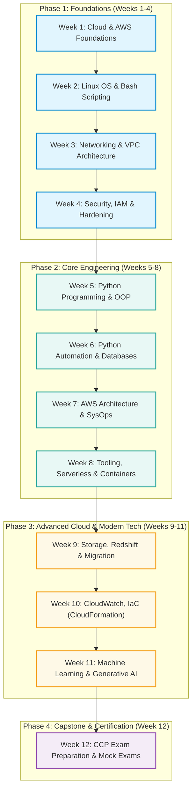

# 📅 AWS re/Start Curriculum & Training Agenda

> **Program**: AWS re/Start  
> **Target Certification**: AWS Certified Cloud Practitioner (CLF-C02)  
> **Duration**: 12 Weeks (Full-Time Intensive)  
> **Source Document**: `T01-reStart_Agenda-4-1.pdf`  
> **Format**: Personal Learning Notebook  

---

## 📑 Table of Contents

- [Curriculum Architecture & Roadmap](#-curriculum-architecture--roadmap)
- [Program Milestone Checklist](#-program-milestone-checklist)
- [Weekly Schedules](#-weekly-schedules)
  - [Week 1: Introduction & Cloud Foundations](#week-1--introduction--cloud-foundations)
  - [Week 2: Linux Administration & Shell Scripting](#week-2--linux-administration--shell-scripting)
  - [Week 3: Linux, Networking & AWS VPC](#week-3--linux-networking--aws-vpc)
  - [Week 4: Networking & Security Engineering](#week-4--networking--security-engineering)
  - [Week 5: Security & Python Programming](#week-5--security--python-programming)
  - [Week 6: Python Automation & Database Fundamentals](#week-6--python-automation--database-fundamentals)
  - [Week 7: Databases & AWS Well-Architected Framework](#week-7--databases--aws-well-architected-framework)
  - [Week 8: Systems Operations, Automation & Serverless](#week-8--systems-operations-automation--serverless)
  - [Week 9: Compute Scaling, Storage & Data Migration](#week-9--compute-scaling-storage--data-migration)
  - [Week 10: Monitoring, Governance & Infrastructure as Code (IaC)](#week-10--monitoring-governance--infrastructure-as-code-iac)
  - [Week 11: Machine Learning & Generative AI](#week-11--machine-learning--generative-ai)
  - [Week 12: Capstone Portfolio & Certification Preparation](#week-12--capstone-portfolio--certification-preparation)
- [Activity Type Legend](#-activity-type-legend)

---

## 🗺️ Curriculum Architecture & Roadmap

---

## 🏷️ Activity Type Legend

| Badge | Type | Description |
| :--- | :--- | :--- |
| `📘 Lecture` | Core Concept Lecture | Guided instructor-led lecture and technical theory |
| `🧪 Lab` | Hands-on Lab | Practical cloud lab or command-line exercise in AWS Console / CLI |
| `🏆 Challenge Lab` | Challenge Lab | Complex scenario-based lab with minimal guidance |
| `☕ Café Lab` | Café Activity / Lab | Collaborative troubleshooting and scenario resolution |
| `💼 Soft Skills` | Professional Skills | Leadership Principles, communication, STAR method, emotional intelligence |
| `🤝 Career` | Career & Professional | Resume development, interview practice, elevator pitch, employer events |
| `📝 Assessment` | Knowledge Check / Quiz | Topic evaluation, module assessment, or practice exam |
| `☕ Break` | Break / Lunch | Scheduled resting and refreshment intervals |
| `⚡ Flex Time` | Flexible Buffer | Catch-up, deeper dive, instructor Q&A, or lab completion buffer |

---

## ✅ Program Milestone Checklist

- [ ] **Milestone 1**: Cloud Foundations & First EC2 Instance Deployed (Week 1)
- [ ] **Milestone 2**: Linux Fluency & Bash Shell Automation Script Written (Week 2)
- [ ] **Milestone 3**: Custom VPC Designed, Subnetted & Tested (Week 3)
- [ ] **Milestone 4**: AWS Security Life Cycle, IAM & Network Hardening (Week 4)
- [ ] **Milestone 5**: Python Scripting & Data Types Mastered (Week 5)
- [ ] **Milestone 6**: Relational (RDS/Aurora) & NoSQL (DynamoDB) Databases Connected (Week 6-7)
- [ ] **Milestone 7**: AWS Well-Architected Framework Assessment Completed (Week 7)
- [ ] **Milestone 8**: Highly Available Auto-Scaled Architecture with ALB & Route 53 (Week 8)
- [ ] **Milestone 9**: Storage Tiering & Hybrid Migration Configured (Week 9)
- [ ] **Milestone 10**: Infrastructure as Code (AWS CloudFormation) Automated (Week 10)
- [ ] **Milestone 11**: Generative AI Application with Amazon Bedrock & SageMaker Canvas (Week 11)
- [ ] **Milestone 12**: Portfolio Finalized & AWS Certified Cloud Practitioner Ready (Week 12)

---

## 📆 Weekly Schedules

---

### Week 1 – Introduction & Cloud Foundations

> [!NOTE]
> **Focus**: Onboarding, Program Expectations, Basic Computing Concepts, Linux First Look, and AWS Cloud Fundamentals (S3, EC2, Shared Responsibility Model).

#### 📋 Daily Schedule

| Day | Topic / Session | Duration | Type | Status |
| :---: | :--- | :---: | :--- | :---: |
| **Day 1** | Opening | 20m | `📘 Lecture` | - [ ] |
| | Welcome & Expectations | 45m | `💼 Soft Skills` | - [ ] |
| | Break | 15m | `☕ Break` | - [ ] |
| | Program Overview and Introductions | 60m | `💼 Soft Skills` | - [ ] |
| | Curriculum Overview | 30m | `📘 Lecture` | - [ ] |
| | Lunch | 45m | `☕ Break` | - [ ] |
| | Vendor Introduction | 45m | `💼 Soft Skills` | - [ ] |
| | Break | 15m | `☕ Break` | - [ ] |
| | Self-Assessment: Who Am I? | 45m | `💼 Soft Skills` | - [ ] |
| | Activity: Introduction to Amazon Leadership Principles | 30m | `💼 Soft Skills` | - [ ] |
| | Introduction to Computing and Knowledge Check | 50m | `📘 Lecture` `📝 Assessment` | - [ ] |
| | Flex Time | 65m | `⚡ Flex Time` | - [ ] |
| **Day 2** | Recap | 20m | `📘 Lecture` | - [ ] |
| | Activity: Think Big | 120m | `💼 Soft Skills` | - [ ] |
| | Break | 15m | `☕ Break` | - [ ] |
| | Basic Computing Concepts and Knowledge Check | 55m | `📘 Lecture` `📝 Assessment` | - [ ] |
| | Lunch | 45m | `☕ Break` | - [ ] |
| | Development Team Roles and Knowledge Check | 40m | `📘 Lecture` `📝 Assessment` | - [ ] |
| | Break | 15m | `☕ Break` | - [ ] |
| | What is Cloud Computing and Knowledge Check | 45m | `📘 Lecture` `📝 Assessment` | - [ ] |
| | Flex Time | 25m | `⚡ Flex Time` | - [ ] |
| | Activity: Cloud Roles | 90m | `💼 Soft Skills` | - [ ] |
| **Day 3** | Recap | 20m | `📘 Lecture` | - [ ] |
| | Activity: Setting Goals | 105m | `💼 Soft Skills` | - [ ] |
| | Break | 15m | `☕ Break` | - [ ] |
| | Activity: Career Goals | 45m | `💼 Soft Skills` | - [ ] |
| | Lunch | 45m | `☕ Break` | - [ ] |
| | Advantages of Cloud Computing and Knowledge Check | 95m | `📘 Lecture` `📝 Assessment` | - [ ] |
| | Break | 15m | `☕ Break` | - [ ] |
| | Communication and STAR methodology | 135m | `💼 Soft Skills` | - [ ] |
| **Day 4** | Recap | 20m | `📘 Lecture` | - [ ] |
| | What is Amazon Web Services (AWS) and Knowledge Check | 55m | `📘 Lecture` `📝 Assessment` | - [ ] |
| | Break | 15m | `☕ Break` | - [ ] |
| | Introduction to AWS Training and Certification | 45m | `📘 Lecture` | - [ ] |
| | Lunch | 45m | `☕ Break` | - [ ] |
| | Fundamentals of AWS Pricing and Knowledge Check | 45m | `📘 Lecture` `📝 Assessment` | - [ ] |
| | Break | 15m | `☕ Break` | - [ ] |
| | AWS Infrastructure Overview and Knowledge Check | 45m | `📘 Lecture` `📝 Assessment` | - [ ] |
| | AWS Services and Service Category Overview and Knowledge Check | 50m | `📘 Lecture` `📝 Assessment` | - [ ] |
| | AWS Shared Responsibility Model and Knowledge Check | 35m | `📘 Lecture` `📝 Assessment` | - [ ] |
| | Amazon Simple Storage Service (S3) Demo and Knowledge Check | 60m | `📘 Lecture` `🧪 Lab` | - [ ] |
| **Day 5** | Recap | 20m | `📘 Lecture` | - [ ] |
| | Amazon Elastic Compute Cloud (EC2) and Demo | 60m | `📘 Lecture` | - [ ] |
| | Lab: Introduction to Amazon EC2 and Knowledge Check | 60m | `🧪 Lab` `📝 Assessment` | - [ ] |
| | Break | 15m | `☕ Break` | - [ ] |
| | Recap and Quiz: Cloud Foundations | 45m | `📝 Assessment` | - [ ] |
| | Review Cloud Foundations | 25m | `📘 Lecture` | - [ ] |
| | Lunch | 45m | `☕ Break` | - [ ] |
| | Introduction to Linux | 50m | `📘 Lecture` | - [ ] |
| | Lab: Introduction to Linux and Knowledge Check | 45m | `🧪 Lab` `📝 Assessment` | - [ ] |
| | Break | 15m | `☕ Break` | - [ ] |
| | Linux Command Line | 75m | `📘 Lecture` | - [ ] |

---

### Week 2 – Linux Administration & Shell Scripting

> [!NOTE]
> **Focus**: Core Linux skills, file system navigation, permissions, users & groups, vim/nano editors, process & service management, and Bash automation scripting.

#### 📋 Daily Schedule

| Day | Topic / Session | Duration | Type | Status |
| :---: | :--- | :---: | :--- | :---: |
| **Day 1** | Recap | 15m | `📘 Lecture` | - [ ] |
| | Lab: Linux Command Line and Knowledge Check | 45m | `🧪 Lab` `📝 Assessment` | - [ ] |
| | Users and Groups | 65m | `📘 Lecture` | - [ ] |
| | Break | 15m | `☕ Break` | - [ ] |
| | Lab: Users and Groups and Knowledge Check | 60m | `🧪 Lab` `📝 Assessment` | - [ ] |
| | Lunch | 45m | `☕ Break` | - [ ] |
| | Editing Files | 65m | `📘 Lecture` | - [ ] |
| | Lab: Editing Files and Knowledge Check | 75m | `🧪 Lab` `📝 Assessment` | - [ ] |
| | Break | 15m | `☕ Break` | - [ ] |
| | Working with the File System | 65m | `📘 Lecture` | - [ ] |
| **Day 2** | Recap | 20m | `📘 Lecture` | - [ ] |
| | Lab: Working with the File System and Knowledge Check | 45m | `🧪 Lab` `📝 Assessment` | - [ ] |
| | Working with Files | 65m | `📘 Lecture` | - [ ] |
| | Break | 15m | `☕ Break` | - [ ] |
| | Lab: Working with Files and Knowledge Check | 45m | `🧪 Lab` `📝 Assessment` | - [ ] |
| | Lunch | 45m | `☕ Break` | - [ ] |
| | Managing File Permissions | 60m | `📘 Lecture` | - [ ] |
| | Lab: Managing File Permissions and Knowledge Check | 50m | `🧪 Lab` `📝 Assessment` | - [ ] |
| | Break | 15m | `☕ Break` | - [ ] |
| | Working with Commands | 90m | `📘 Lecture` | - [ ] |
| | Flex Time | 15m | `⚡ Flex Time` | - [ ] |
| **Day 3** | Recap | 20m | `📘 Lecture` | - [ ] |
| | Lab: Working with Commands and Knowledge Check | 45m | `🧪 Lab` `📝 Assessment` | - [ ] |
| | Managing Processes | 65m | `📘 Lecture` | - [ ] |
| | Break | 15m | `☕ Break` | - [ ] |
| | Lab: Managing Processes and Knowledge Check | 60m | `🧪 Lab` `📝 Assessment` | - [ ] |
| | Lunch | 45m | `☕ Break` | - [ ] |
| | Managing Services | 65m | `📘 Lecture` | - [ ] |
| | Lab: Managing Services and Knowledge Check | 45m | `🧪 Lab` `📝 Assessment` | - [ ] |
| | Break | 15m | `☕ Break` | - [ ] |
| | The Bash Shell | 75m | `📘 Lecture` | - [ ] |
| | Flex Time | 15m | `⚡ Flex Time` | - [ ] |
| **Day 4** | Recap | 20m | `📘 Lecture` | - [ ] |
| | Lab: Bash Shell and Knowledge Check | 45m | `🧪 Lab` `📝 Assessment` | - [ ] |
| | Bash Shell Scripting part 1 | 60m | `📘 Lecture` | - [ ] |
| | Break | 15m | `☕ Break` | - [ ] |
| | Bash Shell Scripting part 2 | 60m | `📘 Lecture` | - [ ] |
| | Lunch | 45m | `☕ Break` | - [ ] |
| | Lab: Bash Shell Scripting and Knowledge Check | 40m | `🧪 Lab` `📝 Assessment` | - [ ] |
| | Activity: Customer Obsession | 50m | `💼 Soft Skills` | - [ ] |
| | Break | 15m | `☕ Break` | - [ ] |
| | Software Management | 40m | `📘 Lecture` | - [ ] |
| | Lab: Software Management and Knowledge Check | 50m | `🧪 Lab` `📝 Assessment` | - [ ] |
| | Flex Time | 25m | `⚡ Flex Time` | - [ ] |
| **Day 5** | Recap | 20m | `📘 Lecture` | - [ ] |
| | Managing Log Files | 60m | `📘 Lecture` | - [ ] |
| | Lab: Managing Log Files and Knowledge Check | 35m | `🧪 Lab` `📝 Assessment` | - [ ] |
| | Break | 15m | `☕ Break` | - [ ] |
| | Challenge Lab: Advanced Bash Shell Scripting on EC2 | 60m | `🏆 Challenge Lab` | - [ ] |
| | Lunch | 45m | `☕ Break` | - [ ] |
| | Review Linux | 30m | `📘 Lecture` | - [ ] |
| | Professional Outlook | 135m | `💼 Soft Skills` `🤝 Career` | - [ ] |
| | Break | 15m | `☕ Break` | - [ ] |
| | Introduction to Networking and Knowledge Check | 50m | `📘 Lecture` `📝 Assessment` | - [ ] |

---

### Week 3 – Linux, Networking & AWS VPC

> [!NOTE]
> **Focus**: TCP/IP stack, CIDR subnetting, IP addressing, routing, AWS Virtual Private Cloud (VPC), Subnets, Internet Gateways, and network troubleshooting.

#### 📋 Daily Schedule

| Day | Topic / Session | Duration | Type | Status |
| :---: | :--- | :---: | :--- | :---: |
| **Day 1** | Recap | 20m | `📘 Lecture` | - [ ] |
| | Networking Concepts and Knowledge Check | 65m | `📘 Lecture` `📝 Assessment` | - [ ] |
| | Internet Protocol | 45m | `📘 Lecture` | - [ ] |
| | Break | 15m | `☕ Break` | - [ ] |
| | Internet Protocol (IP) Demo and Knowledge Check | 60m | `📘 Lecture` `📝 Assessment` | - [ ] |
| | Lunch | 45m | `☕ Break` | - [ ] |
| | Networking in the AWS Cloud | 60m | `📘 Lecture` | - [ ] |
| | Break | 15m | `☕ Break` | - [ ] |
| | Lab: Public and Private IPs | 60m | `🧪 Lab` | - [ ] |
| | Lab: Dynamic and Static IPs | 60m | `🧪 Lab` | - [ ] |
| | Flex Time | 20m | `⚡ Flex Time` | - [ ] |
| **Day 2** | Recap | 20m | `📘 Lecture` | - [ ] |
| | Lab: Public and Private IPs | 60m | `🧪 Lab` | - [ ] |
| | Lab: Dynamic and Static IPs | 60m | `🧪 Lab` | - [ ] |
| | Break | 15m | `☕ Break` | - [ ] |
| | AWS VPC Demonstration | 45m | `📘 Lecture` | - [ ] |
| | AWS VPC Knowledge Check | 15m | `📝 Assessment` | - [ ] |
| | Lunch | 45m | `☕ Break` | - [ ] |
| | Lab: Create subnets in a VPC | 60m | `🧪 Lab` | - [ ] |
| | Break | 15m | `☕ Break` | - [ ] |
| | Lab: Networking resources for a VPC | 60m | `🧪 Lab` | - [ ] |
| | Emotional Intelligence | 90m | `💼 Soft Skills` | - [ ] |
| **Day 3** | Recap | 20m | `📘 Lecture` | - [ ] |
| | IP Subnetting and Knowledge Check | 85m | `📘 Lecture` `📝 Assessment` | - [ ] |
| | Alumni presentation with Students part 1 | 45m | `🤝 Career` | - [ ] |
| | Break | 15m | `☕ Break` | - [ ] |
| | Alumni presentation with Students part 2 | 45m | `🤝 Career` | - [ ] |
| | Lunch | 45m | `☕ Break` | - [ ] |
| | Activity: Learn and Be Curious | 50m | `💼 Soft Skills` | - [ ] |
| | Break | 15m | `☕ Break` | - [ ] |
| | Lab: Troubleshooting Commands | 60m | `🧪 Lab` | - [ ] |
| | Lab: Troubleshooting Network Issue | 60m | `🧪 Lab` | - [ ] |
| **Day 4** | Recap | 20m | `📘 Lecture` | - [ ] |
| | Lab: Troubleshooting Network Issue | 60m | `🧪 Lab` | - [ ] |
| | Additional Networking Protocols | 75m | `📘 Lecture` | - [ ] |
| | Break | 15m | `☕ Break` | - [ ] |
| | Additional Networking Protocols Activities and Knowledge Check | 50m | `📘 Lecture` `📝 Assessment` | - [ ] |
| | Lunch | 45m | `☕ Break` | - [ ] |
| | Lab: Build your VPC and launch a web server | 60m | `🧪 Lab` | - [ ] |
| | Break | 15m | `☕ Break` | - [ ] |
| | Additional Networking Technologies and Knowledge Check | 40m | `📘 Lecture` `📝 Assessment` | - [ ] |
| | Review Networking | 20m | `📘 Lecture` | - [ ] |
| | Flex Time | 25m | `⚡ Flex Time` | - [ ] |
| **Day 5** | Recap | 20m | `📘 Lecture` | - [ ] |
| | Digital Presence | 95m | `🤝 Career` | - [ ] |
| | Interview settings (lecture) | 35m | `🤝 Career` | - [ ] |
| | Break | 15m | `☕ Break` | - [ ] |
| | Interview Practice | 45m | `🤝 Career` | - [ ] |
| | Lunch | 45m | `☕ Break` | - [ ] |
| | Introduction to Security | 65m | `📘 Lecture` | - [ ] |
| | Break | 15m | `☕ Break` | - [ ] |
| | Introduction to Security Knowledge Check | 15m | `📝 Assessment` | - [ ] |
| | Security Life Cycle: Prevention and Knowledge Check | 70m | `📘 Lecture` `📝 Assessment` | - [ ] |
| | Flex Time | 45m | `⚡ Flex Time` | - [ ] |

---

### Week 4 – Networking & Security Engineering

> [!NOTE]
> **Focus**: Network and OS hardening, Public Key Infrastructure (PKI), AWS IAM policies, KMS encryption, CloudTrail/Config monitoring, and introduction to Cloud9/programming data types.

#### 📋 Daily Schedule

| Day | Topic / Session | Duration | Type | Status |
| :---: | :--- | :---: | :--- | :---: |
| **Day 1** | Recap | 20m | `📘 Lecture` | - [ ] |
| | Prevention: Network Hardening | 75m | `📘 Lecture` | - [ ] |
| | Lab: Networking Hardening and Knowledge Check | 60m | `🧪 Lab` `📝 Assessment` | - [ ] |
| | Break | 15m | `☕ Break` | - [ ] |
| | Prevention: System Hardening | 40m | `📘 Lecture` | - [ ] |
| | Prevention: Data Security | 35m | `📘 Lecture` | - [ ] |
| | Lunch | 45m | `☕ Break` | - [ ] |
| | Lab: Systems Hardening and Knowledge Check | 75m | `🧪 Lab` `📝 Assessment` | - [ ] |
| | Prevention: Public Key Infrastructure and Demo | 35m | `📘 Lecture` | - [ ] |
| | Break | 15m | `☕ Break` | - [ ] |
| | Lab: Data Protection Using Encryption and Knowledge Check | 60m | `🧪 Lab` `📝 Assessment` | - [ ] |
| **Day 2** | Recap | 20m | `📘 Lecture` | - [ ] |
| | Prevention: Public Key Infrastructure and Demo | 35m | `📘 Lecture` | - [ ] |
| | Demo: Amazon Certificate Manager and Knowledge Check | 25m | `📘 Lecture` `📝 Assessment` | - [ ] |
| | Prevention: Identity Management and Knowledge Check | 75m | `📘 Lecture` `📝 Assessment` | - [ ] |
| | Break | 15m | `☕ Break` | - [ ] |
| | AWS Identity and Access Management (IAM) | 30m | `📘 Lecture` | - [ ] |
| | Lab: Introduction to IAM and Knowledge Check | 60m | `🧪 Lab` `📝 Assessment` | - [ ] |
| | Lunch | 45m | `☕ Break` | - [ ] |
| | Detection | 40m | `📘 Lecture` | - [ ] |
| | Lab: Malware Protection and Knowledge Check | 60m | `🧪 Lab` `📝 Assessment` | - [ ] |
| | Break | 15m | `☕ Break` | - [ ] |
| | AWS CloudTrail and Knowledge Check | 35m | `📘 Lecture` `📝 Assessment` | - [ ] |
| **Day 3** | Recap | 20m | `📘 Lecture` | - [ ] |
| | AWS Config and Knowledge Check | 50m | `📘 Lecture` `📝 Assessment` | - [ ] |
| | Response | 45m | `📘 Lecture` | - [ ] |
| | Activity: Incident Response and Knowledge Check | 45m | `💼 Soft Skills` `📝 Assessment` | - [ ] |
| | Break | 15m | `☕ Break` | - [ ] |
| | Lab: Monitor an EC2 Instance and Knowledge Check | 75m | `🧪 Lab` `📝 Assessment` | - [ ] |
| | Analysis | 45m | `📘 Lecture` | - [ ] |
| | Lunch | 45m | `☕ Break` | - [ ] |
| | Activity: Earn Trust | 50m | `💼 Soft Skills` | - [ ] |
| | Discussion: Earn Trust | 20m | `💼 Soft Skills` | - [ ] |
| | Break | 15m | `☕ Break` | - [ ] |
| | Presentation from future peers at company | 40m | `🤝 Career` | - [ ] |
| **Day 4** | Recap | 20m | `📘 Lecture` | - [ ] |
| | AWS Trusted Advisor and Knowledge Check | 80m | `📘 Lecture` `📝 Assessment` | - [ ] |
| | Security Best Practices and Knowledge Check | 50m | `📘 Lecture` `📝 Assessment` | - [ ] |
| | Break | 15m | `☕ Break` | - [ ] |
| | AWS Compliance Program and Knowledge Check | 50m | `📘 Lecture` `📝 Assessment` | - [ ] |
| | AWS Security Resources and Knowledge Check | 35m | `📘 Lecture` `📝 Assessment` | - [ ] |
| | Lunch | 45m | `☕ Break` | - [ ] |
| | Review Security | 30m | `📘 Lecture` | - [ ] |
| | Interview Practice Hiring Process | 60m | `🤝 Career` | - [ ] |
| | Break | 15m | `☕ Break` | - [ ] |
| | Introduction to Programming - What is Programming? | 25m | `📘 Lecture` | - [ ] |
| **Day 5** | Recap | 20m | `📘 Lecture` | - [ ] |
| | AWS Cloud 9 Instructor Demonstration | 30m | `📘 Lecture` | - [ ] |
| | Lab: Hello World | 60m | `🧪 Lab` | - [ ] |
| | Break | 15m | `☕ Break` | - [ ] |
| | Categorize a Value as a Data Type | 30m | `📘 Lecture` | - [ ] |
| | Lab: Numeric data types | 80m | `🧪 Lab` | - [ ] |
| | Lunch | 45m | `☕ Break` | - [ ] |
| | Lab: String data type | 60m | `🧪 Lab` | - [ ] |
| | Lab: List, tuple, dictionary | 60m | `🧪 Lab` | - [ ] |
| | Break | 15m | `☕ Break` | - [ ] |
| | Lab: Categorize values | 60m | `🧪 Lab` | - [ ] |

---

### Week 5 – Security & Python Programming

> [!NOTE]
> **Focus**: Python fundamentals, composite data types, functions, control flow, loops, file handling, system administration with Python, Git version control, and debugging.

#### 📋 Daily Schedule

| Day | Topic / Session | Duration | Type | Status |
| :---: | :--- | :---: | :--- | :---: |
| **Day 1** | Recap | 20m | `📘 Lecture` | - [ ] |
| | Combine Values into Composite Data Types | 15m | `📘 Lecture` | - [ ] |
| | Introduction to Programming - Functions | 25m | `📘 Lecture` | - [ ] |
| | Lab: Composite data types | 60m | `🧪 Lab` | - [ ] |
| | Break | 15m | `☕ Break` | - [ ] |
| | Introduction to Programming – Functions | 25m | `📘 Lecture` | - [ ] |
| | Follow the Execution Path of a Program | 15m | `📘 Lecture` | - [ ] |
| | Lab: Conditionals | 60m | `🧪 Lab` | - [ ] |
| | Lunch | 45m | `☕ Break` | - [ ] |
| | Lab: Loops | 60m | `🧪 Lab` | - [ ] |
| | Activity: Have a Backbone | 40m | `💼 Soft Skills` | - [ ] |
| | Introduction to Programming – Version Control | 30m | `📘 Lecture` | - [ ] |
| | Break | 15m | `☕ Break` | - [ ] |
| | Introduction to Programming – Version Control (Part 2) | 45m | `📘 Lecture` | - [ ] |
| **Day 2** | Recap | 20m | `📘 Lecture` | - [ ] |
| | Lab: Create a git repository and Knowledge Check | 75m | `🧪 Lab` `📝 Assessment` | - [ ] |
| | Introduction to Python | 30m | `📘 Lecture` | - [ ] |
| | Break | 15m | `☕ Break` | - [ ] |
| | Lab: Preparing to analyze insulin with Python and Knowledge Check | 45m | `🧪 Lab` `📝 Assessment` | - [ ] |
| | Python Basics 1 | 45m | `📘 Lecture` | - [ ] |
| | Lunch | 45m | `☕ Break` | - [ ] |
| | Python Basics 2 | 100m | `📘 Lecture` | - [ ] |
| | Break | 15m | `☕ Break` | - [ ] |
| | Lab: Working with string sequence and numeric weight of insulin | 60m | `🧪 Lab` `📝 Assessment` | - [ ] |
| **Day 3** | Recap | 20m | `📘 Lecture` | - [ ] |
| | Meet future peers at company | 45m | `🤝 Career` | - [ ] |
| | Interview Practice | 30m | `🤝 Career` | - [ ] |
| | Introduction to Flow Control | 45m | `📘 Lecture` | - [ ] |
| | Break | 15m | `☕ Break` | - [ ] |
| | Flow Control (Cont’d) | 45m | `📘 Lecture` | - [ ] |
| | Flow Control (Cont’d) | 45m | `📘 Lecture` | - [ ] |
| | Lunch | 45m | `☕ Break` | - [ ] |
| | Lab: Calculating net charge of insulin using lists and loops | 55m | `🧪 Lab` `📝 Assessment` | - [ ] |
| | Break | 15m | `☕ Break` | - [ ] |
| | Functions | 80m | `📘 Lecture` | - [ ] |
| | Review Lists and Loops | 45m | `📘 Lecture` | - [ ] |
| **Day 4** | Recap | 20m | `📘 Lecture` | - [ ] |
| | Lab: Use functions to implement a Caesar Cipher | 105m | `🧪 Lab` `📝 Assessment` | - [ ] |
| | Mods and Libraries 1 | 45m | `📘 Lecture` | - [ ] |
| | Break | 15m | `☕ Break` | - [ ] |
| | Mods and Libraries 2 | 45m | `📘 Lecture` | - [ ] |
| | File Handlers | 15m | `📘 Lecture` | - [ ] |
| | Lunch | 45m | `☕ Break` | - [ ] |
| | Lab: File handlers and modules for retrieving insulin data | 55m | `🧪 Lab` `📝 Assessment` | - [ ] |
| | Python for System Administration | 80m | `📘 Lecture` | - [ ] |
| | Break | 15m | `☕ Break` | - [ ] |
| | Flex Time | 30m | `⚡ Flex Time` | - [ ] |
| **Day 5** | Recap | 20m | `📘 Lecture` | - [ ] |
| | Lab: System Administration with Python and Knowledge Check | 65m | `🧪 Lab` `📝 Assessment` | - [ ] |
| | Debugging and Testing | 70m | `📘 Lecture` | - [ ] |
| | Break | 15m | `☕ Break` | - [ ] |
| | Lab: Using the Debugger | 40m | `🧪 Lab` | - [ ] |
| | Lunch | 45m | `☕ Break` | - [ ] |
| | Lab: Debugging Hello World and Caesar Cipher | 80m | `🧪 Lab` | - [ ] |
| | Knowledge Check (Debugging) | 15m | `📝 Assessment` | - [ ] |
| | DevOps and Continuous Integration | 40m | `📘 Lecture` | - [ ] |
| | Break | 15m | `☕ Break` | - [ ] |
| | Lab: Evaluate a DevOps tool | 45m | `🧪 Lab` | - [ ] |

---

### Week 6 – Python Automation & Database Fundamentals

> [!NOTE]
> **Focus**: Automation vs orchestration, configuration management, relational databases (SQL, tables, querying, transactions), Amazon RDS, Amazon Aurora, and Amazon DynamoDB.

#### 📋 Daily Schedule

| Day | Topic / Session | Duration | Type | Status |
| :---: | :--- | :---: | :--- | :---: |
| **Day 1** | Recap | 20m | `📘 Lecture` | - [ ] |
| | Lab: Explore the value of automation | 45m | `🧪 Lab` | - [ ] |
| | Lab: Compare and contrast automation and orchestration | 60m | `🧪 Lab` `📝 Assessment` | - [ ] |
| | Break | 15m | `☕ Break` | - [ ] |
| | Configuration Management and Knowledge Check | 60m | `📘 Lecture` `📝 Assessment` | - [ ] |
| | Lunch | 45m | `☕ Break` | - [ ] |
| | Challenge lab: Python | 60m | `🏆 Challenge Lab` | - [ ] |
| | Review Python | 45m | `📘 Lecture` | - [ ] |
| | Break | 15m | `☕ Break` | - [ ] |
| | Exploring Cloud Job Postings | 90m | `🤝 Career` | - [ ] |
| **Day 2** | Recap | 20m | `📘 Lecture` | - [ ] |
| | Explore Cloud Job Postings discussion | 45m | `🤝 Career` | - [ ] |
| | Introduction to Databases | 60m | `📘 Lecture` | - [ ] |
| | Break | 15m | `☕ Break` | - [ ] |
| | Activity: Introduction to Databases and Knowledge Check | 55m | `📘 Lecture` `📝 Assessment` | - [ ] |
| | Lunch | 45m | `☕ Break` | - [ ] |
| | Data Interaction and Database Transaction and Knowledge Check | 65m | `📘 Lecture` `📝 Assessment` | - [ ] |
| | Creating Tables and Learning Different Data Types | 90m | `📘 Lecture` | - [ ] |
| | Break | 15m | `☕ Break` | - [ ] |
| | Activity: Creating tables and data types | 30m | `🧪 Lab` | - [ ] |
| **Day 3** | Recap | 20m | `📘 Lecture` | - [ ] |
| | Lab: Database table operations and Knowledge Check | 45m | `🧪 Lab` `📝 Assessment` | - [ ] |
| | Interview Practice | 45m | `🤝 Career` | - [ ] |
| | Inserting Data into a Database | 55m | `📘 Lecture` | - [ ] |
| | Break | 15m | `☕ Break` | - [ ] |
| | Lab: Inserting Data and Knowledge Check | 40m | `🧪 Lab` `📝 Assessment` | - [ ] |
| | Lunch | 45m | `☕ Break` | - [ ] |
| | Selecting Data | 55m | `📘 Lecture` | - [ ] |
| | Lab: Selecting data from a database and Knowledge Check | 60m | `🧪 Lab` `📝 Assessment` | - [ ] |
| | Break | 15m | `☕ Break` | - [ ] |
| | Resume Creation (Lecture) | 35m | `🤝 Career` | - [ ] |
| | Work on Resume | 45m | `🤝 Career` | - [ ] |
| **Day 4** | Recap | 20m | `📘 Lecture` | - [ ] |
| | Performing a Conditional Search | 90m | `📘 Lecture` | - [ ] |
| | Activities and Lab: Performing a Conditional Search | 100m | `🧪 Lab` `📝 Assessment` | - [ ] |
| | Break | 15m | `☕ Break` | - [ ] |
| | Working with Functions | 55m | `📘 Lecture` | - [ ] |
| | Lunch | 45m | `☕ Break` | - [ ] |
| | Lab: Working with functions and Knowledge Check | 60m | `🧪 Lab` `📝 Assessment` | - [ ] |
| | Organizing Data | 55m | `📘 Lecture` | - [ ] |
| | Break | 15m | `☕ Break` | - [ ] |
| | Flex Time | 30m | `⚡ Flex Time` | - [ ] |
| **Day 5** | Recap | 20m | `📘 Lecture` | - [ ] |
| | Lab: Organizing Data and Knowledge Check | 60m | `🧪 Lab` `📝 Assessment` | - [ ] |
| | Retrieving Data | 45m | `📘 Lecture` | - [ ] |
| | Break | 15m | `☕ Break` | - [ ] |
| | Lab: Build your DB server and Knowledge Check | 60m | `🧪 Lab` `📝 Assessment` | - [ ] |
| | Lunch | 45m | `☕ Break` | - [ ] |
| | Amazon RDS and Demonstration | 60m | `📘 Lecture` | - [ ] |
| | Lab: Introduction to Amazon Aurora and Knowledge Check | 55m | `🧪 Lab` `📝 Assessment` | - [ ] |
| | Break | 15m | `☕ Break` | - [ ] |
| | Amazon DynamoDB and Demonstration | 60m | `📘 Lecture` | - [ ] |

---

### Week 7 – Databases & AWS Well-Architected Framework

> [!NOTE]
> **Focus**: NoSQL with DynamoDB, RDS Challenge, AWS Cloud Adoption Framework (CAF), AWS Well-Architected Framework (6 pillars), AWS CLI installation, and Systems Operations.

#### 📋 Daily Schedule

| Day | Topic / Session | Duration | Type | Status |
| :---: | :--- | :---: | :--- | :---: |
| **Day 1** | Recap | 20m | `📘 Lecture` | - [ ] |
| | Lab: Introduction to Amazon DynamoDB and Knowledge Check | 50m | `🧪 Lab` `📝 Assessment` | - [ ] |
| | Challenge lab: Build and Access an RDS Server | 45m | `🏆 Challenge Lab` | - [ ] |
| | Break | 15m | `☕ Break` | - [ ] |
| | Review Databases | 30m | `📘 Lecture` | - [ ] |
| | Work on Resume | 45m | `🤝 Career` | - [ ] |
| | Lunch | 45m | `☕ Break` | - [ ] |
| | Networking (soft skills) | 95m | `💼 Soft Skills` | - [ ] |
| | Break | 15m | `☕ Break` | - [ ] |
| | Flex Time | 60m | `⚡ Flex Time` | - [ ] |
| **Day 2** | Recap | 20m | `📘 Lecture` | - [ ] |
| | Networking (soft skills) Continued | 100m | `💼 Soft Skills` | - [ ] |
| | Break | 15m | `☕ Break` | - [ ] |
| | Interview Practice | 45m | `🤝 Career` | - [ ] |
| | Lunch | 45m | `☕ Break` | - [ ] |
| | Networking Event | 180m | `🤝 Career` | - [ ] |
| | Break | 15m | `☕ Break` | - [ ] |
| | Flex Time | 25m | `⚡ Flex Time` | - [ ] |
| **Day 3** | Recap | 20m | `📘 Lecture` | - [ ] |
| | Technical thought process | 185m | `💼 Soft Skills` `📘 Lecture` | - [ ] |
| | Break | 15m | `☕ Break` | - [ ] |
| | AWS Architecture Overview | 10m | `📘 Lecture` | - [ ] |
| | AWS Cloud Adoption Framework | 25m | `📘 Lecture` | - [ ] |
| | Lunch | 45m | `☕ Break` | - [ ] |
| | AWS Well-Architected Framework | 30m | `📘 Lecture` | - [ ] |
| | Well-Architected Principles | 20m | `📘 Lecture` | - [ ] |
| | Break | 15m | `☕ Break` | - [ ] |
| | Reliability and High Availability | 20m | `📘 Lecture` | - [ ] |
| | Transitioning a Data Center to the Cloud | 30m | `📘 Lecture` | - [ ] |
| | Flex time | 50m | `⚡ Flex Time` | - [ ] |
| **Day 4** | Recap | 20m | `📘 Lecture` | - [ ] |
| | Well-Architected Knowledge Check and Review | 30m | `📝 Assessment` | - [ ] |
| | Work on Resume | 45m | `🤝 Career` | - [ ] |
| | Teamwork and Collaboration | 45m | `💼 Soft Skills` | - [ ] |
| | Break | 15m | `☕ Break` | - [ ] |
| | Teamwork and Collaboration (Continued) | 70m | `💼 Soft Skills` | - [ ] |
| | Lunch | 45m | `☕ Break` | - [ ] |
| | Teamwork and Collaboration (Continued) | 70m | `💼 Soft Skills` | - [ ] |
| | Break | 15m | `☕ Break` | - [ ] |
| | Teamwork and Collaboration (Continued) | 60m | `💼 Soft Skills` | - [ ] |
| | Flex Time | 50m | `⚡ Flex Time` | - [ ] |
| **Day 5** | Recap | 20m | `📘 Lecture` | - [ ] |
| | Systems Operations Overview | 10m | `📘 Lecture` | - [ ] |
| | System Operations on AWS | 45m | `📘 Lecture` | - [ ] |
| | Activity: Troubleshooting Knowledge Base | 30m | `☕ Café Lab` | - [ ] |
| | Break | 15m | `☕ Break` | - [ ] |
| | Introduction: AWS IAM Review | 55m | `📘 Lecture` | - [ ] |
| | Lunch | 45m | `☕ Break` | - [ ] |
| | AWS Command Line Interface (AWS CLI) | 60m | `📘 Lecture` | - [ ] |
| | Break | 15m | `☕ Break` | - [ ] |
| | Café Lab: Install and use the AWS CLI | 75m | `☕ Café Lab` `🧪 Lab` | - [ ] |
| | System Operations Knowledge Check and Review | 30m | `📝 Assessment` | - [ ] |
| | Flex time | 60m | `⚡ Flex Time` | - [ ] |

---

### Week 8 – Systems Operations, Automation & Serverless

> [!NOTE]
> **Focus**: AWS Systems Manager, Static Hosting on S3, EC2 Lifecycle, Auto Scaling & Elastic Load Balancing (ELB), Route 53, CloudFront CDN, AWS Lambda, API Gateway, Step Functions, and Docker Containers.

#### 📋 Daily Schedule

| Day | Topic / Session | Duration | Type | Status |
| :---: | :--- | :---: | :--- | :---: |
| **Day 1** | Recap | 20m | `📘 Lecture` | - [ ] |
| | Tooling and Automation Overview | 10m | `📘 Lecture` | - [ ] |
| | AWS Systems Manager | 45m | `📘 Lecture` | - [ ] |
| | Lab: Using AWS Systems Manager | 30m | `🧪 Lab` | - [ ] |
| | Break | 15m | `☕ Break` | - [ ] |
| | Administration and Development Tools | 20m | `📘 Lecture` | - [ ] |
| | Tooling and Automation Knowledge Check and Review | 30m | `📝 Assessment` | - [ ] |
| | Lunch | 45m | `☕ Break` | - [ ] |
| | Servers Overview | 10m | `📘 Lecture` | - [ ] |
| | Hosting a Static Website on Amazon S3 | 15m | `📘 Lecture` | - [ ] |
| | Café Lab: Creating a Website on Amazon S3 | 75m | `☕ Café Lab` `🧪 Lab` | - [ ] |
| | Break | 15m | `☕ Break` | - [ ] |
| | Computing on AWS and Demonstration | 90m | `📘 Lecture` | - [ ] |
| | Managing Your AWS Instances | 45m | `📘 Lecture` | - [ ] |
| **Day 2** | Recap | 20m | `📘 Lecture` | - [ ] |
| | Lab: Creating Amazon EC2 Instances | 45m | `🧪 Lab` | - [ ] |
| | Challenge lab: Linux EC2 Instance | 55m | `🏆 Challenge Lab` | - [ ] |
| | Break | 15m | `☕ Break` | - [ ] |
| | AWS Elastic Beanstalk | 35m | `📘 Lecture` | - [ ] |
| | Work on Resume | 35m | `🤝 Career` | - [ ] |
| | Interview Practice | 30m | `🤝 Career` | - [ ] |
| | Lunch | 45m | `☕ Break` | - [ ] |
| | Café Lab: Troubleshooting Creation of an EC2 Instance | 75m | `☕ Café Lab` `🧪 Lab` | - [ ] |
| | Servers Knowledge Check and Review | 30m | `📝 Assessment` | - [ ] |
| | Scaling and Name Resolution Overview | 10m | `📘 Lecture` | - [ ] |
| | Break | 15m | `☕ Break` | - [ ] |
| | Elastic Load Balancing | 65m | `📘 Lecture` | - [ ] |
| **Day 3** | Recap | 20m | `📘 Lecture` | - [ ] |
| | ELB Load Balancers and Listeners | 75m | `📘 Lecture` | - [ ] |
| | Networking Event | 60m | `🤝 Career` | - [ ] |
| | Break | 15m | `☕ Break` | - [ ] |
| | Amazon EC2 Auto Scaling | 80m | `📘 Lecture` | - [ ] |
| | Lunch | 45m | `☕ Break` | - [ ] |
| | Lab: Scaling and Load Balancing Your Architecture | 45m | `🧪 Lab` | - [ ] |
| | Lab: Using Auto Scaling in AWS (Linux) | 45m | `🧪 Lab` | - [ ] |
| | Break | 15m | `☕ Break` | - [ ] |
| | Auto Scaling Prediction Challenge | 85m | `🏆 Challenge Lab` | - [ ] |
| **Day 4** | Recap | 20m | `📘 Lecture` | - [ ] |
| | Amazon Route 53 | 60m | `📘 Lecture` | - [ ] |
| | Amazon CloudFront | 15m | `📘 Lecture` | - [ ] |
| | Break | 15m | `☕ Break` | - [ ] |
| | Café Lab: Amazon Route 53 Failover Routing | 80m | `☕ Café Lab` `🧪 Lab` | - [ ] |
| | Lunch | 45m | `☕ Break` | - [ ] |
| | Scaling and Name Resolution Knowledge Check and Review | 30m | `📝 Assessment` | - [ ] |
| | Serverless and Containers Overview | 10m | `📘 Lecture` | - [ ] |
| | AWS Lambda | 30m | `📘 Lecture` | - [ ] |
| | Café Lab: Working with AWS Lambda | 60m | `☕ Café Lab` `🧪 Lab` | - [ ] |
| | Break | 15m | `☕ Break` | - [ ] |
| | Flex Time | 55m | `⚡ Flex Time` | - [ ] |
| **Day 5** | Recap | 20m | `📘 Lecture` | - [ ] |
| | Challenge Lab: AWS Lambda | 90m | `🏆 Challenge Lab` | - [ ] |
| | APIs and REST | 30m | `📘 Lecture` | - [ ] |
| | Break | 15m | `☕ Break` | - [ ] |
| | Amazon API Gateway | 30m | `📘 Lecture` | - [ ] |
| | AWS Step Functions | 30m | `📘 Lecture` | - [ ] |
| | Lunch | 45m | `☕ Break` | - [ ] |
| | Containers on AWS | 45m | `📘 Lecture` | - [ ] |
| | Serverless and Containers Knowledge Check and Review | 30m | `📝 Assessment` | - [ ] |
| | Break | 15m | `☕ Break` | - [ ] |
| | Work on Resume | 35m | `🤝 Career` | - [ ] |
| | Interview Practice | 45m | `🤝 Career` | - [ ] |
| | Flex Time | 35m | `⚡ Flex Time` | - [ ] |

---

### Week 9 – Compute Scaling, Storage & Data Migration

> [!NOTE]
> **Focus**: Data warehousing with Amazon Redshift, Aurora, AWS Database Migration Service (DMS), Advanced VPC connectivity, EBS, EFS, S3 Storage classes/lifecycle, Glacier, and Storage Gateway.

#### 📋 Daily Schedule

| Day | Topic / Session | Duration | Type | Status |
| :---: | :--- | :---: | :--- | :---: |
| **Day 1** | Recap | 20m | `📘 Lecture` | - [ ] |
| | AWS Database Services Overview | 10m | `📘 Lecture` | - [ ] |
| | Introduction to Databases on AWS Amazon Redshift | 30m | `📘 Lecture` | - [ ] |
| | Amazon Redshift | 60m | `📘 Lecture` | - [ ] |
| | Break | 15m | `☕ Break` | - [ ] |
| | Amazon Aurora | 40m | `📘 Lecture` | - [ ] |
| | Lunch | 45m | `☕ Break` | - [ ] |
| | AWS Database Migration Service (DMS) | 55m | `📘 Lecture` | - [ ] |
| | Café Lab: Migrate to Amazon RDS | 75m | `☕ Café Lab` `🧪 Lab` | - [ ] |
| | Break | 15m | `☕ Break` | - [ ] |
| | AWS Database Services Knowledge Check and Review | 30m | `📝 Assessment` | - [ ] |
| | AWS Networking Services Overview | 10m | `📘 Lecture` | - [ ] |
| | Amazon VPC | 65m | `📘 Lecture` | - [ ] |
| **Day 2** | Recap | 20m | `📘 Lecture` | - [ ] |
| | VPC Connectivity Options | 90m | `📘 Lecture` | - [ ] |
| | Securing and Troubleshooting Your Network | 75m | `📘 Lecture` | - [ ] |
| | Break | 15m | `☕ Break` | - [ ] |
| | Lab: Configuring a VPC | 45m | `🧪 Lab` | - [ ] |
| | Lunch | 45m | `☕ Break` | - [ ] |
| | Café Activity: Troubleshoot an Amazon VPC | 95m | `☕ Café Lab` | - [ ] |
| | AWS Networking Services Knowledge Check and Review | 30m | `📝 Assessment` | - [ ] |
| | Break | 15m | `☕ Break` | - [ ] |
| | Work on Resume | 45m | `🤝 Career` | - [ ] |
| **Day 3** | Recap | 20m | `📘 Lecture` | - [ ] |
| | Interview Practice | 70m | `🤝 Career` | - [ ] |
| | Elevator Pitch | 65m | `💼 Soft Skills` `🤝 Career` | - [ ] |
| | Break | 15m | `☕ Break` | - [ ] |
| | AWS re/Start Interview Preparation | 45m | `🤝 Career` | - [ ] |
| | Lunch | 45m | `☕ Break` | - [ ] |
| | Storage and Archiving Overview | 10m | `📘 Lecture` | - [ ] |
| | Cloud Storage Overview | 40m | `📘 Lecture` | - [ ] |
| | Break | 15m | `☕ Break` | - [ ] |
| | Amazon Elastic Block Store (EBS) | 105m | `📘 Lecture` | - [ ] |
| | Flex Time | 20m | `⚡ Flex Time` | - [ ] |
| **Day 4** | Recap | 20m | `📘 Lecture` | - [ ] |
| | Lab: Working with EBS | 45m | `🧪 Lab` | - [ ] |
| | Instance Store | 60m | `📘 Lecture` | - [ ] |
| | Break | 15m | `☕ Break` | - [ ] |
| | Amazon EFS | 35m | `📘 Lecture` | - [ ] |
| | Storage with Amazon S3 | 60m | `📘 Lecture` | - [ ] |
| | Lunch | 45m | `☕ Break` | - [ ] |
| | Amazon S3 Glacier | 60m | `📘 Lecture` | - [ ] |
| | Lab: Managing Storage | 45m | `🧪 Lab` | - [ ] |
| | Break | 15m | `☕ Break` | - [ ] |
| | AWS Storage Gateway | 40m | `📘 Lecture` | - [ ] |
| | Flex Time | 25m | `⚡ Flex Time` | - [ ] |
| **Day 5** | Recap | 20m | `📘 Lecture` | - [ ] |
| | Café Lab: Working with Amazon S3 | 110m | `☕ Café Lab` `🧪 Lab` | - [ ] |
| | Break | 15m | `☕ Break` | - [ ] |
| | Challenge Lab: Amazon S3 | 45m | `🏆 Challenge Lab` | - [ ] |
| | Lunch | 45m | `☕ Break` | - [ ] |
| | AWS Data Transfer and Migration Services | 45m | `📘 Lecture` | - [ ] |
| | Break | 15m | `☕ Break` | - [ ] |
| | Storage and Archiving Knowledge Check and Review | 30m | `📝 Assessment` | - [ ] |
| | Work on Resume/Interview Practice | 50m | `🤝 Career` | - [ ] |
| | Flex Time | 55m | `⚡ Flex Time` | - [ ] |

---

### Week 10 – Monitoring, Governance & Infrastructure as Code (IaC)

> [!NOTE]
> **Focus**: Amazon CloudWatch (Metrics, Logs, Alarms), AWS CloudTrail, Athena integration, AWS Organizations, Tagging strategies, AWS Cost Explorer/Billing, AMIs, Launch Templates, and AWS CloudFormation (JSON/YAML IaC).

#### 📋 Daily Schedule

| Day | Topic / Session | Duration | Type | Status |
| :---: | :--- | :---: | :--- | :---: |
| **Day 1** | Recap | 20m | `📘 Lecture` | - [ ] |
| | Introduce Monitoring and Security | 10m | `📘 Lecture` | - [ ] |
| | Amazon CloudWatch | 75m | `📘 Lecture` | - [ ] |
| | Break | 15m | `☕ Break` | - [ ] |
| | Deep Dive: Amazon CloudWatch - Logs and Events | 60m | `📘 Lecture` | - [ ] |
| | Lunch | 45m | `☕ Break` | - [ ] |
| | Lab: Monitoring your applications and infrastructure | 65m | `🧪 Lab` | - [ ] |
| | Break | 15m | `☕ Break` | - [ ] |
| | AWS CloudTrail | 75m | `📘 Lecture` | - [ ] |
| | AWS Service Integration with Amazon Athena | 30m | `📘 Lecture` | - [ ] |
| | Flex Time | 20m | `⚡ Flex Time` | - [ ] |
| **Day 2** | Recap | 20m | `📘 Lecture` | - [ ] |
| | Café Activity: Working with AWS CloudTrail and Knowledge Check | 90m | `☕ Café Lab` `📝 Assessment` | - [ ] |
| | Break | 15m | `☕ Break` | - [ ] |
| | Review Monitoring and Security | 15m | `📘 Lecture` | - [ ] |
| | Introduce Managing Resource Consumption | 10m | `📘 Lecture` | - [ ] |
| | Introduction to AWS Organizations | 25m | `📘 Lecture` | - [ ] |
| | Lunch | 45m | `☕ Break` | - [ ] |
| | Tagging | 35m | `📘 Lecture` | - [ ] |
| | Lab: Managing Resources with Tagging | 30m | `🧪 Lab` | - [ ] |
| | Cost Management and Best Practices and Billing Demonstration | 65m | `📘 Lecture` | - [ ] |
| | Break | 15m | `☕ Break` | - [ ] |
| | AWS Support Services | 40m | `📘 Lecture` | - [ ] |
| | Flex Time | 25m | `⚡ Flex Time` | - [ ] |
| **Day 3** | Recap | 20m | `📘 Lecture` | - [ ] |
| | Café Activity: Optimize Utilization and Knowledge Check | 60m | `☕ Café Lab` `📝 Assessment` | - [ ] |
| | Break | 15m | `☕ Break` | - [ ] |
| | Review Managing Resource Consumption | 15m | `📘 Lecture` | - [ ] |
| | Networking Event | 65m | `🤝 Career` | - [ ] |
| | Lunch | 45m | `☕ Break` | - [ ] |
| | Introduce Creating Automated and Repeatable Deployments | 10m | `📘 Lecture` | - [ ] |
| | Creating Automated and Repeatable Deployments | 45m | `📘 Lecture` | - [ ] |
| | Break | 15m | `☕ Break` | - [ ] |
| | AMI Building Strategy | 60m | `📘 Lecture` | - [ ] |
| | Amazon EC2 Launch Templates | 75m | `📘 Lecture` | - [ ] |
| | Amazon EC2 Launch Templates Demonstration | 15m | `📘 Lecture` | - [ ] |
| **Day 4** | Recap | 20m | `📘 Lecture` | - [ ] |
| | Infrastructure as Code | 30m | `📘 Lecture` | - [ ] |
| | Introduction to JSON and YAML | 60m | `📘 Lecture` | - [ ] |
| | Break | 15m | `☕ Break` | - [ ] |
| | AWS CloudFormation | 95m | `📘 Lecture` | - [ ] |
| | Lunch | 45m | `☕ Break` | - [ ] |
| | Lab: Automate Deployments with AWS CloudFormation | 45m | `🧪 Lab` | - [ ] |
| | Troubleshoot with AWS CloudFormation | 60m | `📘 Lecture` | - [ ] |
| | Break | 15m | `☕ Break` | - [ ] |
| | Café Activity: Troubleshoot AWS CloudFormation Deployments | 45m | `☕ Café Lab` | - [ ] |
| | Flex Time | 15m | `⚡ Flex Time` | - [ ] |
| **Day 5** | Recap | 20m | `📘 Lecture` | - [ ] |
| | Challenge Lab: CloudFormation | 90m | `🏆 Challenge Lab` | - [ ] |
| | Knowledge Check: Creating Automated & Repeatable Deployments | 15m | `📝 Assessment` | - [ ] |
| | Break | 15m | `☕ Break` | - [ ] |
| | Introduction: Fundamentals of Machine Learning and AI | 60m | `📘 Lecture` | - [ ] |
| | Lunch | 45m | `☕ Break` | - [ ] |
| | Discussion Using ML and AI | 15m | `📘 Lecture` | - [ ] |
| | Exploring AI Use Cases and Applications | 60m | `📘 Lecture` | - [ ] |
| | Break | 15m | `☕ Break` | - [ ] |
| | Introduction to the Portfolio | 30m | `💼 Soft Skills` `🤝 Career` | - [ ] |
| | Artificial Intelligence Practices | 60m | `📘 Lecture` | - [ ] |
| | Discussion: Responsible AI Tools and Services on AWS | 15m | `📘 Lecture` | - [ ] |
| | Flex Time | 30m | `⚡ Flex Time` | - [ ] |

---

### Week 11 – Machine Learning & Generative AI

> [!NOTE]
> **Focus**: AI/ML Lifecycle, Amazon SageMaker Canvas (No-Code ML), Foundation Models, Prompt Engineering, Amazon Bedrock, LangChain, Knowledge Bases (RAG), AI Agents, and Amazon Q Developer.

#### 📋 Daily Schedule

| Day | Topic / Session | Duration | Type | Status |
| :---: | :--- | :---: | :--- | :---: |
| **Day 1** | Recap | 20m | `📘 Lecture` | - [ ] |
| | Developing Machine Learning Solutions | 60m | `📘 Lecture` | - [ ] |
| | Discussion: Describe methods to use a model in production | 30m | `📘 Lecture` | - [ ] |
| | Break | 15m | `☕ Break` | - [ ] |
| | Work on Portfolio | 60m | `🤝 Career` | - [ ] |
| | Lunch | 45m | `☕ Break` | - [ ] |
| | Developing Generative Artificial Intelligence Solutions | 60m | `📘 Lecture` | - [ ] |
| | Break | 15m | `☕ Break` | - [ ] |
| | Optimizing Foundation Models | 60m | `📘 Lecture` | - [ ] |
| | Discussion: Foundation Models | 30m | `📘 Lecture` | - [ ] |
| | Work on Portfolio | 45m | `🤝 Career` | - [ ] |
| **Day 2** | Recap | 20m | `📘 Lecture` | - [ ] |
| | Security, Compliance, and Governance for AI Solutions | 60m | `📘 Lecture` | - [ ] |
| | Discussion: AWS services and features for securing AI systems | 15m | `📘 Lecture` | - [ ] |
| | Break | 15m | `☕ Break` | - [ ] |
| | Work on Portfolio | 60m | `🤝 Career` | - [ ] |
| | Lunch | 45m | `☕ Break` | - [ ] |
| | Portfolio Progress Discussion | 30m | `🤝 Career` | - [ ] |
| | Break | 15m | `☕ Break` | - [ ] |
| | Essentials of Prompt Engineering | 60m | `📘 Lecture` | - [ ] |
| | Discussion: Prompt Engineering | 30m | `📘 Lecture` | - [ ] |
| | Introduction to No-Code ML and GenAI | 45m | `📘 Lecture` | - [ ] |
| | Work on Portfolio | 60m | `🤝 Career` | - [ ] |
| **Day 3** | Recap | 20m | `📘 Lecture` | - [ ] |
| | No-Code ML and GenAI 2: Data Analysis and Prep | 45m | `📘 Lecture` | - [ ] |
| | Demonstration: SageMaker Tutorial 1 | 30m | `📘 Lecture` | - [ ] |
| | Break | 15m | `☕ Break` | - [ ] |
| | Demonstration: SageMaker Tutorial 2 | 45m | `📘 Lecture` | - [ ] |
| | Lunch | 45m | `☕ Break` | - [ ] |
| | Model Building Using SageMaker Canvas | 30m | `📘 Lecture` | - [ ] |
| | Break | 15m | `☕ Break` | - [ ] |
| | Discussion: Using SageMaker Canvas | 30m | `📘 Lecture` | - [ ] |
| | Build a Custom Model using SageMaker Canvas (Tutorial) | 60m | `🧪 Lab` | - [ ] |
| | Demo 4: No-Code ML Capstone Lab Tutorial | 45m | `🧪 Lab` | - [ ] |
| | Work on Portfolio | 60m | `🤝 Career` | - [ ] |
| **Day 4** | Recap | 20m | `📘 Lecture` | - [ ] |
| | Generative AI using SageMaker Canvas | 45m | `📘 Lecture` | - [ ] |
| | Best Practices for SageMaker Canvas | 45m | `📘 Lecture` | - [ ] |
| | Break | 15m | `☕ Break` | - [ ] |
| | Generative AI – The Art of the Possible | 60m | `📘 Lecture` | - [ ] |
| | Lunch | 45m | `☕ Break` | - [ ] |
| | Planning a Generative AI Project | 60m | `📘 Lecture` | - [ ] |
| | Portfolio Progress Discussion: A Generative AI approach | 45m | `🤝 Career` | - [ ] |
| | Break | 15m | `☕ Break` | - [ ] |
| | Getting Started with Amazon Bedrock | 60m | `📘 Lecture` | - [ ] |
| | Prompt Engineering Foundations | 60m | `📘 Lecture` | - [ ] |
| **Day 5** | Recap | 20m | `📘 Lecture` | - [ ] |
| | Building GenAI Apps using Amazon Bedrock: Intro to Bedrock | 15m | `📘 Lecture` | - [ ] |
| | Module 2: Foundation Models | 120m | `📘 Lecture` | - [ ] |
| | Module 3: Application Components | 60m | `📘 Lecture` | - [ ] |
| | Break | 15m | `☕ Break` | - [ ] |
| | Module 4: Using LangChain | 45m | `📘 Lecture` | - [ ] |
| | Module 5: Using Knowledge Bases (RAG) | 45m | `📘 Lecture` | - [ ] |
| | Lunch | 45m | `☕ Break` | - [ ] |
| | Module 6: Using Agents and Demonstration | 60m | `📘 Lecture` | - [ ] |
| | Break | 15m | `☕ Break` | - [ ] |
| | Amazon Q Developer Getting Started | 60m | `📘 Lecture` | - [ ] |
| | Developing Machine Learning Solutions Review | 60m | `📝 Assessment` | - [ ] |

---

### Week 12 – Capstone Portfolio & Certification Preparation

> [!NOTE]
> **Focus**: Portfolio Finalization, AWS Certified Cloud Practitioner (CCP / CLF-C02) Blueprints, Whitepapers, FAQs, Mock Exams, Company Visits, and Post-Graduate Career Transition.

#### 📋 Daily Schedule

| Day | Topic / Session | Duration | Type | Status |
| :---: | :--- | :---: | :--- | :---: |
| **Day 1** | Recap | 20m | `📘 Lecture` | - [ ] |
| | Amazon Q Developer Getting Started | 60m | `📘 Lecture` | - [ ] |
| | Discussion: Use cases for Amazon Q Developer | 30m | `📘 Lecture` | - [ ] |
| | Break | 15m | `☕ Break` | - [ ] |
| | Developing Machine Language Solutions | 60m | `📘 Lecture` | - [ ] |
| | Lunch | 45m | `☕ Break` | - [ ] |
| | Lab: Amazon SageMaker – Training a Machine Learning Model | 45m | `🧪 Lab` | - [ ] |
| | Break | 15m | `☕ Break` | - [ ] |
| | Portfolio Progress Discussion | 15m | `🤝 Career` | - [ ] |
| | Finalize Portfolio | 150m | `🤝 Career` | - [ ] |
| **Day 2** | Recap | 20m | `📘 Lecture` | - [ ] |
| | AWS Certified Cloud Practitioner (CCP) Exam Preparation | 120m | `📝 Assessment` `📘 Lecture` | - [ ] |
| | Break | 15m | `☕ Break` | - [ ] |
| | Review AWS re/Start Post-Graduate Resources | 45m | `🤝 Career` | - [ ] |
| | Lunch | 45m | `☕ Break` | - [ ] |
| | Company Visit | 90m | `🤝 Career` | - [ ] |
| | Break | 15m | `☕ Break` | - [ ] |
| | Interview practice | 20m | `🤝 Career` | - [ ] |
| | Company Visit (Continued) | 60m | `🤝 Career` | - [ ] |
| **Day 3** | Recap | 20m | `📘 Lecture` | - [ ] |
| | Cloud Practitioner Essentials Knowledge Checks | 75m | `📝 Assessment` | - [ ] |
| | Break | 15m | `☕ Break` | - [ ] |
| | Cloud Practitioner Essentials Knowledge Checks (Part 2) | 80m | `📝 Assessment` | - [ ] |
| | Lunch | 45m | `☕ Break` | - [ ] |
| | Networking Event | 90m | `🤝 Career` | - [ ] |
| | Break | 15m | `☕ Break` | - [ ] |
| | Networking Event (Part 2) | 90m | `🤝 Career` | - [ ] |
| **Day 4** | Recap | 20m | `📘 Lecture` | - [ ] |
| | Review Product FAQs, AWS Whitepapers & Exam Blueprint | 80m | `📘 Lecture` `📝 Assessment` | - [ ] |
| | Break | 15m | `☕ Break` | - [ ] |
| | Review Product FAQs, AWS Whitepapers & Exam Blueprint (Part 2) | 85m | `📘 Lecture` `📝 Assessment` | - [ ] |
| | Lunch | 45m | `☕ Break` | - [ ] |
| | Mock Exam and Review 1 | 80m | `📝 Assessment` | - [ ] |
| | Break | 15m | `☕ Break` | - [ ] |
| | Mock Exam and Review 2 | 85m | `📝 Assessment` | - [ ] |
| **Day 5** | Recap | 20m | `📘 Lecture` | - [ ] |
| | Review Product FAQs, AWS Whitepapers & Exam Blueprint | 80m | `📘 Lecture` `📝 Assessment` | - [ ] |
| | Break | 15m | `☕ Break` | - [ ] |
| | Review Product FAQs, AWS Whitepapers & Exam Blueprint (Part 2) | 85m | `📘 Lecture` `📝 Assessment` | - [ ] |
| | Lunch | 45m | `☕ Break` | - [ ] |
| | Final Mock Exam and Review 1 | 80m | `📝 Assessment` | - [ ] |
| | Break | 15m | `☕ Break` | - [ ] |
| | Final Mock Exam and Review 2 | 85m | `📝 Assessment` | - [ ] |

---

## 📊 Curriculum Statistics & Highlights

| Metric | Count / Volume |
| :--- | :--- |
| **Total Program Duration** | 12 Weeks (60 Days) |
| **Total Instruction & Lab Time** | ~420+ Hours |
| **Hands-on Labs & Challenge Labs** | 45+ Interactive Labs |
| **Soft Skills & Career Sessions** | 35+ Dedicated Workshops |
| **Exam Blueprints & Mock Exams** | 8 Comprehensive Review & Mock Sessions |
| **Core Cloud Pillars Covered** | Compute, Networking, Storage, Databases, Security, Automation, AI/ML |

---

> © 2025 Amazon Web Services, Inc. or its Affiliates. All rights reserved.  
> Document converted and formatted for Personal Learning Notebook Reference.
