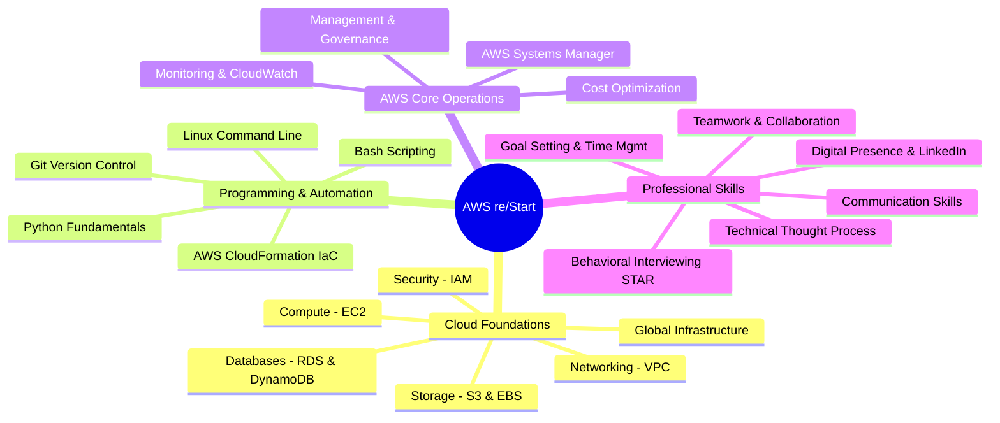

# 🚀 Welcome to AWS re/Start: Student Orientation & Guide

> **Course**: AWS re/Start Foundational Soft Skills  
> **Module**: M00 – Program Orientation  
> **Source**: `T01-RSTFSS_EN-US_SG_M00_AWSRESTARTWELCOME.pdf`  
> **Target Audience**: AWS re/Start Learners  

---

## 🎯 Module Overview

Welcome to the **AWS re/Start** program! This orientation module sets expectations, introduces the program structure, outlines core technical and professional learning tracks, and guides you through cohort introductions.

### 📌 Learning Objectives
- [ ] Understand the primary goals of the AWS re/Start program
- [ ] Familiarize yourself with the interactive learning methodology
- [ ] Review hardware, attendance, and commitment expectations
- [ ] Explore technical curriculum tracks and soft skill competencies
- [ ] Adopt proven strategies to maximize your 12-week learning experience
- [ ] Introduce yourself to peers and begin cohort networking

---

## 🌟 1. Program Goal

```
┌────────────────────────────────────────────────────────────────────────┐
│                          AWS re/Start Mission                          │
│                                                                        │
│  Prepare diverse learners for entry-level cloud careers by building    │
│  deep technical knowledge, hands-on applied cloud skills, and          │
│  workplace professional capabilities.                                  │
└────────────────────────────────────────────────────────────────────────┘
```

The program is designed as a full-time, immersive workforce development pathway. By the end of 12 weeks, you will be prepared to take the **AWS Certified Cloud Practitioner (CLF-C02)** exam and transition into entry-level IT/cloud roles (e.g., Cloud Support Associate, Junior Cloud Operations, Helpdesk Tier 2/3).

---

## 💡 2. Learning Approach

The curriculum combines five collaborative learning modalities:

| Modality | Description | Key Deliverable |
| :--- | :--- | :--- |
| **Instructor-Led Discussions** | Interactive lectures covering cloud architecture and operating systems | Real-time Q&A and conceptual foundations |
| **Application Activities** | Case studies, design exercises, and architectural scenarios | Problem-solving frameworks |
| **Hands-on Labs** | Real AWS Console and CLI sandbox environments | Verifiable cloud deployments |
| **Professional Skills Practice** | Behavioral interviewing, STAR technique, and communication | Professional portfolio & resume |
| **Assessments** | Module quizzes, knowledge checks, and mock certification exams | Readiness evaluation |

---

## 📋 3. Program Requirements & Resources

### Student Expectations
- **Reliable Hardware**: Daily access to a computer with reliable high-speed internet and webcam/audio.
- **Dedicated Commitment**: 100% active, engaged participation throughout all scheduled classes, labs, and collaborative team activities.
- **Growth Mindset**: Willingness to embrace technical hurdles and seek help proactively.

### Materials Provided
- **Student Guides**: Slide decks and deep-dive technical notes for each learning module.
- **Activity Templates**: Structured worksheets to build your personal professional portfolio.
- **AWS Sandbox Labs**: Guided lab environments to practice on AWS services with zero risk.

---

## 📚 4. Curriculum Tracks & Topic Coverage



---

## 🏆 5. Maximizing Your Learning Experience

> [!TIP]
> **Key Strategies for Success**:
> 1. **Ask Early, Ask Often**: Never hesitate to ask questions during lectures or peer breakout sessions. If you are confused, peers likely are too.
> 2. **Reflect Daily**: Use your Joplin notebook to summarize 3 key things you learned each day.
> 3. **Embrace the Struggle**: Technical troubleshooting (debugging scripts, VPC routing issues) is where actual engineering capability develops.
> 4. **Cultivate Peer Support**: Pair program, review lab steps together, and practice mock behavioral interview questions with cohort peers.

---

## 🤝 6. Cohort Introductions Activity

> [!IMPORTANT]
> **Exercise**: Introduce yourself to the cohort using the following structure:

```markdown
### 👤 Learner Profile
- **Full Name**: 
- **Location / Origin**: 
- **One Interesting Fact**: 
- **Primary Goal / Expectation for AWS re/Start**: 
```

---

## 📝 Personal Notes & Reflection

*Use this space in your Joplin notebook to record personal reflections, contact information of study partners, or cohort goals.*

- 
- 
- 
