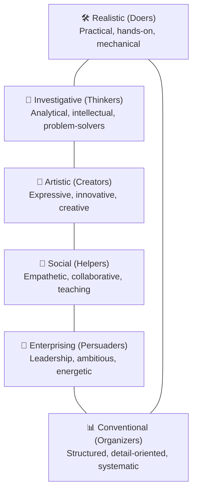

# 🧭 Self-Assessment: Who Am I?

> **Course**: AWS re/Start Foundational Soft Skills  
> **Module**: M00 – Self-Assessment & Career Identity  
> **Source**: `T02-RSTFSS_EN-US_SG_M00_WHOAMI.pdf`  
> **Target Audience**: AWS re/Start Learners  

---

## 🎯 Module Overview

Before embarking on your cloud career journey, you need to know where you are starting from. This module guides you through self-discovery, prior experience inventory, psychological safety, and foundational career aptitude assessment using the RIASEC model and Amazon Leadership Principles.

### 📌 Learning Objectives
- [ ] Understand your unique personality profile and strengths
- [ ] Inventory and extract value from your past professional and life experiences
- [ ] Connect personal strengths to the Amazon Leadership Principles
- [ ] Complete the O*NET RIASEC Interest Profiler test
- [ ] Create your baseline "Journal Entry Zero"

---

## 🛡️ Psychological Safety & Amazon Leadership Principles

AWS re/Start creates an open, psychologically safe environment where you can take intellectual risks, make mistakes, and learn rapidly:

```
┌────────────────────────────────────────────────────────────────────────┐
│                      Safe Space Principles                             │
│                                                                        │
│  ✨ Share your ideas without fear of judgment                         │
│  🔍 Learn and be curious: leaders seek continuous improvement          │
│  🚀 Think big: avoid small thinking; set bold career directions       │
│  🧗 Have backbone, disagree and commit: maintain your convictions      │
│  💡 Invent and simplify: seek outside-the-box, elegant solutions       │
│  🎯 Insist on the highest standards: relentlessly raise the bar        │
└────────────────────────────────────────────────────────────────────────┘
```

> [!NOTE]
> Amazon Leadership Principles are not just company slogans—they serve as mental decision-making models and form the exact rubric used by cloud employers in behavioral interviews.

---

## 👥 Turn and Talk Activity (15 Minutes)

Pair up with a fellow learner and interview each other using the following prompts:

- [ ] **Partner Name**: 
- [ ] **Location / Hometown**: 
- [ ] **Expectations for AWS re/Start**: 
- [ ] **Last Purchase from Amazon**: 
- [ ] **Class Introduction**: Introduce your partner to the cohort highlighting their strengths.

---

## 📓 Journal Entry Zero: Baseline Snapshot

> [!IMPORTANT]
> Capture your authentic thoughts at the very start of the program. Store your responses in Joplin or record audio/video notes.

### 1. Where do you want to be?
- **6 Months from now**:
  - *Goal*: 
- **2 Years from now**:
  - *Goal*: 
- **5 Years from now**:
  - *Goal*: 

### 2. What would you like to learn?
- **Within 6 Months**:
  - *Technical & Soft Skills*: 
- **Within 2 Years**:
  - *Specialization (DevOps / SysOps / Architecture)*: 
- **Within 5 Years**:
  - *Senior Role / Leadership*: 

### 3. Areas for Growth
- "One thing that I could do better is:"
  > 

### 4. Role Models & Values
- "Qualities that I admire in other people:"
  > 

---

## 🧪 Career Profiling: The RIASEC Assessment

The **RIASEC** model (Holland Codes) categorizes vocational personalities into six primary themes:



### 📋 Steps to Complete
1. Navigate to the free [O*NET Interest Profiler](https://www.mynextmove.org/explore/ip).
2. Complete the 60 questions honestly based on what you enjoy doing.
3. Record your top 3 interest scores below:

| RIASEC Dimension | Score | Cloud IT Alignment |
| :--- | :---: | :--- |
| **Realistic (R)** | | Data Center operations, hardware, infrastructure automation |
| **Investigative (I)** | | Cloud architecture, troubleshooting, security analysis, root cause |
| **Artistic (A)** | | Solutions design, UI/UX, workflow visualization |
| **Social (S)** | | Cloud support, client onboarding, technical training, team lead |
| **Enterprising (E)** | | Technical sales, Cloud consulting, project management |
| **Conventional (C)** | | Database management, cloud compliance, billing & cost optimization |

---

## 🔍 Self-Reflection on Results

- **Primary 3-letter Holland Code**: `[ ] [ ] [ ]`
- **Key Takeaways**:
  > 
- **Does this reflect how you see yourself? Why or why not?**:
  > 

---

> Related Exercise: See [T03-RSTFSS_EN-US_SG_M00_WHOAMIQUESTIONNAIRE.md](file:///work/tmp/aws-cf/T03-Professional_Skills/T03-RSTFSS_EN-US_SG_M00_WHOAMIQUESTIONNAIRE.md) for the detailed skills inventory worksheet.
