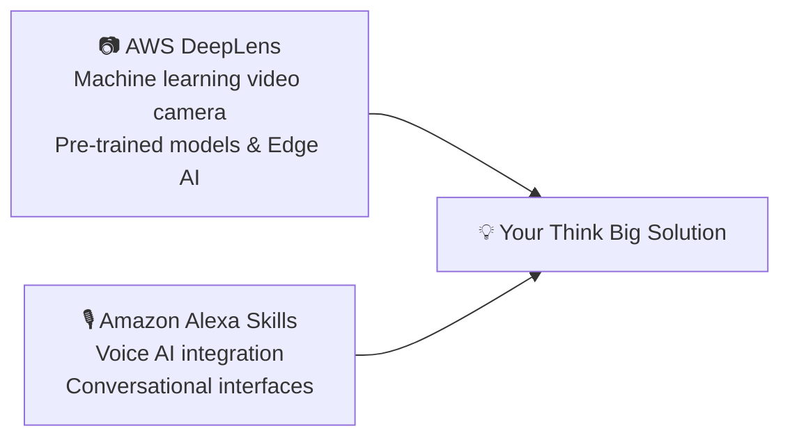

# 🚀 Amazon Leadership Principles: Think Big

> **Course**: AWS re/Start Foundational Soft Skills  
> **Module**: M00 – Leadership Principles Deep Dive  
> **Source**: `T04-RSTFSS_EN-US_SG_M00_THINKBIG.pdf`  
> **Target Audience**: AWS re/Start Learners  

---

## 🎯 Module Overview

This module explores the core philosophy of Amazon's **Think Big** Leadership Principle. Thinking small is a self-fulfilling prophecy. In this session, you will analyze how leaders communicate bold directions, examine real-world innovation case studies, discover emerging cloud and AI technologies (AWS DeepLens, Alexa Skills), and collaborate on a "Think Big" team pitch.

### 📌 Learning Objectives
- [ ] Understand the role and significance of all 16 Amazon Leadership Principles
- [ ] Internalize the definition and mindset of the "Think Big" principle
- [ ] Evaluate innovative solutions to non-traditional problems
- [ ] Explore AI/IoT edge technologies (AWS DeepLens, Amazon Alexa Skills)
- [ ] Formulate, develop, and present a bold "Think Big" project idea in small teams

---

## 🏛️ The 16 Amazon Leadership Principles

Amazon employees use these principles daily—from architectural debates to hiring and operational decisions.

```
┌─────────────────────────────────┬─────────────────────────────────┐
│ Customer Obsession              │ Think Big                       │
├─────────────────────────────────┼─────────────────────────────────┤
│ Ownership                       │ Bias for Action                 │
├─────────────────────────────────┼─────────────────────────────────┤
│ Invent and Simplify             │ Frugality                       │
├─────────────────────────────────┼─────────────────────────────────┤
│ Are Right, A Lot                │ Earn Trust                      │
├─────────────────────────────────┼─────────────────────────────────┤
│ Learn and Be Curious            │ Dive Deep                       │
├─────────────────────────────────┼─────────────────────────────────┤
│ Hire and Develop the Best       │ Have Backbone; Disagree & Commit│
├─────────────────────────────────┼─────────────────────────────────┤
│ Insist on the Highest Standards │ Deliver Results                 │
├─────────────────────────────────┼─────────────────────────────────┤
│ Strive to be Earth's Best       │ Success and Scale Bring         │
│ Employer                        │ Broad Responsibility            │
└─────────────────────────────────┴─────────────────────────────────┘
```

---

## 🔭 Defining "Think Big"

> [!IMPORTANT]
> **Amazon Leadership Principle Definition**:  
> *"Thinking small is a self-fulfilling prophecy. Leaders create and communicate a bold direction that inspires results. They think differently and look around corners for ways to serve customers."*

### 🐾 Case Study: "Look What the Cat Can't Drag In"
- **The Challenge**: An Amazon engineer’s cat frequently brought prey (dead birds and mice) through the automated cat flap door into the house at 3:00 AM.
- **The "Think Small" Approach**: Lock the cat flap permanently or wake up to check the cat every night.
- **The "Think Big" Solution**: Build an AI-powered smart cat flap!
  - Integrated an **AWS DeepLens** video camera running a trained machine learning computer vision model.
  - Detects if the cat is carrying prey in its mouth.
  - Automatically locks the flap for 15 minutes, prevents entry, turns on house lights, and sends a Slack notification with a photo.

---

## 💡 Ideation Discovery Technologies



### 1. AWS DeepLens
- Fully programmable video camera designed to expand deep learning skills at the edge.
- Combines device hardware, tutorials, Python code, and pre-trained computer vision models (object detection, facial recognition, sentiment analysis).

### 2. Amazon Alexa Skills Kit (ASK)
- Voice-first conversational applications that extend Amazon Alexa's capabilities.
- Allows users to control cloud infrastructure, manage tasks, access medical assistance, and interact hands-free.

---

## 👥 Group Activity: Your Think Big Pitch

> [!TIP]
> Form groups of 3–4 learners. Select one thematic domain below and design an innovative cloud/AI solution.

### 🌐 Thematic Domains:
1. **Inclusivity & Accessibility**: Empower individuals with disabilities or language barriers.
2. **Healthcare & Wellness**: Remote patient monitoring, early detection, or mental well-being.
3. **Games & Interactive Learning**: Engaging educational platforms or gamified training.
4. **Sustainability & Climate**: Energy conservation, food waste reduction, or smart agriculture.

---

### 📋 Team Proposal Template

```markdown
### 💡 Project Title: [Insert Title]

- **Team Members**: 
- **Thematic Domain**: [Inclusivity / Health / Games / Sustainability]

#### 1. Problem Statement
*What friction, pain point, or global challenge does this solve?*
> 

#### 2. The "Think Big" Cloud Solution
*What bold direction are you proposing? How does it look around corners?*
> 

#### 3. Technologies Leveraged
- [ ] Computer Vision / Edge AI (e.g., DeepLens, Rekognition)
- [ ] Voice / Conversational AI (e.g., Alexa, Amazon Lex)
- [ ] Serverless Backend (AWS Lambda, Amazon API Gateway)
- [ ] Cloud Storage & Database (Amazon S3, DynamoDB)

#### 4. Value Delivered to the Customer
*What measurable impact or life improvement does this provide?*
> 
```
