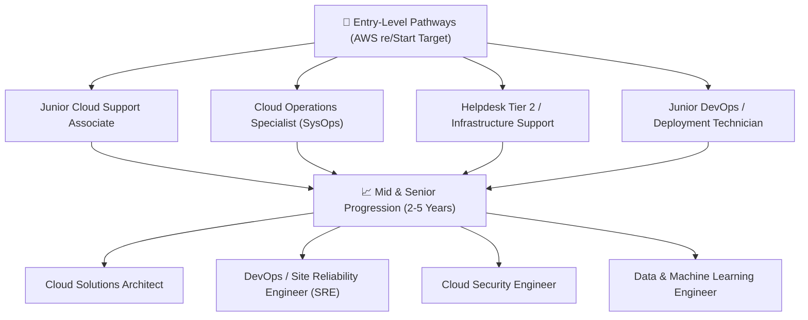

# ☁️ Cloud Roles & Competency Pathways

> **Course**: AWS re/Start Foundational Soft Skills  
> **Module**: M00 – Cloud Industry Roles & Research  
> **Source**: `T05-RSTFSS_EN-US_SG_M00_CLOUDROLES.pdf`  
> **Target Audience**: AWS re/Start Learners  

---

## 🎯 Module Overview

The cloud computing ecosystem encompasses a wide variety of specialized and entry-level career opportunities. In this module, you will explore entry-level job descriptions, research skill requirements using the national O*NET Online database, contrast technical vs. soft skill demands, and establish target career pathways.

### 📌 Learning Objectives
- [ ] Differentiate between entry-level and advanced cloud career paths
- [ ] Understand the balance of technical proficiencies and soft skills
- [ ] Conduct structured career research on O*NET Online
- [ ] Evaluate job requirements, educational expectations, and credential standards
- [ ] Prepare a 5-minute presentation evaluating a target cloud job profile

---

## 📚 Key Concept: Technical vs. Soft Skills

```
┌─────────────────────────────────┬─────────────────────────────────┐
│       Technical Hard Skills     │      Foundational Soft Skills   │
├─────────────────────────────────┼─────────────────────────────────┤
│ • Linux OS & Shell Scripting    │ • Clear verbal communication    │
│ • AWS Core Services (EC2, S3)   │ • Empathy & customer obsession  │
│ • TCP/IP Networking & VPCs      │ • Teamwork & active listening   │
│ • Python Programming & SQL      │ • Problem-solving tenacity      │
│ • IAM Security & Hardening      │ • Professional composure        │
└─────────────────────────────────┴─────────────────────────────────┘
```

> [!NOTE]
> Employers repeatedly emphasize that technical tools can be taught on the job, but reliability, communication, coachability, and emotional intelligence make candidates stand out.

---

## 🗺️ Landscape of Cloud Roles



---

## 🔬 Activity 1: Individual Role Discovery (10 Mins)

Review standard entry-level job postings. Identify at least 3 distinct job titles that mention AWS or Cloud infrastructure:

1. **Role 1**: 
2. **Role 2**: 
3. **Role 3**: 

---

## 👥 Activity 2: Partner Deep Dive & Research (20 Mins)

Pair up with a peer and pick **one target role** to investigate using [O*NET Online](https://www.onetonline.org/) and real-world job portals (LinkedIn, Indeed).

### 📋 Research Worksheet

```markdown
### 💼 Cloud Role Profile: [Insert Role Title Here]

#### 1. Core Responsibilities
- What does a typical day look like in this role?
> 

#### 2. Technical Competencies Required
- Operating Systems (Linux/Windows): 
- Cloud Platforms (AWS): 
- Automation & Scripting (Bash, Python): 
- Networking & Security: 

#### 3. Key Non-Technical / Soft Skills
- Communication & Team Dynamics: 
- Incident Handling & Pressure Management: 

#### 4. Education & Certifications
- Is a 4-year degree strictly required, or do certifications & portfolio suffice?
> 
- Target Certifications (e.g., AWS Certified Cloud Practitioner, SysOps Administrator):
> 

#### 5. My Personal Gap Analysis
- What skills do I already have that align with this role?
> 
- What specific modules in AWS re/Start do I need to focus on to qualify?
> 
```

---

## 🎤 Activity 3: Presentation Rubric (5 Mins per Team)

Prepare a concise 5-minute presentation covering:
- [ ] Role description and core day-to-day duties
- [ ] Technical vs. soft skill expectations
- [ ] Degree requirements vs. hands-on project portfolio
- [ ] Concrete next steps to bridge any skill gaps

---

## 🎯 Personal Action Plan

*Which cloud role is currently your #1 choice, and what is your immediate milestone this month to move closer to it?*

- **Target Role**: 
- **Immediate Milestone**: 
