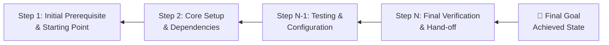

# ⏱️ Communication & Strategy: Setting Goals & Time Management

> **Course**: AWS re/Start Foundational Soft Skills  
> **Module**: M00 – Goal Setting, Reverse Planning & Accountability  
> **Source**: `T06-RSTFSS_EN-US_SG_M00_GOALSETTINGS.pdf`  
> **Target Audience**: AWS re/Start Learners  

---

## 🎯 Module Overview

Effective time management and goal architecture are the bedrock of top-performing cloud professionals. In this module, you will learn to manage cognitive load, apply **Reverse Planning (Backward Planning)** to break complex technical goals into sequential milestones, take genuine **Accountability**, and clarify team responsibilities using the **RACI Model**.

### 📌 Learning Objectives
- [ ] Articulate why time management is vital for high-velocity tech careers
- [ ] Implement proven daily time management and focus strategies
- [ ] Master the Reverse Planning methodology starting from the end-state
- [ ] Define professional accountability and ownership
- [ ] Construct and analyze a RACI responsibility assignment matrix

---

## ⏳ 1. The Core of Time Management

```
┌────────────────────────────────────────────────────────────────────────┐
│                        Definition & Importance                         │
│                                                                        │
│  Time management is the ability to plan and control how you spend      │
│  available hours to accomplish specific outcomes without burnout.      │
│                                                                        │
│  • Accelerates goal achievement                                        │
│  • Maximizes output per hour (doing more with focused time)            │
│  • Maintains sustainable work-life integration                         │
└────────────────────────────────────────────────────────────────────────┘
```

### Essential Pillars:
1. **Goal Setting**: Clear definition of done.
2. **Prioritization**: Separating urgent vs. truly important tasks.
3. **Structured Planning**: Blocking calendar intervals for deep work.
4. **Execution & Organization**: Eliminating unnecessary friction.

---

## 🛠️ 2. Time Management Strategies & Tactics

| Strategy | Implementation in Tech | Impact |
| :--- | :--- | :--- |
| **Task Lists / Kanban** | Use Joplin to-do checklists, Trello, or Jira boards | Reduces cognitive memory load |
| **Focus Blocks / Pomodoro** | 25 or 50-minute uninterrupted sprints; phone silenced | Prevents context switching |
| **Batching Communications** | Checking emails/Slack only at dedicated intervals | Protects deep engineering flow |
| **Single-Tasking** | Completing one lab configuration before starting the next | Reduces bug and error rate |
| **Meeting Agendas** | Clear objectives and pre-reads for all syncs | Protects team engineering time |

---

## 🔄 3. Reverse Planning (Backward Planning)

Traditional forward planning starts with "What do I do today?" and often results in missed deadlines. **Reverse planning** starts with the final vision and works backward step by step:



### 🎨 Analogy: Painting a Room in Reverse
1. *End State*: Beautiful freshly painted room.
2. Step 8: Remove painter's tape carefully.
3. Step 7: Let top coat dry completely.
4. Step 6: Apply wall paint.
5. Step 5: Let primer dry.
6. Step 4: Apply primer.
7. Step 3: Tape trims, switches, and moldings.
8. Step 2: Lay drop cloths to protect flooring.
9. Step 1: Move and cover all furniture.

---

### 💻 Exercise: Technical Learning Reverse Plan

> [!TIP]
> **Example Learning Goal**: *"I can configure an isolated AWS VPC with public and private subnets, NAT Gateway, and launch a secured EC2 web server."*

```markdown
- **Target Completion Date**: 
- **Milestone 5 (Final Step)**: Verify HTTP traffic loads from internet and private instance reaches internet via NAT Gateway.
- **Milestone 4**: Launch EC2 instances in proper subnets and apply security groups.
- **Milestone 3**: Configure route tables (associate public subnet with IGW, private subnet with NAT Gateway).
- **Milestone 2**: Attach Internet Gateway (IGW) and deploy NAT Gateway in public subnet.
- **Milestone 1**: Create VPC with `/16` CIDR block and carve out `/24` subnets across 2 Availability Zones.
- **Starting Point (Today)**: Understand IP addressing and CIDR notation.
```

---

## 🛡️ 4. Accountability & Radical Ownership

> [!IMPORTANT]
> **Accountability**: The obligation of an individual to account for their activities, accept responsibility for them, and disclose the results in a transparent manner.

### How True Leaders Demonstrate Accountability:
- **Communicate Proactively**: Flag blockers *before* deadlines pass, not after.
- **Be Honest About Capacity**: Say "no" or negotiate scope rather than quietly failing.
- **Honor Commitments**: Deliver what was agreed upon to standard.
- **Admit Mistakes Cleanly**: State: *"I made this misconfiguration; here is why it happened, how I fixed it, and the runbook change I implemented to prevent a recurrence."*

---

## 📊 5. The RACI Responsibility Assignment Matrix

When multiple engineers, stakeholders, and managers collaborate, confusion arises over who makes decisions versus who does the work. The **RACI Matrix** solves this ambiguity:

```
┌────────────────────────────────────────────────────────────────────────┐
│                                 RACI                                   │
│                                                                        │
│  [R] Responsible : The 'Doer' who completes the actual task/work.      │
│  [A] Accountable : The 'Owner' who holds ultimate decision authority.  │
│                    (Only ONE person should be Accountable per task!)   │
│  [C] Consulted   : The subject matter expert asked for input/feedback. │
│  [I] Informed    : Kept updated on progress and outcomes (FYI only).   │
└────────────────────────────────────────────────────────────────────────┘
```

### Example: Deploying an AWS Production Environment

| Task / Activity | Cloud Engineer | Solutions Architect | Security Lead | Project Manager |
| :--- | :---: | :---: | :---: | :---: |
| **Write CloudFormation Template** | **R** | **C** | **C** | **I** |
| **Approve Architecture Design** | **C** | **A** | **C** | **I** |
| **Sign-Off on IAM Security Policy** | **C** | **C** | **A** | **I** |
| **Execute Deployment to Prod** | **R** / **A** | **I** | **I** | **I** |
| **Client Status Update** | **I** | **I** | **I** | **R** / **A** |

> [!CAUTION]
> **Common Trap for Junior Engineers**: Saying yes to everything without checking the RACI matrix leads to working on out-of-scope tasks while neglecting the core deliverables for which you are Accountable.

---

## 📝 Self-Evaluation & Action Items

- [ ] My #1 time drain during study hours: `_________________________________`
- [ ] Strategy I will adopt starting this week: `_____________________________`
- [ ] Person who is my accountability study partner: `________________________`
