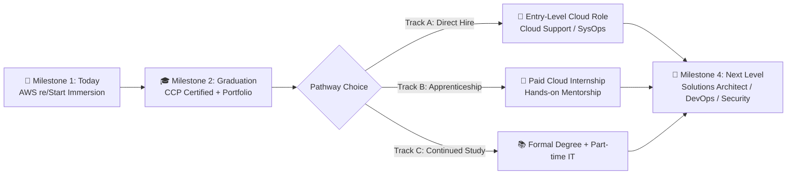

# 🎯 Career Goals, Roadmapping & Financial Sustainability

> **Course**: AWS re/Start Foundational Soft Skills  
> **Module**: M00 – Career Planning & Financial Literacy  
> **Source**: `T07-RSTFSS_EN-US_SG_M00_CAREERGOALS.pdf`  
> **Target Audience**: AWS re/Start Learners  

---

## 🎯 Module Overview

Transitioning into tech requires both a strategic career roadmap and practical personal stability. This module guides you through defining measurable career milestones, mapping out alternative transition pathways (direct hiring, apprenticeships, higher education), creating a personal survival budget during training, and navigating financial hardship.

### 📌 Learning Objectives
- [ ] Construct a personalized multi-stage career progression timeline
- [ ] Formulate 1-year, 5-year, and 10-year professional milestones
- [ ] Build a zero-based personal transition budget
- [ ] Identify local community and workforce support networks during career pivots

---

## 🗺️ 1. Multi-Stage Career Roadmapping

A career roadmap is an adaptable blueprint that connects your current baseline to long-term leadership goals through defined **milestones**.

---

## 🧭 2. My 5-Year & 10-Year Career Vision

Fill in your milestone targets below:

### 🌟 6-12 Month Horizon (Immediate)
- **Primary Goal**: Complete AWS re/Start and pass AWS Certified Cloud Practitioner (CLF-C02).
- **Target Roles**: Cloud Support Specialist, Junior NOC Technician, Helpdesk Support Engineer.
- **Target Compensation / Benefits**: 

### 🌟 3-5 Year Horizon (Mid-Term)
- **Primary Goal**: Transition into specialized cloud engineering (SysOps / DevOps / SecOps).
- **Target Certifications**: AWS Certified Solutions Architect – Associate, AWS SysOps Administrator.
- **Target Responsibilities**: Leading deployments, architecting high-availability infrastructure.

### 🌟 10-Year Horizon (Long-Term)
- **Primary Goal**: Senior Solutions Architect, Technical Lead, or Engineering Manager.
- **Legacy & Impact**: Mentoring new cloud cohorts, driving enterprise architecture.

---

## 💰 3. Financial Wellness & Transition Budgeting

During an intensive full-time training program, financial discipline prevents stress from derailing academic focus. A **budget** ensures your essential living needs are met before non-essentials.

### 📊 Zero-Based Monthly Transition Budget Worksheet

| Category | Planned Amount | Actual Spent | Notes |
| :--- | :---: | :---: | :--- |
| **Total Monthly Income / Stipend / Savings** | **$______** | **$______** | *Baseline starting capital* |
| **Housing (Rent / Mortgage)** | $______ | $______ | *Essential roof over head* |
| **Utilities (Electricity, Internet)** | $______ | $______ | *Required for online class* |
| **Food & Groceries** | $______ | $______ | *Meal prep over takeout* |
| **Transportation (Gas, Transit)** | $______ | $______ | *Commute to center / events* |
| **Healthcare & Insurance** | $______ | $______ | *Essential health needs* |
| **Discretionary / Entertainment** | $______ | $______ | *Temporarily minimized* |
| **Emergency Buffer** | $______ | $______ | *Unforeseen vehicle / medical* |
| **Remaining Balance (Target: $0 Allocated)** | **$0.00** | **$0.00** | *Every dollar given a job* |

---

## 🤝 4. Real-World Case Study: Overcoming Financial Hardship

> [!CAUTION]
> **Scenario**: Shirley was laid off from her retail job and joined AWS re/Start. Two weeks into the program, her savings depleted and her card was declined at the grocery store.

### Collaborative Resources & Solutions:
If you or a peer face acute financial stress during the 12 weeks:
1. **Community Food Banks & Pantries**: Immediate relief for basic nutritional needs without stigma.
2. **Workforce Development Grants**: Emergency student support funds through program sponsoring organizations.
3. **Utility Assistance Programs (LIHEAP, Lifeline)**: Subsidized electricity and high-speed broadband programs.
4. **Cohort Mutual Aid**: Carpooling, bulk study meal prep, and emotional encouragement.
5. **Transparency with Instructors**: Informing program coordinators early allows staff to connect you with emergency community resources.

---

## 📌 Checklist for Success

- [ ] Complete personal career timeline infographic
- [ ] Finalize monthly budget for the duration of the 12-week program
- [ ] Connect with 2 cohort accountability partners for weekly check-ins
