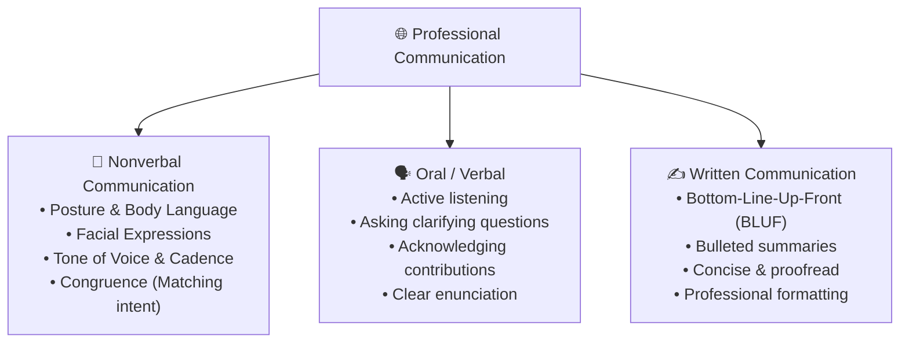

# 🗣️ Effective Communication & The STAR Methodology

> **Course**: AWS re/Start Foundational Soft Skills  
> **Module**: M00 – Professional Communication & Behavioral Interviewing  
> **Source**: `T08-RSTFSS_EN-US_SG_M00_COMMUNICATIONSTAR.pdf`  
> **Target Audience**: AWS re/Start Learners  

---

## 🎯 Module Overview

Communication is the most evaluated competency in technical interviews and day-to-day cloud operations. This module provides tactical frameworks for mastering **nonverbal congruence**, **concise written business communication**, **delivering compelling technical presentations**, and structuring behavioral interview answers using the **STAR (Situation, Task, Action, Result)** method.

### 📌 Learning Objectives
- [ ] Align nonverbal signals (posture, facial expressions, tone) with verbal messages
- [ ] Apply professional etiquette across online meetings, phone calls, and email
- [ ] Structure and deliver an engaging 5-minute technical presentation
- [ ] Master the STAR framework to articulate past technical and interpersonal experiences
- [ ] Draft an interview-ready STAR response based on a classroom lab challenge

---

## 🎭 1. The Three Modalities of Communication



> [!IMPORTANT]
> **Congruence**: Ensure that your body language, tone, and spoken words match. Delivering exciting news with a monotone voice or slumped posture creates cognitive dissonance and undermines trust.

---

## 📋 2. Professional Communication Etiquette Matrix

| Channel | ✅ Top Dos | ❌ Critical Don'ts |
| :--- | :--- | :--- |
| **Online Meetings (Zoom / Teams / Chime)** | • Test camera/mic 5 mins before start<br>• Mute when not actively speaking<br>• Use good lighting and look into the camera lens | • Multi-task or type noisily on unmuted mic<br>• Leave camera off during interactive discussions<br>• Interrupt while peers are mid-sentence |
| **Professional Phone Calls** | • State your name, role, and reason immediately<br>• Confirm if the other party has time to talk<br>• Summarize action items before hanging up | • Take calls in noisy transit environments<br>• Put callers on speaker without warning<br>• Ramble without a clear purpose |
| **Professional Email / Slack** | • Use clear, actionable subject lines<br>• Put the key point / ask in the first 2 sentences<br>• Proofread carefully for spelling and tone | • Write massive unbroken walls of text<br>• Use informal slang, all-caps, or emojis in formal memos<br>• "Reply All" when only sender needs response |

---

## 🎤 3. Delivering High-Impact Technical Presentations

Presenting complex cloud concepts to both technical and non-technical stakeholders requires a structured 3-phase process:

```
Step 1: Plan                Step 2: Write               Step 3: Deliver
┌──────────────────────┐    ┌──────────────────────┐    ┌──────────────────────┐
│ • Analyze audience   │    │ • Build outline:     │    │ • Test AV equipment  │
│ • Define 1-sentence  │ -> │   - Intro & Hook     │ -> │ • Ground stance      │
│   core objective     │    │   - 3 Main Points    │    │ • Maintain eye contact│
│ • Select key terms   │    │   - Summary & Q&A    │    │ • Speak with cadence │
└──────────────────────┘    └──────────────────────┘    └──────────────────────┘
```

> [!TIP]
> **One-Sentence Objective Rule**: Before writing a single slide, complete this statement:  
> *"By the end of this presentation, my audience will understand [Core Concept] and how it benefits [Customer Need]."*

---

## ⭐ 4. The STAR Behavioral Interview Framework

Tech employers (especially Amazon and AWS partners) use behavioral questions ("Tell me about a time when...") to predict future performance based on past actions. Use **STAR** to keep responses crisp, structured, and impactful:

```
┌────────────────────────────────────────────────────────────────────────┐
│                              STAR METHOD                               │
├────────────────────────────────────────────────────────────────────────┤
│ [S] Situation : Context, background, setting, and environment. (15%)   │
│ [T] Task      : The specific goal, assignment, or problem faced. (15%) │
│ [A] Actions   : Concrete steps YOU took. Focus on "I", not "we". (50%) │
│ [R] Results   : Measurable outcome, lessons learned, and impact. (20%) │
└────────────────────────────────────────────────────────────────────────┘
```

---

### 💡 Example STAR Script: Resolving a Cloud Configuration Error

- **Situation (S)**: *"During Week 3 of AWS re/Start, our team was tasked with launching a multi-tier web application inside a custom Amazon VPC."*
- **Task (T)**: *"My responsibility was ensuring that the web server instances in the public subnet could communicate with the internet, while keeping the database tier private."*
- **Actions (A)**: *"When external traffic failed to reach the server, I methodically verified our routing table. I discovered that while an Internet Gateway was attached, the route table associated with our public subnet was missing a default route (`0.0.0.0/0`) directed to the IGW. I updated the route table, double-checked the security group inbound rules on port 80, and tested connectivity using `curl`."*
- **Results (R)**: *"The web application immediately began loading successfully. I documented the troubleshooting workflow in our team runbook, saving our group approximately 45 minutes on subsequent lab deployments."*

---

## 📝 5. Your Personal STAR Exercise

Draft your own response based on a technical hurdle or team project during the program:

```markdown
### 🌟 Interview Prompt: "Tell me about a time you solved a tough technical issue under a tight deadline."

- **[S] Situation**:
  > 

- **[T] Task**:
  > 

- **[A] Actions Taken (Focus on your specific role & logic)**:
  > 

- **[R] Quantifiable Results & Key Takeaways**:
  > 
```
