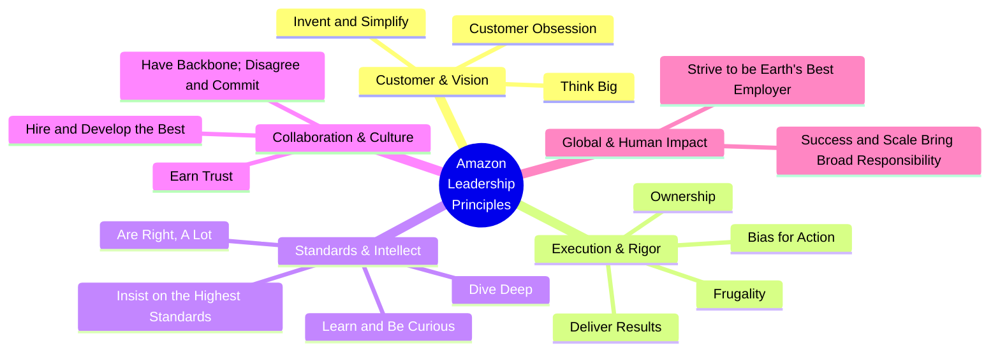
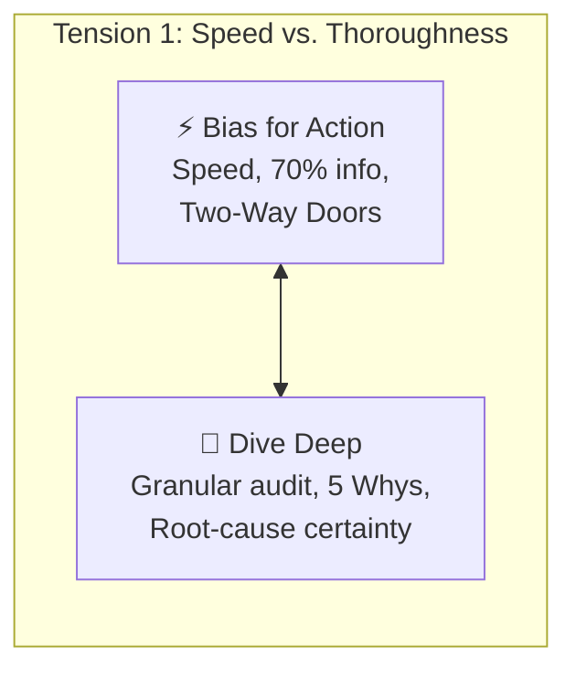
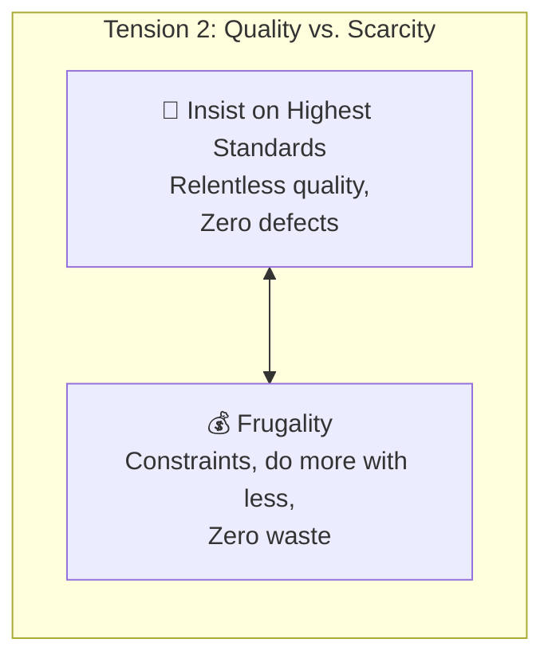
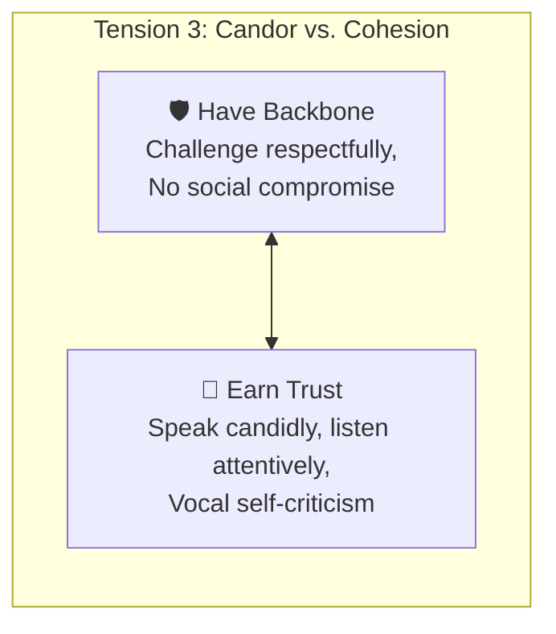
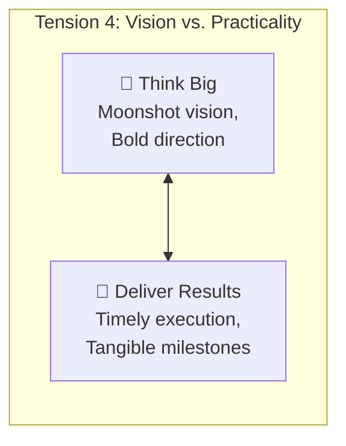
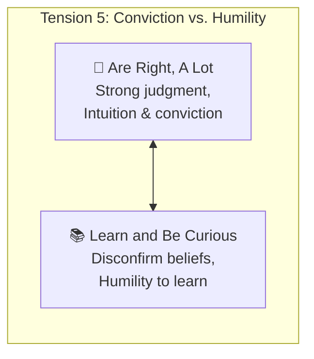

# 🧭 Introduction to Amazon Leadership Principles

> **Course**: AWS re/Start Foundational Soft Skills  
> **Module**: M00 – Techno Functional Soft Skills (Leadership Principles Intro)  
> **Source**: `T09-RSTFSS_EN-US_SG_M00_LPIntro.pdf`  
> **Target Audience**: AWS re/Start Learners & Cloud Practitioners  

---

## 🎯 Module Overview

At Amazon, the **16 Leadership Principles (LPs)** are not decorative plaques hanging on the wall; they are operating tenets used daily. Whether engineers are evaluating system architectures, resolving Sev-1 production outages, deciding on product roadmaps, or interviewing candidates, these principles serve as the common cultural vocabulary and decision-making heuristic that makes Amazon uniquely **"peculiar"**.

For cloud practitioners and job candidates, mastering these principles serves a dual purpose:
1. **Behavioral Interview Excellence**: Tech employers—especially Amazon and the broader AWS ecosystem—heavily weight behavioral evaluation. Familiarity with the LPs allows you to structure past achievements using the **STAR (Situation, Task, Action, Result)** method with precision.
2. **Professional Decision-Making**: The principles provide clear mental models for managing technical debt, resolving cross-team trade-offs, delivering software under constraints, and driving continuous improvement.

> [!NOTE]
> *"No one is expected to be amazing at every leadership principle. Everyone has their strengths and weaknesses, and the same goes for their representation in the leadership principles. It is about applying them to your work and understanding where your own leadership skills compare."* — *AWS re/Start Facilitator Guide*

### 📌 Learning Objectives
- [ ] Memorize and understand the verbatim definitions and practical expectations of all **16 Amazon Leadership Principles**.
- [ ] Analyze the **interconnected synergies** (similar principles) and **deliberate tensions** (opposing principles) across the framework.
- [ ] Conduct an honest **Personal Strengths & Development Areas Self-Assessment**.
- [ ] Map personal technical and academic experiences to LPs for upcoming behavioral interview preparation.

---

## 🗺️ Holistic Architecture: The 16 Leadership Principles

The 16 principles are organized below across five core operational dimensions:



---

## 🏛️ The Complete Catalog of 16 Leadership Principles

Below is the complete set of all 16 Amazon Leadership Principles, featuring their official wording, pragmatic workplace interpretations, behavioral interview signals, and common anti-patterns.

---

### 1. 🎯 Customer Obsession

> [!IMPORTANT]
> **Official Definition**:  
> *"Leaders start with the customer and work backward. They work vigorously to earn and keep customer trust. Although leaders pay attention to competitors, they obsess over customers."*

* **Pragmatic Interpretation**: Every architecture, deployment pipeline, and operational metric exists solely to provide customer value. Competitor benchmarking is informative, but customer needs dictate the product roadmap.
* **Working Backward Mechanism**: Writing a PR/FAQ (Press Release and Frequently Asked Questions) before writing a single line of production code.
* **Interview Evaluation**: Look for candidates who prioritize user pain points over pet technology choices and make decisions based on real user feedback.
* **Anti-Pattern**: Building features because they are technically fascinating or because a competitor released them, without validating whether real customers need them.

---

### 2. 🔑 Ownership

> [!IMPORTANT]
> **Official Definition**:  
> *"Leaders are owners. They think long term and don’t sacrifice long-term value for short-term results. They act on behalf of the entire company, beyond just their own team. They never say, 'That’s not my job.'"*

* **Pragmatic Interpretation**: Take end-to-end accountability. If a pipeline breaks, documentation is lacking, or a customer request is stalled in another department, step up and ensure it reaches resolution.
* **Interview Evaluation**: Demonstrating proactive resolution of gaps outside your formal job scope; resisting quick, dirty hacks that introduce massive technical debt.
* **Anti-Pattern**: Siloed thinking ("My code passed the unit tests; the deployment failure is DevOps' problem").

---

### 3. 💡 Invent and Simplify

> [!IMPORTANT]
> **Official Definition**:  
> *"Leaders expect and require innovation and invention from their teams and always find ways to simplify. They are externally aware, look for new ideas from everywhere, and are not limited by 'not invented here' thinking. As we do new things, we accept that we might be misunderstood for long periods of time."*

* **Pragmatic Interpretation**: True architectural elegance is simplicity. Eliminate complex manual procedures by designing automated, maintainable solutions. Accept that radical, disruptive ideas may draw skepticism early on.
* **Interview Evaluation**: Demonstrating where you automated a convoluted workflow, refactored overly complex code, or adopted open-source tools instead of reinventing the wheel.
* **Anti-Pattern**: Over-engineering architectures with unnecessary microservices, esoteric patterns, or bespoke frameworks.

---

### 4. 🧠 Are Right, A Lot

> [!IMPORTANT]
> **Official Definition**:  
> *"Leaders are right a lot. They have strong judgment and good instincts. They seek diverse perspectives and work to disconfirm their beliefs."*

* **Pragmatic Interpretation**: This principle is **not** about stubborn infallibility. It means possessing calibrated intuition while constantly seeking data and alternative viewpoints to prove your initial hypotheses *wrong*. When proven wrong by data, you pivot immediately.
* **Interview Evaluation**: Examples of making correct decisions in ambiguous environments, coupled with the humility to alter your stance when new evidence emerges.
* **Anti-Pattern**: Defending a flawed architectural or business decision despite contradicting metrics just to save face.

---

### 5. 📚 Learn and Be Curious

> [!IMPORTANT]
> **Official Definition**:  
> *"Leaders are never done learning and always seek to improve themselves. They are curious about new possibilities and act to explore them."*

* **Pragmatic Interpretation**: The technology landscape evolves constantly. Great practitioners dedicate time to mastering new AWS services, paradigms, and soft skills without needing an external mandate.
* **Interview Evaluation**: Instances where you stepped out of your comfort zone to learn a language, cloud service, or discipline to resolve an emergent challenge.
* **Anti-Pattern**: Complacency and reliance on legacy tooling ("We have always done it with bare-metal cron scripts, so why change?").

---

### 6. 🌟 Hire and Develop the Best

> [!IMPORTANT]
> **Official Definition**:  
> *"Leaders raise the performance bar with every hire and promotion. They recognize exceptional talent and willingly move them throughout the organization. Leaders develop leaders and take seriously their role in coaching others. We work on behalf of our people to invent mechanisms for development like Career Choice."*

* **Pragmatic Interpretation**: Every new hire must raise the collective bar of the team. Leaders actively invest in coaching, mentoring junior peers, and encouraging high performers to take on new opportunities.
* **Interview Evaluation**: Mentorship of peers, running study groups, conducting constructive code reviews, or contributing to onboarding guides.
* **Anti-Pattern**: Hoarding top performers on your team or feeling threatened by high-performing colleagues.

---

### 7. 📏 Insist on the Highest Standards

> [!IMPORTANT]
> **Official Definition**:  
> *"Leaders have relentlessly high standards—many people might think these standards are unreasonably high. Leaders are continually raising the bar and drive their teams to deliver high quality products, services, and processes. Leaders ensure that defects do not get sent down the line and that problems are fixed so they stay fixed."*

* **Pragmatic Interpretation**: High standards are contagious. Build robust CI/CD automated gates, comprehensive unit/integration test coverage, and clear runbooks. Root causes must be resolved permanently via Mechanisms (e.g., Correction of Errors / COE).
* **Interview Evaluation**: Pushing back on releasing half-baked software, fixing root causes rather than applying band-aids.
* **Anti-Pattern**: Shipping code with known unhandled exceptions to meet an arbitrary deadline, hoping operations won't notice.

---

### 8. 🔭 Think Big

> [!IMPORTANT]
> **Official Definition**:  
> *"Thinking small is a self-fulfilling prophecy. Leaders create and communicate a bold direction that inspires results. They think differently and look around corners for ways to serve customers."*

* **Pragmatic Interpretation**: Avoid incrementalism when fundamental transformation is needed. Design architectures capable of handling 100x scale, and anticipate customer needs before they are articulated.
* **Interview Evaluation**: Identifying bold solutions, anticipating downstream bottlenecks, and looking around corners (anticipating future user demands).
* **Anti-Pattern**: Setting conservative goals merely to guarantee 100% completion without stretching capabilities.

---

### 9. ⚡ Bias for Action

> [!IMPORTANT]
> **Official Definition**:  
> *"Speed matters in business. Many decisions and actions are reversible and do not need extensive study. We value calculated risk taking."*

* **Pragmatic Interpretation**: Analysis paralysis kills momentum. Differentiate between **Type 1 decisions (one-way doors)** which are irreversible and require deep study, and **Type 2 decisions (two-way doors)** which can be easily reverted if unsuccessful. For Type 2, move quickly with ~70% of available information.
* **Interview Evaluation**: Overcoming ambiguity to launch a prototype, run an experiment, or resolve an urgent issue without waiting for endless sign-offs.
* **Anti-Pattern**: Endless meetings, over-analyzing trivial variables, or waiting for 100% certainty before taking any initiative.

---

### 10. 💰 Frugality

> [!IMPORTANT]
> **Official Definition**:  
> *"Leaders accomplish more with less. Constraints breed resourcefulness, self-sufficiency, and invention. There are no extra points for growing headcount, budget size, or fixed expense."*

* **Pragmatic Interpretation**: Scarcity fosters creativity. Optimize AWS infrastructure (right-sizing EC2 instances, leveraging spot instances, lifecycle policies on S3) and deliver maximum business value with minimal waste.
* **Interview Evaluation**: Finding cost-effective alternatives, optimizing cloud spend, or solving complex issues with existing tools.
* **Anti-Pattern**: Throwing expensive cloud resources or additional headcount at poorly optimized software instead of profiling code.

---

### 11. 🤝 Earn Trust

> [!IMPORTANT]
> **Official Definition**:  
> *"Leaders listen attentively, speak candidly, and treat others respectfully. They are vocally self-critical, even when doing so is awkward or embarrassing. Leaders do not believe their or their team’s body odor smells of perfume. They benchmark themselves and their teams against the best."*

* **Pragmatic Interpretation**: Trust is earned through honesty, reliability, and humility. Be the first to admit when your deployment caused a disruption, conduct blameless post-mortems, and respect your peers.
* **Interview Evaluation**: Acknowledging personal mistakes openly, giving credit to teammates, and handling difficult feedback with grace.
* **Anti-Pattern**: Shifting blame during outages, downplaying team failures, or defensive posturing during reviews.

---

### 12. 🔬 Dive Deep

> [!IMPORTANT]
> **Official Definition**:  
> *"Leaders operate at all levels, stay connected to the details, audit frequently, and are skeptical when metrics and anecdote differ. No task is beneath them."*

* **Pragmatic Interpretation**: Leaders inspect reality directly. Don't rely solely on aggregated executive dashboards—read the CloudWatch logs, audit the VPC flow records, inspect raw payloads, and talk directly to engineers on call.
* **Interview Evaluation**: Root-cause analysis (5 Whys), deep-diving into obscure bugs, and verifying metrics against customer reality.
* **Anti-Pattern**: Hand-waving technical issues ("It must be a network glitch") without digging into trace logs and metrics.

---

### 13. 🛡️ Have Backbone; Disagree and Commit

> [!IMPORTANT]
> **Official Definition**:  
> *"Leaders are obligated to respectfully challenge decisions when they disagree, even when doing so is uncomfortable or exhausting. Leaders have conviction and are tenacious. They do not compromise for the sake of social cohesion. When a decision is determined, they commit wholly."*

* **Pragmatic Interpretation**: Do not nod in agreement just to avoid conflict if you see technical or strategic risks. Advocate with data and tenacity. However, once the final consensus or leadership determination is made, commit 100% without second-guessing or passive resistance.
* **Interview Evaluation**: Respectfully challenging a manager or majority consensus using data, followed by wholehearted support once the final call was made.
* **Anti-Pattern**: Remaining silent during architectural reviews only to say "I told you it would fail" when issues arise later.

---

### 14. 🏁 Deliver Results

> [!IMPORTANT]
> **Official Definition**:  
> *"Leaders focus on the key inputs for their business and deliver them with the right quality and in a timely fashion. Despite setbacks, they rise to the occasion and never settle."*

* **Pragmatic Interpretation**: Effort is appreciated, but outcome is what counts. Overcome blockers, re-prioritize inputs, maintain high execution cadence, and cross the finish line on critical initiatives.
* **Interview Evaluation**: Navigating scope changes, unexpected bugs, and resource shortages to deliver on core commitments.
* **Anti-Pattern**: Chronic excuses, starting many projects without completing them, and celebrating activity over output.

---

### 15. 🌍 Strive to be Earth’s Best Employer

> [!IMPORTANT]
> **Official Definition**:  
> *"Leaders work every day to create a safer, more productive, higher performing, more diverse, and more just work environment. They lead with empathy, have fun at work, and make it easy for others to have fun. Leaders ask themselves, 'Are my fellow employees growing? Are they empowered? Are they ready for what's next?' Leaders have a vision for and commitment to their employees' personal success, whether that be at Amazon or elsewhere."*

* **Pragmatic Interpretation**: High performance cannot come at the expense of psychological safety, physical well-being, or human dignity. Cultivate an inclusive environment where teammates can thrive, grow, and have fun.
* **Interview Evaluation**: Fostering inclusion, standing up for peer well-being, improving team work-life balance, and supporting colleague career paths.
* **Anti-Pattern**: Burnout culture, toxic competitiveness, neglecting psychological safety, and viewing team members as interchangeable resources.

---

### 16. 🌐 Success and Scale Bring Broad Responsibility

> [!IMPORTANT]
> **Official Definition**:  
> *"We started in a garage, but we're not there anymore. We are big, we impact the world, and we are far from perfect. We must be humble and thoughtful about even the secondary effects of our actions. Our local communities, planet, and future generations need us to be better every day. We must begin each day with a determination to make better, do better, and be better for our customers, our employees, our partners, and the world at large. And we must end every day knowing we can do even more tomorrow. Leaders create more than they consume and always leave things better than how they found them."*

* **Pragmatic Interpretation**: As software and cloud platforms scale to millions of users, unintended secondary consequences multiply. Consider security, environmental footprints, ethical AI implications, data privacy, and community impacts.
* **Interview Evaluation**: Thinking through systemic risks, environmental impacts (e.g., AWS Sustainability Pillar), and leaving codebases and systems better than you found them.
* **Anti-Pattern**: Dismissing externalities ("Not our problem if our algorithm causes unintended harm in downstream systems").

---

## ⚖️ Deep Comparative Analysis: Similarities vs. Dynamic Tensions

A foundational insight from the training is that **Leadership Principles are not isolated virtues; they operate in deliberate dynamic tension**. High-performing leaders navigate these trade-offs consciously.

```
┌────────────────────────────────────────────────────────────────────────┐
│                   THE YIN-YANG OF LEADERSHIP PRINCIPLES                │
├──────────────────────────────────┬─────────────────────────────────────┤
│        ACCELERATION FORCES       │          GOVERNANCE FORCES          │
│  • Bias for Action               │  • Dive Deep                        │
│  • Think Big                     │  • Frugality                        │
│  • Invent and Simplify           │  • Insist on the Highest Standards  │
│  • Disagree (Have Backbone)      │  • Commit / Earn Trust              │
└──────────────────────────────────┴─────────────────────────────────────┘
```

---

### 🤝 Part 1: Reinforcing Synergies (Similar Principles)

| Principle Pair | Shared DNA | How They Reinforce Each Other |
| :--- | :--- | :--- |
| **Customer Obsession**<br>+<br>**Think Big** | *Vision & Impact* | Starting backward from the customer naturally leads to bold, transformative visions rather than tiny incremental feature tweaks. |
| **Ownership**<br>+<br>**Deliver Results** | *Accountability* | Owners don't make excuses when blockers occur. They take end-to-end responsibility and pivot until results are achieved. |
| **Invent & Simplify**<br>+<br>**Learn & Be Curious** | *Innovation Mindset* | Constant curiosity introduces new tools and mental models that unlock novel ways to simplify architectures. |
| **Dive Deep**<br>+<br>**Are Right, A Lot** | *Sound Judgment* | Leaders are "right a lot" precisely because they dive deep into granular metrics and audit reality rather than relying on guesswork. |
| **Earth's Best Employer**<br>+<br>**Scale & Broad Responsibility** | *Systemic Stewardship* | Both reflect Amazon's institutional maturation—recognizing internal duty to human capital and external duty to society and the planet. |

---

### ⚡ Part 2: Opposing Tensions & Trade-Offs (The Dynamic Balances)

Navigating behavioral interview questions often centers on how you balance these fundamental tensions:



#### 1. ⚡ Bias for Action vs. 🔬 Dive Deep
* **The Conflict**: Bias for Action pushes for immediate execution; Dive Deep demands detailed verification and root-cause certainty.
* **The Resolution (Two-Way Door Framework)**:
  * If a decision is **reversible (Two-Way Door)**: Bias for Action prevails. Ship early, measure, and iterate.
  * If a decision is **irreversible (One-Way Door)**: Dive Deep prevails. Audit architecture, security models, and compliance before committing.

---



#### 2. 📏 Insist on Highest Standards vs. 💰 Frugality
* **The Conflict**: Highest Standards can tempt teams to purchase enterprise suites and over-provision tier-1 infrastructure; Frugality demands minimal spend.
* **The Resolution**:
  * High standards do *not* require infinite budgets. Resource constraints spark innovative architectures (e.g., using serverless auto-scaling and spot fleets rather than over-sized dedicated clusters).
  * Never compromise on security, data integrity, or core reliability to cut costs.

---



#### 3. 🛡️ Have Backbone; Disagree & Commit vs. 🤝 Earn Trust
* **The Conflict**: Forcefully disagreeing can feel confrontational; Earn Trust requires respectful empathy and active listening.
* **The Resolution**:
  * Disagreeing *is* an act of trust when done respectfully with data rather than ego. Compromising for superficial social cohesion harms the customer and damages long-term trust.
  * Once the debate is over, committing wholly shows the highest respect for the collective team.

---



#### 4. 🔭 Think Big vs. 🏁 Deliver Results
* **The Conflict**: Moonshot thinking can lead to perpetually delayed deliverables; Deliver Results emphasizes shipping on time.
* **The Resolution**:
  * Think Big defines the North Star architecture. Deliver Results breaks that vision down into iterative, shippable MVPs (Minimum Viable Products).

---



#### 5. 🧠 Are Right, A Lot vs. 📚 Learn and Be Curious
* **The Conflict**: Believing you are right can lead to dogmatism; curiosity requires humility and admitting you don't know everything.
* **The Resolution**:
  * True high judgment comes from actively working to **disconfirm your own beliefs**. When data disproves your intuition, change your mind without hesitation.

---

## 📊 Personal Assessment: Strengths & Development Areas

Use this interactive scorecard to calibrate your personal proficiency across all 16 Leadership Principles:

### 📋 Complete Self-Evaluation Matrix

| # | Leadership Principle | Rating (1-5) | Evidence / Concrete Experience | Targeted Growth Commitment |
| :-: | :--- | :-: | :--- | :--- |
| 1 | **Customer Obsession** | [ ] | *e.g., prioritized end-user UX in capstone* | *Conduct user feedback interviews prior to coding* |
| 2 | **Ownership** | [ ] | *e.g., resolved unassigned build pipeline bug* | *Step up to maintain shared team runbooks* |
| 3 | **Invent & Simplify** | [ ] | *e.g., automated repetitive backup script* | *Identify manual deployment steps to script via CLI* |
| 4 | **Are Right, A Lot** | [ ] | *e.g., chose relational DB over NoSQL correctly*| *Actively search for data disconfirming my assumptions* |
| 5 | **Learn & Be Curious** | [ ] | *e.g., self-taught AWS Lambda & Python basics* | *Earn AWS Certified Cloud Practitioner / Solutions Architect* |
| 6 | **Hire & Develop Best**| [ ] | *e.g., tutored cohort peers on Linux permissions*| *Facilitate regular peer study group sessions* |
| 7 | **Highest Standards** | [ ] | *e.g., insisted on 90%+ test coverage in labs* | *Refuse to push code without clear comments & testing* |
| 8 | **Think Big** | [ ] | *e.g., designed multi-region DR for class lab* | *Brainstorm 10x scalability improvements for projects* |
| 9 | **Bias for Action** | [ ] | *e.g., rapidly deployed mock API for frontend* | *Distinguish Type 1 vs Type 2 decisions to move faster* |
| 10 | **Frugality** | [ ] | *e.g., shut down idle EC2 to save AWS credits* | *Implement auto-stop Lambda routines for dev resources* |
| 11 | **Earn Trust** | [ ] | *e.g., admitted misconfiguration during lab demo*| *Practice active listening before responding in meetings* |
| 12 | **Dive Deep** | [ ] | *e.g., analyzed packet traces to solve route bug*| *Perform 5-Why root cause analysis on every error* |
| 13 | **Have Backbone** | [ ] | *e.g., argued for IaC over manual console setup* | *Voice constructive dissent backed by documentation* |
| 14 | **Deliver Results** | [ ] | *e.g., met tight sprint deadline despite outage* | *Track project milestones using Kanban / task boards* |
| 15 | **Earth's Best Employer**| [ ] | *e.g., championed inclusive team environment* | *Support struggling teammates with empathy and patience* |
| 16 | **Scale & Responsibility**| [ ] | *e.g., integrated security scanning in CI/CD* | *Evaluate sustainability and security blast radius* |

*Rating Scale: 1 = Developing / Minimal Experience | 3 = Competent / Capable | 5 = Role Model / Proven Track Record*

---

### 🌟 Deep Dive: My Top 3 Core Strengths

Document your top 3 standout Leadership Principles along with a mapped STAR story outline:

#### 1. Top Strength: `[Principle Name]`
- **Why this is a strength**:
  > 
- **STAR Story Mapping**:
  - **Situation (S)**: 
  - **Task (T)**: 
  - **Action (A)**: 
  - **Result (R)**: 

#### 2. Top Strength: `[Principle Name]`
- **Why this is a strength**:
  > 
- **STAR Story Mapping**:
  - **Situation (S)**: 
  - **Task (T)**: 
  - **Action (A)**: 
  - **Result (R)**: 

#### 3. Top Strength: `[Principle Name]`
- **Why this is a strength**:
  > 
- **STAR Story Mapping**:
  - **Situation (S)**: 
  - **Task (T)**: 
  - **Action (A)**: 
  - **Result (R)**: 

---

### 🌱 Deep Dive: My Top 3 Development Areas

Identify the 3 principles where you face the greatest friction and define concrete growth mechanisms:

#### 1. Development Area: `[Principle Name]`
- **The Challenge / Blindspot**:
  > *e.g., Tendency to over-analyze small decisions, hesitating to launch (Bias for Action).*
- **Actionable Growth Strategy**:
  > *e.g., Set a 30-minute timer for two-way door decisions; ship prototypes early.*

#### 2. Development Area: `[Principle Name]`
- **The Challenge / Blindspot**:
  > 
- **Actionable Growth Strategy**:
  > 

#### 3. Development Area: `[Principle Name]`
- **The Challenge / Blindspot**:
  > 
- **Actionable Growth Strategy**:
  > 

---

## 💬 Classroom & Group Discussion Guide

When discussing the Leadership Principles in study groups or cohort sessions, use these guided questions:

### ❓ Guided Discussion Prompts

1. **Similar Principles**:
   * *Which leadership principles do you think are most similar in daily practice?*
   * *How does pairing 'Invent and Simplify' with 'Think Big' change how an engineering team brainstorms solutions?*

2. **Opposing Tensions**:
   * *Which leadership principles feel like natural opposites?*
   * *Recall a situation where you had to choose between speed (Bias for Action) and thorough investigation (Dive Deep). How did you decide?*
   * *How do you push for relentlessly high standards without violating frugality or burning out your team?*

3. **Self-Awareness**:
   * *Why is it dangerous for a candidate to claim they are a '10 out of 10' on all 16 principles?*
   * *How does being 'vocally self-critical' (Earn Trust) about your developmental areas strengthen your credibility in an interview?*

---

## 🎓 Behavioral Interview Preparation Checklist (STAR Method)

- [ ] **Prepare 5–7 Versatile Stories**: Real-world experiences that can each demonstrate 2–3 different Leadership Principles depending on the question asked.
- [ ] **Emphasize 'I', Not 'We'**: Interviewers want to evaluate *your* specific actions, reasoning, and technical contribution.
- [ ] **Quantify Results**: Use concrete numbers (e.g., *"reduced deployment latency by 35%"*, *"cut monthly AWS bill by $120"*, *"resolved ticket backlog 2 days ahead of schedule"*).
- [ ] **Articulate the Trade-Off**: Highlight how you balanced competing principles (e.g., navigating Bias for Action vs. Dive Deep).
- [ ] **Keep Stories Concise**: Aim for 2–3 minutes per STAR response (15% Situation/Task, 60% Action, 25% Result).
