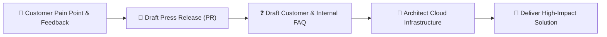

# 👑 Amazon Leadership Principles: Customer Obsession

> **Course**: AWS re/Start Foundational Soft Skills  
> **Module**: M00 – Leadership Principles Deep Dive  
> **Source**: `T10-RSTFSS_EN-US_SG_M00_LPCustomerObsession.pdf`  
> **Target Audience**: AWS re/Start Learners  

---

## 🎯 Module Overview

**Customer Obsession** is the cornerstone and first among Amazon's Leadership Principles. At Amazon and across cloud infrastructure teams, every technical architecture, service feature, operational runbook, and business decision begins with one fundamental question: *"How does this delight and earn trust with the customer?"*

In technical roles—such as Cloud Support Associate, DevOps Engineer, or SysOps Administrator—your customers include both external clients using cloud services and internal stakeholders (developers, product managers, security teams, and executive management).

This guide deconstructs the philosophy of Customer Obsession, provides tactical frameworks for applying the **STAR (Situation, Task, Action, Result)** methodology to behavioral interview scenarios, provides high-scoring model responses, and features a complete 50-minute workshop exercise.

### 📌 Learning Objectives
- [ ] Understand the philosophy and 3 pillars of Amazon's Customer Obsession
- [ ] Differentiate between competitor-centric and customer-obsessed mindsets
- [ ] Master Amazon's "Working Backwards" product and engineering philosophy
- [ ] Structure compelling behavioral interview stories using the STAR methodology
- [ ] Formulate quantified, trust-building interview answers for cloud customer support
- [ ] Complete peer-reviewed mock interview practice with the evaluation rubric

---

## 🏛️ The Definition & Core Pillars

> [!IMPORTANT]
> **Official Amazon Leadership Principle Definition**:  
> *"Leaders start with the customer and work backwards. They work vigorously to earn and keep customer trust. Although leaders pay attention to competitors, they obsess over customers."*

```
┌────────────────────────────────────────────────────────────────────────┐
│                      THE 3 PILLARS OF CUSTOMER OBSESSION               │
├───────────────────┬────────────────────────────┬───────────────────────┤
│ 1. Work Backwards │ 2. Earn & Keep Trust       │ 3. Obsess on Customer │
│ Start with pain   │ Deliver promises, maintain │ Competitors inform;   │
│ points and build  │ transparency, prioritize   │ customer needs drive  │
│ inward to tech    │ long-term relationships    │ innovation & roadmap  │
└───────────────────┴────────────────────────────┴───────────────────────┘
```

### 1. Working Backwards
Amazon famously utilizes the **"Working Backwards"** mechanism when developing any service or feature:
- Write the **Customer Press Release** first (announcing what problem is solved and why the customer loves it).
- Draft the **Customer FAQ** (answering hard questions about usability, edge cases, pricing, and migration).
- Define the **User Experience / Interaction Walkthrough**.
- Only after the customer experience is crystal clear does the engineering architecture begin.



### 2. Earning & Keeping Customer Trust
- Trust takes years to build, seconds to break, and forever to repair.
- In cloud engineering, earning trust means:
  - **High Availability & Reliability**: Designing fault-tolerant systems across Multi-AZ environments.
  - **Radical Transparency**: Communicating outages or misconfigurations proactively with detailed Root Cause Analyses (RCAs).
  - **Fiduciary Responsibility**: Recommending cost-optimization strategies (e.g., AWS Cost Explorer, Reserved Instances, Rightsizing) even when it lowers immediate vendor billing.

### 3. Customer Obsession vs. Competitor Obsession

| Dimension | 🥊 Competitor-Centric Mindset | 👑 Customer-Obsessed Mindset |
| :--- | :--- | :--- |
| **Primary Motivation** | Beating the rival's features or pricing | Relieving customer friction & unblocking growth |
| **Product Roadmap** | Reactive; copies what competitors release | Proactive; invents based on latent customer needs |
| **Meeting Culture** | Focus on market share percentages | The "Empty Chair" representing the customer |
| **Long-Term Risk** | Building features nobody actually needs | Sustained loyalty and compounding trust |

> [!TIP]
> **The Empty Chair Concept**: Jeff Bezos popularized placing an empty chair in critical leadership meetings to represent the customer—the most important stakeholder in the room who has no voice unless leaders advocate for them.

---

## ⭐ The STAR Methodology for Customer Obsession

The **STAR method** is the universal standard for behavioral interview answers at Amazon, AWS, and enterprise tech employers. It turns open-ended inquiries into structured, evidence-backed narratives.

```
┌────────────────────────────────────────────────────────────────────────┐
│                              STAR METHOD                               │
├────────────────────────────────────────────────────────────────────────┤
│ [S] Situation : Context, customer identity, and stakes. (15% time)     │
│ [T] Task      : The objective or customer pain point. (15% time)       │
│ [A] Actions   : Concrete steps YOU took; customer advocacy. (50% time) │
│ [R] Results   : Quantified customer outcome & trust earned. (20% time) │
└────────────────────────────────────────────────────────────────────────┘
```

### 🔍 Tactical Guide for Each STAR Component:

#### 1. Situation (S)
- State who the customer was (client business, end user, internal engineering team, student peer).
- What was at risk? (System outage, missed release deadline, compliance penalty, customer frustration).
- Keep context crisp; do not spend more than 25–30 seconds here.

#### 2. Task (T)
- Clarify your specific responsibility.
- What was the customer's direct expectation versus what was realistically needed?
- Highlight any tension between speed, cost, security, or customer satisfaction.

#### 3. Action (A) — *The Heart of Your Story (Use "I", not "We")*
- **Empathy & Discovery**: How did you listen and diagnose the customer's real underlying problem?
- **Advocacy**: How did you stand up for the customer's needs when shortcuts or quick fixes were tempted?
- **Execution**: What technical steps, cloud configurations, or creative workarounds did you execute?
- **Communication**: How did you keep the customer informed throughout the process?

#### 4. Result (R)
- **Quantifiable Metrics**: Use percentages, hours saved, dollars reduced, latency dropped, or CSAT scores (e.g., "reduced incident resolution time by 40%").
- **Trust Factor**: How did the customer respond? Did they renew, send commendations, or adopt the solution?
- **Long-term Mechanisms**: Did you write runbooks, automate scripts, or document FAQs to prevent the issue for future customers?

---

## 🎯 Customer Obsession Behavioral Question Bank

Interviewers evaluate whether you instinctively prioritize customer delight over personal convenience or rigid processes. Prepare STAR stories for these common prompts:

- [ ] *"Tell me about a time when you went above and beyond to solve a customer's problem."*
- [ ] *"Describe a situation where a customer made an unreasonable request. How did you handle it?"*
- [ ] *"Give an example of a time when you had to balance customer satisfaction with technical or budget constraints."*
- [ ] *"Tell me about a time when you received harsh feedback from a client or teammate. What actions did you take?"*
- [ ] *"Describe a time when you anticipated a customer need before they even realized or voiced it."*
- [ ] *"Tell me about a situation where an internal stakeholder's priority conflicted with an external customer's experience."*

---

## 🏆 Exemplary Interview Model Answers

### 🌟 Scenario 1: Cloud Operations & Customer Production Outage (External Customer)

> **Interview Question**: *"Tell me about a time when you had to resolve a high-stakes issue for an urgent, unhappy customer."*

- **Situation (S)**:  
  *"In my previous role supporting cloud infrastructure services, an e-commerce client experienced severe slowdowns and database timeouts on their web application during a peak holiday flash sale, risking thousands of dollars in lost transactions every minute."*

- **Task (T)**:  
  *"As the on-duty support specialist, my goal was not merely to restart the servers to temporarily restore traffic, but to rapidly restore operational performance without data loss, maintain constant communication with their panic-stricken engineering director, and identify the root cause."*

- **Actions (A)**:  
  *"First, I immediately hopped on a dedicated bridge call with the client's lead developer to acknowledge the severity and assure them I was taking end-to-end ownership. Looking at the metrics, I observed CPU utilization on their primary Amazon RDS instance at 99% caused by unexpected query connection spikes.  
  Instead of suggesting an immediate maintenance restart that would drop live shopping carts, I took three decisive actions:  
  1. I provisioned an RDS Read Replica within minutes and redirected read-heavy product catalog traffic away from the primary writer node.  
  2. I enabled Amazon RDS Performance Insights to isolate two unindexed query loops that were locking tables.  
  3. I shared temporary connection pool optimization parameters to immediately drop thread contention."*

- **Result (R)**:  
  *"Application latency dropped from 4,200 ms back to under 180 ms in less than 20 minutes, allowing the flash sale to complete with record sales volume. The client's director sent an email thanking our leadership for our calm and decisive communication. Following the incident, I worked backwards from their incident by delivering a comprehensive Root Cause Analysis (RCA) and recommending an automated AWS Lambda scheduled scaling script for their future promotions, eliminating repeat bottlenecks."*

---

### 🌟 Scenario 2: Cross-Functional Team Collaboration (Internal Customer)

> **Interview Question**: *"Describe a time when you improved a process for an internal customer or teammate."*

- **Situation (S)**:  
  *"During our AWS re/Start capstone project, our development sub-team was frequently blocked because provisioning test cloud environments required manual AWS CLI script executions that took over 45 minutes and occasionally broke due to misaligned environment variables."*

- **Task (T)**:  
  *"I recognized that my peers were my customers. My objective was to eliminate this friction by creating an automated, reproducible deployment process so they could test their code changes independently without waiting or troubleshooting broken dependencies."*

- **Actions (A)**:  
  *"I interviewed three team members to understand their biggest pain points. Taking their feedback, I authored an AWS CloudFormation template that declared our complete VPC network, security groups, EC2 instances, and S3 buckets with parameter files for development, staging, and testing.  
  I wrote a clear, 1-page markdown README with copy-paste deploy commands, tested it across fresh terminal environments to verify zero bugs, and hosted a 15-minute walkthrough demo for the group."*

- **Result (R)**:  
  *"Environment setup time dropped from 45 minutes of manual error-prone setup to a single 4-minute automated deployment (`aws cloudformation deploy`). Our team completed all capstone deliverables two days ahead of schedule, and two teammates adopted the template pattern for their individual certification project labs."*

---

## 👥 50-Minute Classroom Activity Guide

```
┌────────────────────────────────────────────────────────────────────────┐
│               50-MINUTE CUSTOMER OBSESSION WORKSHOP SCHEDULE           │
├──────────────┬────────────────────────────────────────────────────────┤
│ 00 – 10 mins │ 🧠 Brainstorming: Identify 2–3 Customer Obsession feats │
│ 10 – 25 mins │ ✍️ Drafting: Outline your story using the STAR template │
│ 25 – 45 mins │ 🗣️ Peer Roleplay: Partner mock interviews (10 min each) │
│ 45 – 50 mins │ 📝 Debrief: Group share-out & instructor feedback       │
└──────────────┴────────────────────────────────────────────────────────┘
```

### 🤝 Instructions for Pair Practice
1. **Pair Up**: Find a study partner. Person A is the **Candidate**; Person B is the **Amazon Bar Raiser / Interviewer**.
2. **First Round (10 mins)**: Person B asks one behavioral question from the bank above. Person A answers using STAR (aim for 2.5 to 3 minutes total). Person B provides 2 minutes of critique using the rubric below.
3. **Switch Roles (10 mins)**: Person A interviews Person B.

---

### 📊 Peer Evaluation & Feedback Rubric

| Evaluation Criteria | Needs Work (1) | Competent (2) | Bar Raiser / Excellent (3) | Score |
| :--- | :--- | :--- | :--- | :--- |
| **Customer Focus** | Customer is absent or blamed for issue | Mentions customer needs | Shows relentless empathy and advocacy | [ /3 ] |
| **STAR Structure** | Jumbled narrative, missing results | Recognizable STAR order | Crisp 15/15/50/20 balance, easy to follow | [ /3 ] |
| **"I" vs "We"** | Only says "we did", contributions vague | Mostly "I" with some team context | Crystal clear personal ownership & actions | [ /3 ] |
| **Quantified Results** | "Everything was better" (vague) | General qualitative metrics | Specific numbers, percentages, time saved | [ /3 ] |
| **Trust & Mechanism** | No follow-through or trust focus | Customer was satisfied | Permanent mechanism/runbook implemented | [ /3 ] |
| **Total Score** | | | **/15** | |

---

## 📝 Personal STAR Storyboard & Template

*Use this template to capture and refine your personal Customer Obsession stories for upcoming tech interviews.*

```markdown
### 🌟 Story Title: [E.g., Automated Client Backup Recovery Script]
- **Target Leadership Principle**: Customer Obsession
- **Target Role**: Cloud Support Associate / Junior Cloud Engineer
- **Date / Setting**: [Project / re/Start Week / Previous Job]

#### 1. Situation (S) - Setting the Context (approx. 20-30 seconds)
- Who was the customer? 
  > 
- What was their problem or business emergency? 
  > 
- What were the stakes if not resolved? 
  > 

#### 2. Task (T) - Defining Your Responsibility (approx. 20-30 seconds)
- What was your specific assignment or deliverable? 
  > 
- What technical or organizational challenges stood in the way? 
  > 

#### 3. Actions (A) - What YOU Personally Did (approx. 60-90 seconds)
- How did you listen and diagnose the customer's true requirements?
  > 
- What specific tools, scripts, or cloud technologies did you deploy?
  > 
- How did you communicate with the customer while resolving it?
  > 
- What roadblocks did you encounter, and how did you overcome them?
  > 

#### 4. Results (R) - The Value Delivered & Trust Earned (approx. 30-45 seconds)
- What was the quantitative outcome? (Numbers, %, time saved, dollars saved)
  > 
- How did the customer express their trust and satisfaction?
  > 
- What long-term process, mechanism, or runbook did you create?
  > 
```

---

## 💡 Quick Tips for Interview Success

> [!TIP]
> - **Never blame the customer**: Even if a customer made a configuration mistake or clicked the wrong button, customer-obsessed leaders focus on how the interface, documentation, or guardrails can be improved.
> - **Internal customers matter**: If you lack direct client-facing tech experience, use stories involving developers, lab partners, instructors, or non-technical peers you assisted.
> - **Have data ready**: If you don't have exact metrics, estimate with integrity (e.g., *"reduced ticket response turnaround by approximately 30%"*).
> - **End with a mechanism**: Amazon loves **mechanisms**—a process, tool, or policy that prevents repeat problems automatically. Always mention what lasting artifact you left behind.
