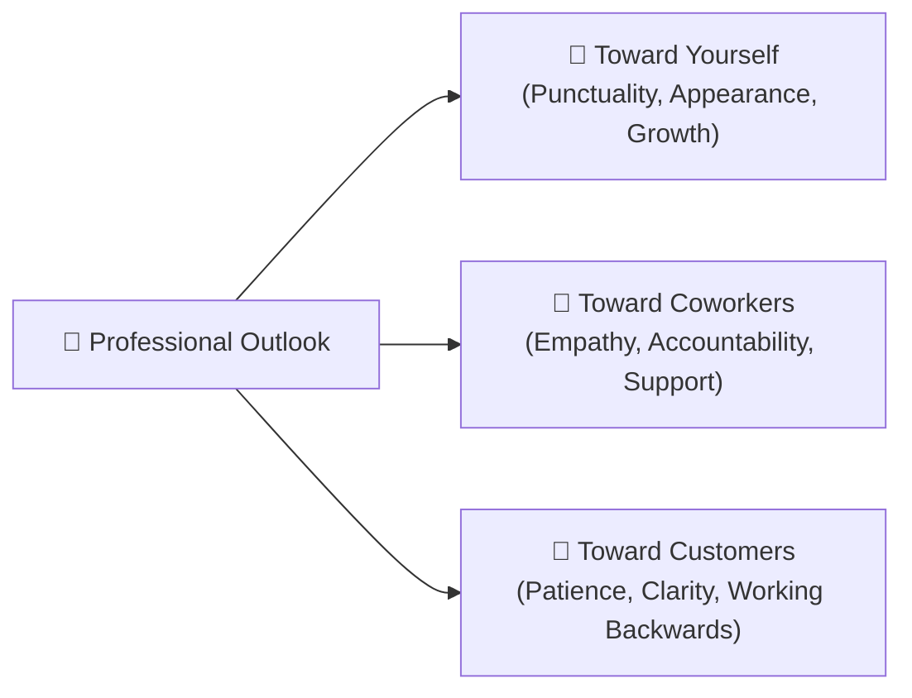
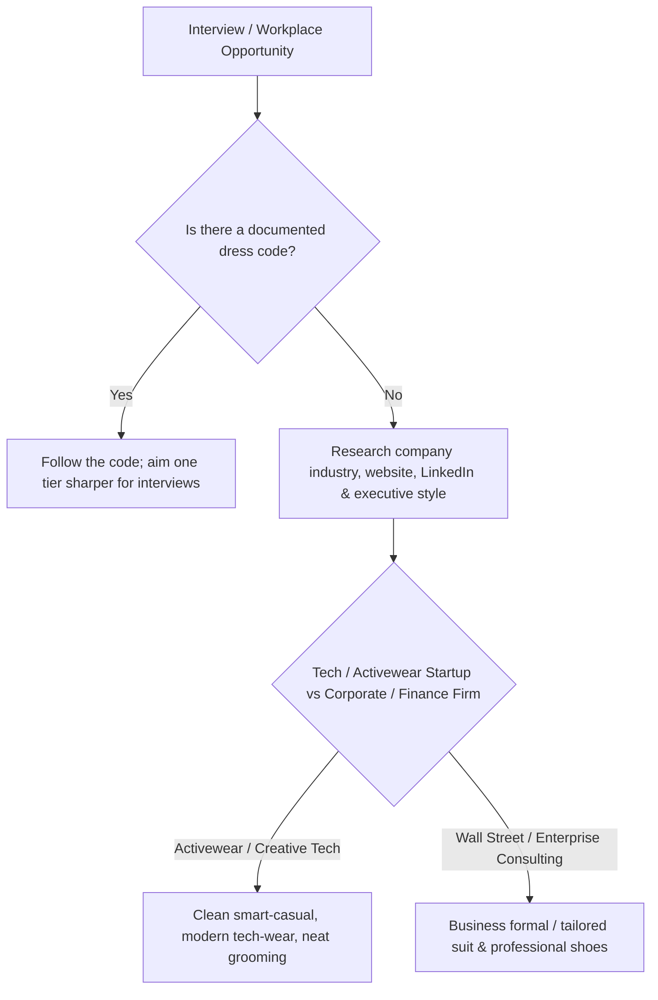
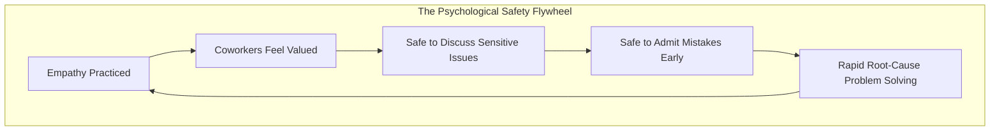
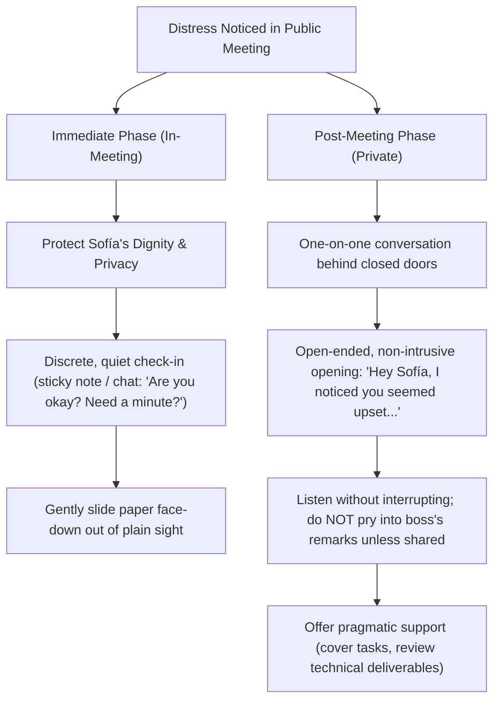
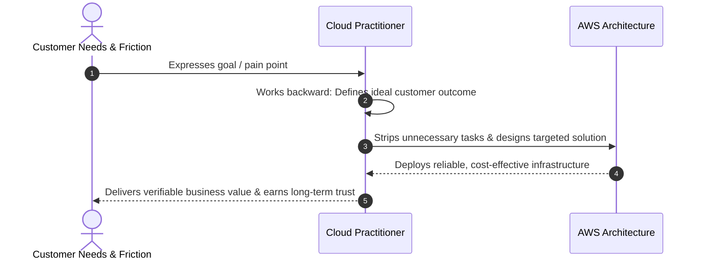
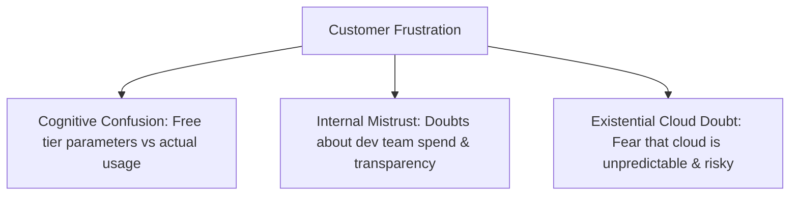
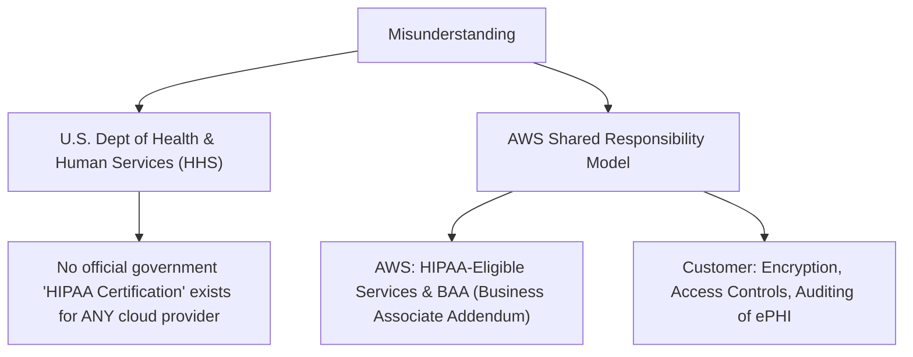

# 👔 Professional Outlook & Workplace Demeanor

> **Course**: AWS re/Start Foundational Soft Skills  
> **Module**: M00 – Professional Outlook (Techno-Functional Soft Skills)  
> **Source**: `T11-RSTFSS_EN-US_SG_M00_OUTLOOK.pdf`  
> **Target Audience**: AWS re/Start Learners & Aspiring Cloud Practitioners  

---

## 🎯 Module Overview

In modern technology organizations and cloud operations, **technical excellence alone is insufficient**. Professionalism is the foundational operating system upon which technical expertise delivers business value. 

This module explores the multidimensional nature of a **Professional Outlook**—encompassing physical presentation, emotional intelligence, workplace interpersonal dynamics, and customer-facing de-escalation. Through realistic workplace and cloud support scenarios (ranging from peer distress to severe billing confusion and regulatory HIPAA panic), learners develop the behavioral maturity needed to earn trust and lead with empathy.

### 📌 Learning Objectives
- [ ] Define **Professionalism** and articulate how it influences coworkers, organizational culture, and customers
- [ ] Understand **Dress Code** standards across diverse technical environments and job interviews
- [ ] Cultivate workplace **Empathy** to foster psychological safety and team trust
- [ ] Apply Amazon's **Customer Obsession** leadership principle by working backward from customer needs
- [ ] Differentiate communication styles across personal, internal, and client stakeholders
- [ ] Deconstruct and resolve complex customer dilemmas involving **AWS Lambda billing** and **HIPAA compliance**

---

## 📖 1. Core Terminology & Definitions

| Term | Operational Definition in Cloud & Business Context |
| :--- | :--- |
| **Professionalism** | The conduct, aims, integrity, accountability, and qualities that characterize a trusted worker. It spans appearance, verbal/written communication, time management, emotional control, and customer interactions. |
| **Dress Code** | The set of written or unwritten standards established by an organization regarding acceptable clothing and grooming. It reflects industry norms, company culture, and client expectations. |
| **Empathy** | The cognitive and emotional capacity to be aware of, understand, and sensitively relate to the feelings, thoughts, and lived experiences of others. |
| **Customer-Centricity** | A business architecture and personal mindset where every decision, process, and communication starts with customer needs and works backward to create maximum value. |
| **AWS Lambda** | An event-driven, serverless compute service that runs code in response to events and automatically manages the underlying compute resources. |
| **HIPAA Compliance** | Adherence to the *U.S. Health Insurance Portability and Accountability Act* of 1996, which establishes national standards to protect sensitive Patient Health Information (PHI). |



---

## 👤 2. What is Professionalism? The Ripple Effect

Unprofessional behaviors rarely exist in a vacuum. A lapse by a single team member creates a cascading impact across coworkers, overall business operations, and customer trust.

### 🔍 Workplace Behavioral Case Studies

```
┌────────────────────────────────────────────────────────────────────────────────────────┐
│                              THE 3-TIER IMPACT MATRIX                                  │
├───────────────┬────────────────────────┬───────────────────────┬───────────────────────┤
│ Team Member   │ Impact on Coworkers    │ Impact on Business    │ Impact on Customers   │
├───────────────┼────────────────────────┼───────────────────────┼───────────────────────┤
│ Richard       │ Resentment from having │ Standup delays, lost  │ Missed SLA windows,   │
│ (Consistently │ to cover shift starts  │ productivity, reduced │ slow support response │
│ 15-20m late)  │ or delay handoffs.     │ velocity.             │ times.                │
├───────────────┼────────────────────────┼───────────────────────┼───────────────────────┤
│ John          │ Emotional drain; toxic │ Low morale; higher    │ Negative attitude can │
│ (Grumpy, loud │ cynicism undermines    │ turnover; hampers     │ bleed into tickets,   │
│ negativity)   │ creative synergy.      │ collaboration.        │ hurting CSAT.         │
├───────────────┼────────────────────────┼───────────────────────┼───────────────────────┤
│ Martha        │ Teammates blocked;     │ Bottlenecks in team   │ Customer resolutions  │
│ (Unapproachable, feels unvalued while  │ knowledge transfer    │ delayed due to        │
│ personal calls)waiting for help.       │ and issue resolution. │ unshared expertise.   │
├───────────────┼────────────────────────┼───────────────────────┼───────────────────────┤
│ Mateo         │ Destroys safety; peers │ Repeated errors; no   │ Substandard delivery; │
│ ("Not my fault", walk on eggshells;    │ root-cause learning;  │ finger-pointing in    │
│ blames others) toxic culture.          │ audit vulnerabilities.│ incident reports.     │
├───────────────┼────────────────────────┼───────────────────────┼───────────────────────┤
│ Jane          │ Discomfort, anxiety;   │ HR liabilities; risks │ Severe brand damage   │
│ (Reliable but │ fear of unpredictable  │ creating a hostile    │ if rants occur within │
│ profane rants) outbursts.              │ work environment.     │ earshot of customers. │
└───────────────┴────────────────────────┴───────────────────────┴───────────────────────┘
```

> [!IMPORTANT]
> **Key Insight**: High technical capability does not excuse toxic behavior. Jane and Martha are skilled and reliable producers, but their interpersonal liabilities degrade team psychological safety and organizational throughput.

---

## 👔 3. Physical Appearance & Impression Management

Your visual presentation communicates respect for your organization, your teammates, and yourself. It establishes nonverbal credibility before you speak a single word.



### 🧭 Industry-Specific Dress Code Considerations

| Setting | Standard Attire | Rationale & Nuance |
| :--- | :--- | :--- |
| **High-End Fashion / Finance (e.g., NYC)** | Business Formal / Sharp Business Casual (Tailored suits, dresses, dress shoes) | Clients demand high aesthetic polish, traditional authority, and executive presentation. |
| **Activewear Tech Brand (e.g., Atlanta)** | Modern Athleisure / Elevated Smart Casual (Clean designer sneakers, tech fleece, chinos) | Aligns with brand identity, active lifestyle, and agility while maintaining cleanliness and fit. |
| **Cloud IT Support (Remote / Back-Office)** | Clean Business Casual / Neat Collared Shirt | Even if video cameras are infrequent, dressing purposefully primes cognitive focus and professional readiness. |

### 🎯 Interview Preparation Protocol
- [ ] **Research Early**: Review company social media, employee profiles, and glassdoor insights to gauge everyday attire.
- [ ] **Dress One Tier Sharper**: For an interview, err on the side of formality (e.g., if the office is casual, wear smart business casual; if business casual, wear a blazer or suit).
- [ ] **Grooming & Condition**: Ensure garments are clean, pressed, and unwrinkled.
- [ ] **Jewelry & Body Art**: Assess the prospective employer's brand guidelines and client interface expectations. When in doubt, opt for subtlety during initial interviews.

---

## 💬 4. Audience Adaptation & Communication Boundaries

Effective professionals understand **contextual register** (code-switching). How you frame ideas, express emotion, and choose vocabulary depends directly on who you are speaking with.

```
┌────────────────────────────────────────────────────────────────────────┐
│                        SPECTRUM OF FORMALITY                           │
│                                                                        │
│   Informal & Casual                             Formal & Measured      │
│   ◄────────────────────────────────────────────────────────────────►   │
│   [Family / Friends]  ──►  [Coworkers]  ──►  [Manager]  ──►  [Customers]│
└────────────────────────────────────────────────────────────────────────┘
```

| Audience | Communication Goal | Boundaries & Key Rules |
| :--- | :--- | :--- |
| **Family & Friends** | Deep emotional intimacy, casual sharing, unfiltered expression | High familiarity, colloquial language, personal topics permitted. |
| **Coworkers** | Collaborative camaraderie, project alignment, mutual support | Friendly and warm, but strictly respectful; avoid gossip, politics, offensive slang, and emotional venting. |
| **Boss / Manager** | Strategic transparency, problem-solving, progress updates | Bottom-Line-Up-Front (BLUF); bring solutions alongside problems; respect time constraints. |
| **Customers** | Trust-building, consultative guidance, empathetic problem resolution | Extreme patience, active listening, zero defensive jargon, professional polish regardless of provocation. |

---

## ❤️ 5. Professionalism & Empathy

Empathy is neither weakness nor agreement; it is the **deliberate cognitive discipline of understanding another human's emotional and operational reality**.



### 🌟 5 Core Organizational Benefits of Empathy
1. **Open Dialogue**: Coworkers feel comfortable speaking up about blocking issues early.
2. **Personal Validation**: Colleagues and clients feel that their challenges and perspectives genuinely matter.
3. **Psychological Safety**: Team members do not hide critical bugs or sensitive vulnerabilities.
4. **Transparent Accountability**: People openly admit mistakes without fear of punitive humiliation.
5. **Quality of Output**: An honest, communicative environment directly improves technical and operational deliverables.

---

### 🎭 Case Scenario: The Distressed Teammate (Sofía)

```
┌────────────────────────────────────────────────────────────────────────────────────────┐
│ SCENARIO: Sofía rushes into your conference room several minutes late. She places her  │
│ laptop on the table, immediately buries her head in her hands, and shakes her head in  │
│ deep distress. You spot a paper on the table with "Unacceptable, Sofía!" written in    │
│ red marker in your boss's unmistakable handwriting. The meeting has started, but no    │
│ agenda items have been discussed yet.                                                  │
└────────────────────────────────────────────────────────────────────────────────────────┘
```

#### 🧭 Structured Incident Handling



#### ❓ Reflection & Follow-Up Prompts
- **Why wait for full discussion?** Calling out the red letter in front of the team would amplify embarrassment and violate privacy.
- **First words to say in private**: *"Sofía, I noticed you looked really overwhelmed before the meeting. I'm here if you want to vent or talk through anything, but no pressure. How can I support you today?"*
- **Earning peer trust**: Respecting boundaries while demonstrating proactive compassion signals to the entire cohort that you are safe, discreet, and reliable.

---

## 🎯 6. Customer-Centricity & Amazon Customer Obsession

```
┌────────────────────────────────────────────────────────────────────────┐
│                        CUSTOMER OBSESSION                              │
│                                                                        │
│   "Leaders start with the customer and work backward. They work        │
│    vigorously to earn and keep customer trust. Although leaders pay    │
│    attention to competitors, they obsess over customers."             │
│                                           — Amazon Leadership Principle│
└────────────────────────────────────────────────────────────────────────┘
```



---

## 🔬 7. Case Study 1: The Confused Customer (AWS Lambda Billing)

### 📞 The Scenario
A customer calls AWS support in distress. They explain that sales informed them they would receive **1 million free Lambda invocations per month**. Assuming their developer team could never exceed this, they were shocked to receive a monthly bill exceeding **$70.00**.

> *"I should have never started using the cloud! Now, I'm in trouble and I can't figure it out!"*

---

### 🧩 Analytical Breakdown



| Professional Skill | Application in Scenario |
| :--- | :--- |
| **Clear Communication** | Restate the problem calmly: *"I understand you were expecting zero charges under the free tier and are surprised by this $70 bill. Let's look into this together."* |
| **Deep Product Knowledge** | Explain that AWS Lambda's Free Tier includes **1 million free requests** AND **400,000 GB-seconds of compute time** each month. Invocations above 1M, or high memory/execution durations, incur compute charges. |
| **Emotional Cues & Empathy** | Acknowledge the anxiety: Cloud cost models can feel daunting during initial migration. Validate their concern without validating unfounded panic. |
| **Analytical Decision-Making** | Pull telemetry and billing data: The developers actually initiated **32.5 million invocations** with memory allocations between 128 MB and 1,024 MB. |

### 🛠️ Step-by-Step Resolution Plan

- [ ] **Step 1: Validate & De-escalate**: Confirm that AWS did indeed credit the first 1,000,000 requests and 400,000 GB-seconds free of charge.
- [ ] **Step 2: Present Transparent Metrics**: Share clear CloudWatch / Cost Explorer breakdown showing 32.5M invocations.
- [ ] **Step 3: Provide Actionable Tools**: Share the **AWS Pricing Calculator** and architectural documentation for Lambda memory optimization.
- [ ] **Step 4: Connect Account Resources**: Facilitate an introduction with the AWS Account Sales team to discuss AWS Budgets, Billing Alerts, and architectural right-sizing.

---

## 🔬 8. Case Study 2: The Angry Customer (HIPAA Compliance & Security)

### 📞 The Scenario
An IT manager servicing multiple medical clinics calls the AWS support center furious, shouting into the phone:
- They were led to believe AWS was compliant with the **U.S. Health Insurance Portability and Accountability Act (HIPAA)**.
- A clinic office manager recently claimed that *"no HIPAA certification exists for cloud service providers"*.
- Medical clients are threatening legal action because the IT manager cannot produce an official "HIPAA Certification Certificate".
- The caller demands an emergency expedited return of all clinic data via **AWS Snowball** so they can terminate cloud operations immediately.

---

### 🧩 Analytical Breakdown & Regulatory Reality



> [!CAUTION]
> **Extreme Demands**: Complying blindly with the customer's demand to pull all data onto AWS Snowball would severely disrupt live healthcare services, incur unnecessary migration costs, and fail to address the core compliance misunderstanding.

---

### 🛡️ Five Pillars of Professional De-escalation

```
┌────────────────────────────────────────────────────────────────────────┐
│                    PROFESSIONAL DE-ESCALATION MODEL                    │
├───────────────────┬────────────────────────────────────────────────────┤
│ 1. Calm Patience  │ Allow the customer to express their intense stress │
│    & Focus        │ without interrupting or reacting defensively.      │
├───────────────────┼────────────────────────────────────────────────────┤
│ 2. Empathetic     │ Acknowledge legal/regulatory liability:            │
│    Validation     │ "I completely recognize the massive legal pressure │
│                   │ and patient privacy responsibility you are under." │
├───────────────────┼────────────────────────────────────────────────────┤
│ 3. Clear Framing  │ Clarify that HHS does not certify cloud providers; │
│    & Knowledge    │ AWS provides HIPAA-eligible services under a BAA.  │
├───────────────────┼────────────────────────────────────────────────────┤
│ 4. Structured     │ Point to AWS Artifact to execute the Business      │
│    Artifacts      │ Associate Addendum (BAA) and download SOC 2 /      │
│                   │ ISO 27001 / FedRAMP compliance reports.           │
├───────────────────┼────────────────────────────────────────────────────┤
│ 5. Sound Decision │ Prevent rash destructive actions (Snowball egress) │
│    Making         │ and guide customer back to secure compliance.      │
└───────────────────┴────────────────────────────────────────────────────┘
```

#### 📋 Professional Script for Healthcare IT Resolution
> *"I understand completely why you are alarmed—when clinic administrators hear the word lawsuit, it is terrifying. Let me clarify what is happening and how we can protect your clinics immediately.*  
>  
> *The clinic manager is technically correct that there is no governmental 'HIPAA Certificate' issued by the U.S. Department of Health and Human Services to any cloud vendor. However, AWS enables HIPAA compliance through our **Business Associate Addendum (BAA)** and third-party audited security controls.  
>  
> *Right now in the **AWS Artifact console**, you can accept the BAA and download third-party audit reports (SOC 1/2/3, ISO 27001, HITRUST) to prove due diligence to your medical clinics. Migrating your data onto Snowball today would disrupt your clinical operations and won't resolve your regulatory requirements. Let's walk through AWS Artifact together right now."*

---

## 📝 9. Professionalism Self-Assessment & Reflection Prompts

Use these prompts for self-reflection and group discussion:

### 💡 Personal Reflection Checklist
- [ ] **Punctuality**: Do I consistently arrive 5–10 minutes before meetings, standups, or customer calls begin?
- [ ] **Emotional Regulation**: When under intense deadlines or technical roadblocks, do I remain composed, or do I rant or blame others?
- [ ] **Customer Perspective**: Am I starting with technical tools or starting with the user's business pain point and working backward?
- [ ] **Empathy & Psychological Safety**: Do my coworkers feel comfortable admitting a broken build or failed deployment to me without fearing ridicule?
- [ ] **Executive Polish**: Does my visual, verbal, and written demeanor instill immediate trust in stakeholders?

---

## 📚 Key Takeaways

1. **Professionalism is an Operational Standard**: It encompasses dress, punctuality, ownership, emotional intelligence, and customer empathy.
2. **Empathy Unlocks High Performance**: When team members feel safe to discuss mistakes and personal challenges, teams resolve incidents faster and maintain higher retention.
3. **De-escalation Demands Product Mastery**: You cannot calm an angry or confused customer with pleasantries alone; true de-escalation requires combining empathy with authoritative technical and regulatory knowledge.
4. **Always Work Backward**: Every cloud deployment, metric, and communication must justify its existence by creating value for the customer.
