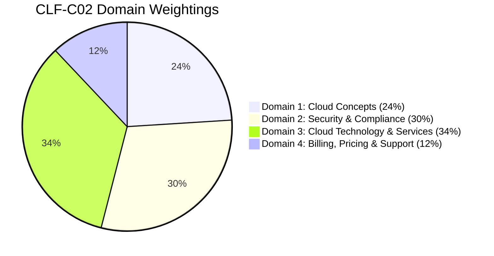
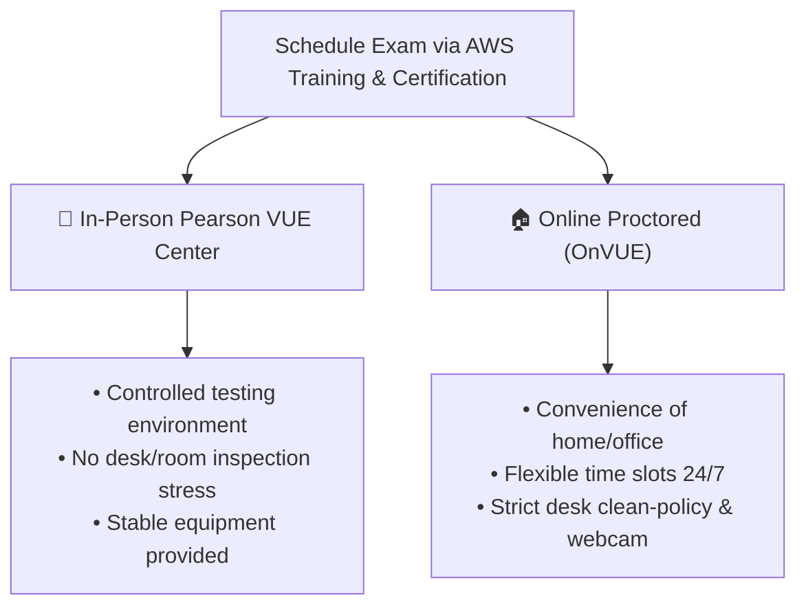

# 🏅 Getting AWS Certified: Cloud Practitioner (CLF-C02) Guide & Study Roadmap

> **Course**: AWS re/Start Foundational Skills & Technical Certification Track  
> **Module**: M00 / RSMISC – Ready to Get AWS Certified  
> **Source**: `T12-RSMISC_EN-US_SG_M00_AWSCERTIFIED.pdf`  
> **Target Audience**: AWS re/Start Learners & Cloud Career Changers  

---

## 🎯 Module Overview

As part of the **AWS re/Start** curriculum, earning your first industry-recognized credential is a pivotal milestone. The **AWS Certified Cloud Practitioner (CLF-C02)** validates an overall understanding of the AWS Cloud platform, independent of specific technical roles. 

This guide serves as your comprehensive Joplin notebook companion, covering the career value of certification, detailed exam domains, curated study pathways, official whitepapers, test-taking tactics, and an interactive study plan.

### 📌 Learning Objectives
- [ ] Understand the strategic career value of AWS Certification during career transition
- [ ] Master the 4 core domains and weightings of the CLF-C02 exam blueprint
- [ ] Review essential AWS services, shared responsibility, and Well-Architected pillars
- [ ] Access official AWS whitepapers, documentation, and practice exam resources
- [ ] Adopt test-taking strategies for Pearson VUE proctored / testing-center delivery
- [ ] Track your 4-week preparation with the interactive Joplin study checklist

---

## 🚀 1. The Value of AWS Certification for Career Transition

```
┌────────────────────────────────────────────────────────────────────────┐
│                     Why Earn Your AWS Certification?                   │
│                                                                        │
│  1. Industry Recognition: Validates foundational cloud knowledge       │
│  2. Employer Confidence: Proves tenacity, commitment, and literacy     │
│  3. Digital Credential: Credly digital badge for LinkedIn & resume     │
│  4. Stepping Stone: Prerequisite foundation for Associate-level certs   │
│  5. Global Community: Access to the AWS Certified Global Network       │
└────────────────────────────────────────────────────────────────────────┘
```

For career changers and non-traditional tech learners in AWS re/Start, certification is more than a credential—it is verifiable proof of:
- **Cloud Fluency**: Demonstrating you can converse fluently with engineers, architects, managers, and clients about cloud architecture, security, and cost models.
- **Commitment to Growth**: Employers hiring for entry-level roles (Cloud Support Associate, Junior SysOps, IT Operations) value candidates who take initiative to learn cutting-edge technology.
- **Verified Credential**: Digital badges hosted on Credly enable prospective recruiters and hiring managers to instantly verify your credential with one click.
- **Exam Perks**: Passing earns you a **50% discount voucher** for your next AWS Certification exam (e.g., Solutions Architect Associate or SysOps Administrator Associate).

---

## 📊 2. Exam Overview & Blueprint (CLF-C02)

| Specification | Details |
| :--- | :--- |
| **Exam Code** | **CLF-C02** (Current version) |
| **Level** | Foundational |
| **Duration** | **90 minutes** |
| **Number of Questions** | **65 questions** (Multiple choice & multiple response) |
| **Scoring Range** | **100 – 1000** |
| **Passing Score** | **700 / 1000** (~70%) scaled score |
| **Unscored Questions** | 15 unscored questions included for statistical evaluation (unmarked) |
| **Delivery Options** | Pearson VUE testing center OR Online proctored exam |
| **Standard Cost** | $100 USD (Check with AWS re/Start instructors regarding vouchers) |
| **Validity** | 3 years from the date of passing |

---

## 🗺️ 3. Exam Domains & Weighting



### Detailed Domain Breakdown

```
┌─────────────────────────────────────────────────────────────────────────────┐
│                       CLF-C02 Four Core Domains                             │
├───────────────────────────────┬─────────────────────────────────────────────┤
│ Domain 1: Cloud Concepts      │ • Value proposition of the AWS Cloud        │
│ (24%)                         │ • Cloud economics & financial benefits       │
│                               │ • Cloud architecture design principles      │
│                               │ • Well-Architected Framework (6 Pillars)    │
│                               │ • Cloud adoption & migration strategies     │
├───────────────────────────────┼─────────────────────────────────────────────┤
│ Domain 2: Security &          │ • AWS Shared Responsibility Model           │
│ Compliance (30%)              │ • AWS Identity & Access Management (IAM)    │
│                               │ • Data security, encryption, and governance │
│                               │ • Compliance resources & AWS Artifact       │
│                               │ • AWS Security services (WAF, Shield, etc.) │
├───────────────────────────────┼─────────────────────────────────────────────┤
│ Domain 3: Cloud Technology    │ • AWS Global Infrastructure (Regions, AZs)  │
│ & Services (34%)              │ • Compute (EC2, Lambda, ECS, Fargate)       │
│                               │ • Storage (S3, EBS, EFS)                    │
│                               │ • Networking (VPC, Subnets, Route 53, CDN)  │
│                               │ • Databases (RDS, Aurora, DynamoDB)         │
│                               │ • Monitoring (CloudWatch, CloudTrail)       │
├───────────────────────────────┼─────────────────────────────────────────────┤
│ Domain 4: Billing, Pricing    │ • AWS pricing models & compute purchasing   │
│ & Support (12%)               │ • Billing tools (Cost Explorer, Budgets)    │
│                               │ • AWS Free Tier tiers                       │
│                               │ • AWS Support plans (Developer, Business,   │
│                               │   Enterprise) & AWS Trusted Advisor         │
└───────────────────────────────┴─────────────────────────────────────────────┘
```

---

## 🧠 4. Key Concepts & High-Yield Summary

### 🏛️ AWS Well-Architected Framework (6 Pillars)
1. **Operational Excellence**: Run and monitor systems to deliver business value and continually improve processes and procedures.
2. **Security**: Protect information, systems, and assets while delivering business value through risk assessments and mitigation strategies.
3. **Reliability**: Ensure workloads perform intended functions correctly and consistently when expected (recovery, fault tolerance, scaling).
4. **Performance Efficiency**: Use computing resources efficiently to meet requirements and maintain that efficiency as demand changes.
5. **Cost Optimization**: Avoid unnecessary costs and understand where money is spent.
6. **Sustainability**: Minimize the environmental impacts of running cloud workloads.

### 🛡️ AWS Shared Responsibility Model
> [!IMPORTANT]
> **Rule of Thumb**:
> - **Security OF the Cloud**: AWS is responsible for protecting the infrastructure (hardware, software, networking, facilities) that runs all services.
> - **Security IN the Cloud**: The Customer is responsible for operating systems, network configuration, firewall rules (security groups), IAM access, encryption, and customer data.

### 🌐 AWS Global Infrastructure Hierarchy
- **AWS Region**: A physical geographical location in the world that consists of two or more Availability Zones.
- **Availability Zone (AZ)**: One or more discrete data centers with redundant power, networking, and connectivity in an AWS Region.
- **Edge Locations / Point of Presence (PoP)**: Distributed data endpoints used by **Amazon CloudFront** (CDN) and **AWS Global Accelerator** to cache and deliver content with low latency worldwide.

### 💰 AWS Pricing & Support Plans Summary
- **Purchasing Options**: On-Demand (flexible, no commitment), Savings Plans (1 or 3-year commitment for compute), Reserved Instances (steady-state workloads), Spot Instances (up to 90% discount on spare EC2 capacity, interruptible).
- **Support Plans**:
  - **Basic**: 24/7 access to customer service, documentation, 7 Core Trusted Advisor checks.
  - **Developer**: Business hours email access to Cloud Support Associates, 1 primary contact.
  - **Business**: 24/7 phone/chat/email to Cloud Support Engineers, full Trusted Advisor checks, 1-hour response for production issues.
  - **Enterprise**: 15-minute response for business-critical issues, dedicated **Technical Account Manager (TAM)**, Infrastructure Event Management (IEM).

---

## 📚 5. Recommended Study Resources & Whitepapers

### 📖 Essential AWS Whitepapers
1. [Overview of Amazon Web Services](https://docs.aws.amazon.com/whitepapers/latest/aws-overview/introduction.html) – Broad survey of core cloud services.
2. [How AWS Pricing Works](https://docs.aws.amazon.com/whitepapers/latest/how-aws-pricing-works/welcome.html) – In-depth guide to billing models and savings options.
3. [AWS Well-Architected Framework](https://docs.aws.amazon.com/wellarchitected/latest/framework/welcome.html) – The architectural principles tested heavily across all domains.
4. [Compare AWS Support Plans](https://aws.amazon.com/premiumsupport/plans/) – Clear side-by-side comparison matrix.

### 🎓 Interactive Learning Paths
- **AWS Skill Builder**: Complete the free *AWS Cloud Practitioner Essentials* digital course.
- **AWS Cloud Quest**: Play the *Cloud Practitioner* role-playing simulation for hands-on console tasks.
- **AWS re/Start Labs**: Re-run foundational labs on EC2, S3, VPC, and IAM in your sandboxed lab environment.

---

## ⏱️ 6. Exam Scheduling & Test-Day Strategy

### 💻 Scheduling Options: Testing Center vs. Online Proctoring



> [!TIP]
> **Online Proctored Checklist**:
> - Perform the system check on your computer at least 48 hours prior.
> - Ensure your testing space has a clear desk, no extra monitors, no wristwatches, and no interruptions.
> - Have government-issued photo ID (Passport, Driver's License) ready.

### 📝 Test-Taking Tactics (During the 90 Minutes)
- **Time Pacing**: With 65 questions in 90 minutes, you have approximately **1 minute and 20 seconds** per question. This leaves ~15 minutes for review.
- **Process of Elimination**: Cross out answers that are obviously incorrect (e.g., services that do not exist or violate the Shared Responsibility Model).
- **Flag for Review**: Never spend more than 2 minutes stuck on a single question. Choose your best educated guess, flag it, and return at the end.
- **Read Carefully**: Watch out for keywords such as *MOST cost-effective*, *LEAST operational overhead*, *global*, *decoupled*, and *real-time*.

---

## 📅 7. Joplin-Ready 4-Week Study Plan & Checklist

Use Joplin's interactive markdown checkboxes (`- [ ]`) to track your preparation milestones:

### 🗓️ Week 1: Cloud Concepts & Global Infrastructure
- [ ] Read *Overview of Amazon Web Services* whitepaper
- [ ] Understand Cloud vs. On-Premises advantages (agility, elasticity, global reach, OpEx vs. CapEx)
- [ ] Study Regions, Availability Zones, and Edge Locations
- [ ] Complete AWS Skill Builder Modules 1–3
- [ ] Review Joplin notes and flashcards for Week 1

### 🗓️ Week 2: Security & Compliance (Highest Yield)
- [ ] Master the AWS Shared Responsibility Model diagram
- [ ] Deep dive into AWS IAM: Users, Groups, Roles, Policies, Root Account MFA
- [ ] Review security services: AWS Shield, AWS WAF, Amazon GuardDuty, Amazon Inspector, AWS KMS
- [ ] Understand AWS Artifact (compliance reports & agreements)
- [ ] Take a 20-question practice quiz focused solely on Security

### 🗓️ Week 3: Core Technology & Architecture
- [ ] Review Compute: EC2 instance types, AWS Lambda serverless, ECS/Fargate containers
- [ ] Review Storage: S3 storage classes, lifecycle policies, EBS volumes, EFS file systems
- [ ] Review Networking: VPC, Public/Private Subnets, Internet Gateways, NAT Gateways, Security Groups vs. NACLs
- [ ] Review Databases: Amazon RDS, Amazon Aurora, Amazon DynamoDB, Amazon Redshift
- [ ] Review Monitoring & Governance: Amazon CloudWatch (metrics/alarms) vs. AWS CloudTrail (API audit logs)
- [ ] Study the 6 Pillars of the Well-Architected Framework

### 🗓️ Week 4: Billing, Support & Final Practice
- [ ] Compare AWS Support Plans (Basic, Developer, Business, Enterprise)
- [ ] Master Cost Tools: AWS Cost Explorer, AWS Budgets, AWS Pricing Calculator
- [ ] Understand Compute Savings Plans vs. Reserved Instances vs. Spot
- [ ] Take Full-Length Official Practice Exam 1 (timed, 90 mins, target score: ≥ 85%)
- [ ] Review incorrect questions and document root cause in Joplin notes
- [ ] Schedule exam appointment on Pearson VUE
- [ ] Test computer environment (if online proctored)

---

## 📝 8. Personal Notes & Weak Area Log

*Use this section to record challenging concepts, tricky quiz questions, or services you frequently confuse (e.g., CloudWatch vs. CloudTrail, Shield vs. WAF).*

```markdown
### 🔍 Tricky Concepts / Distinctions
- **CloudWatch** = Performance metrics, resource monitoring, logs, alerts ("How is the system performing?")
- **CloudTrail** = Governance, auditing, history of API calls ("Who did what and when?")
- **AWS Shield** = DDoS protection (Standard is free, Advanced is paid with 24/7 SRT)
- **AWS WAF** = Layer 7 web application firewall (blocks SQL injection, XSS, IP rate limits)
- **AWS Inspector** = Automated vulnerability assessment for EC2, containers, and Lambda
- **AWS GuardDuty** = Intelligent threat detection using machine learning and VPC flow logs
```

### 🎯 Practice Exam Performance Tracking

| Date | Practice Test Source | Score (%) | Weakest Domain / Topic | Action Item |
| :--- | :--- | :--- | :--- | :--- |
|      | Skill Builder Benchmark |           |                        |             |
|      | Practice Exam #1        |           |                        |             |
|      | Practice Exam #2        |           |                        |             |

---

## 🏆 9. Post-Exam Action Plan

Once you receive your PASS confirmation:
- [ ] Claim your Credly digital badge from AWS Training & Certification
- [ ] Add the certification to your LinkedIn profile under **Licenses & Certifications**
- [ ] Share your achievement on LinkedIn mentioning the AWS re/Start program
- [ ] Update your professional resume with the AWS Certified Cloud Practitioner badge
- [ ] Retrieve your 50% discount voucher for your next Associate-level exam!
