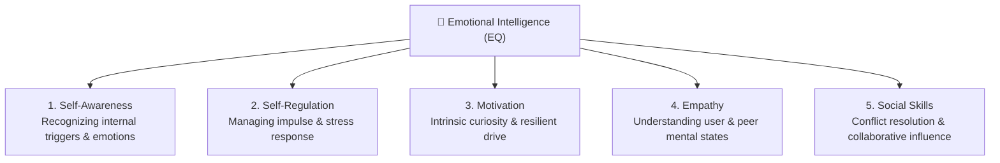
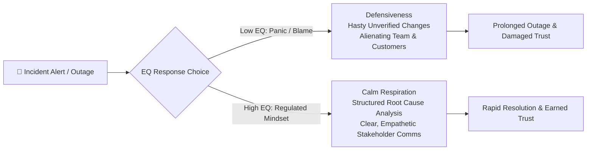
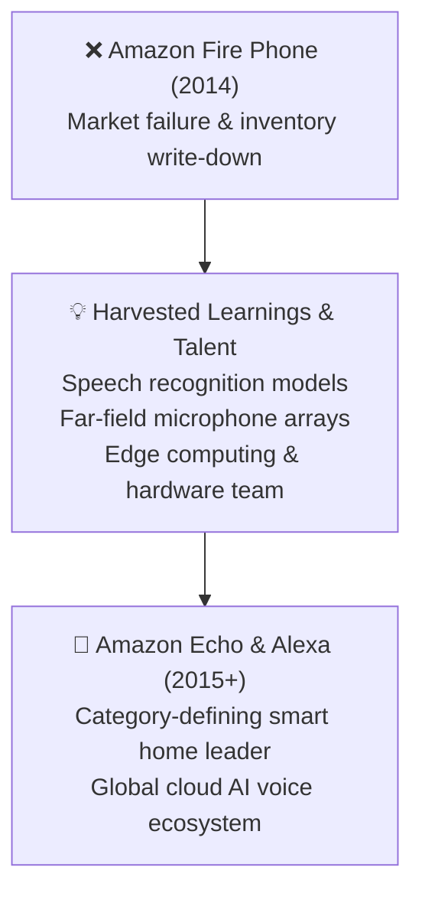

# 🧠 Emotional Intelligence (EQ) & Resilience in Tech

> **Course**: AWS re/Start Foundational Soft Skills  
> **Module**: M00 – Emotional Intelligence, Positive Attitude & Constructive Failure  
> **Source**: `T13-RSTFSS_EN-US_SG_M00_EMOTIONALINTELLIGENCE.pdf`  
> **Target Audience**: AWS re/Start Learners & Cloud Support Practitioners  

---

## 🎯 Module Overview

Technical prowess alone does not make an exceptional cloud practitioner or leader. **Emotional Intelligence (EQ)**—the capacity to recognize, understand, regulate, and harness emotions—is what differentiates engineers who thrive under pressure from those who burn out or alienate their teams.

In high-velocity cloud environments characterized by continuous deployment, complex microservices, and high-impact production incidents, EQ dictates how effectively you troubleshoot under stress, collaborate with cross-functional teams, communicate with distressed customers, and transform failures into groundbreaking innovations.

### 📌 Learning Objectives
- [ ] Articulate the core definitions and pillars of Emotional Intelligence (EQ)
- [ ] Understand the role of **Empathy** in customer obsession and cross-functional team dynamics
- [ ] Maintain emotional regulation and a constructive mindset during high-pressure outages and troubleshooting
- [ ] Contrast positive vs. negative workplace attitudes using behavioral indicators (Travis Case Study)
- [ ] Embrace failure constructively using a Growth Mindset, blameless post-mortems, and Amazon's experimental innovation model (Fire Phone $\rightarrow$ Echo/Alexa)
- [ ] Complete self-reflection audits and action plans formatted for your Joplin notebook

---

## 🏛️ 1. The Core of Emotional Intelligence (EQ)

```
┌────────────────────────────────────────────────────────────────────────┐
│                   Definition of Emotional Intelligence                 │
│                                                                        │
│  Emotional intelligence is the ability to understand, control, and     │
│  express your own emotions in a positive, constructive way to:         │
│                                                                        │
│  • Handle rejection and bounce back from setbacks                      │
│  • Navigate and relieve intense operational stress                     │
│  • Be actively aware and considerate of colleagues and customers       │
│  • Communicate technical context with clarity and calm                 │
│  • Empathize deeply with end-user pain points                          │
│  • Overcome complex obstacles and defuse interpersonal friction        │
└────────────────────────────────────────────────────────────────────────┘
```

### The 5 Pillars of Emotional Intelligence (Goleman Framework in Tech)



| Pillar | Core Meaning | Application in Cloud & IT Support |
| :--- | :--- | :--- |
| **Self-Awareness** | Recognizing your feelings, stress markers, cognitive biases, and behavioral triggers. | Knowing when fatigue or panic is clouding your diagnostic thinking during a multi-hour troubleshooting ticket. |
| **Self-Regulation** | Channeling emotional reactions constructively; maintaining composure under duress. | Resisting the urge to get defensive when a developer or customer questions your architectural choices or incident updates. |
| **Motivation** | Driving toward long-term mastery, craftsmanship, and problem resolution without needing external praise. | Staying relentless when diagnosing an elusive intermittent networking issue or learning a new AWS service. |
| **Empathy** | The ability to be aware of and deeply understand the feelings, thoughts, and experiences of others. | Acknowledging customer distress during downtime rather than dismissing them with cold, sterile jargon. |
| **Social Skills** | Managing relationships, building rapport, persuading stakeholders, and guiding collaborative teams. | Leading cross-team bridge calls, mentoring junior teammates, and aligning DevOps with business goals. |

---

## 🔍 2. Core Self-Reflection Questions

The training highlights six critical questions that every technology professional should routinely ask themselves:

> [!NOTE]
> ### 🪞 The Daily EQ Reflection Matrix
> 1. **What are you feeling?**  
>    *Are you overwhelmed, frustrated, defensive, tired, or curious right now? Naming the emotion defuses its control.*
> 2. **Do you listen?**  
>    *Are you listening to truly understand the problem, or merely waiting for your turn to speak and defend yourself?*
> 3. **Do you control your thoughts?**  
>    *Are you spiraling into catastrophic thinking ("Everything is ruined") or focusing on actionable facts?*
> 4. **How do you handle criticism?**  
>    *Do you view code reviews and feedback as an attack on your character, or as an opportunity to elevate code quality?*
> 5. **Do you show empathy?**  
>    *Do you validate the frustration of an upset stakeholder whose business operations are currently disrupted?*
> 6. **How do you treat others?**  
>    *Are you patient with junior colleagues, courteous in Slack channels, and collaborative across functional silos?*

---

## ⚡ 3. EQ Under Pressure: High-Stakes Technical Troubleshooting

When production databases hang, CloudWatch alarms trigger cascade alerts, and SLAs are ticking, your brain naturally defaults to a **fight-or-flight** response ("Amygdala Hijack"). Technical problem-solving requires prefrontal cortex engagement. High EQ enables you to switch from panic to analytical problem-solving.



### 🛑 The "STOP & REGULATE" Troubleshooting Protocol

1. **S - Stop**: Pause typing commands when adrenaline surges. Do not blindly copy-paste commands from StackOverflow into production.
2. **T - Take a Breath**: Physiological sigh (two quick inhales through the nose, long exhale through the mouth) to lower heart rate and restore cognitive focus.
3. **O - Observe**: Focus purely on verifiable metrics, logs, traces, and timeline events—not subjective panic.
4. **P - Proceed with Empathy & Plan**: Communicate status with transparency, explain next triage steps, and coordinate with peers calmly.

---

## ☀️ 4. Workplace Enthusiasm & Attitude

### Why Attitude Dictates Altitude
- Having a genuine, positive attitude in tech environments is directly correlated with career velocity and team trust.
- Employers promote individuals who are technically competent **and** elevate team morale, defuse panic, and support peers.
- Attitude is contagious: cynical negativity drags team performance down, while solutions-oriented optimism inspires innovation.

---

### 🎬 Case Study Analysis: US Department of Labor "Enthusiasm & Attitude"
*(Soft Skills to Pay the Bills – Travis Version 1 vs. Travis Version 2)*

```
┌─────────────────────────────────┬─────────────────────────────────┐
│        Travis Version 1         │        Travis Version 2         │
│      (Low EQ / Negative)        │      (High EQ / Positive)       │
├─────────────────────────────────┼─────────────────────────────────┤
│ • Slouching, defensive posture  │ • Upright, alert, open posture  │
│ • Sullen, monotone vocal tone   │ • Warm, engaging, audible tone  │
│ • Blaming circumstances/others  │ • Owning tasks & asking to help │
│ • "Not my job" mentality        │ • Curious & eager to contribute │
│ • Treats requests as burdens    │ • Treats requests as learning   │
│ • Perceived as unapproachable   │ • Perceived as reliable & ally  │
└─────────────────────────────────┴─────────────────────────────────┘
```

#### Behavioral Breakdown & Workplace Perception

| Dimension | ❌ Negative Workplace Attitude | ✅ Positive Workplace Attitude |
| :--- | :--- | :--- |
| **Observable Actions** | Sighing loudly, complaining about tickets, gossiping about other teams, resisting change, ignoring messages. | Active listening, offering proactive support, documenting helpful runbooks, greeting team members with warmth. |
| **Response to Setbacks** | "This system is broken and management doesn't care." | "Let's isolate what failed and see how we can harden our infrastructure." |
| **Colleague Perception** | Draining, hazardous to project deadlines, isolated, untrusted with critical responsibilities. | Energizing, dependable anchor, high-trust contributor, natural candidate for team lead. |
| **Customer Impact** | Escalates customer frustration through indifference and robotic answers. | De-escalates tensions, creates reassurance, converts negative incidents into loyal customer relationships. |

---

## 💥 5. Handling Failure Constructively: The Growth Mindset

```
┌────────────────────────────────────────────────────────────────────────┐
│                        Jeff Bezos on Bold Failure                      │
│                                                                        │
│  "As a company grows, everything needs to scale, including the size    │
│  of your failed experiments. If the size of your failures isn't        │
│  growing, you're not going to be inventing at a size that can          │
│  actually move the needle."                                            │
│                                                                        │
│  "Of course, we won't undertake such experiments cavalierly.           │
│  We will work hard to make them good bets, but not all good bets       │
│  will ultimately pay out."                                             │
└────────────────────────────────────────────────────────────────────────┘
```

### 📱 Amazon Fire Phone $\rightarrow$ Echo & Alexa: The Ultimate Pivot

In 2014, Amazon launched the **Amazon Fire Phone**, which was a massive commercial failure resulting in an estimated $170 million inventory write-down. 

Instead of firing the engineering team or burying the failure in shame, leadership demonstrated supreme organizational EQ:



> [!IMPORTANT]
> **Jeff Bezos on the Fire Phone Retrospective**:  
> *"The development of the Fire phone and Echo was started around the same time. While the Fire phone was a failure, we were able to take our learnings (as well as the developers) and accelerate our efforts building Echo and Alexa."*

---

### 🛡️ Building a Blameless Engineering Culture

In high-maturity cloud teams, failures are analyzed without finger-pointing:

1. **Separate Intent from Outcome**: Nobody wakes up in the morning intending to delete an S3 bucket or bring down an ALB. Systemic guards must catch human errors.
2. **Blameless Post-Mortems (Correction of Errors - COE)**:
   - Ask *how* the system allowed the mistake to propagate, not *who* typed the command.
   - Use the **5 Whys** technique to find systemic, automated safeguards.
3. **Persistence Over Despair**: Failure provides data that success cannot offer. Learn, adapt, automate, and move forward.

| Aspect | Fixed Mindset (Low EQ) | Growth Mindset (High EQ) |
| :--- | :--- | :--- |
| **Belief about Ability** | "I'm just not cut out for cloud networking." | "I haven't mastered VPC CIDR routing **yet**." |
| **Response to Criticism** | Takes code review rejections personally. | Appreciates code review as free mentorship and quality protection. |
| **Response to Failure** | Hides mistakes; points fingers at other teams. | Openly presents the incident post-mortem with actionable remediation items. |
| **Obstacles** | Gives up when an automated script throws an unexpected error. | Methodically debugs logs, tests hypotheses, and reads documentation. |

---

## 📋 6. Joplin Reflection Workbook & Practical Exercises

Use these Joplin-ready interactive templates for your weekly review and self-coaching.

### 📝 Exercise 1: Personal EQ Diagnostic Audit

Rate yourself on a scale from 1 (Needs Improvement) to 5 (Exemplary):

- [ ] **Self-Awareness**: I can identify my exact stress triggers before they cause me to snap. `[ 1 | 2 | 3 | 4 | 5 ]`
- [ ] **Emotional Impulse Control**: During heated discussions, I pause before firing off messages. `[ 1 | 2 | 3 | 4 | 5 ]`
- [ ] **Active Empathy**: I consciously put myself in the end-user's shoes during outages. `[ 1 | 2 | 3 | 4 | 5 ]`
- [ ] **Constructive Failure**: When my lab script or build fails, I view it as diagnostic data rather than defeat. `[ 1 | 2 | 3 | 4 | 5 ]`
- [ ] **Workplace Energy**: My presence in team channels and meetings elevates collective morale. `[ 1 | 2 | 3 | 4 | 5 ]`

---

### 📝 Exercise 2: Outage & Incident Decompression Worksheet

Whenever you experience a tough technical setback, complete this retrospective in your Joplin note:

```markdown
### 🛠️ Incident / Setback Decompression Note
- **Date & Context**: 2026-XX-XX / [Describe the system, ticket, or lab]
- **What Happened**: [Factual description of the error/failure without self-blame]
- **Emotional Trigger**: [Did I feel panic, anger, embarrassment, or fear?]
- **How I Reacted**: [Did I react constructively or defensively?]
- **The "Echo from the Fire Phone" Lesson**: [What is the #1 technical or behavioral lesson learned?]
- **Systemic Prevention**: [What automated guardrail, checklist, or test can prevent this recurrence?]
```

---

### 📝 Exercise 3: Group Discussion Prompts (AWS re/Start Study Pod)

Discuss these three scenarios with your peers:
1. **The Angry Customer Scenario**: A business client is yelling in an urgent ticket because their payment gateway is returning HTTP 500 errors. How does high EQ shape your first response?
2. **The Harsh Code Review Scenario**: A senior engineer leaves 14 critical comments requesting a total rewrite of your CloudFormation template. How do you regulate your thoughts before replying?
3. **The Failed Lab / Interview Scenario**: You were rejected after a technical interview round. How do you apply the Bezos experiment scaling philosophy to maintain momentum?

---

## 🌟 7. Summary & Golden Rules

```
┌────────────────────────────────────────────────────────────────────────┐
│                        The Golden Rules of EQ in Cloud                 │
│                                                                        │
│  1. Name the Emotion, Tame the Action: Feelings are data, not orders.  │
│  2. Empathy First: Always remember there is a human behind the screen. │
│  3. Attitude is a Skill: Optimism and curiosity are daily choices.     │
│  4. Fail Forward: Every failed deployment holds the seeds of your      │
│     next breakthrough architecture.                                    │
└────────────────────────────────────────────────────────────────────────┘
```

---
*© 2022, Amazon Web Services, Inc. or its affiliates. All rights reserved. Learning material adapted for personal study and professional career development.*
