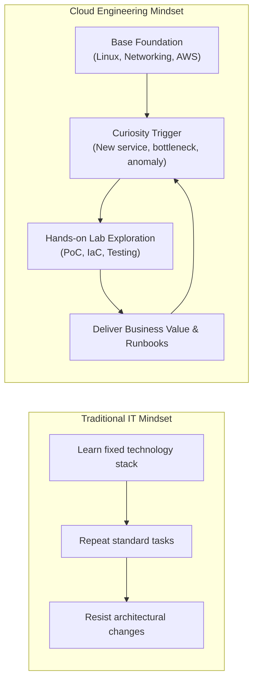

# 🧠 Amazon Leadership Principles: Learn and Be Curious

> **Course**: AWS re/Start Foundational Soft Skills (Techno-Functional Soft Skills)  
> **Module**: M00 – Leadership Principles Deep Dive & Behavioral Interviewing  
> **Source**: `T14-RSTFSS_EN-US_SG_M00_LPLearnAndBeCurious.pdf`  
> **Target Audience**: AWS re/Start Cloud Learners & Job Seekers  

---

## 🎯 Module Overview

In modern technology, especially cloud computing, tools, frameworks, and architectures evolve at a breakneck pace. Yesterday’s best practice is tomorrow’s legacy setup. Amazon’s **Learn and Be Curious** Leadership Principle captures the core philosophy required to thrive in this environment: continuous personal development and proactive exploration of the unknown.

This guide explores the foundational meaning of **Learn and Be Curious**, examines why it is critical in cloud engineering, bridges the principle directly into behavioral interview mastery via the **STAR (Situation, Task, Action, Result)** methodology, and provides a full practice worksheet and evaluation toolkit for mock interviews.

### 📌 Learning Objectives
- [ ] Understand Amazon's formal definition and core tenets of **Learn and Be Curious**.
- [ ] Recognize the critical role of self-directed learning and curiosity in cloud roles.
- [ ] Connect learning narratives to the **STAR behavioral interview methodology**.
- [ ] Analyze high-scoring sample STAR responses highlighting proactive curiosity.
- [ ] Draft, refine, and rehearse an original STAR story using the step-by-step interview worksheet.
- [ ] Conduct structured peer interview practice with an objective evaluation rubric.

---

## 💡 1. Understanding "Learn and Be Curious"

### 📜 Amazon Leadership Principle Definition

> [!IMPORTANT]
> **Amazon Leadership Principle: Learn and Be Curious**  
> *"Leaders are never done learning and always seek to improve themselves. They are curious about new possibilities and act to explore them."*

```
                     ┌───────────────────────────────────────────┐
                     │          LEARN AND BE CURIOUS             │
                     └─────────────────────┬─────────────────────┘
                                           │
                 ┌─────────────────────────┴─────────────────────────┐
                 ▼                                                   ▼
   ┌───────────────────────────┐                       ┌───────────────────────────┐
   │    NEVER DONE LEARNING    │                       │  CURIOUS & BIAS TO EXPLORE │
   ├───────────────────────────┤                       ├───────────────────────────┤
   │ • Continuous improvement  │                       │ • "What if?" mindset      │
   │ • Humility & coachability │                       │ • Hands-on experimentation│
   │ • Unlearning old paradigms│                       │ • Seeking novel solutions │
   │ • Closing knowledge gaps  │                       │ • Looking beyond your job │
   └───────────────────────────┘                       └───────────────────────────┘
```

### 🔬 Core Dimensions of the Principle

1. **Continuous Self-Improvement**:
   - Recognizing that expertise is not a fixed destination but a moving horizon.
   - Actively seeking constructive feedback from mentors, peers, and managers rather than waiting for annual reviews.
   - Taking ownership of professional and technical growth without requiring spoon-fed training.

2. **Inquisitiveness & Exploration**:
   - Asking thoughtful questions: *"Why was this system built this way?"*, *"What happens under the hood if this service fails?"*, *"Is there a more efficient or cost-effective AWS service for this workload?"*
   - Diving into documentation, RFCs, whitepapers, and source code out of intrinsic interest rather than mere obligation.

3. **Bias to Act on Curiosity**:
   - Curiosity without action is daydreaming. Leaders don't just wonder; they build proof-of-concepts (PoCs), spin up sandbox labs, write benchmark scripts, and test hypotheses.

4. **The Growth Mindset in Cloud**:
   - Embracing technical friction and errors (`HTTP 500`, `AccessDenied`, syntax failures) as high-value learning data rather than signs of inadequacy.

---

## ☁️ 2. Significance in Cloud Computing

Cloud infrastructure transforms fundamentally every 6 to 12 months. AWS releases hundreds of new features and managed services annually. In this context, static technical knowledge has a very short half-life.



### Why Cloud Employers Hire for Curiosity Over Memorization:
- **Rapid Problem Solving**: When an undocumented error occurs in production, curious engineers trace logs, read GitHub issues, inspect API contracts, and dissect underlying architectures.
- **Cost & Performance Optimization**: Curious cloud practitioners explore newly announced instance types (e.g., AWS Graviton processors), serverless models (AWS Lambda), and modern storage tiers (S3 Intelligent-Tiering) to save the company money.
- **Cross-Domain Adaptability**: Cloud practitioners often interface with networking, DevOps pipelines, database administration, and security. Curiosity enables swift cross-disciplinary competency.

---

## ⭐ 3. The STAR Methodology for "Learn and Be Curious"

In technical behavioral interviews, hiring teams ask competency-based prompts to observe how your past behavior predicts future performance. The **STAR** method structures your narrative logically.

```
┌───────────────────────────────────────────────────────────────────────────────┐
│                                STAR BREAKDOWN                                 │
├───────────────┬─────────┬─────────────────────────────────────────────────────┤
│ Component     │ Weight  │ Focus for "Learn and Be Curious"                    │
├───────────────┼─────────┼─────────────────────────────────────────────────────┤
│ [S] Situation │ 15%     │ Set the stage: What new tool, knowledge gap,        │
│               │         │ system anomaly, or unfamiliar challenge emerged?    │
├───────────────┼─────────┼─────────────────────────────────────────────────────┤
│ [T] Task      │ 15%     │ What was your specific responsibility or personal   │
│               │         │ objective? What gap needed to be bridged and why?   │
├───────────────┼─────────┼─────────────────────────────────────────────────────┤
│ [A] Action    │ 50-60%  │ What concrete steps did YOU take to research,       │
│               │         │ test, learn, and experiment? Focus on "I", not "we".│
├───────────────┼─────────┼─────────────────────────────────────────────────────┤
│ [R] Result    │ 15-20%  │ What was the measurable outcome? What did you       │
│               │         │ learn, and how did you share or apply that learning?│
└───────────────┴─────────┴─────────────────────────────────────────────────────┘
```

### 🎯 Key Elements Interviewers Look For:

> [!TIP]
> **What Interviewers Want to Hear**:
> - **Self-Initiative**: You pursued knowledge on your own initiative, not because an instructor or manager forced you to.
> - **Methodical Learning Process**: You have a reproducible strategy for learning difficult topics (e.g., documentation first, hands-on labbing, asking targeted questions).
> - **Application of Knowledge**: You didn't just read an article; you built a project, solved a bug, or streamlined a workflow.
> - **Knowledge Multiplying**: You documented findings in a runbook, wiki, or presented your learning to peers.

> [!CAUTION]
> **Common Pitfalls to Avoid**:
> - **"I had to attend a required class."** — Passive compliance is not curiosity.
> - **"We did some research."** — Overusing "we" hides your personal contribution. Use "I investigated...", "I configured...", "I tested...".
> - **No tangible result**: Ending with "and then I knew Python" is weak. Quantify the result: "I automated a 30-minute daily task into a 15-second Bash script."
> - **Pretending to know everything**: Denying knowledge gaps contradicts the spirit of the principle. Humility and eagerness to learn are rewarded.

---

## ❓ 4. Behavioral Interview Question Bank

Use these authentic interview questions to prepare your stories:

### Category A: Unfamiliar Technology & Rapid Upskilling
1. *"Tell me about a time when you were assigned a task or project involving a technology or tool you had never used before. How did you approach learning it?"*
2. *"Can you describe a situation where you had to quickly become proficient in a new operating system, programming language, or cloud service under a tight deadline?"*

### Category B: Proactive Curiosity & Going Beyond the Job Description
3. *"Give an example of a time when you noticed something outside your immediate responsibilities that sparked your interest. What did you do to explore it?"*
4. *"Tell me about a technical topic or skill you learned entirely out of personal curiosity. How did you apply that knowledge?"*

### Category C: Overcoming Roadblocks & Deep-Dive Troubleshooting
5. *"Describe a time when standard documentation or troubleshooting steps failed to solve a technical issue. How did you figure out the solution?"*
6. *"Tell me about a time you made an incorrect technical assumption. How did you realize your mistake, and what did you learn from the experience?"*

### Category D: Sharing Knowledge & Teaching Others
7. *"Once you learned a difficult concept or mastered a complex tool, how did you share that knowledge with your team or peers?"*

---

## 🏆 5. Model STAR Response: Cloud Scenario

Here is an exemplary STAR answer from an AWS re/Start graduate interviewing for a Junior Cloud Support Associate role:

### 🎙️ Interview Prompt:
> *"Tell me about a time when you encountered a technical problem involving a service or concept you were unfamiliar with. How did you resolve it?"*

```markdown
#### [S] Situation
"During the fourth week of the AWS re/Start program, our cohort had an intensive lab to deploy an Apache web application across multiple Amazon EC2 instances in private subnets behind an Application Load Balancer. Everything seemed correctly configured, but the ALB health checks kept failing with HTTP 502 Bad Gateway responses, preventing traffic from reaching our web servers."

#### [T] Task
"My responsibility was to diagnose why the ALB could not reach the instances, restore healthy target status, and verify that web traffic balanced smoothly across our Availability Zones."

#### [A] Action
"Because I was new to ALB target groups and routing architectures, I methodically broke the problem down into isolated layers:
1. **Curiosity & Hypothesis**: I asked myself whether this was a network path issue or an application server issue.
2. **Direct Verification**: Instead of guessing, I accessed an instance through AWS Systems Manager Session Manager and ran `systemctl status httpd` and `curl -I http://localhost:80`. The local server responded with `HTTP 200 OK`, confirming Apache was running properly.
3. **Deep-Dive Network Inspection**: I reviewed the security groups. I noticed our web servers had an inbound rule allowing port 80 only from our local laptops rather than from the ALB's security group.
4. **Self-Directed Study**: To ensure I truly grasped the architecture, I read the AWS Documentation on 'Target Group Health Checks' and security group chaining.
5. **Execution**: I updated the EC2 security group to reference the ALB Security Group ID as the source for HTTP port 80, preventing open exposure while allowing health check probes."

#### [R] Result
"Within two minutes, both target instances switched to 'Healthy', and requests routed flawlessly. To make this learning durable, I created a one-page visual network troubleshooting flowchart in Markdown and shared it in our cohort's Slack channel. Two other classmates used my checklist later that afternoon to resolve identical issues, saving approximately 40 minutes of debugging time."
```

---

## 📝 6. Step-by-Step Response Worksheet

Use this fillable template to craft your personal "Learn and Be Curious" STAR story.

### 📋 Story Selection Checklist
- [ ] Does this story demonstrate proactive curiosity rather than passive instruction?
- [ ] Did you encounter an unfamiliar concept, tool, or roadblock?
- [ ] Did you take tangible steps to research, test, or build?
- [ ] Can you quantify or clearly describe the positive outcome?
- [ ] Does it highlight your individual contribution ("I")?

---

### ✍️ Learner STAR Draft Sheet

```markdown
### 🏷️ Story Title: [e.g., Automating S3 Log Auditing with Python / Debugging Linux File Permissions]

#### 🎯 Selected Interview Prompt:
> [Insert selected question from Question Bank]

---

#### 1. Situation (15% - Set the context in 2-3 sentences)
- **Where were you?** (AWS re/Start lab, previous work experience, open-source project):
  - 
- **What was the challenge, knowledge gap, or unexpected scenario?**:
  - 

---

#### 2. Task (15% - Define the objective and stakes in 1-2 sentences)
- **What was your goal or assignment?**:
  - 
- **What was at stake if the problem was not solved?**:
  - 

---

#### 3. Action (50-60% - The concrete steps YOU took to learn and execute)
- **Step 1: Curiosity Trigger & Research Strategy**  
  (What questions did you ask? What documentation, logs, or resources did you consult?)
  - 
- **Step 2: Hands-on Testing & Experimentation**  
  (What commands did you run? What labs or tests did you conduct?)
  - 
- **Step 3: Roadblocks Encountered & Adaptation**  
  (What went wrong during testing, and how did you pivot or dive deeper?)
  - 
- **Step 4: Final Implementation**  
  (How did you apply your newfound understanding to solve the problem?)
  - 

---

#### 4. Result (15-20% - Measurable outcome & knowledge multiplier)
- **What was the direct technical result?** (Quantify: time saved, errors eliminated, uptime):
  - 
- **What key insight did you gain?**:
  - 
- **How did you share or institutionalize this learning?** (Runbook, presentation, code comments):
  - 
```

---

## 👥 7. Peer Practice Activity Protocol (50 Minutes)

*(Based on Slide 4 of the AWS re/Start Guide)*

```
┌────────────────────────────────────────────────────────────────────────┐
│                   50-MINUTE PRACTICE BREAKDOWN                         │
├─────────────────────┬───────────┬──────────────────────────────────────┤
│ Phase               │ Duration  │ Objective                            │
├─────────────────────┼───────────┼──────────────────────────────────────┤
│ Phase 1: Prep       │ 10 Mins   │ Individual drafting using worksheet  │
│ Phase 2: Round 1    │ 15 Mins   │ Learner A shares, Learner B evaluates│
│ Phase 3: Round 2    │ 15 Mins   │ Learner B shares, Learner A evaluates│
│ Phase 4: Debrief    │ 10 Mins   │ Mutual feedback, refinement & notes  │
└─────────────────────┴───────────┴──────────────────────────────────────┘
```

### 🤝 Instructions:
1. **Partner Up**: Work with a cohort peer. One acts as the Interviewer; the other acts as the Candidate.
2. **Interviewer Role**:
   - Ask one question from the **Question Bank**.
   - Listen actively without interrupting for 2–3 minutes.
   - Use the **Evaluation Rubric** below to score and note specific strengths and growth areas.
3. **Candidate Role**:
   - Deliver your answer using the STAR structure in under 3 minutes.
   - Emphasize proactive learning, experimentation, and self-drive.
4. **Switch Roles** at the 25-minute mark.

---

### 📊 Peer Evaluation Rubric

Rate each dimension on a scale of **1 (Needs Work)** to **5 (Exceptional)**:

| Evaluation Criteria | Score (1-5) | Specific Feedback & Observations |
| :--- | :---: | :--- |
| **STAR Structure**: Did the response follow Situation, Task, Action, and Result without rambling? | `[ /5]` | |
| **Focus on "I"**: Did the candidate showcase their individual curiosity and actions rather than hiding behind "we"? | `[ /5]` | |
| **Curiosity Demonstrated**: Was there genuine passion to explore, experiment, and learn under the hood? | `[ /5]` | |
| **Technical Depth**: Did the explanation sound credible, logical, and appropriate for cloud operations? | `[ /5]` | |
| **Measurable Result**: Did the outcome include concrete results and knowledge sharing? | `[ /5]` | |
| **Delivery & Presence**: Tone, clarity, confidence, and pacing (within 2–3 minutes). | `[ /5]` | |

**Total Score**: `[ /30]`

#### 💬 Constructive Feedback Prompts for Partners:
- *"The strongest part of your story was..."*
- *"I was confused when you mentioned..."*
- *"To make your 'Action' section punchier, you should highlight..."*
- *"Make sure to quantify your result by mentioning..."*

---

## 🚀 8. Continuous Learning Plan for Cloud Engineers

Curiosity is a daily habit, not just an interview topic. Use this personal development tracking framework in Joplin to maintain your edge:

- [ ] **Follow AWS What's New**: Review the official AWS RSS feed / blog weekly.
- [ ] **Hands-on Sandboxing**: Build one mini-architecture weekly using the AWS Free Tier.
- [ ] **Failure Autopsies**: Whenever a lab command or deployment fails, log the exact error message and the root cause before fixing it.
- [ ] **Knowledge Sharing**: Write a technical blog post or LinkedIn walkthrough explaining a complex AWS concept to beginners.
- [ ] **Certification Roadmap**: Map out next milestones (e.g., AWS Certified Cloud Practitioner ➔ Solutions Architect Associate ➔ SysOps Administrator).

---

## 📖 References & Additional Reading
- [Amazon Leadership Principles (Official Site)](https://www.aboutamazon.com/about-us/leadership-principles)
- [AWS Documentation & Architecture Center](https://aws.amazon.com/architecture/)
- [AWS re/Start Program Resources](https://aws.amazon.com/training/restart/)
- `T08-RSTFSS_EN-US_SG_M00_COMMUNICATIONSTAR.pdf` (STAR Methodology Guide)
- `T04-RSTFSS_EN-US_SG_M00_THINKBIG.pdf` (Innovation & Exploration Mindset)
