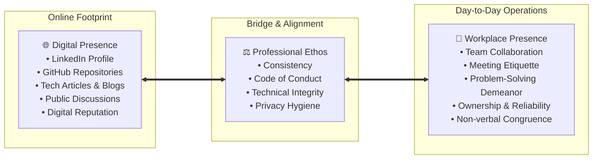
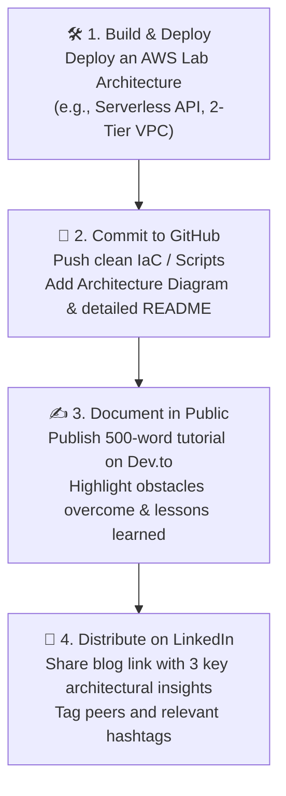

# 🌐 Crafting Your Digital & Workplace Presence: The Tech Professional's Guide

> **Course**: AWS re/Start Foundational Soft Skills  
> **Module**: M00 – Digital Presence & Personal Branding  
> **Source**: `T15-RSTFSS_EN-US_SG_M00_DIGITALPRESENCE.pdf`  
> **Target Audience**: AWS re/Start Learners & Aspiring Cloud/DevOps Professionals  

---

## 🎯 Module Overview

In the modern technology ecosystem, your digital presence is your dynamic resume and public portfolio. Long before an interviewer meets you in person or on a video call, they research your online footprint. This module covers the foundational principles of **digital presence**, how it aligns with your **workplace presence**, safeguarding your **online privacy**, adhering to corporate **codes of conduct**, and executing a high-impact social media and portfolio strategy tailored for tech recruiters.

### 📌 Learning Objectives
- [ ] Differentiate between **digital presence** and **workplace presence** and explain their symbiotic relationship.
- [ ] Understand how HR professionals and recruiters actively screen candidates online (85% of positions filled through networking).
- [ ] Conduct a personal digital audit ("Google yourself") and evaluate what employers see.
- [ ] Implement strict **online privacy and cybersecurity controls** (MFA/2FA, password vaults, privacy configurations).
- [ ] Align personal online activities with company policies and corporate **Codes of Conduct** (e.g., AWS Community Code of Conduct).
- [ ] Build an optimized, recruiter-ready **LinkedIn profile** showcasing cloud competencies and AWS re/Start achievements.
- [ ] Expand your digital footprint through **GitHub**, technical blogging (Dev.to/Hashnode/Medium), and cloud portfolio projects.
- [ ] Complete a hands-on profile audit and establish a sustainable networking cadence.

---

## 🔑 Key Vocabulary & Core Concepts

| Term | Official Definition | Practical Meaning for Tech Professionals |
| :--- | :--- | :--- |
| **Digital Presence** | The way that a person or company appears online; all accumulated data, content, profiles, and interactions across the web. | Everything that surfaces when an employer Googles your name: LinkedIn, GitHub, blogs, social posts, photos, and forum comments. |
| **Workplace Presence** | The way that you present yourself, behave, and interact with people in the workplace environment. | Professional demeanor, verbal/non-verbal communication, dependability, emotional intelligence, and teamwork. |
| **Online Privacy** | The level of privacy and security applied to personal data published through or stored on the internet. | Controlling who sees your data, preventing unauthorized access, identity theft, and credential harvesting. |
| **Social Media** | Websites and applications designed for people to create and share content quickly, efficiently, and in real time. | Professional distribution channels (LinkedIn, X/Twitter, GitHub, YouTube) to showcase skills and build career capital. |
| **Code of Conduct** | A description of the rules, values, ethical principles, and vision of an organization setting standards of behavior. | The ethical and legal boundaries dictating how employees act both internally and when representing the company publicly online. |

---

## 🔄 1. Digital Presence vs. Workplace Presence

Your professional reputation exists across two intersecting domains. What you do in the workplace builds internal equity, while your online presence projects your capabilities and character to the broader industry.



### The Synergy Between Presence Types

| Dimension | Digital Presence (Online) | Workplace Presence (On-the-Job) |
| :--- | :--- | :--- |
| **Primary Scope** | External industry, hiring managers, global tech communities, peer networks. | Internal teams, direct managers, cross-functional stakeholders, clients. |
| **Primary Medium** | Profiles, git commits, technical articles, posts, comments, portfolio sites. | Meetings (Zoom/Slack), 1-on-1s, documentation, stand-ups, code reviews. |
| **First Impression** | Evaluated asynchronously before initial recruiter outreach or interview screening. | Evaluated synchronously during interviews and the first 90 days on the job. |
| **Core Vulnerability** | Inappropriate personal posts, leaked private data, lack of activity, unpolished profiles. | Lack of active listening, unprofessional nonverbal signals, missed commitments. |
| **Ultimate Goal** | Attract career opportunities, validate technical authority, build an industry network. | Drive impact, earn stakeholder trust, foster team cohesion, earn promotions. |

---

## 📊 2. The Modern Hiring Reality: Why Digital Presence Matters

> [!IMPORTANT]
> **Key Recruiting Statistic**:  
> Approximately **85% of all open job positions are filled through networking** rather than traditional cold job board applications. Furthermore, HR teams and technical recruiters conduct digital background reviews on candidates before making offer decisions.

### How Employers & Recruiters Leverage Social Media
1. **Active Sourcing**: Recruiters do not wait for applications; they proactively run boolean queries on LinkedIn and GitHub searching for keywords like `AWS`, `Python`, `Linux`, `CloudFormation`, and `Docker`.
2. **Pre-Interview Screening**: Recruiters check prospective candidates' public profiles to evaluate communication clarity, professional maturity, and alignment with corporate culture.
3. **Current Employee Oversight**: Companies actively monitor public posts to ensure employees do not disclose proprietary company data, leak intellectual property, or violate corporate codes of conduct.

---

## 🛡️ 3. Online Privacy & Cybersecurity Hygiene

Your digital presence must balance **public discoverability for career growth** with **rigorous privacy safeguards against cyber threats and identity theft**.

```
┌────────────────────────────────────────────────────────────────────────┐
│                        Cyber Hygiene Imperatives                       │
│                                                                        │
│  [2FA / MFA]         [Password Vault]       [Information Boundary]    │
│  Enforce hardware    Generate unique, 20+   Never post SSN/Gov ID,    │
│  keys or authenticator character passwords;  phone numbers, home       │
│  apps on all accounts never reuse passwords. address, or pet names.   │
└────────────────────────────────────────────────────────────────────────┘
```

### Critical Security Practices
- [x] **Enforce Multi-Factor Authentication (MFA/2FA)**: Activate app-based (Google Authenticator, Microsoft Authenticator) or hardware (YubiKey) 2FA on GitHub, LinkedIn, email, and cloud consoles. Avoid SMS-based 2FA where possible due to SIM-swapping risks.
- [x] **Deploy a Password Manager / Vault**: Use solutions like Bitwarden, 1Password, or KeePass. Never reuse credentials across services.
- [x] **Eliminate Guessable Password Hints**: Avoid publicly sharing answers to common security questions (e.g., hometown, high school, pet names, mother's maiden name, favorite sports teams).
- [x] **Segregate Personal & Professional Spaces**: Keep personal Facebook/Instagram accounts set to strictly private (`Friends Only`). Reserve public-facing platforms (LinkedIn, GitHub, Tech Blog) for professional content.
- [x] **Conduct a Regular Self-Audit**: Search your full name, common usernames, and email address in Google and DuckDuckGo using private/incognito mode to observe what an external employer discovers.

---

## 📜 4. Corporate Code of Conduct & Social Media Policies

Every reputable tech organization establishes a formal **Code of Conduct** to maintain a safe, respectful, and ethical work environment.

### Purpose of a Code of Conduct
- **Establishes Clear Standards**: Outlines acceptable and prohibited behaviors across internal communications and public platforms.
- **Protects Organizational Ethos**: Ensures that individual employee actions align with company values (e.g., Amazon Leadership Principles).
- **Prevents Legal & Reputational Liability**: Sets explicit guardrails regarding confidentiality, intellectual property, harassment, and discrimination.

### The AWS Community Code of Conduct Framework
The [AWS Community Code of Conduct](https://aws.amazon.com/codeofconduct/) illustrates the standard expected of cloud practitioners:
- **Be Welcoming and Inclusive**: Encourage participation from individuals of all backgrounds and skill levels.
- **Be Respectful**: Avoid discriminatory, demeaning, or harassing language and conduct.
- **Communicate Professionally**: Disagree constructively with focus on technical arguments rather than personal attacks.
- **Respect Brand Assets & Logos**: Adhere to corporate trademark guidelines; never misuse official logos or misrepresent personal opinions as official company stances.

> [!CAUTION]
> **Social Media Disclaimers**: If you post opinions about technology, cloud vendors, or industry controversies on public profiles, always clarify: *"Opinions expressed are solely my own and do not represent the views of my employer."*

---

## 📱 5. The Professional Social Media & Tech Channel Matrix

| Platform | Primary Purpose in Tech | What to Share & Post | What to Strictly Avoid |
| :--- | :--- | :--- | :--- |
| **LinkedIn** | Professional identity, recruiter discovery, formal networking. | Project releases, AWS certifications, lab walkthroughs, industry insights. | Casual personal memes, political arguments, unverified complaints. |
| **GitHub** | Proof of technical competence and code quality. | Infrastructure-as-Code (CloudFormation/Terraform), Python scripts, lab repos. | Committed AWS API keys, `.env` files, abandoned boilerplate repos without READMEs. |
| **X (Twitter)** | Real-time tech community engagement, cloud news. | Bite-sized architecture tips, cloud news commentary, tech conference live-tweets. | Aggressive flame wars, partisan debates, unprofessional venting. |
| **Tech Blog (Dev.to / Medium)** | In-depth technical articulation and thought leadership. | Tutorial guides, "How I resolved X bug" troubleshooting logs, lab architecture overviews. | Plagiarized documentation, AI-generated low-effort spam without substance. |
| **Personal Site / Portfolio** | Central showcase of projects, resume, and contact info. | Architecture diagrams, live demo links, downloadable PDF resume, certifications. | Broken hyperlinks, outdated contact info, overly complex navigation. |

---

## 🚀 6. Tactical Guide: Building a Recruiter-Magnet LinkedIn Profile

Tech recruiters look at profiles for less than 10 seconds before deciding whether to read further. Follow this step-by-step optimization blueprint:

### 1. Photo & Banner Imagery
- **Profile Photo**: High-resolution, professional headshot with clean lighting, neutral or blurred background, professional attire, and friendly, approachable eye contact.
- **Custom Background Banner**: Replace the default grey background with a tailored banner showcasing your domain (e.g., AWS Cloud Architecture motifs, terminal graphics, or a custom Canva banner highlighting: `Cloud Foundations | Linux | Python | AWS Certified`).

### 2. High-Impact Headline Formula
Avoid generic headlines like *"Student at AWS re/Start"* or *"Aspiring Cloud Engineer"*. Use the proven 3-component formula:

$$\text{Target Role / Specialization} \quad\mid\quad \text{Core Tech Stack} \quad\mid\quad \text{Certification / Value Add}$$

```
💡 High-Impact Examples:
• Cloud Support Associate | AWS, Linux, Python & Bash | AWS Certified Cloud Practitioner
• Junior DevOps / Cloud Operations | Infrastructure as Code (CloudFormation) | Linux & Networking
• AWS re/Start Cloud Graduate | Cloud Infrastructure, Automation & VPC Architecture
```

### 3. The 3-Act "About" Summary
Structure your summary into three digestible sections:

```markdown
**Act I: The Hook & Core Mission**
I am a hands-on Cloud Practitioner specializing in AWS architecture, Linux system administration, and infrastructure automation. Passionate about building highly available, secure, and cost-effective cloud solutions.

**Act II: Technical Competencies & Experience (AWS re/Start)**
Through the rigorous 12-week AWS re/Start workforce development program, I gained deep hands-on expertise across:
• Cloud Infrastructure: Amazon EC2, S3, VPC (Subnets, Route Tables, NAT Gateways), IAM, RDS, CloudWatch
• Automation & Scripting: Python, Bash scripting, AWS CloudFormation (IaC), Git/GitHub
• Systems Administration: Linux CLI (Ubuntu/Amazon Linux), storage management, network troubleshooting

**Act III: Call to Action**
Currently preparing for the AWS Solutions Architect Associate certification and eager to contribute to cloud support, DevOps, or system administration teams.
📫 Connect with me here or contact me at: [your.email@example.com]
```

### 4. Experience & Education Optimization
- **AWS re/Start Program**: List as an intensive professional development fellowship or technical training program.
  - Detail specific laboratory achievements: *"Architected a multi-tier VPC featuring public/private subnets, bastion hosts, and auto-scaling EC2 instances."*
  - Quantify outcomes: *"Automated EC2 instance backups utilizing Python Boto3 scripts and CloudWatch Event bridges."*
- **Prior Career Experience**: Highlight transferable skills (project management, incident resolution, customer escalation management, analytical reasoning).

---

## 💻 7. Beyond LinkedIn: GitHub & Technical Writing Strategy

Recruiters verify skills on LinkedIn; hiring managers and technical lead interviewers verify competence on **GitHub** and **technical publications**.



### Recommendations for Your GitHub Profile
1. **GitHub Profile README**: Create a repository named after your GitHub username (`username/username`) to render a custom landing page highlighting your skills, tech stack badges, and pinned projects.
2. **Pinned Repositories**: Showcase 2–4 clean, well-documented projects. Every pinned repo must feature:
   - A descriptive `README.md` explaining the problem, architecture diagram, setup steps, and lessons learned.
   - Clean folder structure (`/src`, `/templates`, `/docs`).
   - A `.gitignore` file that prevents uploading credentials or temporary virtual environment files.

---

## ⏱️ 8. Hands-On Profile Creation & Networking Sprint (30-Minute Lab)

*(Derived from Slides 11–12 Class Activity)*

```
Sprint Timeline: 30 Minutes Total
├── [00:00 - 08:00]  Profile Photo, Custom Banner & Contact Details
├── [08:00 - 18:00]  Target Headline & 3-Act About Summary
├── [18:00 - 25:00]  Add AWS re/Start Experience & Top 5 Cloud Skills
└── [25:00 - 30:00]  Peer Cohort Connections & First Thoughtful Post
```

### Step-by-Step Instructions
1. **Photo & Header**: Upload a crisp headshot and create a banner using Canva or a clean technology graphic.
2. **Draft Bio / Summary**: Craft a 2–3 sentence biography articulating your technical trajectory.
3. **Connect with Cohort**: Connect with at least 5 fellow AWS re/Start cohort members and your instructors.
4. **Initial Engagement**: Find an insightful article or AWS announcement, like it, and repost with 2 sentences of your own commentary on what makes it interesting.

---

## ✅ 9. Joplin-Ready Digital Presence Audit Checklist

Use this interactive checklist in your Joplin notebook to audit and optimize your complete digital footprint.

### 🔒 Category A: Privacy & Security Hygiene
- [ ] Conducted an incognito web search for my full name and email; reviewed top 20 search results.
- [ ] Set all personal social media accounts (Facebook, Instagram, TikTok) to private.
- [ ] Enabled app-based Multi-Factor Authentication (MFA) on LinkedIn, GitHub, and primary email.
- [ ] Installed and configured a password vault (e.g., Bitwarden) with unique 16+ character passwords.
- [ ] Verified that no private personally identifiable information (phone numbers, physical addresses) is visible to the public.

### 👔 Category B: LinkedIn Recruiter Optimization
- [ ] High-resolution professional profile photo uploaded.
- [ ] Custom tech-oriented background banner added.
- [ ] Headline crafted using the formula: `[Role] | [Core Skills] | [Certification]`.
- [ ] Custom public profile URL claimed (e.g., `linkedin.com/in/firstname-lastname`).
- [ ] 3-Act "About" section drafted, showcasing cloud passions and technical proficiencies.
- [ ] AWS re/Start added under Education / Experience with bulleted hands-on technical achievements.
- [ ] Top 5 technical skills pinned (e.g., AWS Cloud, Linux, Python, Networking, CloudFormation).
- [ ] Added certifications section with the AWS Certified Cloud Practitioner badge (or target date).

### 🛠️ Category C: Technical Proof-of-Work (GitHub & Portfolio)
- [ ] Created a GitHub Profile README with technical skills, bio, and cloud certifications.
- [ ] Cleaned up repositories: removed empty forks, added descriptive names and tags.
- [ ] Pinned at least 2 hands-on cloud projects with architecture diagrams and complete documentation.
- [ ] Ensured `.gitignore` files exist and zero secrets, API keys, or credentials are committed.
- [ ] Linked GitHub profile directly in LinkedIn contact info and resume.

### 🤝 Category D: Networking & Community Engagement
- [ ] Connected with all cohort peers, mentors, and program instructors.
- [ ] Joined official professional groups: AWS Community, Cloud Career Network, local AWS User Groups.
- [ ] Scheduled weekly cadence: like/comment on 3 peer posts and share 1 technical learning update.

---

## 💡 10. Key Takeaways & Long-Term Maintenance Plan

> [!TIP]
> **Summary Principles**:
> 1. **Digital Presence is Dynamic**: Building an online presence is not a one-time setup; it requires continuous, incremental cultivation.
> 2. **Reputation Follows You**: Potential employers screen candidates before interviews and during the final offer review stage.
> 3. **Consistency is Key**: Consistently sharing updates, lab summaries, and learning insights positions you as an active learner with a growth mindset.
> 4. **Privacy Protects You**: Control your digital narrative. Make what you want public shine brightly, and lock down personal data.

### Weekly 15-Minute Maintenance Rhythm
```
Every Friday Afternoon (15 Mins):
┌────────────────────────────────────────────────────────┐
│ 1. Accept pending connection requests & send a thank   │
│    you note.                                           │
│ 2. Post 1 short update on a lab completed or AWS       │
│    service learned during the week.                    │
│ 3. Star 1 relevant open-source repo or read 1 article. │
│ 4. Leave 2 thoughtful comments on peer posts.          │
└────────────────────────────────────────────────────────┘
```

---

## 📝 Personal Notes & Action Journal

*Use this Joplin notebook space to record your weekly posts, track connection milestones, and log recruiter outreach.*

```markdown
### 🎯 My Immediate 7-Day Action Goals
- [ ] Goal 1: Update LinkedIn Headline & About section by: _____________
- [ ] Goal 2: Publish GitHub README repository by: _____________________
- [ ] Goal 3: Send connection requests to 10 local AWS community members by: _____________

### 📓 Reflection / Mentorship Notes:
- Date: 
- Note: 
```
