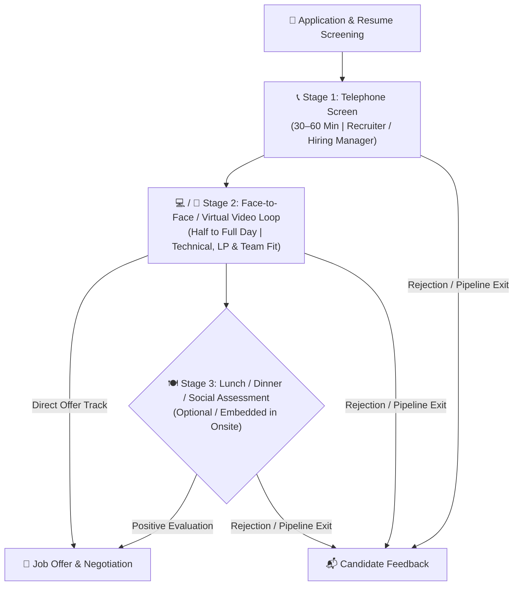
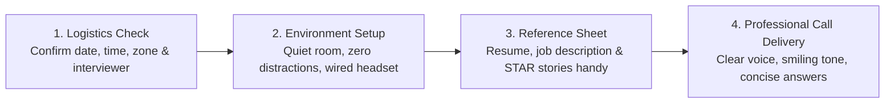
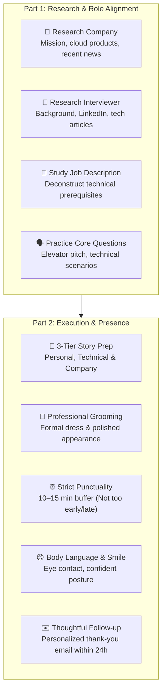
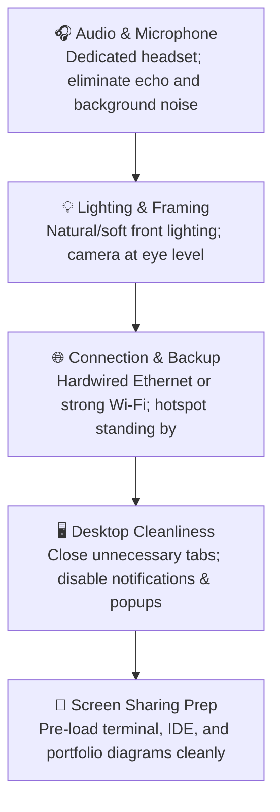

# 🎯 Mastering Tech Interview Settings: Phone, Video, Onsite & Meal Assessments

> **Course**: AWS re/Start Foundational Soft Skills  
> **Module**: M00 – Interview Settings & Formats  
> **Source**: `T03-0017-RSTFSS_EN-US_SG_M00_INTERVIEWSETTINGS.pdf`  
> **Target Audience**: AWS re/Start Learners & Cloud Career Candidates  
> **Series**: Professional Skills & Career Readiness  

---

## 📌 Executive Summary & Purpose

In the technology and cloud services industry, the hiring journey is rarely a single meeting. Employers deploy a multi-stage evaluation pipeline using distinct interview settings to evaluate technical proficiency, role alignment, behavioral competence (such as the Amazon Leadership Principles), and team culture fit.

Each interview environment—whether a phone screen, a virtual video conference, a multi-hour onsite loop, or an informal lunch assessment—requires specialized preparation, communication tactics, and behavioral etiquette. Navigating each setting with confidence ensures that your technical capabilities, cloud knowledge, and professional presence shine through at every stage.

---

## 🎯 Learning Objectives

By the end of this module, you will be able to:
- [ ] Distinguish between the three primary interview setting categories (Telephone, Face-to-Face / Virtual Video, and Meal / Informal).
- [ ] Prepare systematically for initial telephone screens, including logistics, concise communication, and active listening.
- [ ] Execute comprehensive preparation for face-to-face and virtual video loop interviews, from interviewer research to technical question structuring.
- [ ] Master professional etiquette for informal lunch or dinner interviews, maintaining composure and focus in social settings.
- [ ] Apply technical etiquette rules across audio, video, environment, and post-interview follow-up communications.
- [ ] Utilize an end-to-end interview simulation checklist to audit readiness before scheduled interviews.

---

## 🔄 The Multi-Stage Tech Interview Pipeline

Employers use a sequenced combination of interview settings to systematically evaluate candidates from initial screening to final hiring decision.



---

## 📞 1. Interview Setting: The Telephone Screen

```
┌────────────────────────────────────────────────────────────────────────┐
│                   Telephone Interview Snapshot                         │
│                                                                        │
│   • Typical Duration : 30 to 60 minutes                                │
│   • Conducted By     : Recruiter, Talent Acquisition, or Team Lead     │
│   • Primary Focus    : Role overview, basic qualification verification, │
│                        salary/timing alignment, communication clarity   │
│   • Format           : Audio-only telephone call                       │
└────────────────────────────────────────────────────────────────────────┘
```

The telephone interview is almost universally the first interactive step in the hiring process. It serves as a triage and vetting stage where the employer assesses whether your background meets basic qualifications and whether you understand the role requirements.

### Key Characteristics & Objectives
1. **Clarifying the Role**: The recruiter provides context on the opening, team expectations, reporting lines, and project scope.
2. **Elevator Pitch Validation**: Gives you the opportunity to succinctly articulate your technical foundation (e.g., AWS re/Start curriculum, Linux, Python, networking fundamentals) and career motivations.
3. **Communication Baseline**: Tests your verbal clarity, ability to articulate complex thoughts without visual cues, and professional demeanor over the phone.

### Strategic Telephone Preparation



#### Detailed Execution Guidelines

- **Confirm Logistics in Advance**:
  - Always verify the date, exact time, time zone (especially when speaking to global or remote teams), and the full name/title of your interviewer.
  - Keep a calendar invite with phone number and dial-in pin readily accessible.

- **Answer the Call Promptly Yourself**:
  - Ensure your phone is fully charged with strong cellular or Wi-Fi calling reception.
  - Answer in a quiet, professional tone: *"Hello, this is [Your Name], thank you for calling."*
  - **Handling Missed Calls**: If an unexpected disruption causes you to miss the call, immediately call the interviewer back within minutes, apologize sincerely for the technical delay or missed ring, and confirm whether they still have time or wish to reschedule.

- **Active Listening & No Interruptions**:
  - Since facial cues are unavailable, audio pacing is critical. Allow the interviewer a 1–2 second pause after they finish speaking to confirm they are done before starting your reply.
  - Take brief handwritten notes during the conversation to anchor your responses to their exact phrasing.

- **Provide Concise, Structured Responses**:
  - Telephone screens can easily run out of time if answers wander. Limit behavioral or background answers to **90–120 seconds**.
  - Focus directly on what was asked; do not ramble into tangential technical setups unless prompted.

- **Immediate Follow-up**:
  - Thank the interviewer verbally at the conclusion of the call.
  - Send a crisp thank-you email within 24 hours reiterating enthusiasm for the role and referencing one specific topic discussed.

> [!TIP]
> **Stand Up or Sit Up Straight**: Standing up while speaking opens your diaphragm, improves vocal projection, and makes your voice sound energetic and engaged over the phone.

---

## 🏢 2. Interview Setting: Face-to-Face & Virtual Video Interviews

```
┌────────────────────────────────────────────────────────────────────────┐
│                   Face-to-Face / Virtual Loop Snapshot                 │
│                                                                        │
│   • Typical Duration : 2 hours to a full-day series (4–6 rounds)       │
│   • Conducted By     : Hiring Manager, Senior Engineers, Bar Raiser,   │
│                        Cross-functional Stakeholders                   │
│   • Primary Focus    : Deep technical capability, problem-solving,     │
│                        Leadership Principles (STAR), behavioral fit    │
│   • Format           : In-person office visit or multi-round video call│
└────────────────────────────────────────────────────────────────────────┘
```

The face-to-face interview represents the second (and deepest) evaluation stage. Depending on organizational model and geography, this can take place in person at a company office, or virtually via video conferencing platforms (e.g., Amazon Chime, Zoom, Microsoft Teams).

This setting provides a comprehensive 360-degree evaluation of your technical competence, analytical problem-solving, architectural design thinking, and interpersonal collaboration.

### Two-Part Preparation Framework



### Deep Dive: Part 1 Preparation (Research & Role Alignment)

1. **Company Research**:
   - Understand the organization's core business model, key cloud services or migrations they are undertaking, and public customer stories.
   - Prepare at least 3–4 thoughtful, business-grounded questions about their technical architecture, deployment pipelines, or team growth strategy.
2. **Interviewer Research**:
   - Review the interviewer’s LinkedIn profile and public tech contributions (GitHub, blog posts, whitepapers).
   - Formulate a tailored question regarding their projects, tech stack choices, or career journey within the team.
3. **Deconstruct the Job Description**:
   - Break down every bullet point into required skills (e.g., Linux administration, Bash scripting, VPC networking, EC2 troubleshooting).
   - Map your AWS re/Start lab experiences and capstone portfolio projects directly to each requirement.
4. **Practice Standard & Behavioral Responses**:
   - Rehearse STAR method stories (Situation, Task, Action, Result) mapped to core principles like Customer Obsession, Ownership, and Learn and Be Curious.

### Deep Dive: Part 2 Preparation (Presence & Etiquette)

1. **Prepare Answers Across Three Dimensions**:
   - **Personal Interests**: Genuine hobbies or curiosity that reveal problem-solving mindset and continuous learning.
   - **Technical Topics**: Explaining cloud concepts simply (e.g., S3 storage tiers, security group vs. NACL differences, DNS resolution).
   - **Company-Specific Fit**: Clear, articulate rationale for why you chose this specific company and team.
2. **Dress Professionally & Be Well Groomed**:
   - Even in casual tech cultures, opt for business casual or professional attire (collared shirt/blouse, tailored blazer).
   - Ensure clean grooming and well-maintained appearance; first impressions set the evaluation tone.
3. **Master Timing & Punctuality**:
   - **The Punctuality Rule**: Never arrive late, and do **not** arrive excessively early.
   - **In-person**: Arrive at the lobby 10–15 minutes before the scheduled time. Arriving 45 minutes early creates awkward logistical burdens for the reception and hiring team.
   - **Virtual**: Log into the virtual lobby 5–7 minutes prior to verify audio/video feeds.
4. **Body Language & Smiling**:
   - Smile warmly upon greeting each interviewer. Smiling naturally projects confidence, warmth, and high emotional intelligence.
   - Maintain steady eye contact (in virtual settings, look directly into the camera lens, not just at the screen video feed).
5. **Post-Interview Thank-You Protocol**:
   - Send individualized thank-you emails within 24 hours to each person you interviewed with, mentioning unique points from your conversations.

---

## 🍽️ 3. Interview Setting: Lunch or Dinner Assessments

```
┌────────────────────────────────────────────────────────────────────────┐
│                   Meal / Social Interview Snapshot                     │
│                                                                        │
│   • Typical Duration : 60 to 90 minutes                                │
│   • Conducted By     : Prospective teammates, peers, hiring manager    │
│   • Primary Focus    : Interpersonal dynamics, social grace, team      │
│                        chemistry, behavior under relaxed conditions     │
│   • Format           : Restaurant dining or corporate dining room      │
└────────────────────────────────────────────────────────────────────────┘
```

A lunch or dinner interview frequently follows or is embedded within a full-day face-to-face loop. While the atmosphere may seem informal and casual, make no mistake: **it is still an active, high-stakes job interview.**

### Strategic Objectives of a Meal Assessment
- **Evaluate Real-World Interpersonal Fit**: Observing how you interact with potential future teammates outside a formal conference room.
- **Observe Social Awareness & Courtesy**: Watching how you treat restaurant staff, manage conversation turn-taking, and navigate unexpected social moments.
- **Two-Way Cultural Discovery**: Providing you a candid opportunity to ask peers about daily team life, on-call rotations, mentorship culture, and collaboration norms.

### Crucial Guidelines for Meal Interviews

| Category | Recommended Best Practice | Common Pitfall / Risk |
| :--- | :--- | :--- |
| **Punctuality** | Arrive at the restaurant 10 minutes prior; wait in the lobby/host area. | Running late or lingering in traffic without communicating. |
| **Attire** | Maintain professional / business casual dress regardless of venue informality. | Underdressing because the restaurant is perceived as casual. |
| **Electronics** | **Turn off your cell phone** or silence it completely; keep it hidden away. | Checking notifications or placing the phone screen-up on the dining table. |
| **Alcohol** | **Strict Zero Alcohol**: Politely decline and order water, iced tea, or soda. | Ordering beer/wine because interviewers did; impairs cognitive sharpness. |
| **Food Selection** | Choose simple, neat dishes (e.g., grilled chicken, rice, easy fork items). | Ordering messy foods (spaghetti, ribs, messy burgers, whole shellfish). |
| **Table Manners** | Napkin on lap, wait for everyone to be served, chew with mouth closed. | Talking with food in mouth, resting elbows clumsily, complaining to waitstaff. |
| **Attention Sharing**| Divide eye contact and conversational attention equally across all diners. | Talking exclusively to the senior manager while ignoring junior peers. |

### Engaging in Meal Conversation
1. **Active Listening**: Listen attentively without speaking over colleagues while they share anecdotes about company culture.
2. **Balanced Dialogue**: Answer questions thoroughly but do not dominate 100% of the airtime. Pass conversational prompts back to the team (*"How has your experience been adapting to that new CI/CD workflow?"*).
3. **Professional Courtesy**: Express gratitude to both the team for hosting the meal and the restaurant service staff for their hospitality.

> [!CAUTION]
> **The Informal Trap**: Candidates often drop their guard during meals and share informal complaints about previous employers or personal grievances. Maintain absolute professionalism, discretion, and positive framing throughout the meal.

---

## 📊 Comprehensive Comparison Matrix

The table below contrasts the three major interview settings across key logistical, behavioral, and technical evaluation dimensions:

| Dimension | 📞 Telephone Screen | 🏢 Face-to-Face / Virtual Loop | 🍽️ Meal Assessment (Lunch/Dinner) |
| :--- | :--- | :--- | :--- |
| **Primary Evaluator** | Recruiter / Talent Sourcer / Manager | Hiring Manager, Bar Raiser, Tech Leads | Future Peers, Tech Leads, Team Members |
| **Standard Duration** | 30–60 minutes | 45 minutes per round (2–6 hours total) | 60–90 minutes |
| **Primary Evaluation Focus** | Resume validation, baseline communication, role alignment | Technical depth, coding/troubleshooting, STAR behavioral stories | Culture fit, interpersonal skills, team dynamics, composure |
| **Visual Cues Available** | ❌ None (Voice tone, pitch, pacing only) | ✅ Full visual cues (Body language, screen sharing, whiteboard) | ✅ Full social cues (Manners, table etiquette, eye contact) |
| **Optimal Arrival Time** | Answer call on the 2nd–3rd ring | 10–15 min early (In-person) / 5 min (Virtual) | 10 min early (Meet at restaurant entrance) |
| **Dress Code** | Business casual (enhances posture/mindset) | Professional / Business Casual | Professional / Business Casual |
| **Highest Risk Factor** | Rambling, speaking over interviewer, bad audio | Inadequate company research, weak STAR details, poor setup | Consuming alcohol, poor table manners, dropping professional guard |
| **Follow-up Protocol** | Short email within 24h thanking recruiter | Tailored individual emails to each loop interviewer within 24h | Warm group or individual thank-you note within 24h |

---

## 💻 Technical & Virtual Interview Etiquette

Because many face-to-face interviews today are conducted remotely via video conferencing tools, virtual technical etiquette is just as vital as physical boardroom etiquette.

### Technical Hygiene Checklist



1. **Camera Position & Eye Contact**:
   - Elevate your laptop or external webcam to direct eye level (use a laptop stand or books).
   - Look directly into the camera lens when speaking to simulate direct eye contact with the interviewer.
2. **Audio Quality Over Everything**:
   - Use a dedicated headset or noise-canceling microphone rather than built-in laptop microphones to prevent room echo.
3. **Environment & Distractions**:
   - Choose a neutral, clutter-free background or apply a clean, subtle professional blur.
   - Silence all computer notifications, Slack/Discord messages, and mobile phones.
4. **Latency & Voice Overlap Management**:
   - In virtual calls, internet latency can cause inadvertent interruptions. Always wait for a deliberate 2-second pause before chiming in.

---

## ✉️ The 24-Hour Follow-Up Protocol

A well-crafted follow-up note reinforces your professionalism, enthusiasm, and active listening skills. Always send your thank-you message within 24 hours of the interview conclusion.

### Recommended Thank-You Email Template

```markdown
Subject: Thank You – [Your Name] – Interview for [Job Title] Role

Dear [Interviewer Name],

Thank you very much for taking the time to speak with me today regarding the [Job Title] opportunity with [Company Name]. I thoroughly enjoyed our conversation and learning more about how your team is approaching [Specific Technical Topic or Project Discussed, e.g., automated cloud infrastructure migrations using AWS].

Our discussion further strengthened my enthusiasm for the position. I am confident that my hands-on training in Linux administration, Python scripting, and core AWS cloud architectures through the AWS re/Start program will allow me to contribute meaningfully to your team's operational goals.

Please let me know if you need any additional portfolio projects, documentation, or references from my end. I look forward to hearing about the next steps in the process.

Warm regards,

[Your Name]  
AWS Certified Cloud Practitioner  
[Your Phone Number] | [Your LinkedIn URL] | [Your Portfolio Link]
```

---

## ✅ Practical Interview Simulation & Readiness Checklist

Use this interactive worksheet before every interview to verify that your preparation covers all logistical, technical, and behavioral requirements across any setting.

### Pre-Interview Preparation
- [ ] **Logistics Verified**: Date, time, time zone, interviewer name(s), and format (Phone / Video / In-person / Meal) confirmed.
- [ ] **Company Researched**: Core business, cloud initiatives, recent press releases, and corporate mission reviewed.
- [ ] **Interviewer Researched**: Interviewer's LinkedIn profile, role, tenure, and background explored.
- [ ] **Job Description Mapped**: Key technical requirements matched with specific STAR stories from AWS re/Start coursework or labs.
- [ ] **Questions Prepared**: 3–5 insightful questions prepared regarding technical architecture, team culture, and business challenges.
- [ ] **Stories Rehearsed**: 5–7 STAR behavioral stories prepared highlighting Amazon Leadership Principles (Customer Obsession, Ownership, Learn and Be Curious, etc.).

### Setting-Specific Verification

#### If Telephone Screen:
- [ ] Quiet room reserved with zero external noise or family/pet disruptions.
- [ ] Strong cellular or Wi-Fi calling signal verified.
- [ ] Resume, job description, notepad, and pen laid out in front of you.
- [ ] Glass of water ready nearby.

#### If Face-to-Face / Virtual Video:
- [ ] Professional attire selected, pressed, and tested on camera.
- [ ] Webcam at eye level with flattering, front-facing illumination.
- [ ] Hardware, microphone, and conference software (Chime/Zoom/Teams) tested 30 minutes ahead.
- [ ] Clean desktop environment with notifications silenced.
- [ ] If in-person: Travel route mapped with traffic buffer; arrive at lobby exactly 10–15 minutes early.

#### If Meal Interview:
- [ ] Restaurant location, parking, and transit route mapped.
- [ ] Professional attire chosen (business casual standard).
- [ ] Mobile phone turned completely off before entering the venue.
- [ ] Mental commitment to zero alcohol and neat food choices confirmed.
- [ ] Plan to divide attention evenly across all attending colleagues prepared.

### Post-Interview Protocol
- [ ] Key technical points and interviewer advice noted down immediately following the meeting.
- [ ] Customized thank-you emails sent to each interviewer within 24 hours.
- [ ] Job search tracking spreadsheet updated with dates, interviewer notes, and next milestone targets.

---

## 📚 Related Modules & Next Steps

Continue refining your technical presentation and career readiness with these complementary modules:
- [T03-0008-RSTFSS_EN-US_SG_M00_COMMUNICATIONSTAR.md](file:///work/tmp/aws-cf/T03-Professional_Skills/T03-0008-RSTFSS_EN-US_SG_M00_COMMUNICATIONSTAR.md) – Mastering the STAR Framework for Behavioral Interviews
- [T03-0015-RSTFSS_EN-US_SG_M00_DIGITALPRESENCE.md](file:///work/tmp/aws-cf/T03-Professional_Skills/T03-0015-RSTFSS_EN-US_SG_M00_DIGITALPRESENCE.md) – Building an Impactful Tech LinkedIn Presence
- [T03-0016-RSTFSS_EN-US_SG_M00_DIGITALPRESENCERESUME.md](file:///work/tmp/aws-cf/T03-Professional_Skills/T03-0016-RSTFSS_EN-US_SG_M00_DIGITALPRESENCERESUME.md) – Aligning Your Resume with AWS Cloud Credentials
- [T03-0018-RSTFSS_EN-US_SG_M00_INTERVIEWPROCESS.pdf](file:///work/tmp/aws-cf/T03-Professional_Skills/T03-0018-RSTFSS_EN-US_SG_M00_INTERVIEWPROCESS.pdf) – The End-to-End Cloud Engineering Interview Process
