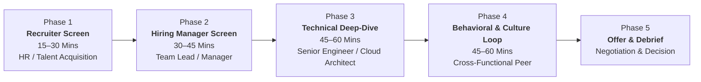
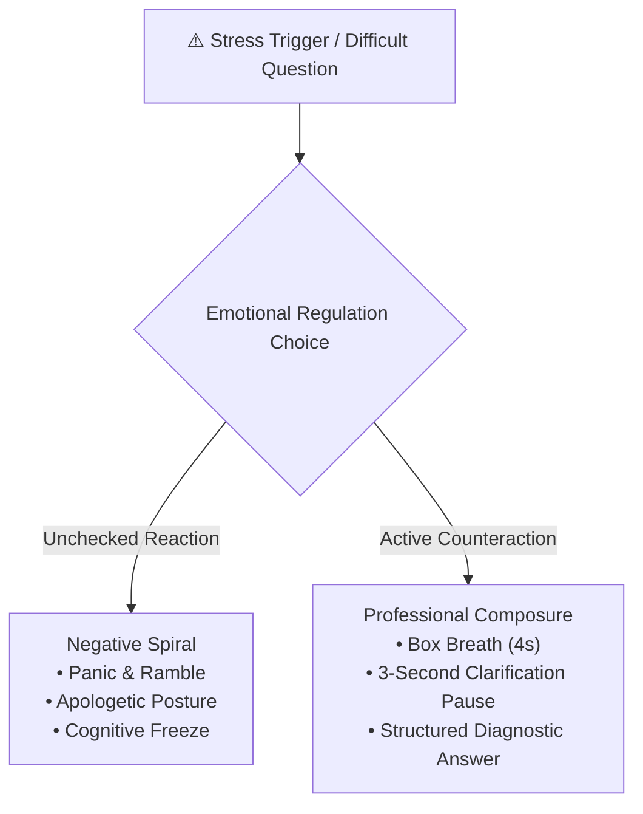
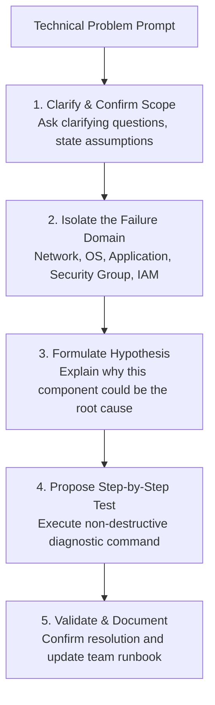
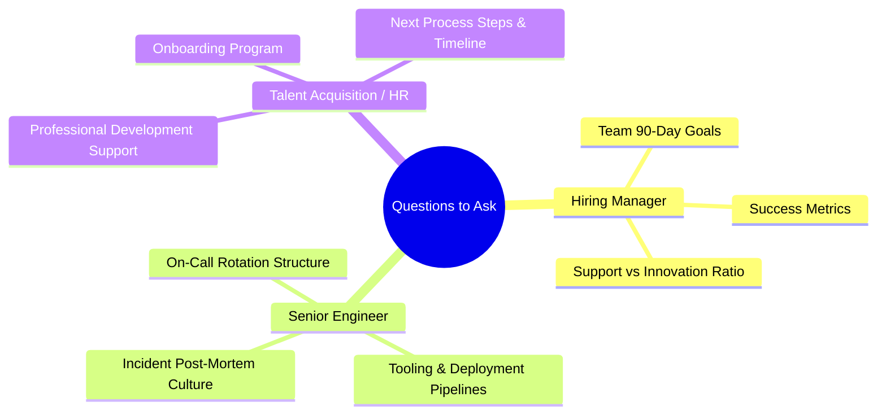

# 🤝 Mastering the IT & Cloud Job Interview Process

> **Course**: AWS re/Start Foundational Soft Skills  
> **Module**: M00 – Interview Process & Technical Evaluation  
> **Source**: `T03-0018-RSTFSS_EN-US_SG_M00_INTERVIEWPROCESS.pdf`  
> **Target Audience**: AWS re/Start Learners & Aspiring Cloud Support Practitioners  

---

## 🎯 Module Overview

An interview for an Information Technology (IT) or Cloud Support role is not an interrogation—it is a structured, two-way professional dialogue designed to assess mutual fit between a candidate and an engineering organization. Succeeding in IT interviews requires equal parts technical depth, emotional regulation, and clear business communication.

This comprehensive guide breaks down the full hiring lifecycle, provides tactical mechanisms to master internal emotional states, analyzes the core categories of interview questions (HR, Cultural, Behavioral, and Technical Deep Dives), equips candidates with strategic questions to ask prospective employers, and presents an end-to-end interview readiness checklist.

### 📌 Learning Objectives
- [ ] Understand the multi-stage progression of modern IT and cloud recruitment cycles
- [ ] Recognize and regulate acute emotional triggers (doubt, overexcitement, nervousness) during high-stakes interviews
- [ ] Formulate articulate responses to standard personal, work-style, and organizational fit questions
- [ ] Structure technical thought processes when answering complex problem-solving and diagnostic questions
- [ ] Frame past experience using behavioral frameworks aligned with industry standards
- [ ] Select impactful, insightful questions to ask interviewers and evaluate company culture
- [ ] Execute a rigorous pre-interview, day-of, and post-interview preparation checklist

### 🔑 Key Terminology
- **Job Interview**: A structured conversation where an employer evaluates an applicant's qualifications, technical capabilities, cultural fit, and potential for growth within the organization.
- **Interview Questions**: Purposeful prompts categorized into biographical, behavioral, situational, and technical problem-solving inquiries.
- **Mutual Fit Evaluation**: The dual objective of an interview where both the employer evaluates the candidate and the candidate assesses team culture, leadership philosophy, and career alignment.
- **Technical Thought Process**: The verbalized step-by-step reasoning a candidate demonstrates while diagnosing an outage, architecting a solution, or troubleshooting a system error.

---

## 🗺️ 1. Stages of the Modern IT & Cloud Interview Process

The interview lifecycle for entry-to-mid level cloud positions typically spans four to five distinct evaluation phases. Understanding the purpose and audience of each stage allows candidates to tailor their messaging appropriately.



### Comprehensive Stage Breakdown

| Stage | Primary Evaluator | Format & Medium | Core Focus & Objectives | Success Metrics |
| :--- | :--- | :--- | :--- | :--- |
| **Phase 1: Recruiter / HR Screen** | Talent Acquisition Partner | Phone / Video (15–30 min) | Resume validation, baseline communication, salary expectations, timeline, work authorization, motivation. | Clear elevator pitch, professional cadence, alignment on logistics. |
| **Phase 2: Hiring Manager Chat** | Direct Engineering Manager | Video Conference (30–45 min) | High-level experience overview, interest in the team, leadership alignment, coachability, team dynamic fit. | Passion for cloud technologies, proactive attitude, team mindset. |
| **Phase 3: Technical Deep-Dive / Assessment** | Senior Systems Engineer / Solutions Architect | Video / Live Whiteboard / Screen Share (45–60 min) | Systems troubleshooting, Linux/networking fundamentals, AWS service knowledge, diagnostic methodology. | Structured troubleshooting tree, sound reasoning, admitting unknowns gracefully. |
| **Phase 4: Behavioral & Culture Loop** | Peer Engineer / Bar Raiser / Team Member | Video Conference (45–60 min) | Interpersonal collaboration, conflict resolution, dealing with ambiguity, Amazon Leadership Principles. | Structured STAR stories, customer empathy, data-driven outcomes. |
| **Phase 5: Final Decision & Offer** | HR Recruiter & Hiring Manager | Phone Call & Written Letter | Compensation breakdown, benefits review, start date, onboarding expectations. | Professional negotiation, timely response, enthusiasm. |

> [!NOTE]
> In some enterprise and AWS Partner organizations, Phases 3 and 4 may be consolidated into a single "panel day" or multi-interview "loop" consisting of three to four back-to-back 45-minute sessions.

---

## 🧘 2. Emotional Regulation & Psychology in Interviews

High-stakes interviews trigger physiological stress responses. Peak performance is achieved not by eliminating emotions, but by recognizing, naming, and actively counteracting them in real time.

```
┌────────────────────────────────────────────────────────────────────────┐
│                   The Emotional Equilibrium Model                      │
│                                                                        │
│     [ Self-Doubt ]        ──▶  Focus on Continuation & Growth Mindset  │
│     [ Overexcitement ]    ──▶  Ground Focus on the Immediate Question   │
│     [ Nervousness ]       ──▶  Box Breathing & Two-Way Mindset Shift   │
└────────────────────────────────────────────────────────────────────────┘
```

### Emotional Response & Counteraction Matrix

The curriculum identifies three primary emotional challenges experienced during interviews:

| Emotion | Internal Sensation / Warning Sign | Cognitive & Behavioral Impact | Counteracting Strategy & Technique |
| :--- | :--- | :--- | :--- |
| **Doubt** | *"I fumbled that Linux command question. I'm definitely failing this interview."* | Leads to cognitive freezing, diminished vocal projection, defensiveness, and giving up prematurely. | • **Refocus on the present**: The interview is actively continuing; the interviewer is still asking questions, which proves you remain in contention.<br>• **Cognitive reframing**: Interviewers test boundaries intentionally to identify knowledge limits; not knowing everything is expected.<br>• **Pivot positively**: State what you *do* know and describe how you would research the solution. |
| **Overexcitement** | *"I nailed that VPC routing question! This job is basically mine already!"* | Causes rushing ahead, talking over the interviewer, overlooking critical nuances in subsequent questions, and appearing overconfident. | • **Re-center cadence**: Consciously remind yourself that the interview is still ongoing.<br>• **Pencil-and-paper pause**: Take a deliberate 2-second sip of water or jot down a key word from the next prompt.<br>• **Channel humility**: Treat each question as an independent challenge requiring full rigor. |
| **Nervousness** | Shallow breathing, elevated heart rate, shaky voice, imposter syndrome, catastrophic thinking. | Impairs short-term working memory, causes rambling, and reduces vocal inflection to a monotone. | • **Box Breathing**: Inhale for 4 seconds, hold for 4 seconds, exhale for 4 seconds, hold for 4 seconds.<br>• **Remember the Two-Way Dialogue**: An interview is a mutual evaluation to find a fit, not an oral examination.<br>• **Smile deliberately**: Physical smiling activates facial feedback loops, reducing cortisol and softening tone. |



> [!TIP]
> **The 3-Second Buffer Rule**: When asked a difficult question, pause for 3 full seconds before speaking. Say: *"That is a great scenario. Let me take a brief moment to structure my thoughts."* This projects calm confidence and prevents impulse rambling.

---

## 🏢 3. Standard HR & Cultural Fit Interview Questions

Standard questions provide employers insight into your personality, work ethic, self-awareness, and alignment with corporate culture.

```
┌────────────────────────────────────────────────────────────────────────┐
│                   Core Categories of Standard Inquiries                │
│                                                                        │
│   1. Questions About Yourself    ──▶  Work style, origins, adaptability│
│   2. Questions About the Company ──▶  Mission alignment, culture fit   │
│   3. Questions About Career Path ──▶  Longevity, drive, learn & curious│
└────────────────────────────────────────────────────────────────────────┘
```

### Category 1: Questions About Yourself & Work Style

#### 1. "Tell me about yourself and your professional journey."
- **Interviewer's Objective**: Evaluate clarity, executive summary skills, career narrative coherence, and communication brevity.
- **Answering Formula (Past-Present-Future)**:
  - **Present (30 sec)**: Current credential, core skills, and focus (e.g., AWS re/Start graduate certified in cloud foundations).
  - **Past (30 sec)**: Prior professional or academic background and transferable soft skills (problem solving, customer service, resilience).
  - **Future (30 sec)**: Why this specific cloud role matches your career trajectory.

#### 2. "How would you describe your ideal work style and collaboration approach?"
- **Interviewer's Objective**: Determine if you thrive in cross-functional, agile, or remote environments.
- **Key Themes to Emphasize**:
  - Proactive communication and documentation.
  - Ownership of tasks with readiness to ask for assistance when blocked after an initial timebox (e.g., 30-minute troubleshooting rule).
  - Openness to feedback and blameless retrospective learning.

#### 3. "What are your greatest strengths, and what is one area you are actively developing?"
- **Strengths Formula**: State the strength, provide a concrete example, and show its business impact.
- **Development Area Formula**: Never disguise a strength as a flaw (e.g., "I work too hard"). Choose an authentic, non-fatal technical skill you are actively remediating through structured study.
  - *Example*: *"Coming from an infrastructure focus, my scripting in Python was initially basic. Over the past two months, I have built automated AWS Lambda scripts and practice weekly on coding challenges to advance my automation abilities."*

---

### Category 2: Questions About the Job & Company

#### 1. "Why do you want to work for our organization specifically?"
- **Interviewer's Objective**: Verify whether you researched the company or simply submitted mass applications.
- **Key Components**:
  - Reference a specific recent company initiative, blog post, or technology adoption.
  - Connect their engineering mission to your personal values or career focus.
  - Explain how you can deliver value to their customers from day one.

#### 2. "How do you handle ambiguous requirements or shifting priorities?"
- **Interviewer's Objective**: Assess emotional resilience and operational adaptability in fast-paced cloud environments.
- **Winning Approach**:
  - Describe how you clarify requirements through written questions and requirements gathering.
  - Highlight prioritizing tasks by customer impact and operational severity.

---

## 💻 4. Technical Deep-Dive & Problem-Solving Questions

Technical questions in IT interviews are designed less to test rote memorization and more to evaluate your **problem-solving methodology**, your **architectural reasoning**, and your **learning habits**.



### The 5 Core Technical Inquiry Areas

The AWS re/Start curriculum outlines five primary domains evaluated in technical interviews:

| Evaluation Area | Sample Question from Curriculum | Intent & Evaluated Competency | Recommended Response Architecture |
| :--- | :--- | :--- | :--- |
| **1. Education & Continuous Learning** | *"What technical websites, publications, or resources do you follow?"* | Assesses intrinsic curiosity, technical currency, and passion for the industry beyond classroom requirements. | Name 2–3 credible sources (e.g., *AWS What's New Blog*, *All Things Distributed* by Werner Vogels, *Hacker News*, *r/aws*, or *Cloud That*). Explain a specific recent service launch or trend you learned from them. |
| **2. Skills & Problem-Solving Thought Process** | *"Given this network connectivity issue, what solution would you provide? Explain your thought process."* | Tests systematic diagnostic methodology rather than lucky guessing. Evaluates composure under uncertainty. | State assumptions $\rightarrow$ Walk layer-by-layer (OSI / VPC network path) $\rightarrow$ Explain diagnostic commands (`ping`, `traceroute`, `curl`, `netstat`, AWS Flow Logs) $\rightarrow$ Mitigate and document. |
| **3. Certifications & Currency** | *"What do you do to maintain your technical certifications and knowledge?"* | Gauges long-term professional development, commitment to standards, and proactive learning habits. | Highlight hands-on lab experimentation (AWS Free Tier, GitHub personal projects), joining user groups (AWS User Group, meetup), and studying towards associate-level certifications (SysOps / Solutions Architect). |
| **4. Languages & Scripting** | *"What programming or scripting languages have you used, and what have you built?"* | Evaluates automation literacy, comfort with CLI environments, and software tool literacy. | Outline bash scripting for task automation (log parsing, backups) or Python (Boto3 SDK for automating EC2 start/stop routines). Emphasize writing maintainable, commented code. |
| **5. Planning & Operational Tools** | *"What planning, collaboration, and operations tools are you familiar with?"* | Tests enterprise readiness and familiarity with modern DevOps / Agile workflows. | Discuss Git/GitHub for version control, Jira/Trello/Kanban for sprint tracking, Markdown for runbooks, and ticketing systems (ServiceNow/Zendesk). |

---

### Deep-Dive Scenario: Explaining Technical Thought Process

When presented with open-ended scenarios such as *"A customer cannot connect to an Apache web server running on an Amazon EC2 instance"*, execute the **6-Step Cloud Diagnostics Framework**:

```
┌────────────────────────────────────────────────────────────────────────┐
│                  6-Step Cloud Diagnostics Framework                    │
├────────────────────────────────────────────────────────────────────────┤
│ 1. Clarify Scope    : Is it affecting one user or all users?           │
│ 2. Check Edge/DNS   : Is DNS resolving to the expected IP address?     │
│ 3. Check Network    : Route Table, Internet Gateway, Subnet NACLs?    │
│ 4. Check Security   : Security Group inbound rules (Port 80/443 open?) │
│ 5. Check Instance   : Instance status checks (2/2 passing?), CPU?      │
│ 6. Check Service    : Is the `httpd` or `nginx` daemon actively running?│
└────────────────────────────────────────────────────────────────────────┘
```

> [!IMPORTANT]
> **Think Out Loud**: In technical interviews, interviewers value the *pathway to the answer* more than the answer itself. Verbalize your reasoning: *"First, I would verify whether the instance status checks are 2/2 passing to eliminate underlying hardware virtualization faults before checking operating system daemons."*

---

## 🏆 5. Behavioral Interviewing & The STAR Framework

Behavioral questions evaluate whether candidates embody team values and operate effectively within corporate environments. Amazon and AWS partner employers place massive emphasis on behavioral alignment through the **Amazon Leadership Principles (LPs)**.

### STAR Methodology Refresher

```
┌────────────────────────────────────────────────────────────────────────┐
│                              STAR FORMAT                               │
├────────────────────────────────────────────────────────────────────────┤
│ [S] Situation : Context, environment, and stakeholders (15% of time)   │
│ [T] Task      : The specific obstacle, target, or ticket (15% of time) │
│ [A] Action    : Concrete actions YOU took (Focus on "I") (50% of time) │
│ [R] Result    : Quantified outcome, business value, learnings (20%)   │
└────────────────────────────────────────────────────────────────────────┘
```

### High-Yield Behavioral Question Bank for Cloud Roles

#### 1. Customer Obsession / Empathy
- **Question**: *"Tell me about a time you went above and beyond to solve a user's technical problem."*
- **Key Focus**: Active listening, preventing recurrence, understanding the business impact of the outage.

#### 2. Ownership & Accountability
- **Question**: *"Describe a situation where a project or lab deployment went wrong. How did you handle it?"*
- **Key Focus**: Owning the mistake without shifting blame, performing root cause analysis, fixing the issue transparently.

#### 3. Bias for Action / Problem Solving
- **Question**: *"Tell me about a time you had to make a technical decision with incomplete information."*
- **Key Focus**: Balancing speed with calculated risk, using reversible decisions (two-way doors), validating with data.

#### 4. Earn Trust / Collaboration
- **Question**: *"Give an example of a disagreement you had with a team member during a technical lab. How did you resolve it?"*
- **Key Focus**: Data-driven debate, respect, separating ego from code/architecture, committing once a decision was made.

---

## ❓ 6. High-Impact Questions to Ask the Interviewer

At the conclusion of nearly every interview, the interviewer will ask: *"What questions do you have for me?"* Responding with *"I don't have any questions"* signals disinterest or lack of preparation. High-caliber candidates use this opportunity to evaluate the team and reinforce their curiosity.



### Curated Question Bank by Evaluator

#### For the Hiring Manager:
1. *"What does success look like for someone in this role during their first 90 days?"*
2. *"What is the balance between reactive ticket resolution and proactive automation or project work on this team?"*
3. *"How does the team handle post-incident reviews? Is there a blameless post-mortem culture?"*

#### For Senior Engineers / Peer Panelists:
1. *"What is the most challenging technical hurdle this team has tackled over the past quarter?"*
2. *"What deployment and monitoring tooling does the team rely on daily (e.g., CloudWatch, Datadog, Terraform)?"*
3. *"How does the team share knowledge and mentor junior engineers who are eager to expand their cloud skillset?"*

#### For the Recruiter / Talent Acquisition:
1. *"What are the next milestones in the interview process, and when might I expect an update?"*
2. *"How does the company support continuing education, such as additional AWS certifications and conference attendance?"*

> [!CAUTION]
> **Questions to Avoid Early**: Do not ask about vacation policies, remote work flexibilities, or benefits packages during your first technical or peer screening. Reserve compensation and logistics inquiries for HR during the offer phase.

---

## ✅ 7. Comprehensive Interview Preparation Checklist

Use this structured timeline checklist to ensure complete operational, technical, and psychological readiness.

### 📅 Phase 1: 5–7 Days Before the Interview (Deep Research & Narrative Prep)
- [ ] Research the company's recent news, product announcements, engineering blogs, and mission statement.
- [ ] Review the exact job description line-by-line; map each requirement to a specific project, lab, or course module.
- [ ] Draft 4–5 versatile STAR stories covering:
  - Technical troubleshooting / outage recovery.
  - Team conflict / compromise.
  - Learning a complex technical tool quickly under pressure.
  - Going above and beyond for an end user or customer.
- [ ] Practice your 90-second "Tell me about yourself" elevator pitch out loud until smooth and natural.
- [ ] Review core AWS networking fundamentals (CIDR, Subnets, Route Tables, IGW, NAT Gateways, Security Groups, NACLs).

### 🖥️ Phase 2: 24–48 Hours Before the Interview (Environment & Tech Audit)
- [ ] Test video conferencing software (Zoom, Teams, Chime) for required updates and permissions.
- [ ] Verify microphone, camera, and lighting in your physical interview space.
- [ ] Ensure your background is clean, clutter-free, and professional.
- [ ] Prepare a physical notebook and pen for taking notes during the session.
- [ ] Print or open a clean copy of your resume and the job description for quick reference.
- [ ] Draft 3–4 tailored questions to ask each interviewer.

### ⏰ Phase 3: Day-of Interview (T-60 to T-15 Minutes)
- [ ] Close all unnecessary browser tabs, applications, messaging apps (Slack, Discord, WhatsApp), and silence your phone.
- [ ] Have a glass of room-temperature water nearby.
- [ ] Complete 3 minutes of Box Breathing (4-4-4-4) to regulate nervous system arousal.
- [ ] Remind yourself: *The interview is a collaborative conversation to find a mutual fit.*
- [ ] Log into the meeting link 5 minutes early to sit in the waiting room calmly.

### 📬 Phase 4: Within 24 Hours Post-Interview (Follow-Up & Reflection)
- [ ] Immediately write down all questions asked, technical topics covered, and areas where you felt strong or hesitant while fresh in mind.
- [ ] Send a concise, personalized thank-you email to the recruiter or interviewer.
  - Express gratitude for their time.
  - Reference a specific technical discussion point from the conversation.
  - Reiterate enthusiasm for the role and team mission.

---

## 📝 8. Interactive Self-Coaching & Practice Worksheets

Use these interactive markdown worksheets to prepare your core interview narratives and technical thought process scripts.

### Worksheet 1: Elevator Pitch (Present-Past-Future)

```markdown
### 🎙️ My 90-Second Professional Introduction

- **Present (Current state & core credentials)**:
  "Hello, I am [Your Name]. I am an AWS Certified Cloud Practitioner and recent graduate 
  of the intensive AWS re/Start program, where I spent hundreds of hours building 
  hands-on infrastructure across Linux systems, networking, security, and cloud architectures..."

- **Past (Background & transferable superpower)**:
  "Prior to entering cloud computing, I spent [X years] in [previous field/industry], 
  where I developed a strong foundation in [customer communication / systematic problem-solving / operational resilience]..."

- **Future (Value proposition for this specific role)**:
  "I am particularly excited about this Cloud Support Associate opportunity with [Company Name] 
  because of your commitment to [Company Focus Area], and I am eager to apply my diagnostic 
  skills to help your engineering teams maintain 99.99% system availability."
```

---

### Worksheet 2: Technical Troubleshooting Thought Process Practice

```markdown
### 🛠️ Practice Scenario: "A web application hosted on an EC2 instance returns '504 Gateway Timeout'."

1. **Clarifying Questions I Will Ask**:
   - Is traffic routing through an Application Load Balancer (ALB) or CloudFront?
   - Is the timeout occurring for all routes or specific database-intensive API calls?

2. **Hypotheses Formulated**:
   - Hypothesis A: The target EC2 instance is failing ALB health checks.
   - Hypothesis B: The backend application/database is overloaded, causing response times to exceed the ALB idle timeout.
   - Hypothesis C: A security group or network ACL is dropping return traffic from the instance to the ALB.

3. **Step-by-Step Diagnostic Verification**:
   - Step 1: Check AWS Target Group health status (Healthy vs. Unhealthy).
   - Step 2: Review CloudWatch metrics for ALB `TargetResponseTime` and EC2 `CPUUtilization`.
   - Step 3: Inspect server access and error logs (`/var/log/httpd/` or `/var/log/nginx/`).

4. **Remediation & Runbook Update**:
   - Adjust timeout parameters, optimize query performance or horizontally scale with Auto Scaling, and document findings in the incident post-mortem.
```

---

## 🔗 Related Curriculum Modules

- [T03-0008: Professional Communication & STAR Framework](file:///work/tmp/aws-cf/T03-Professional_Skills/T03-0008-RSTFSS_EN-US_SG_M00_COMMUNICATIONSTAR.md)
- [T03-0013: Emotional Intelligence & Constructive Resilience](file:///work/tmp/aws-cf/T03-Professional_Skills/T03-0013-RSTFSS_EN-US_SG_M00_EMOTIONALINTELLIGENCE.md)
- [T03-0015: Professional Digital Presence & Personal Branding](file:///work/tmp/aws-cf/T03-Professional_Skills/T03-0015-RSTFSS_EN-US_SG_M00_DIGITALPRESENCE.md)
- [T03-0016: Digital Presence & Resume Alignment Guide](file:///work/tmp/aws-cf/T03-Professional_Skills/T03-0016-RSTFSS_EN-US_SG_M00_DIGITALPRESENCERESUME.md)
