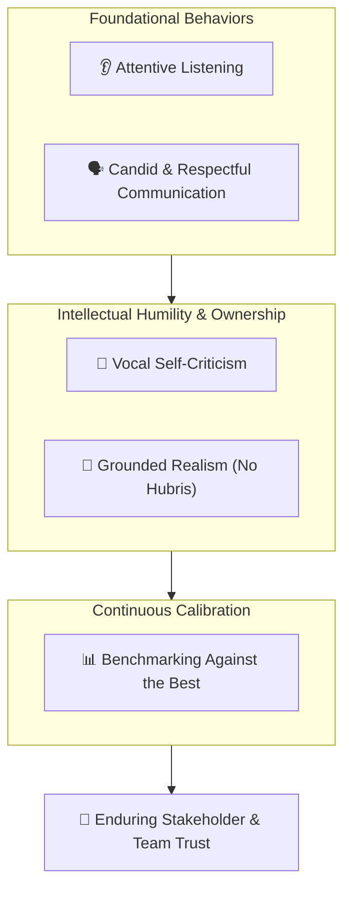

# 🤝 Amazon Leadership Principles: Earn Trust

> **Course**: AWS re/Start Foundational Soft Skills (Techno-Functional Soft Skills)  
> **Module**: M00 – Leadership Principles Deep Dive & Behavioral Interviewing  
> **Source**: `T03-0019-RSTFSS_EN-US_SG_M00_LPEarnTrust.pdf`  
> **Target Audience**: AWS re/Start Cloud Learners & Job Seekers  

---

## 🎯 Module Overview

In collaborative technology ecosystems—whether you are deploying multi-region infrastructure, responding to production incidents, or conducting peer code reviews—trust is the foundational currency of high-performing engineering teams. Amazon's **Earn Trust** Leadership Principle recognizes that trust is neither granted by title nor assumed by default; it is earned through consistent actions, transparency, emotional intelligence, and radical intellectual honesty.

To "Earn Trust" does not mean being agreeable or avoiding difficult conversations. Rather, it demands candor delivered with genuine respect, the courage to be vocally self-critical when things go wrong, and the humility to constantly benchmark your performance against the highest external standards.

This comprehensive guide breaks down the core pillars of **Earn Trust**, demonstrates how trust operates in cloud engineering and customer support, provides structured frameworks for behavioral interviews using the **STAR (Situation, Task, Action, Result)** methodology, supplies high-scoring model responses, and features a complete 50-minute workshop exercise.

### 📌 Learning Objectives
- [ ] Understand Amazon's formal definition and the 5 foundational pillars of **Earn Trust**.
- [ ] Internalize the concept of **vocal self-criticism** and blameless post-mortem culture.
- [ ] Demystify the idiom *"leaders do not believe their body odor smells of perfume"*.
- [ ] Structure compelling, authentic behavioral interview stories using the **STAR methodology**.
- [ ] Formulate quantified, high-trust interview responses tailored to cloud support and DevOps roles.
- [ ] Conduct structured peer interview practice using the 50-minute activity guide and evaluation rubric.

---

## 🏛️ The Definition & Core Pillars

> [!IMPORTANT]
> **Official Amazon Leadership Principle Definition: Earn Trust**  
> *"Leaders listen attentively, speak candidly, and treat others respectfully. They are vocally self-critical, even when doing so is awkward or embarrassing. Leaders do not believe their or their team’s body odor smells of perfume. They benchmark themselves and their teams against the best."*

```
┌────────────────────────────────────────────────────────────────────────────────────────┐
│                               THE 5 PILLARS OF EARN TRUST                              │
├──────────────────┬─────────────────┬──────────────────┬────────────────┬───────────────┤
│ 1. Attentive     │ 2. Candid       │ 3. Vocal Self-   │ 4. Intellectual│ 5. Benchmarking│
│    Listening     │    Respect      │    Criticism     │    Honesty     │    the Best   │
│ Seek first to    │ Speak truth with│ Own mistakes     │ No hubris; don't│ Measure       │
│ understand; hear │ empathy; never  │ openly without   │ sugarcoat or   │ against world-│
│ unvarnished truth│ belittle others │ excuses or blame │ rationalize    │ class standards│
└──────────────────┴─────────────────┴──────────────────┴────────────────┴───────────────┘
```



---

## 🔬 Deconstructing the Core Pillars

### 1. Listen Attentively
- **Active Listening**: Leaders listen to understand, not merely to reply. They absorb requirements, stakeholder anxieties, and technical feedback without interrupting or becoming defensive.
- **Hearing Uncomfortable Feedback**: Trustworthy engineers create an environment where team members feel safe delivering difficult truths without fear of retaliation.

### 2. Speak Candidly & Treat Others Respectfully
- **Candor with Empathy**: Radical candor balances direct honesty with personal care. It avoids passive-aggressive silence as well as destructive aggression.
- **Universal Dignity**: Treat all colleagues with dignity regardless of hierarchy—from executive leadership to junior interns, operations technicians, and external vendors.

### 3. Vocally Self-Critical (Even When Awkward or Embarrassing)
- **Extreme Ownership**: When a deployment fails, a database drops connections, or a deadline slips, leaders immediately step forward and say: *"I made this misjudgment, here is what went wrong, and here is what I am doing to fix it."*
- **No Finger-Pointing**: Deflecting blame onto junior engineers, buggy documentation, or external vendors destroys trust instantly. Vocal self-criticism disarms defensiveness and encourages psychological safety across the team.

```
┌────────────────────────────────────────────────────────────────────────┐
│              DEFENSIVE RESPONSE vs. VOCALLY SELF-CRITICAL              │
├───────────────────────────────────┬────────────────────────────────────┤
│ ❌ Defensive / Trust-Eroding      │ ✅ Vocally Self-Critical           │
├───────────────────────────────────┼────────────────────────────────────┤
│ "The script failed because the    │ "I failed to validate the payload  │
│ customer provided bad parameters, │ schema against edge cases prior to │
│ and documentation wasn't clear."  │ deployment. I own this miss."      │
│                                   │                                    │
│ "It worked in staging; DevOps must│ "I should have verified production │
│ have misconfigured production."   │ parity. Here is our RCA and fix."  │
└───────────────────────────────────┴────────────────────────────────────┘
```

### 4. "Body Odor Doesn't Smell of Perfume"
- **Meaning of the Phrase**: A vivid Amazonian idiom emphasizing that leaders do not engage in self-delusion, hubris, or collective team cheerleading when results fall short of expectations.
- **Facing Cold Facts**: If system latency spikes by 15%, uptime drops below SLA, or ticket resolution quality slips, trustworthy teams do not spin the narrative or praise vanity metrics. They confront the objective data head-on.

### 5. Benchmark Against the Best
- **External Standards**: Avoid complacency by measuring your performance, infrastructure architecture, security posture, and automation maturity not against the lowest bar in your department, but against top industry benchmarks.
- **Continuous Calibration**: Leaders constantly study industry whitepapers, Well-Architected Framework guidelines, and community best practices to raise the team's waterline.

---

## ☁️ Earning Trust in Cloud & IT Engineering

In cloud and technical environments, trust is expressed through rigorous engineering mechanisms:

| Engineering Scenario | How to Build & Earn Trust | Trust-Eroding Failure Mode |
| :--- | :--- | :--- |
| **Production Outages** | Publish transparent, blameless Root Cause Analyses (RCAs) detailing timeline, detection gap, and automated mitigations. | Hiding root causes, sweeping incidents under the rug, or blaming junior technicians. |
| **Peer Code & Infra Review** | Provide constructive, actionable feedback while welcoming critiques of your own CloudFormation/Terraform code. | Rubber-stamping PRs without scrutiny or attacking teammates personally during reviews. |
| **Access & Security** | Adhere strictly to the Principle of Least Privilege and MFA protocols; admit immediately if a credential is misconfigured. | Sharing root IAM credentials, disabling guardrails in secret, or bypassing change approvals. |
| **Knowledge Gaps** | Transparently state: *"I don't know the answer to this AWS ECS issue yet, but I will investigate and follow up by 2:00 PM."* | Guessing or bluffing technical details to clients or stakeholders during a live escalation. |

> [!TIP]
> **Blameless Post-Mortems**: High-trust organizations run blameless post-mortems using the **5 Whys** technique. The focus is never *"Who messed up?"* but *"Why did our system, guardrail, and automation allow this failure to occur?"*

---

## ⭐ The STAR Methodology for "Earn Trust"

The **STAR method** is the standard framework for articulating behavioral interview answers at Amazon, AWS, and leading tech companies.

```
┌────────────────────────────────────────────────────────────────────────┐
│                              STAR METHOD                               │
├────────────────────────────────────────────────────────────────────────┤
│ [S] Situation : Context, teammates/clients involved, stakes. (15%)     │
│ [T] Task      : The objective, conflict, or challenge faced. (15%)     │
│ [A] Actions   : Concrete personal steps YOU took to earn trust. (50%)  │
│ [R] Results   : Measurable outcome, lessons learned, mechanism built. (20%)│
└────────────────────────────────────────────────────────────────────────┘
```

### 🔍 Applying STAR Specifically to "Earn Trust":

1. **Situation (S)**:
   - Introduce the technical project, team environment, or client engagement.
   - Clarify the tension or high-stakes scenario (e.g., misconfigured security rule, missed milestone, heated architectural disagreement, or critical service degradation).
   - Set the scene succinctly in 20–30 seconds.

2. **Task (T)**:
   - Define your individual responsibility.
   - Explain what was at stake for the customer or team if trust was lost or unresolved.

3. **Action (A) — *Focus on "I", Vulnerability, and Candor***:
   - **Vocal Self-Criticism**: Did you admit your error before someone else caught it?
   - **Active Listening**: How did you solicit differing viewpoints or understand another engineer's frustration?
   - **Respectful Candor**: How did you communicate bad news or push back respectfully with data?
   - **Remediation**: What precise technical or procedural steps did you execute to resolve the crisis?

4. **Result (R)**:
   - **Quantified Metrics**: Metrics on uptime, latency recovery, sprint velocity, or ticket resolution.
   - **Trust Impact**: How did relationships with the client, manager, or peers strengthen?
   - **Lasting Mechanism**: What automation, CI/CD linting check, monitoring alarm, or runbook did you create so the error cannot recur?

---

## 🎯 "Earn Trust" Behavioral Question Bank

Prepare structured STAR stories for these common Amazon behavioral interview questions:

- [ ] *"Tell me about a time when you made a significant mistake at work or on a technical project. How did you communicate it, and what did you do?"*
- [ ] *"Describe a situation where you had to deliver difficult, candid feedback to a peer or manager. How did you handle it?"*
- [ ] *"Give an example of a time when you had to work closely with someone whose working style or technical approach conflicted with yours. How did you build trust?"*
- [ ] *"Tell me about a time when you realized your team’s project or solution was substandard, even though everyone else seemed satisfied."*
- [ ] *"Describe a time when you were challenged or criticized on your technical design. How did you respond?"*
- [ ] *"Tell me about a time when you did not know the answer to a critical question asked by a client or team lead. How did you handle the situation?"*

---

## 🏆 Exemplary Interview Model Answers

### 🌟 Scenario 1: Owning a Technical Mistake (Vocal Self-Criticism in Cloud Support)

> **Interview Question**: *"Tell me about a time when you made a mistake that impacted others. How did you handle it?"*

- **Situation (S)**:  
  *"During a scheduled maintenance window in my cloud foundations lab, I was tasked with updating security group ingress rules for an internal staging application to restrict SSH access to our company VPN CIDR block."*

- **Task (T)**:  
  *"My task was to apply the updated AWS security group rules and verify connectivity. However, after executing the change, I accidentally modified the wrong security group rule, inadvertently cutting off database connectivity between our staging ECS containers and the RDS PostgreSQL instance."*

- **Actions (A)**:  
  *"Instead of waiting for the software development team to discover broken builds or attempting to quietly troubleshoot without notifying anyone, I took immediate vocal ownership:  
  1. Within three minutes, I posted a clear message in our team Slack channel stating: 'Team, I made an error while editing the security group rules and dropped staging database access. I am actively restoring the rule now.'  
  2. I rolled back the security group changes immediately using the AWS CLI, restoring database connectivity in less than 5 minutes.  
  3. Rather than treating it as a one-off slip, I conducted a short personal post-mortem. I recognized that performing manual console edits during changes was error-prone. I authored an Infrastructure as Code (CloudFormation) template with parameter validation and implemented a pre-commit check to ensure changes are peer-reviewed before deployment."*

- **Result (R)**:  
  *"Staging downtime was capped at under 6 minutes with zero build pipeline data corruption. My team lead commended my transparency and immediate communication, noting that prompt disclosure saved the dev team hours of debugging mysterious connection timeouts. The CloudFormation change management mechanism I introduced was adopted across all four staging lab environments."*

---

### 🌟 Scenario 2: Resolving Peer Disagreement & Building Team Trust

> **Interview Question**: *"Describe a time when you had a disagreement with a colleague on a project. How did you earn their trust and resolve the issue?"*

- **Situation (S)**:  
  *"During our AWS re/Start capstone project, our team had two weeks to deliver a resilient web application architecture. A teammate and I had a fundamental disagreement: they wanted to deploy a single large EC2 instance to save setup time, whereas I advocated for an Auto Scaling group behind an Application Load Balancer across two Availability Zones."*

- **Task (T)**:  
  *"My responsibility was to ensure our system met high-availability standards without alienating my peer, causing project delays, or dominating the team dynamic."*

- **Actions (A)**:  
  *"First, I scheduled a 1-on-1 discussion and practiced attentive listening. I asked them to explain their primary concerns, and learned they were worried about CloudFormation complexity and meeting our tight project deadline.  
  Acknowledging their valid timeline concern, I validated their perspective rather than dismissing it.  
  Next, I spoke candidly and shared objective AWS Well-Architected Framework data showing that a single instance constituted a Single Point of Failure (SPOF).  
  To bridge the gap, I volunteered to take ownership of authoring the Auto Scaling and ALB CloudFormation module myself within 24 hours, guaranteeing that if I encountered blockers, we would fall back to an agreed alternative without compromising the deadline. I delivered the tested template on schedule and walked them through every line of code so they felt completely confident supporting it."*

- **Result (R)**:  
  *"The multi-AZ architecture successfully passed our instructor's simulated failover test with zero dropped requests. My teammate expressed gratitude for how the disagreement was handled and partnered with me on our final presentation. We earned an 'Exemplary' rating for both our architecture and team collaboration."*

---

## 👥 50-Minute Classroom Activity Guide

```
┌────────────────────────────────────────────────────────────────────────┐
│                  50-MINUTE EARN TRUST WORKSHOP SCHEDULE                │
├──────────────┬────────────────────────────────────────────────────────┤
│ 00 – 10 mins │ 🧠 Brainstorming: Identify personal Earn Trust moments │
│ 10 – 25 mins │ ✍️ Drafting: Document your story using the STAR sheet  │
│ 25 – 45 mins │ 🗣️ Peer Roleplay: Partner mock interviews (10 min each)│
│ 45 – 50 mins │ 📝 Debrief: Group share-out & instructor feedback      │
└──────────────┴────────────────────────────────────────────────────────┘
```

### 🤝 Instructions for Pair Practice
1. **Pair Up**: Form pairs with a classmate. Person A begins as the **Job Candidate**; Person B is the **Amazon Bar Raiser / Interviewer**.
2. **First Round (10 mins)**:
   - Person B selects and asks one behavioral question from the Question Bank.
   - Person A delivers their STAR answer (target 2.5 to 3 minutes).
   - Person B provides 2 minutes of constructive, candid feedback using the evaluation rubric below.
3. **Switch Roles (10 mins)**:
   - Person A becomes the Interviewer; Person B becomes the Candidate.
   - Repeat the process with a different question from the bank.

---

### 📊 Peer Evaluation & Feedback Rubric

| Evaluation Criteria | Needs Work (1) | Competent (2) | Bar Raiser / Exceptional (3) | Score |
| :--- | :--- | :--- | :--- | :--- |
| **Vocal Self-Criticism** | Blames others, downplays errors, or makes excuses. | Acknowledges error but appears defensive or minimizes it. | Complete, courageous ownership of mistakes; zero finger-pointing. | [ /3 ] |
| **Respect & Candor** | Avoids tough truths or communicates abrasively. | Honest but lacks tact, or overly polite without candor. | Perfectly balances direct, data-backed truth with deep empathy. | [ /3 ] |
| **STAR Structure** | Disorganized, rambling, or skips Situation/Result. | Recognizable STAR stages with slightly uneven pacing. | Crisp 15% S / 15% T / 50% A / 20% R balance; concise and punchy. | [ /3 ] |
| **"I" Ownership** | Speaks vaguely about what "we" did. | Clearly identifies personal contributions with minor ambiguity. | Unambiguous focus on personal agency, decisions, and actions. | [ /3 ] |
| **Lasting Mechanism** | No mention of prevention or root-cause fixing. | Mentions that the error was fixed. | Describes an automated mechanism, runbook, or test to prevent recurrence. | [ /3 ] |
| **Total Score** | | | **/15** | |

---

## 📝 Personal STAR Storyboard & Template

*Use this template to outline and refine your personal "Earn Trust" stories for technical interviews.*

```markdown
### 🌟 Story Title: [E.g., Production Configuration Recovery & CI/CD Guardrail]
- **Target Leadership Principle**: Earn Trust
- **Target Role**: Cloud Support Associate / Junior Cloud Engineer / DevOps Associate
- **Context/Setting**: [AWS re/Start Lab / Capstone Project / Previous Professional Role]

#### 1. Situation (S) - Setting the Context (approx. 20-30 seconds)
- What was the technical context or team setting?
  > 
- What tension, risk, or unexpected challenge emerged?
  > 
- Who were the key stakeholders (peers, manager, client)?
  > 

#### 2. Task (T) - Defining Your Responsibility (approx. 20-30 seconds)
- What was your specific responsibility or goal?
  > 
- What made earning or preserving trust difficult in this moment?
  > 

#### 3. Actions (A) - What YOU Personally Did (approx. 60-90 seconds)
- How did you demonstrate vocal self-criticism or candid communication?
  > 
- How did you listen attentively to stakeholders or peers?
  > 
- What concrete technical actions, commands, or troubleshooting steps did you take?
  > 
- How did you ensure everyone was treated with respect throughout the crisis?
  > 

#### 4. Results (R) - The Value Delivered & Trust Earned (approx. 30-45 seconds)
- What was the quantifiable outcome (downtime avoided, metrics improved, SLA preserved)?
  > 
- How did your relationship with the team, client, or manager improve?
  > 
- What permanent mechanism (script, automation, policy, documentation) did you institute?
  > 
```

---

## 💡 Quick Tips for Interview Success

> [!TIP]
> - **Embrace the Awkwardness**: When interviewers ask for a mistake, never say *"I'm a perfectionist who works too hard."* Real Bar Raisers see through canned weaknesses. Share a genuine technical or operational error and emphasize how rapidly and honestly you owned and resolved it.
> - **Highlight Mechanisms Over Good Intentions**: Amazon famously believes *"Good intentions don't work; mechanisms do."* Always conclude your story with the automated guardrail, validation script, or process you built to ensure the mistake never happens again.
> - **Be Humble but Decisive**: Acknowledging that you don't know something or made an error is a sign of engineering maturity, not incompetence. Pair humility with swift, proactive problem-solving.
