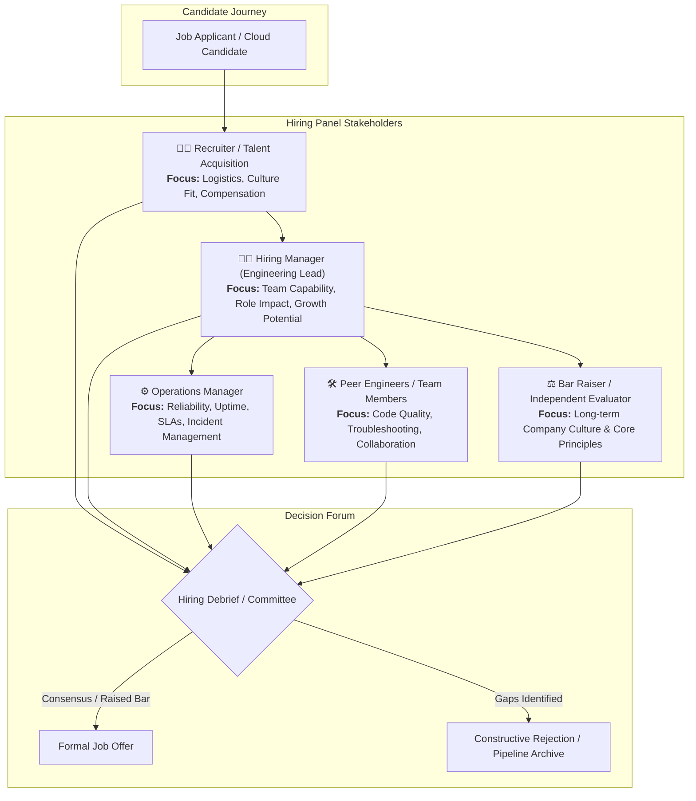
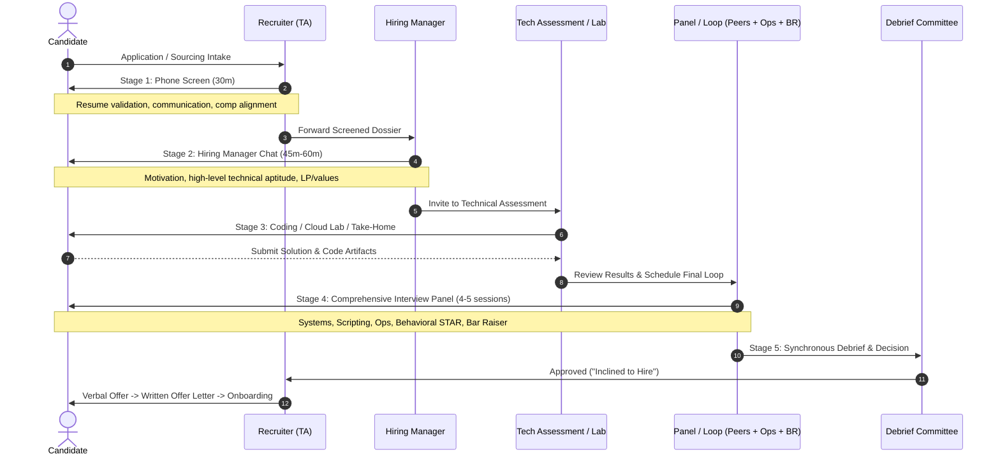
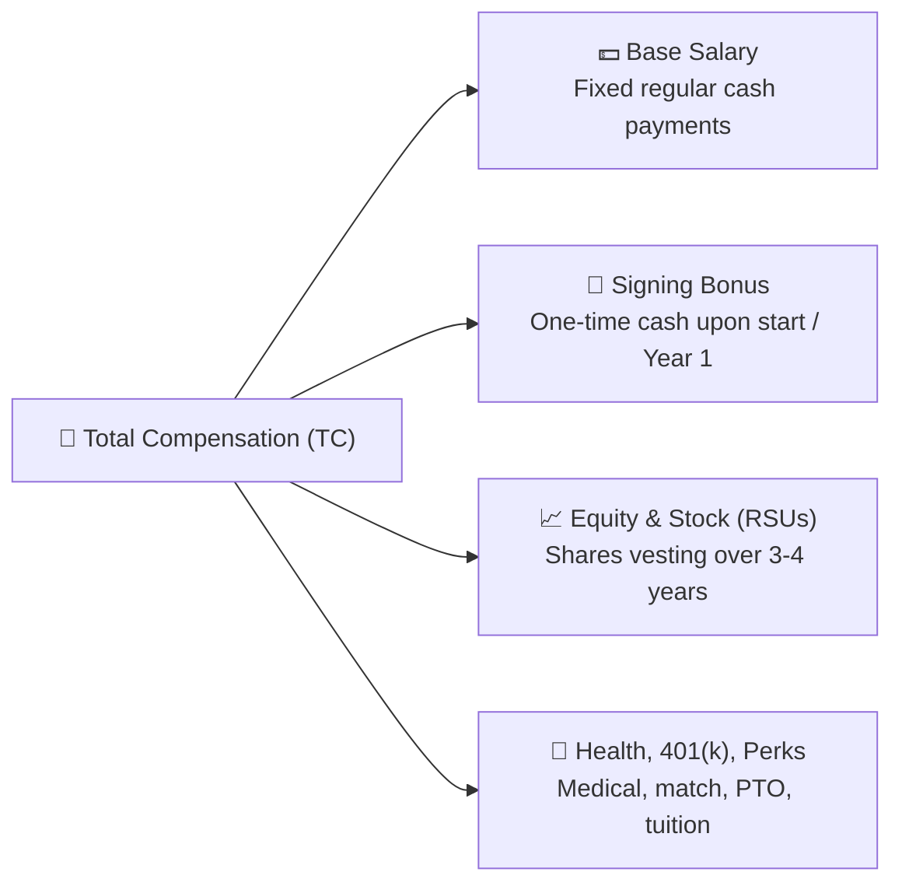
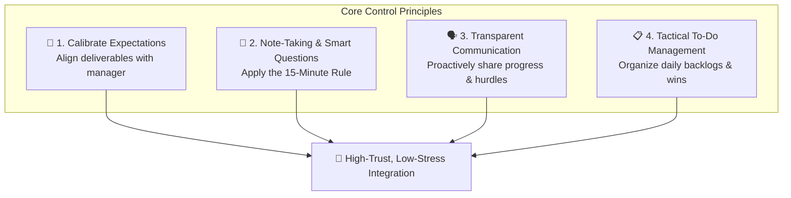
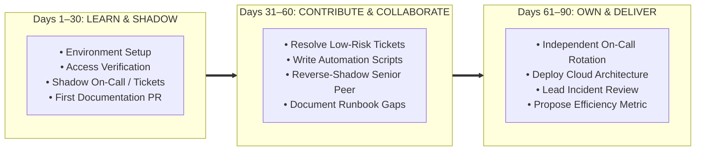

# 🤝 Navigating the Tech Hiring Process & First 90 Days Onboarding Guide

> **Course**: AWS re/Start Foundational Soft Skills  
> **Module**: M00 – Hiring Process & Workplace Onboarding  
> **Source**: `T03-0020-RSTFSS_EN-US_SG_M00_HIRINGPROCESS.pdf`  
> **Target Audience**: AWS re/Start Learners, Cloud Job Seekers & Early-Career Cloud Engineers  

---

## 🎯 Module Overview

Securing an entry-level or associate cloud role requires more than technical proficiency—it demands an in-depth understanding of how modern technology companies source, evaluate, and select candidates, as well as how to successfully transition from receiving an offer to becoming a high-impact team member. 

The corporate hiring journey involves multiple cross-functional stakeholders, rigorous technical assessments, behavioral evaluations, and structured debriefs. Once hired, succeeding during the probationary onboarding window requires proactive communication, psychological resilience, and a deliberate 30-60-90 day performance strategy.

This guide details the complete end-to-end tech hiring pipeline, analyzes key decision-makers (recruiters, hiring managers, operations leads, peers, and bar raisers), provides a pragmatic framework for offer evaluation and compensation negotiation, and establishes a proven 30-60-90 day roadmap for new cloud hires.

### 📌 Learning Objectives

- [ ] **Demystify the Tech Hiring Lifecycle**: Trace the end-to-end recruitment funnel from initial sourcing to the final signed offer.
- [ ] **Analyze Key Stakeholders**: Differentiate the roles, priorities, and evaluation criteria of recruiters, hiring managers, operations managers, peer engineers, and Amazon-style bar raisers.
- [ ] **Master Technical Assessments**: Prepare for coding tests, take-home labs, live troubleshooting interviews, and architectural scenario walkthroughs.
- [ ] **Navigate Offer Evaluation & Negotiation**: Objectively analyze total compensation packages (base, bonus, equity, benefits) and negotiate professionally without burning bridges.
- [ ] **Overcome Day 1 to Day 30 Friction**: Master administrative setup, access provisioning, collaboration protocols, and expectation calibration.
- [ ] **Execute a 30-60-90 Day Cloud Onboarding Plan**: Implement a milestone-driven strategy to transition from passive learning to independent cloud system ownership.

---

## 🔑 Key Vocabulary & Core Concepts

| Term | Official Definition | Practical Meaning for Tech Professionals |
| :--- | :--- | :--- |
| **Hiring Process** | The structured process of reviewing applications, selecting candidates to interview, administering assessments, and making the final hiring decision. | The multi-stage pipeline designed to filter candidates based on technical ability, cultural alignment, and problem-solving aptitude. |
| **Recruiter (Talent Acquisition)** | Finds qualified candidates for job openings and acts as the primary intermediary between candidate and employer. | Your primary point of contact and advocate; screens for baseline requirements, timeline, compensation expectations, and communication clarity. |
| **Hiring Manager (HM)** | The department lead or engineering manager responsible for defining the job opening and making the hiring decision. | Your future direct supervisor; evaluates whether you can solve their team's specific pain points, learn quickly, and integrate into team dynamics. |
| **Operations Manager** | Manages various operational, infrastructure, and delivery aspects within the organization. | Evaluates reliability, operational excellence, on-call willingness, adherence to SLAs/runbooks, and pragmatic systems support. |
| **Peer / Project Team Member** | Senior or staff engineers and colleagues who work directly within the target engineering squad. | Evaluates day-to-day collaboration, code review etiquette, debugging thought process, and whether they would enjoy working with you on high-stress outages. |
| **Bar Raiser** | An objective interviewer outside the hiring team trained to ensure candidates raise the long-term hiring standard of the company. | Amazon's signature quality mechanism; has veto power and specifically probes deep behavioral alignment with core values (Leadership Principles). |
| **Technical Assessment** | A structured evaluation consisting of live coding, take-home exercises, lab simulations, or technical presentations. | Demonstrates your real-time problem-solving process, script debugging (Python/Bash), networking fundamentals, and cloud architectural reasoning. |
| **Onboarding Plan** | A structured 30-60-90 day operational framework guiding a new hire's integration, learning, and independent contribution. | A proactive roadmap that clarifies manager expectations, tracks learning milestones, and prevents early-tenure imposter syndrome. |

---

## 👥 1. Stakeholder Taxonomy: Who Decides Your Fate?

In tech recruitment, hiring is rarely a unilateral decision made by a single person. Instead, candidates are evaluated by a multidisciplinary interview panel representing distinct functional interests. Understanding each interviewer's perspective allows you to tailor your communication style and technical depth accordingly.



### Detailed Stakeholder Matrix

| Stakeholder Role | Primary Perspective & Motivation | What They Evaluate | High-Impact Behaviors | Red Flags to Avoid |
| :--- | :--- | :--- | :--- | :--- |
| **Recruiter (Sourcer / TA Specialist)** | Needs to fill open requisitions quickly with qualified, reliable candidates who will accept an offer. | • Clear communication<br>• Genuine interest in the company<br>• Realistic salary expectations<br>• Work authorization & timeline | Concise elevator pitch, enthusiasm for the mission, punctual responses, transparent scheduling. | Arrogance, lack of basic knowledge about the company, unrealistic comp demands, vagueness on resume details. |
| **Hiring Manager (HM)** | Responsible for project delivery, team health, and team productivity; needs to reduce workload. | • Problem-solving speed<br>• Coachability & growth mindset<br>• Ownership and accountability<br>• Cultural alignment | Demonstrating self-starter initiative, admitting knowledge boundaries while explaining learning steps, asking insightful questions about team challenges. | Blaming previous teammates, defensiveness when challenged, claiming expertise without substance. |
| **Operations Manager** | Protects system availability, service-level agreements (SLAs), and operational workflows. | • Incident response mentality<br>• Adherence to documentation & runbooks<br>• Risk awareness in production | Emphasizing change-management discipline, monitoring mindset (CloudWatch), security least-privilege, and root-cause analysis. | "Cowboy engineering" attitudes, bypassing change controls, disregarding security or operational guardrails. |
| **Peer Engineers (Cloud / DevOps)** | Will review your pull requests, share on-call rotations, and debug production outages with you. | • Hands-on CLI/scripting fluency<br>• Code review receptivity<br>• Clear debugging logic<br>• Daily teamwork | Thinking out loud during technical problems, asking clarifying edge-case questions, welcoming feedback during pairing. | Inflexibility on tooling, pretending to know commands you don't, talking down to colleagues, poor git hygiene. |
| **Bar Raiser (Culture Champion)** | Ensures the hire exceeds the 50th percentile of existing employees in equivalent roles; neutral party. | • Long-term cultural principles (e.g., Amazon LPs)<br>• Dealing with ambiguity<br>• Ethical backbone and earned trust | Structured STAR responses, clear data-driven decisions, demonstrable ownership and customer focus. | Generalized answers ("we did this"), inability to identify personal mistakes, lack of reflective introspection. |

---

## 🗺️ 2. The End-to-End Tech Hiring Process

A typical technical recruitment lifecycle follows five sequential phases. While naming conventions vary across startups, mid-market IT firms, and enterprise cloud providers (e.g., AWS, Microsoft, Google), the evaluation progression remains consistent.



### Stage 1: Initial Phone Screen / Recruiter Screen (20–30 Minutes)

The initial filter is conducted by a talent acquisition recruiter. The objective is candidate verification and logistical qualification.

#### Core Agenda:
- **Language & Communication**: Can you explain your background concisely without excessive jargon or filler words?
- **Motivation & "Why Us?"**: Why do you want to join this specific company and cloud team?
- **Salary & Compensation Expectations**: Are your salary targets aligned with the budget band approved for the role?
- **Work Authorization & Notice Period**: Do you have legal work rights, and what is your earliest start date?

> [!TIP]
> **How to Answer the Salary Question at Stage 1**:  
> Avoid giving a rigid single number too early. Instead, anchor to industry market research:  
> *"I am targeting market rates for an entry-level Cloud Support Associate or Junior Cloud Engineer in this region, generally between $X and $Y depending on total compensation, benefits, and growth opportunities. What is the budgeted range for this position?"*

---

### Stage 2: Hiring Manager Screen (45–60 Minutes)

The hiring manager assesses technical foundation, relevant project experience from AWS re/Start, and interpersonal fit with the existing team.

#### Key Focus Areas:
- **Deep-Dive into Hands-on Labs**: Walking through architectures built during training (e.g., multi-tier VPC, LAMP stack on EC2, automated S3 backups using Lambda and EventBridge).
- **Behavioral Scenarios**: How you overcome technical roadblocks, manage deadlines, and resolve conflicting priorities.
- **Mutual Discovery**: An opportunity for the candidate to ask questions about the team’s roadmap, tech stack, and onboarding support.

---

### Stage 3: Technical Assessment (Online Assessment, Lab, or Take-Home)

Technical evaluations vary by company size and role archetype (Cloud Support vs. DevOps vs. Solutions Architecture):

```
┌────────────────────────────────────────────────────────────────────────┐
│                     Common Tech Assessment Formats                     │
│                                                                        │
│  [Format A: Timed Online Test]      [Format B: Take-Home Lab]          │
│  • Platforms: HackerRank, Codility  • Deploy AWS VPC, EC2, RDS         │
│  • Topics: Bash scripts, Python,    • Submit GitHub repo with README,  │
│    Linux commands, SQL queries      CloudFormation/Terraform scripts   │
│                                                                        │
│  [Format C: Live Pairing / Screen]  [Format D: Architecture Scenario]  │
│  • Live troubleshooting on terminal • "Design a resilient, low-cost    │
│  • Diagnose 403 Forbidden on S3     web tier on AWS for 100k users"    │
│  • Debug broken Apache/Nginx web    • Whiteboard trade-offs (RTO/RPO,  │
│    server via SSH                   cost, security, high availability) │
└────────────────────────────────────────────────────────────────────────┘
```

#### Evaluation Criteria:
1. **Methodology over Perfection**: Interviewers observe *how* you break down ambiguous problems and systematically isolate variables.
2. **Syntax Recovery**: Making an error in Bash or Python is acceptable if you read the compiler/interpreter error message and calmly rectify it.
3. **Security Guardrails**: Always mentioning least-privilege permissions, security groups, and encryption (never hardcoding secrets in plain text).

---

### Stage 4: The Final Loop / Onsite Panel (4–5 Consecutive Sessions)

The definitive evaluation round, consisting of individual 45–60 minute deep dives:

1. **System & Architecture Session**: Focuses on cloud components (VPC, subnets, route tables, IGWs, NAT gateways, ALB, EC2, RDS).
2. **Scripting & Automation Session**: Focuses on writing modular Bash or Python scripts to automate cloud operational tasks (e.g., parsing log files, stopping idle instances).
3. **Operational Excellence & Incident Response**: Evaluates your approach to monitoring alerts, ticketing escalation paths, and conducting root-cause analysis (post-mortems).
4. **Behavioral & Cultural Principles**: Probes collaboration, conflict resolution, customer advocacy, and dealing with failure using the **STAR** method (Situation, Task, Action, Result).
5. **The Bar Raiser / Executive Session**: An interviewer external to the team evaluating long-term company fit and high ethical standards.

---

### Stage 5: Debrief, Committee Decision & The Offer

Following the panel, all interviewers submit independent written feedback before meeting in a **debrief session**.

- **Independent Scoring**: Interviewers cannot see other panelists' written scorecards until their own is submitted, preventing anchoring bias.
- **Inclined vs. Not Inclined**: Each panelist votes on whether to extend an offer.
- **The Decision Bar**: A candidate must receive a strong consensus, and the Bar Raiser must agree that the candidate raises the team's standard.
- **Formal Offer Letter**: The recruiter contacts the selected candidate to present the written offer package.

---

## 💰 3. Offer Evaluation & Strategic Compensation Negotiation

Receiving an offer is an exciting milestone, but evaluating tech compensation requires analyzing total compensation (TC) rather than just the base salary.



### Total Compensation Breakdown

| Component | Definition | Strategic Considerations |
| :--- | :--- | :--- |
| **Base Salary** | Guaranteed annual cash salary paid bi-weekly or monthly. | Forms the baseline for future percentage raises and bonus calculations. Target high predictability. |
| **Signing Bonus** | Lump-sum cash paid upon joining or distributed across Year 1 and Year 2. | Often used by employers when base salary bands are strictly capped. Frequently has a 1-year clawback clause if you leave early. |
| **Equity / RSUs / Stock** | Restricted Stock Units or stock options vesting over time (typically a 4-year schedule). | High upside at publicly traded cloud leaders (e.g., Amazon, Microsoft); variable value at early-stage private startups. |
| **Health & Retirement** | Employer contributions to health insurance premiums and 401(k) retirement matching. | A 5% 401(k) match on a $70,000 base represents an additional $3,500 in non-taxable cash value per year. |
| **Professional Growth** | Certification reimbursements, training stipends, equipment allowances. | Crucial for early-career cloud professionals wanting to pursue AWS Solutions Architect or SysOps Associate exams. |

### Strategic Negotiation Framework

> [!IMPORTANT]
> **Golden Rule of Tech Offer Negotiation**:  
> Negotiation is a collaborative problem-solving dialogue, not an adversarial argument. Employers expect candidates to review offers thoughtfully. Express enthusiastic appreciation for the offer before proposing data-backed counter-adjustments.

#### Professional Counter-Offer Script

```text
Subject: Re: Job Offer - Cloud Support Associate - [Your Name]

Dear [Recruiter Name],

Thank you so much for extending the offer to join [Company Name] as a Cloud Support Associate! I am truly thrilled about the team's mission, the cloud infrastructure challenges we discussed with [Hiring Manager Name], and the opportunity to contribute immediately.

I have thoroughly reviewed the offer details. Based on my comprehensive hands-on training with AWS core services, Linux administration, and Python automation, alongside current market data for this role in [City/Remote], I was hoping to see a base salary closer to $[Target Amount].

If we can reach $[Target Amount], or bridge the difference through a signing bonus of $[Bonus Target] to support my home lab and ongoing AWS professional certifications, I would be delighted to sign the agreement immediately.

Thank you again for your partnership throughout this process. I look forward to your thoughts!

Warm regards,
[Your Name]
[Phone Number]
```

---

## 🏢 4. Starting as a New Hire: What to Expect in Week 1

The primary objective of your employer during your first few days is to welcome you, complete human resources compliance, integrate you into company communications, and help you build rapport with your immediate team.

```
┌────────────────────────────────────────────────────────────────────────┐
│                      First Week Milestone Checklist                    │
│                                                                        │
│  [Equipment & IT Setup]               [Account Access & Security]      │
│  • Receive laptop, YubiKey, monitors  • Corporate email activation     │
│  • Set up password vault (1Password)  • Slack/Teams workspace access   │
│  • Enforce hardware 2FA / MFA         • GitHub Enterprise / GitLab     │
│                                                                        │
│  [Administrative Orientation]         [Calendar Synchronization]       │
│  • HR benefits enrollment & tax forms • Daily stand-up invites         │
│  • Complete compliance training       • Weekly 1-on-1 with manager     │
│  • Review employee code of conduct    • Sprint planning / Retros       │
└────────────────────────────────────────────────────────────────────────┘
```

### Essential First-Week Activities

1. **Company Orientation**: Attending scheduled onboarding seminars with human resources to learn company history, values, and workplace policies.
2. **Equipment Provisioning**: Receiving your company laptop, configuring disk encryption (FileVault / BitLocker), and verifying corporate VPN connectivity.
3. **Collaboration Tool Setup**: Joining company Slack channels, Microsoft Teams groups, and document repositories (Confluence, Notion, Google Drive).
4. **Key Stakeholder Contact List**: Receiving an organization chart containing contacts for your manager, team peers, IT Help Desk, and HR Business Partner (HRBP).
5. **Meeting Cadence Setup**: Populating your calendar with recurring team ceremonies (daily stand-ups, sprint backlog grooming, bi-weekly retrospectives, and regular 1-on-1 coaching sessions).

---

## 🧘 5. Proactive Strategies to Stay in Control

Starting a technical cloud position can trigger feelings of cognitive overload and imposter syndrome. New engineers are suddenly exposed to proprietary internal tools, complex legacy architectures, and rapid technical jargon. 

The following four foundational principles ensure you remain composed, productive, and well-regarded:



### Strategy 1: Set Realistic Expectations

Early in your tenure, nobody expects you to be a solo architectural savior. Trying to deploy major production changes on Day 3 risks causing unintended system disruptions.

- **Check In Frequently**: Regularly validate your understanding of expectations with your manager and assigned onboarding buddy.
- **Define What "Good" Looks Like**: Ask your manager: *"What does successful completion of my first 30 days look like to you?"*
- **Acknowledge the Learning Curve**: Modern cloud estates are vast. Give yourself permission to absorb architecture before trying to redesign it.

---

### Strategy 2: Take Diligent Notes & Ask Smart Questions

The difference between an irritating question and an impressive question is the candidate's demonstrated preparation and retention.

> [!TIP]
> **The 15-Minute Rule for Technical Troubleshooting**:  
> When you hit a roadblock:
> 1. Spend **15 minutes** attempting to solve it yourself (review documentation, inspect logs, search internal Slack channels or Stack Overflow).
> 2. Document what you tried, what errors occurred, and what hypotheses you formed.
> 3. If you remain stuck after 15 minutes, reach out to your buddy or team:  
>    *"Hi [Peer], I'm configuring the staging IAM role and encountering an `AccessDenied` error on `s3:GetObject`. I reviewed the bucket policy and confirmed my role has the read policy attached. Could you help point me toward where our KMS key permissions are defined?"*

- **Never Ask the Same Question Twice**: Capture every command, path, and architectural idiosyncrasy in your personal engineering notebook (Obsidian, Notion, or Joplin).
- **Schedule Follow-Up Micro-Syncs**: If a senior engineer cannot answer immediately due to an active incident, politely request a 10-minute slot on their calendar when they are free.

---

### Strategy 3: Communicate Proactively & Transparently

Engineers often make the mistake of going silent when they are confused or struggling, fearing it will expose incompetence. In professional engineering teams, silence breeds anxiety.

- **Broadcast Context**: Teammates are far more eager to assist when you keep them informed of what you are tackling and where you need a quick nudge.
- **The "5-15" Friday Status Email**: Send your manager a weekly bulleted update that takes 15 minutes to write and 5 minutes to read:
  - **Accomplishments This Week**: (e.g., Set up local dev environment; closed first documentation bug ticket; attended onboarding sessions).
  - **Priorities for Next Week**: (e.g., Shadow on-call shift; deploy test CloudFormation template in sandbox).
  - **Blockers / Help Needed**: (e.g., Still awaiting IAM access approval for staging cluster).

---

### Strategy 4: Maintain Structured Task & Question Backlogs

Working without an organized task list guarantees that administrative requests and training tasks will slip through the cracks.

- **Maintain Two Running Lists**:
  1. **Immediate Task Kanban**: Prioritized list of tasks scheduled for completion today and tomorrow.
  2. **Non-Urgent Question Repository**: A dedicated scratchpad where you record curiosities about system architecture to ask during scheduled 1-on-1s.

---

## 📈 6. The 30-60-90 Day Cloud Onboarding Masterplan

A structured 30-60-90 day plan outlines clear phases that transition an engineer from an initial consumer of knowledge to an autonomous contributor and cloud systems owner.



### Phase-by-Phase Roadmap

```
┌────────────────────────────────────────────────────────────────────────┐
│                        30-60-90 DAY ACTION MATRIX                      │
├────────────────────────────────────────────────────────────────────────┤
│ DAYS 1–30: ABSORB, OBSERVE & REPRODUCE                                  │
│ • Objective: Master toolchains, understand topology, earn peer trust. │
│ • Target Deliverable: Ship first minor PR; update stale documentation. │
├────────────────────────────────────────────────────────────────────────┤
│ DAYS 31–60: EXECUTE, SCRIPT & EXPAND                                   │
│ • Objective: Handle routine cloud operations; automate recurring tasks.│
│ • Target Deliverable: Resolve support tickets unassisted; write Bash/  │
│   Python automation for manual operational toil.                       │
├────────────────────────────────────────────────────────────────────────┤
│ DAYS 61–90: OPERATE, LEAD & OPTIMIZE                                   │
│ • Objective: Assume full operational ownership; contribute to reviews. │
│ • Target Deliverable: Participate in production on-call rotation;      │
│   identify cost/security optimizations in cloud infrastructure.        │
└────────────────────────────────────────────────────────────────────────┘
```

#### Detailed Milestone Breakdown

| Milestone Period | Core Objectives | Hands-on Technical Tasks | Key Deliverables & Validation |
| :--- | :--- | :--- | :--- |
| **Days 1–30**<br>*(Learn & Absorb)* | • Understand system topology<br>• Build relationships with team & buddy<br>• Master git workflows and PR standards | • Clone repositories and build dev containers<br>• Walk through AWS Architecture diagrams (VPCs, ALB, RDS)<br>• Review past 10 post-mortems and incident reports | • Complete all compliance and security modules<br>• Submit 1 PR fixing outdated team documentation or broken links<br>• Conduct 30-day alignment review with manager |
| **Days 31–60**<br>*(Contribute & Collaborate)* | • Take ownership of simple tickets<br>• Shadow on-call incidents<br>• Understand monitoring and alerting thresholds | • Resolve Level-1/Level-2 cloud support tickets<br>• Write a script (Python/Boto3 or Bash) to automate log rotation or EBS snapshot cleanup<br>• Conduct "reverse-shadowing" (you drive, senior observes) | • Independently resolve 5–10 support backlog issues<br>• Author or update 1 operational runbook<br>• Conduct 60-day milestone progress review with manager |
| **Days 61–90**<br>*(Own & Deliver)* | • Full integration into team rota<br>• Identify areas of infrastructure waste or risk<br>• Actively participate in architectural discussions | • Join secondary on-call rotation with backup support<br>• Deploy infrastructure changes via CloudFormation or Terraform<br>• Run a cost-optimization audit using AWS Cost Explorer/Trusted Advisor | • Present a small project or optimization proposal at team retro<br>• Propose professional goals for next 6 months<br>• Conduct formal 90-day probationary review |

---

## 🛠️ 7. Practical Worksheets & Toolkits

### Worksheet 1: Pre-Interview Stakeholder Research Matrix

Use this worksheet before interviewing with any tech company to map out their panel:

```text
Company Name: __________________________________________________
Target Role: ____________________________________________________
Target Cloud Services Mentioned in Job Post: _____________________

1. RECRUITER INSIGHTS:
• Name: ___________________________ 
• Key topics to confirm: Salary range ($______), Interview steps (____ stages), Timeline (____)
• 30-Second Elevator Pitch tailored to this company:
  "_____________________________________________________________________________________"

2. HIRING MANAGER INSIGHTS:
• Name & Title: _________________________________________________
• Recent team accomplishments or public LinkedIn posts: _________________________________
• Primary business problem their team solves: ____________________________________________
• 2 Questions to ask them:
  1. "__________________________________________________________________________________"
  2. "__________________________________________________________________________________"

3. PEER / OPERATIONS INSIGHTS:
• Tech stack used: OS (Linux/RHEL/Ubuntu) | Cloud (AWS/Multi) | Scripting (Python/Bash)
• Core operational challenges: High availability, legacy migration, incident escalation
• 2 Questions to ask them:
  1. "What does an average on-call week look like for an engineer on this squad?"
  2. "How does the team approach testing and reviewing infrastructure-as-code updates?"
```

---

### Worksheet 2: Daily Engineer Question & Logbook Template

Keep this template open in your notes app during your first month on the job:

```text
DATE: YYYY-MM-DD
-----------------------------------------------------------------------------------------
[ ] BLOCKER LOG (15-Minute Rule)
• Problem Encountered: 
• Error Message / Log Snippet:
• What I Have Tried:
  1. 
  2. 
• Relevant Documentation Checked:
• Colleague Consulted & Resolution:

-----------------------------------------------------------------------------------------
[ ] NEW TERMINOLOGY / ARCHITECTURAL NOTES
• Term / Acronym Heard Today: _________________ -> Meaning: _____________________________
• Internal Service / Endpoint: _________________ -> Purpose: _____________________________

-----------------------------------------------------------------------------------------
[ ] DAILY 3 WINS
1. 
2. 
3. 

-----------------------------------------------------------------------------------------
[ ] QUESTIONS FOR NEXT 1-ON-1 WITH MANAGER / BUDDY
• 
• 
```

---

## 📌 Summary & Key Takeaways

1. **Recruitment is a Multi-Perspective Evaluation**: The recruiter assesses your viability, the hiring manager assesses your growth and impact, the operations lead tests your reliability, your peers assess your daily collaborative fit, and the bar raiser safeguards corporate culture.
2. **Technicals Get You the Interview, Soft Skills Secure the Offer**: While you must understand Linux, networking, and AWS architecture, panels hire candidates who communicate transparently, take ownership of errors, and demonstrate high coachability.
3. **Negotiate Total Compensation Holistically**: Base salary is only one component of tech pay. Signing bonuses, equity, 401(k) matches, and professional training budgets provide multiple levers for negotiation.
4. **Day 1 to 30 is About Cultural and System Assimilation**: Focus on setting up clean environments, observing team norms, asking structured questions via the 15-minute rule, and building high-trust relationships.
5. **Execute a Deliberate 30-60-90 Day Strategy**: Move deliberately from **Learning & Shadowing** (Month 1), to **Contributing & Automating** (Month 2), to **Operational Ownership & Proactive Delivery** (Month 3).

---

## 🔗 Related Course Modules

- [T03-0005: Cloud Roles & Career Pathways](file:///work/tmp/aws-cf/T03-Professional_Skills/T03-0005-RSTFSS_EN-US_SG_M00_CLOUDROLES.md)
- [T03-0008: Behavioral Interviewing & The STAR Method](file:///work/tmp/aws-cf/T03-Professional_Skills/T03-0008-RSTFSS_EN-US_SG_M00_COMMUNICATIONSTAR.md)
- [T03-0015: Building a Digital Presence](file:///work/tmp/aws-cf/T03-Professional_Skills/T03-0015-RSTFSS_EN-US_SG_M00_DIGITALPRESENCE.md)
- [T03-0016: Technical Resume Alignment](file:///work/tmp/aws-cf/T03-Professional_Skills/T03-0016-RSTFSS_EN-US_SG_M00_DIGITALPRESENCERESUME.md)
- [T03-0019: Amazon Leadership Principles: Earn Trust](file:///work/tmp/aws-cf/T03-Professional_Skills/T03-0019-RSTFSS_EN-US_SG_M00_LPEarnTrust.md)
