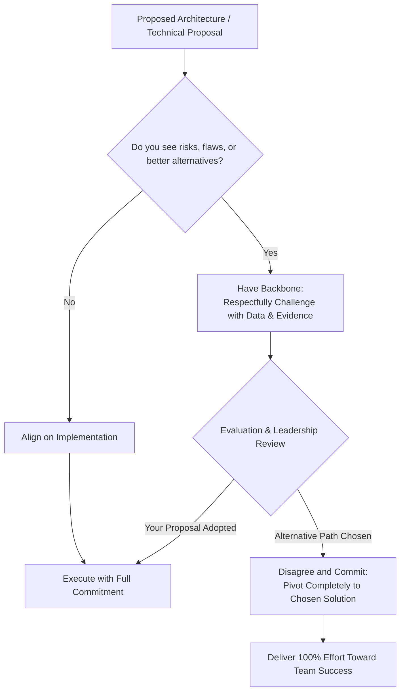

# 🛡️ Amazon Leadership Principles: Have Backbone; Disagree and Commit

> **Course**: AWS re/Start Foundational Soft Skills (Techno-Functional Soft Skills)  
> **Module**: M00 – Leadership Principles Deep Dive & Behavioral Interviewing  
> **Source**: `T03-0021-RSTFSS_EN-US_SG_M00_LPHaveBackbone.pdf`  
> **Target Audience**: AWS re/Start Cloud Learners & Job Seekers  

---

## 🎯 Module Overview

In modern engineering and technology environments, making high-stakes decisions is a daily occurrence. Whether choosing an AWS multi-region architecture, designing security guardrails, or prioritizing sprint deliverables, teams frequently face competing technical opinions and trade-offs.

Amazon's Leadership Principle **Have Backbone; Disagree and Commit** addresses one of the most critical dynamics of high-performing engineering teams: how to navigate conflict constructively, challenge assumptions with conviction, avoid the dangerous pitfall of artificial harmony ("social cohesion"), and pivot instantly to 100% unified execution once a decision is finalized.

This study guide provides an in-depth exploration of this principle, illustrates its relevance in cloud and DevOps roles, details the **STAR (Situation, Task, Action, Result)** behavioral interview framework, presents comprehensive model scenarios, and establishes a 50-minute structured peer practice activity with an evaluation rubric.

### 📌 Learning Objectives
- [ ] Understand Amazon's formal definition and underlying philosophy of **Have Backbone; Disagree and Commit**.
- [ ] Distinguish between respectful, data-backed pushback and destructive interpersonal conflict.
- [ ] Recognize why artificial consensus ("social cohesion") leads to sub-optimal architectural and organizational failures.
- [ ] Master the two distinct stages of the principle: vigorous debate prior to a decision vs. unreserved commitment post-decision.
- [ ] Structure compelling behavioral interview stories using the **STAR methodology**.
- [ ] Apply peer coaching techniques during a 50-minute interactive mock interview session.

---

## 💡 1. Understanding "Have Backbone; Disagree and Commit"

### 📜 Amazon Leadership Principle Definition

> [!IMPORTANT]
> **Amazon Leadership Principle: Have Backbone; Disagree and Commit**  
> *"Leaders are obligated to respectfully challenge decisions when they disagree, even when doing so is uncomfortable or exhausting. Leaders have conviction and are tenacious. They do not compromise for the sake of social cohesion. Once a decision is determined, they commit wholly."*

```
                     ┌─────────────────────────────────────────────────────────┐
                     │          HAVE BACKBONE; DISAGREE AND COMMIT             │
                     └────────────────────────────┬────────────────────────────┘
                                                  │
                 ┌────────────────────────────────┴────────────────────────────────┐
                 ▼                                                                 ▼
   ┌───────────────────────────────────────────┐                     ┌───────────────────────────────────────────┐
   │        HAVE BACKBONE / DISAGREE           │                     │                  COMMIT                   │
   ├───────────────────────────────────────────┤                     ├───────────────────────────────────────────┤
   │ • Obligation to challenge dissent         │                     │ • 100% wholehearted dedication            │
   │ • Tenacity and intellectual honesty       │                     │ • Zero passive-aggressive undermining     │
   │ • Rooted in data, customer impact, facts  │                     │ • No lingering "I told you so" attitudes  │
   │ • Rejects superficial "social cohesion"   │                     │ • United alignment behind team goals      │
   └───────────────────────────────────────────┘                     └───────────────────────────────────────────┘
```

### 🔬 Core Tenets of the Principle

1. **Obligation to Challenge (Dissent is a Duty, Not an Option)**:
   - Notice the precise language: leaders are **obligated** to challenge decisions when they disagree.
   - Remaining silent when you foresee a technical risk, security vulnerability, or flaw in logic is considered a failure of leadership, not politeness.
   - It requires courage, especially when disagreeing with senior engineers, project managers, or team leads.

2. **Conviction and Tenacity**:
   - Having backbone means defending your perspective with persistence, grounded in objective facts, benchmarks, AWS Well-Architected guidelines, and customer needs.
   - It is uncomfortable and exhausting to push back against a prevailing opinion; true leaders muster the stamina to voice concerns thoroughly.

3. **Rejection of Artificial "Social Cohesion"**:
   - "Social cohesion" refers to superficial politeness where team members nod along just to avoid friction, preserve camaraderie, or finish a meeting early.
   - Compromising solely to appease feelings produces mediocre systems and conceals lurking failures. Genuine respect means caring enough about the outcome to voice the hard truth.

4. **Wholly Committing Once Decided**:
   - The phrase is **Disagree *and* Commit**, not *Disagree and Disengage*.
   - Once the debate phase concludes and a leader or team consensus reaches a final verdict, the disagreement stops immediately.
   - Every team member—regardless of what position they advocated—executes the agreed-upon plan with total energy and dedication, working tirelessly to ensure its success.

---

## ☁️ 2. Significance in Cloud Engineering & IT Operations

In cloud infrastructure and software engineering, decisions carry long-lasting architectural, financial, and security repercussions. Weak backbone or fractured execution can cause downtime, security breaches, or budget overruns.



### Real-World Engineering Scenarios:

| Engineering Scenario | The "No Backbone" / False Cohesion Trap | The "Have Backbone; Disagree and Commit" Approach |
| :--- | :--- | :--- |
| **Security vs. Release Deadline** | A developer requests `0.0.0.0/0` SSH access to speed up testing before launch. The junior engineer lets it pass to avoid delaying the sprint. | Engineer respectfully challenges the open CIDR block, explains the security blast radius, proposes an AWS Systems Manager Session Manager solution instead, and helps implement it quickly. |
| **Database Engine Selection** | Team votes for a familiar relational DB (RDS MySQL) for a high-throughput time-series logging system, even though Amazon Timestream or DynamoDB is far better suited. | Engineer presents IOPS benchmarks, cost estimates, and maintenance overhead to challenge the choice. If the team still elects RDS for time-to-market reasons, the engineer commits fully by optimizing schemas, connection pools, and indexes. |
| **Refactoring vs. Technical Debt** | Team lead suggests skipping automated unit tests for an infrastructure-as-code (Terraform/CloudFormation) deployment. | Engineer highlights risks of drift and breaking production changes. If leadership accepts the risk due to an emergency hotfix, the engineer ensures robust rollback alarms and tags are in place. |

---

## ⚖️ 3. Respectful Pushback vs. Destructive Conflict vs. False Cohesion

To demonstrate this leadership principle effectively in interviews and day-to-day work, it is vital to understand the distinctions between productive debate, toxic friction, and passive conformity.

```
                                  ASSERTIVENESS
                                       ▲
                                       │
                      Aggressive /     │   HAVE BACKBONE;
                      Combative        │   DISAGREE AND COMMIT
                      (Toxic Ego)      │   (Principled & Data-Driven)
                                       │
                                       │
                ───────────────────────┼───────────────────────► COOPERATIVENESS /
                                       │                         COMMITMENT
                      Passive-         │   Passive
                      Aggressive       │   "Social Cohesion"
                      (Sabotage)       │   (Artificial Harmony)
                                       │
```

| Behavioral Attribute | ❌ False "Social Cohesion" (Avoidance) | ⚠️ Combative Argument (Toxic) | ✅ Have Backbone; Disagree & Commit (Exemplary) |
| :--- | :--- | :--- | :--- |
| **Mindset** | *"I don't want to rock the boat or upset anyone."* | *"I must win this debate at all costs to prove I am right."* | *"We need the best possible outcome for our customer and system."* |
| **Basis of Argument** | Silence or passive agreement. | Personal opinions, volume, defensive emotion. | Data, logs, official documentation, cost models, architecture pillars. |
| **Tone & Demeanor** | Submissive, disengaged. | Hostile, dismissive, sarcastic, confrontational. | Calm, inquisitive, objective, respectful, empathetic. |
| **Reaction to Counter-Evidence** | Immediately retreats. | Ignores evidence, doubles down stubbornly. | Analyzes counter-evidence objectively, willing to be persuaded. |
| **Post-Decision Behavior** | Complains in private channels. | Grudges, foot-dragging, "I told you it would fail." | 100% active commitment to making the chosen solution succeed. |

> [!TIP]
> **Formulas for Respectful Pushback in Technical Discussions**:
> - *"I see where this approach provides quick turnaround, but I want to raise a concern regarding scalability..."*
> - *"Based on the AWS Well-Architected Security Pillar, opening this port creates unnecessary exposure. Can we look at using IAM role delegation or AWS SSM instead?"*
> - *"Here is the benchmark data comparing Option A and Option B. While Option A is familiar, Option B reduces our monthly operational cost by 40%."*

> [!CAUTION]
> **The Two Deadly Traps of this Leadership Principle**:
> 1. **No Backbone (The Compliant Bystander)**: You knew something was wrong, said nothing, and watched the project fail.
> 2. **Refusal to Commit (The Passive Saboteur)**: You lost the argument, so you subtly drag your feet or whisper cynical comments to teammates. When the system encounters hiccups, you say, "Well, if you had listened to me..."

---

## ⭐ 4. The STAR Behavioral Interview Framework

Behavioral interviewers evaluate your responses using the **STAR methodology** to understand how your historical actions predict your future on-the-job execution.

```
┌────────────────────────────────────────────────────────────────────────────────────────┐
│                                     STAR METHODOLOGY                                   │
├───────────────┬─────────┬──────────────────────────────────────────────────────────────┤
│ Component     │ Target  │ Specific Focus for "Have Backbone; Disagree and Commit"      │
├───────────────┼─────────┼──────────────────────────────────────────────────────────────┤
│ [S] Situation │ 15%     │ Set the scene: Describe the project, the conflicting ideas,  │
│               │         │ or the decision on the table. Identify the technical stakes. │
├───────────────┼─────────┼──────────────────────────────────────────────────────────────┤
│ [T] Task      │ 15%     │ Define your specific role, the disagreement you identified,  │
│               │         │ and why you were obligated to speak up or challenge it.      │
├───────────────┼─────────┼──────────────────────────────────────────────────────────────┤
│ [A] Action    │ 50-60%  │ Detail YOUR specific actions: How did you respectfully voice │
│               │         │ dissent? What data did you present? How did you commit once  │
│               │         │ the final decision was reached? (Focus on "I", not "we").    │
├───────────────┼─────────┼──────────────────────────────────────────────────────────────┤
│ [R] Result    │ 15-20%  │ What was the business or technical outcome? What did the     │
│               │         │ team learn? How did team trust strengthen as a result?       │
└───────────────┴─────────┴──────────────────────────────────────────────────────────────┘
```

### 🎯 Key Elements Interviewers Look For:

> [!NOTE]
> **Green Flags Interviewers Want to See**:
> - **Courage & Moral Compass**: You raised concerns despite peer pressure, hierarchical seniority, or tight deadlines.
> - **Data Over Ego**: You brought logs, benchmarks, customer requirements, or AWS documentation to support your stance.
> - **Professionalism & Tact**: You challenged the *idea*, never the *person*.
> - **True Commitment**: When an alternative path was chosen, you pivoted with full enthusiasm, taking active ownership of tasks to make that path successful.

> [!WARNING]
> **Red Flags to Avoid**:
> - Choosing an example where you argued over trivial personal preferences (e.g., code formatting or tab spacing).
> - Painting your manager or teammates as foolish or incompetent.
> - Showing stubbornness by continuing to argue after the decision was finalized.
> - Blaming others if the alternative choice didn't work out.

---

## ❓ 5. Behavioral Interview Question Bank

Review and practice answering these authentic interview questions targeting **Have Backbone; Disagree and Commit**:

### Category A: Challenging a Decision or Prevailing Consensus
1. *"Tell me about a time when you strongly disagreed with a manager or team lead on a technical decision. How did you handle the situation?"*
2. *"Can you share an experience where the majority of your team wanted to go in one direction, but you believed another approach was necessary? How did you present your viewpoint?"*
3. *"Describe a situation where staying silent would have been easier, but you felt obligated to speak up. What was the risk, and what happened?"*

### Category B: Disagreeing and Committing Wholly
4. *"Describe a time when you passionately disagreed with a decision, but leadership decided to move forward with the opposite approach. How did you react, and what actions did you take to support the project?"*
5. *"Have you ever had to support and execute an initiative that you initially argued against? How did you ensure your personal disagreement didn't affect project delivery?"*

### Category C: Navigating High-Pressure & Deadline Trade-offs
6. *"Tell me about a situation where someone wanted to cut corners or skip security/quality checks to meet an aggressive deadline. How did you address it?"*
7. *"Give an example of a time when you received pushback from a colleague on your proposed solution. How did you evaluate their feedback, and how did you resolve the difference?"*

---

## 🏆 6. Model STAR Scenarios: Cloud & Systems Context

### 🎙️ Scenario 1: Respectfully Challenging a Security Shortcut (Your Proposal Adopted)

**Interview Prompt**: *"Tell me about a time when you felt obligated to challenge a decision or proposal from a colleague or team lead."*

```markdown
#### [S] Situation
"During a capstone deployment sprint in the AWS re/Start program, our 4-person team was deploying a three-tier web application consisting of a React frontend, Node.js API, and Amazon RDS PostgreSQL database. With less than two days before our cohort presentation, the backend was failing to communicate with the database due to VPC subnet routing issues. Under time pressure, a teammate suggested placing the RDS instance into a public subnet with an open 0.0.0.0/0 security group rule so we could easily test connections from our local laptops and get the app live."

#### [T] Task
"My role was managing cloud networking and security configurations. While I understood the urgency of getting the database connected, I knew that exposing our database publicly directly violated the AWS Well-Architected Framework's Security Pillar and established industry best practices. I felt obligated to push back against this shortcut and provide a secure, working alternative without slowing down our progress."

#### [A] Action
"Instead of shooting down the idea in a confrontation, I took the following steps:
1. **Acknowledged the Goal**: I validated our shared goal to resolve the connectivity issue immediately.
2. **Explained the Risk with Facts**: In our team standup, I respectfully explained that public database exposure creates severe security vulnerabilities and could lead to automated brute-force attacks within minutes.
3. **Prepared a Concrete Alternative**: Before raising the objection, I had already researched and drafted a solution. I proposed keeping the RDS instance in private subnets and setting up an AWS Systems Manager (SSM) Session Manager port-forwarding tunnel via a private bastion host.
4. **Demonstrated the Fix Hands-On**: Within 20 minutes, I wrote the Terraform configuration and security group rule allowing inbound traffic on port 5432 exclusively from our application server's security group ID. I demonstrated the local tunnel working cleanly to my teammates."

#### [R] Result
"The team agreed with the solution, and our application re-connected successfully within an hour—maintaining complete private subnet isolation. During our capstone presentation, our instructor specifically commended our architecture for maintaining strict least-privilege security controls under deadline pressure. This experience reinforced to me that having backbone is not about being difficult; it is about protecting the customer and system integrity with viable, data-backed solutions."
```

---

### 🎙️ Scenario 2: Wholehearted Commitment After an Alternative Path Was Chosen

**Interview Prompt**: *"Describe a time when you strongly disagreed with a team decision, but had to commit to it anyway."*

```markdown
#### [S] Situation
"In a collaborative group project, we had to deploy automated configuration management across a fleet of 15 Amazon EC2 Linux instances. I strongly advocated for using Ansible because of its agentless architecture over SSH and clean YAML playbooks, which I had extensive experience testing in our lab environment. Another teammate proposed using Bash user-data scripts paired with AWS Systems Manager State Manager, arguing that it avoided installing any third-party tooling and integrated natively with the AWS console."

#### [T] Task
"As the lead for our deployment strategy, I wanted to ensure long-term maintainability, idempotency, and ease of debugging. I felt Ansible was clearly superior, but the team took a vote, and our instructor recommended going with native AWS SSM State Manager to deepen our cloud-native skills."

#### [A] Action
"Once the team decision was made, I immediately transitioned from the debate phase into 100% commitment:
1. **Dropped the Debate**: I consciously set aside my personal preference for Ansible and did not dwell on the outcome.
2. **Stepped Up to Lead Execution**: I volunteered to write the modular SSM Document definitions and ensure our Bash scripts included proper exit code error handling (`set -euo pipefail`) so they would be idempotent.
3. **Built Safeguards**: I spent an extra evening reviewing the AWS SSM documentation to master State Manager associations and CloudWatch alarm triggers, ensuring we had visibility if any script failed.
4. **Maintained Positive Team Morale**: When a minor script syntax bug caused an initial deployment error, I didn't say 'this wouldn't have happened with Ansible.' Instead, I jumped on a call with my teammate, debugged the line in under ten minutes, and patched the template."

#### [R] Result
"Our SSM State Manager deployment executed flawlessly across all 15 instances in less than 90 seconds, and we achieved an automated drift-detection schedule. Committing wholly allowed our team to finish the sprint a full day ahead of schedule. I learned firsthand that a cohesive team fully committed to an 80% solution will always outperform a divided team arguing over a 100% solution."
```

---

## 📝 7. Step-by-Step Response Worksheet

Use this worksheet to prepare, refine, and rehearse your personal **Have Backbone; Disagree and Commit** story.

### 📋 Story Selection Checklist
- [ ] Does the story involve a genuine disagreement, technical trade-off, or risk?
- [ ] Did you speak up respectfully and back your viewpoint with facts, data, or standards?
- [ ] Does the story show that you challenged the idea without attacking people?
- [ ] If your idea was adopted: Did you solve the problem constructively?
- [ ] If the other idea was adopted: Did you execute the decision with 100% enthusiasm and ownership?
- [ ] Does your narrative emphasize what **YOU** did (`"I"`) rather than passive team actions (`"we"`)?

---

### ✍️ Learner STAR Draft Sheet

```markdown
### 🏷️ Story Title: [e.g., Challenging Root IAM Account Usage in Cohort Lab / Committing to Python vs. Bash for Automation]

#### 🎯 Selected Interview Prompt:
> [Insert chosen question from Question Bank]

---

#### 1. Situation (15% - Context, technical stakes, and conflicting viewpoints)
- **What project or setting were you in?**:
  - 
- **What was the initial proposal or decision that caused concern?**:
  - 
- **What technical, security, or business risks were involved?**:
  - 

---

#### 2. Task (15% - Your responsibility and obligation to intervene)
- **What was your official role or deliverable?**:
  - 
- **Why was it your responsibility to challenge or address the situation?**:
  - 

---

#### 3. Action (50-60% - How you challenged with data AND how you committed)
- **Step 1: Preparing Evidence & Alternative Solutions**  
  (What documentation, metrics, AWS guidelines, or logs did you gather?)
  - 
- **Step 2: Respectful Communication**  
  (How did you voice your pushback professionally without escalating personal friction?)
  - 
- **Step 3: The Decision Point & Pivot**  
  (How was the decision reached, and how did you transition into execution mode?)
  - 
- **Step 4: Dedicated Execution**  
  (What concrete contributions did you deliver to ensure the final path succeeded?)
  - 

---

#### 4. Result (15-20% - Quantifiable outcome, team trust, and key learnings)
- **What was the measurable outcome?** (Delivery speed, security posture, zero downtime, cost saved):
  - 
- **How was team trust or cohesion affected?**:
  - 
- **What did you learn about leadership, conviction, or commitment?**:
  - 
```

---

## 👥 8. Peer Practice Activity Protocol (50 Minutes)

*(Based on Slide 4 of the AWS re/Start Curriculum Guide)*

```
┌────────────────────────────────────────────────────────────────────────────────────────┐
│                              50-MINUTE PRACTICE AGENDA                                 │
├─────────────────────┬───────────┬──────────────────────────────────────────────────────┤
│ Phase               │ Duration  │ Focus                                                │
├─────────────────────┼───────────┼──────────────────────────────────────────────────────┤
│ Phase 1: Prep       │ 10 Mins   │ Individual drafting using the STAR worksheet above   │
│ Phase 2: Round 1    │ 15 Mins   │ Peer A answers interview prompt; Peer B evaluates    │
│ Phase 3: Round 2    │ 15 Mins   │ Peer B answers interview prompt; Peer A evaluates    │
│ Phase 4: Debrief    │ 10 Mins   │ Mutual feedback, calibration, and final refinement   │
└─────────────────────┴───────────┴──────────────────────────────────────────────────────┘
```

### 🤝 Step-by-Step Instructions:

1. **Pairing Up**: Partner with a fellow cohort learner. Designate **Learner A** and **Learner B**.
2. **Interviewer Protocol (15 mins per round)**:
   - Select an interview question from [Section 5](#-5-behavioral-interview-question-bank).
   - Ask the question with a professional, authentic interview tone.
   - Listen attentively for 2 to 3 minutes without interrupting.
   - Use the **Evaluation Rubric** below to score each section and write constructive observations.
   - Spend the remaining 10–12 minutes debriefing: highlight 1 key strength and 2 areas for polish.
3. **Candidate Protocol**:
   - Deliver your answer within 2 to 3 minutes.
   - Clearly delineate Situation, Task, Action, and Result.
   - Emphasize **data-driven conviction** during the challenge and **wholehearted energy** during commitment.
4. **Switch Roles** promptly at the 25-minute mark.

---

### 📊 Peer Evaluation Rubric

Score each competency from **1 (Needs Substantial Polish)** to **5 (Exceptional / Bar-Raiser)**:

| Competency Dimension | Target Criteria | Score (1–5) | Specific Feedback & Notes |
| :--- | :--- | :---: | :--- |
| **STAR Structure & Timing** | Kept within 2–3 minutes; clear transition from S $\rightarrow$ T $\rightarrow$ A $\rightarrow$ R without rambling. | `[ /5]` | |
| **Backbone & Conviction** | Clearly articulated *why* speaking up was necessary; demonstrated courage, tenacity, and objective data over emotion. | `[ /5]` | |
| **Avoidance of Social Cohesion** | Showed willingness to address uncomfortable friction rather than yielding just to keep false harmony. | `[ /5]` | |
| **Wholehearted Commitment** | Clearly demonstrated 100% active alignment once the decision was set (no passive-aggressive resistance). | `[ /5]` | |
| **Focus on "I" (Personal Contribution)** | Explicitly highlighted individual actions, communication choices, and technical execution rather than vague "we". | `[ /5]` | |
| **Professional Tone & Presence** | Confident, respectful, respectful of colleagues, articulated with poise and clarity. | `[ /5]` | |

**Total Score**: `[ /30]`

#### 💬 Feedback Starters for Interview Partners:
- *"Your explanation of why you had to push back was compelling because..."*
- *"I noticed you spent too long on the Situation (over 60 seconds). Try condensing the background to 2 sentences so you can expand on your Action."*
- *"To make your commitment stage more convincing, highlight what you personally built to support the final plan."*
- *"Make sure you emphasize what data or documentation you used to support your stance."*

---

## 🚀 9. Everyday Engineering Habits: Cultivating Backbone & Commitment

Demonstrating this principle in your professional career is a lifelong habit. Use this checklist in your day-to-day engineering and teamwork:

- [ ] **Prepare the "Plan B" Before Objecting**: Never criticize a proposal without offering a viable, well-thought-out alternative.
- [ ] **Ground Disagreements in Documentation**: Cite AWS documentation, RFCs, security standards, and benchmarks rather than personal aesthetic taste.
- [ ] **Ask Clarifying Questions First**: Before assuming someone's idea is flawed, ask: *"Can you walk me through how this handles traffic spikes?"* or *"What was the thought process behind this security group rule?"*
- [ ] **Check Your Ego at the Door**: Understand that having your proposal rejected is not a personal loss—it is part of the collaborative design process.
- [ ] **Celebrate Team Wins on Committed Paths**: When an alternative path that you initially opposed succeeds, genuinely celebrate that success with your team.

---

## 📖 10. References & Cross-Links

- **AWS re/Start Soft Skills Curriculum**:
  - [STAR Methodology & Behavioral Communication](file:///work/tmp/aws-cf/T03-Professional_Skills/T03-0008-RSTFSS_EN-US_SG_M00_COMMUNICATIONSTAR.md)
  - [Overview of Amazon Leadership Principles](file:///work/tmp/aws-cf/T03-Professional_Skills/T03-0009-RSTFSS_EN-US_SG_M00_LPIntro.md)
  - [LP: Customer Obsession](file:///work/tmp/aws-cf/T03-Professional_Skills/T03-0010-RSTFSS_EN-US_SG_M00_LPCustomerObsession.md)
  - [LP: Learn and Be Curious](file:///work/tmp/aws-cf/T03-Professional_Skills/T03-0014-RSTFSS_EN-US_SG_M00_LPLearnAndBeCurious.md)
  - [LP: Earn Trust](file:///work/tmp/aws-cf/T03-Professional_Skills/T03-0019-RSTFSS_EN-US_SG_M00_LPEarnTrust.md)
- **External Resources**:
  - [Amazon Leadership Principles (Official Amazon Careers)](https://www.aboutamazon.com/about-us/leadership-principles)
  - [AWS Well-Architected Framework](https://aws.amazon.com/architecture/well-architected/)
