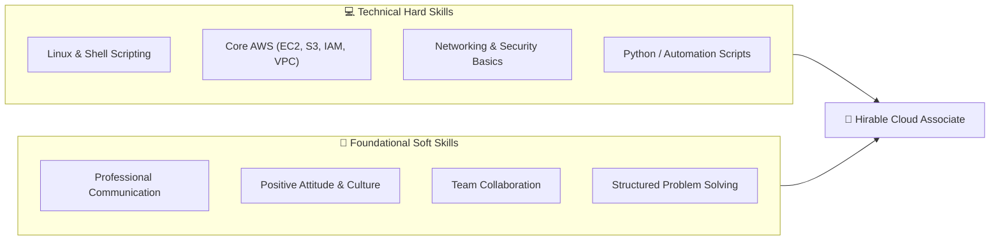
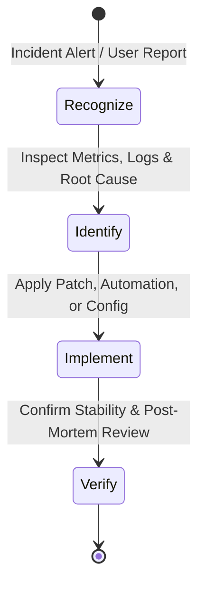
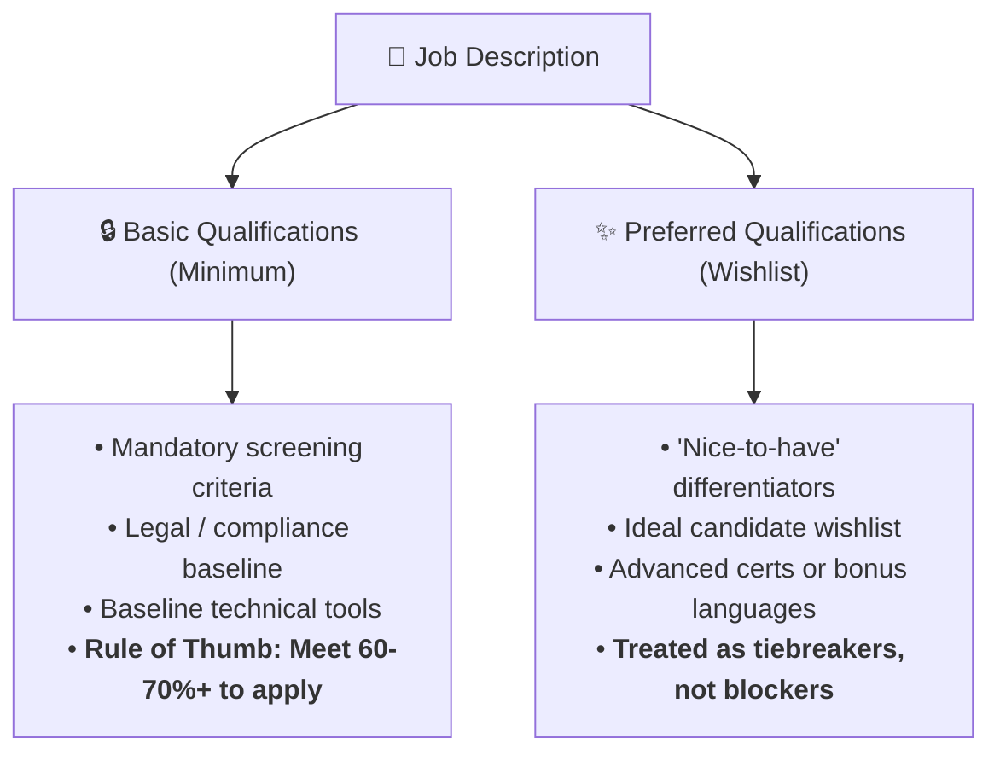
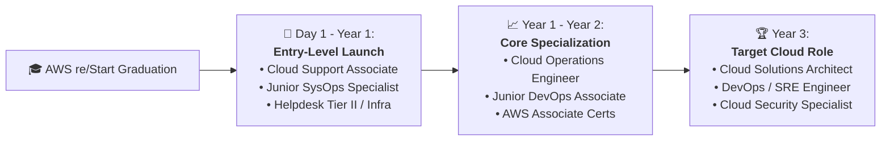

# 🔍 Exploring Cloud Job Postings & Career Action Planning

> **Course**: AWS re/Start Foundational Soft Skills  
> **Module**: M00 – Exploring Cloud Job Postings  
> **Source**: `T03-0022-RSTFSS_EN-US_SG_M00_EXPLORECLOUDJOBPOSTS.pdf`  
> **Target Audience**: AWS re/Start Learners  

---

## 🎯 Executive Summary & Purpose

Navigating the cloud computing job market requires more than technical certifications; it demands the strategic ability to **read, decode, and analyze job descriptions**. Job descriptions are not rigid checklists where every single bullet point is non-negotiable. Rather, they represent an employer's wishlist combined with institutional screening criteria.

This module equips learners to dissect job postings, separate **must-have basic qualifications** from **nice-to-have preferred qualifications**, translate recruitment buzzwords, conduct rigorous skill-gap assessments, and design a concrete, milestone-driven **3-year career action plan**.

```
┌─────────────────────────────────────────────────────────────────────────────┐
│                      Job Description Analysis Funnel                        │
│                                                                             │
│   [ 1. Job Discovery ]   ──▶  [ 2. Requirement Triage ] ──▶  [ 3. Action ]  │
│   • Amazon.jobs / Portals     • Basic vs. Preferred         • Tailor Resume │
│   • Title normalizations      • Technical vs. Soft Skills   • Gap Strategy  │
│   • Core responsibilities     • Decode Buzzwords            • Pitch & Apply │
└─────────────────────────────────────────────────────────────────────────────┘
```

---

## 📌 Learning Objectives

By completing this module and accompanying workshops, you will be able to:

- [ ] **Distinguish Core Competencies**: Differentiate between technical hard skills and foundational soft skills required in modern cloud roles.
- [ ] **Decode Job Descriptions**: Accurately read, parse, and analyze tech job postings, filtering out jargon and unmasking true baseline expectations.
- [ ] **Separate Must-Haves from Nice-to-Haves**: Evaluate basic qualifications versus preferred qualifications to overcome imposter syndrome and apply strategically.
- [ ] **Perform Skill Gap Audits**: Map current personal capabilities against target job descriptions using a structured skill-matching worksheet.
- [ ] **Develop a 3-Year Career Action Plan**: Collaborate with peers to establish short-term post-graduation entry strategies and long-term career growth roadmaps.

---

## 🧠 Key Terminology

| Term | Definition & Practical Cloud Context |
| :--- | :--- |
| **Communication Skills** | The ability to articulate technical concepts clearly across written documentation, ticketing updates, verbal standups, and cross-functional presentations. |
| **Positive Attitude** | A solutions-oriented mindset that embraces ambiguity, demonstrates enthusiasm for continuous learning, and elevates team workplace culture. |
| **Teamwork Skills** | The capacity to collaborate effectively within cross-functional agile pods, support peers during production outages, and share knowledge transparently. |
| **Problem-Solving Skills** | A systematic methodology for identifying incident root causes, evaluating architectural trade-offs, executing fixes, and verifying long-term stability. |
| **Job Posting** | An employer's formal announcement outlining the responsibilities, expected competencies, education, and experience for an open role. |
| **Career Planning** | The deliberate ongoing process of setting professional goals, identifying skill gaps, acquiring credentials, and charting advancement pathways. |

---

## ⚖️ The Two Halves of Cloud Competency

Employers evaluating cloud candidates screen for a balanced equilibrium between **hard technical proficiencies** and **foundational behavioral traits**.



### 1. Communication Skills
- **HR & Recruiter Priority**: Human Resources (HR) and talent acquisition specialists consistently rank clear communication as the primary gating criteria during first-round phone screens.
- **Professional Norms**: Demonstrating professional etiquette across business emails, Slack/Teams chats, issue tracker tickets (Jira/ServiceNow), and video interviews.
- **Translating Complexity**: Explaining complex AWS technical issues in simple, value-focused terms to non-technical stakeholders and business owners.

### 2. Positive Attitude & Workplace Culture
- **Cultural Health**: As organizations transition to collaborative DevOps and SRE models, teams prioritize psychological safety, resilience, and constructive enthusiasm.
- **Coachability**: Demonstrating curiosity, accepting architectural code review feedback graciously, and viewing production bugs as learning opportunities.

### 3. Teamwork & Cross-Functional Collaboration
- **No Siloed Engineers**: Cloud infrastructure supports developers, data scientists, security officers, and business analysts. Cloud engineers must work harmoniously across boundaries.
- **Interview Scenarios**: Almost every behavioral interview includes behavioral questions (STAR format) testing conflict resolution, consensus building, and team delivery under pressure.

### 4. Problem-Solving Methodology
Technical problem-solving follows a repeatable four-stage loop:



1. **Recognize**: Promptly identify anomalies, system constraints, or customer roadblocks.
2. **Identify**: Isolate variables, analyze CloudWatch logs, and pinpoint the root cause.
3. **Implement**: Apply targeted remediations adhering to the principle of least privilege and infrastructure as code.
4. **Follow Up & Confirm**: Validate system health with telemetry and document post-incident learnings.

---

## 🔍 Decoding Tech Job Descriptions: Wishlists vs. Realities

Job postings often read like unrealistic wishlists created by combining inputs from hiring managers, HR recruiters, and senior architects. Understanding how to decode these postings prevents unnecessary self-disqualification.

### 1. Basic Qualifications vs. Preferred Qualifications



> [!IMPORTANT]
> **The 60–70% Application Rule**:
> Research shows that underrepresented candidates and career changers often only apply when meeting 100% of listed requirements, whereas experienced candidates apply when meeting 60%. If you fulfill the core basic qualifications and have demonstrable hands-on lab projects, **apply**.

### 2. Decoder Matrix: Tech Buzzwords vs. Reality

| Job Posting Phrase | What It Sounds Like | What It Actually Means in Daily Practice |
| :--- | :--- | :--- |
| *"Fast-paced environment"* | High stress and chaotic overtime. | Priorities may shift quickly based on customer feedback; requires adaptable time management. |
| *"Self-starter / Independent learner"* | No onboarding support or documentation. | Expected to consult official AWS documentation and troubleshoot before escalating questions. |
| *"End-to-end ownership"* | You do everything alone. | Aligns with Amazon's *Ownership* principle: you follow issues through to resolution without dropping the ball. |
| *"Strong troubleshooting skills"* | Memorizing thousands of error codes. | Ability to read error logs logically, isolate failing network hops, and test hypotheses methodically. |
| *"3+ years cloud experience for entry role"* | Impossible barrier for juniors. | Hiring manager desires someone with practical hands-on capability; intensive lab projects, portfolios, and certifications can substitute. |

---

## 🛠️ Activity 1: Partner Job Posting Analysis (20 Mins)

In pairs, explore live cloud openings on [Amazon Jobs](https://www.amazon.jobs/en) or mainstream tech boards.

### Target Roles for Research
1. **Systems Development Engineer (SysDev)**: Bridges software development and systems operations, building automation tools for large-scale fleets.
2. **Cloud Infrastructure Architect**: Designs foundational VPC topologies, hybrid connectivity, migration strategies, and governance guardrails.
3. **Software Development Engineer (SDE)**: Focuses on core application code, microservices, APIs, and cloud-native software architecture.
4. **Solutions Architect (SA)**: Customer-facing advisory role translating customer business problems into scalable, resilient AWS architectures.
5. **Cloud Support Associate (CSA)**: Entry-level foundational role troubleshooting live customer environments across networking, compute, storage, and IAM.

---

### 📋 Partner Job Analysis Worksheet

Use this worksheet to dissect one target role selected during your 20-minute partner activity:

```markdown
### 🏢 Job Posting Analysis Form

- **Target Job Title**: 
- **Company / Business Unit**: 
- **Requisition / Job ID**: 
- **Job Posting URL**: 

#### 1. Core Mission & Responsibilities
- What primary problem does this position solve for the company?
  > 
- List 3 primary day-to-day responsibilities:
  1. 
  2. 
  3. 

#### 2. Competency Decomposition
| Category | Job Description Requirement | Current Mastery Level (1-5) | Evidence / Relevant AWS re/Start Project |
| :--- | :--- | :---: | :--- |
| **Technical Hard Skills** | e.g., Linux command line & Bash scripting | | |
| | e.g., Amazon EC2, VPC, Security Groups | | |
| | e.g., Python automation or SQL queries | | |
| **Foundational Soft Skills**| e.g., Customer-facing incident communication | | |
| | e.g., Cross-team issue resolution | | |
| | e.g., High-ownership troubleshooting mindset | | |

#### 3. Qualifications Breakdown
- **Minimum / Basic Qualifications Listed**:
  - Education requirement: 
  - Years of experience: 
  - Essential technologies: 
- **Preferred Qualifications (Nice-to-Haves)**:
  - Advanced certifications: 
  - Secondary technologies / languages: 

#### 4. Candidate Strategy Assessment
- What percentage of the basic qualifications do you meet today? [   ]%
- What is your strategy to address the primary missing requirement before or during an interview?
  > 
```

---

## 👥 Activity 2: Group Career Action Planning (30 Mins)

Form small peer groups (3–4 learners) to map immediate next steps and 3-year career trajectories.



---

### 🗺️ 3-Year Career Action Plan Template

Complete this structured planning template during your group discussion:

```markdown
### 🎯 My Personal 3-Year Cloud Career Roadmap

#### Part A: Immediate Post-Course Target (Months 0–6)
1. **Target Entry Role Title**: 
   (e.g., Cloud Support Associate, Jr. Cloud Operations Engineer)
2. **Immediate Action Steps to Secure Interviews**:
   - [ ] Finalize technical resume and portfolio GitHub repository.
   - [ ] Earn AWS Certified Cloud Practitioner (CLF-C02) credential.
   - [ ] Optimize LinkedIn headline, summary, and projects section.
   - [ ] Conduct 5 weekly informational outreach contacts with alumni/engineers.
3. **Target Employer Profiles**:
   - Primary: AWS Partner Network (APN) Consulting Partners
   - Secondary: Managed Service Providers (MSPs) & Enterprise Cloud Users

#### Part B: The 3-Year Vision (Year 3)
1. **Target Mid-Level Role Title**: 
   (e.g., Solutions Architect, DevOps Engineer, Site Reliability Engineer)
2. **Required Capabilities for the 3-Year Role**:
   - Technical Competencies (e.g., Kubernetes, Terraform, CI/CD pipelines, Multi-region VPC peering):
     > 
   - Certification Roadmap (e.g., AWS Solutions Architect - Associate, SysOps Administrator):
     > 
   - Business & Soft Skill Acumen (e.g., Architectural pitching, incident lead, mentoring juniors):
     > 
3. **Bridge Strategy: How to acquire experience on the job during Years 1 & 2**:
   - Volunteer for internal automation and script-writing tasks.
   - Shadow on-call senior engineers during production maintenance windows.
   - Author thorough runbooks and internal knowledge-base documentation.
```

---

## 💡 Best Practices for Tech Job Applications

> [!TIP]
> **Tailor Each Application**:
> Avoid sending generic resumes. Customize your profile summary and project bullets to mirror the specific phrasing and service names found in the target job posting.

> [!NOTE]
> **Leverage the AWS re/Start Advantage**:
> Highlight that you completed 400+ hours of full-time, hands-on immersive technical education encompassing Linux, Python, networking, security, and AWS services, accompanied by rigorous behavioral soft skills coaching.

> [!CAUTION]
> **Beware the "Quick Apply" Trap**:
> One-click submitting 200 generic applications on job boards yields low response rates. Combining thoughtful applications with warm networking, LinkedIn connections, and portfolio demonstrations delivers dramatically higher interview conversion.

---

## 🔗 Related Curriculum Modules

- [T03-0005 Cloud Roles & Pathways](file:///work/tmp/aws-cf/T03-Professional_Skills/T03-0005-RSTFSS_EN-US_SG_M00_CLOUDROLES.md) – Industry landscape and role definitions.
- [T03-0006 Goal Setting](file:///work/tmp/aws-cf/T03-Professional_Skills/T03-0006-RSTFSS_EN-US_SG_M00_GOALSETTINGS.md) – SMART goal framework for tech careers.
- [T03-0007 Career Goals](file:///work/tmp/aws-cf/T03-Professional_Skills/T03-0007-RSTFSS_EN-US_SG_M00_CAREERGOALS.md) – Aligning personal motivations with industry trajectories.
- [T03-0008 Communication & STAR Method](file:///work/tmp/aws-cf/T03-Professional_Skills/T03-0008-RSTFSS_EN-US_SG_M00_COMMUNICATIONSTAR.md) – Structuring behavioral interview answers.
- [T03-0015 Digital Presence](file:///work/tmp/aws-cf/T03-Professional_Skills/T03-0015-RSTFSS_EN-US_SG_M00_DIGITALPRESENCE.md) – Professional online branding.
- [T03-0016 Digital Presence & Resume Guide](file:///work/tmp/aws-cf/T03-Professional_Skills/T03-0016-RSTFSS_EN-US_SG_M00_DIGITALPRESENCERESUME.md) – Crafting high-impact cloud resumes and LinkedIn profiles.
