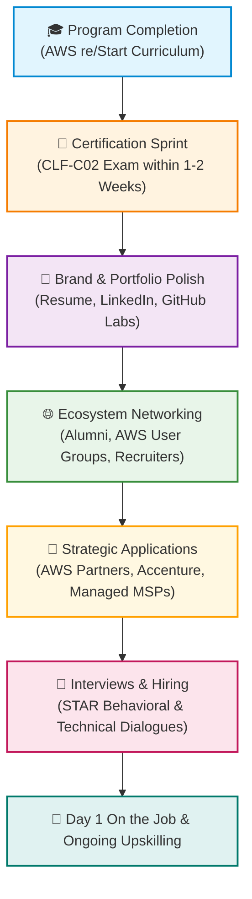
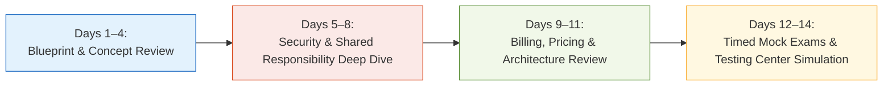

# 🚀 What's Next After AWS re/Start? Post-Graduation Transition & Career Launchpad

> **Course**: AWS re/Start Foundational Soft Skills & Career Readiness  
> **Module**: M00 / RSMISC – What's Next After AWS re/Start?  
> **Source**: `T03-0023-RSMISC_EN-US_SG_M00_WHATSNEXT.pdf`  
> **Target Audience**: AWS re/Start Learners, Recent Graduates & Cloud Job Seekers  

---

## 🎯 Module Overview

Completing the **AWS re/Start** curriculum marks a transformative turning point in your professional journey. Over the course of the program, you have built foundational proficiency in Linux operating systems, Python scripting, networking, security governance, and AWS Cloud architecture. 

However, finishing the coursework is not the finish line—it is the launchpad. This guide outlines your critical transition into the cloud industry: earning your **AWS Certified Cloud Practitioner** credential, learning from real-world graduate success stories (such as alumni thriving at **Accenture**), leveraging official AWS certification preparation tools, and executing a concrete 30-60-90 day post-graduation launchpad strategy.

### 📌 Learning Objectives
- [ ] Understand the post-graduation lifecycle and transition milestones
- [ ] Analyze the real-world case study of AWS re/Start graduates hired at Accenture
- [ ] Identify and navigate official AWS Certification preparation resources and practice exams
- [ ] Synthesize technical lab experience into employer-ready portfolio artifacts
- [ ] Execute the Post-Graduation Launchpad Checklist to accelerate employment in entry-level cloud roles

---

## 🗺️ 1. Post-Graduation Transition Pipeline

The transition from student to working cloud professional requires deliberate momentum. The weeks immediately following graduation are the most critical for certification pass rates and interview responsiveness.



### Transition Phases Breakdown

| Phase | Core Objective | Primary Milestone | Ideal Timeline |
| :--- | :--- | :--- | :--- |
| **Phase 1: Certification Sprint** | Validate foundational cloud literacy | Pass the AWS Certified Cloud Practitioner exam | Days 1–14 post-grad |
| **Phase 2: Asset Optimization** | Showcase skills to recruiters and algorithms | Updated resume, Credly badge on LinkedIn, public GitHub repo | Days 7–21 post-grad |
| **Phase 3: Targeted Outreach** | Connect with hiring partners and alumni | 5 weekly connection requests, AWS User Group attendance | Days 14–45 post-grad |
| **Phase 4: Interview Execution** | Convert opportunities into formal offers | Behavioral STAR mastery & technical scenario defense | Days 30–90 post-grad |

> [!IMPORTANT]
> **Maintain Peak Knowledge**: AWS exam retention drops rapidly if you pause study habits after graduation. Plan to sit for your AWS Certified Cloud Practitioner exam within **7 to 14 days** of completing your course while commands, services, and architectures are top of mind.

---

## 🏢 2. Real-World Case Study: AWS re/Start Graduates at Accenture

One of the most inspiring testaments to the value of AWS re/Start is the success of alumni entering premier enterprise cloud consultancies like **Accenture**.

🎥 **Case Study Video Resource**:  
Watch the official video feature: [AWS re/Start Emerging Talent at Accenture](https://www.youtube.com/watch?v=RBKqlp9lj-k)

```
┌────────────────────────────────────────────────────────────────────────┐
│               Enterprise Partner Spotlight: Accenture                  │
│                                                                        │
│  "AWS re/Start prepares unemployed and underemployed individuals for   │
│   cloud careers through skills development training. Enterprise        │
│   partners like Accenture actively recruit re/Start graduates for      │
│   their tenacity, agility, and foundational cloud engineering talent." │
└────────────────────────────────────────────────────────────────────────┘
```

### Key Takeaways from the Accenture Graduate Experience

1. **Non-Traditional Backgrounds are Assets, Not Handicaps**:
   - The graduates featured did not enter the program with traditional computer science degrees.
   - Past experiences in client service, logistics, administration, or retail instilled resilience, empathy, and customer-first mindsets—core traits sought by consulting firms.
2. **Consulting Demands "Learn and Be Curious"**:
   - At Accenture, cloud consultants constantly encounter client architectures spanning multi-region AWS environments, migrations, and automated pipelines.
   - The primary attribute managers praised was not encyclopedic knowledge, but rather the **confidence to troubleshoot unknown challenges** developed during re/Start hands-on labs.
3. **Collaboration and Cohort Support**:
   - Graduates emphasized the importance of team-based lab work during re/Start. In modern agile consulting teams, no cloud architect or support engineer operates in a silo.
4. **Structured Mentorship & Early-Career Pathways**:
   - Many global consulting partners provide early-career apprenticeships and associate rotational programs designed specifically to transition re/Start graduates into enterprise cloud engineering.

### Consulting Readiness Competency Matrix

| Competency Dimension | What Employers Look For | How AWS re/Start Prepared You |
| :--- | :--- | :--- |
| **Cloud Fluency** | Ability to discuss trade-offs in compute, storage, security, and cost | AWS Well-Architected Framework, pricing calculators, shared responsibility model |
| **Applied Troubleshooting** | Resolving misconfigured route tables, IAM permission denied, or SSH issues | Linux CLI practice, VPC networking labs, CloudWatch diagnostics |
| **Customer Obsession** | Translating technical terminology into business value for stakeholders | Professional communication modules, stakeholder presentation drills |
| **Growth Potential** | Hunger to attain Associate and Specialty certifications | Habit of daily documentation, whitepaper reading, and lab experimentation |

> [!TIP]
> **Consulting Firm Applications**: When applying to Global Systems Integrators (GSIs) like Accenture, Capgemini, Slalom, or Cognizant, highlight your adaptability, client-facing soft skills, and end-to-end understanding of cloud fundamentals alongside your technical labs.

---

## 📚 3. Official AWS Certification Preparation Resources

To ensure you achieve your **AWS Certified Cloud Practitioner (CLF-C02)** credential with confidence, AWS provides official, comprehensive preparation materials.

🔗 **Official Resource Portal**: [AWS Certification Exam Preparation Hub](https://aws.amazon.com/certification/certification-prep/)

### Essential Preparation Resource Catalog

| Resource Name | Source / Location | Format | Focus Area |
| :--- | :--- | :--- | :--- |
| **CLF-C02 Exam Guide** | [AWS Certification Prep](https://aws.amazon.com/certification/certification-prep/) | PDF Blueprint | Definitive breakdown of domain weightings, service scope, and out-of-scope technologies |
| **Official Practice Question Set** | AWS Skill Builder | 20 Interactive Questions | Authentic exam question formatting, question styles, and comprehensive rationales |
| **AWS Cloud Practitioner Essentials** | AWS Skill Builder | Self-Paced Digital Course | Video walk-throughs of core services, global infrastructure, and compliance models |
| **AWS Exam Prep Standard Course** | AWS Skill Builder | Modular Guided Videos | Deep dive into test-taking strategies, parsing distractor answers, and question stems |
| **Official Pre-Test Exam** | AWS Skill Builder (Subscription) | Timed Mock Exam | 65-question simulated environment matching the Pearson VUE exam interface |
| **AWS Whitepapers & FAQs** | AWS Documentation | Technical Papers | *Overview of Amazon Web Services*, *How AWS Pricing Works*, *Well-Architected Framework* |

### Recommended 14-Day Exam Preparation Schedule



- **Days 1–4**: Read the official CLF-C02 exam guide line by line. Review Cloud Concepts (24% exam weight). Ensure you can explain agility, elasticity, high availability, and fault tolerance without referencing notes.
- **Days 5–8**: Focus on Security and Compliance (30% exam weight). Review AWS IAM policies, Multi-Factor Authentication (MFA), AWS KMS, AWS Shield, AWS WAF, Amazon Inspector, and the AWS Shared Responsibility Model.
- **Days 9–11**: Focus on Cloud Technology and Services (34% exam weight) and Billing, Pricing, and Support (12% exam weight). Review compute types, storage tiers, database families, and AWS Support tiers (Basic, Developer, Business, Enterprise).
- **Days 12–14**: Complete at least two full-length, timed practice tests. Analyze every incorrect and guess question. Verify exam check-in requirements on Pearson VUE.

> [!NOTE]
> For in-depth domain breakdowns and technical service matrices, consult the companion guide: [T03-0012: Getting AWS Certified Cloud Practitioner](file:///work/tmp/aws-cf/T03-Professional_Skills/T03-0012-RSMISC_EN-US_SG_M00_AWSCERTIFIED.md).

---

## 🛠️ 4. Post-Graduation Career Launchpad Checklist

Use this interactive launchpad checklist to guide your transition from graduate to employed cloud professional.

### 📌 Milestone 1: Certification & Technical Verification
- [ ] Schedule your AWS Certified Cloud Practitioner exam appointment on Pearson VUE
- [ ] Complete the official 20-question practice set on AWS Skill Builder
- [ ] Review the 6 Pillars of the AWS Well-Architected Framework
- [ ] Achieve passing score ($\ge 700/1000$) on the CLF-C02 exam
- [ ] Claim your Credly digital certification badge and attach it to your profiles

### 📌 Milestone 2: Professional Branding & Online Assets
- [ ] Update your LinkedIn headline (e.g., *"AWS Certified Cloud Practitioner \| AWS re/Start Graduate \| Junior Cloud Operations & Support"* )
- [ ] Link your Credly credential under **Licenses & Certifications** on LinkedIn
- [ ] Update resume summary, technical skill badges, and bullet points using the STAR method
- [ ] Have your resume peer-reviewed and finalized with your AWS re/Start instructor or career coach
- [ ] Clean up personal GitHub profile: Pin 2–3 capstone lab repositories with professional `README.md` files and architecture diagrams

### 📌 Milestone 3: Networking & Strategic Outreach
- [ ] Join local and virtual **AWS User Groups (Meetup / AWS Community)**
- [ ] Connect with AWS re/Start alumni currently working at Accenture, AWS, and consulting partners
- [ ] Follow cloud recruiters and enterprise partner hiring managers on LinkedIn
- [ ] Send 3–5 personalized informational interview messages weekly to working Cloud Support Associates
- [ ] Publish a LinkedIn post sharing your graduation experience, key lessons learned, and Credly badge

### 📌 Milestone 4: Application Pipeline & Interview Readiness
- [ ] Identify 15 target employers (AWS Premier Partners, MSPs, Tech Support Centers, Public Sector contractors)
- [ ] Prepare 5 tailored STAR behavioral stories highlighting:
  - *Customer Obsession* (resolving a difficult client situation)
  - *Bias for Action / Troubleshooting* (debugging a broken Linux or AWS deployment)
  - *Learn and Be Curious* (rapidly mastering a new AWS service during class)
  - *Earn Trust* (team collaboration during cohort group labs)
- [ ] Conduct 2 mock interview sessions with a cohort peer or mentor
- [ ] Apply to 5–10 entry-level cloud roles weekly (Cloud Support Associate, NOC Analyst Tier 1, Junior DevOps, Cloud Operations)

---

## 🗓️ 5. 30-60-90 Day Post-Graduation Action Plan

A structured timeline prevents post-program stagnation and ensures continuous upward momentum.

| Period | Strategic Focus | Deliverables & Metrics |
| :--- | :--- | :--- |
| **Days 1–30: Validate & Launch** | Certification, Asset Polish & First Applications | • Earn CLF-C02 certification<br/>• 100% complete LinkedIn & Github<br/>• 25 targeted job applications submitted<br/>• Attend 1 AWS User Group event |
| **Days 31–60: Pipeline Acceleration** | Active Interviewing & Intermediate Upskilling | • Begin phone screenings and first-round interviews<br/>• Start studying for AWS Solutions Architect Associate (SAA-C03)<br/>• Build an automated Terraform or CloudFormation mini-project<br/>• 20 additional targeted applications |
| **Days 61–90: Offer Closing & Placement** | Technical Defense & Offer Negotiation | • Complete second/final stage behavioral and technical interviews<br/>• Secure job offer as Cloud Support Associate, SysOps, or Cloud Analyst<br/>• Complete cohort exit interviews and report placement to AWS re/Start team |

> [!CAUTION]
> **Avoid "Tutorial Hell"**: While continuing your education is vital, do not hide behind endless passive video watching. Real career breakthroughs come from **hands-on building**, documenting public code repositories, and actively submitting applications.

---

## 📝 6. Personal Transition Strategy & Goal Tracker

*Complete the following worksheet to personalize your career launchpad.*

### 🎯 My 90-Day Career Target
```markdown
- Target Job Title(s): __________________________________________________
- Target Employer Types (e.g., Consulting, MSP, Enterprise, Startup): _______________________
- Planned CLF-C02 Exam Date: ____ / ____ / 2026
- Target Score: ______
- Top 3 AWS Services I Can Speak Confidently About in an Interview:
  1. ___________________________________________________
  2. ___________________________________________________
  3. ___________________________________________________
```

### 📊 Weekly Accountability Dashboard
| Week | Applications Sent | Networking Contacts | Study Hours Logged | Labs Built / Repos Pushed | Interviews Held |
| :---: | :---: | :---: | :---: | :---: | :---: |
| **Week 1** | | | | | |
| **Week 2** | | | | | |
| **Week 3** | | | | | |
| **Week 4** | | | | | |

---

## 🔗 Related Curriculum Modules & Next Steps

Continue reinforcing your knowledge and job readiness with these related modules:
- [T03-0012: Getting AWS Certified Guide & Study Roadmap](file:///work/tmp/aws-cf/T03-Professional_Skills/T03-0012-RSMISC_EN-US_SG_M00_AWSCERTIFIED.md)
- [T03-0015: Digital Presence & Professional Branding](file:///work/tmp/aws-cf/T03-Professional_Skills/T03-0015-RSTFSS_EN-US_SG_M00_DIGITALPRESENCE.md)
- [T03-0016: Technical Resume Creation & Tailoring](file:///work/tmp/aws-cf/T03-Professional_Skills/T03-0016-RSTFSS_EN-US_SG_M00_DIGITALPRESENCERESUME.md)
- [T03-0008: Behavioral Interviewing & The STAR Technique](file:///work/tmp/aws-cf/T03-Professional_Skills/T03-0008-RSTFSS_EN-US_SG_M00_COMMUNICATIONSTAR.md)
- [T03-0005: Exploring Cloud Roles & Responsibilities](file:///work/tmp/aws-cf/T03-Professional_Skills/T03-0005-RSTFSS_EN-US_SG_M00_CLOUDROLES.md)
- [T03-0001: AWS re/Start Student Orientation & Welcome](file:///work/tmp/aws-cf/T03-Professional_Skills/T03-0001-RSTFSS_EN-US_SG_M00_AWSRESTARTWELCOME.md)
