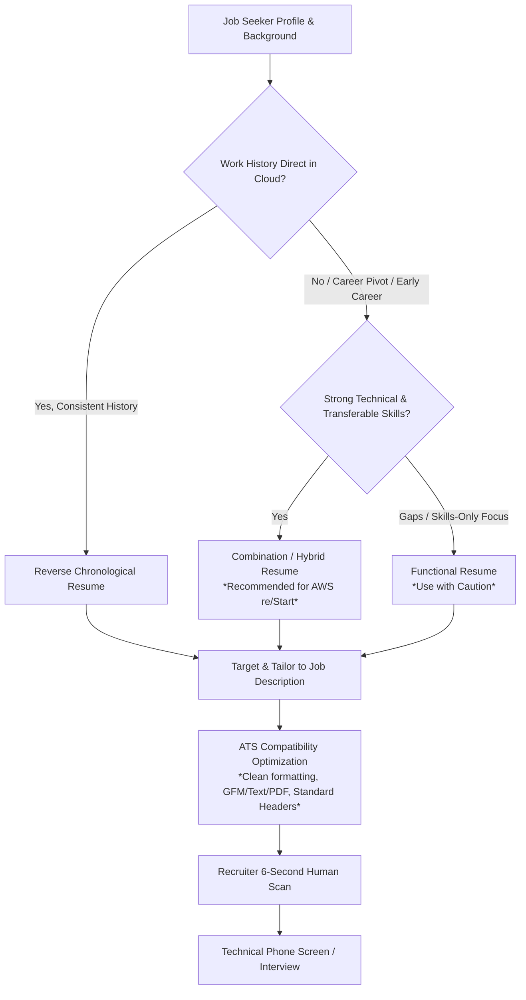
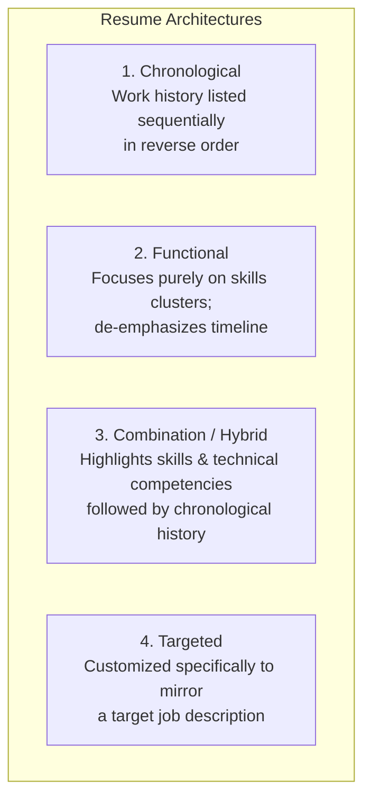
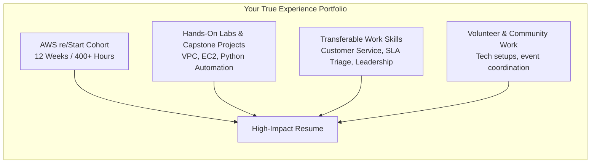
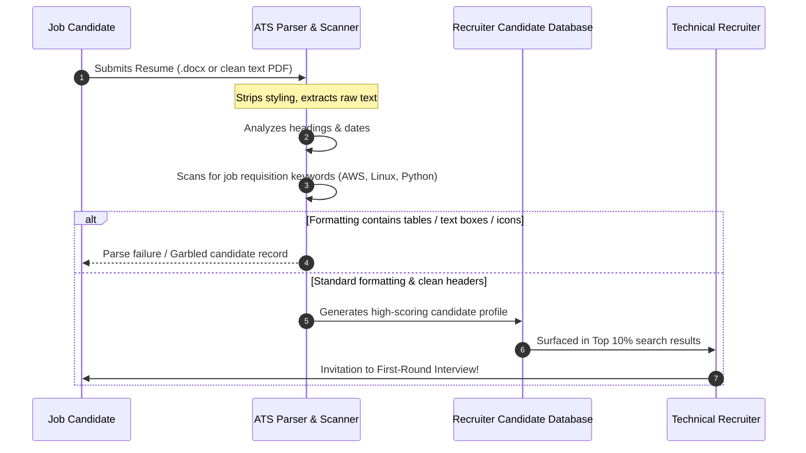

# 📄 Creating Resumes: Strategy, Structure, and Optimization for Tech Careers

> **Course**: AWS re/Start Foundational Soft Skills  
> **Module**: M00 – Creating Resumes (Techno-Functional Soft Skills)  
> **Source**: `T03-0024-RSTFSS_EN-US_SG_M00_RESUMECREATION.pdf`  
> **Complementary Guide**: [T03-0025-RSTFSS_EN-US_SG_M00_RESUMEGUIDANCE.pdf](file:///work/tmp/aws-cf/T03-Professional_Skills/T03-0025-RSTFSS_EN-US_SG_M00_RESUMEGUIDANCE.pdf) | [T03-0016-RSTFSS_EN-US_SG_M00_DIGITALPRESENCERESUME.md](file:///work/tmp/aws-cf/T03-Professional_Skills/T03-0016-RSTFSS_EN-US_SG_M00_DIGITALPRESENCERESUME.md)  
> **Target Audience**: AWS re/Start Learners, Career Changers, and Early-Career Cloud Professionals  

---

## 🎯 Module Overview & Core Purpose

Your resume is your primary marketing document in the technology job search ecosystem. In an increasingly automated hiring landscape, your resume serves a dual purpose: it must pass through automated **Applicant Tracking Systems (ATS)** algorithms while also capturing the attention of a human technical recruiter or hiring manager during a **6-to-7 second initial scan**.

This guide covers the structural fundamentals of resume creation, evaluates the four primary resume types (with special emphasis on the **Hybrid/Combination format** for career pivoters), outlines the formula for high-impact **Summary Statements**, provides actionable strategies for framing **limited direct IT experience**, guides military veterans through **civilian translation**, and provides strict standards for **ATS optimization**.

---

### 📌 Learning Objectives

- [ ] **Define** a resume and explain its strategic purpose in securing job interviews.
- [ ] **Distinguish** between a resume and a Curriculum Vitae (CV) across length, focus, and regional conventions.
- [ ] **Analyze and differentiate** the four core resume formats: Chronological, Functional, Combination/Hybrid, and Targeted.
- [ ] **Formulate** a compelling 4-part professional Summary Statement tailored for entry-level cloud and IT roles.
- [ ] **Overcome limited direct experience** by leveraging transferable soft skills, AWS re/Start coursework, labs, capstones, and volunteer work.
- [ ] **Demilitarize military experience** by translating military terminology, operational security, and leadership into civilian tech terminology.
- [ ] **Implement ATS optimization principles** to ensure algorithmic parsing accuracy and maximum keyword alignment.

---



---

## 📖 1. What is a Resume? Foundations and Scope

### Definition & Purpose
A **resume** is a concise, curated summary of your skills, abilities, professional experience, education, and accomplishments. Its strategic goal is **not to guarantee a job offer**, but to **generate employer interest and earn you an interview**.

```
┌────────────────────────────────────────────────────────────────────────┐
│                        The Resume Golden Rule                          │
│                                                                        │
│   A resume is a targeted marketing brochure, NOT an exhaustive         │
│   autobiography. Every bullet point must argue why you are qualified   │
│   for the specific role you are applying for today.                    │
└────────────────────────────────────────────────────────────────────────┘
```

> [!NOTE]
> Recruiters and hiring managers spend an average of **6 to 7 seconds** scanning a resume on their initial review. Essential qualifications, technical stack keywords, and certifications must be visible above the digital fold.

---

### Resume vs. Curriculum Vitae (CV)

While the terms are occasionally used interchangeably in certain international contexts, they represent distinct documents in North American and global technology recruitment.

| Dimension | Resume | Curriculum Vitae (CV) |
| :--- | :--- | :--- |
| **Length** | Short and targeted (1 page for early career/career transition; maximum 2 pages for senior staff). | Comprehensive and detailed (multiple pages; typically 3 to 10+ pages). |
| **Focus** | Specific skills, direct competencies, and quantifiable outcomes tailored to a single job. | Exhaustive cumulative academic, research, and scholarly history. |
| **Content** | Work experience, technical competencies, summary statement, education, certifications. | Publications, peer-reviewed articles, research projects, grants, teaching experience, conferences. |
| **Primary Use Cases** | Private corporate sector, tech startups, enterprise IT, government contractors. | Academia, scientific research, medical professions, university professorships, fellowships. |
| **Modification Frequency** | Tailored for almost every individual job application. | Static cumulative record; updated only as new achievements occur. |

---

## 🗂️ 2. The Four Primary Resume Formats

Selecting the appropriate resume architecture is the most critical strategic decision you will make before drafting content.



---

### 1. Chronological (Reverse-Chronological)
- **Structure**: Begins with the most recent or current position and moves backwards in time through previous employment.
- **When to Use**: You possess 2+ years of continuous, progressive experience in the exact tech domain you are applying for (e.g., IT support, helpdesk, or sysadmin).
- **Advantages**: Highly favored by corporate recruiters and ATS parsers; easy to read; clearly demonstrates career trajectory.
- **Disadvantages**: Highlights employment gaps, frequent job changes, or lack of direct industry experience.

---

### 2. Functional (Skills-Based)
- **Structure**: Groups experience under thematic skill domains (e.g., "Systems Administration", "Troubleshooting", "Customer Relationship Management") placed prominently at the top. Work history is minimized to a brief list of employer names and dates at the bottom.
- **When to Use**: Severe career disruptions, extended gaps, or dramatic pivot where previous titles have zero relevance.
- **Advantages**: Emphasizes capabilities rather than dates and titles.
- **Disadvantages**: 
  > [!CAUTION]
  > Many technical recruiters view functional resumes with skepticism, assuming the applicant is disguising a lack of verifiable work history or hiding termination gaps. ATS algorithms frequently misparse functional resumes because duties are decoupled from employer timeline anchors.

---

### 3. Combination / Hybrid (*The Recommended Standard for AWS re/Start*)
- **Structure**: Combines the greatest strengths of both formats. It begins with a strong **Summary Statement** and a structured **Technical Skills & Cloud Competencies** matrix, followed by a **Hands-On Technical Projects** section, and concludes with a standard **Professional Experience** section in reverse-chronological order.
- **When to Use**: Career pivoters, adult learners, tech bootcamp graduates, and individuals transitioning from non-technical fields into cloud computing.
- **Advantages**:
  1. Positions newly acquired cloud infrastructure skills (AWS, Linux, Python, Networking) directly in front of the reviewer.
  2. Anchors previous employment chronologically, demonstrating reliability, soft skills, and career stability.
  3. Fully compliant with modern ATS chronological parsing engines.

---

### 4. Targeted Resume
- **Structure**: An adapted version of a Chronological or Hybrid resume customized for a single specific employer and job requisition.
- **When to Use**: When applying for high-priority target opportunities where you want to maximize interview probability.
- **Advantages**: Mirrors the employer's vocabulary, required certifications, and tooling requirements directly, resulting in top-tier ATS matching scores.
- **Disadvantages**: Requires significant time investment per application.

---

### Format Comparison Matrix

| Format Type | Primary Focus | Best Suited For | ATS Compatibility | Recruiter Reception |
| :--- | :--- | :--- | :--- | :--- |
| **Chronological** | Work history, job titles, and career progression | Consistent, linear IT/tech track record | ⭐⭐⭐⭐⭐ Highest | ⭐⭐⭐⭐⭐ Preferred for experienced hires |
| **Functional** | Isolated skill categories and competencies | Severe gaps, radical career re-entry | ⭐⭐ Low (Parser errors) | ⭐⭐ Often viewed skeptically |
| **Combination (Hybrid)** | Technical skillset + chronological experience verification | **AWS re/Start learners, career changers, non-IT to cloud** | ⭐⭐⭐⭐⭐ Highest | ⭐⭐⭐⭐⭐ Highly persuasive for entry tech roles |
| **Targeted** | Direct 1:1 mirroring of specific job posting requirements | High-priority dream company applications | ⭐⭐⭐⭐⭐ Highest | ⭐⭐⭐⭐⭐ Exceptional conversion rate |

---

## ✍️ 3. Formulating a High-Impact Summary Statement

The **Summary Statement** sits at the apex of your resume immediately below your contact header. It replaces the outdated, self-serving "Objective Statement" with a forward-looking value proposition.

> [!IMPORTANT]
> **Objective Statement (Outdated)**: *"Seeking an entry-level cloud support position where I can learn new skills and grow my career."* *(Self-centered; focuses on what you want from the company.)*  
> **Summary Statement (Modern Standard)**: *"AWS Certified Cloud Practitioner with practical experience building automated, secure cloud infrastructure in Linux and Python environments. Proven track record of delivering high-pressure customer solutions..."* *(Employer-centered; focuses on the value you deliver to the company.)*

---

### The 4-Part Summary Statement Formula

A high-converting summary statement consists of **2 to 4 concise sentences** built upon four core elements:

```
┌──────────────────────────────────────────────────────────────────────────────┐
│                   The 4-Part Summary Formulation Formula                     │
│                                                                              │
│  [1. Professional Identity] + [2. Ambition / Value Focus] +                  │
│  [3. Key Core Skills]       + [4. Quantifiable Accomplishment / Credential]  │
└──────────────────────────────────────────────────────────────────────────────┘
```

1. **Who You Are (Professional Identity)**: Your technical title and identity (e.g., *"AWS Certified Cloud Practitioner and aspiring Cloud Support Associate"*).
2. **Ambition & Value Focus**: Your target domain and the business problem you solve (e.g., *"dedicated to optimizing infrastructure uptime, automation, and security"*).
3. **Key Core Skills**: Core tooling and competencies relevant to the role (e.g., *"Hands-on experience in Amazon EC2, S3, VPC, Linux system administration, and Python scripting"*).
4. **Quantifiable Accomplishments & Differentiators**: Program rigor, certifications, or previous professional excellence (e.g., *"Graduate of the intensive 12-week AWS re/Start cohort with a background in 5-star customer service and rapid incident triage"*).

---

### Copy-and-Paste Summary Templates

#### Template A: Career Pivoter (Non-Technical Background to Cloud Support)
```text
AWS Certified Cloud Practitioner and AWS re/Start graduate with 4+ years of cross-functional customer support experience, transitioning into Cloud Operations. Proficient in configuring and managing core AWS cloud services (EC2, S3, IAM, VPC), Linux system administration (Bash), and network troubleshooting. Recognized for maintaining high SLA resolution rates in fast-paced environments and eager to contribute to 24/7 technical cloud support.
```

#### Template B: IT Helpdesk / Sysadmin Moving to Cloud
```text
Results-driven IT professional and AWS Certified Cloud Practitioner with 2 years of enterprise desktop support experience. Skilled in migrating on-premises workloads to AWS, automating operational workflows using Python and Shell scripting, and implementing least-privilege IAM policies. Proven ability to reduce ticket backlogs while maintaining high stakeholder satisfaction.
```

#### Template C: Early Career / Recent Graduate with Limited Work History
```text
Detail-oriented cloud technician and AWS Certified Cloud Practitioner trained through the intensive AWS re/Start program. Possesses hands-on lab experience architecting fault-tolerant infrastructure using Amazon EC2, VPC multi-tier networking, and S3 storage lifecycle rules. Combines foundational technical competence with collaborative communication and disciplined problem-solving.
```

#### Template D: Military Veteran Transitioning to Cloud Systems Engineer
```text
Disciplined military veteran and AWS Certified Cloud Practitioner with 6 years of technical logistics and communications security leadership. Translates rigorous operational readiness, incident command, and risk mitigation into resilient cloud system administration. Proficient in Linux, Python scripting, and core AWS architecture, seeking to support mission-critical enterprise cloud operations.
```

---

## 🚀 4. Navigating Limited Direct Experience

Many learners enter the cloud computing industry from retail, hospitality, administrative, or non-technical backgrounds. Having **limited direct cloud experience** does not mean you have **no value to offer**.



### Strategies for Structuring Limited Direct Experience

1. **Feature the AWS re/Start Program as Intensive Experience / Education**:
   - Frame your 12-week, 400+ hour cohort as immersive professional training.
   - Highlight the technical breadth: Linux administration, TCP/IP networking, Python automation, AWS infrastructure, and security.

2. **Add a Dedicated "Technical Projects / Cloud Labs" Section**:
   - If your past job titles were non-technical, place a **Technical Projects** section *above* your work history.
   - Describe projects using the **CAR framework (Context, Action, Result)** or **STAR framework**.

3. **Incorporate Informal, Gig, and Volunteer Work**:
   - Volunteer technical support, freelancing, managing non-profit web portals, or coordinating community technology initiatives demonstrate initiative and practical application.
   - Informal businesses (e.g., pet sitting, lawn care, event organization) demonstrate entrepreneurship, financial management, customer service, and scheduling integrity.

4. **Surface Transferable Soft Skills**:
   - Cloud operations and technical support require strong customer obsession, clear verbal/written communication, and calm triage during high-severity outages.
   - Prior roles in retail, customer service, or healthcare provide direct evidence of these abilities.

---

### Before vs. After: Elevating Non-Technical Bullets

| Non-Technical Source Role | Weak / Passive Bullet (What Not to Do) | Strong / Value-Driven Bullet (What to Do) |
| :--- | :--- | :--- |
| **Retail Associate / Cashier** | *"Worked at the register and helped customers buy items."* | *"Delivered high-touch customer support in a high-volume retail environment, resolving an average of 80+ customer inquiries daily while maintaining a 98% positive satisfaction rating."* |
| **Hotel Front Desk** | *"Checked guests in and answered phone calls."* | *"Triaged escalated guest requests under tight deadlines, managing reservation databases and coordinating cross-departmental operations during peak occupancy periods."* |
| **Pet Sitting / Informal Gig** | *"Walked dogs and fed pets for neighbors."* | *"Founded and managed an independent pet-care service; scheduled appointments, marketed services, and built long-term client retention through reliable service and transparent communication."* |
| **AWS re/Start Lab Project** | *"Did an AWS lab on EC2 and VPC."* | *"Architected a highly available, dual-subnet VPC featuring public and private subnets, NAT Gateways, and security groups hosting an Apache web server on Amazon EC2 with automated health checks."* |

---

## 🎖️ 5. Demilitarizing Military Experience for Civilian Tech

Military veterans bring invaluable skills in leadership, risk management, integrity, and crisis decision-making. However, military resumes often get rejected by corporate recruiters due to **excessive military acronyms and incomprehensible jargon**.

> [!TIP]
> Recruiters do not know what a "CO", "NCOIC", "S-6", "MOS 25B", or "DA Form 4856" is. Replace military hierarchy and codes with universal civilian corporate language.

---

### Military-to-Civilian Translation Matrix

| Military Concept / Term | Civilian Corporate Translation | Resume Bullet Implementation Example |
| :--- | :--- | :--- |
| **MOS / AFSC / Rating** | Specialized Professional Role / Title | *Communications Systems Specialist* (instead of *MOS 25U Signal Support Systems Specialist*) |
| **Commander / CO / XO** | Executive Director / Senior Operations Manager | *"Reported directly to executive leadership on communications readiness and infrastructure security."* |
| **NCOIC / Squad Leader** | Team Lead / Operations Supervisor | *"Supervised and mentored a multidisciplinary team of 8 technicians, overseeing equipment maintenance and operational workflows."* |
| **COMSEC / Security Clearance** | Data Security / High-Trust Access Clearance | *"Administered cryptographic keys and data security protocols in strict compliance with federal regulatory standards; held Secret Clearance."* |
| **Mission / Tactical Operation** | Project / Strategic Initiative | *"Executed cross-functional technology deployment projects ahead of schedule in high-pressure, austere operating environments."* |
| **SOP (Standard Operating Procedure)** | Standard Operating Procedure / Runbook | *"Authored and standardized 15+ operational runbooks for network configuration, reducing onboarding time for incoming personnel by 30%."* |
| **Preventive Maintenance (PMCS)** | System Health Audits / Preventive Maintenance | *"Performed scheduled hardware and software health audits on critical communication arrays, achieving 99.8% equipment availability."* |

---

## 🤖 6. Applicant Tracking System (ATS) Optimization

Over 90% of Fortune 500 corporations and mid-sized technology enterprises utilize **Applicant Tracking Systems (ATS)** such as Workday, Taleo, Greenhouse, Lever, and iCIMS. These systems parse your resume into plain database fields before a human ever sees it.



---

### ATS Best Practices Checklist

#### 1. Layout & Formatting Rules
- [ ] **Single-Column Format Only**: Never use multi-column layouts, sidebars, or split magazine-style columns. ATS parsers read horizontally and will merge column text into unintelligible sentences.
- [ ] **No Text Boxes or Floating Graphics**: Parsers completely ignore text enclosed in text boxes.
- [ ] **No Vital Information in Headers & Footers**: Place your name, phone number, email, LinkedIn, and location in the main body document text. Many ATS engines discard headers and footers to strip page numbering.
- [ ] **Standard Font Families**: Use clean, standard fonts such as Calibri, Arial, Helvetica, Georgia, or Times New Roman (10–12 pt body text, 14–16 pt headings).
- [ ] **Standard Bullet Characters**: Use simple circular bullets (`•`) or hyphens (`-`). Avoid arrows, checkmark icons, or custom wingdings.

#### 2. Canonical Section Headings
Use recognizable, standard section headers so parser algorithms correctly categorize your data:
- ✅ **Summary** (or **Professional Summary**)
- ✅ **Technical Skills** (or **Core Competencies**)
- ✅ **Technical Projects** (or **Cloud Projects**)
- ✅ **Professional Experience** (or **Work Experience**)
- ✅ **Education**
- ✅ **Certifications & Training**

*(Avoid stylized headers such as "Where I've Been", "My Journey", or "Toolkit".)*

#### 3. Keyword Alignment Strategy
- **Match Job Description Terminology**: If the job posting lists *"Amazon Elastic Compute Cloud (Amazon EC2)"*, include both the spelled-out name and the common acronym: `Amazon Elastic Compute Cloud (EC2)`.
- **Blend Hard and Soft Skills**: Combine technical keywords (Linux, Python, Bash, Amazon S3, TCP/IP, VPC, IAM) with foundational workplace competencies (collaboration, incident triage, customer obsession, root cause analysis).
- **Avoid Keyword Stuffing**: Never insert hidden white text or repeated keyword dumps. Modern parsers flag keyword stuffing and disqualify the candidate immediately. Keywords must appear naturally within context.

#### 4. File Format Selection
- **Word Document (`.docx`)**: The safest and most reliably parsed format across all legacy and modern ATS platforms.
- **PDF (`.pdf`)**: Modern ATS platforms parse clean PDFs effectively. However, ensure the PDF is generated from clean text (searchable and selectable), not an exported raster graphic or Photoshop image.

---

## 🛠️ 7. Interactive Worksheets & Self-Coaching Tools

### Worksheet 1: Summary Statement Builder

Use this fillable template to draft your personalized 4-part summary statement.

| Component | Your Content Draft |
| :--- | :--- |
| **Part 1: Who You Are** *(Title / Identity)* | `e.g., AWS Certified Cloud Practitioner and AWS re/Start graduate...` |
| **Part 2: Ambition & Value Focus** *(Goal)* | `e.g., seeking to deliver scalable, reliable infrastructure solutions...` |
| **Part 3: Core Skills** *(Tooling & Competencies)* | `e.g., hands-on knowledge in Linux (Bash), Python, EC2, S3, IAM, VPC...` |
| **Part 4: Accomplishment / Differentiator** | `e.g., demonstrated history of exceptional customer triage and team collaboration...` |

#### Combined Final Draft:
> *"____________________________________________________________________________________________________  
> ____________________________________________________________________________________________________  
> ____________________________________________________________________________________________________"*

---

### Worksheet 2: Military-to-Civilian Experience Translator

If you have military service, complete this translation worksheet prior to writing your experience bullets.

| Military Task / Role / Award | Demilitarized Civilian Translation |
| :--- | :--- |
| **Primary Specialty / MOS:** |  |
| **Unit Leadership / Scope of Responsibility:** |  |
| **Equipment / Communications / IT Managed:** |  |
| **Incident Response / High-Pressure Scenarios:** |  |
| **Key Accomplishment / Commendation:** |  |

---

### Worksheet 3: Pre-Submission Quality & ATS Audit Checklist

Run through this quality checklist before submitting your resume to any prospective employer:

- [ ] **Header Contact Info**: Main body text includes Name, Phone, Professional Email, City/State, LinkedIn URL, and Portfolio/GitHub URL.
- [ ] **Length**: Exactly 1 page (for entry-level / career pivoter) or strictly capped at 2 pages.
- [ ] **Formatting**: Single-column layout, zero text boxes, standard bullet characters, consistent margins (0.5" to 1").
- [ ] **Summary Statement**: 2–4 sentences following the 4-part formula; zero outdated objective statements.
- [ ] **Technical Skills**: Grouped logically (Cloud, Operating Systems, Scripting/Tools, Networking/Security).
- [ ] **Action Verbs**: Every single experience and project bullet begins with a strong past-tense action verb (e.g., *Configured, Architected, Automated, Triaged, Implemented, Spearheaded*).
- [ ] **Quantification**: Numbers, metrics, percentages, dollar amounts, or volumes included wherever possible.
- [ ] **Spelling & Grammar**: Verified using grammar checkers and proofread by at least two human peers.
- [ ] **ATS Compliance**: File saved as clean `.docx` or searchable text `.pdf` named cleanly (e.g., `FirstName_LastName_Resume.pdf`).

---

## 🔗 Related Resources & Course Navigation

- [T03-0016-RSTFSS_EN-US_SG_M00_DIGITALPRESENCERESUME.md](file:///work/tmp/aws-cf/T03-Professional_Skills/T03-0016-RSTFSS_EN-US_SG_M00_DIGITALPRESENCERESUME.md) – Step-by-Step LinkedIn Profile and Resume Alignment
- [T03-0025-RSTFSS_EN-US_SG_M00_RESUMEGUIDANCE.pdf](file:///work/tmp/aws-cf/T03-Professional_Skills/T03-0025-RSTFSS_EN-US_SG_M00_RESUMEGUIDANCE.pdf) – Detailed Resume Guidance, Comparison Examples (Martha vs. Shirley)
- [T03-0008-RSTFSS_EN-US_SG_M00_COMMUNICATIONSTAR.md](file:///work/tmp/aws-cf/T03-Professional_Skills/T03-0008-RSTFSS_EN-US_SG_M00_COMMUNICATIONSTAR.md) – Structuring Experience Bullets with the STAR Method
- [T03-0022-RSTFSS_EN-US_SG_M00_EXPLORECLOUDJOBPOSTS.pdf](file:///work/tmp/aws-cf/T03-Professional_Skills/T03-0022-RSTFSS_EN-US_SG_M00_EXPLORECLOUDJOBPOSTS.pdf) – Analyzing Job Postings for ATS Keyword Extraction
