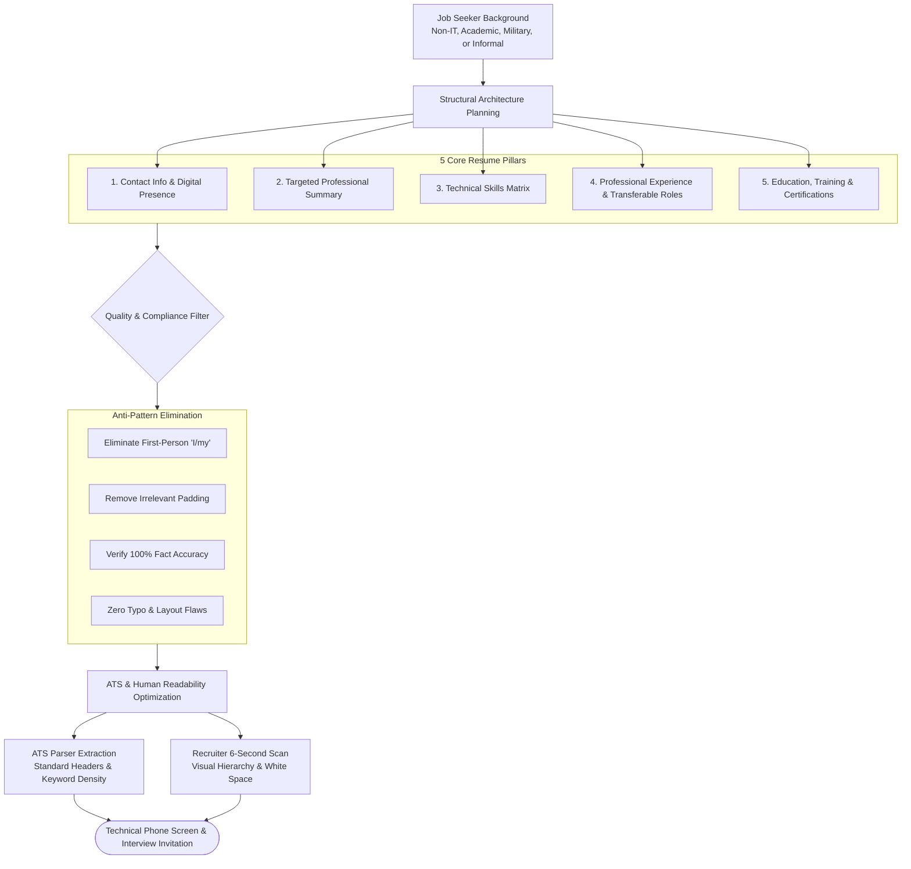
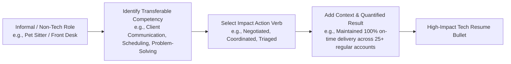
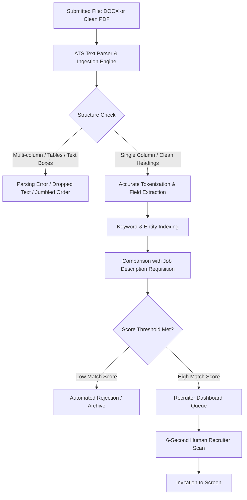

# 📄 AWS re/Start Resume Guidance: Core Architecture, Comparative Analysis, and Optimization

> **Course**: AWS re/Start Foundational Soft Skills  
> **Module**: M00 – Resume Guidance (Techno-Functional Soft Skills)  
> **Source**: `T03-0025-RSTFSS_EN-US_SG_M00_RESUMEGUIDANCE.pdf`  
> **Complementary Guide**: [T03-0024-RSTFSS_EN-US_SG_M00_RESUMECREATION.md](file:///work/tmp/aws-cf/T03-Professional_Skills/T03-0024-RSTFSS_EN-US_SG_M00_RESUMECREATION.md) | [T03-0016-RSTFSS_EN-US_SG_M00_DIGITALPRESENCERESUME.md](file:///work/tmp/aws-cf/T03-Professional_Skills/T03-0016-RSTFSS_EN-US_SG_M00_DIGITALPRESENCERESUME.md)  
> **Target Audience**: AWS re/Start Learners, Career Changers, and Early-Career Cloud Support Specialists  

---

## 🎯 Executive Overview

In the cloud computing industry, technical capability must be matched by clear, professional communication. A resume is not an exhaustive chronicle of everything you have ever done; it is a **precision marketing document** engineered to persuade recruiters and hiring managers that you possess the skills, problem-solving mindset, and dedication needed to excel in entry-level cloud and IT infrastructure roles.

Hiring managers typically evaluate a resume within a **6-to-7 second initial scan** before deciding whether to advance a candidate to a phone screen. Furthermore, modern hiring pipelines rely on **Applicant Tracking Systems (ATS)** to filter and index incoming applications before human eyes ever see them.

This guide details the essential architecture of a high-impact technical resume, conducts an exhaustive line-by-line comparative critique of flawed versus exemplary resumes (Martha Rivera vs. Shirley Rodriguez), highlights critical red flags and traps to avoid, provides ATS parsing rules, and offers ready-to-use copy-paste templates and a rigorous 25-point pre-submission checklist.

---

### 📌 Learning Objectives

- [ ] **Construct** the five core structural sections of a modern cloud and IT resume according to enterprise standards.
- [ ] **Distinguish** hard technical skills from transferable soft skills and present them effectively within a categorized matrix.
- [ ] **Transform** non-technical, informal, and volunteer work history into compelling, customer-centric experience bullets using strong action verbs and metrics.
- [ ] **Analyze and dissect** real-world resume samples to identify critical failure modes (Martha Rivera) and best practices (Shirley Rodriguez).
- [ ] **Eliminate** fatal resume traps, including truth-stretching/lying, irrelevant padding, first-person pronouns, and typographical errors.
- [ ] **Implement** ATS-compliant typography, layout, heading hierarchy, and keyword alignment without keyword stuffing.
- [ ] **Deploy** structured markdown and text templates to produce a polished, employer-ready entry-level cloud resume.

---



---

## 🧱 1. Core Sections of a Tech Resume

A competitive technology resume requires a logical visual flow that places the most vital and qualifying information immediately in the reader's line of sight.

```
┌────────────────────────────────────────────────────────────────────────┐
│                        ANATOMY OF A TECH RESUME                        │
├────────────────────────────────────────────────────────────────────────┤
│ 1. CONTACT INFO      Name | Clean Email | Phone | Location | Links     │
│ 2. SUMMARY           Targeted 2-3 sentence cloud value proposition     │
│ 3. TECHNICAL SKILLS  Cloud | OS / Scripting | Networking | Tools       │
│ 4. EXPERIENCE        Action Verbs + Business Context + Results/Metrics │
│ 5. EDUCATION & CERTS AWS re/Start | Degrees | AWS Certifications       │
│ 6. ACCOMPLISHMENTS   Hackathons | Customer Service Awards | Honors     │
└────────────────────────────────────────────────────────────────────────┘
```

---

### Section 1: Contact Information

Your contact header must be clean, scannable, and placed in the main body of the document (never hidden inside a Word/PDF header box where ATS parsers fail to extract it).

#### Mandatory Elements
- **Full Legal Name**: Clean, bold, 16–18 pt font.
- **Professional Email Address**: Check it daily. Use an address derived from your name (e.g., `first.last@email.com` or `shirleyr@example.com`). Avoid unprofessional handles like `skaterguy99@email.com`.
- **Phone Number**: Include area code with standard spacing or dots (`(111) 555-0199` or `111.555.0199`). Ensure your voicemail greeting is professional.
- **Location**: City and State/Province (`Anytown, USA` or `Seattle, WA`). Full street addresses are no longer required for privacy and ATS security reasons.
- **Digital Footprint Links**: 
  - Customized LinkedIn profile URL (`linkedin.com/in/shirleyrodriguez`).
  - Technical portfolio, GitHub repository, or cloud demo link (if applicable).

> [!IMPORTANT]
> Ensure your LinkedIn profile exactly mirrors the dates, job titles, and educational credentials listed on your resume. Discrepancies between your resume and online presence raise red flags during background screening.

---

### Section 2: Professional Summary

The summary statement is your 10-second elevator pitch. It replaces outdated "Objective" statements (which focus on what *you* want from the company) with a value-driven summary of what *you bring* to the employer.

#### The 3-Point Formula for Early-Career & Career Changers
1. **Identity & Core Attributes**: Who you are professionally (e.g., *Motivated, detail-oriented, and curious AWS re/Start graduate...*).
2. **Targeted Value & Domain**: The exact operational domain you are positioned to support (e.g., *...positioned to contribute to cloud-focused support, systems operations, and infrastructure automation.*).
3. **Core Differentiator**: Blend of technical foundation and transferable interpersonal skills (e.g., *...leveraging hands-on lab experience in core AWS services and a proven track record of de-escalating complex customer issues.*).

```
❌ BAD OBJECTIVE:
"Looking for an entry level cloud job where I can learn more about AWS and grow my career in IT."

✅ STRONG PROFESSIONAL SUMMARY:
"Motivated, curious, and responsible individual positioned to contribute to cloud-focused support and operations. AWS Certified Cloud Practitioner trained in Linux, Python, and core AWS infrastructure, bringing strong problem-solving and customer-facing communication skills."
```

---

### Section 3: Technical Skills Matrix

Recruiters and hiring managers must instantly see your capabilities. Instead of a disorganized paragraph or an unformatted bullet list, organize your skills into clear, logical functional categories.

| Skill Category | Recommended Core Keywords & Competencies |
| :--- | :--- |
| **Cloud Platforms (AWS)** | Amazon EC2, Amazon S3, AWS Identity and Access Management (IAM), Amazon VPC, AWS Lambda, AWS CloudFormation, Amazon RDS, Amazon Route 53, CloudWatch |
| **Operating Systems & Scripting** | Linux (Ubuntu, Amazon Linux), Bash / Shell Scripting, Python (Scripting, Automation, Boto3 basics) |
| **Networking & Infrastructure** | TCP/IP, DNS, DHCP, Subnetting, CIDR, Routing Tables, Security Groups, Network ACLs (NACLs) |
| **Productivity & Collaboration** | Git / GitHub, Microsoft Excel, Microsoft Word, Jira, Ticket Management Systems |
| **Transferable & Soft Skills** | Customer Obsession, High-Pressure Incident Triage, Technical Communication, Root Cause Analysis, Cross-Functional Collaboration, Adaptability |

> [!TIP]
> **Hard Skills vs. Soft Skills**:
> - **Hard Skills** represent quantifiable, learned technical capabilities (e.g., configuring an Amazon VPC, writing a Bash backup script, querying an RDS database).
> - **Soft Skills** are transferable behavioral competencies (e.g., active listening, explaining technical concepts to non-technical stakeholders, composure in high-pressure situations). Both are critical for Cloud Support Associate and Helpdesk roles.

---

### Section 4: Professional Experience

The experience section validates your work ethic, dependability, and practical problem-solving ability.

#### Framing Non-IT, Informal, and Volunteer Work
Many AWS re/Start learners transition from retail, hospitality, food service, caregiving, military service, or informal employment (such as babysitting, landscaping, or gig work). **Do not omit these experiences.** They prove:
- Reliability and punctuality.
- Handling demanding, stressful, or unpredictable client requests.
- Cash management, inventory control, and operational procedures.
- Conflict de-escalation and customer service excellence.



#### The Bullet Point Formula: Action Verb + Context + Result / Metrics
Every bullet point must follow the **Action-Verb + Task + Impact** formula:

- ❌ *Weak / Passive*: "Was responsible for helping hotel guests check into their rooms."
- ✅ *Strong / Impactful*: "Assisted 120+ hotel guests daily with room reservations, check-ins, and high-priority requests while maintaining calm professionalism during peak holiday seasons."

- ❌ *Weak / Passive*: "Walked dogs and fed pets for neighbors."
- ✅ *Strong / Impactful*: "Established and operated a self-directed pet-care service, coordinating schedules, marketing services, and retaining a loyal base of 15 recurring clients with zero missed appointments."

---

### Section 5: Education, Training & Certifications

This section anchors your technical qualification, especially when you have graduated from intensive bootcamps or training initiatives like AWS re/Start.

#### How to Feature AWS re/Start
Do not merely write "AWS re/Start". Describe the program's rigor and academic breadth:
```markdown
### EDUCATION & FORMAL TRAINING

**AWS re/Start Program** | Full-Time Cloud Development & Skills Training
*Graduation: February 2021*
- Completed an intensive 12-week, 480-hour classroom-based technical development program covering IT fundamentals, Linux OS, networking, Python scripting, security, and AWS Cloud architecture.
- Designed, configured, and troubleshot multi-tier cloud infrastructure in hands-on AWS sandbox environments.

**Example High School** — Anytown, USA
*Graduation: May 2017*
```

#### Certifications & Credentials
List your certifications prominently. Include the full certification name, granting authority, and date earned:
- **AWS Certified Cloud Practitioner** – Amazon Web Services (Issued: October 2020)
- *(Optional Credly verification link or Validation Number)*

---

### Section 6: Accomplishments, Awards & Capstone Projects

Include notable achievements that demonstrate excellence, initiative, and peer recognition:
- **Awards**: Employee of the Month, Customer Service Excellence Award, Academic honors.
- **Technical Capstones**: Hands-on cloud projects demonstrating VPC setup, static website hosting on S3 with CloudFront, or serverless API deployments using Lambda.
- **Community Leadership**: Team captain, volunteer coordinator, mentorship roles.

---

## 🚫 2. Common Resume Traps & Red Flags to Avoid

Recruiters sift through hundreds of applicants. Any glaring inconsistency, exaggeration, or carelessness will result in immediate disqualification.

```
┌────────────────────────────────────────────────────────────────────────┐
│                   THE 3 FATAL RESUME CARDINAL SINS                     │
├────────────────────────────────────────────────────────────────────────┤
│ 1. LYING & STRETCHING THE TRUTH  --> Immediate disqualification / firing│
│ 2. PADDING & UNRELATED FLUFF    --> Dilutes technical impact           │
│ 3. TYPOGRAPHICAL ERRORS & SLOP   --> Signals carelessness & low quality │
└────────────────────────────────────────────────────────────────────────┘
```

### 1. Lying and Truth-Stretching
- **The Trap**: Claiming mastery over technologies you only watched a video on, inflating job titles, or fabricating dates to hide employment gaps.
- **The Consequence**: Technical interviewers will probe every line of your resume. When an interviewer asks deep questions about a service you fabricated, the deceit collapses immediately. Even if hired, background checks and daily performance will expose the fabrication, leading to termination and blacklisting.
- **The Standard**: Be completely transparent about your level of proficiency. Frame your knowledge accurately: *"Hands-on experience deploying EC2 and S3 via AWS re/Start labs."*

### 2. Padding and Irrelevant Content
- **The Trap**: Listing personal hobbies (e.g., *"enjoy playing video games, watching movies, hiking with friends"*), childhood achievements, or completely unrelated activities just to fill a page.
- **The Consequence**: Hiring managers view padding as a sign that the candidate lacks substantive technical qualifications.
- **The Standard**: Every line must earn its place on the page by demonstrating either technical acumen, operational responsibility, or transferable workplace capability.

### 3. Typographical Errors, Inconsistent Formatting, and Grammatical Slips
- **The Trap**: Misspelled service names (`AWS EC-2`, `Pyton`, `Github`), mismatched verb tenses (mixing past and present tense in past jobs), broken punctuation, and irregular indentations.
- **The Consequence**: Cloud engineering and support demand meticulous attention to detail. A misplaced semicolon or typo in an IAM policy or CloudFormation template can cause outages or security breaches. A sloppy resume indicates a sloppy engineer.
- **The Standard**: Proofread meticulously. Run spell checks and have at least two peers or mentors review the document.

### 4. First-Person Pronoun Abuse
- **The Trap**: Writing in the first person: *"I worked on accounts... I helped professors... I was in charge of..."*
- **The Consequence**: Reads like an informal diary or stream-of-consciousness personal essay rather than an executive summary.
- **The Standard**: Use standard **bullet-point telegraphic style** beginning with strong action verbs: *"Constructed standard operating procedure manual..."*, *"Configured IAM roles and least-privilege security policies..."*.

### 5. Subjective Rating Scales & Progress Bars
- **The Trap**: Visual bar charts claiming *"Python: 85%"* or *"AWS: 4/5 stars"*.
- **The Consequence**: Meaningless to hiring managers (what does 85% of Python mean?), unparseable by ATS engines, and invites harsh technical grilling.

---

## ⚖️ 3. Case Study: The Tale of Two Resumes

The AWS re/Start curriculum provides two contrasting resumes: **Martha Rivera** (a poorly constructed, unpersuasive resume) and **Shirley Rodriguez** (a well-structured, persuasive entry-level cloud resume).

### Executive Comparison Matrix

| Evaluation Dimension | Martha Rivera (Flawed Example) | Shirley Rodriguez (Exemplary Example) |
| :--- | :--- | :--- |
| **Visual Structure & Layout** | Dense, blocky paragraphs; chaotic date styling; poor whitespace balance. | Clean, structured headers; balanced margins; readable bullet lists. |
| **Contact Information** | Incomplete (No email address, no LinkedIn or portfolio link, awkward phone format). | Complete (Professional email, clean phone, location, customized profile URL). |
| **Professional Summary** | **Missing entirely.** Opens immediately with education. | **Clear, concise 2-sentence summary** establishing motivation and cloud focus. |
| **Grammar & Tone** | Conversational, first-person ("I am", "I try", "I made"), passive, informal. | Telegraphic, professional, active voice, third-person implied action verbs. |
| **Skills Presentation** | **No skills section.** Technical capabilities buried or absent. | **Dedicated categorized skills section** spanning soft and hard technical competencies. |
| **Use of Action Verbs** | Weak or absent ("I try to make", "I helped", "I wrote things"). | Strong action verbs ("Assisted", "Responsible for", "Created", "Delivering"). |
| **Treatment of Non-IT Work** | Vague, unfocused task lists without measurable impact or business context. | Reframed customer service and pet-sitting business highlighting reliability and pressure handling. |
| **Education Section** | Lists high school GPA (3.2); no explanation of AWS re/Start coursework. | Highlights AWS re/Start's 12-week intensive curriculum, scope of study, and technical depth. |
| **Accomplishments** | Extracurricular high school sports/council entries irrelevant to cloud roles. | Industry-recognized certification (AWS Certified Cloud Practitioner) + Customer Service Award. |
| **ATS Compatibility** | Likely to be rejected due to missing keywords, missing email, and poor heading structure. | High ATS keyword density (EC2, S3, IAM, VPC, Lambda, RDS, Linux, Python). |

---

### Detailed Anatomy of Martha Rivera (The Flawed Resume)

```
┌────────────────────────────────────────────────────────────────────────┐
│               TRANSCRIPT OF MARTHA RIVERA'S RESUME                     │
├────────────────────────────────────────────────────────────────────────┤
│ Martha Rivera                                                          │
│ 18 Main St                                                             │
│ Anytown, USA                                                           │
│ (111)555-0100                                                          │
│                                                                        │
│ Education                                                              │
│ AWS re/Start                                                           │
│ Graduation: February 2021                                              │
│ Example High School, Anytown, USA                                      │
│ Graduation: 2017                                                       │
│ 3.2 GPA                                                                │
│                                                                        │
│ Employment Experience                                                  │
│ Fall 2018-present: Internal Consultant for Example University          │
│ I am the process consultant in Undergraduate Studies. I try to make    │
│ our systems better. I interview professors, assist with a student      │
│ focus group, and write recommendations. I also made an Organizational  │
│ Process Manual. I help professors in systems, in communication, and    │
│ leadership decisions.                                                  │
│ In the School of Entrepreneurship, I worked as the communications      │
│ Assistant. I was in charge of different communications projects.       │
│ I made media and event communications. I also wrote things to make the │
│ SE website easier to read. I taught co workers some Word formatting    │
│ tricks and I improved powerpoint presentations.                        │
│ Summer 2018: ExampleGolf                                               │
│ I was the Golf Pro Shop Supervisor, running operations of a new store. │
│ I was in charge of marketing, retail purchasing, and systems of        │
│ operations, I decided how to run the office.                           │
│ Fall 2017: AnyCompany Banking Office Assistant                         │
│ I made a training manual, worked on accounts and helped with paperwork.│
│ Summer 17: Intern at Example Corp. Investments                         │
│ I helped others learn financial software, I worked on accounts, stocks,│
│ bonds, and Mutual Funds. I helped with surveys and events.              │
│                                                                        │
│ Achievements                                                           │
│ Tennis Team Captain 2016-2017                                          │
│ Student Council 2015-2017                                              │
└────────────────────────────────────────────────────────────────────────┘
```

#### Line-by-Line Critique of Martha's Mistakes:
1. **Critical Contact Info Missing**: Martha provides a physical street address and a phone number, but **no email address**! In modern recruiting, 95% of first-contact communication occurs via email. A recruiter cannot easily contact her.
2. **Missing Summary Statement**: She launches directly into Education without orienting the reader to her professional identity, technical goals, or cloud interests.
3. **Uninformative Education Details**: She lists "AWS re/Start" with no explanation of what the program is, what technologies she learned, or what certifications she earned. Listing a high school 3.2 GPA four years after graduation is irrelevant filler.
4. **First-Person Pronoun Saturation**: In four short paragraphs, she uses the word "I" over **15 times** (*"I am"*, *"I try"*, *"I interview"*, *"I also made"*, *"I help"*, *"I worked"*, *"I was in charge"*, *"I taught"*, *"I improved"*, *"I decided"*).
5. **Vague, Unprofessional Phrasing**:
   - *"I try to make our systems better"* — "Try" denotes uncertainty and lack of authority. What systems? What was the outcome?
   - *"I wrote things to make the SE website easier to read"* — "Things" is vague and casual. What content? What metrics improved?
   - *"I taught co workers some Word formatting tricks"* — Diminishes what could have been a strong training/mentorship achievement.
6. **Inconsistent Date Formats**: Uses *"Fall 2018-present"*, *"Summer 2018"*, *"Fall 2017"*, and then switches to *"Summer 17"*.
7. **Complete Absence of a Skills Matrix**: A recruiter searching for "Linux", "Python", "Cloud", "AWS", or "Networking" will find zero matches. The resume will be filtered out immediately by an ATS.
8. **Irrelevant Achievements**: High school tennis captain and student council from 2015–2017 offer no value to a cloud support hiring manager in 2021.

---

### Detailed Anatomy of Shirley Rodriguez (The Exemplary Resume)

```
┌────────────────────────────────────────────────────────────────────────┐
│              TRANSCRIPT OF SHIRLEY RODRIGUEZ'S RESUME                  │
├────────────────────────────────────────────────────────────────────────┤
│ Shirley Rodriguez                                                      │
│ shirleyr@example.com                                                   │
│ 111.555.0199                                                           │
│ 100 South Boulevard                                                    │
│ Anytown, USA                                                           │
│ https://www.examplesocialnetwork.com/profile/shirleyr/                 │
│                                                                        │
│ SUMMARY                                                                │
│ Motivated, curious, and responsible individual positioned to contribute│
│ to cloud-focused support and operations.                               │
│                                                                        │
│ EXPERIENCE                                                             │
│ Hotel Front Desk Associate, Example Hotel — Anytown, USA               │
│ November 2019–November 2020                                            │
│ Assisted customers with room reservations, check-in and check-out,     │
│ and special requests. Responsible for checking room availability,      │
│ creating customer reservations in the reservation system, and providing│
│ assistance with customers’ questions or needs, in person or by phone.  │
│ Frequently required juggling high volumes of customer requests during  │
│ fully booked dates during the summer concert season.                   │
│                                                                        │
│ Pet Sitter, AnyCompany Pet Sitting — Anytown, USA                      │
│ June 2016–October 2019                                                 │
│ Created successful pet-sitting business, including dog walking,        │
│ pet feeding, and play visits. Responsible for marketing services,      │
│ establishing customers, scheduling visits, delivering scheduled        │
│ services, and maintaining customer relationships.                      │
│                                                                        │
│ SKILLS                                                                 │
│ • Strong verbal and written communication skills, with the ability to  │
│   explain technical information to non-technical users                 │
│ • Customer service skills, with the ability to remain professional in  │
│   stressful, high-pressure situations                                  │
│ • Effective problem solving through analysis                           │
│ • IT fundamental skills, including a working knowledge of Linux OS     │
│   and writing scripts in Python and Shell                              │
│ • Experience applying core AWS services in compute, storage, and       │
│   networking, including Amazon Elastic Compute Cloud (Amazon EC2),     │
│   Amazon Simple Storage Service (Amazon S3), AWS Identity and Access   │
│   Management (IAM), Amazon Virtual Private Cloud (Amazon VPC),         │
│   AWS Lambda, AWS CloudFormation, Amazon Relational Database Service   │
│   (Amazon RDS), and Amazon Route 53                                    │
│ • Experience configuring, monitoring, and supporting the suite of      │
│   core AWS services                                                    │
│ • Experience with Microsoft Excel                                      │
│ • Experience with Microsoft Word                                       │
│                                                                        │
│ EDUCATION                                                              │
│ AWS re/Start                                                           │
│ Attended a 12-week, full-time, classroom-based skills development      │
│ and training program on IT fundamentals, AWS Cloud, and professional   │
│ skills.                                                                │
│ Graduation: February 2021                                              │
│                                                                        │
│ Example High School, Anytown, USA                                      │
│ Graduation: May 2017                                                   │
│                                                                        │
│ ACCOMPLISHMENTS                                                        │
│ • AWS Certified Cloud Practitioner – October 2020                      │
│ • Customer Service Award – June 2020                                   │
│ • Received award for customer service recognition and ability to work  │
│   well with the other team members.                                    │
└────────────────────────────────────────────────────────────────────────┘
```

#### Line-by-Line Success Factors in Shirley's Resume:
1. **Flawless Header & Professional Links**: Shirley provides email, phone, location, and an active digital profile link.
2. **Clear Value Proposition in Summary**: Her summary defines her character traits (*"Motivated, curious, and responsible"*) and targets the exact role domain (*"cloud-focused support and operations"*).
3. **Masterful Framing of Non-Technical Experience**:
   - Rather than hiding her customer-facing hotel job, she highlights managing high-volume requests during fully booked dates under pressure (direct parallel to high-severity ticket spikes in IT support).
   - In her pet-sitting business, she demonstrates entrepreneurial drive, scheduling discipline, client retention, and self-management.
4. **Rich Technical Skills Matrix**:
   - Full service names + acronyms: Amazon Elastic Compute Cloud (Amazon EC2), Amazon Simple Storage Service (Amazon S3), AWS Identity and Access Management (IAM), Amazon Virtual Private Cloud (Amazon VPC), AWS Lambda, AWS CloudFormation, Amazon Relational Database Service (Amazon RDS), and Amazon Route 53.
   - Core foundational capabilities: Linux OS, Shell scripting, Python scripting.
   - Crucial soft skills: Explaining technical information to non-technical users, problem solving through analysis.
5. **Contextualized Education**: Shirley explains the rigor of AWS re/Start as a *"12-week, full-time, classroom-based skills development and training program"*.
6. **Validating Accomplishments**: Her certifications (AWS Certified Cloud Practitioner) and Customer Service Award confirm both technical baseline and interpersonal excellence.

---

## 🤖 4. Applicant Tracking System (ATS) Optimization Strategy

Modern recruiting workflows rely on Applicant Tracking Systems (e.g., Taleo, Workday, Greenhouse, Lever, iCIMS). Understanding how ATS software processes resumes ensures your document reaches a hiring manager.



### ATS Parsing Rules & Best Practices

1. **Maintain Single-Column Layout**:
   - Multi-column formats often parse horizontally across columns, interleaving text and creating incomprehensible strings.
   - Never use text boxes, floating frames, or embedded tables for core content.

2. **Standard Section Headings**:
   - Use standard terminology: `SUMMARY`, `EXPERIENCE`, `SKILLS`, `EDUCATION`, `ACCOMPLISHMENTS`, `CERTIFICATIONS`.
   - Avoid creative headings like *"My Background"*, *"Toolkit"*, or *"Where I Excel"*.

3. **Keyword Density & Dual-Naming Standard**:
   - ATS algorithms search for both acronyms and expanded names.
   - Always include both on first reference:
     - `Amazon Elastic Compute Cloud (Amazon EC2)`
     - `Amazon Simple Storage Service (Amazon S3)`
     - `Amazon Virtual Private Cloud (Amazon VPC)`
     - `AWS Identity and Access Management (IAM)`
     - `Relational Database Service (Amazon RDS)`

4. **Font Selection & Hierarchy**:
   - Use clean, standard typefaces: Arial, Calibri, Helvetica, Georgia, Times New Roman.
   - Body font size: 10–12 point. Section headers: 13–16 point bold.
   - Margins: 0.5 to 1.0 inch on all sides.

5. **File Format Selection**:
   - **Microsoft Word (`.docx`)**: Universally parsed with highest accuracy across all legacy and modern ATS platforms.
   - **Text-searchable PDF (`.pdf`)**: Accepted by modern systems. Ensure the PDF text is selectable (never submit an image-scanned PDF).

> [!CAUTION]
> **Never Use "White Texting" or Hidden Keywords**:
> Inserting invisible white-colored keywords into margins or footers is an obsolete cheat. Modern ATS parsers strip all color formatting and display extracted plain text to recruiters. If keyword stuffing is detected, the candidate is permanently blacklisted.

---

## 📋 5. Ready-to-Use Copy-Paste Resume Templates

### Template 1: Entry-Level Cloud Support Associate (AWS re/Start Graduate)

```markdown
**FIRSTNAME LASTNAME**  
City, State • (123) 456-7890 • email@example.com • linkedin.com/in/username • github.com/username  

---

### PROFESSIONAL SUMMARY
Motivated, curious, and AWS-certified cloud professional positioned to contribute to cloud infrastructure support, operations, and technical incident resolution. Trained through the full-time AWS re/Start program with hands-on proficiency in Linux, Python, networking fundamentals, and core AWS cloud services. Proven ability to translate complex technical concepts and deliver exceptional customer support in high-pressure environments.

---

### TECHNICAL SKILLS
- **Cloud Computing (AWS)**: Amazon EC2, Amazon S3, Amazon VPC, AWS IAM, AWS Lambda, Amazon RDS, Amazon Route 53, AWS CloudFormation, AWS CloudWatch
- **Operating Systems & Scripting**: Linux (Amazon Linux, Ubuntu), Bash Shell Scripting, Python (Scripting & Automation)
- **Networking & Security**: TCP/IP, DNS, DHCP, Subnetting, Security Groups, Network ACLs, Least-Privilege IAM Policies
- **Tools & Methodologies**: Git/GitHub, Ticket Management Systems, Technical Documentation, Root Cause Analysis
- **Professional Skills**: Customer Obsession, Problem Solving, High-Pressure Incident Triage, Cross-Team Collaboration

---

### TECHNICAL PROJECTS & LAB EXPERIENCE
**Multi-Tier Scalable Web Infrastructure Deployment** | *AWS re/Start Capstone*
- Architected and deployed a highly available, fault-tolerant web architecture across multiple Availability Zones using Amazon EC2, Application Load Balancers, and Auto Scaling groups.
- Configured secure networking infrastructure utilizing custom Amazon VPC, public and private subnets, NAT Gateways, and strict Security Group rules.
- Automated static asset hosting and content delivery using Amazon S3 bucket policies and Amazon CloudFront.

**Automated EC2 Snapshot & Backup Script** | *Personal Technical Project*
- Developed a Python script leveraging the AWS SDK (Boto3) to automate scheduled Amazon EBS volume snapshots and clean up expired backups.
- Reduced manual administrative overhead and ensured adherence to mock disaster recovery service-level objectives (SLOs).

---

### PROFESSIONAL EXPERIENCE
**Customer Support Specialist** | *Previous Company Name — City, State*  
*Month Year – Month Year*
- Resolved 40+ customer technical and billing inquiries daily via phone and ticketing systems, achieving a 98% customer satisfaction rating.
- De-escalated high-stress customer escalations through active listening, structured troubleshooting, and prompt root-cause follow-up.
- Authored 12 internal standard operating procedure (SOP) articles to streamline onboarding for new support representatives.

**Operations Associate** | *Previous Company Name — City, State*  
*Month Year – Month Year*
- Coordinated inventory tracking and order fulfillment workflows in a fast-paced, SLA-driven distribution environment.
- Triaged daily logistical discrepancies, collaborating with cross-functional team members to minimize fulfillment delays by 15%.

---

### EDUCATION & CERTIFICATIONS
**AWS Certified Cloud Practitioner** | *Amazon Web Services* — Issued: Month Year  

**AWS re/Start Program** | *Sponsoring Organization / Institution* — Graduation: Month Year  
- Intensive 12-week, 480-hour full-time technical development curriculum focusing on Linux OS, networking, security, Python programming, and AWS Cloud architecture.

**High School Diploma / Associate Degree** | *School Name — City, State* — Graduation: Year  
```

---

### Template 2: Career Pivoter / Transferable Skills Format

```markdown
**FIRSTNAME LASTNAME**  
City, State • Phone • Professional Email • LinkedIn URL • Portfolio URL  

---

### PROFESSIONAL SUMMARY
Results-driven professional transitioning into cloud computing and IT infrastructure support, bringing [X] years of client service, operations, and analytical troubleshooting experience. AWS Certified Cloud Practitioner trained in core AWS architecture, Linux administration, and automation scripting. Adept at bridging technical systems and customer needs to optimize operational uptime.

---

### CORE COMPETENCIES & TECHNICAL MATRIX
- **Cloud Infrastructure**: Amazon EC2, Amazon S3, Amazon VPC, IAM, AWS Lambda, CloudWatch
- **Systems Administration**: Linux Command Line, Shell Scripting, Windows, System Patching & Updates
- **Networking Foundations**: IPv4 Subnetting, Routing, DNS, OSI Model, Firewalls & Security Groups
- **Client & Operations**: SLA Adherence, Customer Service, Incident Management, Process Improvement

---

### CLOUD & TECHNICAL TRAINING
**AWS re/Start Program** — Full-Time Technical Trainee  
*Month Year – Month Year*
- Completed 480 hours of hands-on cloud instruction, completing 30+ virtual labs on cloud architecture, networking, security, and systems administration.
- Built automated infrastructure provisioning templates using AWS CloudFormation and configured secure identity governance using AWS IAM.

---

### PROFESSIONAL EXPERIENCE
**Store Manager / Team Lead** | *Retail / Hospitality Company — City, State*  
*Month Year – Month Year*
- Managed day-to-day operations and cross-functional team of 10 staff members in a high-volume retail environment.
- Maintained 99.5% accuracy in POS systems, inventory management databases, and daily fiscal auditing.
- Trained and mentored new team members on operational protocols, safety standards, and customer engagement excellence.

---

### CERTIFICATIONS & EDUCATION
- **AWS Certified Cloud Practitioner**, Amazon Web Services (Year)
- **AWS re/Start Graduate**, AWS Training & Certification (Year)
- **High School Diploma / Degree**, Institution Name (Year)
```

---

## ⚡ 6. Action Verb Cheat Sheet for Tech & Cloud Resumes

Replace passive phrases ("was responsible for", "worked on", "helped") with high-impact, decisive technical action verbs:

| Functional Category | High-Impact Action Verbs |
| :--- | :--- |
| **Cloud & Systems Infrastructure** | *Architected, Configured, Deployed, Provisioned, Installed, Migrated, Automated, Streamlined, Integrated, Rebuilt* |
| **Troubleshooting & Support** | *Diagnosed, Triaged, Resolved, Debugged, De-escalated, Investigated, Restored, Monitored, Audited, Rectified* |
| **Scripting & Development** | *Programmed, Scripted, Developed, Implemented, Refactored, Tested, Designed, Executed, Automated, Standardized* |
| **Leadership & Collaboration** | *Spearheaded, Coordinated, Facilitated, Mentored, Instructed, Partnered, Liaised, Negotiated, Championed* |
| **Documentation & Process** | *Authored, Standardized, Documented, Formulated, Compiled, Published, Formalized, Revised, Mapped* |

---

## ✅ 7. The 25-Point Pre-Submission Review Checklist

Before sending your resume to any recruiter, application portal, or referral contact, complete this comprehensive 25-point audit:

### Contact Header & Format
- [ ] 1. **Header Placement**: Contact information is located in the main document body, not in Word/PDF headers or footers.
- [ ] 2. **Professional Email**: Email address is professional and checked multiple times daily.
- [ ] 3. **Clean Phone & Location**: Phone number includes area code; location lists City and State without full street address.
- [ ] 4. **Live Digital Links**: LinkedIn and portfolio URLs are clickable, clean (no tracking tags), and verified active.
- [ ] 5. **Single-Column Architecture**: Document uses a clean, single-column layout without tables, floating text boxes, or icons.

### Professional Summary
- [ ] 6. **Value Focus**: Summary emphasizes what you bring to the employer rather than what you want from them.
- [ ] 7. **Cloud Target**: Specifically mentions cloud operations, infrastructure support, or technical services.
- [ ] 8. **Length**: Strictly contained within 2 to 4 impactful sentences.
- [ ] 9. **Zero Pronouns**: No use of "I", "me", "my", or "our".

### Technical Skills
- [ ] 10. **Logical Categorization**: Skills are organized into logical groups (Cloud, OS/Scripting, Networking, Soft Skills).
- [ ] 11. **Dual Acronym/Expansion**: AWS services include official names and acronyms (e.g., *Amazon Elastic Compute Cloud (EC2)*).
- [ ] 12. **Authentic Representation**: You can confidently answer technical interview questions about every tool listed.
- [ ] 13. **No Rating Bars**: Visual percentages and star ratings are eliminated.

### Professional Experience
- [ ] 14. **Action-Verb Opening**: Every single bullet point begins with a powerful past-tense action verb (or present tense for current roles).
- [ ] 15. **Quantified Metrics**: Metrics, percentages, volumes, or time savings are included wherever possible.
- [ ] 16. **Transferable Skills Reframed**: Non-IT roles highlight customer satisfaction, reliability, ticketing, and problem-solving.
- [ ] 17. **Consistent Date Formatting**: Dates follow a unified structure throughout (e.g., `Nov 2019 – Nov 2020`).

### Education & Certifications
- [ ] 18. **AWS re/Start Detailed**: Program description outlines the 12-week intensive curriculum, hours, and domains studied.
- [ ] 19. **Certifications Highlighted**: Full official certification titles, granting bodies, and issue dates are stated.
- [ ] 20. **Education Pruned**: Outdated high school GPAs and irrelevant extracurricular activities are omitted.

### Grammar, Quality & ATS Compliance
- [ ] 21. **Zero Typographical Errors**: Document is verified error-free through automated spell check and human peer review.
- [ ] 22. **Page Count Discipline**: Strictly 1 page (recommended for career changers and entry-level) or max 2 pages for extensive careers.
- [ ] 23. **Standard Typography**: Clean 10–12 pt font (Arial, Calibri, Georgia) with 0.5" to 1" margins.
- [ ] 24. **File Naming Standard**: File is saved cleanly without spaces (e.g., `FirstName_LastName_Resume.pdf`).
- [ ] 25. **ATS Verification**: File is saved as a searchable PDF or `.docx` document and verified for plain-text extraction.

---

## 🔗 Related Resources & Course Navigation

- [T03-0024-RSTFSS_EN-US_SG_M00_RESUMECREATION.md](file:///work/tmp/aws-cf/T03-Professional_Skills/T03-0024-RSTFSS_EN-US_SG_M00_RESUMECREATION.md) – Structural Fundamentals, Resume Formats & Military Translation
- [T03-0016-RSTFSS_EN-US_SG_M00_DIGITALPRESENCERESUME.md](file:///work/tmp/aws-cf/T03-Professional_Skills/T03-0016-RSTFSS_EN-US_SG_M00_DIGITALPRESENCERESUME.md) – Digital Presence, LinkedIn Profile Building & Resume Synergy
- [T03-0008-RSTFSS_EN-US_SG_M00_COMMUNICATIONSTAR.md](file:///work/tmp/aws-cf/T03-Professional_Skills/T03-0008-RSTFSS_EN-US_SG_M00_COMMUNICATIONSTAR.md) – Mastering the STAR Method for Experience Bullets & Interviews
- [T03-0022-RSTFSS_EN-US_SG_M00_EXPLORECLOUDJOBPOSTS.pdf](file:///work/tmp/aws-cf/T03-Professional_Skills/T03-0022-RSTFSS_EN-US_SG_M00_EXPLORECLOUDJOBPOSTS.pdf) – Job Description Deconstruction & Keyword Mapping
- [T03-0026-RSTFSS_EN-US_SG_M00_NETWORKING.pdf](file:///work/tmp/aws-cf/T03-Professional_Skills/T03-0026-RSTFSS_EN-US_SG_M00_NETWORKING.pdf) – Leveraging Your Resume in Professional Networking & Informational Interviews
