# 🤝 Professional Networking Skills: Building Authentic Connections in Tech

> **Course**: AWS re/Start Foundational Soft Skills  
> **Module**: M00 – Networking Skills (Techno-Functional Soft Skills)  
> **Source**: `T03-0026-RSTFSS_EN-US_SG_M00_NETWORKING.pdf`  
> **Complementary Guides**: [T03-0015-RSTFSS_EN-US_SG_M00_DIGITALPRESENCE.md](file:///work/tmp/aws-cf/T03-Professional_Skills/T03-0015-RSTFSS_EN-US_SG_M00_DIGITALPRESENCE.md) | [T03-0017-RSTFSS_EN-US_SG_M00_INTERVIEWSETTINGS.md](file:///work/tmp/aws-cf/T03-Professional_Skills/T03-0017-RSTFSS_EN-US_SG_M00_INTERVIEWSETTINGS.md) | [T03-0019-RSTFSS_EN-US_SG_M00_LPEarnTrust.md](file:///work/tmp/aws-cf/T03-Professional_Skills/T03-0019-RSTFSS_EN-US_SG_M00_LPEarnTrust.md)  
> **Target Audience**: AWS re/Start Learners, Career Changers, and Early-Career Cloud Professionals  

---

## 🎯 Executive Summary & Purpose

In the technology industry, technical capabilities—such as managing Linux instances, writing Python automation scripts, and designing fault-tolerant AWS cloud architectures—represent only half of career success. The remaining half is driven by **social capital and professional relationships**. Industry data reveals that **70% to 80% of technology positions are filled through professional networks and internal employee referrals**, often before a public job description is ever posted.

Networking is frequently misunderstood as aggressive self-promotion or superficial business card swapping. In reality, authentic professional networking is the continuous practice of **building mutual trust, exchanging knowledge, and cultivating genuine human connections**.

This comprehensive study guide translates the AWS re/Start Networking curriculum into an actionable framework. It covers foundational etiquette, tactical formulas for initiating one-on-one dialogues, methodologies for gracefully joining and leaving group conversations, in-depth roleplay scenarios across diverse tech settings, active listening mastery, and a repeatable **24-hour follow-up protocol** with an end-to-end event checklist.

---

## 📌 Learning Objectives

By mastering this module, you will be able to:
- [ ] **Define** professional networking within the context of technology and cloud careers.
- [ ] **Analyze and apply** the core Dos and Don'ts of relationship building, contrasting transactional networking with authentic connection.
- [ ] **Execute situational conversation starters** using open-ended questioning and context calibration.
- [ ] **Join ongoing group conversations gracefully** by assessing non-verbal social geometry, listening for conversational anchors, and timing entries.
- [ ] **Practice active listening techniques** that embody the Amazon Leadership Principle of *Earn Trust*.
- [ ] **Navigate realistic networking scenarios**: from alumni hallway discussions and conference panel breaks to engaging time-constrained senior engineers.
- [ ] **Execute the 24-hour follow-up protocol** with tailored email and LinkedIn message templates.
- [ ] **Implement the pre-, during-, and post-event networking checklist** to maximize return on effort at meetups, hackathons, and conferences.

---

## 🗺️ The Professional Networking Lifecycle

Building a sustainable tech network follows a structured, multi-stage lifecycle rather than isolated, haphazard encounters.

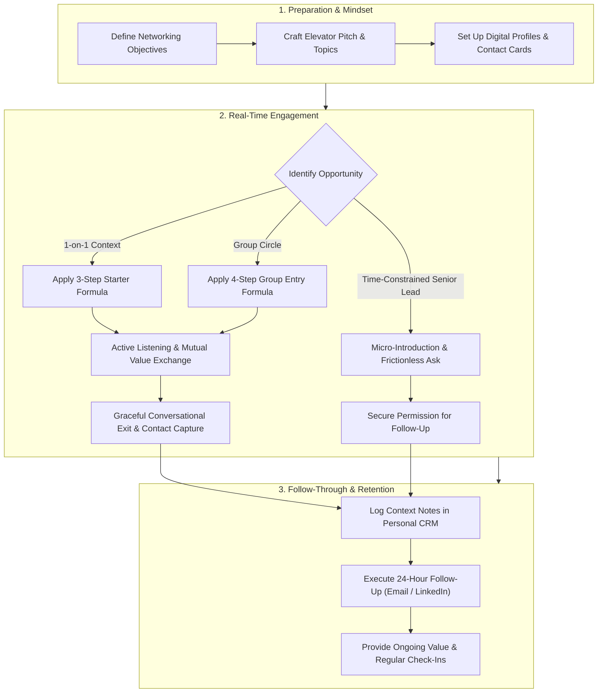

---

## 📖 1. Foundational Principles: Dos and Don'ts of Professional Networking

Authentic networking is built on long-term reciprocity. As a cloud practitioner, your reputation precedes you. Treating every interaction with dignity and genuine curiosity lays the groundwork for lasting professional relationships.

```
┌────────────────────────────────────────────────────────────────────────┐
│                        The Golden Rule of Networking                   │
│                                                                        │
│   "Networking is not about collecting contacts; it is about planting   │
│    seeds for authentic relationships. Focus first on how you can       │
│    listen, learn, and add value before asking for favors or jobs."      │
└────────────────────────────────────────────────────────────────────────┘
```

### Core Behavioral Guidelines

| Category | Guideline | Professional Context & Strategic Rationale |
| :--- | :--- | :--- |
| **DO** | **Try to have interesting conversations** | Move past generic small talk. Ask about current challenges, cloud migration hurdles, open-source tools, or industry insights. Be intellectually curious. |
| **DO** | **Be generous with your time** | Offer assistance, share relevant technical articles or open-source repositories, introduce peers to one another, and mentor beginners. Giving builds social equity. |
| **DON'T** | **Don't be dismissive of anyone** | Never evaluate someone's worth based on their job title, seniority, or company name. Junior developers become CTOs, and recruiters move across firms. Treat every person with equal dignity. |
| **DON'T** | **Don't be rude or entitled** | Respect physical space, avoid interrupting, put away distracting electronic devices during dialogue, and never demand referrals from strangers. |
| **DON'T** | **Don't rush a conversation** | Avoid scanning the room over someone's shoulder for "someone more important." Slow down, listen deeply, and give full presence to the human in front of you. |

### Transactional vs. Authentic Networking

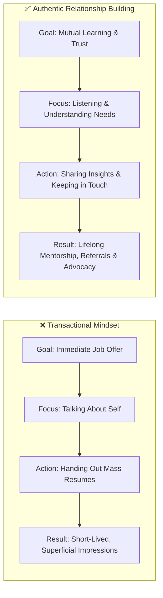

> [!TIP]
> **The Generosity Inversion**: When entering a room, ask yourself: *"What can I learn from the people here today, and how might I support someone else's journey?"* rather than *"Who here can get me hired?"* This mental shift immediately relieves social anxiety and projects confidence.

---

## 💬 2. One-on-One Conversation Skills: Starting Dialogue

Initiating a conversation with a stranger at an IT meetup, AWS User Group, or industry conference can feel daunting. Having a simple, repeatable 3-step formula eliminates hesitation.

### The 3-Step Starter Formula

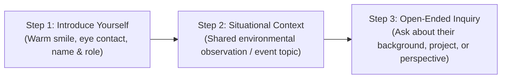

#### Step 1: Introduce Yourself
Deliver a concise, welcoming greeting accompanied by open body language and clear pronunciation:
- *"Hi, I'm Alex. Great to meet you."*
- *"Hello! Mind if I join you at this table? I'm Jordan."*

#### Step 2: Ask a Question About the Event / Shared Environment
Ground the initial exchange in your shared physical or virtual context:
- *"What did you think of the keynote on serverless architectures?"*
- *"Have you attended this AWS User Group before, or is this your first time too?"*
- *"What brought you to this particular security workshop?"*

#### Step 3: Ask a Question About Them (Curiosity & Open-Ended Inquiry)
Pivot the focus toward their professional interests, experiences, or journey:
- *"What kind of cloud projects are you or your team currently working on?"*
- *"How did you get started in cloud security?"*
- *"What session on today's agenda are you most excited to check out?"*

---

### Situational Conversation Starters by Context

| Scenario / Setting | Contextual Observation | Recommended Opening Line |
| :--- | :--- | :--- |
| **Waiting for a Speaker / Session** | Both seated in a lecture hall waiting for presentation to start. | *"Hi there! Are you planning to focus on the containerization track today, or just exploring different sessions?"* |
| **Coffee / Refreshment Line** | Casual, low-pressure shared wait time. | *"The caffeine is definitely needed after that deep-dive lab! How did you find the VPC peering exercise?"* |
| **Vendor Expo / Booth Hall** | Exploring partner booths and technical demos. | *"Have you tested this observability platform in production before? We've been evaluating different monitoring stacks."* |
| **Hallway / Between Sessions** | Walking between break-out tracks. | *"Excuse me, do you happen to know if this room is host to the IAM policy session? I'm curious to see how they handle least privilege."* |
| **Virtual Chat / Breakout Room** | Online webinar or Zoom breakout session. | *"Hello everyone! I'm joining from Seattle while transitioning into cloud architecture. What parts of the world or domains is everyone connecting from?"* |

---

### Master Open-Ended vs. Closed Questions

Closed questions yield binary "yes/no" responses that stifle conversational momentum. Open-ended questions invite storytelling and deeper technical dialogue.

```
❌ Closed: "Do you like working with AWS?"
   ↳ Response: "Yes." (Conversation stalls)

✅ Open:   "What has your experience been like migrating workloads over to AWS?"
   ↳ Response: "It was challenging initially with IAM permissions, but once we automated..."

❌ Closed: "Was that presentation good?"
   ↳ Response: "Yeah, it was alright."

✅ Open:   "What was your single biggest takeaway from that speaker's approach to disaster recovery?"
   ↳ Response: "I was surprised by how heavily they relied on multi-region DynamoDB replication..."
```

---

## 👥 3. Group Dynamics: Joining Existing Conversations Gracefully

Entering an ongoing group conversation requires social calibration and spatial awareness. Bumping into a circle abruptly can feel intrusive, while standing awkwardly silent on the periphery causes discomfort.

### The 4-Step Group Entry Protocol

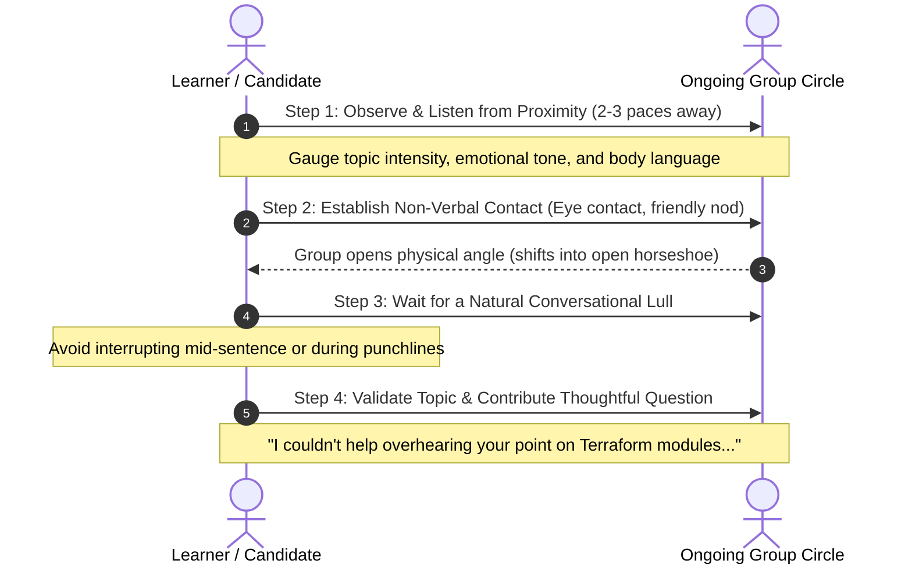

#### Step 1: Listen Carefully (Acoustic & Social Reconnaissance)
Before speaking, position yourself within comfortable earshot (2 to 3 feet from the outer edge). Identify:
- What is the subject matter? (Is it casual social banter, a debate over Kubernetes vs. ECS, or a private personal matter?)
- What is the emotional tone? (Humorous, serious, heated, or reflective?)

#### Step 2: Make Eye Contact & Observe Body Language
Make brief, warm eye contact with whoever is listening (not the speaker mid-sentence). If someone notices you and smiles or shifts their footing outward, they are welcoming you into the space.

#### Step 3: Wait for a Natural Break
Every conversation has natural rhythmic pauses: when the speaker finishes a point, when a group chuckles at a shared remark, or when someone takes a sip of their drink. Never interrupt an active speaker.

#### Step 4: Show Interest & Contribute or Validate
Bridge smoothly into the conversation by acknowledging their dialogue:
- *"Excuse me, I couldn't help overhearing your discussion about cloud cost optimization—that's something our cohort has been wrestling with. How are you tackling unused EBS volumes?"*
- *"Pardon the interruption, but that point you made about CI/CD pipeline automation caught my attention. Mind if I listen in?"*

---

### The Geometry of Conversations: Open vs. Closed Formations

Understanding spatial arrangements allows you to determine whether a group is approachable.

```
        THE CLOSED "O" CIRCLE                     THE OPEN "V" / HORSESHOE
        (DO NOT INTERRUPT)                        (WELCOMING NEW MEMBERS)

                 Person A                                Person A
               ▲          ▲                             ▲        ▲
              /            \                           /          \
             /              \                         /            \
     Person D                Person B         Person C              Person B
             \              /                         \            /
              \            /                           \          /
               ▼          ▼                             ▼        ▼
                 Person C                               [ OPEN SPACE ]
                                                              ▲
         Shoulders squared inward,                    Ideal entry point!
         feet facing center. Intimate                 Shoulders angled outward,
         or private discussion.                       inviting passersby.
```

> [!IMPORTANT]
> If a group is standing in a tight, closed circular ring with zero gap, do not force your way in. They may be discussing confidential company business, personal matters, or conducting an ad-hoc performance debrief. Look instead for groups standing in a "V" or "horseshoe" formation with open physical space.

---

## 👂 4. Active Listening: Earning Trust in Conversation

In technology culture, listening is prized far above speaking. True communication is not waiting for your turn to talk; it is dedicating 100% of your cognitive bandwidth to understanding the other person's perspective.

### The 80/20 Rule of Networking
Spend **80% of your time listening** and only **20% speaking**. People naturally perceive individuals who show deep, sincere interest in their experiences as charismatic, intelligent, and trustworthy.

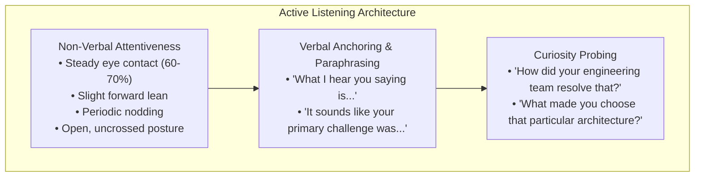

### Connection to Amazon Leadership Principle: *Earn Trust*

> [!NOTE]
> **Amazon Leadership Principle — Earn Trust**:  
> *"Leaders listen attentively, speak candidly, and treat others respectfully. They are vocally self-critical, even when doing so is awkward or embarrassing."*
>
> In networking, you earn trust by:
> 1. Giving credit where credit is due and being transparent about what you know and what you are currently learning.
> 2. Demonstrating intellectual humility when a senior practitioner explains an architecture you have not mastered.
> 3. Following through on any commitment you make during the conversation (e.g., sending an article link or following up as promised).

---

## 🎭 5. Deep-Dive Role-Play: The 6 Core Networking Scenarios

The curriculum presents six distinct real-world scenarios. Below is an exhaustive breakdown of the objectives, strategies, step-by-step dialogue scripts, and potential pitfalls for each scenario.

---

### 🔹 Scenario 1: Hallway Discussion with Instructor & Alumni (Goal: Participate)

> **Context**: Two former AWS re/Start students visit your classroom. During a short break, they start talking in the hallway with your instructor about a recent job interview one of them completed.  
> **Your Primary Goal**: Gracefully join and participate in the conversation.

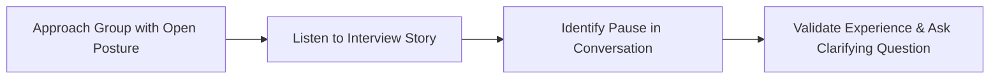

#### Strategic Approach
1. **Approach and Non-Verbal Alignment**: Walk over calmly and stand at the perimeter in the open "V" formation. Smile, make brief eye contact with the instructor or speaking alumnus, and listen attentively.
2. **Listen for Context**: Understand which company was interviewed, what role was discussed, and whether the tone is celebratory or analytical.
3. **Timed Entry**: When the alumnus finishes describing a challenging question or interview round, validate their effort.

#### Recommended Dialogue Script
- **Learner**: *(Stepping in gently after a brief pause)* *"Excuse me, congratulations on completing that interview loop! As current re/Start students, hearing about real-world interview loops is gold for us. Did they focus more on technical scenarios like VPC troubleshooting, or did they spend more time on behavioral questions like the Leadership Principles?"*
- **Alumnus**: *"They actually grilled me on IAM roles and then spent 30 minutes on 'Customer Obsession' STAR stories!"*
- **Learner**: *"That is super insightful. Our instructor has been emphasizing how critical those STAR stories are. Thank you for sharing that!"*

#### Common Pitfalls to Avoid
- 🚫 *Interrupting the alumnus while they are reliving an emotional part of the interview.*
- 🚫 *Shifting the entire spotlight to your own anxieties or complaints about the curriculum.*
- 🚫 *Standing silently beside the group without making eye contact, appearing like an eavesdropper.*

---

### 🔹 Scenario 2: Hallway Discussion with Alumni (Goal: Participate + Exchange Contact Info)

> **Context**: Same setting as Scenario 1, but with an advanced dual objective.  
> **Your Primary Goals**: Participate meaningfully in the conversation **AND** obtain the contact information (phone number or email/LinkedIn) of at least one alumnus.

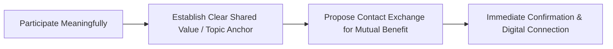

#### Strategic Approach
Never ask for contact information out of the blue. You must **anchor the contact request to a specific topic discussed during the conversation**.

#### Recommended Dialogue Script
- **Learner**: *(Building on the conversation)* *"You mentioned earlier that you prepared for the AWS Solutions Architect Associate exam using a specific lab guide and flashcard deck alongside the re/Start materials. That sounds incredibly useful."*
- **Alumnus**: *"Yeah, it really bridged the gap for me on storage options like S3 lifecycle policies."*
- **Learner**: *(Natural transition to contact exchange)* *"I’d love to check that out as we prepare for our certification exams. Would you be open to connecting on LinkedIn or exchanging email addresses so I can see which resources you recommend? I promise not to take up much of your time."*
- **Alumnus**: *"Absolutely! Let me pull up my LinkedIn QR code on my phone right now."*
- **Learner**: *(Scanning QR code)* *"Connected! It was great meeting you, Marcus. I'll make sure to follow up with a quick note."*

#### Common Pitfalls to Avoid
- 🚫 *Treating the contact information as a trophy without establishing conversational rapport first.*
- 🚫 *Directly asking for a job referral or internal recommendation within five minutes of meeting.*
- 🚫 *Forgetting to write down or save their details immediately.*

---

### 🔹 Scenario 3: IT Conference Waiting Room (Goal: Start a Conversation)

> **Context**: You are attending a panel discussion at an IT conference. You are seated and waiting for the next speaker, whose presentation begins in approximately 15 minutes. Not many people are in the room, but someone is seated a few chairs away from you checking their mobile phone.  
> **Your Primary Goal**: Start a conversation respectfully without being intrusive.

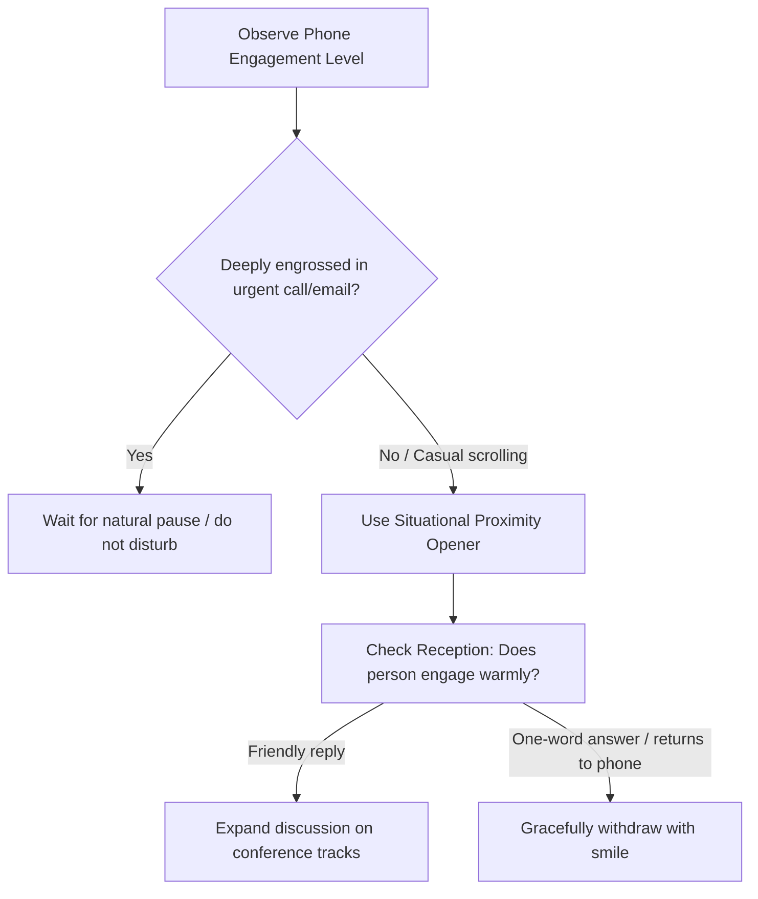

#### Strategic Approach
Respect the mobile phone boundary. If someone is vigorously typing an urgent email or on a call, do not interrupt. If they are casually scrolling or looking around, use the physical environment as a springboard.

#### Recommended Dialogue Script
- **Learner**: *(Looking toward the neighbor, with a pleasant, calm voice)* *"Hi there! Excuse me—are you also here for the panel on 'Modernizing Monoliths to Microservices'?"*
- **Attendee**: *(Puts phone facedown, looks up)* *"Yes, I am. Hoping to hear how they handle stateful services."*
- **Learner**: *"Same here! I'm David, by the way. I'm currently training in cloud infrastructure."*
- **Attendee**: *"Nice to meet you, David. I'm Priya, a DevOps engineer at FinTech Cloud."*
- **Learner**: *"Pleasure to meet you, Priya. How has your experience of the conference been so far today?"*

#### Common Pitfalls to Avoid
- 🚫 *Leaning over their shoulder or peeking at their screen.*
- 🚫 *Ignoring clear non-verbal cues (e.g., single-word answers while keeping their phone up).*
- 🚫 *Talking too loudly in an otherwise quiet auditorium.*

---

### 🔹 Scenario 4: IT Conference Waiting Room (Goal: Start Conversation + Solicit Session Recommendations)

> **Context**: Same setting as Scenario 3 (seated before panel starts), but with the goal of soliciting their professional recommendations on which conference sessions are worth attending.  
> **Your Primary Goals**: Start a conversation **AND** ask for tips on which upcoming sessions or speakers they find most interesting.

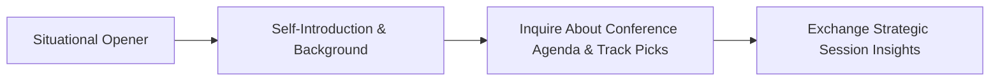

#### Strategic Approach
People love being asked for their advice and recommendations. It signals respect for their expertise and gives them an effortless platform to share insights.

#### Recommended Dialogue Script
- **Learner**: *"Hi! It looks like we both beat the crowd for this session. I'm Sarah."*
- **Attendee**: *"Hi Sarah, I'm Chris."*
- **Learner**: *"Nice to meet you, Chris. The conference agenda is packed today with four concurrent tracks. As someone looking to maximize technical learning in cloud automation and security, I’m curious—which upcoming sessions or speakers are at the top of your must-attend list?"*
- **Attendee**: *"Oh, you definitely shouldn't miss the 2:30 PM session by Dr. Aris on zero-trust architectures in AWS. He’s a phenomenal speaker and breaks down complex VPC endpoint policies better than anyone."*
- **Learner**: *"That is fantastic advice! I was torn between that and the container lab, but zero-trust security is exactly where I want to build depth. Are there any other workshops you're planning to catch?"*

#### Common Pitfalls to Avoid
- 🚫 *Dismissing their recommendations or arguing that another speaker is superior.*
- 🚫 *Taking notes without looking up, turning a natural dialogue into an interrogation.*
- 🚫 *Failing to thank them for their guidance.*

---

### 🔹 Scenario 5: Internal Cloud Security Workshop (Goal: Start Conversation with Busy Senior Engineer)

> **Context**: Your company held a workshop on cloud security led by a senior cloud security engineer. As a new hire, you want to introduce yourself. After the workshop, you notice an opportunity to approach them, but they are packing up their laptop and have very limited time.  
> **Your Primary Goal**: Start a conversation respectfully within strict time constraints.

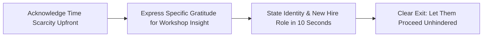

#### Strategic Approach
When someone is visibly pressed for time, the greatest way to earn their respect is to **explicitly acknowledge and protect their schedule**. Keep your engagement under 45 seconds.

#### Recommended Dialogue Script
- **Learner**: *(Approaching with hands at side, professional posture)* *"Hi Marcus, I know you're packing up and tight on time, so I won't hold you for more than twenty seconds. I'm Elena, a new associate cloud engineer on the infrastructure team. I just wanted to say that your walkthrough on mitigating SSRF vulnerabilities with IMDSv2 was the clearest explanation I've seen. Thank you for putting this together!"*
- **Senior Engineer**: *(Smiling, appreciative)* *"Thanks so much, Elena! Welcome to the team. IMDSv2 is definitely something we're enforcing company-wide right now."*
- **Learner**: *"I really appreciate it. I'll let you get to your next commitment—have a great afternoon!"*

#### Common Pitfalls to Avoid
- 🚫 *Trapping them while they are trying to unplug cables or walk toward the door.*
- 🚫 *Asking a deep, complex architectural question that requires 20 minutes to explain.*
- 🚫 *Expressing frustration or disappointment when they indicate they need to leave.*

---

### 🔹 Scenario 6: Internal Cloud Security Workshop (Goal: Introduce + Request an Informational Meeting)

> **Context**: Same setting as Scenario 5 (busy senior engineer packing up), but with the goal of securing a follow-up 15-minute coffee chat or informational interview.  
> **Your Primary Goals**: Start a conversation **AND** secure permission for a brief follow-up meeting / 1:1 chat.

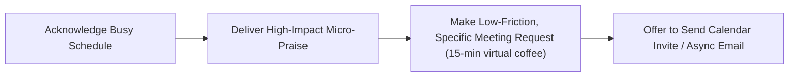

#### Strategic Approach
Senior staff are busy, but they almost always want to support motivated new hires who are respectful of their calendar. The request must be:
1. **Time-bounded**: Exactly 15 minutes (never ask for "an hour of your time").
2. **Specific**: Center on a distinct topic (e.g., career trajectory in cloud security, advice for new hires).
3. **Frictionless**: Offer to schedule around their calendar or send a brief email first.

#### Recommended Dialogue Script
- **Learner**: *"Hi Marcus! I know you're rushing to your next meeting, so I will be very brief. I'm Elena, a new associate engineer on Cloud Ops. Your workshop on IAM least privilege was fantastic."*
- **Senior Engineer**: *"Thanks Elena, glad you could make it!"*
- **Learner**: *"I have a strong interest in specializing in cloud security down the road. Would you be open to a 15-minute virtual coffee chat sometime in the next couple of weeks? I'd love to ask two or three brief questions about the skills you found most valuable when stepping into security."*
- **Senior Engineer**: *"I'd be happy to. Drop me an email or find an open 15-minute slot on my Outlook calendar next Thursday afternoon."*
- **Learner**: *"Thank you so much, Marcus. I will send over an invite for Thursday with a quick agenda. Have a great rest of your day!"*

#### Common Pitfalls to Avoid
- 🚫 *Vague requests like: "Can we hang out sometime and pick your brain?"*
- 🚫 *Sending a meeting invite immediately without prior verbal agreement or context.*
- 🚫 *Booking an invite over their existing busy calendar blocks without checking.*

---

## ⏰ 6. The 24-Hour Follow-Up Protocol

A networking interaction without a timely follow-up is an opportunity lost. Human memory decays rapidly; within 48 to 72 hours, the details of your conversation will fade from the other person's mind.

```
┌────────────────────────────────────────────────────────────────────────┐
│                        The 24-Hour Rule                                │
│                                                                        │
│   Always send your follow-up note within 24 hours of meeting.          │
│   Reference a specific insight or shared laugh from your conversation   │
│   to anchor their memory and solidify the connection.                  │
└────────────────────────────────────────────────────────────────────────┘
```

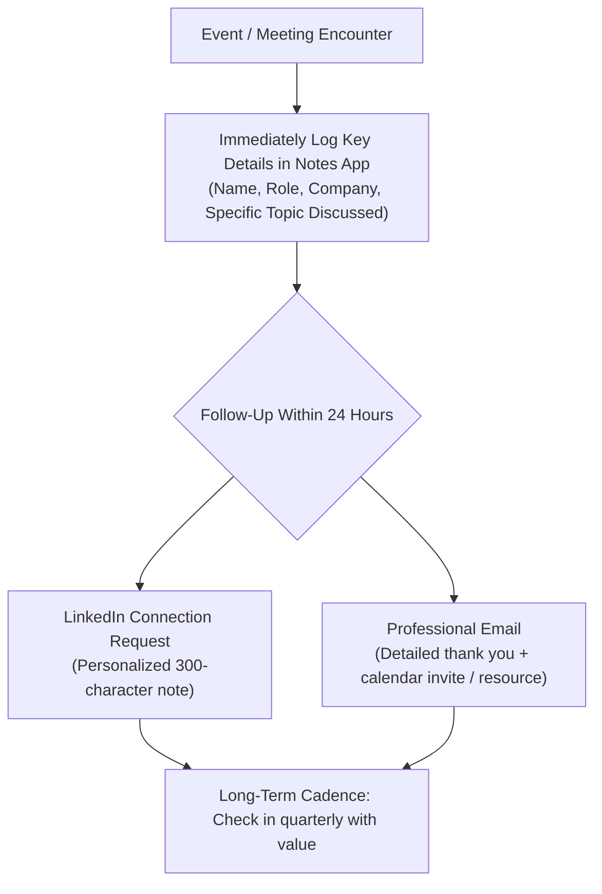

---

### Copy-Paste Follow-Up Templates

#### Template 1: LinkedIn Follow-Up to an Alumnus / Class Visitor
```text
Hi [First Name],

It was great meeting you during your visit to our AWS re/Start cohort today! Thank you for sharing your experience with the technical interview process and the emphasis on IAM and STAR stories. 

I'd love to stay connected on LinkedIn as I continue my journey into cloud computing. Wishing you continued success at [Their Company]!

Best regards,
[Your Name]
[Your LinkedIn URL]
```

#### Template 2: Email to a Conference Contact / Attendee
```text
Subject: Great meeting you at [Conference Name] – [Topic Discussed]

Hi [First Name],

I really enjoyed our conversation while waiting for the panel on [Panel Name] at [Conference Name] yesterday. 

Your recommendation to attend Dr. Aris's session on zero-trust architectures was spot on—his breakdown of VPC endpoints and private connectivity was one of the highlights of my day.

As promised, here is the link to the AWS whitepaper on security reference architectures we touched on: [Link].

I hope you enjoyed the rest of the conference. Let's stay in touch!

Warm regards,

[Your Name]
Cloud Infrastructure Practitioner | AWS re/Start
[Phone Number] | [LinkedIn Profile URL]
```

#### Template 3: Internal Outlook Email Requesting Coffee Chat (Senior Engineer)
```text
Subject: Quick 15-Min Coffee Chat – Follow-up from [Workshop Name]

Hi [First Name],

Thank you again for delivering such an insightful workshop on [Workshop Topic] yesterday. I really appreciated your walkthrough of [Specific Concept, e.g., IMDSv2 security enforcement].

Per our brief hallway chat, I would love to take 15 minutes of your time for a quick virtual coffee to ask for your perspective on early career development in cloud security. 

I checked your calendar and noticed a couple of potential openings:
• Option 1: Thursday, [Date] at 2:00 PM
• Option 2: Friday, [Date] at 10:30 AM

If either works for you, I'll send over a brief calendar invitation with a 3-question agenda so you know exactly what to expect. If another time suits you better, please let me know.

Thank you for your time and guidance,

[Your Name]
Associate Cloud Engineer, [Department / Team]
[Internal Slack/Teams handle]
```

#### Template 4: Value-Add Reconnect (30–60 Days Later)
```text
Hi [First Name],

Hope you've been having a productive quarter!

I came across this newly released AWS blog post on [Relevant Topic, e.g., automated IAM policy generation using generative AI], and immediately thought of our conversation at [Event Name] regarding policy governance. 

Here's the write-up in case you haven't seen it yet: [Link].

No reply needed—just wanted to share it with you. Hope all is well with you and the team at [Their Company]!

Best,
[Your Name]
```

---

## 📋 7. Complete Tech Networking Event Checklist

Use this operational checklist before, during, and after industry meetups, AWS User Groups, hackathons, and technology conferences.

```mermaid
flowchart LR
    subgraph Pre["Phase 1: Pre-Event (T - 48 Hours)"]
        P1["Research Agenda & Speakers"]
        P2["Polish LinkedIn Profile & QR"]
        P3["Refine 30-Sec Elevator Pitch"]
    end

    subgraph During["Phase 2: During Event"]
        D1["Arrive 15 Min Early"]
        D2["Look for Open 'V' Formations"]
        D3["Take Micro-Notes Between Chats"]
    end

    subgraph Post["Phase 3: Post-Event (T + 24 Hours)"]
        A1["Send Personalized Notes"]
        A2["Add to Personal Contact Tracker"]
        A3["Deliver Promised Resources"]
    end

    Pre --> During --> Post
```

### Phase 1: Pre-Event Checklist (48 to 24 Hours Before)
- [ ] **Review the Agenda & Attendee/Speaker List**: Identify 2 to 3 specific sessions, topics, or organizations you want to learn about.
- [ ] **Set Realistic Relationship Goals**: Aim for **2 to 3 quality, in-depth conversations** rather than attempting to hand out 30 business cards.
- [ ] **Test Your Digital Contact Card**: Ensure your LinkedIn mobile app is updated, logged in, and that you know how to instantly generate your LinkedIn QR code (tap the search bar, tap the QR icon).
- [ ] **Sharpen Your 30-Second Elevator Pitch**: Practice articulating your current focus: your background, what you are building or mastering in AWS re/Start, and your aspirational technical domain.
- [ ] **Dress for Tech Context**: Business casual or smart tech casual (clean polo, button-up, or neat sweater). Dress comfortably for prolonged standing.

### Phase 2: During-Event Checklist (Live Execution)
- [ ] **Arrive 15 Minutes Early**: Early arrival allows you to meet organizers, speakers, and early birds before large crowds gather and sound levels rise.
- [ ] **Hold Drinks in Your Left Hand**: Keep your right hand dry, free, and warm for handshakes or gestural greetings.
- [ ] **Scan the Perimeter for Approachable Openings**: Look for individuals standing alone checking schedules or groups standing in open "V" shapes.
- [ ] **Apply the 80/20 Listening Rule**: Ask thoughtful questions and let others speak. Show genuine fascination for their technical stack.
- [ ] **Take Immediate Micro-Notes**: When stepping away to the restroom or between sessions, open your phone's notes app. Record:
  - *Person's name and company*
  - *Key topic or hobby discussed*
  - *Any follow-up action promised (e.g., article link, repo, coffee chat)*

### Phase 3: Post-Event Checklist (Within 24 Hours)
- [ ] **Audit Your Collected Contacts**: Review your notes and business cards collected.
- [ ] **Send Personalized LinkedIn Requests**: Include a customized 300-character message referencing your specific discussion point for every contact.
- [ ] **Deliver on Every Promise**: If you said you would email an article, link, or github repo, send it within 24 hours without fail.
- [ ] **Log into Personal Network Tracker**: Update your spreadsheet or CRM with dates, contact information, and follow-up intervals.
- [ ] **Schedule 60-Day Re-Engagement Reminders**: Set a calendar reminder to check in with high-value contacts after 6 to 8 weeks with a low-friction value-add note.

---

## 🗃️ 8. Personal Networking Tracker (Mini-CRM Template)

To avoid losing track of professional relationships as your career advances, maintain a simple structured spreadsheet or markdown ledger.

| Full Name | Role & Organization | Where We Met | Key Discussion Topic | Promised Action | Follow-Up Date | Status / Notes |
| :--- | :--- | :--- | :--- | :--- | :--- | :--- |
| *Marcus Vance* | *Cloud Security Lead, FinTech Corp* | *Internal Sec Workshop* | *IMDSv2, IAM least privilege* | *Send 15-min coffee invite* | *Oct 14, 2026* | *Scheduled for Thursday 2 PM* |
| *Priya Sharma* | *Senior DevOps, CloudScale Inc* | *AWS Summit Hallway* | *EKS vs ECS Fargate costs* | *Send link to FinOps article* | *Oct 15, 2026* | *Connected on LinkedIn; link sent* |
| *Chris Miller* | *Solutions Architect, AWS Partner* | *User Group Meetup* | *Terraform state locking* | *Connect on LinkedIn* | *Oct 15, 2026* | *Sent connection request* |

---

## 🧠 9. Self-Coaching & Reflection Worksheets

### Exercise 1: Crafting Your Situational Openers
Draft three personalized opening questions you can comfortably deliver at your next local tech event:

1. **The Shared Observation Opener**:
   > *Draft your question*: ____________________________________________________  
   > *Context where you will use it*: ___________________________________________

2. **The Curiosity & Tech Stack Opener**:
   > *Draft your question*: ____________________________________________________  
   > *Context where you will use it*: ___________________________________________

3. **The Speaker / Keynote Feedback Opener**:
   > *Draft your question*: ____________________________________________________  
   > *Context where you will use it*: ___________________________________________

---

### Exercise 2: Conversational Boundary Audit

Review the following common networking mistakes. Rate your current comfort level from 1 (Needs Improvement) to 5 (Mastered):

| Competency | Score (1–5) | Growth Action Item |
| :--- | :---: | :--- |
| **Resisting the urge to interrupt while someone is speaking** | `[   ]` | Focus on counting 1 second after the other person stops speaking before replying. |
| **Pivoting closed questions into open-ended inquiries** | `[   ]` | Replace all *"Do you..."* questions with *"What has your experience been with..."* |
| **Exiting long conversations gracefully without awkwardness** | `[   ]` | Memorize and practice: *"It was fantastic chatting about X! I want to make sure you get a chance to grab coffee before the session starts."* |
| **Consistently following up within 24 hours** | `[   ]` | Set a recurring calendar reminder for the morning following any meetup or conference. |

---

## 📚 Summary & Key Takeaways

1. **Networking is Relationship Cultivation**: Genuine interest in others, intellectual curiosity, and generosity form the bedrock of sustainable career growth in cloud and IT.
2. **Start with the Environment**: Break the ice by referencing the shared space, the event track, or an interesting presentation before asking personal or career questions.
3. **Respect Social Geometry**: Only enter groups positioned in open "V" formations; listen carefully for conversational rhythm before speaking.
4. **Active Listening Builds Trust**: Use the 80/20 rule. Reflective listening and thoughtful follow-up questions showcase maturity and professional presence.
5. **Protect Others' Time**: When speaking with busy senior staff, acknowledge their constraints upfront, keep requests micro-sized (15 minutes), and eliminate scheduling friction.
6. **Execution Lives in the Follow-Up**: What you do within 24 hours of an event determines whether an encounter becomes a lasting professional ally or a forgotten business card.
