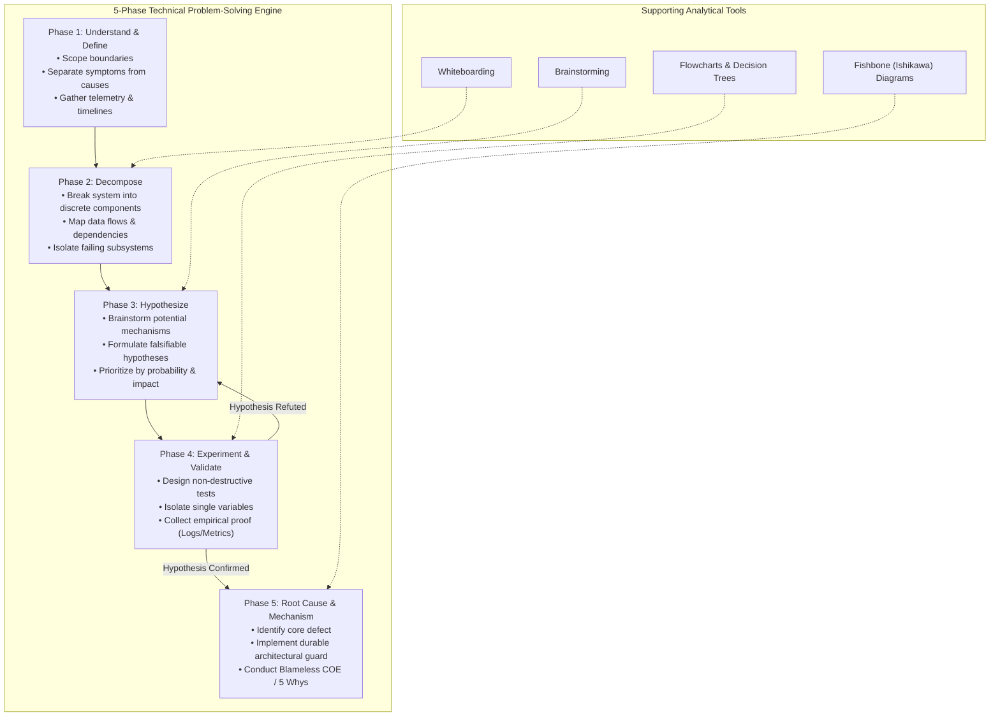
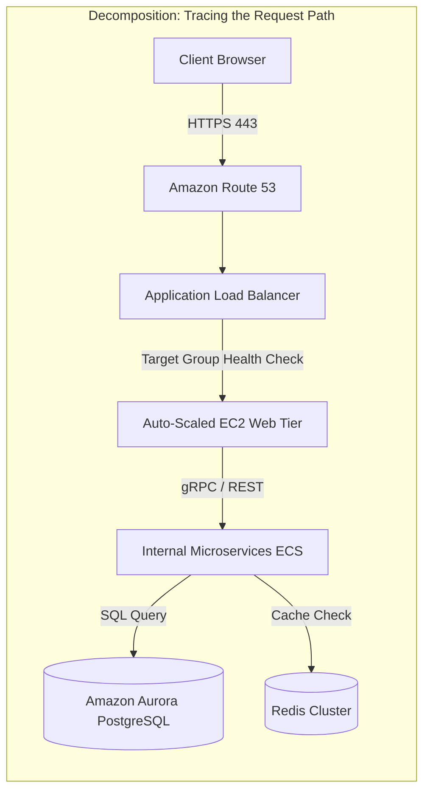
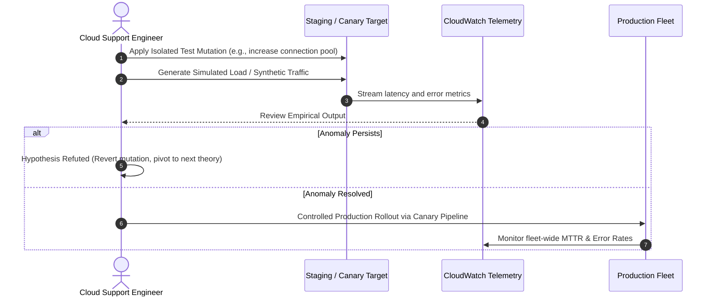
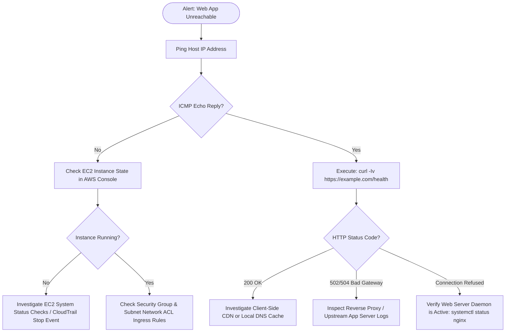
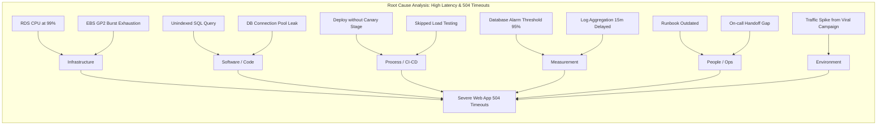
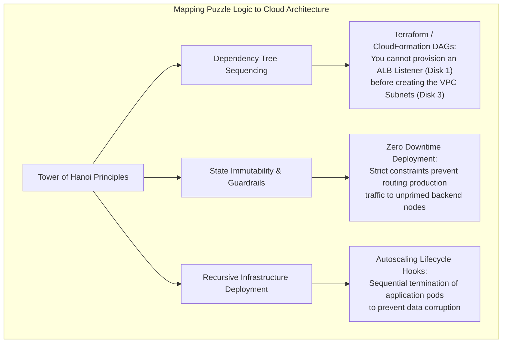

# 🧠 Technical Thought Process: Systematic Problem-Solving, Analytical Tools, and Root Cause Analysis

> **Course**: AWS re/Start Foundational Soft Skills (Techno-Functional Soft Skills)  
> **Module**: M00 – Technical Thought Process & Problem-Solving Methodology  
> **Source**: `T03-0027-RSTFSS_EN-US_SG_M00_TECHTHOUGHTPROCESS.pdf`  
> **Target Audience**: AWS re/Start Cloud Learners, Junior Cloud Support Engineers, Solutions Architects, and Systems Administrators  

---

## 🎯 Module Overview & Core Purpose

In modern cloud computing and DevOps environments, technical failures, service disruptions, and ambiguous architectural requirements are everyday realities. Novice engineers often approach technical issues using **haphazard trial-and-error**—randomly changing configuration parameters, rebooting servers, or executing unverified shell commands without understanding the system's underlying state. This undisciplined approach increases mean time to resolution (MTTR), introduces cascading failures, and obscures the genuine root causes of incidents.

Professional engineers and solutions architects rely on a **structured technical thought process**. This methodology transforms problem solving from subjective guesswork into a systematic, hypothesis-driven discipline rooted in scientific inquiry, telemetry validation, and architectural decomposition.

This guide provides a comprehensive framework for mastering the technical thought process. It breaks down the **5-Phase Problem-Solving Lifecycle**, explores essential analytical and visual collaboration tools (**Brainstorming**, **Whiteboarding**, **Flowcharts**, and **Fishbone Diagrams**), examines algorithmic state decomposition through the **Tower of Hanoi**, provides an enterprise architectural blueprint for solving **constrained production log ingestion**, and details Amazon's industry-standard **Correction of Errors (COE)** blameless post-mortem framework.

---

### 📌 Learning Objectives

- [ ] **Define** the foundational stages of the structured technical problem-solving lifecycle.
- [ ] **Execute** the 5-Phase Technical Problem-Solving Model: *Understand/Define*, *Decompose*, *Hypothesize*, *Experiment/Validate*, and *Root Cause/Mechanism*.
- [ ] **Deploy** collaborative tools—structured brainstorming, architectural whiteboarding, decision flowcharts, and fishbone (Ishikawa) cause-and-effect diagrams.
- [ ] **Deconstruct** complex state transitions and recursive constraints using algorithmic models (Tower of Hanoi).
- [ ] **Architect** viable cloud solutions under strict enterprise constraints (fleet log aggregation without operating system reconfiguration).
- [ ] **Implement** Amazon's blameless Correction of Errors (COE) process, utilizing the **5 Whys** root cause analysis technique to establish automated, durable preventative mechanisms.

---



---

## 🔬 1. The 5-Phase Structured Problem-Solving Lifecycle

Engineering issues often appear chaotic and overwhelmed with contradictory symptoms. When an application returns HTTP 500 errors to end users, the root failure might reside in a saturated database connection pool, an expired TLS certificate, an AWS IAM permission boundary misconfiguration, or an asynchronous worker thread deadlock. 

To resolve such challenges predictably, engineers navigate five sequential phases.

```
┌────────────────────────────────────────────────────────────────────────────────────────┐
│                   THE SYSTEMATIC PROBLEM-SOLVING LIFECYCLE                             │
├─────────────────┬──────────────────────────────────────────────────────────────────────┤
│ Phase           │ Key Engineering Questions & Deliverables                             │
├─────────────────┼──────────────────────────────────────────────────────────────────────┤
│ 1. Understand / │ • What is the observed behavior versus expected baseline behavior?  │
│    Define       │ • What are the precise error codes, timestamps, and impacted scopes? │
│                 │ • Deliverable: Explicit Problem Statement with clear boundaries.     │
├─────────────────┼──────────────────────────────────────────────────────────────────────┤
│ 2. Decompose    │ • What are the functional tiers, dependencies, and network paths?    │
│                 │ • At which component boundary does valid state become invalid state? │
│                 │ • Deliverable: High-level system architecture and data-flow map.     │
├─────────────────┼──────────────────────────────────────────────────────────────────────┤
│ 3. Hypothesize  │ • Given the failure boundary, what technical mechanisms explain it?  │
│                 │ • Are our theories testable and falsifiable?                         │
│                 │ • Deliverable: Ranked list of causal hypotheses with test criteria.  │
├─────────────────┼──────────────────────────────────────────────────────────────────────┤
│ 4. Experiment / │ • Can we safely reproduce or measure the hypothesized condition?     │
│    Validate     │ • How do we isolate one variable without causing further outages?    │
│                 │ • Deliverable: Empirical test logs, packet traces, and metrics data. │
├─────────────────┼──────────────────────────────────────────────────────────────────────┤
│ 5. Root Cause / │ • What was the foundational failure (human, process, code, infra)?   │
│    Mechanism    │ • How do we build an automated mechanism to prevent recurrence?      │
│                 │ • Deliverable: Published Blameless COE & permanent remediations.     │
└─────────────────┴──────────────────────────────────────────────────────────────────────┘
```

---

### Phase 1: Understand and Define the Problem

The primary error made during troubleshooting is attempting to solve a problem before clearly understanding what has actually occurred. Treating symptoms rather than the root disease wastes time and often creates fresh system anomalies.

#### Symptoms vs. Root Causes
- **Symptom**: "The web checkout page is slow and timing out."
- **Intermediate Cause**: "EC2 instance CPU utilization is pegged at 100%."
- **Root Cause**: "A recent microservice deployment introduced an unindexed database query, causing full table scans on millions of rows during peak traffic."

#### Techniques for Problem Definition
1. **Define Expected vs. Actual Behavior**: Document the exact contract or standard that is failing.
2. **Quantify the Blast Radius**: Determine which users, availability zones, tenants, API endpoints, or regions are affected.
3. **Capture Telemetry and Timestamps**: Pinpoint the precise minute the anomaly began using Amazon CloudWatch, VPC Flow Logs, application logs, or APM traces.
4. **Identify Recent Changes**: Review deployment pipelines, CloudTrail API audit logs, auto-scaling events, and network routing updates that coincided with the incident.

> [!TIP]
> **Crafting a Precise Problem Statement Formula**:  
> `[System/Service X] is experiencing [Specific Failure/Error] since [Timestamp], resulting in [Quantifiable Impact], while [Unaffected Upstream/Downstream Systems] remain normal.`  
> *Example*: *"The Payment Processing Service has returned HTTP 504 Gateway Timeouts on 14% of `/charge` requests since 14:15 UTC, affecting US-East-1 customers, while auth and catalog services continue operating normally."*

---

### Phase 2: Decompose the System

Complex systems cannot be analyzed as a single monolithic block. **Decomposition** involves dissecting a distributed architecture into its constituent components, interfaces, communication protocols, and dependencies.



#### Key Decomposition Tactics
1. **Interface Isolation**: Test communication across individual hops (Client $\to$ CDN $\to$ Load Balancer $\to$ Web Tier $\to$ App Tier $\to$ Database).
2. **Binary Search Troubleshooting**: When debugging long pipelines or binary systems, divide the pipeline in half to see which half introduces the fault.
3. **Static vs. Dynamic Elements**: Separate immutable configuration artifacts from dynamic runtime dependencies (e.g., DNS caching, ephemeral IP allocations, external third-party payment gateways).

---

### Phase 3: Hypothesize Potential Mechanisms

Once the failing component or network segment is isolated, generate technical hypotheses that could account for the observed state.

#### Rules for High-Quality Hypotheses
- **Falsifiability**: A hypothesis must be capable of being proven wrong through an empirical test.
- **Specificity**: Avoid vague generalizations like *"there is a network issue."* Formulate precise statements such as *"VPC Security Group rules for the target group omit ingress port 8080 from the ALB subnet CIDR."*
- **Occam's Razor**: Prioritize simpler, higher-probability explanations (e.g., configuration mismatch, capacity exhaustion, DNS TTL latency) before exotic corner cases (e.g., Linux kernel zero-day bug, physical hardware bit-flips).

---

### Phase 4: Experiment and Validate

Validation is the active testing of your hypotheses under controlled conditions.



#### Experimental Guardrails
- **Change One Variable at a Time**: Modifying multiple configuration values simultaneously makes it impossible to identify which adjustment corrected or degraded the environment.
- **Predict Before Testing**: Before executing an operational test, write down the expected outcome. If the result diverges from your prediction, your mental model of the system is incomplete.
- **Non-Destructive Testing**: In live production environments, prioritize read-only diagnostics (`curl`, `traceroute`, `tcpdump`, reading CloudWatch metrics) over disruptive mutations (`reboot`, `systemctl restart`, `iptables flush`).

---

### Phase 5: Identify Root Cause and Establish Mechanisms

The final phase solidifies the investigation into a permanent improvement. A problem is not solved when service is restored; it is solved when **architectural mechanisms ensure the specific class of failure cannot happen again**.

- **Distinction between Mitigation and Remediation**:
  - *Mitigation*: Restarting a deadlocked Java virtual machine to restore web traffic (temporary recovery).
  - *Remediation*: Refactoring the multithreaded synchronization lock or tuning garbage collection parameters so thread deadlocks are mathematically prevented (permanent fix).
- **Mechanical Safeguards**: Replace human vigilance ("be more careful next time") with automated guards (linters, CI/CD pipeline tests, infrastructure-as-code policies, CloudWatch anomaly detection alarms).

---

## 🛠️ 2. Core Analytical Tools Supporting the Thought Process

To execute the 5-phase problem-solving process effectively, engineers employ four foundational collaborative and analytical tools.

```
┌─────────────────────────────────────────────────────────────────────────────────────────┐
│                     ANALYTICAL & COLLABORATIVE TOOL CHEST                               │
├─────────────────────┬───────────────────────────────┬───────────────────────────────────┤
│ Tool                │ Primary Function              │ Best Engineering Application      │
├─────────────────────┼───────────────────────────────┼───────────────────────────────────┤
│ 1. Brainstorming    │ Divergent idea generation &   │ Incident response war rooms,      │
│                     │ expansive hypothesis building │ architectural trade-off sessions  │
├─────────────────────┼───────────────────────────────┼───────────────────────────────────┤
│ 2. Whiteboarding    │ Visual architectural mapping  │ System design, boundary mapping,  │
│                     │ and consensus formation       │ inter-service protocol analysis   │
├─────────────────────┼───────────────────────────────┼───────────────────────────────────┤
│ 3. Flowcharts       │ Sequential decision trees &   │ Standard Operating Procedures,    │
│                     │ logic branch evaluation       │ automated runbooks, triage trees  │
├─────────────────────┼───────────────────────────────┼───────────────────────────────────┤
│ 4. Fishbone Chart   │ Multidimensional cause-and-   │ Post-incident root cause analysis,│
│    (Ishikawa)       │ effect categorization         │ complex systemic flaw discovery   │
└─────────────────────┴───────────────────────────────┴───────────────────────────────────┘
```

---

### 1. Brainstorming

Brainstorming is a collaborative method designed to generate a high volume of ideas, hypotheses, and solutions around a central problem statement without early critical filtering.

#### Core Rules of Engineering Brainstorming
1. **Suspend Premature Judgement**: Do not shoot down ideas immediately with "that won't work." Unorthodox ideas frequently point toward overlooked failure vectors.
2. **Quantity Breeds Quality**: Aim for a target count (e.g., "list 10 distinct potential causes for this network latency") to force participants beyond obvious first assumptions.
3. **Turn-Taking & Equal Airtime**: Ensure junior and senior engineers participate equally; junior engineers often notice subtle anomalies that seniors take for granted.
4. **Amazon Silent Brainstorming (The 6-Pager Approach)**: Instead of verbal open-floor debates where the loudest voice dominates, write ideas silently in a shared document for the first 10 minutes, followed by collective, systematic analysis.

---

### 2. Whiteboarding

Whiteboarding is the practice of visually diagramming systems, data flows, and state transitions on an erasable board or a shared digital canvas (such as Draw.io, Miro, or Lucidchart).

```
┌───────────────────────────────────────────────────────────────────────┐
│                      VIRTUAL WHITEBOARD SCHEMATIC                     │
│                                                                       │
│   [ Client IP ]                                                       │
│         │                                                             │
│         ▼ (TCP 443)                                                   │
│   [ CloudFront CDN ] ─── Cached Hit (80%) ───► [ S3 Static Assets ]   │
│         │                                                             │
│         ▼ Dynamic Miss (20%)                                          │
│   [ ALB Ingress ]                                                     │
│         │                                                             │
│         ▼ (HTTP 80)                                                   │
│   [ ECS Task Cluster ] ──(Connection Timeout?)──► [ RDS Postgres ]    │
│                                                          │            │
│                                                    [ IOPS Maxed ]     │
└───────────────────────────────────────────────────────────────────────┘
```

#### Key Whiteboarding Benefits
- **Shared Mental Model**: Aligns diverse engineers around the exact same topology.
- **Boundary Verification**: Clearly highlights where responsibilities transition (e.g., AWS Shared Responsibility boundary, VPC peering connections, external third-party APIs).
- **Active Engagement**: Visual elements activate spatial reasoning, making missing architectural connections instantly noticeable.

---

### 3. Flowcharts & Decision Trees

A **flowchart** is a standardized graphical representation of the sequential steps in a process or troubleshooting tree. Flowcharts transform ambiguous intuition into repeatable, deterministic runbooks.

#### Standard Flowchart Symbols
- **Terminal (Oval / Rounded Box)**: Start or end of a procedure.
- **Process (Rectangle)**: An operational task, command, or execution step (e.g., `Run ping 8.8.8.8`).
- **Decision (Diamond)**: A conditional evaluation with two or more branching outcomes (e.g., `Exit Code 0? Yes/No`).
- **Input/Output (Parallelogram)**: Data ingestion or metric emission.

#### Example: Production Network Triage Decision Tree



---

### 4. Fishbone (Ishikawa) Diagrams

Developed by Kaoru Ishikawa, the **Fishbone Diagram** is a structured cause-and-effect tool used to identify and organize all potential contributors to a specific outcome or defect. 

The "head" of the fish represents the central problem, while the "bones" represent major categories of causes. In cloud engineering, the traditional manufacturing categories are adapted into the **6 Cloud Vectors**:
1. **Infrastructure & Hardware**: EC2 hypervisor, EBS volume limits, underlying networking hardware.
2. **Software & Configuration**: Application code, libraries, runtime versions, OS kernel parameters.
3. **People & Training**: Human operational error, lack of documentation, on-call fatigue.
4. **Process & Deployment**: CI/CD pipelines, change management procedures, untested migrations.
5. **Measurement & Telemetry**: Missing alarms, delayed log aggregation, misleading dashboards.
6. **Environment & External Dependencies**: Third-party SaaS outages, ISP routing, AWS regional events.

```
       INFRASTRUCTURE           SOFTWARE                PEOPLE
         EBS Volume I/O Maxed    App Memory Leak          Fatigue / Shift Change
              \                       \                       \
               \                       \                       \
    ────────────┴───────────────────────┴───────────────────────┴──────────────► [ HIGH LATENCY
                ┬                       ┬                       ┬                  OUTAGE ]
               /                       /                       /
              /                       /                       /
      Deployment Pipeline     CloudWatch Alarm Lag    Upstream ISP Fiber Cut
      PROCESS                 MEASUREMENT             ENVIRONMENT
```

#### Mermaid Fishbone Representation



---

## 🏛️ 3. Amazon Correction of Errors (COE) & Blameless Post-Mortem Framework

A technical thought process extends beyond resolving an active outage; it includes the formal review conducted after the dust settles. At Amazon and across high-performing engineering organizations, this process is known as the **Correction of Errors (COE)**.

### The Philosophy of Blamelessness

```
┌────────────────────────────────────────────────────────────────────────┐
│                   THE BLAMELESS POST-MORTEM PRINCIPLE                  │
│                                                                        │
│   "You cannot engineer a resilient distributed system if you treat     │
│   human error as a root cause. Human error is NEVER the root cause;    │
│   it is the symptom of broken mechanisms, inadequate automation,       │
│   or missing safety guardrails."                                       │
└────────────────────────────────────────────────────────────────────────┘
```

When an engineer accidentally deletes a production database, a blame-oriented culture asks: *"Why did Alice run that command? We should reprimand Alice."* 

A **blameless engineering culture** asks:
- *Why did our command-line tools permit a production deletion without a multi-party approval token?*
- *Why was termination protection disabled on the database instance?*
- *Why didn't our IAM policies restrict destructive permissions to dedicated break-glass roles?*
- *How quickly did automated point-in-time recovery restore customer data?*

---

### Core Sections of an Amazon COE Document

Every formal COE contains six mandatory sections:

```
┌────────────────────────────────────────────────────────────────────────┐
│                   STANDARD AMAZON COE DOCUMENT SECTIONS                │
├────────────────────────────────────────────────────────────────────────┤
│ 1. Executive Summary & Impact Summary (Metrics, Duration, Cost)        │
│ 2. Chronological Incident Timeline (UTC timestamps from start to fix)  │
│ 3. 5 Whys Root Cause Analysis (Deep drilling into systemic flaws)       │
│ 4. Lessons Learned (What went well, what went poorly, where we got lucky)│
│ 5. Telemetry & Detection Gaps (Why didn't an alarm fire immediately?)  │
│ 6. Action Items / Preventive Mechanisms (Owners, Jira IDs, Hard Dates) │
└────────────────────────────────────────────────────────────────────────┘
```

---

### The 5 Whys Technique: Root Cause Mechanism Deep Dive

The **5 Whys** is an iterative interrogative technique used to explore the cause-and-effect relationships underlying a particular problem. The goal is to move past the superficial physical trigger and uncover the organizational or systemic defect.

#### Real-World Cloud Outage 5-Whys Walkthrough

> **Incident Problem Statement**: Customers received HTTP 500 Internal Server Errors when trying to access the customer profile page between 10:14 UTC and 10:48 UTC.

1. **Why 1**: Why did users receive HTTP 500 errors?  
   *Because the backend UserProfile microservice pods crashed across all Kubernetes nodes.*
2. **Why 2**: Why did the microservice pods crash?  
   *Because the containers encountered an Out-Of-Memory (OOM) killer event when heap consumption exceeded the 512MB container limit.*
3. **Why 3**: Why did heap memory exceed 512MB during routine load?  
   *Because a recent software patch began deserializing entire customer history objects directly into memory instead of streaming them with pagination.*
4. **Why 4**: Why was an unpaginated memory-intensive query deployed to production?  
   *Because staging integration tests were executed against a synthetic test database with only 10 mock records per user, masking memory scaling anomalies.*
5. **Why 5**: Why were integration tests permitted to pass without realistic data volumes and performance gating?  
   *Because our CI/CD pipeline lacked an automated load-testing performance gate and had no guardrail enforcing database pagination at the ORM layer.*

> [!IMPORTANT]
> **Mechanisms Over Good Intentions**:  
> In response to this incident, saying *"developers will remember to use pagination next time"* is a failed action item.  
> A true **Amazon-style mechanism** is:  
> 1. Implement an automated rule in the linter/ORM that fails the CI build if queries lack pagination limit clauses.  
> 2. Create automated synthetic performance testing in the staging pipeline with production-scale datasets.  
> 3. Configure Kubernetes Horizontal Pod Autoscaler (HPA) and alert when memory utilization reaches 75%.

---

## 🧩 4. Interactive Group Exercise 1: Algorithmic Logic & Recursive Problem Solving

### The Tower of Hanoi Puzzle

The **Tower of Hanoi** is a classical mathematical puzzle invented by French mathematician Édouard Lucas in 1883. In technical thought processes, it serves as an ideal training ground for **algorithmic thinking, recursive decomposition, and state-machine constraint validation**.

```
         Rod A (Source)           Rod B (Auxiliary)         Rod C (Destination)
               │                          │                          │
              ┌┴┐                         │                          │
             ┌──┴──┐                      │                          │
            ┌───┴───┐                     │                          │
      ══════╧═══════╧═════════════════════╧══════════════════════════╧══════
```

#### Rules & Constraints
1. Only **one disk** may be moved at any given time.
2. Each move consists of taking the upper disk from one of the stacks and placing it on another rod or an empty rod.
3. **No larger disk may ever be placed on top of a smaller disk**.

---

### Algorithmic & Mathematical Decomposition

To solve the puzzle for $n$ disks, break the problem into three recursive sub-problems:
1. Move the top $n - 1$ disks from **Source (A)** to **Auxiliary (B)** using **Destination (C)**.
2. Move the largest remaining disk $n$ directly from **Source (A)** to **Destination (C)**.
3. Move the $n - 1$ disks from **Auxiliary (B)** to **Destination (C)** using **Source (A)**.

$$\text{Minimum Moves Required: } M(n) = 2^n - 1$$

- For $n = 3$ disks: $2^3 - 1 = \mathbf{7 \text{ moves}}$
- For $n = 4$ disks: $2^4 - 1 = \mathbf{15 \text{ moves}}$
- For $n = 5$ disks: $2^5 - 1 = \mathbf{31 \text{ moves}}$

---

### Step-by-Step State Transition Table ($n = 3$ Disks)

Let Disk 1 be Smallest, Disk 2 be Medium, and Disk 3 be Largest.

| Move # | Disk | From Rod | To Rod | System State After Move (A \| B \| C) | Engineering Principle Demonstrated |
| :---: | :---: | :---: | :---: | :--- | :--- |
| **0** | — | — | — | **A**: [3, 2, 1] \| **B**: [ ] \| **C**: [ ] | Initial Baseline State |
| **1** | 1 | A | C | **A**: [3, 2] \| **B**: [ ] \| **C**: [1] | Isolate smallest sub-unit |
| **2** | 2 | A | B | **A**: [3] \| **B**: [2] \| **C**: [1] | Clear staging path for largest dependency |
| **3** | 1 | C | B | **A**: [3] \| **B**: [2, 1] \| **C**: [ ] | Reassemble intermediate state |
| **4** | 3 | A | C | **A**: [ ] \| **B**: [2, 1] \| **C**: [3] | **Milestone**: Core dependency relocated |
| **5** | 1 | B | A | **A**: [1] \| **B**: [2] \| **C**: [3] | Clear auxiliary staging stack |
| **6** | 2 | B | C | **A**: [1] \| **B**: [ ] \| **C**: [3, 2] | Relocate intermediate dependency |
| **7** | 1 | A | C | **A**: [ ] \| **B**: [ ] \| **C**: [3, 2, 1] | **Terminal State Reached: Success** |

---

### Parallel Lessons for Distributed Cloud Systems



---

### 60-Minute Group Activity 1 Worksheet

```
┌────────────────────────────────────────────────────────────────────────┐
│               GROUP ACTIVITY 1: TOWER OF HANOI CHALLENGE               │
├────────────────────────────────────────────────────────────────────────┤
│ Group Name: ____________________________  Date: ______________________ │
│ Members: 1. _____________ 2. _____________ 3. _____________            │
│          4. _____________ 5. _____________                             │
├────────────────────────────────────────────────────────────────────────┤
│ Step 1: Baseline Experiment (4 Disks)                                  │
│ • Calculated Theoretical Minimum Moves ($2^4 - 1$): ______             │
│ • Actual Moves Recorded on First Physical Attempt: ______               │
│ • Delta (Inefficiency Overhead): ______                                │
├────────────────────────────────────────────────────────────────────────┤
│ Step 2: Boundary & Bottleneck Reflection                               │
│ • At which move did your team encounter circular backtracking?         │
│   ____________________________________________________________________ │
│ • What rule or heuristic did you develop to avoid violating the rules? │
│   ____________________________________________________________________ │
├────────────────────────────────────────────────────────────────────────┤
│ Step 3: Algorithmic Verification                                       │
│ • Search online / verify using recursive logic: Did your move list     │
│   match the optimal path? (Yes / No): ______                           │
│ • If not, where did the sub-problem decomposition fail?               │
│   ____________________________________________________________________ │
└────────────────────────────────────────────────────────────────────────┘
```

---

## 🏗️ 5. Interactive Group Exercise 2: Architectural Group Assignment

### Scenario & Problem Statement

> **Enterprise Scenario**:  
> You have recently joined the Cloud Infrastructure Operations team at a financial enterprise. You are assigned responsibility for a fleet of **500+ heterogeneous Linux virtual machines** (running Amazon Linux 2, Ubuntu, and Red Hat Enterprise Linux) across multiple AWS accounts.  
> 
> Your management team mandates that all system logs (`/var/log/messages`, `/var/log/syslog`, `/var/log/auth.log`) and specific application access logs must be **centrally captured, aggregated, and stored on a central operations server / log repository** for security auditing, compliance, and real-time monitoring.

#### The Technical Constraints
> [!CAUTION]
> **Strict Operational Guardrails**:
> 1. **Zero OS Configuration Tampering**: You do **not** own base OS provisioning. You are strictly forbidden from modifying or tampering with the existing OS-level logging configuration files (e.g., no editing `/etc/rsyslog.conf`, no altering `/etc/systemd/journald.conf`, no modifying `/etc/logrotate.conf`).
> 2. **Immutable Application Configs**: You cannot alter the running application configuration files or modify how applications write logs to disk.
> 3. **Non-Intrusive Resource Footprint**: CPU and memory overhead on the production fleet must remain negligible (< 2% CPU overhead).
> 4. **Security & Least Privilege**: Solution must adhere to strict IAM least-privilege standards; no root credentials may be hardcoded or shared across instances.

---

### The 5-Step Applied Engineering Process

Students will work in teams of 5 for **60 minutes** to formulate, evaluate, and blueprint an enterprise-grade solution.

```
┌───────────────────────────────────────────────────────────────────────┐
│               THE 5-STEP GROUP PROBLEM-SOLVING WORKFLOW               │
│                                                                       │
│   [ Step 1: Describe the Exact Problem ]                              │
│         │                                                             │
│         ▼                                                             │
│   [ Step 2: Brainstorm Possibilities & Architectural Options ]        │
│         │                                                             │
│         ▼                                                             │
│   [ Step 3: Filter & Evaluate Trade-Offs Matrix ]                     │
│         │                                                             │
│         ▼                                                             │
│   [ Step 4: Blueprint Implementation on Paper / Architecture Map ]    │
│         │                                                             │
│         ▼                                                             │
│   [ Step 5: Deliver Group Defense & Peer Presentation ]               │
└───────────────────────────────────────────────────────────────────────┘
```

---

#### Step 1: Describe the Exact Problem

Teams must document the exact boundaries:
- **Input**: Log files generated at read-only file paths (`/var/log/*.log`) on 500+ Linux hosts.
- **Output**: Durable, searchable, encrypted ingestion into a central log analytics target.
- **Constraints**: Read-only access to existing files; zero changes to `/etc/rsyslog.conf`, `/etc/systemd/journald.conf`, or application daemon setups.

---

#### Step 2: Brainstorm Possibilities (Listing Architectural Options)

During this phase, teams brainstorm potential mechanisms without immediate dismissal:

1. **Option A: Central Pull via SSH / Cron / Rsync Script**:
   - A central log server runs a scheduled cron job executing an unprivileged `rsync` or `scp` over SSH, pulling `/var/log` contents using an automated read-only key pair.
2. **Option B: AWS Systems Manager (SSM) Run Command Script**:
   - Central automation uses AWS Systems Manager Run Command or State Manager to periodically read `/var/log/` contents and stream them to Amazon S3 via AWS CLI.
3. **Option C: Non-Intrusive Daemon / Sidecar Log Shipper (e.g., AWS CloudWatch Agent / Fluent Bit)**:
   - Install a dedicated, standalone logging agent (such as the **Amazon CloudWatch unified agent**, **Fluent Bit**, or **Promtail**) configured strictly to read the existing log files on disk (tailing files as a read-only reader) and push records over HTTPS to Amazon CloudWatch Logs / Amazon OpenSearch, requiring zero edits to the operating system's native logging daemons.
4. **Option D: Mount Shared Network Storage (NFS / Amazon EFS)**:
   - Mount an Amazon Elastic File System (EFS) volume and redirect directory symlinks (may require OS configuration changes, potentially violating constraints).

---

#### Step 3: Trade-Off Matrix & Solution Filtering

Teams evaluate the brainstormed options against enterprise criteria:

| Evaluation Criteria | Option A: SSH/Rsync Pull | Option B: AWS SSM Run Command | Option C: Non-Intrusive Agent (CloudWatch / Fluent Bit) | Option D: EFS Symlink Redirection |
| :--- | :--- | :--- | :--- | :--- |
| **Adheres to Zero-Tamper Constraint?** | ✅ Yes (pure read-only access) | ✅ Yes (executes outside config files) | ✅ **Yes (tails existing files without altering syslog config)** | ❌ No (requires modifying mount points / directory symlinks) |
| **Real-Time Streaming vs. Batch Lag** | ❌ Batch (delayed by cron schedule) | ❌ Batch (polling overhead) | ✅ **Near Real-Time (sub-second streaming)** | ✅ Near Real-Time |
| **Security & Credential Management** | ❌ High risk (managing 500+ SSH keys) | ✅ Strong (IAM role-based auth) | ✅ **Exceptional (IAM Instance Profiles, zero stored secrets)** | ⚠️ Medium (NFS security group controls) |
| **Fleet Scalability (500 to 50,000 nodes)** | ❌ Poor (central pull server bottlenecks) | ⚠️ Medium (SSM API throttling limits) | ✅ **Virtually Infinite (native AWS managed endpoints)** | ⚠️ Medium (connection limits) |
| **Resource Overhead on Host** | ⚠️ High CPU spikes during rsync scans | ⚠️ Intermittent CPU spikes during CLI exec | ✅ **Minimal (< 1% CPU, stream buffering)** | ⚠️ High NFS I/O latency on apps |
| **Recommendation Score** | 3 / 10 | 6 / 10 | **9.5 / 10 (Selected Solution)** | 2 / 10 |

---

#### Step 4: Architectural Blueprint & Implementation on Paper

```mermaid
flowchart TD
    subgraph "Production Linux Machine (500+ Fleets)"
        subgraph "Existing Immutable Environment (Untouched)"
            App[Business Applications] -->|Writes to file| AppLog["/var/log/myapp.log"]
            SyslogDaemon[Native rsyslog / journald] -->|Writes to file| SysLog["/var/log/messages"]
        end
        
        subgraph "Non-Intrusive Collector Layer"
            CW_Agent["Amazon CloudWatch Unified Agent\n• Standalone daemon\n• Dedicated read-only config: /opt/aws/amazon-cloudwatch-agent\n• IAM Instance Profile authentication"]
        end
        
        AppLog -.->|Tails file (Read-Only)| CW_Agent
        SysLog -.->|Tails file (Read-Only)| CW_Agent
    end

    subgraph "Central Operations & Ingestion (AWS Account)"
        CW_Endpoint["AWS CloudWatch Logs HTTPS API\n(Encrypted in transit TLS 1.3)"]
        CW_Agent -->|HTTPS PutLogEvents| CW_Endpoint
        
        CW_Group["CloudWatch Log Groups\n• Retention: 90 Days\n• Metric Filters & Alarms"]
        CW_Endpoint --> CW_Group
        
        KinesisFirehose["Amazon Kinesis Data Firehose\n(Buffering & Parquet Compression)"]
        CW_Group --> KinesisFirehose
        
        S3_Archive[("Amazon S3 Central Log Bucket\n• WORM / Object Lock Compliance\n• S3 Glacier Lifecycle\n• Server-Side Encryption KMS")]
        KinesisFirehose --> S3_Archive
        
        Athena["Amazon Athena / OpenSearch Service\n(Central Ops Querying & Dashboards)"]
        S3_Archive --> Athena
    end
```

##### Detailed Architectural Specifications
1. **Agent Installation**: Install the CloudWatch Unified Agent package via AWS Systems Manager Distributor without modifying any OS configuration files.
2. **Configuration Isolation**: Place the agent config in its isolated directory (`/opt/aws/amazon-cloudwatch-agent/etc/amazon-cloudwatch-agent.json`), defining tailing pointers for `/var/log/messages` and `/var/log/*.log`.
3. **Authentication**: Attach the AWS managed policy `CloudWatchAgentServerPolicy` to the EC2 instances' IAM Instance Profile, eliminating all API keys and credentials on the machines.
4. **Lifecycle & Archival**: CloudWatch Logs forward streams to Amazon Kinesis Data Firehose, compressing data into Parquet and delivering it to a central Amazon S3 bucket with KMS encryption and Object Lock for non-repudiation.

---

#### Step 5: Presentation & Peer Review Rubric

Each group selects a spokesperson to deliver a **5-minute presentation** evaluated against the following criteria:

```
┌────────────────────────────────────────────────────────────────────────┐
│                   GROUP PRESENTATION EVALUATION RUBRIC                 │
├──────────────────────────┬───────┬─────────────────────────────────────┤
│ Criteria                 │ Pts   │ Observed Performance Notes          │
├──────────────────────────┼───────┼─────────────────────────────────────┤
│ 1. Constraint Compliance │ /25   │ Did the solution completely respect │
│                          │       │ the zero-tampering requirement?     │
├──────────────────────────┼───────┼─────────────────────────────────────┤
│ 2. Technical Rigor       │ /25   │ Are security, IAM least privilege,  │
│                          │       │ and encryption clearly accounted for?│
├──────────────────────────┼───────┼─────────────────────────────────────┤
│ 3. Scalability & Cost    │ /20   │ Does the design scale efficiently   │
│                          │       │ across 500+ heterogeneous nodes?    │
├──────────────────────────┼───────┼─────────────────────────────────────┤
│ 4. Visual Architecture   │ /15   │ Was the whiteboard/diagram clear,   │
│                          │       │ logical, and properly labeled?      │
├──────────────────────────┼───────┼─────────────────────────────────────┤
│ 5. Defense & Q&A Response│ /15   │ Did the team defend trade-offs      │
│                          │       │ professionally during peer critique? │
├──────────────────────────┼───────┼─────────────────────────────────────┤
│ Total Score              │ /100  │ Evaluator: ________________________ │
└──────────────────────────┴───────┴─────────────────────────────────────┘
```

---

## 📝 6. Behavioral Interview Alignment: Technical Problem-Solving (STAR Method)

During technical interviews for Cloud Support Associate, SysOps Administrator, or Solutions Architect roles, interviewers probe your technical thought process using behavioral questions.

### The STAR Framework

```
┌────────────────────────────────────────────────────────────────────────┐
│                        THE STAR METHODOLOGY                            │
├─────────────────┬──────────────────────────────────────────────────────┤
│ Situation (15%) │ Set the context: system environment, business stakes, │
│                 │ and the specific anomaly encountered.                │
├─────────────────┼──────────────────────────────────────────────────────┤
│ Task (15%)      │ Define your exact responsibility: what were you tasked │
│                 │ with resolving or diagnosing?                        │
├─────────────────┼──────────────────────────────────────────────────────┤
│ Action (50%)    │ The core technical steps: how you formed hypotheses,  │
│                 │ isolated variables, used analytical tools, and tested.│
├─────────────────┼──────────────────────────────────────────────────────┤
│ Result (20%)    │ The measurable outcome: MTTR reduction, dollar       │
│                 │ savings, zero recurrence, and the published COE.      │
└─────────────────┴──────────────────────────────────────────────────────┘
```

---

### High-Impact Model Interview Response

> **Interviewer Question**: *"Tell me about a time you encountered a complex, highly ambiguous technical problem in a production environment. How did you diagnose and solve it?"*

#### Candidate STAR Delivery

- **Situation**:  
  *"In my previous cloud infrastructure project, our e-commerce web platform began returning intermittent 502 Bad Gateway errors during an unexpected traffic spike. Our monitoring system was generating dozens of alarms, and team members were suggesting contradictory theories, ranging from an ongoing DDoS attack to database corruption."*

- **Task**:  
  *"As the incident triage lead, my goal was to bring structure to the chaos: establish an objective problem statement, identify the failing boundary within our 5-tier architecture, restore customer traffic within our 30-minute SLA, and prevent recurrence."*

- **Action**:  
  *"Rather than randomly restarting servers, I applied a 5-phase problem-solving process. First, I decomposed the request path by analyzing our Application Load Balancer target group metrics alongside VPC Flow Logs. I observed that healthy host counts were flapping between 0 and 8 every 90 seconds.*  
  *I hypothesized that our load balancer health check endpoint (`/health`) was performing a deep check on our Redis cache, and that under high load, cache timeouts were causing the ALB to prematurely mark healthy web nodes as failed, triggering an aggressive cascading failure loop.*  
  *To test this hypothesis safely without affecting production, I cloned the configuration in our canary environment and simulated load using synthetic traffic scripts. The metrics reproduced the exact flapping behavior. I modified the ALB health check to use a lightweight, shallow ping endpoint (`/ping`) while keeping deep diagnostics in our internal telemetry pipeline."*

- **Result**:  
  *"Target group stability recovered immediately upon pushing the configuration update, dropping our error rate from 28% to 0.01% within four minutes. Following the incident, I led a blameless Correction of Errors (COE) review. Using the 5 Whys, we identified that our engineering standards lacked a clear policy distinguishing shallow health checks from deep dependency checks. We automated this standard into our CloudFormation linting rules, preventing this misconfiguration across all future microservice deployments."*

---

## 📋 7. Summary & Key Takeaways

```
┌────────────────────────────────────────────────────────────────────────┐
│                          SUMMARY TAKEAWAYS                             │
├────────────────────────────────────────────────────────────────────────┤
│ 1. Scientific Method Over Guesswork: Structured troubleshooting is an  │
│    iterative loop: Understand -> Decompose -> Hypothesize ->           │
│    Experiment -> Root Cause. Never execute unverified changes blindly. │
│                                                                        │
│ 2. Visual Tools Accelerate Consensus: Whiteboards, flowcharts, and     │
│    fishbone diagrams externalize mental models, eliminate ambiguity,   │
│    and prevent endless verbal debate during incident triage.           │
│                                                                        │
│ 3. Blameless Culture Fosters Resiliency: True engineering excellence   │
│    rejects human blame. Resilient systems use automated guardrails,    │
│    telemetry alarms, and structural mechanisms to eliminate failure    │
│    classes entirely.                                                   │
│                                                                        │
│ 4. Algorithmic Rigor Underpins Architecture: Deconstructing puzzles    │
│    like the Tower of Hanoi mirrors how distributed cloud systems       │
│    sequence dependencies, satisfy constraints, and execute rollouts.   │
└────────────────────────────────────────────────────────────────────────┘
```

---

## 🔗 Related Resources & Course Navigation

- **Previous Module**: [T03-0026-RSTFSS_EN-US_SG_M00_NETWORKING.pdf](file:///work/tmp/aws-cf/T03-Professional_Skills/T03-0026-RSTFSS_EN-US_SG_M00_NETWORKING.pdf)
- **Next Module**: [T03-0028-RSTFSS_EN-US_SG_M00_COLLABORATION.pdf](file:///work/tmp/aws-cf/T03-Professional_Skills/T03-0028-RSTFSS_EN-US_SG_M00_COLLABORATION.pdf)
- **Leadership Principles Guide**: [T03-0021-RSTFSS_EN-US_SG_M00_LPHaveBackbone.md](file:///work/tmp/aws-cf/T03-Professional_Skills/T03-0021-RSTFSS_EN-US_SG_M00_LPHaveBackbone.md)
- **Interview Skills**: [T03-0018-RSTFSS_EN-US_SG_M00_INTERVIEWPROCESS.md](file:///work/tmp/aws-cf/T03-Professional_Skills/T03-0018-RSTFSS_EN-US_SG_M00_INTERVIEWPROCESS.md)
