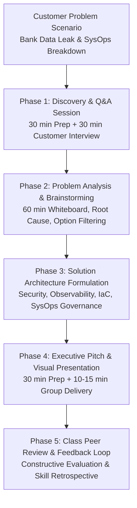
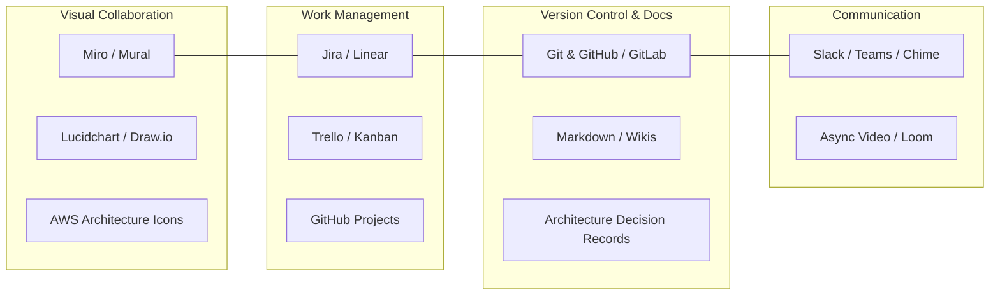
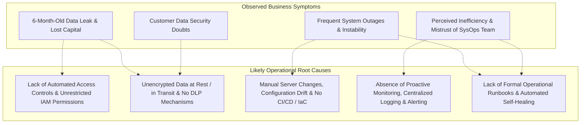
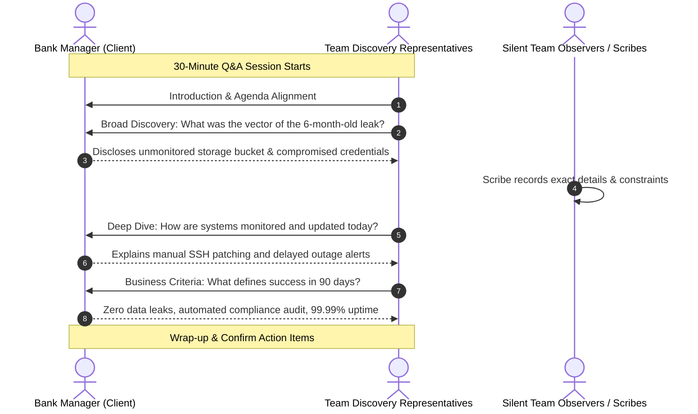
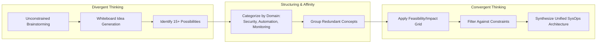
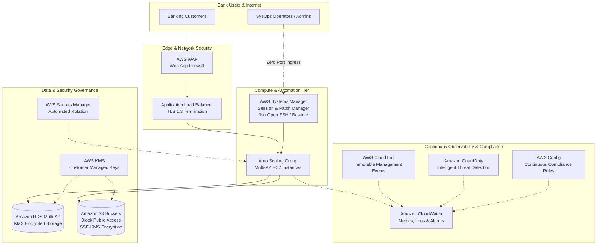

# 👥 Teamwork and Collaboration: Architecting and Presenting SysOps Solutions

> **Course**: AWS re/Start Foundational Soft Skills  
> **Module**: M00 – Teamwork and Collaboration (Techno-Functional Soft Skills)  
> **Source**: `T03-0028-RSTFSS_EN-US_SG_M00_COLLABORATION.pdf`  
> **Complementary Guides**: [T03-0027-RSTFSS_EN-US_SG_M00_TECHTHOUGHTPROCESS.pdf](file:///work/tmp/aws-cf/T03-Professional_Skills/T03-0027-RSTFSS_EN-US_SG_M00_TECHTHOUGHTPROCESS.pdf) | [T03-0008-RSTFSS_EN-US_SG_M00_COMMUNICATIONSTAR.md](file:///work/tmp/aws-cf/T03-Professional_Skills/T03-0008-RSTFSS_EN-US_SG_M00_COMMUNICATIONSTAR.md) | [T03-0010-RSTFSS_EN-US_SG_M00_LPCustomerObsession.md](file:///work/tmp/aws-cf/T03-Professional_Skills/T03-0010-RSTFSS_EN-US_SG_M00_LPCustomerObsession.md)  
> **Target Audience**: AWS re/Start Learners, Aspiring Solutions Architects, Systems Operations (SysOps) Administrators, and Cloud Support Engineers  

---

## 🎯 Module Overview & Core Purpose

In cloud computing, technical excellence alone does not guarantee project success. Systems Operations (SysOps) engineers and Solutions Architects (SAs) operate in complex, distributed environments where business requirements evolve rapidly and critical incidents require swift, coordinated action. The capacity to collaborate within cross-functional teams, execute structured discovery with clients, analyze ambiguous operational failures, brainstorm scalable architectures, and present technical recommendations persuasively to non-technical stakeholders is essential for professional cloud practitioners.

This module places learners into a simulated professional scenario: acting as an AWS Solutions Architecture and SysOps consulting team tasked with diagnosing and resolving a high-stakes banking crisis involving a severe data leak, financial loss, system instability, and operational inefficiencies. Through structured teamwork, collaborative tooling, requirement discovery, brainstorming frameworks, and executive presentation drills, learners bridge the gap between technical knowledge and consultative execution.

---

### 📌 Learning Objectives

- [ ] **Collaborate Effectively in Cloud Engineering Teams**: Establish clear roles, communication norms, and shared accountability within technical working groups.
- [ ] **Leverage Collaborative Tooling**: Utilize digital whiteboards, architectural diagramming suites, issue trackers, and version control systems to document and visualize cloud solutions.
- [ ] **Execute Customer Discovery (Q&A)**: Formulate and conduct structured question-and-answer interviews with customer leadership to uncover underlying operational pain points and business constraints.
- [ ] **Define Root Causes & Isolate Problems**: Distinguish high-level business symptoms from foundational infrastructure, security, and process vulnerabilities.
- [ ] **Facilitate Structured Brainstorming**: Apply divergent and convergent thinking frameworks, affinity grouping, and prioritization matrices to evaluate cloud remediation options.
- [ ] **Deliver High-Impact SysOps Presentations**: Structure and present a professional 10-to-15 minute technical pitch containing architecture diagrams, operational roadmaps, and clear business justification.
- [ ] **Conduct Peer Review & Feedback Loops**: Provide and receive objective, constructive peer evaluations on technical soundness and presentation delivery.

---



---

## 🔑 Key Terminology

- **Solutions Architect (SA)**: A cloud professional responsible for evaluating business requirements and designing scalable, reliable, cost-effective, and secure cloud system architectures.
- **Systems Operations (SysOps) Administrator**: A cloud engineer focused on deploying, managing, operating, automating, and monitoring infrastructure and workloads within a cloud environment.
- **Customer Discovery / Q&A Session**: A structured fact-finding engagement where architects ask targeted questions to elicit requirements, operational constraints, regulatory mandates, and success criteria.
- **Divergent Thinking**: The brainstorming phase where a team generates a broad, unconstrained range of creative solutions without immediate judgment.
- **Convergent Thinking**: The analytical phase where ideas are categorized, filtered, scored, and consolidated into the single most viable architectural solution.
- **Architecture Decision Record (ADR)**: A lightweight document capturing an architectural decision, its technical context, alternatives considered, and anticipated consequences.
- **Shared Responsibility Model**: The foundational AWS framework establishing that AWS secures the cloud infrastructure, while the customer is responsible for security *in* the cloud (data protection, IAM, operating systems, network configuration).

---

## 👥 1. Teamwork and Collaboration in Cloud Operations

### The Cross-Functional Reality of Cloud Computing
Modern cloud operations operate at the intersection of development, operations, security, and executive governance. Siloed teams lead to misconfigurations, deployment delays, and communication breakdowns. 

```
┌────────────────────────────────────────────────────────────────────────┐
│               The Cloud Operations Collaboration Triad                 │
│                                                                        │
│     [ People & Culture ] ◄───▶ [ Modern Tooling ] ◄───▶ [ Processes ]   │
│       Shared ownership,          Diagrams, Kanban,        Well-Architected │
│       psychological safety,       Git repositories,        reviews, RCA &   │
│       clear role definition       async collaboration      postmortems      │
└────────────────────────────────────────────────────────────────────────┘
```

### Team Roles in the Solutions Architecture Exercise
To avoid duplicated effort and confusion during time-boxed consulting engagements, groups must distribute responsibilities explicitly:

| Role | Primary Responsibilities | Core Skills Exercised |
| :--- | :--- | :--- |
| **Team Lead / Project Coordinator** | Facilitates team discussions, monitors time allocations, ensures all team voices are heard, and aligns work with deliverables. | Time management, conflict resolution, servant leadership. |
| **Customer Liaison / Lead Interviewer** | Leads the customer Q&A interview, asks clarifying follow-ups, and represents the customer voice during internal deliberation. | Active listening, stakeholder empathy, professional questioning. |
| **Technical Scribe / Documentarian** | Captures detailed notes during customer interviews, records brainstorming outputs, and drafts the solution summary. | Technical writing, requirement synthesis, precision recording. |
| **Architectural Diagrammer** | Translates technical concepts into visual diagrams (whiteboard, draw.io, Lucidchart, Mermaid) showing data flow and AWS services. | Visual communication, AWS architecture design, systems modeling. |
| **Lead Presenter** | Delivers the final 10–15 minute customer pitch, articulates business value, and manages the question-and-answer handover. | Public speaking, executive presence, persuasive delivery. |

> [!TIP]
> While specific members lead individual deliverables, the entire team participates in brainstorming, technical validation, and solution critique. High-performing engineering teams operate on **collective ownership**.

---

## 🛠️ 2. Modern Collaborative Tooling for Cloud Teams

Collaborative engineering requires standard digital tools that enable synchronous whiteboarding, asynchronous issue tracking, version-controlled documentation, and real-time communication.



### Tool Ecosystem Matrix

| Category | Recommended Tools | Primary Use Case in SysOps / Cloud Projects | Team Impact & Best Practices |
| :--- | :--- | :--- | :--- |
| **Collaborative Diagramming & Whiteboarding** | Miro, Mural, Lucidchart, draw.io, Excalidraw | Initial brainstorming, customer journey mapping, live technical whiteboarding, architectural topology drafting. | • Standardize on official AWS Architecture Icons.<br>• Color-code security perimeters, VPC subnets, and data flows.<br>• Use sticky notes for rapid, unconstrained concept mapping. |
| **Agile Issue Tracking & Kanban** | Jira, Linear, Trello, GitHub Projects | Decomposing operational migrations into epics, stories, and tasks; tracking remediation backlog and velocity. | • Keep work-in-progress (WIP) limits low.<br>• Define unambiguous "Definition of Done" for operational tasks.<br>• Link tickets to infrastructure commits and pull requests. |
| **Code & Architecture Versioning** | Git, GitHub, GitLab, AWS CodeCommit | Infrastructure as Code (Terraform, CloudFormation, CDK), automated pipelines, team code reviews via pull requests. | • Treat documentation and runbooks as code (Markdown in Git).<br>• Require peer approvals on cloud configuration changes.<br>• Maintain an immutable audit history of infrastructure shifts. |
| **Centralized Knowledge Management** | Confluence, Notion, GitHub Wikis, Markdown | Operational runbooks, incident postmortems, compliance documentation, Architecture Decision Records (ADRs). | • Maintain a single source of truth.<br>• Ensure all runbooks include rollback steps and verification commands. |

> [!NOTE]
> During rapid 30-to-60 minute exercises, teams should select low-friction, immediate-access tools (such as digital whiteboards or Markdown text editors) rather than heavy enterprise suites that require extensive setup.

---

## 🏦 3. Deep Dive into the Customer Scenario

### The Bank Scenario Breakdown

```
┌────────────────────────────────────────────────────────────────────────┐
│                        Customer Incident Profile                       │
│                                                                        │
│   Client: Commercial Banking Institution                               │
│   Event: Data breach / unauthorized leak occurred 6 months ago         │
│   Consequences: Direct financial loss, regulatory exposure, brand harm │
│   Current State:                                                       │
│     • Executive dissatisfaction with SysOps team efficiency            │
│     • Deep concerns regarding sensitive customer data security         │
│     • Persistent system instability, downtime, and performance issues │
│     • Executive loss of confidence in internal SysOps competency       │
│     • Bank manager initiated outreach directly to AWS Professional    │
│       Services / Partner Solutions Architects                         │
└────────────────────────────────────────────────────────────────────────┘
```

### Deconstructing Symptoms vs. Root Causes

To recommend viable AWS solutions, architects must separate emotional executive complaints from underlying technical and operational realities:



| Executive Pain Point | Potential Root Causes in Systems Operations | AWS Well-Architected Pillar Implicated |
| :--- | :--- | :--- |
| **Data Leak & Loss of Money** | Over-privileged access keys, publicly exposed storage buckets, lack of data classification, hardcoded credentials. | **Security Pillar**: Identity management, data protection, detection. |
| **Sensitive Information Security** | Missing encryption at rest (KMS) or in transit (TLS), absence of audit trails, compliance oversight gaps. | **Security Pillar**: Incident response, infrastructure protection. |
| **System Instability** | Single points of failure, manual patching causing unintended outages, absence of automated auto-scaling and health checks. | **Reliability Pillar**: Fault tolerance, recovery planning, change management. |
| **SysOps Inefficiency** | Manual operations, firefighting repetitive incidents, no centralized logging dashboard, lack of infrastructure automation. | **Operational Excellence Pillar**: Infrastructure as Code, continuous improvement. |

---

## ❓ 4. Phase 1: Customer Discovery & Q&A Protocol

The discovery phase determines whether the architectural team solves the actual problem or merely treats superficial symptoms.



### Discovery Question Bank by Operational Area

Teams must prepare structured questions before entering the meeting:

#### 1. Security & Identity Management
- *"Can you walk us through the postmortem findings of the data leak that occurred six months ago? What was the confirmed attack vector or misconfiguration?"*
- *"How are user access, administrative privileges, and service credentials managed across your SysOps personnel (e.g., IAM, MFA, SSO)?"*
- *"What mechanisms are currently utilized to encrypt customer data both at rest and in transit across your banking environments?"*

#### 2. Operations & Automation
- *"Are your infrastructure environments deployed manually through consoles/scripts, or are you utilizing automated Infrastructure as Code (IaC)?"*
- *"What does your deployment and patching cycle look like, and how frequently do routine changes trigger service degradation?"*
- *"Do you maintain standardized, automated runbooks for routine operational interventions and disaster recovery?"*

#### 3. Observability & Auditing
- *"What monitoring and centralized logging tools do your systems operators rely on to detect anomalies before they impact customers?"*
- *"Are your audit trails immutable, and do you receive real-time alerts when security baselines are altered?"*

#### 4. Business Constraints & Success Metrics
- *"What regulatory and compliance mandates (e.g., PCI-DSS, SOC 2, local banking regulations) govern this workload?"*
- *"What budget, timeline, and downtime tolerances must the target solution respect?"*
- *"How will the bank leadership measure the success and restoration of trust in this SysOps modernization engagement?"*

### Effective Interview Behaviors

```
┌────────────────────────────────────────────────────────────────────────┐
│                      Consultative Discovery Rules                      │
│                                                                        │
│   DO:                                                                  │
│   ✓ Ask open-ended questions ("How", "Describe", "Walk us through")    │
│   ✓ Actively listen and pause before responding                        │
│   ✓ Rephrase customer answers to verify comprehension                  │
│   ✓ Capture verbatim quotes regarding pain points and financial impact │
│                                                                        │
│   DON'T:                                                               │
│   ✗ Jump immediately to technical solutioning during discovery         │
│   ✗ Challenge or argue with the customer's perceptions                 │
│   ✗ Overwhelm non-technical managers with dense cloud acronyms         │
│   ✗ Allow one interviewer to monopolize the conversation               │
└────────────────────────────────────────────────────────────────────────┘
```

---

## 💡 5. Phase 2: Problem Definition & Brainstorming Protocol

Following the Q&A session, the team reconvenes for 60 minutes of analysis, root-cause identification, divergent brainstorming, and solution filtering.



### Brainstorming Protocols

1. **Silent Brainwriting (5–10 Minutes)**:
   - Team members silently write down 4–6 potential architectural interventions on digital sticky notes or cards.
   - Prevents dominant personalities from steering the room and guarantees input from all participants.
2. **Affinity Mapping (10–15 Minutes)**:
   - Group sticky notes into thematic clusters: *Identity & Access*, *Data Protection*, *Continuous Monitoring*, *Infrastructure Automation*, *Culture & Training*.
3. **Filtering via the 2x2 Impact vs. Effort Matrix (15 Minutes)**:
   - Every proposal is mapped based on business impact and implementation feasibility.

```
                  HIGH IMPACT
                      │
     Strategic Quick  │   High-Value
     Wins (Priority 1)│   Transformations (Priority 2)
                      │
  ─── LOW EFFORT ─────┼───── HIGH EFFORT ───
                      │
     Low-Priority     │   Operational
     Fill-ins         │   Money Pits (Avoid)
                      │
                  LOW IMPACT
```

### Filtering Matrix for Banking SysOps Options

| Proposed Solution | Estimated Effort | Anticipated Impact | Priority / Decision | Strategic Rationale |
| :--- | :--- | :--- | :--- | :--- |
| **Enable AWS CloudTrail & GuardDuty** | Low (Immediate setup) | Very High | **P1: Immediate Core** | Delivers instant threat detection, audit logging, and visibility into account activities. |
| **Enforce S3 Block Public Access & KMS Encryption** | Low to Medium | Very High | **P1: Immediate Core** | Directly remediates past data leak vectors and ensures banking regulatory compliance. |
| **Implement AWS Systems Manager (SSM) Patching** | Medium | High | **P2: High-Value Core** | Eliminates manual SSH access; automates compliance patching without downtime. |
| **Convert Entire Legacy App to Microservices / Kubernetes** | Extremely High | High | **Deferred / Scope Out** | Overly disruptive; does not solve immediate SysOps operational and security failures. |
| **Fire and Replace the Entire SysOps Team** | High | Low / Destructive | **Rejected** | Destroys domain knowledge; fails to fix foundational architectural deficiencies. |

---

## 🏗️ 6. The Proposed AWS SysOps & Architecture Solution

Based on the bank's scenario, an effective Systems Operations solution must restore security, automate operations, provide real-time visibility, and rebuild executive confidence.



### Key Pillars of the Target SysOps Architecture

#### 1. Security & Access Hardening (Zero Trust SysOps)
- **AWS IAM Identity Center (SSO) & Least Privilege**: Eliminate root and long-term IAM user access keys. Mandate Multi-Factor Authentication (MFA) and role-based temporary credentials.
- **AWS Systems Manager (Session Manager)**: Terminate all direct SSH/RDP ports (Port 22/3389). Operators access servers through IAM-authenticated, audited web sessions with zero inbound firewall holes.
- **AWS Secrets Manager**: Automatically rotate database credentials and API tokens, preventing hardcoded secrets in source code or configuration files.

#### 2. Data Protection & Compliance Safeguards
- **AWS KMS (Key Management Service)**: Enforce encryption at rest for all database volumes (RDS) and object storage (S3) using customer-managed keys (CMKs).
- **Amazon S3 Block Public Access**: Enable account-wide S3 Block Public Access to prevent accidental exposure of sensitive financial records.
- **AWS Backup**: Implement automated, immutable cross-region backups with vault lock to protect against ransomware or catastrophic data corruption.

#### 3. Proactive Observability & Incident Response
- **AWS CloudTrail & Amazon GuardDuty**: Centralize immutable API logging across all AWS regions. GuardDuty leverages machine learning to detect credential exfiltration and unauthorized access attempts.
- **Amazon CloudWatch Dashboards & Alarms**: Create executive-level and engineer-level operational dashboards displaying system health, latency, error rates, and automated alerts to SysOps on-call teams.
- **AWS Config**: Continuously assess and remediate configuration drift against security baselines (e.g., flag any unencrypted disk or overly permissive security group immediately).

#### 4. Operational Stability through Automation
- **Infrastructure as Code (AWS CloudFormation / CDK)**: Standardize all banking infrastructure into version-controlled templates, eliminating manual configuration divergence.
- **Automated Patch Management**: Use Systems Manager Patch Manager to automate OS security patches during scheduled maintenance windows with rollback triggers.

---

## 📢 7. Phase 3: High-Impact Technical Presentation & SysOps Pitch

The final phase requires presenting the technical solution to the bank manager in a structured 10-to-15 minute format.

```mermaid
timeline
    title 15-Minute Technical Presentation Timeline
    00:00 - 02:00 : Executive Problem Re-alignment : Empathy & acknowledgment of data breach and instability
    02:00 - 04:00 : Root-Cause Analysis : Clear explanation of architectural vulnerabilities
    04:00 - 09:00 : Target AWS SysOps Architecture : Live walkthrough of security, automation & observability
    09:00 - 12:00 : 90-Day Implementation Roadmap : Phased rollout, minimal disruption & staff upskilling
    12:00 - 14:00 : Measurable Business ROI : Security assurance, 99.99% uptime, restored confidence
    14:00 - 15:00 : Conclusion & Stakeholder Q&A : Definitive next steps and call to action
```

### The 6-Part Presentation Structure

| Section | Target Duration | Speaker Focus & Core Talking Points | Visual Material Required |
| :--- | :--- | :--- | :--- |
| **1. Executive Alignment & Empathy** | 2 Mins | Re-state the bank manager's concerns accurately: data security, operational stability, cost recovery, and team confidence. | High-level summary slide with clear customer quotes and objectives. |
| **2. Diagnostic Root-Cause Analysis** | 2 Mins | Explain why the previous systems failed (manual processes, unencrypted storage, lack of real-time monitoring) without casting personal blame. | Side-by-side comparison: Symptoms vs. Architectural Root Causes. |
| **3. Proposed AWS SysOps Target State** | 5 Mins | Walk through the architecture diagram. Explain how AWS KMS, IAM, Systems Manager, and GuardDuty resolve each specific pain point. | Clear, clean AWS Architecture Diagram highlighting security boundaries. |
| **4. Phased Implementation Roadmap** | 3 Mins | Present a realistic 30/60/90 day execution plan showing zero downtime, migration safeguards, and SysOps staff enablement. | Milestone timeline Gantt or phased roadmap graphic. |
| **5. Business Value & Measurable ROI** | 2 Mins | Connect technical features to executive value: 99.99% availability, automated regulatory compliance, reduced operational overhead. | Metrics card (e.g., MTTR reduced by 70%, 100% data encryption). |
| **6. Q&A & Actionable Next Steps** | 1 Min | Invite questions, address customer doubts directly, and propose immediate Day-1 deliverables. | Contact & kick-off action checklist. |

### Presentation Delivery Best Practices for Technical Presenters

> [!IMPORTANT]
> - **Translate Cloud Features into Business Benefits**: Do not just say *"We implemented AWS KMS."* Say *"By implementing AWS KMS, all customer account numbers and financial transactions are encrypted with hardware-grade security, ensuring complete regulatory compliance and eliminating the vulnerability that caused the previous leak."*
> - **Use Visuals to Anchor Complex Concepts**: An architecture diagram creates clarity; dense slides filled with unformatted bullet points create confusion.
> - **Pacing and Vocal Projection**: Maintain an even cadence, pause after key points to allow comprehension, and make steady eye contact with the customer.
> - **Handling Difficult Questions**: If the customer challenges a cost or timeline figure, acknowledge their point, validate the concern, explain the architectural trade-off, and offer to provide detailed calculations in the follow-up debrief.

---

## 🔍 8. Peer Review & Feedback Framework

Following each presentation, class members act as a review board providing structured, balanced feedback. Constructive peer feedback builds high-performing engineering cultures.

```
┌────────────────────────────────────────────────────────────────────────┐
│                   The Radical Candor Feedback Model                    │
│                                                                        │
│   1. Specific Positive (What resonated technically and stylistically) │
│   2. Specific Growth Opportunity (What was ambiguous or incomplete)   │
│   3. Actionable Suggestion (How to strengthen the next delivery)       │
└────────────────────────────────────────────────────────────────────────┘
```

### Evaluation Rubric Matrix

| Evaluation Dimension | Scoring (1–5) | Criteria for Excellence (Rating 5) | Common Pitfalls to Avoid |
| :--- | :--- | :--- | :--- |
| **Customer Problem Alignment** | 1 · 2 · 3 · 4 · 5 | Explicitly addressed the data leak, financial loss, SysOps efficiency, and system instability; demonstrated deep customer empathy. | Ignores the past leak; offers generic tech stack without context. |
| **Technical Architecture Soundness** | 1 · 2 · 3 · 4 · 5 | Recommends appropriate AWS services (KMS, IAM, Systems Manager, CloudWatch, GuardDuty); adheres to Well-Architected principles. | Suggests overly complex or irrelevant services; lacks security controls. |
| **Quality of Visual Materials** | 1 · 2 · 3 · 4 · 5 | Professional, legible diagram with clear data flow, standardized AWS icons, and minimal slide clutter. | Tiny unreadable text, messy hand drawings, missing flow arrows. |
| **Verbal Delivery & Executive Presence** | 1 · 2 · 3 · 4 · 5 | Confident posture, clear voice, engages audience, balances technical depth with executive clarity, finishes within 10–15 minutes. | Reading directly from slides, speaking in a quiet monotone, running overtime. |
| **Q&A Handling & Team Cohesion** | 1 · 2 · 3 · 4 · 5 | Answers questions directly with poise; smooth transitions between team members if multiple speakers participate. | Arguing with customer, contradicting teammates, evading hard questions. |

---

## 📝 9. Hands-On Interactive Worksheets & Templates

### Worksheet 1: Customer Discovery Interview Script & Scribe Sheet

```markdown
### 📋 Customer Discovery Scribe Sheet
**Team Name / Number**: ____________________________________________________  
**Customer Representative(s)**: _____________________________________________  
**Technical Scribe**: _______________________________________________________  
**Date / Time**: ___________________________________________________________  

#### 1. Customer Problem Discovery Notes
- What specific data was leaked 6 months ago?
  [Notes]: 

- What financial and operational damages resulted from the leak?
  [Notes]: 

- What are the current operational bottlenecks of the SysOps team?
  [Notes]: 

- What compliance standards (PCI-DSS, SOC 2, etc.) must the bank adhere to?
  [Notes]: 

#### 2. Customer Goals & Success Criteria
- Immediate (30 Days): ____________________________________________________
- Medium-Term (90 Days): _________________________________________________
- Long-Term (1 Year): ____________________________________________________
```

---

### Worksheet 2: Five Whys Root Cause Analysis Canvas

Use this structured canvas to trace the bank's symptoms down to the technical core:

```markdown
### 🔍 Five Whys Root Cause Canvas
**Symptom**: The bank experienced a catastrophic data leak 6 months ago and lost money.

1. **Why did the data leak occur?**
   ↳ Answer: Sensitive customer records in an S3 bucket were accessed without authorization.

2. **Why were unauthorized entities able to access the bucket?**
   ↳ Answer: The bucket lacked restrictive access policies and public access was not globally blocked.

3. **Why was the bucket misconfigured without public access blocks?**
   ↳ Answer: Systems operators manually provisioned storage resources using the web console without templates.

4. **Why are systems operators provisioning infrastructure manually?**
   ↳ Answer: The organization lacks automated Infrastructure as Code (IaC) and continuous compliance auditing (AWS Config).

5. **Why is there no IaC or compliance automation in place? (ROOT CAUSE)**
   ↳ Answer: The SysOps team has never been equipped or trained with modern cloud operational tooling, CI/CD pipelines, and automated security governance frameworks.

**Identified Strategic Fix**: Implement Infrastructure as Code (CloudFormation), enforce account-level S3 Block Public Access, activate AWS Config compliance rules, and transition SysOps staff to automated operational management.
```

---

### Worksheet 3: 15-Minute Presentation Run-of-Show Planner

```markdown
### ⏱️ Technical Presentation Run-of-Show Outline
**Team Presenter**: ________________________________________________________  
**Presentation Topic**: Bank SysOps Modernization & Security Remediation  
**Total Allocated Time**: 10–15 Minutes  

| Minute Marker | Section Title | Key Message / Value Proposition | Slide / Visual Asset |
| :--- | :--- | :--- | :--- |
| **00:00 – 02:00** | Introduction & Problem Restatement | We understand your security and stability challenges. | Title + Problem Statement Slide |
| **02:00 – 04:00** | Root Cause Breakdown | The leak was caused by manual drifts, not bad intentions. | Diagnostic Root Cause Matrix |
| **04:00 – 09:00** | Proposed AWS SysOps Architecture | Zero-trust access, continuous monitoring, auto-remediation. | Main AWS Architecture Diagram |
| **09:00 – 12:00** | 90-Day Migration & Training Roadmap | Safe, phased transition with zero downtime and staff uplift. | Phased Gantt Roadmap Slide |
| **12:00 – 14:00** | Business Outcomes & ROI | Restored trust, 100% auditability, 99.99% availability. | Business Value Scorecard |
| **14:00 – 15:00** | Customer Q&A and Next Steps | Immediate Day-1 assessment kick-off. | Action Steps & Q&A Slide |
```

---

### Worksheet 4: Peer Evaluation Scorecard

```markdown
### 📊 Peer Feedback Scorecard
**Reviewing Team / Learner**: _______________________________________________  
**Presenting Team Being Evaluated**: ________________________________________  

| Scoring Criteria | Rating (1–5) | Specific Observations & Concrete Feedback |
| :--- | :---: | :--- |
| **1. Customer Alignment & Empathy** | [ ] / 5 |  |
| **2. Architectural Soundness (SysOps)** | [ ] / 5 |  |
| **3. Visual Quality & Diagram Clarity** | [ ] / 5 |  |
| **4. Verbal Delivery & Professionalism** | [ ] / 5 |  |
| **5. Question Handling & Confidence** | [ ] / 5 |  |

**Total Score**: _____ / 25  

**One Key Strength**:  
> __________________________________________________________________________

**One Concrete Improvement Opportunity**:  
> __________________________________________________________________________
```

---

## 💡 Summary & Practical Study Guide

1. **Collaboration is an Operational Discipline**: High-functioning cloud teams rely on defined roles, open communication, and shared ownership to solve complex infrastructure failures.
2. **Treat Discovery as a Strategic Investigation**: Never prescribe architectural fixes before executing a structured, empathetic Q&A session that separates surface-level symptoms from foundational technical root causes.
3. **Brainstorm Broadly, Decide Rigorously**: Leverage divergent brainwriting and affinity grouping to capture diverse ideas, then use 2x2 Feasibility vs. Impact matrices to select high-value, realistic interventions.
4. **Solve SysOps Failures with AWS Best Practices**: Rebuild bank reliability and security through Zero Trust access (IAM, SSM Session Manager), automated data protection (KMS, S3 Block Public Access), and continuous observability (CloudWatch, CloudTrail, GuardDuty, AWS Config).
5. **Pitch to the Business**: Deliver technical presentations that anchor architecture diagrams to business outcomes: financial security, regulatory compliance, operational uptime, and restored customer confidence.

---

> [!TIP]
> **Next Recommended Steps**:
> - Revisit [T03-0008-RSTFSS_EN-US_SG_M00_COMMUNICATIONSTAR.md](file:///work/tmp/aws-cf/T03-Professional_Skills/T03-0008-RSTFSS_EN-US_SG_M00_COMMUNICATIONSTAR.md) to practice articulating this team consulting experience as a behavioral STAR story for upcoming cloud interviews.
> - Review [T03-0010-RSTFSS_EN-US_SG_M00_LPCustomerObsession.md](file:///work/tmp/aws-cf/T03-Professional_Skills/T03-0010-RSTFSS_EN-US_SG_M00_LPCustomerObsession.md) to integrate Amazon Leadership Principles into client discovery and problem resolution.
