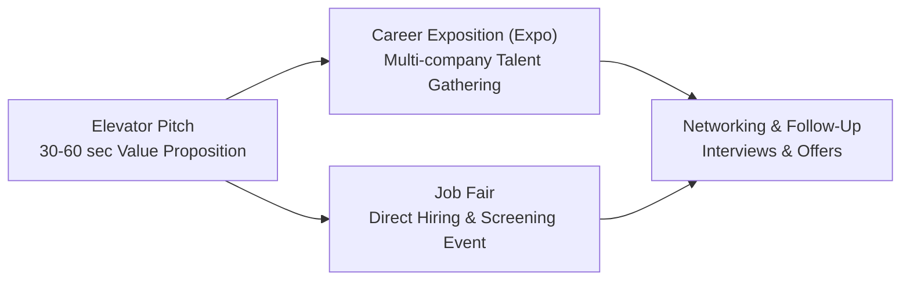
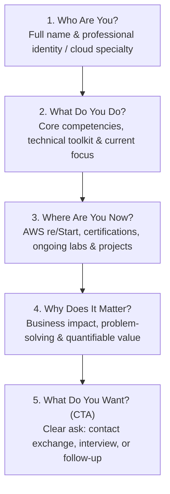
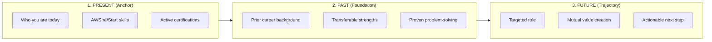
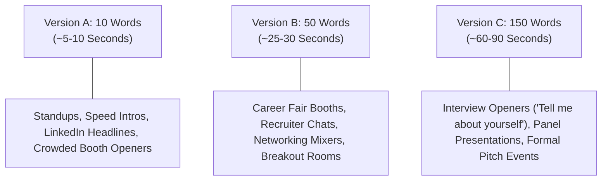
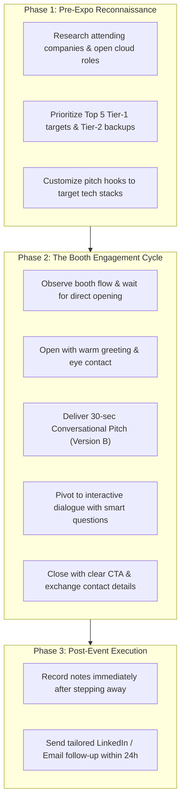
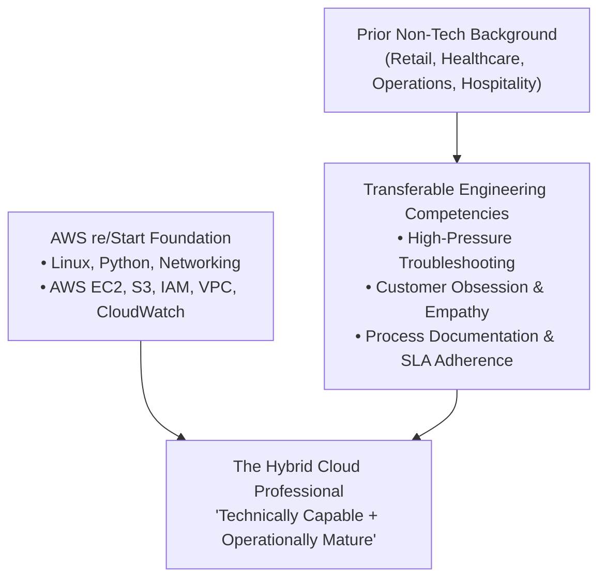
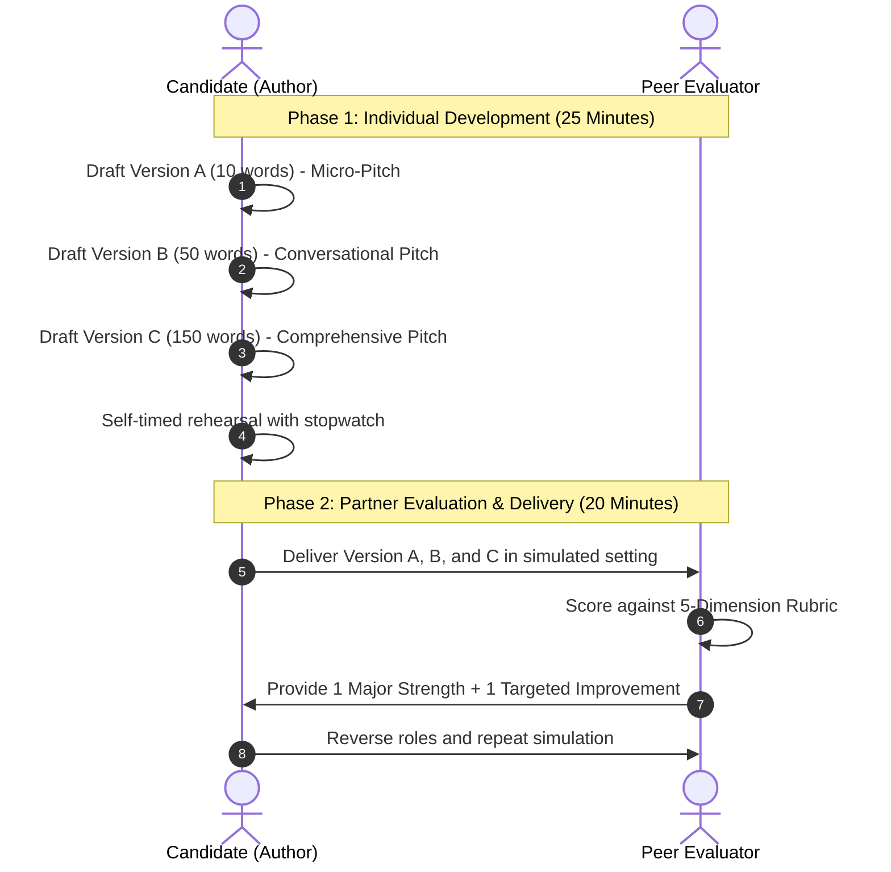

# 🚀 Crafting High-Impact Elevator Pitches: Architecture, Formulas & Career Fair Execution

> **Course**: AWS re/Start Foundational Soft Skills  
> **Module**: M00 – Elevator Pitch & Professional Introduction  
> **Source**: `T03-0029-RSTFSS_EN-US_SG_M00_ELEVATORPITCH.pdf`  
> **Target Audience**: AWS re/Start Learners & Cloud Career Candidates  
> **Series**: Professional Skills & Career Readiness  

---

## 📌 Executive Summary & Purpose

In the competitive technology and cloud computing landscape, opportunities to make an impression are brief and decisive. Whether attending an AWS career expo, engaging a hiring manager at a tech meetup, or answering the opening prompt *"Tell me about yourself"* in a technical interview, cloud professionals must articulate their value concisely, clearly, and persuasively.

An **elevator pitch** is a concise, carefully crafted summary designed to spark interest in who you are, what you deliver, and where you are headed. Originally conceptualized as a message delivered within the span of an elevator ride (typically 30 to 60 seconds), a modern technical pitch bridges your past experience, present technical training (such as Linux, Python, networking, and AWS services), and future contributions to an engineering team.

Mastering this skill enables career switchers and emerging cloud practitioners to overcome imposter syndrome, showcase transferable skills, quantify business impact, and steer conversations toward meaningful career outcomes.

---

## 🎯 Learning Objectives

By the end of this module, you will be able to:
- [ ] **Define the Core Purpose of an Elevator Pitch**: Articulate the strategic role of brief introductions across job fairs, career expos, social media profiles, and interviews.
- [ ] **Implement the 30-to-60 Second Architecture**: Structure presentations answering: *Who are you?*, *What do you do?*, *Where do you work/study?*, *Why does it matter?*, and *What do you want?*.
- [ ] **Apply the Present-Past-Future Formula**: Frame technical journeys into a cohesive narrative that emphasizes transferable skills and future value.
- [ ] **Develop a Multi-Tier Pitch Portfolio**: Craft and tailor three distinct lengths—Short (10 words), Medium (50 words), and Long (150 words)—to match situational contexts.
- [ ] **Project Executive Presence & Confidence**: Apply vocal modulation, professional body language, and anxiety management techniques during high-pressure career events.
- [ ] **Deploy Specialized Scripts for Career Switchers**: Leverage customizable templates translating non-technical backgrounds into cloud-ready assets.
- [ ] **Conduct Peer Evaluations with Structured Rubrics**: Assess pitch clarity, business value, delivery cadence, and calls to action using a standardized scoring matrix.

---

## 📖 Key Terminology & Foundations

Understanding the core vocabulary and context of professional introduction helps set the stage for effective delivery:



| Term | Formal Definition | Tactical Application in Cloud Job Searches |
| :--- | :--- | :--- |
| **Elevator Pitch** | A brief, persuasive speech used to spark interest in yourself, a project, a product, or your organization within 30 to 60 seconds. | Opening answer to *"Tell me about yourself"*, LinkedIn summary, networking greeting, or initial recruiter phone screen hook. |
| **Career Exposition (Expo)** | A large-scale event where multiple employers, educational institutions, industry recruiters, and staffing partners showcase career opportunities. | Gathering industry intelligence, exploring corporate cloud roadmaps, and establishing direct contacts with technical talent acquisition teams. |
| **Job Fair** | A targeted recruitment event focused primarily on immediate open requisitions, conducting on-site screenings, and collecting qualified candidate pipelines. | Rapid booth conversations where candidates have 60–90 seconds to stand out from hundreds of applicants and secure follow-up interviews. |
| **Value Proposition** | A clear statement explaining the tangible benefit, efficiency gain, or problem-solving capability an individual or product delivers. | Moving beyond job titles to quantify how your skills (e.g., automation, scripting, AWS cloud infrastructure) reduce cost or improve reliability. |
| **Call to Action (CTA)** | A direct, low-friction closing request that specifies the immediate next step in the professional interaction. | Asking to exchange LinkedIn profiles, schedule a 15-minute informational coffee chat, or submit an application for an active req. |

---

## 🏗️ The 30-to-60 Second Elevator Pitch Architecture

An effective pitch is not an exhaustive autobiography; it is an executive summary designed to generate curiosity. Every successful elevator pitch answers five core structural questions:



### Detailed Breakdown of the 5 Core Questions

```
┌────────────────────────────────────────────────────────────────────────┐
│                   Elevator Pitch Architecture Blueprint                │
│                                                                        │
│   1. Who are you?        ──► Full Name + Professional Title / Identity  │
│   2. What do you do?     ──► Core Technical Focus + Engineering Skill  │
│   3. Where are you now?  ──► Education / Projects / AWS Certification  │
│   4. Why does it matter? ──► Quantifiable Impact + Solutions Delivered │
│   5. What do you want?   ──► Actionable Closing Question (CTA)         │
└────────────────────────────────────────────────────────────────────────┘
```

1. **Who Are You?**
   - State your full name with clear, confident diction.
   - Establish your professional identity immediately (e.g., *"Junior Cloud Support Associate"*, *"AWS-certified Cloud Practitioner"*, *"Infrastructure Automation Specialist"*).
   - *Avoid*: Vague student identifiers like *"I'm just a student learning computers."*

2. **What Do You Do?**
   - Summarize your core technical domain: Linux administration, Python scripting, networking topology, security compliance, or AWS core services (EC2, S3, VPC, IAM, CloudWatch).
   - Focus on what you *create*, *manage*, or *optimize*.

3. **Where Do You Work / Study Now?**
   - Highlight your current intense training or project environment: *"Currently completing the full-time AWS re/Start cloud development cohort"* or *"Designing highly available multi-tier architectures in AWS"*.
   - Mention hands-on lab deployments, infrastructure-as-code exercises, or capstone projects.

4. **Why Does Your Conversation Partner Need to Know This? (Value & Impact)**
   - **This is the most critical element of the pitch.** Relate your skill set to the listener's business objectives.
   - Frame your skills around solving common organizational pain points: improving operational uptime, automating repetitive manual tasks, securing cloud workloads, or optimizing compute costs.
   - Incorporate metrics or impact language wherever possible.

5. **What Do You Want? (Call to Action / Next Step)**
   - An elevator pitch without a closing request leaves the listener stranded.
   - Conclude with a crisp, low-pressure question that invites continuation:
     - *"Could I set up a brief 15-minute call next week to learn more about your cloud engineering team?"*
     - *"May I connect with you on LinkedIn and share my GitHub project portfolio?"*
     - *"Would you be open to exchanging contact details to discuss current junior cloud openings?"*

> [!IMPORTANT]
> **Focus on the Listener's Needs (WIIFM - What's In It For Me)**  
> Hiring managers and recruiters meet dozens of candidates daily. They are not merely asking what you know; they are asking how your knowledge reduces their team's backlog, solves incidents, or drives customer success. Always pivot from what you do to how it delivers tangible value.

---

## ⏳ The Present-Past-Future Formula

For career switchers, recent graduates, and transitioning professionals, organizing thoughts into a timeline formula prevents rambling and builds a compelling narrative arc:



### 1. Present: Where You Are Right Now
- Anchor your identity in your current technical competency and dedication.
- *Template*: *"Right now, I am an AWS Certified Cloud Practitioner trained through the intensive AWS re/Start program, where I design secure, automated cloud environments using Linux, Python, and core AWS infrastructure."*

### 2. Past: Transferable Skills & Prior Background
- Validates that you bring maturity, discipline, and domain expertise from previous careers (customer service, logistics, finance, healthcare, project management, military service).
- *Template*: *"Before transitioning into cloud computing, I spent five years in customer operations managing high-volume client escalations, where I developed root-cause troubleshooting skills and a deep commitment to customer trust."*

### 3. Future: Where You Are Heading & How You Add Value
- Aligns your technical direction with the prospective employer's growth, followed by your closing call to action.
- *Template*: *"I am looking to bring this blend of operational rigor and cloud architecture to a Cloud Support Associate role. I'd love to learn more about how your team manages cloud migrations—could we connect on LinkedIn?"*

---

## 📏 Multi-Tier Length Strategy: 10 Words vs. 50 Words vs. 150 Words

Different networking settings provide different time windows. Preparing three calibrated versions of your pitch ensures you are never caught unprepared:



| Pitch Tier | Word Count | Speaking Time | Ideal Context / Setting | Structural Focus | Key Objective |
| :--- | :--- | :--- | :--- | :--- | :--- |
| **Version A (Micro-Pitch)** | ~10 Words | 5–10 seconds | Virtual standup introductions, chat prompts, elevator greeting, LinkedIn tagline. | Identity + Core Technical Specialty. | Spark immediate curiosity; prompt the listener to say *"Tell me more!"* |
| **Version B (Conversational)** | ~50 Words | 25–30 seconds | Career expo booths, coffee breaks, recruiter phone screen hooks, mixer meetups. | Present identity + Hands-on projects + Value statement + Concluding CTA. | Establish technical credibility and secure contact info. |
| **Version C (Comprehensive)** | ~150 Words | 60–90 seconds | Opening of formal behavioral/technical interview (*"Walk me through your resume"*), company presentation. | Full Present-Past-Future arc + Quantifiable project results + Cultural alignment + Specific ask. | Demonstrate comprehensive domain mastery, self-awareness, and team fit. |

### Comparative Exemplars Across the Three Tiers

#### Version A: 10-Word Micro-Pitch
> *"I'm an AWS-certified cloud specialist building scalable, automated infrastructure solutions."*  
> *(10 words)*

#### Version B: 50-Word Conversational Pitch
> *"Hi, I'm Alex Rivera. Through the AWS re/Start program, I specialize in automating cloud infrastructure using Linux, Python, and AWS services like EC2 and S3. In my recent capstone, I deployed a fault-tolerant multi-tier web application. I'd love to learn more about your junior cloud engineering openings—could we exchange emails?"*  
> *(51 words)*

#### Version C: 150-Word Comprehensive Pitch
> *"Hello, I'm Alex Rivera, an AWS-certified cloud practitioner with a passion for resilient infrastructure automation. Currently, through the rigorous AWS re/Start academy, I build, troubleshoot, and monitor multi-tier cloud architectures utilizing Linux command-line utilities, Python automation scripts, and core AWS services like VPC, IAM, EC2, and CloudWatch.*
>
> *Prior to transitioning into tech, I spent four years in telecommunications operations managing high-priority client escalations. That experience taught me disciplined root-cause analysis, calm communication under critical incidents, and extreme customer obsession.*
>
> *Recently, I architected an automated backup and disaster-recovery pipeline in AWS that reduced simulated data restoration time by 40 percent. I am eager to contribute both my cloud engineering foundation and customer-facing discipline to your Cloud Support Associate team.*
>
> *I saw your company recently expanded its regional cloud migration practice—could I schedule a 15-minute conversation with you next week to discuss entry-level engineering requirements?"*  
> *(147 words)*

---

## 🔍 In-Depth Analysis of Source Slides Examples & Cloud Adaptations

Let's dissect the real-world pitch examples presented in the curriculum slides and adapt their proven structures into technical cloud scenarios:

### Curriculum Slide Example 1: Kwesi Manu (Web Designer)

```
"Hi, I’m Kwesi Manu, a web designer from AnyCompany Websites. The graphic designs I make 
for my customers result in their brand awareness rising by 30 percent. This means that 
people buy their products earlier when they shop in a busy supermarket. I make sure that 
my designs are beautiful and effective and that they have a positive impact on customers. 
I’m now working on several projects, but I’d like to expand my portfolio."
```

#### Anatomical Analysis
- **Identity & Role**: *"Kwesi Manu, a web designer from AnyCompany Websites"* — Instant clarity on identity and trade.
- **Quantifiable Business Metric**: *"result in their brand awareness rising by 30 percent"* — Demonstrates real business outcomes rather than just aesthetic taste.
- **Customer Translation**: *"This means that people buy their products earlier when they shop in a busy supermarket"* — Translates an abstract metric into commercial bottom-line reality.
- **Forward Trajectory**: *"I’d like to expand my portfolio"* — Signals ambition and openness to new engagements.

---

### Curriculum Slide Example 2: María García (Mental Wellness Company)

```
"Hi, I’m María García from Example Mental Wellness Company. We help companies support 
the mental well-being of their employees. Last year, our largest customer worked with us 
through a 6-week process. As a result, they reported that their employees took 15 percent 
less sick leave and that employee productivity increased by 50 percent. The teams felt 
that they had more energy, and managers were able to focus on growth and development. 
You’re not tied to a contract with us, and you can book individual sessions."
```

#### Anatomical Analysis
- **Problem Statement Solved**: Solves enterprise employee burnout and absenteeism.
- **Concrete Proof Point**: *"Last year, our largest customer worked with us through a 6-week process"* — Grounded in actual case studies.
- **Dual Quantifiable Impact**: *"15 percent less sick leave"* and *"productivity increased by 50 percent"*.
- **Overcoming Friction**: *"You’re not tied to a contract with us, and you can book individual sessions"* — Proactively lowers the barrier for the customer to take action.

---

### Cloud & Tech Adaptation: Cloud Support Associate

Applying Kwesi and María's formulas to an AWS re/Start graduate:

```
"Hi, I’m Jordan Lee, an AWS-certified Cloud Support Engineer. I help organizations keep 
their cloud workloads secure, cost-optimized, and continuously available. 

In my recent AWS capstone project, I automated an infrastructure monitoring pipeline using 
AWS Lambda and CloudWatch alarms, reducing simulated downtime alerts by 35 percent and 
cutting incident triage response times in half. 

I combine deep hands-on Linux and Python scripting with five years of prior frontline 
customer escalation management. I’m currently looking to join an innovative cloud operations 
team—could we connect on LinkedIn so I can share my architectural portfolio?"
```

---

## 🎪 Delivering with Confidence at Job Fairs & Career Expos

Job fairs and career expos are fast-paced, high-stimulus environments. Recruiters often meet hundreds of job seekers over a 4- to 6-hour window. Content alone is insufficient; **delivery and executive presence** determine whether your resume gets flagged for follow-up or forgotten.



### The 7-38-55 Rule in In-Person Communication
Psychological research on interpersonal communication (Albert Mehrabian model) highlights that when conveying attitude and emotional credibility:
- **7%** of emotional perception is conveyed through **Verbal Words** (vocabulary and script).
- **38%** is conveyed through **Vocal Modulation** (tone, pace, inflection, resonance, clarity).
- **55%** is conveyed through **Non-Verbal Signals** (eye contact, posture, facial expression, open hand gestures).

```
┌────────────────────────────────────────────────────────────────────────┐
│                   Executive Presence Checklist                         │
│                                                                        │
│   [x] Stance       : Grounded, upright posture; shoulders back.        │
│   [x] Eye Contact  : Steady 3–5 second holding pattern; warm smile.    │
│   [x] Vocal Pace   : 130–150 words per minute (not rushing).           │
│   [x] Pitch Tone   : Energetic downward inflection (signals authority).│
│   [x] Props        : Clean portfolio folder, resumes within easy reach. │
│   [x] Hands        : Open gestures, resting above waist; no fidgeting. │
└────────────────────────────────────────────────────────────────────────┘
```

### Navigating the Career Expo Booth: Step-by-Step

1. **Approach with Intention**:
   - Do not hover silently or interrupt an ongoing recruiter conversation. Wait 2–3 paces back, make friendly eye contact when the previous candidate departs, and step forward with an upright posture and warm smile.
   - *"Hello! Good morning. My name is Maya Patel. How is your day going so far?"*

2. **Deliver the Hook**:
   - Allow the recruiter 10 seconds to greet you, then deliver your Version B (50-word) conversational pitch smoothly without sounding like you are reading a script.

3. **Engage in Two-Way Technical Dialogue**:
   - An elevator pitch must open a conversation, not end it. Transition directly into a thoughtful question about their cloud infrastructure:
     - *"I noticed your team is migrating enterprise workloads to AWS serverless architectures—what are the biggest operational challenges your junior engineers are currently tackling?"*
     - *"What key qualities set the most successful Cloud Support Associates apart on your team during their first 90 days?"*

4. **Secure the Exit & Next Steps**:
   - Recruiters have tight schedules. When the interaction reaches a natural peak (usually after 2–3 minutes), execute your Call to Action:
     - *"I know you have many candidates to meet today. Could I leave you my resume and connect with you on LinkedIn to follow up on the junior cloud analyst opening?"*

5. **Immediate Field Note Capture**:
   - The moment you step away from the booth, jot down:
     - Recruiter's name, title, and email.
     - Specific technologies or challenges they mentioned.
     - Any personal connection point (e.g., shared interest, hometown, alma mater).
   - Use these notes within 24 hours in your customized LinkedIn follow-up message!

---

## 🎭 Pitch Script Templates for Career Switchers

Career switchers often struggle with framing their prior work experience. The key is **translating domain achievements into universal engineering assets** (troubleshooting, project governance, high-stakes communication, compliance, and client retention).



### Template 1: From Hospitality / Customer Service to Cloud Support Associate

> **The Narrative Hook**: Customer obsession under pressure + fast technical incident triage.

```
"Hi, I’m Marcus Chen, an AWS-certified Cloud Support Engineer with a strong foundation 
in Linux, networking, and core AWS infrastructure services. 

Through the rigorous AWS re/Start academy, I’ve built automated deployment pipelines and 
troubleshot multi-tier web applications using CloudWatch and VPC flow logs. 

Before pivoting to cloud computing, I managed front-of-house operations in premium hospitality, 
where I spent six years resolving complex, time-critical escalations and maintaining a 98% 
client satisfaction rating. That background taught me deep customer obsession, active listening, 
and how to stay calm and structured during high-severity service disruptions. 

I’m looking to leverage this combination of technical troubleshooting and client empathy 
to help your cloud operations team maintain high SLA availability. Could we exchange 
contact details to discuss opportunities on your support engineering desk?"
```

---

### Template 2: From Healthcare / Education / Administration to Cloud Compliance & Operations

> **The Narrative Hook**: Regulatory compliance + rigorous procedural execution + security governance.

```
"Hello, my name is Elena Rostova. I am an AWS Certified Cloud Practitioner specializing in 
cloud security governance, identity access management, and infrastructure documentation. 

Through intensive, hands-on labs in AWS re/Start, I’ve configured secure VPC architectures, 
least-privilege IAM policies, and automated audit trails using AWS CloudTrail and AWS Config. 

Previously, I spent seven years in clinical healthcare operations overseeing strict HIPAA 
data compliance, patient records privacy, and procedural audits across multidisciplinary 
teams. In that role, zero compliance breaches occurred under my oversight. 

I bring that same zero-defect security mindset and procedural rigor to managing enterprise 
cloud environments. I’d welcome the chance to connect on LinkedIn and discuss how my 
compliance background adds immediate value to your security and operations team."
```

---

### Template 3: From Traditional IT Support / Hardware Tech to Cloud & DevOps Associate

> **The Narrative Hook**: On-premises foundational knowledge + modern cloud automation mindset.

```
"Hi, I’m David Kim. I’m a cloud infrastructure specialist bridging traditional on-prem systems 
with modern AWS cloud solutions. 

I hold the AWS Certified Cloud Practitioner credential and have spent recent months in the 
AWS re/Start program mastering Python automation scripting, Linux server administration, and 
automated provisioning of EC2, RDS, and S3 resources. 

Before this, I worked as a Tier-1 desktop and hardware support technician, resolving over 
30 hardware, networking, and operating system tickets daily. I realized that the future of 
scalable systems lies in code and automation rather than manual physical maintenance. 

I am eager to contribute my hands-on troubleshooting instincts and automation toolset to your 
cloud engineering team. Do you have five minutes next week for a brief introductory call?"
```

---

## 🧪 45-Minute Pitch Lab: Workshop Workflow & Activity

This practical classroom and team activity guides participants through drafting, delivering, evaluating, and refining three pitch variations in 45 minutes:



### Workshop Breakdown & Time Allocation
- **00:00 – 00:05 (5 Min)**: Review core pitch architecture and establish target audience/role.
- **00:05 – 00:25 (20 Min)**: **Individual Development**:
  - Draft Version A (10 words)
  - Draft Version B (50 words)
  - Draft Version C (150 words)
  - Conduct silent read-through and stopwatch timing.
- **00:25 – 00:45 (20 Min)**: **Partner Evaluation**:
  - Round 1 (10 Min): Partner 1 pitches, Partner 2 evaluates using the rubric; deliver feedback (1 strength, 1 improvement).
  - Round 2 (10 Min): Swap roles; Partner 2 pitches, Partner 1 evaluates.

---

## 📊 Standardized Peer Evaluation Rubric

Use this standardized matrix during peer evaluations to provide actionable, objective feedback:

```
┌────────────────────────────────────────────────────────────────────────┐
│                   Scoring Scale (Total: 20 Points)                     │
│                                                                        │
│   4 = Mastered (Polished, professional, compelling, immediate impact)  │
│   3 = Proficient (Clear, meets technical standards, minor tweaks needed)│
│   2 = Developing (Understood concept, needs structure or energy boost) │
│   1 = Novice (Incomplete, lacks clarity, metrics, or call to action)   │
└────────────────────────────────────────────────────────────────────────┘
```

| Evaluation Dimension | Weight | Novice (1 pt) | Developing (2 pts) | Proficient (3 pts) | Mastered (4 pts) |
| :--- | :---: | :--- | :--- | :--- | :--- |
| **1. Hook & Clarity** | 20% | Mumbles name; unclear role or identity; rambles immediately. | States name and title; lacks hook or distinctive identity. | Clearly introduces name, cloud specialty, and training background. | Crisp, commanding opening hook; immediately memorable professional brand. |
| **2. Value & Quantifiable Impact** | 25% | Lists generic duties (*"I do cloud"*); zero metrics or business relevance. | Mentions technical tools without linking to outcomes or problem solving. | Explains business value (e.g., uptime, automation) with general impact. | Features concrete metrics (e.g., 35% downtime reduction, SLA times) and clear customer benefit. |
| **3. Structure & Narrative Arc** | 20% | Disorganized; jumps erratically between past and present. | Attempts Present-Past-Future but gets bogged down in past jobs. | Clean narrative flow transitioning from current cloud skills to past strengths. | Seamless Present-Past-Future transition; compelling story of deliberate career growth. |
| **4. Executive Presence & Delivery** | 20% | Avoids eye contact; monotone; speaks too fast (>180 wpm) or reads notes. | Adequate eye contact; nervous fidgeting or filler words (*"um", "like"*). | Steady vocal pacing (130–150 wpm), warm smile, upright posture. | Confident vocal resonance, dynamic cadence, poised body language, natural delivery. |
| **5. Call to Action (CTA)** | 15% | Trails off awkwardly (*"So yeah, that's me"*); no request. | Passive closing (*"Let me know if you hear of anything"*). | Asks for a specific next step (LinkedIn connect or email exchange). | High-value, frictionless closing question that invites immediate commitment. |

### Peer Feedback Capture Form

```markdown
### 📝 Peer Evaluation Record Sheet
- **Candidate Name**: __________________________
- **Evaluator Name**: __________________________
- **Date**: __________________

#### Scoring Matrix:
1. Hook & Clarity (1–4)           : [   ]
2. Value & Quantifiable Impact (1–4): [   ]
3. Structure & Narrative Arc (1–4)  : [   ]
4. Delivery & Presence (1–4)        : [   ]
5. Call to Action (1–4)             : [   ]
**Total Score (out of 20)**         : [   ] / 20

#### Targeted Feedback:
- 🌟 **Primary Strength (What worked brilliantly?)**:
  __________________________________________________________________________________
  __________________________________________________________________________________

- 🎯 **Primary Suggestion for Improvement (One concrete tweak)**:
  __________________________________________________________________________________
  __________________________________________________________________________________
```

---

## 📝 Interactive Worksheets & Self-Coaching Prompts

Use the following modular templates to draft and refine your personalized elevator pitch suite.

### Worksheet 1: Present-Past-Future Script Builder

| Phase | Guiding Prompt | Your Working Draft Notes |
| :--- | :--- | :--- |
| **Present** | *Who are you today? What core AWS services and technical tools are you actively mastering?* | |
| **Past** | *What previous career, academic, or life experience gave you unique problem-solving or client-facing grit?* | |
| **Future** | *What specific role are you targeting, and how will your hybrid background create value for their engineering team?* | |
| **CTA** | *What is your concluding question or next step?* | |

---

### Worksheet 2: Multi-Tier Drafting Canvas

#### Version A: 10-Word Micro-Pitch Canvas
> **Target Limit**: Exactly 8 to 12 words.  
> **Formula**: *[Identity / Role] + [Core Technical Specialization] + [Impact Delivered]*

```markdown
[Draft your 10-word pitch here]:
________________________________________________________________________________________
Word Count: [     ] words
```

---

#### Version B: 50-Word Conversational Pitch Canvas
> **Target Limit**: 45 to 55 words (~30 seconds).  
> **Formula**: *Greeting + Identity + AWS re/Start Training + Capstone Project Impact + Concluding CTA*

```markdown
[Draft your 50-word pitch here]:
________________________________________________________________________________________
________________________________________________________________________________________
________________________________________________________________________________________
________________________________________________________________________________________
Word Count: [     ] words | Timed Duration: [     ] seconds
```

---

#### Version C: 150-Word Comprehensive Pitch Canvas
> **Target Limit**: 135 to 160 words (~60–90 seconds).  
> **Formula**: *Full Present-Past-Future Arc + Metric-Driven Project Proof Point + Company Alignment + Direct CTA*

```markdown
[Draft your 150-word pitch here]:
________________________________________________________________________________________
________________________________________________________________________________________
________________________________________________________________________________________
________________________________________________________________________________________
________________________________________________________________________________________
________________________________________________________________________________________
Word Count: [     ] words | Timed Duration: [     ] seconds
```

---

### Worksheet 3: Menu of Powerful Concluding CTAs

Select and adapt the closing question best suited to your immediate networking context:

> [!TIP]
> **Choose the Right CTA for the Right Venue**
> - **At a Busy Career Expo Booth**:
>   - *"I'd love to stay in touch as I apply online. May I connect with you on LinkedIn or leave my resume?"*
> - **At an Informal Tech Meetup / User Group**:
>   - *"I'm fascinated by your team's migration to serverless. Could I buy you a coffee or set up a 15-minute virtual chat next week to ask about your journey?"*
> - **At the End of an Informational Interview**:
>   - *"Based on our conversation today, is there anyone else on your cloud infrastructure team you think I should connect with?"*
> - **During a Phone Screen / Initial Recruiter Touchpoint**:
>   - *"I'd welcome the opportunity to dive deeper into my hands-on AWS lab projects. What does the next step in your evaluation process look like?"*

---

## ✅ Self-Audit Readiness Checklist

Before stepping onto a job fair floor or initiating an interview screen, verify your elevator pitch preparedness:

- [ ] **Word Count Verified**: I have drafted and timed versions at 10 words, 50 words, and 150 words.
- [ ] **No Unexplained Jargon**: My technical terms (AWS, EC2, VPC, Python) are used purposefully and explained in terms of business impact.
- [ ] **Quantified Results Included**: My pitch contains at least one concrete outcome (percentage improvement, hours saved, uptime preserved, tickets resolved).
- [ ] **Pivoted from Past to Future**: I explain how my past non-tech background strengthens my cloud engineering capabilities.
- [ ] **Actionable Closing Question Ready**: I do not end with awkward silence; I have a clear, polished call to action.
- [ ] **Pacing & Breath Control**: I can deliver the 50-word pitch smoothly in under 30 seconds without gasping or rushing.
- [ ] **Peer Evaluated**: At least one peer or mentor has evaluated my delivery using the 20-point rubric and provided feedback.
- [ ] **Follow-up Infrastructure Ready**: My LinkedIn URL is updated, customized, and linked on my resume, and my mobile phone is charged to take down contact info.

---

## 📚 Related Modules & Internal Documentation

- [Mastering Tech Interview Settings](file:///work/tmp/aws-cf/T03-Professional_Skills/T03-0017-RSTFSS_EN-US_SG_M00_INTERVIEWSETTINGS.md)
- [Navigating Tech Interview Process & Stages](file:///work/tmp/aws-cf/T03-Professional_Skills/T03-0018-RSTFSS_EN-US_SG_M00_INTERVIEWPROCESS.md)
- [Hiring Process & Recruiter Perspectives](file:///work/tmp/aws-cf/T03-Professional_Skills/T03-0020-RSTFSS_EN-US_SG_M00_HIRINGPROCESS.md)
- [Crafting a Cloud-Focused Resume](file:///work/tmp/aws-cf/T03-Professional_Skills/T03-0024-RSTFSS_EN-US_SG_M00_RESUMECREATION.md)
- [Professional Communication & The STAR Method](file:///work/tmp/aws-cf/T03-Professional_Skills/T03-0008-RSTFSS_EN-US_SG_M00_COMMUNICATIONSTAR.md)
- [Digital Presence & LinkedIn Optimization](file:///work/tmp/aws-cf/T03-Professional_Skills/T03-0015-RSTFSS_EN-US_SG_M00_DIGITALPRESENCE.md)
