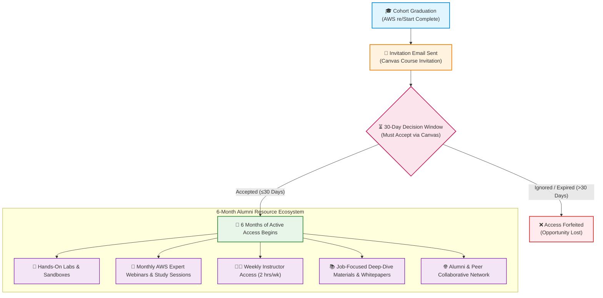
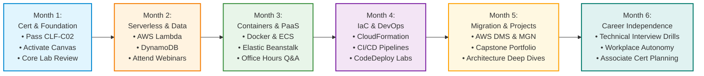

# 🎓 AWS re/Start Post-Graduate Resources: 6-Month Career & Technical Learning Guide

> **Course**: AWS re/Start Foundational Soft Skills & Career Readiness  
> **Module**: M00 / RSTFSS – Post-Graduate Resources  
> **Source**: `T03-0030-RSTFSS_EN-US_SG_M00_POSTGRADRESOURCES.pdf`  
> **Target Audience**: AWS re/Start Graduates, Cloud Alumni & Early-Career Cloud Practitioners  

---

## 🎯 Module Overview

Graduation from the **AWS re/Start** program is not the conclusion of your learning journey—it is the springboard into your professional cloud career. To bridge the gap between classroom fundamentals and real-world workplace proficiency, AWS provides all graduates with **6 months of continuous post-graduate support**.

This program offers an enterprise-level continuation framework delivered directly within the Canvas learning management system. Through ongoing access to AWS hands-on sandbox labs, monthly webinars and study sessions with AWS experts, direct weekly access to technical instructors, and job-focused technical curricula, graduates are empowered to reinforce core skills, troubleshoot day-one workplace tasks, and sustain long-term career momentum.

### 📌 Learning Objectives

- [ ] **Identify 6-Month Post-Graduate Benefits**: Understand the full spectrum of resources provided to alumni, including lab environments, expert sessions, and instructor office hours.
- [ ] **Navigate the Canvas Onboarding Workflow**: Successfully activate and access the post-graduate Canvas course within the mandatory 30-day window.
- [ ] **Explore the Advanced Post-Grad Syllabus**: Map out study goals across Containers, Infrastructure as Code, CI/CD, Serverless, and Cloud Migration.
- [ ] **Implement a Sustainable Study & Work Routine**: Balance employment or job searching with 1–2 daily hours of applied practice and weekly live coaching.
- [ ] **Execute the Post-Grad Transition Roadmap**: Follow a structured 6-month milestone path from foundational certification to real-world cloud engineering autonomy.

---

## 🗺️ 1. The Post-Graduate Ecosystem & Access Pipeline

Upon program completion, graduates are transitioned into a dedicated alumni learning track hosted in Canvas. Because access requires proactive acceptance within a strict time frame, understanding the activation lifecycle is critical.



### Canvas Onboarding Protocol

| Step | Milestone | Key Details & Action Items |
| :---: | :--- | :--- |
| **1** | **Email Invitation** | AWS re/Start generates an official invitation to the *AWS re/Start Post-Graduate Resources* course using your registered Canvas email address. |
| **2** | **30-Day Window** | **You have exactly 30 calendar days** from the date of invitation issuance to log into Canvas and accept the enrollment invite. |
| **3** | **6-Month Clock Activation** | Your 6-month access timer begins **on the day you accept the invitation**, unlocking all modules, sandbox labs, and event calendars. |
| **4** | **Support Escalation** | If you experience issues receiving or accepting the invitation, contact official program administration immediately at `aws-restart-post-graduate@amazon.com`. |

> [!IMPORTANT]
> **Action Required Within 30 Days**: Do not delay accepting your Canvas invitation. If the 30-day enrollment window elapses without acceptance, the invitation expires and access cannot be guaranteed.

---

## 🎁 2. Comprehensive Breakdown of 6-Month Post-Graduate Benefits

AWS re/Start equips alumni with six complementary pillars of continued support designed to accelerate on-the-job ramp-up and technical mastery:

```
┌────────────────────────────────────────────────────────────────────────┐
│               AWS re/Start 6-Month Post-Graduate Toolkit               │
├────────────────────────────────────────────────────────────────────────┤
│  1. Continuous Portal & Lab Access: Sandbox environments & new labs    │
│  2. Monthly Expert Webinars: Industry trends, architecture deep dives  │
│  3. Monthly Study Sessions: Guided problem solving & exam discussions  │
│  4. Technical Q&A with AWS Specialists: Real-world engineering advice  │
│  5. Dedicated Instructor Office Hours: 2 hours/week direct live help   │
│  6. Job-Focused Curriculum: Whitepapers, workshops, and DevOps guides  │
└────────────────────────────────────────────────────────────────────────┘
```

### Detailed Benefit Catalog

| Benefit Pillar | Resource Description | Frequency / Volume | Strategic Value to Graduates |
| :--- | :--- | :--- | :--- |
| **Continuous Portal & Lab Access** | Continued access to re/Start course materials plus an expanded catalog of hands-on guided labs and sandbox environments. | 24/7 on-demand access for 6 months | Practice configurations without personal AWS billing risk; validate architecture patterns before implementing them at work. |
| **Monthly Expert Webinars** | Live interactive virtual sessions hosted by AWS Subject Matter Experts (SMEs), Solutions Architects, and Cloud Support Engineers. | Once per month (6 sessions total) | Exposure to modern industry practices, enterprise customer case studies, and emerging cloud technologies (AI/ML, serverless, microservices). |
| **Monthly Study Sessions** | Collaborative interactive group study forums led by AWS technical specialists. | Once per month (6 sessions total) | Deepens conceptual clarity on complex topics (VPC peering, IAM policies, database tuning) through live Q&A. |
| **Expert Technical Q&A** | Direct channel to consult AWS specialists for technical queries and architecture troubleshooting. | Asynchronous submission via Canvas | Bridge theoretical knowledge with applied troubleshooting when tackling challenging workplace tasks or labs. |
| **Instructor Office Hours** | Scheduled live small-group coaching and mentoring with certified re/Start instructors. | **2 hours per week** (approx. 50+ hours total) | Personalized code reviews, debugging assistance, interview scenario prep, and technical mentorship. |
| **Job-Focused Curated Materials** | Advanced technical reading list: official whitepapers, reference architecture guides, AWS Well-Architected lab modules, and workshop links. | Modular self-paced units | Provides real-world workplace job aids, CLI cheat sheets, and production design guidelines. |

> [!TIP]
> **Leverage the 2-Hour Weekly Instructor Sessions**: Treat weekly instructor office hours as an agile "standup and sprint review." Prepare a log of 2–3 specific questions from your weekly lab practice or workplace challenges to make optimal use of this direct coaching.

---

## 📚 3. Advanced Post-Graduate Technical Syllabus

The post-graduate syllabus expands beyond baseline curriculum content into advanced, production-grade cloud topics. This curriculum directly mirrors the technical demands of Junior Cloud Engineer, DevOps Support Associate, and Cloud Operations roles.

```mermaid
graph LR
    subgraph Core["1. Core & Infrastructure"]
        A1["AWS Core Services"]
        A2["Compute, Storage, Networking, DB"]
        A3["Security & IAM Governance"]
    end

    subgraph Scalability["2. Scalability & Containers"]
        B1["Auto Scaling & ELB"]
        B2["AWS Elastic Beanstalk"]
        B3["Amazon ECS & Docker Containers"]
    end

    subgraph ModernApps["3. Modern Architecture & Serverless"]
        C1["AWS Lambda (Serverless Compute)"]
        C2["Amazon DynamoDB (NoSQL)"]
        C3["AWS Cloud9 (Cloud IDE)"]
    end

    subgraph Automation["4. DevOps & Enterprise Migration"]
        D1["AWS CloudFormation (IaC)"]
        D2["DevOps, CI/CD & Developer Tools"]
        D3["AWS Migrations Strategies"]
    end

    Core --> Scalability
    Scalability --> ModernApps
    ModernApps --> Automation

    style Core fill:#e1f5fe,stroke:#0288d1,stroke-width:1.5px
    style Scalability fill:#e8f5e9,stroke:#388e3c,stroke-width:1.5px
    style ModernApps fill:#fff3e0,stroke:#f57c00,stroke-width:1.5px
    style Automation fill:#f3e5f5,stroke:#7b1fa2,stroke-width:1.5px
```



### Syllabus Breakdown & Practical Application Matrix

| Module Topic | Included AWS Services | Real-World Workplace Application |
| :--- | :--- | :--- |
| **AWS Core Services** | EC2, S3, VPC, RDS, Route 53 | Setting up foundational multi-tier web applications and highly available cloud footprints. |
| **Security & IAM** | IAM Policies, Roles, MFA, KMS, AWS Shield, Security Groups | Implementing Least Privilege access, securing root accounts, managing cryptographic keys, and hardening networks. |
| **Auto Scaling & Load Balancing** | Application Load Balancer (ALB), Network Load Balancer (NLB), EC2 Auto Scaling | Designing fault-tolerant, elastic systems that dynamically respond to traffic spikes without downtime. |
| **Compute, Storage, Networking & DB** | EBS, EFS, S3 Storage Tiers, VPC Subnets/NACLs, Aurora, DynamoDB | Evaluating trade-offs between block, file, and object storage; tuning relational vs. non-relational database queries. |
| **Serverless Compute (AWS Lambda)** | AWS Lambda, API Gateway, Amazon EventBridge | Building event-driven microservices, automated backup triggers, and lightweight serverless web hooks. |
| **Managed NoSQL (Amazon DynamoDB)** | DynamoDB Tables, Partition/Sort Keys, DynamoDB Streams | Designing high-throughput, single-digit millisecond latency data layers for mobile and web backends. |
| **PaaS (AWS Elastic Beanstalk)** | Beanstalk environments, capacity provisioning, platform stacks | Rapidly deploying and scaling web applications in Java, Python, Node.js, and PHP without managing individual server stacks. |
| **Cloud IDE (AWS Cloud9)** | Cloud9 environments, integrated terminal, collaborative coding | Writing, testing, and debugging Python and Bash scripts in a standardized, browser-based cloud environment. |
| **Containers & Microservices** | Docker, Amazon Elastic Container Service (ECS), ECR, Fargate | Containerizing multi-tier software applications, running microservice clusters, and maintaining image repositories. |
| **Enterprise Migrations** | AWS Application Migration Service (MGN), AWS Database Migration Service (DMS), AWS DataSync | Executing the "7 Rs" migration strategies (Rehost, Replatform, Refactor, etc.) to transition on-premises workloads to AWS. |
| **Infrastructure as Code (IaC)** | AWS CloudFormation, CloudFormation Templates (YAML/JSON), Change Sets | Automating repeatable infrastructure provisioning and enforcing consistent environment configuration through code. |
| **DevOps & Developer Tools** | AWS CodeCommit, AWS CodeBuild, AWS CodeDeploy, AWS CodePipeline | Constructing end-to-end continuous integration and continuous deployment (CI/CD) pipelines from commit to production. |

---

## ❓ 4. Frequently Asked Questions (FAQ) Reference Guide

The following authoritative answers address common concerns regarding certifications, badges, time management, and eligibility:

### Q1: Will I receive a voucher for any Associate-level AWS certifications (e.g., Solutions Architect Associate or SysOps Administrator)?
> **Official Answer**: **No.**  
> **Rationale & Context**: Associate-level AWS certifications are designed by AWS for practitioners possessing **12 to 18 months of hands-on, on-the-job enterprise experience**. The post-graduate resources are engineered to support graduates during their immediate entry into the workforce and early career integration, not to serve as an Associate certification test-preparation boot camp.
>
> *Recommendation*: Focus first on solidifying your foundational skills, earning your **AWS Certified Cloud Practitioner (CLF-C02)** credential, and excelling in your day-to-day workplace duties before pursuing Associate certifications.

### Q2: Will I receive a badge or certificate for completing the AWS re/Start Post-Graduate Resources?
> **Official Answer**: **No.**  
> **Rationale & Context**: AWS re/Start does not issue an additional digital badge or certificate upon completion of post-graduate resources. The tangible value of these materials lies in **demonstrated competence**: portfolio projects, hands-on lab experience, and technical confidence during interviews and job performance.

### Q3: Can I still join the AWS re/Start Post-Graduate Resources if I am already employed?
> **Official Answer**: **Yes, absolutely.**  
> **Guidance**: Employed graduates are strongly encouraged to participate. The curriculum serves as an invaluable on-the-job reference and upskilling toolkit. AWS recommends dedicating **1 to 2 hours per day** outside of work hours to sustain steady progress.

### Q4: How much time should graduates plan to invest in the Post-Graduate Resources?
> **Official Answer**:  
> - **Self-Paced Study & Lab Practice**: Dedicate **1 to 2 hours daily**.  
> - **Live Interactive Coaching**: Dedicate **1 to 2 hours weekly** to attend expert webinars, study sessions, and instructor office hours.  
>
> *Time Investment Summary*: Approximately **8 to 14 hours per week** provides the optimal balance for accelerating career growth while managing work or personal responsibilities.

### Q5: How long are the resources available, and what is the exact deadline to enroll?
> **Official Answer**:  
> - **Enrollment Deadline**: You have **30 days** from the receipt of the email invitation to accept the course invitation in Canvas.  
> - **Access Duration**: Once accepted, you have full access to all post-graduate resources for **6 calendar months** from the date of acceptance.

---

## 📈 5. Six-Month Post-Graduation Transition Roadmap

To maximize your 6-month window of support, follow this structured monthly progression roadmap:



### Detailed Monthly Objectives & Milestones

#### 🗓️ Month 1: Certification Consolidation & Environment Activation
- [ ] Accept Canvas Post-Graduate Resources course invitation within the initial 7 days.
- [ ] Sit for and pass the **AWS Certified Cloud Practitioner (CLF-C02)** exam within 14 days of graduation.
- [ ] Share your official Credly digital badge on LinkedIn and tag AWS re/Start and cohort mentors.
- [ ] Complete initial baseline labs in AWS Core Services, IAM policies, and VPC architecture.

#### 🗓️ Month 2: Modern Compute, Serverless & NoSQL Data Architecture
- [ ] Complete deep-dive labs on **AWS Lambda** and event-driven architectures.
- [ ] Build a serverless CRUD backend leveraging **Amazon DynamoDB** and API Gateway.
- [ ] Attend the Month 2 AWS Expert Webinar and participate actively in the monthly study session.
- [ ] Prepare technical questions regarding Lambda concurrency and DynamoDB partitioning for instructor office hours.

#### 🗓️ Month 3: Containers, PaaS & Automated Elasticity
- [ ] Containerize a multi-tier web application using **Docker** and push container images to Amazon ECR.
- [ ] Deploy and configure a container task on **Amazon ECS** with AWS Fargate.
- [ ] Deploy an application stack using **AWS Elastic Beanstalk** to observe automated environment provisioning.
- [ ] Test Auto Scaling policies and Elastic Load Balancing response during simulated traffic spikes.

#### 🗓️ Month 4: Infrastructure as Code (IaC) & Continuous Delivery (CI/CD)
- [ ] Author modular **AWS CloudFormation** templates (in YAML) to provision complete VPC and EC2 environments.
- [ ] Build an automated CI/CD pipeline using **AWS CodePipeline**, **CodeBuild**, and **CodeDeploy**.
- [ ] Verify automated deployment testing, rollback configurations, and change set reviews.
- [ ] Bring CloudFormation template linting and validation queries to weekly instructor office hours.

#### 🗓️ Month 5: Enterprise Workload Migration & Capstone Projects
- [ ] Study the "7 Rs" cloud migration framework and experiment with **AWS Database Migration Service (DMS)** labs.
- [ ] Synthesize your accumulated lab solutions into a public, well-documented **GitHub Portfolio Project**.
- [ ] Write detailed architecture diagrams and README walkthroughs explaining design decisions and Well-Architected principles.
- [ ] Conduct peer code reviews with fellow re/Start alumni in the post-grad study community.

#### 🗓️ Month 6: Technical Interview Mastery & Workforce Autonomy
- [ ] Review common scenario-based technical interview questions using the post-graduate job-focused resources.
- [ ] Conduct mock technical interviews with peers, practicing explaining architecture trade-offs using the STAR method.
- [ ] Evaluate readiness for Associate-level certifications (e.g., AWS Certified Solutions Architect – Associate) based on accumulated on-the-job experience.
- [ ] Maintain an active presence in local AWS User Groups, alumni meetups, and developer communities.

---

## ⏱️ 6. Recommended Weekly Study & Practice Schedule

To balance professional commitments with continuous skill growth, adopt a consistent weekly routine totaling 10–12 hours:

| Day of Week | Allocated Time | Focus Area | Deliverable / Activity |
| :--- | :---: | :--- | :--- |
| **Monday** | 1.5 Hours | Conceptual Review | Read targeted AWS whitepapers or documentation module on Canvas. |
| **Tuesday** | 1.5 Hours | Hands-On Sandbox Lab | Execute a guided lab (e.g., CloudFormation or ECS container setup). |
| **Wednesday** | 2.0 Hours | **Live Instructor Office Hours** | Attend scheduled live instructor session; debug lab issues and review architecture patterns. |
| **Thursday** | 1.5 Hours | Applied Scripting / IaC | Write custom CloudFormation templates or Python/Boto3 automation scripts in Cloud9. |
| **Friday** | 1.5 Hours | Documentation & Portfolio | Push weekly code to GitHub with descriptive markdown documentation. |
| **Saturday** | 2.0 Hours | **Live Webinar or Study Group** | Attend the monthly AWS SME webinar or collaborate with alumni study groups. |
| **Sunday** | 1.0 Hour | Rest & Weekly Retrospective | Log completed milestones in your habit tracker and plan topics for the coming week. |

---

## 🛠️ 7. Interactive Alumni Tracking Worksheets

### A. 6-Month Post-Graduate Habit & Goal Tracker

Use this template to track your progress and engagement during the 6-month support period:

```markdown
### 📋 AWS Post-Graduate Progress Tracker
- [ ] Canvas Invitation Accepted (Date: ____________ / Deadline: ____________)
- [ ] AWS Certified Cloud Practitioner Passed (Target Date: ____________)
- [ ] Monthly Webinar Attendance:
  - [ ] Month 1 Topic: ________________________ (Date: ________)
  - [ ] Month 2 Topic: ________________________ (Date: ________)
  - [ ] Month 3 Topic: ________________________ (Date: ________)
  - [ ] Month 4 Topic: ________________________ (Date: ________)
  - [ ] Month 5 Topic: ________________________ (Date: ________)
  - [ ] Month 6 Topic: ________________________ (Date: ________)
- [ ] Monthly Study Session Participation:
  - [ ] Month 1: [ ] Completed | Notes: ________________________
  - [ ] Month 2: [ ] Completed | Notes: ________________________
  - [ ] Month 3: [ ] Completed | Notes: ________________________
  - [ ] Month 4: [ ] Completed | Notes: ________________________
  - [ ] Month 5: [ ] Completed | Notes: ________________________
  - [ ] Month 6: [ ] Completed | Notes: ________________________
- [ ] Weekly Instructor Office Hours Hours Logged: [___ / 50 Hours]
- [ ] Public GitHub Portfolio Projects Published: [___ / 3 Projects]
```

### B. Instructor Office Hours Question Preparation Template

Maximize your 2 hours of weekly instructor access by drafting your questions before each session:

```markdown
### 📝 Weekly Instructor Question Brief
**Session Date**: ________________________  
**Topic / Service**: (e.g., AWS CloudFormation / VPC Peering / ECS Fargate)

1. **Specific Problem or Concept**:
   - What architecture or configuration are you attempting to implement?
   - __________________________________________________________________________

2. **Observed Behavior vs. Expected Behavior**:
   - What error message, log output, or unintended result occurred?
   - __________________________________________________________________________

3. **Steps Already Attempted**:
   - Which documentation sections, CloudWatch logs, or troubleshooting steps were reviewed?
   - __________________________________________________________________________

4. **Instructor Guidance / Solution Notes**:
   - __________________________________________________________________________
```

---

## 📞 8. Contact & Escalation Directory

Keep these official communication channels readily accessible throughout your 6-month access window:

| Channel | Contact Point | Purpose & Appropriate Use Case |
| :--- | :--- | :--- |
| **Post-Graduate Support Email** | `aws-restart-post-graduate@amazon.com` | Inquiries regarding Canvas course invitation status, enrollment verification, or technical access issues. |
| **Canvas LMS Platform** | Direct portal notifications & course announcements | Accessing course materials, submitting technical questions to AWS specialists, and joining live sessions. |
| **AWS Training & Certification Support** | [AWS Training Support Contact Portal](https://support.aws.amazon.com/#/contacts/aws-training) | Submitting feedback, filing curriculum errata, or resolving AWS account and exam voucher inquiries. |
| **AWS re/Start Program Alumni Community** | Official cohort channels & LinkedIn Alumni groups | Peer networking, collaborative study sessions, job posting shares, and mutual accountability. |

---

## 🔗 Related Curriculum Modules

- [T03-0023-RSMISC_EN-US_SG_M00_WHATSNEXT.md](file:///work/tmp/aws-cf/T03-Professional_Skills/T03-0023-RSMISC_EN-US_SG_M00_WHATSNEXT.md) – Post-Graduation Transition & Career Launchpad
- [T03-0012-RSMISC_EN-US_SG_M00_AWSCERTIFIED.md](file:///work/tmp/aws-cf/T03-Professional_Skills/T03-0012-RSMISC_EN-US_SG_M00_AWSCERTIFIED.md) – AWS Certified Cloud Practitioner Certification Strategy
- [T03-0031-RSTFSS_EN-US_SG_M00_PORTFOLIOPROJECT.md](file:///work/tmp/aws-cf/T03-Professional_Skills/T03-0031-RSTFSS_EN-US_SG_M00_PORTFOLIOPROJECT.md) – Building an Employer-Ready Cloud Portfolio
- [T03-0026-RSTFSS_EN-US_SG_M00_NETWORKING.md](file:///work/tmp/aws-cf/T03-Professional_Skills/T03-0026-RSTFSS_EN-US_SG_M00_NETWORKING.md) – Professional Networking & Cloud Community Engagement
