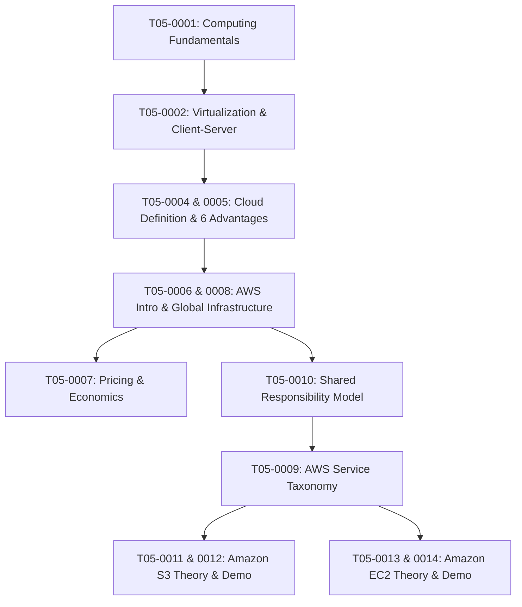

# T05 — AWS Cloud Foundations (Module 01)

> **Course**: AWS re/Start Curriculum  
> **Module**: T05 – Cloud Foundations & Core Services  
> **Standard**: Compliant with [`PROJECT_STANDARDS.md`](../PROJECT_STANDARDS.md)

---

## 📖 Module Overview

AWS Cloud Foundations introduces the foundational architectural principles, global infrastructure, core compute and storage services, pricing economics, and security models underpinning Amazon Web Services. This module combines conceptual theory, reference architectures, interactive knowledge checks, and video lab demonstrations with complete audio transcriptions.

---

## 🗺️ Curriculum Structure & Navigation

| Index | Title / Document | Type | Primary Topics Covered | Guide Link |
|---|---|:---:|---|:---:|
| **T05-0001** | Introduction to Computing | Study Guide | Hardware vs Software, Servers, Data Centers, Storage & RAM, OS | [View Guide](./T05-0001-RSCF_SG_EN-US_M01_INTROCOMPUTING.md) |
| **T05-0002** | Basic Computing Concepts | Study Guide | Virtualization, Hypervisors, Guest OS, Client-Server Architecture, SDLC Phases | [View Guide](./T05-0002-RSCF_SG_EN-US_M01_BASICCOMPUTINGCONCEPTS.md) |
| **T05-0003** | Development Team Roles | Study Guide | Cross-functional team structure, Agile roles, DevOps culture, Product ownership | [View Guide](./T05-0003-RSCF_SG_EN-US_M01_DEVTEAMROLES.md) |
| **T05-0004** | What is Cloud Computing? | Study Guide | NIST definition, Deployment models (Public/Private/Hybrid), Service models (IaaS/PaaS/SaaS) | [View Guide](./T05-0004-RSCF_SG_EN-US_M01_WHATISCLOUDCOMPUTING.md) |
| **T05-0005** | Advantages of Cloud Computing | Study Guide | 6 Core Cloud Advantages: CapEx to OpEx, Economies of scale, Stop guessing capacity, Agility | [View Guide](./T05-0005-RSCF_SG_EN-US_M01_ADVANTAGESCLOUDCOMPUTING.md) |
| **T05-0006** | What is AWS? | Study Guide | AWS Evolution, Management Console, AWS CLI, SDKs, Cloud Adoption Framework (CAF) | [View Guide](./T05-0006-FOUN_WHATISAWS_EN.md) |
| **T05-0007** | Fundamentals of Pricing | Study Guide | Pay-as-you-go, Free Tier tiers, Pricing Calculator, TCO comparison, Billing tools | [View Guide](./T05-0007-RSCF_SG_EN-US_M01_FUNDAMEN-USTALSPRICING.md) |
| **T05-0008** | AWS Global Infrastructure | Study Guide | Regions, Availability Zones, Edge Locations, Points of Presence, Regional Edge Caches | [View Guide](./T05-0008-RSCF_SG_EN-US_M01_AWSINFRASTRUCTURE.md) |
| **T05-0009** | Services and Categories | Study Guide | AWS Service taxonomy: Compute, Storage, Database, Network, Security, Management | [View Guide](./T05-0009-RSCF_SG_EN-US_M01_SERVICESANDCATEGORY.md) |
| **T05-0010** | Shared Responsibility Model | Study Guide | Security OF the Cloud (AWS) vs. Security IN the Cloud (Customer), Shared & Inherited controls | [View Guide](./T05-0010-RSCF_SG_EN-US_M01_SHAREDRESPONSIBILITYMODEL.md) |
| **T05-0011** | Amazon Simple Storage Service (S3) | Study Guide | Buckets, Object keys, Storage classes, Lifecycle rules, Versioning, Bucket Policies, SSE | [View Guide](./T05-0011-RSCF_SG_EN-US_M01_AMAZONS3.md) |
| **T05-0012** | Video Demo: Amazon S3 Hands-On | Video Demo | Live console walk-through: Creating buckets, uploading objects, versioning, access control | [View Video Guide](./T05-0012-RSSCHAB_EN-US_Video_M01_S3_Demo.md) |
| **T05-0013** | Amazon Elastic Compute Cloud (EC2) | Study Guide | Virtual servers, AMIs, Instance families, Pricing models (On-Demand, Spot, RIs), Security Groups | [View Guide](./T05-0013-RSCF_SG_EN-US_M01_COMPUTEAMAZONEC2.md) |
| **T05-0014** | Video Demo: Amazon EC2 Hands-On | Video Demo | Live console walk-through: Launching EC2 instances, key pairs, connecting via SSH/EC2 Connect | [View Video Guide](./T05-0014-RSSCHAB_EN-US_Video_M01_EC2_Demo.md) |

---

## 🎯 Key Learning Path

---

## 🛠️ Verification & Media Transcripts Note

All multimedia files (`.mp4`) in this module have been extracted via Whisper Speech-to-Text and transcribed with timestamped sections, command executions, and instructor explanations embedded within their corresponding markdown files (`T05-0012` and `T05-0014`). No external Joplin metadata tags exist in any documents.
