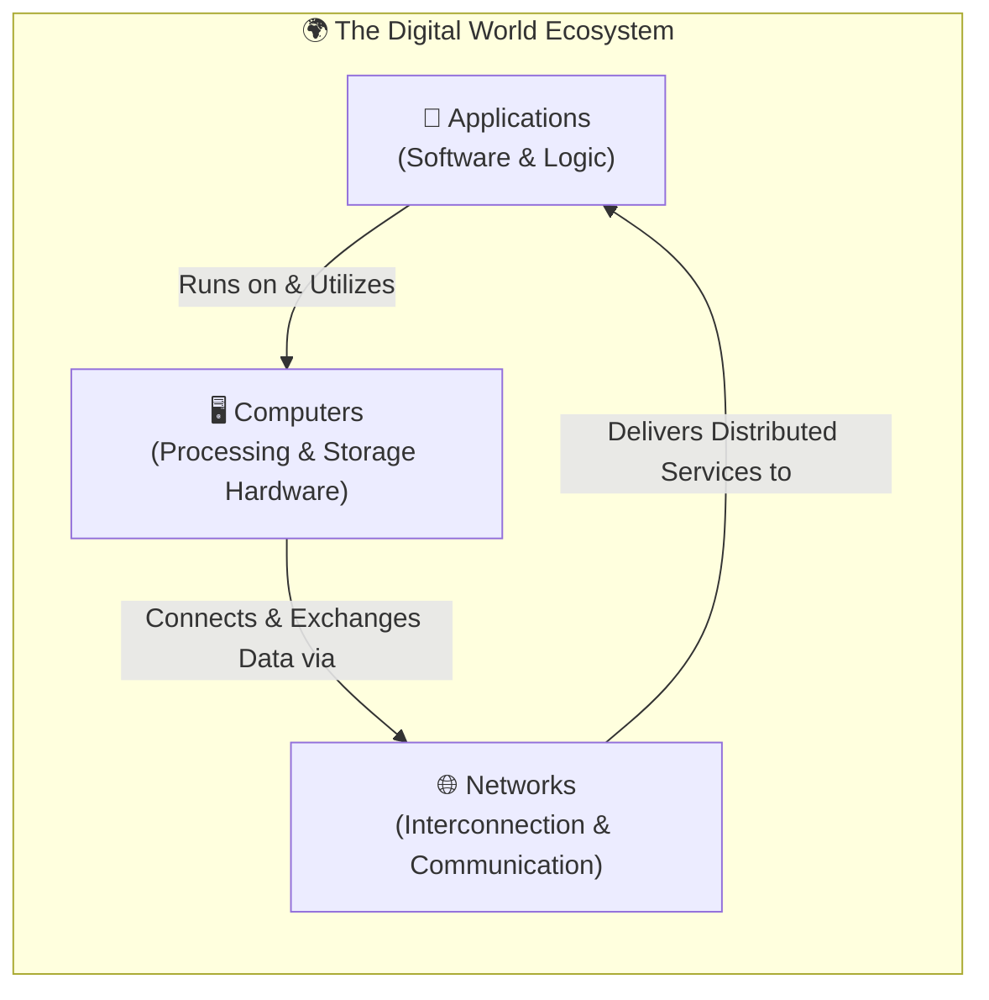
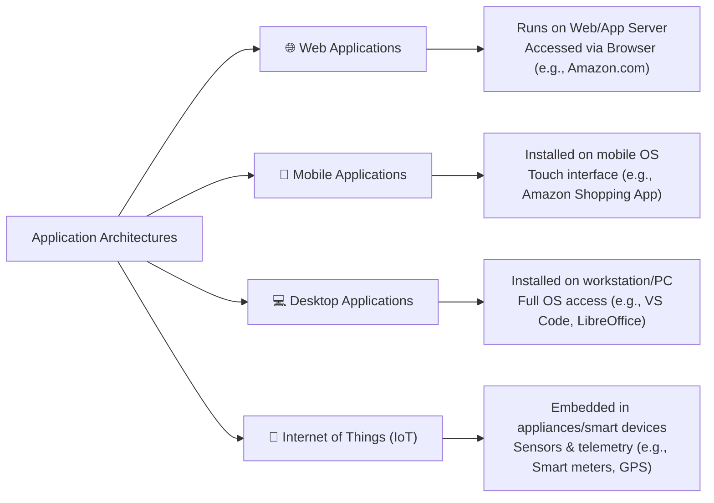
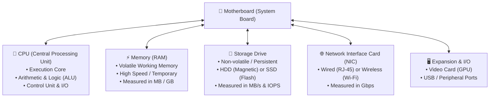
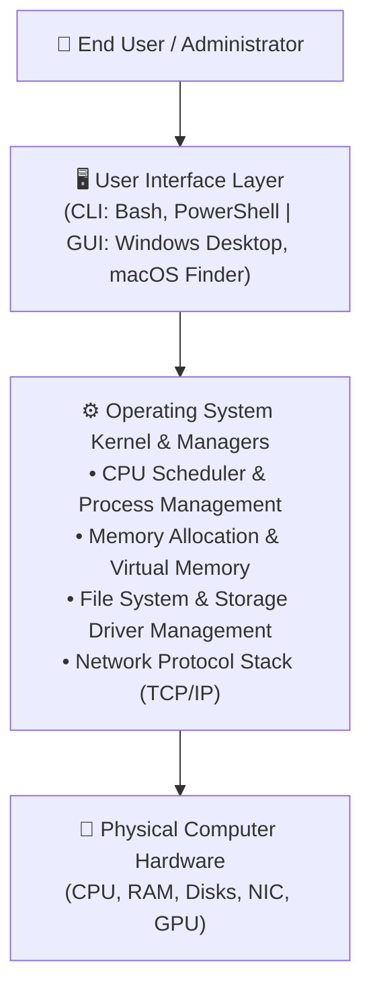

# 💻 Module 01: Introduction to Computing – Study Guide

> **Course**: AWS re/Start Cloud Foundations  
> **Module**: M01 – Introduction to Computing  
> **Source Document**: `T05-0001-RSCF_SG_EN-US_M01_INTROCOMPUTING.pdf`  
> **Target Audience**: AWS re/Start Learners / Cloud Practitioners  

---

## 🎯 Module Overview

Welcome to **Introduction to Computing**. In the contemporary digital economy, applications, computing devices, and global networks underpin virtually every personal interaction, enterprise operation, and cloud service.

This foundational study guide introduces the core concepts of computing, explores how technology transforms everyday life, breaks down the foundational building blocks of the digital world, and examines the hardware and software architecture of modern computer systems.

### 📌 Learning Objectives
- [ ] **Express the Value of Technology**: Understand how technology transcends physical, geographical, and temporal limitations in personal and enterprise contexts.
- [ ] **Identify the Core Building Blocks**: Differentiate the roles of applications, computing devices, and computer networks.
- [ ] **Define Basic Computing Terminology**: Articulate precise definitions for software, programs, and diverse application models (Web, Mobile, Desktop, IoT).
- [ ] **Distinguish Hardware vs. Software**: Categorize internal physical components and system/application software.
- [ ] **Analyze Core Computer Components**: Explain the roles and performance characteristics of the Motherboard, CPU, RAM, Storage Drives (HDD vs. SSD), Network Interface Cards (NIC), and Operating Systems (OS).
- [ ] **Relate Computing Fundamentals to Cloud Infrastructure**: Form the conceptual bridge connecting physical hardware to virtualized cloud primitives (e.g., Amazon EC2, Amazon EBS, VPC).

---

## 🌐 1. Technology in the Digital World

### The Pervasive Digital Experience
Consider standard daily digital interactions:
- Purchasing items from an e-commerce platform (e.g., [Amazon.com](https://amazon.com))
- Streaming video or media
- Communicating via instant messaging or video conference
- Playing an online multiplayer video game

Each of these interactions relies on an interconnected ecosystem of:
1. **End-user Devices**: Smartphones, laptops, desktop computers, tablets, e-readers, or gaming consoles.
2. **Applications & Software**: Mobile applications, web clients, backend services.
3. **The Internet & Networking Infrastructure**: Routers, switches, optical fiber, wireless protocols, and cloud servers.

### The Value of Technology
Technology extends human capability beyond traditional physical, geographical, and time constraints:
- **Education**: Remote learning platforms, digital courseware, automated training labs.
- **Commerce**: 24/7 global e-commerce, digital payments, automated inventory management.
- **Finance**: Real-time account management, mobile payments, algorithmic trading.
- **Home & Safety**: Smart home security systems, environmental automation, sensor alerts.
- **Communication & Collaboration**: Frictionless global voice, video, and data exchange.
- **Entertainment**: On-demand streaming, gaming networks, digital media.

---

## 🏗️ 2. The Three Building Blocks of the Digital World

At the core of all modern digital technology are three foundational elements:



| Building Block | Description | Real-World Examples | Cloud Computing Analogy |
| :--- | :--- | :--- | :--- |
| **Applications** | Computer programs containing instructions that execute specific user or business tasks. | Mobile banking apps, web browsers, enterprise ERP systems, video games. | Microservices, containerized workloads, AWS Lambda functions. |
| **Computers** | Programmable electronic devices that process input, execute instructions, and produce output. | Smartphones, tablets, laptops, workstations, rack-mounted web servers, database servers. | Amazon EC2 instances, virtual machines, bare-metal server instances. |
| **Networks** | Interconnected communication pathways enabling multiple devices to share data and resources. | Local Wi-Fi networks, wired Ethernet LANs, enterprise WANs, the public Internet. | Amazon Virtual Private Cloud (VPC), Subnets, Internet Gateways. |

---

## ⚙️ 3. Computer Applications & Software

### What is an Application?
- An **application** is a computer program consisting of an organized sequence of instructions executed by a computer to accomplish a specific function.
- Computer programs are authored by developers in **programming languages** (such as Python, Java, C++, JavaScript, Go).
- In technical terminology, **software** is synonymous with computer programs and applications.

```
┌────────────────────────────────────────────────────────────────────────┐
│                        Source Code to Execution                        │
│                                                                        │
│   [Developer Code]  ──>  [Compiler / Interpreter]  ──>  [Machine Code] │
│   (Python, Java, C++)     Translates into binary         CPU executes  │
└────────────────────────────────────────────────────────────────────────┘
```

### Application Delivery Models

Applications run on different categories of devices and are delivered across diverse channels:



| Application Type | Execution Environment | Access Mechanism | Practical Examples |
| :--- | :--- | :--- | :--- |
| **Web Application** | Hosted centrally on a web server or application server. | Accessed by client endpoints using a standard web browser (HTTP/HTTPS). | Amazon.com, webmail portals, cloud administration dashboards. |
| **Mobile App** | Installed locally on mobile operating systems (iOS, Android). | Accessed directly via touchscreen interfaces on smartphones or tablets. | Amazon Shopping Mobile App, mobile banking applications, navigation apps. |
| **Desktop Application** | Installed locally on desktop or laptop operating systems (Windows, macOS, Linux). | Accessed through the local graphical desktop or CLI environment. | Word processors, IDEs (VS Code), video editing suites, native PC games. |
| **Internet of Things (IoT)** | Runs on firmware or embedded microcontrollers inside appliances and specialized devices. | Interacts via sensors, internet gateways, lightweight messaging (MQTT), or companion apps. | Smartwatches, connected refrigerators, automotive GPS navigators, industrial telemetry units. |

---

## 🖥️ 4. Anatomy of a Computer: Hardware vs. Software

A functioning computing system requires two complementary dimensions: **hardware** and **software**.

```
┌────────────────────────────────────────────────────────────────────────┐
│                          Computer System Stack                         │
├────────────────────────────────────────────────────────────────────────┤
│ 1. User Applications       (Web Browsers, Mobile Apps, Office Tools)   │
├────────────────────────────────────────────────────────────────────────┤
│ 2. Operating System (OS)   (Amazon Linux 2, Windows, macOS, Android)   │
├────────────────────────────────────────────────────────────────────────┤
│ 3. Hardware Subsystem      (Motherboard, CPU, RAM, Storage, NIC)       │
└────────────────────────────────────────────────────────────────────────┘
```

> [!NOTE]
> **Hardware** refers to the physical, tangible electronic circuitry and mechanical components of a computer system.  
> **Software** refers to the intangible collections of instructions, programs, operating systems, and data that control the hardware.

---

## 🔧 5. Core Hardware Components Deep Dive



### 1. Motherboard (System Board)
- **Role**: The main printed circuit board (PCB) that serves as the central communications backbone of the computer.
- **Function**: Physically holds and electrically interconnects all core hardware components, allowing data and power to flow between them.
- **Interconnections**:
  - Direct sockets for the CPU and RAM.
  - Buses and expansion slots (PCIe) for video cards and network adapters.
  - Connectors (SATA, NVMe/M.2) for internal storage drives.
  - External I/O ports (USB, HDMI, Ethernet, audio).

---

### 2. Central Processing Unit (CPU)
- **Role**: The "brain" of the computer; the electronic circuitry that fetches, decodes, and executes program instructions.
- **Core Operations**:
  - **Arithmetic Operations**: Mathematical calculations (addition, subtraction, multiplication).
  - **Logical Operations**: Comparisons, boolean evaluation (AND, OR, NOT).
  - **Control Operations**: Program flow sequencing, instruction fetching, branch execution.
  - **Input/Output (I/O) Management**: Directing data transfer to and from system buses.
- **Multi-Core Architecture**:
  - A **core** is an independent processing unit within the physical CPU chip.
  - A **dual-core** processor contains two distinct cores that function as two logical CPUs on a single die.
  - Multi-core processors enable the operating system to execute multiple application threads simultaneously (**true parallel computing**), substantially enhancing throughput and responsiveness.

> [!TIP]
> In AWS cloud infrastructure, CPU capacity is provisioned in **vCPUs** (virtual CPUs). A vCPU typically corresponds to a hardware execution thread on a physical multi-core server processor.

---

### 3. System Memory (Random Access Memory - RAM)
- **Role**: High-speed temporary working memory that holds currently running operating system processes, active application code, and immediate data needed by the CPU.
- **Volatile Storage**: RAM requires electrical power to retain data. When the computer is rebooted or powered off, all data in RAM is immediately cleared.
- **Operational Cycle**:
  1. Operating system loads an application executable from persistent storage (SSD/HDD) into RAM.
  2. The CPU retrieves instructions and data directly from RAM at nanosecond latencies.
  3. The CPU writes computed results back to RAM before saving to permanent storage.
- **Units of Measurement**:
  - **Byte**: The basic data unit, consisting of 8 bits (sufficient to represent a single alphanumeric character).
  - **Megabyte (MB)**: Approximately $1 \text{ million bytes}$ ($10^6$ or $2^{20} = 1,048,576 \text{ bytes}$).
  - **Gigabyte (GB)**: Approximately $1 \text{ billion bytes}$ ($10^9$ or $2^{30} = 1,073,741,824 \text{ bytes}$).
- **Performance Impact**: Greater RAM capacity allows the operating system to maintain more active applications and larger working datasets in high-speed memory without resorting to disk paging/swap files.

---

### 4. Storage Drives (HDD vs. SSD)
- **Role**: Persistent (non-volatile) secondary storage responsible for preserving program binaries, system configuration files, database records, and user documents permanently across power cycles.

#### Comparison: Hard Disk Drives (HDD) vs. Solid State Drives (SSD)

| Feature | Hard Disk Drive (HDD) | Solid State Drive (SSD) |
| :--- | :--- | :--- |
| **Technology** | Mechanical spinning magnetic platters with read/write heads. | Non-volatile flash memory integrated circuits (NAND flash). |
| **Moving Parts** | Yes (mechanical spindle and actuator arm). | None (entirely solid-state silicon). |
| **Access Latency** | Higher latency (milliseconds) due to mechanical seek time. | Ultra-low latency (microseconds). |
| **Throughput & Speed** | Moderate data transfer rates (typically 100–200 MB/s). | High to ultra-high throughput (500 MB/s to 7,000+ MB/s). |
| **Cost per Gigabyte** | Inexpensive, highly economical for bulk archival storage. | Higher cost per gigabyte, but decreasing over time. |
| **Durability** | Sensitive to physical shock, drops, and vibrations. | Highly resistant to physical shock and vibration. |
| **AWS Cloud Counterpart** | Amazon EBS Throughput Optimized HDD (`st1`), Cold HDD (`sc1`). | Amazon EBS General Purpose SSD (`gp2`/`gp3`), Provisioned IOPS SSD (`io1`/`io2`). |

#### Storage Performance Metrics
1. **Throughput (MB/s)**: The total volume of data read from or written to the drive per second.
2. **IOPS (Input/Output Operations Per Second)**: The number of distinct read or write transactions a drive can process in one second. Crucial for transactional workloads such as relational databases.

---

### 5. Computer Networks & Network Interface Cards (NIC)

#### Computer Networks
- A **computer network** is an interconnection of multiple computing devices established to share data, files, computing resources, and services.
- **Network Types by Media**:
  - **Wired Networks**: Devices interconnect using physical copper cabling (Ethernet Cat5e/Cat6) or optical fiber connected to a network switch or router.
  - **Wireless Networks**: Devices interconnect over radio frequency (RF) transmissions using Wi-Fi standards (802.11) broadcast by wireless access points/routers.
- **The Internet**: The global, public "network of networks" interconnecting billions of personal and commercial systems worldwide using standardized Internet Protocol (TCP/IP) suites.

#### Network Interface Card (NIC / Network Adapter)
- **Role**: The physical hardware component or expansion card that connects a computer to a computer network.
- **Operational Types**:
  - **Wired NIC**: Incorporates an RJ-45 Ethernet port to accept physical patch cables.
  - **Wireless NIC**: Contains internal or external antennas to receive Wi-Fi signals.
- **Performance Metric**: Network card throughput is measured in **gigabits per second (Gbps)** or megabits per second (Mbps).

> [!IMPORTANT]
> Note the distinction between network speeds and storage sizes:
> - **Storage / Memory** is measured in **bytes** (with an uppercase **B**, e.g., GB, MB).
> - **Network bandwidth** is measured in **bits** (with a lowercase **b**, e.g., Gbps, Mbps).  
> $1 \text{ Byte} = 8 \text{ bits}$.

---

## 🖥️ 6. Operating System (OS) Architecture

An **Operating System (OS)** is system software that manages a computer's physical hardware resources and provides common services for application programs.



### Core Responsibilities of an OS
1. **Resource Sharing & Arbitration**: Fairly schedules and allocates CPU execution cycles, memory space, storage volumes, and network bandwidth among running programs.
2. **Hardware Abstraction**: Provides standard Application Programming Interfaces (APIs) and hardware device drivers so software does not need custom code for each vendor's disk or graphics card.
3. **User Interface (UI)**:
   - **Command Line Interface (CLI)**: Text-based console where users input exact commands (e.g., Linux Bash terminal, Windows PowerShell). Essential for cloud automation and remote server management.
   - **Graphical User Interface (GUI)**: Visual interface with windows, icons, menus, and mouse pointers (e.g., Windows Desktop, macOS Aqua).

### Prominent Operating Systems

| Operating System | Primary Target Environment | Common Cloud / Enterprise Use Cases |
| :--- | :--- | :--- |
| **Amazon Linux 2 / Amazon Linux 2023** | Cloud virtual machines, container hosts | Optimized for high performance and security on AWS EC2. |
| **Microsoft Windows (Server & Desktop)** | Enterprise workstations, corporate domains | Active Directory, enterprise desktop productivity, legacy .NET. |
| **macOS** | Creative workstations, software development | Native iOS/macOS application compilation and design. |
| **Ubuntu / Red Hat Enterprise Linux (RHEL)**| Production web servers, databases, containers | Industry standard for microservices, cloud deployments, and DevOps. |
| **Google Android / Apple iOS** | Mobile smartphones and tablets | Edge mobile computing, consumer touch applications. |

---

## 📊 Summary Comparison: Volatile Memory vs. Persistent Storage

To avoid common beginner confusion, the table below contrasts RAM and Storage:

| Characteristic | System Memory (RAM) | Storage Drive (SSD / HDD) |
| :--- | :--- | :--- |
| **Persistence** | **Volatile**: Data is completely erased upon power loss. | **Non-volatile / Persistent**: Data remains intact across reboots. |
| **Primary Purpose** | Workspace for immediate instruction execution by the CPU. | Long-term repository for operating systems, apps, and documents. |
| **Speed / Latency** | Nanoseconds (extremely fast direct bus access). | Microseconds (SSD) to milliseconds (HDD). |
| **Capacity** | Typically 8 GB to 64 GB on workstations; up to TBs on servers. | Typically 256 GB to multiple Terabytes (TB) / Petabytes (PB). |
| **Measurement Unit** | Gigabytes (GB). | Gigabytes (GB), Terabytes (TB); speed in MB/s or IOPS. |

---

## 🧠 Knowledge Check & Review Questions

Test your mastery of the concepts covered in this module. Select your answer for each question, then review the detailed explanation below.

### Question 1
**Which computer hardware component is responsible for directly executing instructions, performing arithmetic operations, and controlling system input/output (I/O)?**
- A) Motherboard
- B) Random Access Memory (RAM)
- C) Central Processing Unit (CPU)
- D) Network Interface Card (NIC)

<details>
<summary>👉 View Answer and Explanation</summary>

**Correct Answer: C) Central Processing Unit (CPU)**

**Explanation**:  
The CPU is the primary processing engine (the "brain") of the computer. It executes instructions received from applications and the OS, carrying out arithmetic calculations, logical comparisons, and control/I/O operations. The motherboard interconnects components, RAM provides temporary instruction storage, and the NIC manages network communication.
</details>

---

### Question 2
**A cloud practitioner is choosing a storage drive for a database that requires rapid data retrieval and high transaction volume. Why is a Solid State Drive (SSD) preferable over a traditional Hard Disk Drive (HDD)?**
- A) SSDs use spinning magnetic platters that offer higher RPM speed.
- B) SSDs have no moving parts and use flash memory, providing significantly faster read/write speeds and lower latency.
- C) SSDs provide volatile memory that resets cleanly between database transactions.
- D) SSDs connect directly to the CPU socket rather than through the system board.

<details>
<summary>👉 View Answer and Explanation</summary>

**Correct Answer: B) SSDs have no moving parts and use flash memory, providing significantly faster read/write speeds and lower latency.**

**Explanation**:  
SSDs store data electronically in flash-based integrated circuits (silicon memory cells) rather than mechanical magnetic platters. Without moving parts, SSDs virtually eliminate mechanical seek times, delivering much higher IOPS (I/O operations per second) and data transfer speeds (MB/s) than traditional HDDs.
</details>

---

### Question 3
**What occurs to the data stored in a computer's Random Access Memory (RAM) when the system is completely powered down?**
- A) The data is automatically backed up to the BIOS chip.
- B) The data remains preserved exactly as it was until the next user login.
- C) The data is lost because RAM is volatile temporary storage.
- D) The data is compressed and retained on the motherboard circuit traces.

<details>
<summary>👉 View Answer and Explanation</summary>

**Correct Answer: C) The data is lost because RAM is volatile temporary storage.**

**Explanation**:  
RAM is classified as **volatile memory**. It requires continuous electrical power to sustain its electronic state. When power is severed, all memory cells discharge, erasing the stored data. Persistent files, operating systems, and user documents must be written to non-volatile storage drives (SSDs or HDDs) to survive shutdowns.
</details>

---

### Question 4
**Which of the following best defines an Internet of Things (IoT) application?**
- A) An application installed exclusively on desktop workstations for video editing.
- B) An application accessed exclusively through a web browser on a laptop.
- C) An application that runs on an appliance or specialized internet-connected device (such as a smartwatch or smart appliance).
- D) An operating system kernel designed specifically for optical networking switches.

<details>
<summary>👉 View Answer and Explanation</summary>

**Correct Answer: C) An application that runs on an appliance or specialized internet-connected device (such as a smartwatch or smart appliance).**

**Explanation**:  
IoT applications are designed to run inside specialized devices, appliances, sensors, and wearable tech (e.g., smart thermostats, smartwatches, connected medical devices, automotive telematics) that communicate telemetry and operational commands over the internet.
</details>

---

### Question 5
**What is the primary role of a computer's Operating System (OS)?**
- A) To convert alternating current (AC) electricity into direct current (DC) power for system hardware.
- B) To manage the computer's hardware and software resources, coordinate CPU/memory/storage/network usage, and provide a user interface.
- C) To provide physical cooling for the multi-core CPU.
- D) To function as an optical medium for transmitting light pulses over fiber-optic cables.

<details>
<summary>👉 View Answer and Explanation</summary>

**Correct Answer: B) To manage the computer's hardware and software resources, coordinate CPU/memory/storage/network usage, and provide a user interface.**

**Explanation**:  
The operating system serves as the foundational software layer between application programs and the physical hardware. It arbitrates and schedules access to the CPU, memory, storage devices, and networking interfaces while offering user interaction through Command Line Interfaces (CLI) or Graphical User Interfaces (GUI).
</details>

---

### Question 6
**How does a multi-core processor enhance system performance compared to a single-core processor?**
- A) By eliminating the need for an operating system kernel.
- B) By functioning as multiple separate processors capable of running separate instructions and applications simultaneously.
- C) By converting secondary hard drives directly into physical RAM chips.
- D) By increasing the physical thickness of the printed circuit board.

<details>
<summary>👉 View Answer and Explanation</summary>

**Correct Answer: B) By functioning as multiple separate processors capable of running separate instructions and applications simultaneously.**

**Explanation**:  
Each core in a multi-core CPU represents an independent execution engine with its own arithmetic and logical execution circuitry. A multi-core processor allows the operating system to dispatch distinct threads and applications across different cores simultaneously (parallelism), preventing bottlenecks and dramatically speeding up multitasking.
</details>

---

## 📝 Key Takeaways & Review Checklist

- [x] **Digital Pillars**: Applications, computers, and computer networks form the three universal pillars of modern digital technology.
- [x] **Software vs. Hardware**: Hardware encompasses physical circuits and devices; software constitutes the programmed instruction sets and operating systems running on top of that hardware.
- [x] **CPU**: The core processing unit ("brain") that performs arithmetic, logic, and system control; multi-core architectures allow simultaneous thread execution.
- [x] **Memory vs. Storage**: Memory (RAM) is high-speed and volatile (temporary); storage (SSD/HDD) is non-volatile (persistent).
- [x] **Storage Performance**: Measured in throughput (MB/s) and transactional responsiveness (IOPS). SSDs outperform HDDs due to flash memory architectures without moving parts.
- [x] **Networks & NICs**: Networks interconnect systems using wired (Ethernet) or wireless (Wi-Fi) media; NICs manage network communication, measured in Gbps.
- [x] **Operating System**: Manages hardware arbitration, process scheduling, and user interaction through CLI and GUI paradigms.
