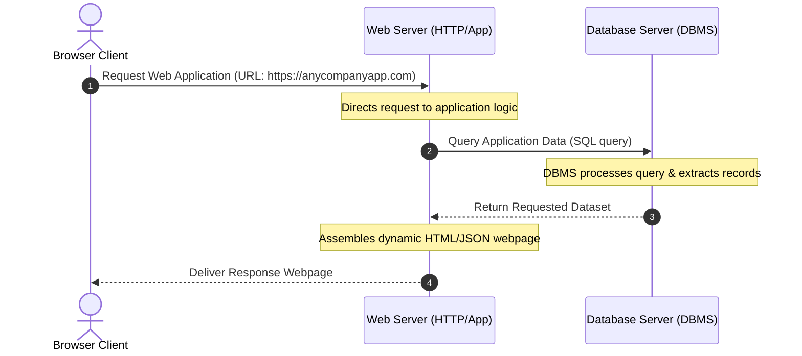
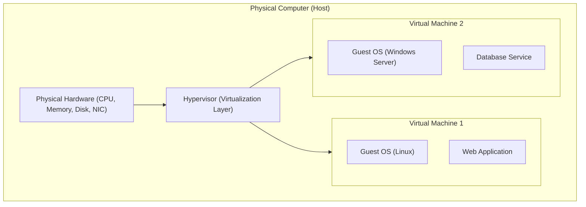
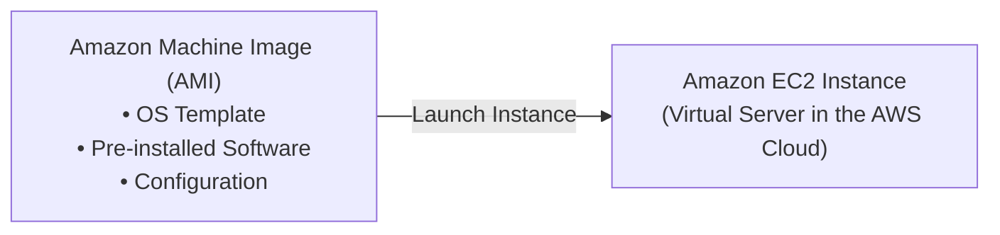
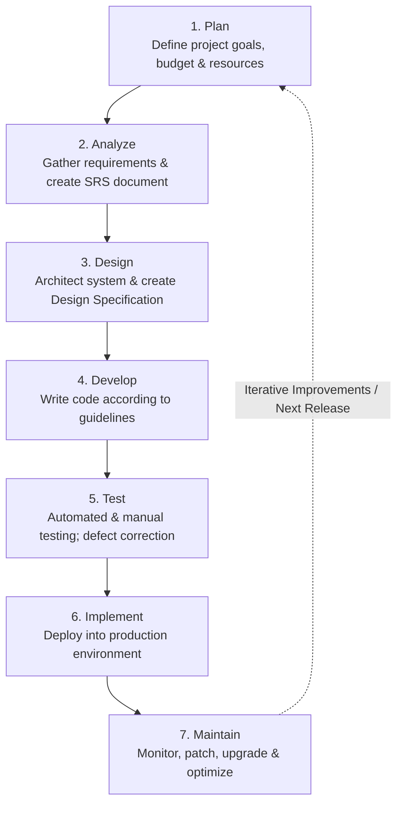

# 💻 Basic Computing Concepts & Cloud Foundations

> **Course**: AWS Cloud Foundations  
> **Module**: M01 – Basic Computing Concepts  
> **Source**: `T05-0002-RSCF_SG_EN-US_M01_BASICCOMPUTINGCONCEPTS.pdf`  
> **Target Audience**: AWS re/Start Learners / Cloud Practitioners  

---

## 🎯 Module Overview

Computing fundamentals form the bedrock of cloud computing. Before working with cloud-native infrastructure, you must understand physical servers, data centers, virtualization technologies that abstract physical hardware, and the software development lifecycle (SDLC) used to build and manage applications.

### 📌 Learning Objectives
- [ ] Define servers and identify common server types (web, database, mail).
- [ ] Understand the client-server architecture model and communication flow.
- [ ] Describe data center infrastructure and contrast traditional on-premises facilities with the cloud computing model.
- [ ] Explain hardware virtualization, virtual machines (VMs), host systems, and hypervisors.
- [ ] Articulate the core benefits of virtualization (cost savings, efficiency, portability).
- [ ] Connect virtual machines to AWS Cloud compute services (Amazon EC2 and AMIs).
- [ ] Outline the 7 phases of the Software Development Life Cycle (SDLC): Plan, Analyze, Design, Develop, Test, Implement, and Maintain.
- [ ] Distinguish between different software testing methodologies and application maintenance categories.

---

## 🖥️ 1. Servers and Data Centers

### What is a Server?
A **server** is a computer that provides data, resources, or services to other computers (referred to as **clients**) across a computer network. When a client requests resources, the server processes the request and delivers a response.

```
┌────────────────────────────────────────────────────────────────────────┐
│                             Server Hardware                            │
│                                                                        │
│  • High-Density Memory: Greater RAM capacity and multi-socket CPUs     │
│  • High Availability: Redundant power supply units (PSU) & dual NICs   │
│  • Form Factor: Rack-mounted (1U/2U/4U) or blade servers for density    │
└────────────────────────────────────────────────────────────────────────┘
```

#### Typical Differences Between Server and Desktop Hardware:
| Characteristic | Desktop Computer | Enterprise Server |
| :--- | :--- | :--- |
| **Primary Role** | Direct interactive use by a single end user | Serving background requests to many network clients |
| **Processors (CPU)** | Single CPU with consumer multi-core specs | Single or multi-socket multi-core CPUs (e.g., Intel Xeon, AMD EPYC) |
| **Memory (RAM)** | Standard non-ECC RAM (8 GB – 64 GB) | High-capacity ECC (Error-Correcting Code) RAM (64 GB – Terabytes) |
| **Redundancy** | Single power supply, single network card | Redundant power supplies, fault-tolerant NIC bonding |
| **Chassis / Form Factor** | Tower or mini PC | Rack-mounted units or dense blade enclosures |

#### Common Types of Servers:
- **Web Server**: Hosts web application files and handles HTTP/HTTPS requests to return Hypertext Markup Language (HTML), CSS, JavaScript, and assets to web browsers (e.g., Apache HTTP Server, Nginx, Microsoft IIS).
- **Database Server**: Hosts specialized database management software used by applications to store, index, query, and manipulate data (e.g., MySQL, PostgreSQL, Oracle, Microsoft SQL Server).
- **Mail Server**: Dedicated server responsible for sending, receiving, and routing electronic mail using protocols such as SMTP, IMAP, and POP3.

---

### Client and Server Interaction: Web Application Architecture

In modern multi-tier web applications, web servers and database servers collaborate to serve dynamic content to browser clients.



#### Step-by-Step Request Flow:
1. **User Request**: The user opens a web browser and enters the application's Uniform Resource Locator (URL) (e.g., `https://anycompanyapplication.com`).
2. **Web Server Processing**: The web server receives the HTTP/S request and directs it to the underlying web application logic.
3. **Database Access**: The web application communicates with the backend database server to retrieve necessary application data.
4. **Data Return**: The **Database Management System (DBMS)** retrieves the data from storage and passes the query results back to the application.
   - A DBMS controls the data's organization, indexing, security, and read/write access. Examples include open-source engines like MySQL/PostgreSQL and enterprise engines like Oracle Database.
5. **Webpage Assembly & Delivery**: The web application constructs the final response webpage using the data and passes it to the web server, which delivers the rendered content back to the client's web browser.

---

### Where Does a Server Reside? Data Centers

Servers are housed in dedicated physical facilities called **data centers**. A data center aggregates an organization's computing, storage, and networking hardware in a controlled, resilient environment.

```
┌────────────────────────────────────────────────────────────────────────┐
│                        Data Center Infrastructure                      │
│                                                                        │
│  [ Compute ]   Servers (Rackmount & Blade Enclosures)                  │
│  [ Storage ]   Storage Area Networks (SAN) & Network-Attached Storage  │
│  [ Network ]   Routers, Core/Access Switches, Firewalls, Hubs          │
│  [ Facility]   HVAC Cooling, Fire Suppression, Security & Biom. Access │
│  [ Power   ]   Uninterruptible Power Supplies (UPS), Diesel Generators │
└────────────────────────────────────────────────────────────────────────┘
```

> [!NOTE]
> Data centers are designed with high redundancy to prevent unexpected outages. Environmental systems regulate humidity and temperature, while Uninterruptible Power Supply (UPS) battery systems and backup diesel generators maintain continuous power during electrical grid failures.

---

### Data Center Ownership: On-Premises vs. Cloud Computing Model

Organizations choose between constructing their own private on-premises facilities or leveraging the infrastructure of a cloud service provider (such as Amazon Web Services).

| Evaluation Criteria | Traditional On-Premises Model | Cloud Computing Model |
| :--- | :--- | :--- |
| **Facility Ownership** | You own or lease the physical building and land. | The cloud provider owns and manages global facilities. |
| **Hardware Procurement** | You purchase, rack, cable, and replace servers, drives, and switches (**CapEx**). | The cloud provider procures and manages all physical infrastructure. |
| **Staffing & Operations** | You must hire facilities staff, HVAC technicians, hardware engineers, and security guards. | The provider manages physical security, hardware repairs, and data center facilities. |
| **Cost Structure** | High upfront capital expenditure with ongoing depreciation and power overhead. | Pay-as-you-go operational model (**OpEx**); pay strictly for consumed services. |
| **Agility & Scaling** | Procuring new hardware takes weeks or months of planning and lead time. | Spin up or decommission computing resources globally in seconds or minutes. |

---

## 📦 2. Virtual Machines & Hardware Virtualization

### What is a Virtual Machine?
A **Virtual Machine (VM)** is a software-based computer emulated on top of physical hardware. Virtualization decouples operating systems and application stacks from the physical host hardware.



#### Core Components of Virtualization:
- **Host**: The underlying physical machine providing physical compute resources (CPUs, RAM, storage drives, and network controllers).
- **Hypervisor**: A specialized software layer that abstracts physical host resources and dynamically allocates shares of CPU, memory, storage, and networking to guest virtual machines.
- **Guest Operating System**: The OS running inside a virtual machine (e.g., Ubuntu Linux, Amazon Linux, Windows Server). The guest OS interacts with physical resources strictly through the hypervisor.

---

### Core Benefits of Virtualization

```
┌─────────────────────────────────┬─────────────────────────────────┬─────────────────────────────────┐
│          Cost Savings           │            Efficiency           │    Reusability & Portability    │
├─────────────────────────────────┼─────────────────────────────────┼─────────────────────────────────┤
│ Eliminate the need to buy       │ Consolidate multiple workloads  │ Capture VM configurations into  │
│ dedicated physical servers for  │ onto a single physical server;  │ reusable images (templates);    │
│ different operating systems.    │ dramatically reduce idle waste. │ clone, move, or restore easily. │
└─────────────────────────────────┴─────────────────────────────────┴─────────────────────────────────┘
```

1. **Cost Savings**: Organizations avoid purchasing separate physical servers for distinct workloads or differing operating system requirements.
2. **Efficiency & Resource Utilization**: Historically, single-purpose physical servers ran at 5–15% average CPU utilization. Running multiple VMs on one physical server balances workloads and drives hardware utilization higher.
3. **Reusability and Portability**: 
   - A **VM image** is a standardized snapshot containing the operating system, configurations, runtime libraries, and application packages.
   - VM images can be duplicated across hosts within minutes, enabling rapid scaling to meet traffic spikes or quick restoration for disaster recovery.

---

### Virtual Machines in the Cloud: Amazon EC2

In cloud computing, virtual machines are the fundamental compute building blocks. On AWS, this capability is delivered through **Amazon Elastic Compute Cloud (Amazon EC2)**.



#### Key Capabilities of Cloud Virtual Machines:
- **Self-Service On-Demand Provisioning**: Request, configure, and launch virtual instances via the AWS Management Console, AWS CLI, or SDKs within minutes.
- **Pay-as-You-Go Billing**: Incur compute costs only for active instance hours or seconds, avoiding idle capacity waste.
- **Dynamic Scalability**: Scale instance sizes up or down (vertical scaling), or increase/decrease the count of instances automatically (horizontal scaling with Auto Scaling groups).
- **Amazon Machine Images (AMIs)**: Standardized templates containing the software configuration (OS, application server, applications) used to launch EC2 instances.

---

## 🔄 3. Software Development Life Cycle (SDLC)

### What is the SDLC?
The **Software Development Life Cycle (SDLC)** is a structured, disciplined framework used by engineering teams to design, develop, test, and maintain high-quality software that meets customer requirements efficiently and predictably.



---

### The 7 Phases of the SDLC

#### 1. Plan
- **Focus**: What is the problem to solve, and what resources are required?
- **Activities**: Evaluate economic, technical, and operational feasibility. Allocate budgets, human capital, and tooling. Plan quality assurance strategies.
- **Key Output**: **Project Plan**.

#### 2. Analyze
- **Focus**: What does the user or customer want from the solution?
- **Activities**: Gather end-user requirements, specify functional workflows, and obtain formal customer approval.
- **Key Output**: **Software Requirement Specification (SRS)** document. The SRS serves as the authoritative baseline for all subsequent development phases.

#### 3. Design
- **Focus**: How will the application be structured and built?
- **Activities**: Evaluate competing architectural approaches against budget, performance, and risk factors. Define UI/UX wireframes, database schemas, and integration points.
- **Key Output**: **Design Specification Document**.

#### 4. Develop
- **Focus**: Building what was designed.
- **Activities**: Software engineers write source code based on the design specification document. Teams follow organizational coding standards, version control workflows, and language selections best suited for the workload.
- **Key Output**: Compiled / built application code base.

#### 5. Test
- **Focus**: Did we build what was expected, and does it operate without defects?
- **Activities**: Validate functionality, identify bugs, and verify non-functional performance and security baselines.

> [!IMPORTANT]
> Defect identification during the **Test** phase is critical. Fixing bugs in early stages is significantly less expensive than repairing critical failures after code has been deployed to production.

##### Common Testing Types:
| Testing Type | Description | Primary Responsibility |
| :--- | :--- | :--- |
| **Unit Testing** | Tests individual functions, classes, or modular components in isolation. | Software Developer |
| **Integration Testing** | Validates the interaction and data flow between multiple connected modules or services. | Developers & QA Engineers |
| **Security Testing** | Identifies potential vulnerabilities, exposure to external threats, and compliance flaws. | Security Analysts / DevSecOps |
| **Performance Testing** | Evaluates response times, throughput, stability, and resource consumption under varying workloads. | QA / Performance Engineers |
| **Automated Testing** | Writing programmatic test suites (unit/integration/e2e) that execute automatically upon code commits. | Development & QA Teams |

#### 6. Implement (Deployment)
- **Focus**: Delivering the completed software to end users.
- **Activities**: Customer signs off on the release. The application is deployed into the production runtime environment (e.g., AWS EC2 instances, containers, or serverless services).
- **Key Output**: Live, operational production application.

#### 7. Maintain
- **Focus**: Sustaining, updating, and improving the production application over its active lifespan.
- **Activities**: Continual operational monitoring, bug resolution, runtime environment patching, and feature refinement.

##### Four Categories of Application Maintenance:
```
┌───────────────────────────┬────────────────────────────────────────────────────────┐
│ Maintenance Type          │ Purpose & Typical Scenario                             │
├───────────────────────────┼────────────────────────────────────────────────────────┤
│ 1. Corrective Maintenance │ Fixing software defects, logic bugs, or errors.        │
│ 2. Adaptive Maintenance   │ Modifying code for runtime changes (OS/database upgrade)│
│ 3. Perfective Maintenance │ Enhancing UI/UX or adding customer-requested features. │
│ 4. Preventive Maintenance │ Refactoring code to prevent anticipated future issues. │
└───────────────────────────┴────────────────────────────────────────────────────────┘
```

- **Corrective Maintenance**: Immediate reactive remediation of unexpected software bugs or errors reported in production.
- **Adaptive Maintenance**: Proactive adjustments required due to changes in the surrounding environment (e.g., upgrading database engine versions, modifying APIs for operating system updates).
- **Perfective Maintenance**: Enhancements made to satisfy evolving user needs, improve user experience, or optimize performance.
- **Preventive Maintenance**: Code restructuring, refactoring, and documentation updates aimed at reducing technical debt and avoiding future faults.

---

## 📌 Key Takeaways Summary

- **Server**: A high-availability computer providing data or services to other computers (clients) across a network.
- **Data Center**: A dedicated facility housing centralized compute, storage, networking, power, and environmental controls.
- **Virtualization & VMs**: Technology that enables multiple software-based computers (VMs) to run concurrently on a single physical host, managed by a hypervisor.
- **Cloud Computing Model**: Allows organizations to trade upfront infrastructure costs (CapEx) for flexible, on-demand, pay-as-you-go operating expenses (OpEx).
- **Amazon EC2 & AMIs**: AWS services providing scalable, on-demand virtual server instances launched from standardized machine image templates.
- **SDLC**: A 7-step iterative framework (**Plan $\rightarrow$ Analyze $\rightarrow$ Design $\rightarrow$ Develop $\rightarrow$ Test $\rightarrow$ Implement $\rightarrow$ Maintain**) ensuring systematic software quality and lifecycle governance.

---

## 🧠 Knowledge Check & Self-Assessment

Test your understanding of the concepts covered in this module:

### Question 1: Server Roles
**Which of the following server types is specifically responsible for hosting a Database Management System (DBMS) to store and retrieve application records?**
- [ ] A) Web Server
- [ ] B) Database Server
- [ ] C) Mail Server
- [ ] D) DNS Server

<details>
<summary>👉 Click to view answer & explanation</summary>

**Correct Answer**: **B) Database Server**  
*Explanation*: A database server runs database management software (such as MySQL or Oracle) to organize, store, secure, and retrieve application data. A web server serves HTML/CSS/JS files, and a mail server handles email protocols.
</details>

---

### Question 2: Virtualization Architecture
**What component is responsible for abstracting the physical host's CPU, memory, storage, and network resources to share them among multiple virtual machines?**
- [ ] A) Operating System Kernel
- [ ] B) BIOS / UEFI
- [ ] C) Hypervisor
- [ ] D) Database Management System

<details>
<summary>👉 Click to view answer & explanation</summary>

**Correct Answer**: **C) Hypervisor**  
*Explanation*: The hypervisor (virtual machine monitor) is the software layer that coordinates resource allocation between the underlying physical hardware and the guest virtual machines.
</details>

---

### Question 3: SDLC Testing
**During which SDLC phase should defects (bugs) primarily be identified and resolved to minimize overall development costs?**
- [ ] A) Plan
- [ ] B) Design
- [ ] C) Test
- [ ] D) Maintain

<details>
<summary>👉 Click to view answer & explanation</summary>

**Correct Answer**: **C) Test**  
*Explanation*: The primary purpose of the Test phase is to uncover and fix bugs before production release. Fixing defects during production (Maintain phase) is exponentially more expensive and disruptive.
</details>

---

### Question 4: Maintenance Classification
**An IT team updates an application because the backend database software is receiving a major version upgrade. Which type of application maintenance does this represent?**
- [ ] A) Corrective maintenance
- [ ] B) Adaptive maintenance
- [ ] C) Perfective maintenance
- [ ] D) Preventive maintenance

<details>
<summary>👉 Click to view answer & explanation</summary>

**Correct Answer**: **B) Adaptive maintenance**  
*Explanation*: Adaptive maintenance modifies application code or configurations to adapt to changes in the external runtime environment, such as database or operating system upgrades.
</details>

---

## 📝 Personal Notes & Reflection

*Use this section to record thoughts, key definitions, or personal takeaways from Module 01:*

- **My key takeaway about physical servers vs. VMs**: 
- **How Amazon EC2 relates to traditional virtualization**: 
- **Questions to ask my instructor or study group**: 
