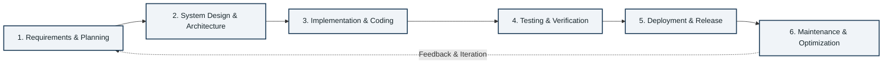
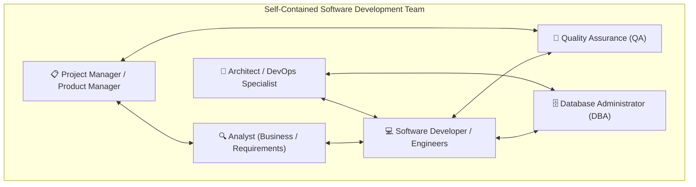

# 👥 Development Team Roles & The Software Development Lifecycle (SDLC)

> **Course**: AWS re/Start Cloud Foundations  
> **Module**: M01 – Introduction to Computing & Cloud Foundations  
> **Source Document**: `T05-0003-RSCF_SG_EN-US_M01_DEVTEAMROLES.pdf`  
> **Target Audience**: AWS re/Start Learners & Cloud Practitioners  

---

## 🎯 Module Overview

Due to the scale, speed, and technical complexity of modern software applications, development rarely happens in isolation—it takes place in structured, highly collaborative teams. Understanding the Software Development Lifecycle (SDLC) and how specialized technical and leadership roles interact is essential for anyone entering the technology and cloud ecosystem.

Many modern engineering teams operate as **self-contained (cross-functional) teams**, possessing all the technical expertise, operational capability, and domain knowledge necessary to complete the SDLC without relying on outside support.

### 📌 Learning Objectives
- [ ] Understand the phases and workflow of the Software Development Lifecycle (SDLC).
- [ ] Identify the primary roles in a software development team and their core responsibilities.
- [ ] Examine the distinct functions of the **Project Manager**, **Analyst**, **Quality Assurance (QA)**, **Software Developer**, and **Database Administrator (DBA)**.
- [ ] Understand complementary modern roles such as **Product Manager**, **Solutions Architect**, and **DevOps Engineer**.
- [ ] Articulate best practices that make collaborative engineering teams effective and resilient.
- [ ] Assess real-world development scenarios through structured checkpoint questions.

---

## 🔄 The Software Development Lifecycle (SDLC) & Team Collaboration

The Software Development Lifecycle (SDLC) is a structured process used by technology organizations to design, develop, test, deploy, and maintain high-quality software applications efficiently.



### Self-Contained Teams
A **self-contained team** (often termed a *cross-functional team* or *two-pizza team* in Amazon culture) has sufficient diverse expertise across management, analysis, design, development, quality assurance, and operations. This structure eliminates external dependency bottlenecks and accelerates delivery velocity.



---

## 🧑‍💻 Core Development Team Roles

### 1. 📋 Project Manager (PM)
The Project Manager orchestrates the execution of the project, ensuring alignment across scope, schedule, budget, and resources.

* **Project Plan Development**: Formulates the overarching roadmap, milestones, deliverables, and resource allocations.
* **Team Recruitment & Staffing**: Helps recruit and onboard appropriate technical talent to fill specialized roles.
* **Team Leadership & Facilitation**: Leads day-to-day operations, removes impediments, and fosters team morale.
* **Task Assignment**: Delegates tasks and work packages to relevant team members based on capacity and skillset.
* **Timeline & Schedule Management**: Establishes sprints, delivery dates, and tracks progress against critical paths.
* **Stakeholder Reporting**: Delivers status updates, risk assessments, and progress metrics to upper management and executive sponsors.

> [!NOTE]
> **Project Manager vs. Product Manager**:
> * A **Project Manager** focuses on *execution and delivery* ("How and when will we build it?").
> * A **Product Manager** focuses on *strategy and customer value* ("What should we build and why?").

---

### 2. 🔍 Analyst (Business / Requirements Analyst)
The Analyst serves as the vital bridge between business stakeholders, end users, and technical implementation teams.

* **Project Purpose Definition**: Clarifies business objectives and success criteria for every feature and initiative.
* **Requirements Elicitation**: Actively gathers needs and constraints from company leadership, clients, subject-matter experts, and end users.
* **Task Decomposition**: Translates broad business requirements into detailed functional specifications, user stories, and acceptance criteria.
* **Cross-Functional Alignment**: Organizes requirements into actionable tasks for developers to implement and QA teams to test.

---

### 3. 💻 Software Developer (Software Engineer)
Software Developers translate business specifications and technical architectures into functional, secure, and maintainable source code.

* **Feature Implementation**: Writes the code that constitutes the application based on the analyst's specifications.
* **Version & Legacy Maintenance**: Maintains and patches supported legacy versions of applications.
* **Initial Unit Testing**: Runs local test cases and unit tests to ensure written components function correctly before handing off to QA.
* **Defect Remediation**: Debugs and resolves issues identified in QA test runs or production monitoring logs.

---

### 4. 🧪 Quality Assurance (QA)
The Quality Assurance specialist guarantees that software satisfies defined functional, security, performance, and usability standards.

* **Test Suite Design**: Constructs comprehensive test plans covering functionality, usability, performance efficiency, maintainability, and portability for each requirement.
* **Regression Testing**: Maintains automated and manual test suites to ensure new releases do not break previously functioning features.
* **Test Execution & Defect Investigation**: Executes end-to-end, integration, and user-acceptance test runs, investigating root causes of failures.
* **Issue Documentation & Replication**: Documents clear, reproducible steps, logs, and screenshots for developers to fix bugs rapidly.
* **Acceptance Criteria Validation**: Collaborates with analysts to define and verify *acceptance criteria*—the measurable criteria governing successful completion.

---

### 5. 🗄️ Database Administrator (DBA)
The Database Administrator manages the persistence layer of an application, ensuring data integrity, security, availability, and performance.

* **Data Lifecycle Management**: Designs data models and maintains the data required for application workflows.
* **Capacity Planning & Resource Provisioning**: Plans, provisions, and configures storage and compute resources so databases scale smoothly.
* **Data Security & Access Control**: Establishes strict authentication, authorization policies, encryption at rest, and encryption in transit.
* **Backup & Disaster Recovery**: Executes automated backups and validates failover and restoration procedures.
* **Performance Tuning & Optimization**: Analyzes slow queries, indexes tables, monitors memory caching, and optimizes database engine parameters.

---

### 6. 🌐 Modern Extended Cloud Roles

In cloud-native environments (such as AWS), traditional development teams often collaborate with or incorporate these specialized competencies:

| Extended Role | Primary Responsibility in Cloud Environments | Typical AWS Services Used |
| :--- | :--- | :--- |
| **Solutions Architect** | Designs resilient, secure, high-performance, and cost-effective cloud system architectures. | AWS Well-Architected Tool, VPC, IAM, EC2, CloudFront |
| **DevOps / Platform Engineer** | Automates deployment pipelines (CI/CD), infrastructure as code (IaC), and container orchestration. | AWS CodePipeline, CloudFormation, Terraform, Amazon EKS |
| **Site Reliability Engineer (SRE)** | Focuses on system availability, observability, latency monitoring, and automated incident recovery. | Amazon CloudWatch, AWS X-Ray, CloudTrail |
| **Security Engineer** | Implements identity governance, compliance frameworks, vulnerability scanning, and threat detection. | AWS IAM, AWS GuardDuty, AWS KMS, AWS WAF |

---

## 📊 Development Team Responsibility Matrix

The following matrix illustrates how each role engages across key software lifecycle phases:

| Role | Primary Focus | Key Deliverables | Primary Collaborators | Key Tools / Standards |
| :--- | :--- | :--- | :--- | :--- |
| **Project Manager** | Schedule, Scope, Staffing, Delivery | Project plans, Gantt charts, status reports | Leadership, All Team Members | Jira, Asana, Trello, Confluence |
| **Analyst** | Requirements, Business Rules, Scope | User stories, BRDs, Acceptance criteria | Stakeholders, Developers, QA | Miro, Confluence, Lucidchart |
| **Software Developer** | Code Implementation, Unit Testing, Bug Fixes | Application code, unit tests, pull requests | Analyst, QA, DBA, Architects | Git/GitHub, IDEs, Python, Java |
| **Quality Assurance** | Quality Validation, Bug Reporting, Verification | Test cases, bug tickets, test coverage reports | Developers, Analysts, PM | Selenium, Postman, Cypress, JUnit |
| **Database Administrator** | Data Integrity, Security, Performance, Backups | Database schemas, backup scripts, query plans | Developers, SysAdmins, Security | PostgreSQL, MySQL, Amazon RDS, DynamoDB |

---

## 🏆 Principles of Effective Software Teams

Because of the intricate nature of software engineering, technical skill alone does not guarantee success. High-performing engineering teams adopt consistent collaborative behaviors:

> [!IMPORTANT]
> ### 6 Pillars of High-Performing Teams
> 1. **Translate Goals into Clear Definitions of Work**: Deconstruct ambitious milestones into bite-sized, verifiable tasks with explicit acceptance criteria.
> 2. **Prototype and Iterate Over Designs**: Build small proof-of-concepts (PoCs), gather rapid user feedback, and refine incrementally rather than building in a silo.
> 3. **Use Version Control Software (e.g., Git)**: Track all code changes, enforce peer code reviews via pull requests, and maintain clean branch lifecycles.
> 4. **Document Decisions and Project Knowledge**: Maintain shared architecture decision records (ADRs), runbooks, and API documentation to prevent knowledge silos.
> 5. **Encourage Two-Way Constructive Feedback**: Create a psychologically safe culture where code reviews, retrospectives, and post-mortems focus on continuous improvement.
> 6. **Use Time Wisely**: Prioritize high-impact tasks, protect focused engineering time, eliminate unproductive meetings, and manage technical debt proactively.

---

## 🧠 Checkpoint Questions & Knowledge Checks

Test your comprehension of development team roles and responsibilities with the checkpoint scenarios below.

### Question 1
**Which team member tests an application?**

<details>
<summary>👉 Click to reveal answer and explanation</summary>

**Answer:**
* **Primary Tester**: The **Quality Assurance (QA)** team member is primarily responsible for testing the application across its lifecycle. QA creates test plans, executes regression/functional/performance tests, and documents reproducible defect reports.
* **Initial Tester**: The **Software Developer** also tests the application initially by creating and running unit test cases before handing code over to QA.

</details>

---

### Question 2
**Which team member secures the data in the database?**

<details>
<summary>👉 Click to reveal answer and explanation</summary>

**Answer:**
* The **Database Administrator (DBA)** is directly responsible for configuring security, access controls, permissions, encryption, backups, and authorization policies for all database assets.

</details>

---

### Question 3 (Applied Scenario)
*Scenario*: A customer discovers that an e-commerce shopping cart calculates sales tax incorrectly for certain states. Trace the roles involved in resolving this issue.

<details>
<summary>👉 Click to reveal scenario walkthrough</summary>

1. **Analyst**: Verifies state tax legislation and updates business rules and acceptance criteria for state tax calculation.
2. **Quality Assurance (QA)**: Documents the bug, identifies reproduction steps, and prepares new test cases covering all affected state tax brackets.
3. **Software Developer**: Updates the tax calculation logic in the codebase, runs unit tests, and submits a pull request.
4. **Database Administrator (DBA)**: Verifies that database tax lookup tables or schemas accurately reflect current rates and indices.
5. **Quality Assurance (QA)**: Re-runs verification tests against the staging build to confirm the fix works without regression.
6. **Project Manager**: Tracks the bug resolution, updates sprint burn-down charts, and communicates the resolution timeline to stakeholders.

</details>

---

## 📝 Key Takeaways & Summary

```
┌────────────────────────────────────────────────────────────────────────┐
│                        CORE MODULE TAKEAWAYS                           │
├────────────────────────────────────────────────────────────────────────┤
│ • Cross-Functional Teams: Self-contained teams minimize dependencies    │
│   and streamline the Software Development Lifecycle (SDLC).            │
│ • Distinct Responsibilities:                                           │
│   - Project Manager: Schedules, staffing, tasks, and executive updates.│
│   - Analyst: Clarifies objectives and converts requirements into tasks. │
│   - Developer: Writes, updates, unit-tests, and fixes application code.│
│   - QA: Creates test suites, executes tests, and logs defect steps.    │
│   - DBA: Secures, backs up, optimizes, and scales database resources.  │
│ • Pillars of Success: Iteration, clear definitions of work, version    │
│   control (Git), documentation, two-way feedback, and time management. │
└────────────────────────────────────────────────────────────────────────┘
```

---

## 🔗 Related Resources & Course Navigation
- Previous Module: [T05-0002-RSCF_SG_EN-US_M01_BASICCOMPUTINGCONCEPTS.pdf](file:///work/tmp/aws-cf/T05-Cloud_Foundations/T05-0002-RSCF_SG_EN-US_M01_BASICCOMPUTINGCONCEPTS.pdf)
- Next Module: [T05-0004-RSCF_SG_EN-US_M01_WHATISCLOUDCOMPUTING.pdf](file:///work/tmp/aws-cf/T05-Cloud_Foundations/T05-0004-RSCF_SG_EN-US_M01_WHATISCLOUDCOMPUTING.pdf)
- Course Curriculum Agenda: [T01-0001-reStart_Agenda-4-1.md](file:///work/tmp/aws-cf/T01-Agenda/T01-0001-reStart_Agenda-4-1.md)
