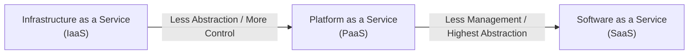
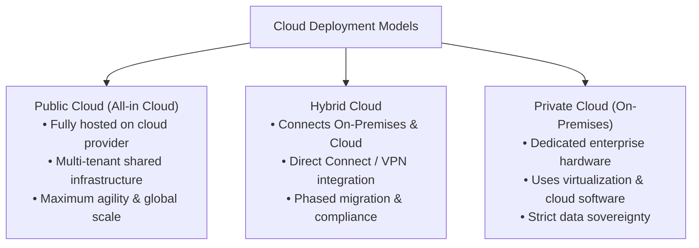

# ☁️ What Is Cloud Computing?

> **Course**: AWS re/Start Cloud Foundations (RSCF)  
> **Module**: M01 – Introduction to Cloud Computing  
> **Source**: `T05-0004-RSCF_SG_EN-US_M01_WHATISCLOUDCOMPUTING.pdf`  
> **Target Audience**: AWS re/Start Learners & Cloud Practitioners  

---

## 🎯 Module Overview

Welcome to **What Is Cloud Computing?**, the foundational module of the AWS re/Start Cloud Foundations curriculum. This module introduces the core paradigms of cloud computing, contrasts traditional physical infrastructure with modern cloud architecture, explores cloud service and deployment models, and outlines standard industry use cases.

### 📌 Learning Objectives
- [ ] Define cloud computing using both AWS and NIST standard definitions
- [ ] Contrast the traditional on-premises model (infrastructure as hardware) with the cloud computing model (infrastructure as software)
- [ ] Describe the three primary cloud service models: Infrastructure as a Service (IaaS), Platform as a Service (PaaS), and Software as a Service (SaaS)
- [ ] Understand the shared management responsibilities across service models ("Who manages what?")
- [ ] Distinguish between the three primary cloud deployment models: Cloud (Public/All-in Cloud), Hybrid Cloud, and Private (On-Premises) Cloud
- [ ] Evaluate the operational and financial differences between cloud and on-premises infrastructure
- [ ] Identify key enterprise workloads and solutions enabled by cloud platforms

---

## 🧠 1. Defining Cloud Computing

### What Does Cloud Computing Mean?

```
┌────────────────────────────────────────────────────────────────────────┐
│                        AWS Definition of Cloud                         │
│                                                                        │
│  "Cloud computing is the on-demand delivery of compute power,          │
│   database, storage, applications, and other IT resources through      │
│   a cloud services platform via the internet with pay-as-you-go        │
│   pricing."                                                            │
└────────────────────────────────────────────────────────────────────────┘
```

At its most fundamental level, the cloud is a network of remote computers and servers housed in secure data centers worldwide, accessed over the internet, and managed via software APIs and management consoles. Instead of buying, owning, and maintaining physical servers and data centers, organizations tap into compute, storage, and database capacity on demand from a cloud provider such as **Amazon Web Services (AWS)**.

### The NIST Standard Definition (SP 800-145)
The **National Institute of Standards and Technology (NIST)** formally defines cloud computing as:
> *"A model for enabling ubiquitous, convenient, on-demand network access to a shared pool of configurable computing resources (e.g., networks, servers, storage, applications, and services) that can be rapidly provisioned and released with minimal management effort or service provider interaction."*

NIST specifies **five essential characteristics** of cloud computing:
1. **On-Demand Self-Service**: Consumers can unilaterally provision computing capabilities (server time, network storage) automatically without human interaction with the service provider.
2. **Broad Network Access**: Capabilities are available over the network and accessed through standard mechanisms (web browsers, CLI, SDKs, mobile devices).
3. **Resource Pooling**: The provider's computing resources are pooled to serve multiple consumers using a multi-tenant model, dynamically assigning physical and virtual resources according to consumer demand.
4. **Rapid Elasticity**: Capabilities can be elastically provisioned and released—in some cases automatically—to scale outward and inward commensurate with demand.
5. **Measured Service**: Resource usage is monitored, controlled, and reported, providing transparency for both the provider and consumer (metered/pay-as-you-go billing).

---

## 🔄 2. Traditional vs. Cloud Computing Model

### Infrastructure as Hardware vs. Infrastructure as Software

```mermaid
flowchart TD
    subgraph Traditional["Traditional On-Premises: Infrastructure as Hardware"]
        A1["Estimate Theoretical Peak Capacity"] --> A2["Lengthy Procurement & Sourcing"]
        A2 --> A3["Physical Space, Racks, Power & Cooling"]
        A3 --> A4["Manual Installation ('Rack & Stack')"]
        A4 --> A5["Fixed Capacity: Risk of Idle Resources or Outages"]
    end

    subgraph Cloud["Cloud Computing: Infrastructure as Software"]
        B1["Design Architecture & Provision via API / Code"]
        B1 --> B2["Instant On-Demand Resource Provisioning"]
        B2 --> B3["Dynamic Elastic Scaling (Scale In / Scale Out)"]
        B3 --> B4["Treat Resources as Temporary & Disposable"]
        B4 --> B5["Pay Only for What You Use"]
    end
```



### Detailed Comparison

| Attribute | Traditional Computing Model (Hardware) | Cloud Computing Model (Software) |
| :--- | :--- | :--- |
| **Mindset** | Infrastructure as physical hardware | Infrastructure as software / code |
| **Capital & Cost** | Large upfront capital expenditure (CapEx) | Low/no upfront cost; variable operating expense (OpEx) |
| **Capacity Planning** | Guessing theoretical maximum peak demand | Dynamic, flexible capacity scaling elastically |
| **Procurement Cycle** | Weeks, months, or quarters to procure and install | Seconds or minutes via console, CLI, or API |
| **Resource Lifecycle** | Permanent, fixed, depreciated over 3–5 years | Disposable, ephemeral, provisioned and terminated as needed |
| **Physical Facilities** | Real estate, cabling, security guards, HVAC, power | Handled entirely by the cloud provider |
| **Agility & Innovation** | Constrained by hardware boundaries and budget | Rapid experimentation with low failure cost |

> [!NOTE]
> **"Rack and Stack"**: In traditional data centers, IT technicians physically install hardware servers, switches, and storage arrays into metal equipment racks and connect cabling. In the cloud, this entire layer is abstracted away.

---

## 🧩 3. Cloud Service Models

Cloud computing offerings are categorized into three primary service models based on the level of control and management responsibility assumed by the customer versus the cloud provider.



### The Three Service Models

1. **Infrastructure as a Service (IaaS)**:
   - **Customer Control**: Highest control over IT resources.
   - **What You Manage**: The operating system (Linux, Windows), software runtime, databases, middleware, and application code.
   - **What Provider Manages**: Physical data centers, virtualization layer, physical servers, storage disks, and core networking hardware.
   - **Examples**: Amazon EC2 (Elastic Compute Cloud), Amazon VPC, Amazon EBS.

2. **Platform as a Service (PaaS)**:
   - **Customer Control**: Moderate control; focuses purely on application deployment and data.
   - **What You Manage**: Application code, configurations, and application data.
   - **What Provider Manages**: Operating system patching, hardware provisioning, runtime environments, networking, and server capacity maintenance.
   - **Examples**: AWS Elastic Beanstalk, AWS Lambda, Google App Engine, Heroku.

3. **Software as a Service (SaaS)**:
   - **Customer Control**: User-level configuration and data access only.
   - **What You Manage**: User accounts, profile settings, and data files.
   - **What Provider Manages**: Entire software application, infrastructure, runtime, OS, updates, scaling, and underlying hardware.
   - **Examples**: Dropbox, Microsoft 365, Google Workspace, Salesforce, Amazon QuickSight.

### Responsibility Matrix: "Who Manages What?"

| Stack Layer | On-Premises | IaaS (e.g., EC2) | PaaS (e.g., Elastic Beanstalk) | SaaS (e.g., Dropbox / M365) |
| :--- | :---: | :---: | :---: | :---: |
| **Applications** | 👤 You Manage | 👤 You Manage | 👤 You Manage | 🏢 Provider Manages |
| **Data** | 👤 You Manage | 👤 You Manage | 👤 You Manage | 👤 You Manage (Files/Access) |
| **Runtime** | 👤 You Manage | 👤 You Manage | 🏢 Provider Manages | 🏢 Provider Manages |
| **Middleware** | 👤 You Manage | 👤 You Manage | 🏢 Provider Manages | 🏢 Provider Manages |
| **Operating System (OS)** | 👤 You Manage | 👤 You Manage | 🏢 Provider Manages | 🏢 Provider Manages |
| **Virtualization** | 👤 You Manage | 🏢 Provider Manages | 🏢 Provider Manages | 🏢 Provider Manages |
| **Servers** | 👤 You Manage | 🏢 Provider Manages | 🏢 Provider Manages | 🏢 Provider Manages |
| **Storage** | 👤 You Manage | 🏢 Provider Manages | 🏢 Provider Manages | 🏢 Provider Manages |
| **Networking** | 👤 You Manage | 🏢 Provider Manages | 🏢 Provider Manages | 🏢 Provider Manages |

---

## 🌍 4. Cloud Deployment Models

Deployment models describe where applications and resources are hosted and how infrastructure is physically and logically segregated.



### 1. Cloud (All-in Cloud / Public Cloud)
- **Description**: An application fully deployed and operating exclusively within the cloud service provider's environment.
- **Characteristics**:
  - All components run in the cloud provider's global infrastructure.
  - Can use low-level foundational services (compute, storage, networking) or high-level abstracted/serverless services.
  - Born in the cloud or fully migrated from legacy data centers.
- **Best Suited For**: Startups, digital-native applications, web applications, and organizations wanting to eliminate physical infrastructure overhead.

### 2. Hybrid Deployment
- **Description**: Connects cloud-based resources with existing on-premises infrastructure and legacy systems.
- **Characteristics**:
  - Seamlessly bridges company data centers with public cloud environments using technologies like AWS Direct Connect, AWS Storage Gateway, or Site-to-Site VPN.
  - Enables gradual migration strategies, seasonal bursting (cloud bursting), and hybrid disaster recovery.
- **Best Suited For**: Large enterprises with extensive existing data center investments, regulated organizations maintaining sensitive records on-premises while processing customer traffic in the cloud.

### 3. Private Cloud (On-Premises Cloud)
- **Description**: Cloud infrastructure dedicated entirely to a single organization, deployed within an on-premises enterprise data center or private hosting facility.
- **Characteristics**:
  - Leverages virtualization (e.g., VMware, OpenStack) and proprietary self-service portals to mimic cloud functionality.
  - Lacks many public cloud benefits (e.g., unlimited scale, zero capital expense, massive economies of scale).
- **Best Suited For**: Financial institutions, defense organizations, or strict regulatory jurisdictions with non-negotiable data sovereignty or physical segregation requirements.

---

## ⚖️ 5. Cloud Infrastructure vs. On-Premises Infrastructure

| Operational Dimension | Cloud Solution (AWS) | On-Premises Infrastructure |
| :--- | :--- | :--- |
| **Capital Investment** | **No upfront investment**: Pay as you go; zero hardware purchases. | **Large initial purchase**: Racks, servers, storage arrays, switches, cabling. |
| **Ongoing Maintenance** | **Low ongoing costs**: Provider handles hardware failures, maintenance, facilities. | **High maintenance burden**: Labor, patches, hardware replacements, HVAC, power. |
| **Strategic Focus** | **Focus on innovation**: Engineering teams prioritize customer-facing applications. | **Focus on operations**: Teams spend cycles keeping lights on and managing hardware. |
| **Capacity Management** | **Flexible & dynamic**: Provision or terminate resources within seconds or minutes. | **Fixed capacity**: Excess capacity wastes money; insufficient capacity drops requests. |
| **Deployment Speed & Agility**| **Instant provisioning**: Self-service tools and APIs enable fast experimentation. | **Long procurement cycles**: Months required for quoting, purchasing, shipping, racking. |
| **Geographic Reach** | **Global on demand**: Deploy across worldwide AWS Regions and Availability Zones. | **Limited geographic presence**: Expanding to new regions requires huge capital outlay. |

---

## 🛠️ 6. What Can You Do in the Cloud?

Cloud platforms offer modular building blocks that support virtually every modern enterprise workload:

1. **Application Hosting**:
   - Run mission-critical internal business systems, web applications, microservices, and mobile backends on reliable, scalable compute.
2. **Backup and Storage**:
   - Implement durable, cost-effective backup and disaster recovery solutions using highly available storage services (such as Amazon S3, S3 Glacier).
3. **Content Delivery**:
   - Accelerate content delivery worldwide to end users with low latency using globally distributed content delivery networks (CDNs like Amazon CloudFront).
4. **Websites**:
   - Host static portfolio sites, dynamic e-commerce platforms, or high-traffic enterprise portals with automated load balancing.
5. **Enterprise IT**:
   - Seamlessly host internal ERP, CRM, directory services, intranet environments, and employee collaboration suites.
6. **Databases**:
   - Deploy high-performance managed relational databases (Amazon RDS, Aurora) and non-relational NoSQL databases (Amazon DynamoDB) with automated backups, replication, and scaling.

---

## 📝 7. Knowledge Check & Review

Test your understanding of the concepts covered in this module:

### Question 1
**Which statement best characterizes the core difference between traditional computing and cloud computing?**
- A) Traditional computing uses Linux, while cloud computing only uses Windows.
- B) Traditional computing views infrastructure as physical hardware; cloud computing treats infrastructure as software.
- C) Cloud computing requires larger upfront capital investments than on-premises data centers.
- D) Cloud computing does not require an internet connection.

> **Answer: B**  
> *Explanation*: Cloud computing abstracts physical hardware away, enabling users to provision, manage, scale, and automate infrastructure as software code via APIs and consoles.

---

### Question 2
**Under the Platform as a Service (PaaS) model, which of the following layers is typically the customer's responsibility to manage?**
- A) Physical server maintenance
- B) Operating system security patching
- C) Application code and configurations
- D) Data center cooling and power

> **Answer: C**  
> *Explanation*: In PaaS, the provider handles hardware, virtualization, operating systems, runtime, and middleware. The customer focuses solely on their application code and data.

---

### Question 3
**An organization has decided to maintain legacy database servers in its own corporate data center while hosting its public-facing web applications in AWS. Which deployment model does this represent?**
- A) Public Cloud
- B) Private Cloud
- C) Hybrid Cloud
- D) Multi-SaaS

> **Answer: C**  
> *Explanation*: A hybrid deployment bridges and connects on-premises resources and infrastructure with cloud-based resources.

---

### Question 4
**Which of the following is NOT one of the five essential characteristics of cloud computing defined by NIST?**
- A) Rapid elasticity
- B) Broad network access
- C) Fixed multi-year hardware leasing
- D) On-demand self-service

> **Answer: C**  
> *Explanation*: NIST defines the 5 essential characteristics as On-Demand Self-Service, Broad Network Access, Resource Pooling, Rapid Elasticity, and Measured Service. Fixed hardware leases are a trait of traditional IT, not cloud computing.

---

## 📌 8. Key Takeaways

> [!IMPORTANT]
> - **Definition**: Cloud computing is the on-demand delivery of IT resources (compute, database, storage, networking, applications) over the internet with pay-as-you-go pricing.
> - **Mindset Shift**: Infrastructure is treated and managed as **software**, enabling automated provisioning and temporary, disposable resources.
> - **Service Models (IaaS, PaaS, SaaS)**: Range from maximum user control (IaaS) to turnkey, fully managed software solutions (SaaS).
> - **Deployment Models (Cloud, Hybrid, Private)**: Define where resources live—fully in the public cloud, connected between cloud and on-premises (hybrid), or dedicated strictly within an enterprise facility (private).
> - **Versatility**: Virtually any traditional IT workload—from databases to enterprise apps—can be implemented more efficiently and globally on AWS.
