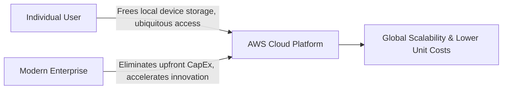
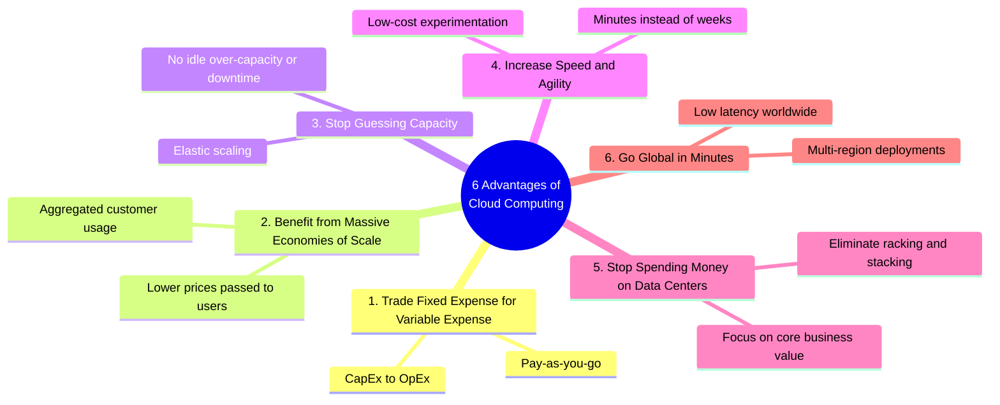
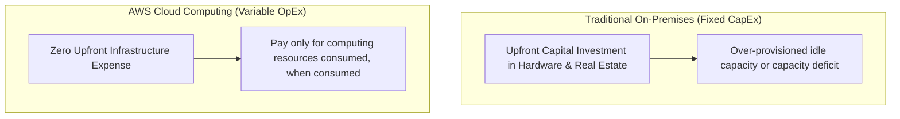
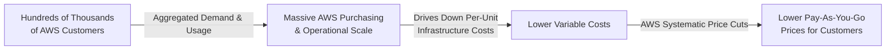
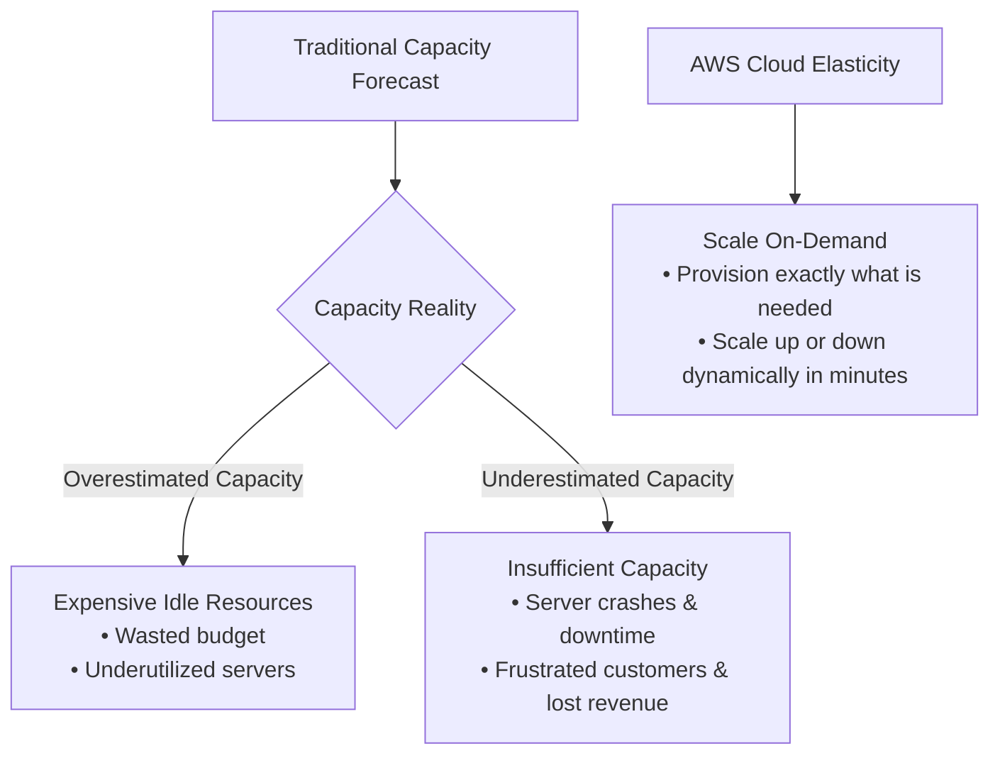
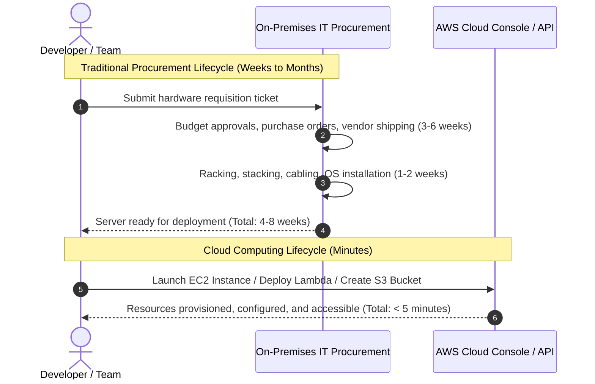
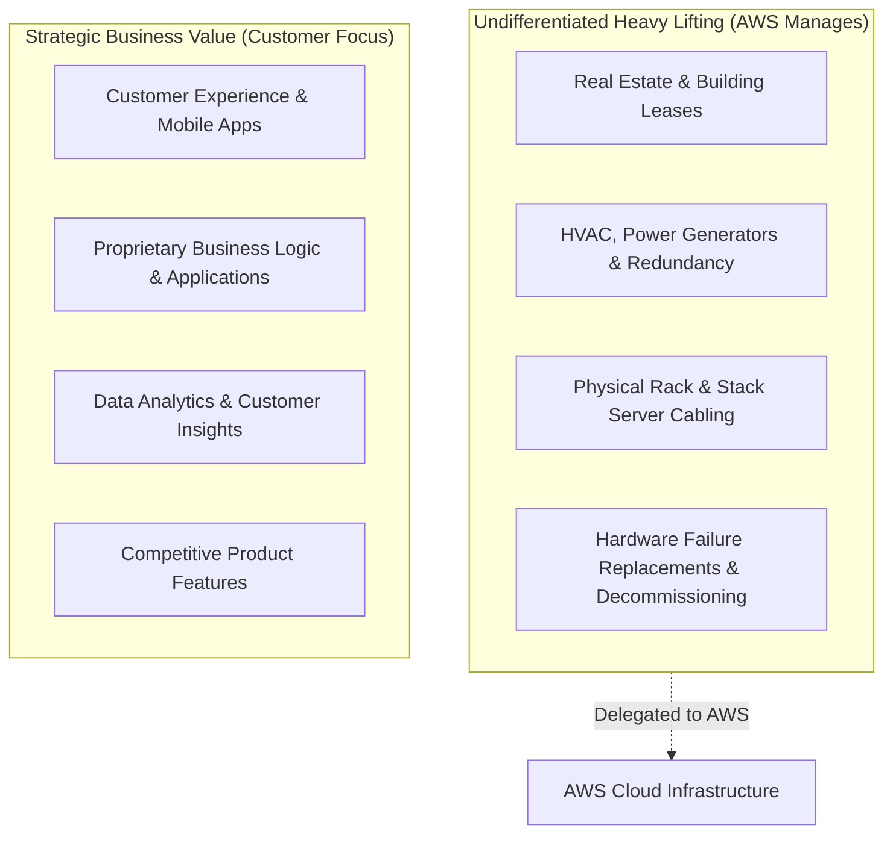
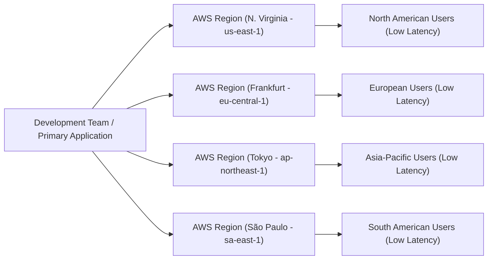

# ☁️ Advantages of Cloud Computing

> **Course**: AWS Cloud Foundations  
> **Module**: M01 – Cloud Concepts & Foundations  
> **Source**: `T05-0005-RSCF_SG_EN-US_M01_ADVANTAGESCLOUDCOMPUTING.pdf`  
> **Target Audience**: AWS re/Start Learners & Cloud Practitioners  

---

## 🎯 Module Overview

Welcome to **Advantages of Cloud Computing**. In this module, you will explore why organizations—from agile startups to multinational enterprises and public sector agencies—are migrating from traditional on-premises data centers to the cloud. You will learn the financial, operational, and architectural advantages of cloud computing, specifically the **Six Core Advantages of Cloud Computing** defined by Amazon Web Services (AWS).

### 📌 Learning Objectives
- [ ] Identify and articulate the six core advantages of cloud computing.
- [ ] Analyze the difference between fixed expenses (CapEx) and variable expenses (OpEx).
- [ ] Summarize how massive economies of scale translate into lower pay-as-you-go pricing for customers.
- [ ] Explain how on-demand scalability eliminates guessing infrastructure capacity needs.
- [ ] Evaluate how rapid resource provisioning increases organizational speed, experimentation, and agility.
- [ ] Describe how eliminating data center management frees organizations to focus on core business differentiators.
- [ ] Understand how global cloud infrastructure enables worldwide multi-region deployments in minutes.

---

## 💬 Foundational Discussion: Why Move to the Cloud?

Before diving into the six advantages, consider these reflective questions and explore how cloud computing impacts individuals and modern businesses.



### Reflective Questions & Perspectives

#### 1. How does cloud computing benefit you personally?
Cloud computing provides instantaneous access to compute servers, high-durability storage, relational/NoSQL databases, and application software over the internet.
* **Consumer Example**: Cloud-backed storage (such as Apple iCloud, Google Photos, or Amazon Photos) frees up valuable memory on mobile phones and personal computers. When your phone runs out of storage, you can stream media, back up pictures, and retrieve files anywhere without purchasing external hard drives.

#### 2. If you run a business, how does cloud computing benefit your enterprise?
Cloud service providers like AWS provide on-demand access to flexible, enterprise-grade, low-cost IT resources without large upfront commitments.
* **Business Example**: Rather than purchasing physical real estate, server racks, uninterrupted power supplies (UPS), HVAC cooling, and enterprise software licenses, business owners can launch infrastructure with a single API call or console click and pay strictly for the compute hours and storage gigabytes consumed.

#### 3. Why are so many organizations migrating to the cloud?
Organizations migrate to the cloud because it fundamentally changes how technology delivers business value:
* **Cost Efficiency**: Pay-as-you-go billing avoids over-provisioning waste.
* **Agility**: Rapid prototyping and experimentation allow teams to bring products to market faster.
* **Resilience & Breadth**: Ready access to advanced services (AI/ML, big data analytics, IoT) without requiring specialized in-house hardware engineering.

---

## 🏛️ The 6 Core Advantages of Cloud Computing



---

### 1. 🔄 Trade Fixed Expense for Variable Expense (CapEx $\rightarrow$ OpEx)

In traditional IT, companies must invest heavily in physical infrastructure up front before knowing how applications will perform or scale. Cloud computing replaces this fixed-cost model with a flexible pay-as-you-go variable cost structure.



#### Comparison: Fixed Expense vs. Variable Expense

| Expense Category | Accounting Concept | Definition | Characteristics |
| :--- | :--- | :--- | :--- |
| **Fixed Expense (CapEx)** | Capital Expenditure | Funds used to acquire, upgrade, and maintain physical assets such as land, data center buildings, hardware racks, and cooling systems. | Requires large upfront forecasting, multi-year depreciation schedules, and sunk costs regardless of utilization. |
| **Variable Expense (OpEx)** | Operational Expenditure | Expenses that scale with operational activity and can be adjusted, scaled down, or avoided based on business demand. | Paid incrementally (per second, hour, or GB), charged only during active consumption, with no long-term physical commitments. |

> [!NOTE]
> **Key Takeaway**: Instead of investing millions into data centers and servers based on multi-year forecasts, you pay only when you use resources, and only for how much you use (Pay-as-you-go).

---

### 2. 📉 Benefit from Massive Economies of Scale

Because usage from hundreds of thousands of customers is aggregated across the AWS Cloud, providers achieve unprecedented economies of scale.



- **Higher Economies of Scale**: Purchasing hardware, bulk electricity, custom silicon (e.g., AWS Graviton, AWS Nitro), and global fiber network capacity in massive volume yields lower per-unit production costs than any single organization could negotiate.
- **Passing Savings Forward**: AWS systematically passes these operational efficiencies directly back to customers in the form of lower pay-as-you-go pricing (AWS has lowered prices over 100 times since inception).

> [!TIP]
> **Economies of Scale in Practice**: A solo developer or small startup accesses enterprise-grade server instances and storage clusters at the exact same discounted unit rates as Fortune 500 corporations.

---

### 3. 🎯 Stop Guessing Capacity (Reduce Guessing About Capacity)

Before cloud computing, organizations had to predict peak usage months or years in advance. These estimates were almost always inaccurate, resulting in two costly failure states:



#### Capacity Scenarios Compared

| Scenario | On-Premises Outcome | AWS Cloud Outcome |
| :--- | :--- | :--- |
| **Overestimated Capacity** | Thousands of dollars in idle servers, wasted electricity, and depreciation costs. | Resources are scaled down or terminated immediately; zero payments for decommissioned instances. |
| **Underestimated Capacity** | System outages, traffic throttling, lost customer transactions, and weeks/months required to order and install new hardware. | **Auto Scaling** spins up additional EC2 instances or container containers within minutes to absorb spikes. |
| **Variable Traffic Pattern** | Hardware must be sized for the yearly peak hour (e.g., Black Friday), sitting idle for the remaining 364 days. | System expands dynamically during peak demand and contracts when traffic subsides. |

> [!IMPORTANT]
> **Elasticity**: Cloud computing allows you to access as many or as few resources as needed, scaling up and down with only a few minutes' notice.

---

### 4. ⚡ Increase Speed and Agility

In traditional enterprise IT environments, ordering a physical server, obtaining approvals, delivering the hardware, racking, cabling, and configuring operating systems could take **weeks or months**.



#### Dimensions of Agility

1. **Rapid Availability of Resources**:
   - New computing, storage, and networking resources are accessible with a single click or API call.
   - Reduces the delay between conceiving a requirement and provisioning resources from **weeks down to minutes**.
2. **Accelerated Innovation & Experimentation**:
   - Engineering teams can test hypotheses, build proof-of-concept prototypes, and experiment with low cost and negligible financial risk.
   - If an experiment succeeds, scale it seamlessly. If it fails, terminate the instances without financial penalty.
3. **Prefabricated Enterprise Functionality**:
   - Gain instant access to complex, production-grade solutions (data warehousing with Amazon Redshift, machine learning with Amazon SageMaker, managed analytics, serverless processing) without needing deep in-house infrastructure engineering teams.

---

### 5. 🏢 Stop Spending Money on Running and Maintaining Data Centers

Operating an on-premises data center involves significant **undifferentiated heavy lifting**—critical infrastructure work that keeps the lights on but provides zero competitive advantage or unique differentiation to your customers.



#### What Cloud Adoption Eliminates

- **Racking, Stacking, and Powering**: AWS takes full ownership of physical data center logistics, physical security, cooling, hardware lifecycle refreshes, and network switching.
- **Resource Reallocation**: IT teams stop spending their daily hours babysitting power supplies and replacing failed disk arrays. They refocus 100% of their energy on writing code, optimizing customer experiences, and building distinctive features that drive business growth.

> [!NOTE]
> **Business Value Alignment**: Focus on projects that differentiate your business from competitors instead of focusing on maintaining physical infrastructure.

---

### 6. 🌍 Go Global in Minutes

AWS operates an extensive global cloud infrastructure consisting of dozens of geographic **Regions** and hundreds of **Availability Zones (AZs)**, connected by a dedicated, redundant, low-latency private network backbone.



- **Global Reach with Minimal Effort**: Deploy applications in multiple AWS Regions around the globe with a few clicks, command-line scripts, or AWS CloudFormation templates.
- **Reduced Latency**: By placing compute and storage resources geographically closer to end users, data travels shorter distances, dramatically reducing network latency and improving customer responsiveness.
- **Data Residency & Compliance**: Meet regulatory and compliance requirements by retaining customer data inside specific geographical boundaries and jurisdictions.

> [!TIP]
> For up-to-date geographical coverage of AWS Regions and Availability Zones, visit the [AWS Global Infrastructure Map](https://aws.amazon.com/about-aws/global-infrastructure/).

---

## 📊 Summary: The 6 Advantages Matrix

| Advantage # | Advantage Name | Traditional IT Challenge | AWS Cloud Benefit |
| :---: | :--- | :--- | :--- |
| **1** | **Trade fixed expense for variable expense** | Large upfront capital expenditures (CapEx) tied up in physical servers and real estate. | Pay-as-you-go operational expenditures (OpEx); pay only for what you consume. |
| **2** | **Benefit from massive economies of scale** | Individual companies have limited purchasing power, resulting in higher per-unit hardware costs. | Aggregated usage from hundreds of thousands of customers lowers unit costs; passed on as lower prices. |
| **3** | **Stop guessing capacity** | Risk of buying too much (wasted money) or too little (costly downtime). | Dynamic, elastic scaling on demand; adjust resource levels up or down in minutes. |
| **4** | **Increase speed and agility** | Hardware procurement takes weeks or months; slow experimentation cycles. | New IT resources provisioned in minutes; low-cost experimentation and rapid innovation. |
| **5** | **Stop spending money on data centers** | Expensive and time-consuming "undifferentiated heavy lifting" (racking, stacking, power, cooling). | Focus resources on business differentiators and customer satisfaction while AWS runs the infrastructure. |
| **6** | **Go global in minutes** | Global data center expansion requires months of logistical planning, contracts, and enormous capital. | Deploy across multiple AWS Regions worldwide in minutes with low latency and minimal cost. |

---

## 👥 Collaborative Research Activity: AWS Customer Success Stories

In this collaborative exercise, you will investigate how real-world organizations leveraged the advantages of cloud computing to solve business challenges.

### Activity Instructions
1. **Team Formation**: Group into teams of 2–3 students.
2. **Select an AWS Customer**: Visit the [AWS Case Studies & Customer Stories](https://aws.amazon.com/solutions/case-studies/) repository.
3. **Coordinate Selection**: To avoid redundancy between groups, record your team's chosen customer on the shared cohort board.
4. **Analyze the Case Study**: Identify the company's background, previous challenges, the AWS solution adopted, and which of the 6 advantages were realized.
5. **Prepare & Present**: Deliver a 3–5 minute presentation detailing your findings.

### 📝 Team Worksheet Template

```markdown
### Team Presentation Brief: AWS Customer Success Story

* **Team Members**: [Student 1, Student 2, Student 3]
* **Customer / Organization Name**: [e.g., Netflix / Airbnb / Moderna / Formula 1]
* **Industry**: [e.g., Media & Entertainment, Healthcare, Financial Services]

#### 1. Business Challenge & Prior Constraints
- What technical or financial bottlenecks did the organization encounter before moving to AWS?
- Were they hindered by capacity forecasting, slow provisioning, or high data center maintenance costs?

#### 2. AWS Solution Implemented
- Which primary AWS services were deployed (e.g., Amazon EC2, Amazon S3, AWS Lambda, Amazon Aurora)?
- How was the architecture designed to support the organization's requirements?

#### 3. Cloud Advantages Realized
- [ ] Traded CapEx for OpEx (Cost optimization)
- [ ] Benefited from massive economies of scale
- [ ] Stopped guessing capacity (Elastic scaling during traffic surges)
- [ ] Increased speed and agility (Faster time-to-market)
- [ ] Eliminated data center maintenance (Staff pivoted to core products)
- [ ] Went global in minutes (Deployed services across multiple AWS Regions)

#### 4. Measurable Business Outcomes
- What were the quantifiable results (e.g., 40% cost reduction, 99.999% uptime, 10x faster deployment frequency)?
```

---

## 🧠 Knowledge Check & Self-Assessment

Test your understanding of the concepts covered in this module.

### Question 1
**An online retailer experiences an unexpected 500% surge in web traffic during an unannounced flash sale. Because they host their application on AWS, the system automatically launches additional compute instances to handle the traffic without manual intervention or downtime. Which cloud computing advantage does this best illustrate?**
- A) Benefit from massive economies of scale
- B) Stop guessing capacity
- C) Go global in minutes
- D) Trade fixed expense for variable expense

<details>
<summary>👉 View Answer & Explanation</summary>

**Correct Answer**: **B) Stop guessing capacity**  
**Explanation**: By leveraging elasticity and Auto Scaling, the retailer does not have to forecast peak capacity in advance. Resources dynamically scale up to meet customer demand and scale down when traffic normalizes, preventing downtime and overspending.
</details>

---

### Question 2
**What is the primary difference between a fixed expense (CapEx) and a variable expense (OpEx) in cloud economics?**
- A) Fixed expenses adjust based on hourly server usage, whereas variable expenses are contracted for 5 years.
- B) Fixed expenses involve upfront capital investment in physical assets (like buildings and hardware), while variable expenses can be altered, scaled, or avoided based on consumption.
- C) Variable expenses require large initial data center buildouts, whereas fixed expenses are pay-as-you-go.
- D) Variable expenses only apply to network bandwidth, whereas fixed expenses apply to databases.

<details>
<summary>👉 View Answer & Explanation</summary>

**Correct Answer**: **B) Fixed expenses involve upfront capital investment in physical assets (like buildings and hardware), while variable expenses can be altered, scaled, or avoided based on consumption.**  
**Explanation**: CapEx (Capital Expenditure) requires large upfront financial outlays for hardware, real estate, and facilities. OpEx (Operational Expenditure) enables organizations to pay only for the operational resources they consume, adjusting costs in real time.
</details>

---

### Question 3
**Why can AWS offer lower pay-as-you-go prices to individual customers compared to what an individual company can achieve building its own data center?**
- A) AWS uses cheaper, lower-quality consumer hardware.
- B) AWS aggregates usage from hundreds of thousands of customers, achieving massive economies of scale and passing those cost savings on to customers.
- C) AWS charges fixed yearly licensing fees that subsidize compute costs.
- D) AWS limits all server runtimes to business hours only.

<details>
<summary>👉 View Answer & Explanation</summary>

**Correct Answer**: **B) AWS aggregates usage from hundreds of thousands of customers, achieving massive economies of scale and passing those cost savings on to customers.**  
**Explanation**: The aggregated purchasing power and operational efficiency of hundreds of thousands of customers allows AWS to achieve economies of scale that drive down unit costs, resulting in lower pay-as-you-go pricing.
</details>

---

### Question 4
**A startup wants to test whether machine learning can improve its product recommendations. Using AWS, the engineering team provisions a managed ML environment in 10 minutes, runs experiments for two days for under $50, and deletes the resources after completing the test. Which cloud advantage is demonstrated?**
- A) Go global in minutes
- B) Increased speed and agility
- C) Physical data center maintenance
- D) Massive economies of scale

<details>
<summary>👉 View Answer & Explanation</summary>

**Correct Answer**: **B) Increased speed and agility**  
**Explanation**: Cloud computing reduces the time needed to acquire resources from weeks to minutes, allowing rapid, low-cost experimentation and innovation without long-term commitments or physical hardware setup.
</details>

---

### Question 5
**What is meant by the phrase "undifferentiated heavy lifting" in the context of data center operations?**
- A) Lifting heavy server hardware into racks without mechanical assistance.
- B) Operational tasks like powering, cooling, cabling, and maintaining hardware that are necessary for IT operations but do not directly differentiate the business in the market.
- C) Running database queries on unindexed relational tables.
- D) Writing custom application code for mobile applications.

<details>
<summary>👉 View Answer & Explanation</summary>

**Correct Answer**: **B) Operational tasks like powering, cooling, cabling, and maintaining hardware that are necessary for IT operations but do not directly differentiate the business in the market.**  
**Explanation**: Racking, stacking, powering, and cooling servers are foundational IT operational tasks, but they do not make a business unique to its customers. Delegating these to AWS frees the company to focus on product differentiation.
</details>

---

## 📚 References & Recommended Reading
- [Overview of Amazon Web Services Whitepaper](https://docs.aws.amazon.com/whitepapers/latest/aws-overview/aws-overview.pdf)
- [AWS Global Infrastructure Documentation](https://aws.amazon.com/about-aws/global-infrastructure/)
- [AWS Customer Case Studies & Reference Architectures](https://aws.amazon.com/solutions/case-studies/)
