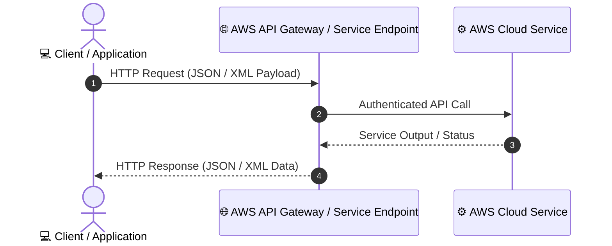
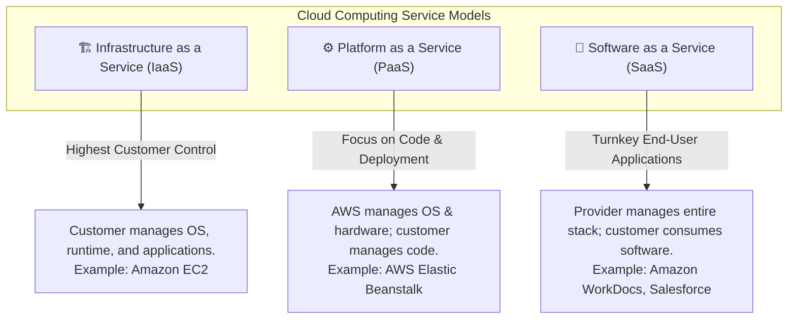
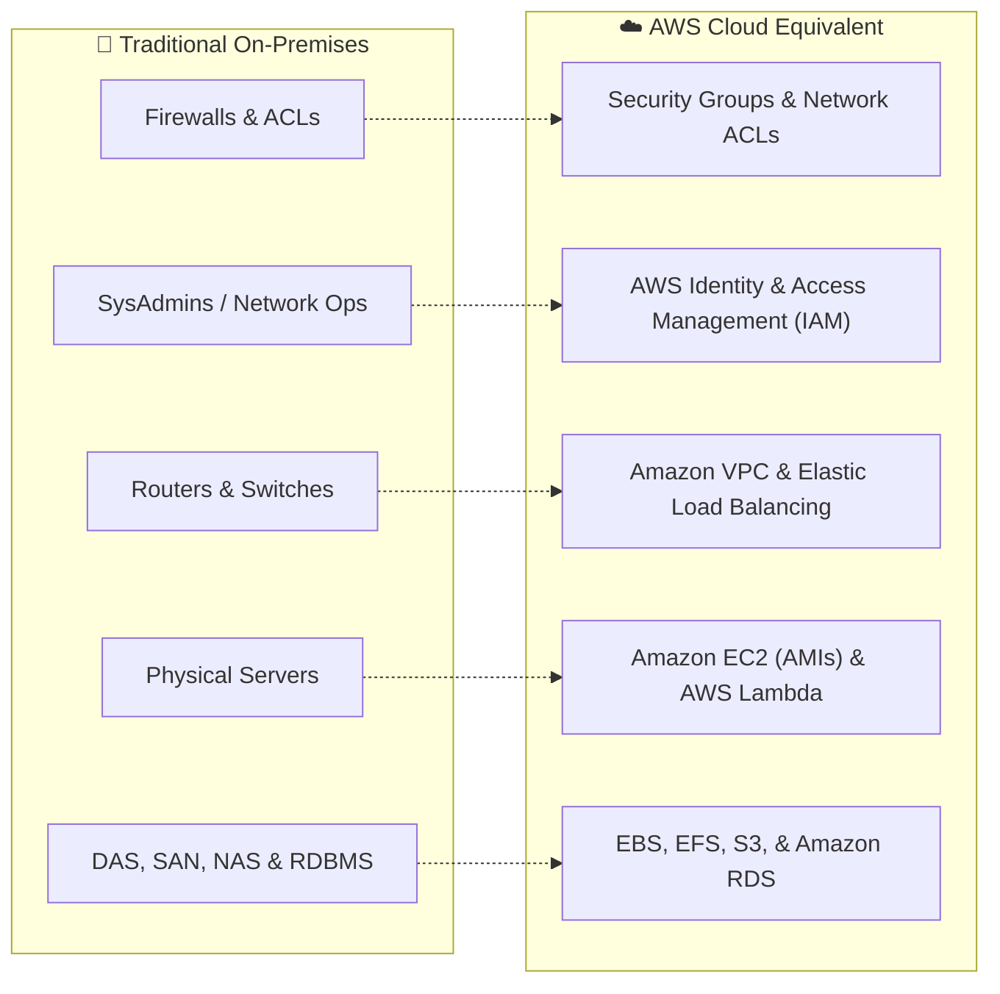
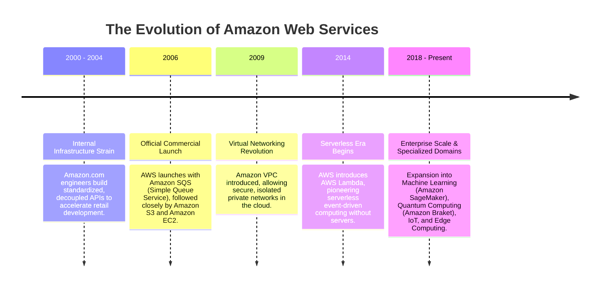
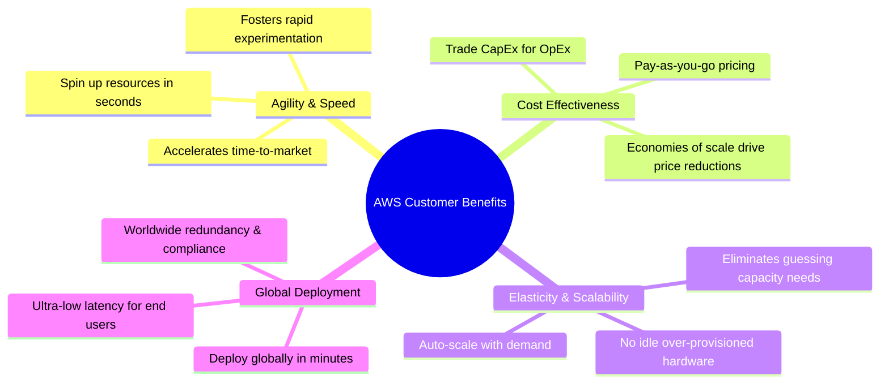
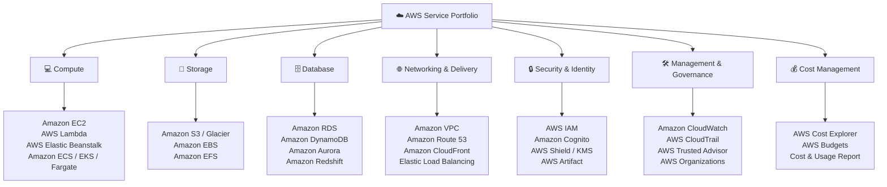
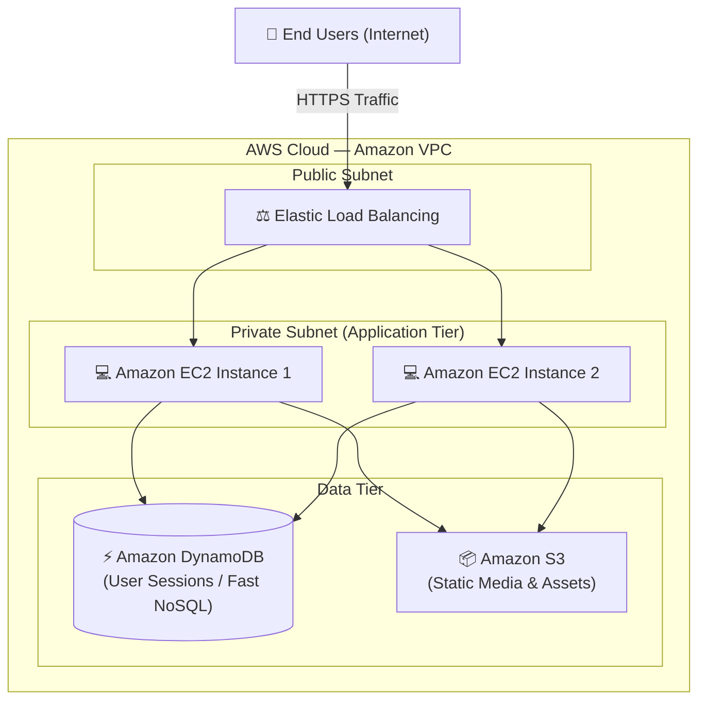
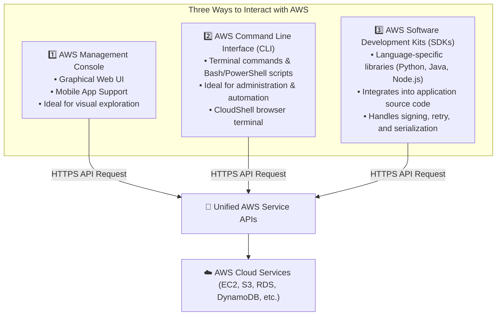
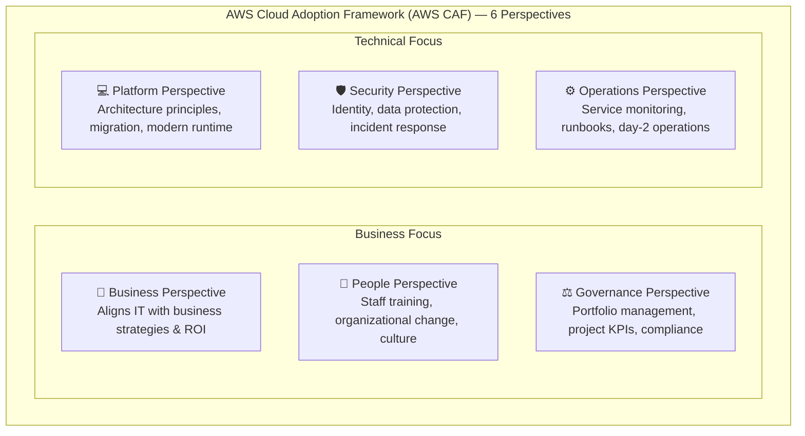
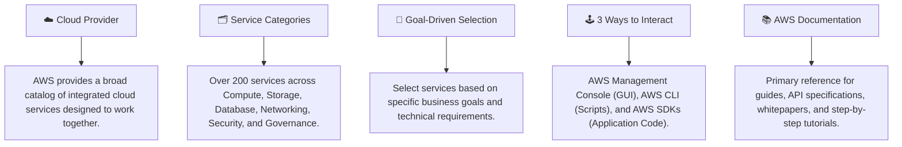

# ☁️ What Is AWS? Cloud Foundations & Service Architecture

> **Course**: AWS Cloud Foundations  
> **Module**: M01 – Cloud Foundations: What Is AWS?  
> **Source**: `T05-0006-FOUN_WHATISAWS_EN.pdf`  
> **Target Audience**: AWS re/Start Learners / Cloud Practitioners  

---

## 🎯 Module Overview

Amazon Web Services (AWS) is the world's most comprehensive and broadly adopted cloud platform, offering over 200 fully featured services from data centers globally. This module introduces the fundamental concepts of web services, explores the core infrastructure components of AWS, contrasts traditional on-premises IT with AWS cloud environments, examines the three primary ways to interact with AWS services, and introduces the AWS Cloud Adoption Framework (AWS CAF).

### 📌 Learning Objectives
- [ ] Define what a web service is and understand how APIs interact using standard messaging formats (XML and JSON)
- [ ] Review the three primary cloud computing service models: IaaS, PaaS, and SaaS
- [ ] Compare on-premises IT infrastructure with equivalent AWS cloud managed services
- [ ] Understand the definition, history, and evolution of AWS
- [ ] Evaluate customer benefits, elasticity, and global reach provided by AWS
- [ ] Categorize common AWS services across Compute, Storage, Database, Networking, Security, Governance, and Cost Management
- [ ] Contrast the three interfaces for interacting with AWS: AWS Management Console, AWS CLI, and AWS SDKs
- [ ] Understand the 6 core perspectives of the AWS Cloud Adoption Framework (AWS CAF)
- [ ] Navigate the AWS Documentation library and identify foundational whitepapers for Cloud Practitioner certification
- [ ] Complete the hands-on AWS Documentation Scavenger Hunt knowledge check

---

## 🌐 1. Foundations of Web Services & Cloud Models

### What Is a Web Service?
A **web service** is any software application that makes itself available over the internet using standardized protocol interfaces. It enables cross-platform communication between machines independent of the underlying operating system or programming language.

- **Standardized Messaging**: Web service interactions use Application Programming Interfaces (APIs) exchanging payloads formatted in **Extensible Markup Language (XML)** or **JavaScript Object Notation (JSON)**.
- **Client-Server Architecture**: A client sends a structured request message over HTTP/HTTPS, and the web service processes the logic and returns a structured response message.

---

### Cloud Computing Service Models Review

Cloud computing architectures are traditionally categorized into three primary service models, representing different tiers of shared management:

| Model | Abbreviation | Customer Responsibility | AWS Responsibility | AWS Example |
| :--- | :--- | :--- | :--- | :--- |
| **Infrastructure as a Service** | **IaaS** | Operating system, middleware, runtime, data, application logic | Physical hardware, virtualization, facilities, power, networking | Amazon EC2, Amazon VPC, Amazon EBS |
| **Platform as a Service** | **PaaS** | Application code, configuration, data management | OS patching, runtime environment, server provisioning, scaling | AWS Elastic Beanstalk, AWS Lambda |
| **Software as a Service** | **SaaS** | User configuration, access management, application consumption | Full stack maintenance, updates, infrastructure, backups | AWS Management Console, SaaS Partner Offerings |

---

## 🔄 2. On-Premises vs. AWS Infrastructure Comparison

Migrating from an on-premises data center to the AWS Cloud replaces physical, capital-intensive equipment with agile, software-defined managed services.

### Detailed Mapping: Physical to Cloud Components

| Infrastructure Domain | On-Premises Traditional Component | AWS Cloud Managed Solution | Primary Architectural Benefit |
| :--- | :--- | :--- | :--- |
| **Security & Firewalls** | Hardware Firewalls, Port ACLs | **Security Groups** (stateful instance firewall) & **Network ACLs** (stateless subnet firewall) | Software-defined rules, automated tagging, granular subnet perimeter defense |
| **Identity & Access** | Local Active Directory, LDAP, Server Root Admins | **AWS IAM (Identity and Access Management)** | Centralized policies, role-based delegation, multi-factor authentication (MFA) |
| **Networking & Routing** | Physical Routers, Network Pipelines, Switches | **Amazon VPC (Virtual Private Cloud)** & **Elastic Load Balancing (ELB)** | Isolated virtual networks, automated health checking, elastic traffic distribution |
| **Compute & Servers** | Rackmount Servers, Hypervisors | **Amazon EC2 (Instances & AMIs)** | Instant provisioning, resizable capacity, custom base machine images (AMIs) |
| **Block & File Storage** | DAS (Direct-Attached), SAN, NAS | **Amazon EBS (Elastic Block Store)** & **Amazon EFS (Elastic File System)** | High-throughput, resilient persistence detached from underlying physical machines |
| **Object Storage** | On-prem storage arrays, tape backups | **Amazon S3 (Simple Storage Service)** | 99.999999999% (11 9s) data durability, virtually infinite scalable storage |
| **Relational Database** | Self-managed RDBMS (Oracle, MySQL, SQL Server) | **Amazon RDS** & **Amazon Aurora** | Automated backups, multi-AZ failover, automatic patch management |

---

## 📖 3. What Is AWS? Definition, History, and Evolution

> [!IMPORTANT]
> **Definition of AWS**:  
> **Amazon Web Services (AWS)** is a secure cloud services platform offering compute power, database storage, content delivery, and other functionality to help businesses scale and grow. AWS provides a broad set of global cloud-based products—known as **services**—that are designed to work together seamlessly.

### History and Evolution of AWS

1. **Origins (Early 2000s)**: Amazon's internal engineering teams struggled with slow development cycles because every project required building custom database, storage, and server pipelines. To solve this, Amazon decoupled infrastructure services through standardized internal APIs.
2. **Launch (2006)**: Recognizing that developers globally faced the same problem, AWS launched commercially with core building blocks: **Amazon S3** (object storage) and **Amazon EC2** (elastic virtual compute).
3. **Broad Enterprise Platform**: Over nearly two decades, AWS expanded from raw compute and storage into a comprehensive ecosystem of over 200 services spanning analytics, artificial intelligence, robotics, IoT, and enterprise migrations.

---

## 🌍 4. Global Reach & Customer Benefits

### Core Pillars of Customer Benefits

1. **Agility and Innovation**: Developers can spin up hundreds of servers in minutes rather than waiting weeks or months for hardware procurement.
2. **Cost Savings (Pay-As-You-Go)**: Replace upfront capital expense (**CapEx**) with variable operating expense (**OpEx**). Pay only for the computing capacity, storage, and bandwidth actually consumed.
3. **Elasticity**: Elastic Auto Scaling allows resources to expand dynamically during traffic spikes and contract when demand subsides, avoiding wasteful over-provisioning.
4. **Global Reach**: Organizations can deploy multi-region architectures worldwide in minutes, placing applications closer to end users for minimal latency.

---

## 🗂️ 5. AWS Service Categories & Commonly Used Services

AWS organizes its comprehensive catalog into functional service categories.

### Reference Table: Commonly Used AWS Services

| Category | Service Name | Purpose & Primary Functionality |
| :--- | :--- | :--- |
| **Compute** | **Amazon EC2** | Resizable virtual compute capacity (virtual machines) |
| | **AWS Lambda** | Serverless compute executing code in response to events |
| | **AWS Elastic Beanstalk** | PaaS for deploying and scaling web applications automatically |
| | **Amazon ECS & EKS** | Managed container orchestration (Docker and Kubernetes) |
| | **AWS Fargate** | Serverless compute engine for containers |
| **Storage** | **Amazon S3** | Highly scalable, durable object storage for data lakes and assets |
| | **Amazon S3 Glacier** | Low-cost archival storage for long-term data retention |
| | **Amazon EBS** | Persistent high-performance block storage volumes for EC2 |
| | **Amazon EFS** | Scalable, fully managed shared elastic file storage (NFS) |
| **Database** | **Amazon RDS** | Managed relational database service (MySQL, PostgreSQL, Oracle, SQL Server) |
| | **Amazon Aurora** | High-performance MySQL and PostgreSQL-compatible cloud database |
| | **Amazon DynamoDB** | Fully managed, serverless, single-digit millisecond NoSQL key-value database |
| | **Amazon Redshift** | Fast, petabyte-scale cloud data warehousing service |
| **Networking** | **Amazon VPC** | Logically isolated virtual network for AWS resources |
| | **Amazon Route 53** | Highly available and scalable cloud Domain Name System (DNS) |
| | **Amazon CloudFront** | Fast, secure global Content Delivery Network (CDN) |
| | **Elastic Load Balancing** | Distributes incoming application traffic across targets |
| **Security & Compliance** | **AWS IAM** | Granular authentication and authorization for AWS resources |
| | **Amazon Cognito** | User identity management, authentication, and sign-in |
| | **AWS Shield** | Managed Distributed Denial of Service (DDoS) protection |
| | **AWS KMS** | Key Management Service for managing cryptographic keys |
| | **AWS Artifact** | On-demand access to AWS compliance reports and agreements |
| **Management & Governance** | **Amazon CloudWatch** | Observability, metric monitoring, log collection, and alarms |
| | **AWS CloudTrail** | Auditing and governance: records AWS API activity and account events |
| | **AWS Trusted Advisor** | Real-time recommendations for cost, security, fault tolerance, and performance |
| | **AWS Organizations** | Centralized governance and billing across multiple AWS accounts |
| **Cost Management** | **AWS Cost Explorer** | Visualize, understand, and manage AWS costs and usage over time |
| | **AWS Budgets** | Set custom cost and usage limits with automated alert thresholds |
| | **AWS Cost & Usage Report** | Comprehensive, granular billing dataset exportable to S3 |

---

## 🏗️ 6. Architectural Solution Example & Choosing a Service

Choosing the right AWS service depends on balancing **business goals** (budget, regulatory requirements, speed-to-market) and **technology requirements** (throughput, latency, state management, operational overhead).

### Multi-Tier Cloud Solution Architecture Example

A standard multi-tier web application combines networking, compute, database, and storage into a fault-tolerant solution:

1. **Virtual Private Cloud (Amazon VPC)**: Provides a logically isolated network boundary.
2. **Elastic Load Balancing (ELB)**: Accepts public user requests and routes them cleanly across healthy application servers.
3. **Compute (Amazon EC2)**: Runs the application web server and business logic inside private subnets.
4. **Database (Amazon DynamoDB)**: Stores high-throughput session state and key-value user records with single-digit millisecond latency.
5. **Storage (Amazon S3)**: Delivers durable, infinitely scalable media assets, documents, and static files.

---

## 🖥️ 7. Three Ways to Interact with AWS

AWS provides three unified interfaces to manage, provision, and automate cloud resources. All three interact with identical underlying AWS service APIs.

### Comparison Matrix

| Interaction Method | Target User | Primary Use Case | Key Features |
| :--- | :--- | :--- | :--- |
| **AWS Management Console** | Beginners, Cloud Architects, Administrators | Visual exploration, one-off configuration, billing inspection, resource dashboards | Web-based graphical interface; available on iOS/Android mobile apps; integrated search bar and Resource Groups |
| **AWS Command Line Interface (CLI)** | System Administrators, DevOps Engineers | Repetitive administration tasks, shell scripting, automation pipelines | Unified single executable (`aws`); scriptable with JSON outputs; integrated via **AWS CloudShell** |
| **Software Development Kits (SDKs)** | Software Engineers, Application Developers | Embedding AWS interactions directly inside software applications | Client libraries for Python (Boto3), Java, JavaScript/TypeScript, Go, C#, PHP, Ruby; handles API authentication and automatic retries |

> [!TIP]
> **AWS CloudShell**:  
> AWS CloudShell is a browser-based, pre-authenticated shell environment that you can launch directly from the AWS Management Console with no local configuration required. It comes pre-installed with the AWS CLI and key development utilities.

---

## 🏛️ 8. AWS Cloud Adoption Framework (AWS CAF)

The **AWS Cloud Adoption Framework (AWS CAF)** harnesses AWS experience and best practices to help organizations formulate an effective plan for their cloud transformation.

### The Six CAF Perspectives

1. **Business Perspective**: Ensures that cloud investments align directly with business goals and drive measurable business value (ROI, cost optimization, business agility).
2. **People Perspective**: Focuses on organizational readiness, role evolution, skills training, cross-team collaboration, and change management.
3. **Governance Perspective**: Bridges business priorities and technical execution through program management, enterprise architecture governance, and measurable KPIs.
4. **Platform Perspective**: Defines the technical architecture, computing infrastructure, design patterns, and application migration pipelines.
5. **Security Perspective**: Establishes security policies, compliance controls, identity baselines, data encryption, and automated vulnerability management.
6. **Operations Perspective**: Defines operational runbooks, system observability, incident response, service-level agreements (SLAs), and ongoing workload maintenance.

---

## 📚 9. AWS Documentation & Essential Whitepapers

The **AWS Documentation** portal (`docs.aws.amazon.com`) is the authoritative source for tutorials, developer guides, user guides, code samples, and API references.

### Recommended Whitepapers for the AWS Certified Cloud Practitioner Exam

> [!NOTE]
> Candidates preparing for the **AWS Certified Cloud Practitioner (CLF-C02)** exam should review these four foundational whitepapers:

1. **Overview of Amazon Web Services**: Broad overview of AWS cloud computing, architecture, and service catalog.
2. **Architecting for the Cloud: AWS Best Practices**: Core architectural guidance on building reliable, scalable, and resilient systems.
3. **Overview of How AWS Pricing Works**: Fundamentals of pay-as-you-go pricing, tiered discounts, Reserved Instances, and billing options.
4. **Overview of the Total Cost of (Non) Ownership of Web Applications in the Cloud**: Comparative financial analysis of traditional hosting vs. AWS cloud infrastructure.

---

## 🔍 10. Knowledge Check: AWS Documentation Scavenger Hunt

This hands-on activity tests your ability to navigate the official AWS Documentation website to locate guides, APIs, tutorials, and service definitions.

---

### Challenge Question 1
**Question**: What guides and references exist for the **Amazon EC2** service?

▶ Click to reveal Answer & Walkthrough

**Answer**:
- Amazon EC2 User Guide for Linux Instances
- Amazon EC2 User Guide for Microsoft Windows Instances
- Amazon EC2 API Reference
- AWS CLI Reference for Amazon EC2
- Amazon EC2 Instance Connect Reference
- Amazon EC2 Auto Scaling User Guide
- VM Import/Export User Guide

**Walkthrough**:
1. Open the main **AWS Documentation** home page.
2. Navigate to **Compute** $\rightarrow$ select **Amazon EC2**.
3. Review the available documentation sections listing User Guides, References, and related feature guides.

---

### Challenge Question 2
**Question**: Can you find the documentation that describes how to create an **Amazon S3 bucket**?

▶ Click to reveal Answer & Walkthrough

**Answer**:
- In the AWS Documentation, select **Storage** $\rightarrow$ **Amazon Simple Storage Service (S3)**.
- Choose **User Guide (HTML)**.
- Select the **Getting Started Guide**.
- Navigate to **Create a Bucket**.

**Key Knowledge**:
S3 bucket names must be globally unique across all AWS accounts worldwide and must follow DNS naming conventions (3–63 characters, lowercase letters, numbers, and hyphens).

---

### Challenge Question 3
**Question**: Can you find a one-sentence summary of the **AWS CloudShell** service?

▶ Click to reveal Answer & Walkthrough

**Answer**:
> *"AWS CloudShell is a browser-based, pre-authenticated shell that you can launch directly from the AWS Management Console."*

**Key Knowledge**:
CloudShell requires no local software installation, includes 1 GB of persistent storage per AWS Region in your home directory, and comes pre-authenticated with your console session credentials.

---

### Challenge Question 4
**Question**: Which programming languages does the service API / developer tools for **AWS Lambda** support?

▶ Click to reveal Answer & Walkthrough

**Answer**:
From the AWS Lambda Documentation under API Reference / Getting Started Tools, supported runtimes and SDK languages include:
- **Node.js**
- **Java**
- **C#**
- **Python**
- **Ruby**
- **Go**
- **PowerShell**

*(Note: Custom runtimes can also run any other programming language on AWS Lambda using the Lambda Runtime API).*

---

### Challenge Question 5
**Question**: Find the tutorial that describes how to run a **serverless Hello World application**, and scroll through the documented steps. Which two AWS services does the tutorial direct you to use?

▶ Click to reveal Answer & Walkthrough

**Answer**:
- **AWS Lambda** (to execute the serverless function code)
- **Amazon CloudWatch** (to view logs, metrics, and monitor function execution)

**Walkthrough**:
1. From the main AWS Documentation page, choose **Tutorials and Projects**.
2. Under the **Websites & Web Apps** category, select the **Serverless Hello World** tutorial.
3. The tutorial guides you through authoring a Lambda function and inspecting the output logs inside Amazon CloudWatch.

---

## 📌 11. Key Takeaways & Summary

- [x] **Web Services Standard**: Built on open web protocols using standardized XML and JSON API request/response messaging.
- [x] **On-Premises Equivalence**: Physical routers, servers, and storage maps directly to Amazon VPC, EC2, EBS, and S3.
- [x] **Management Flexibility**: Access resources visually (Console), via automation scripts (CLI), or inside software source code (SDKs).
- [x] **Framework for Adoption**: Use the 6 AWS CAF perspectives (Business, People, Governance, Platform, Security, Operations) to structure enterprise cloud transformation.
