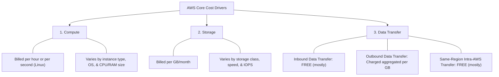
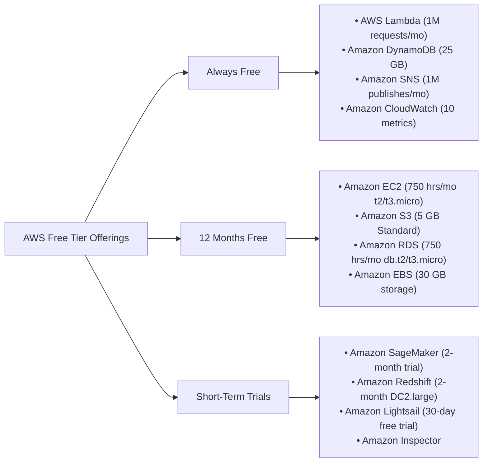
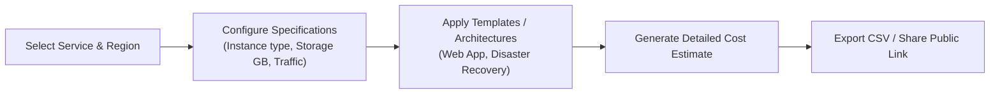
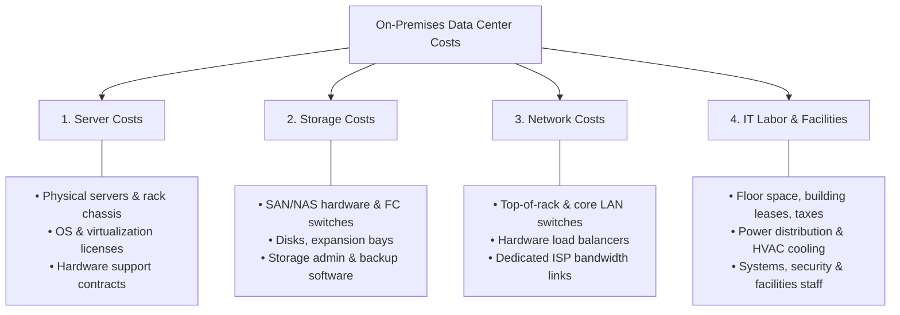

# 💰 Fundamentals of AWS Pricing: Cloud Foundations & Cost Economics

> **Course**: AWS re/Start Cloud Foundations  
> **Module**: M01 – Cloud Computing Fundamentals / Fundamentals of AWS Pricing  
> **Source**: `T05-0007-RSCF_SG_EN-US_M01_FUNDAMEN-USTALSPRICING.pdf`  
> **Target Audience**: AWS re/Start Learners & AWS Certified Cloud Practitioner (CLF-C02) Candidates  

---

## 🎯 Module Overview

Understanding cloud pricing models and financial architecture is fundamental to working in AWS. Unlike traditional IT environments characterized by heavy upfront capital investments and rigid procurement cycles, AWS provides a flexible, consumption-based pricing model. This guide covers how AWS charges for resources, the fundamental drivers of cost, volume discounts, reservation models, Free Tier offerings, services without additional charges, the AWS Pricing Calculator, and Total Cost of Ownership (TCO) analysis.

### 📌 Learning Objectives
- [ ] Describe the Amazon Web Services (AWS) utility-style pricing model and core philosophy
- [ ] Identify the three fundamental drivers of cost in AWS: compute, storage, and data transfer
- [ ] Compare reservation discount options: All Upfront (AURI), Partial Upfront (PURI), and No Upfront (NURI)
- [ ] Explain tiered volume pricing and how economies of scale benefit AWS customers
- [ ] Detail the three categories of the AWS Free Tier (Always Free, 12 Months Free, Short-Term Trials)
- [ ] Distinguish between free AWS management/orchestration services and the underlying provisioned billable resources
- [ ] Utilize the AWS Pricing Calculator to estimate monthly service costs and model architectures
- [ ] Define Total Cost of Ownership (TCO) and analyze on-premises direct and indirect expenses versus cloud cost models

---

## 🏗️ 1. The Three Fundamental Drivers of Cost

At the foundational level, AWS charges are determined by three primary resource dimensions:



### 1. Compute
- **Billing Metric**: Calculated by the clock hour or by the second (available on Linux instances across EC2, Lambda, and containerized services).
- **Pricing Factors**: Varies based on instance family, CPU architectures, memory configurations, operating system licensing, and selected Region.

### 2. Storage
- **Billing Metric**: Typically charged per gigabyte per month (GB/month).
- **Pricing Factors**: Varies based on data tiering, storage class (e.g., S3 Standard vs. S3 Glacier), provisioned Input/Output Operations Per Second (IOPS), and durability profiles.

### 3. Data Transfer
- **Inbound Data Transfer**: **No charge** across almost all services (data coming into AWS data centers from the internet is free).
- **Outbound Data Transfer**: Aggregated across services and charged on a tiered per-GB basis. This line item appears on monthly bills as **AWS Data Transfer Out**.
- **Intra-Region Transfer**: Data transfer between services within the same AWS Region is generally free (with minor exceptions such as cross-Availability Zone VPC peering or transit gateways).

> [!NOTE]
> Always verify service-specific data transfer rates. While inbound data is universally free, outbound data transfer across different Regions or to the internet incurs tiered charges.

---

## 💵 2. AWS Pricing Philosophy & Fundamentals

Although AWS has introduced hundreds of cloud services, its foundational pricing philosophy has remained consistent: **pay only for what you consume with zero required long-term commitments**.

```
┌────────────────────────────────────────────────────────────────────────┐
│                        AWS Pricing Philosophy                          │
│                                                                        │
│   • Pay for what you use (Consumption / Utility Model)                 │
│   • Save when you commit / Pay less when you reserve (RIs / SPs)       │
│   • Pay less by using more (Volume-based Tiered Discounts)             │
│   • Pay even less as AWS grows (Economies of Scale)                    │
│   • Custom Pricing (Tailored agreements for high-volume enterprise)    │
└────────────────────────────────────────────────────────────────────────┘
```

### 1. Pay for What You Use
- **Utility Model**: Operates like electricity or municipal water. You consume what your workload requires and stop paying immediately when instances or resources are decommissioned.
- **No Upfront CapEx**: Eliminates large upfront capital expenditures for physical servers, storage arrays, networking hardware, and datacenter leases.
- **No Long-Term Contracts**: Start and stop services at any time on demand.

### 2. Save When You Commit (Pay Less When You Reserve)
For predictable, steady-state workloads (such as primary production databases on Amazon RDS or continuous application servers on Amazon EC2), you can commit to 1-year or 3-year terms through **Reserved Instances (RIs)** or **Savings Plans**, saving up to 72% compared to On-Demand rates:

| Reservation Payment Option | Acronym | Upfront Cash Required | Discount Level Compared to On-Demand | Ideal Use Case |
| :--- | :--- | :--- | :--- | :--- |
| **All Upfront** | **AURI** | 100% upfront payment | **Highest discount** (up to ~72%) | Organizations with available capital looking to maximize cost savings |
| **Partial Upfront** | **PURI** | Substantial portion upfront, rest monthly | **Moderate discount** | Balancing upfront capital outlay with predictable monthly expenses |
| **No Upfront** | **NURI** | $0 upfront; fixed monthly rate | **Lowest discount** (still ~30–40% vs. On-Demand) | Organizations wanting predictable recurring operational expenses without capital outlays |

### 3. Pay Less by Using More (Volume-Based Discounts)
- As data volume expands, unit costs decrease automatically through tiered pricing brackets.
- **Amazon S3 Tiered Pricing Example**:
  - First 50 TB / month: Baseline price per GB.
  - Next 450 TB / month: Lower price per GB.
  - Over 500 TB / month: Lowest price per GB.
- **Storage Tiering Synergy**: Organizations can combine tiered storage services (e.g., S3 Standard, S3 Standard-Infrequent Access, S3 Glacier Flexible Archive, S3 Glacier Deep Archive) with life-cycle rules to lower costs while keeping data secure and durable.

### 4. Pay Even Less as AWS Grows (Economies of Scale)
- AWS continually invests in power optimization, custom silicon (e.g., AWS Graviton, AWS Inferentia), operational efficiencies, and data center automation.
- As the scale of AWS expands globally, AWS passes savings back to customers.
- **Track Record**: Since launching in 2006, AWS has proactively lowered prices **more than 75 times**.
- **Hardware Generational Upgrades**: AWS introduces next-generation server architectures (e.g., moving from EC2 `m5` to `m6g` instances) offering superior compute power and price-performance without charging migration penalties or upgrade fees.

### 5. Custom Pricing
- For enterprise organizations with very high volume workloads or highly specialized compliance and infrastructure requirements, AWS provides customized enterprise agreements and Enterprise Discount Programs (EDP).

---

## 🎁 3. The AWS Free Tier

The AWS Free Tier offers hands-on experience with AWS services at zero cost. It spans three distinct types of offers:



### Free Tier Categories

| Free Tier Type | Eligibility Period | Description | Representative Services & Caps |
| :--- | :--- | :--- | :--- |
| **Always Free** | Indefinite (Never expires) | Free for all AWS customers indefinitely, up to monthly quota limits. | • **AWS Lambda**: 1 Million free requests/month & 3.2M seconds compute<br>• **Amazon DynamoDB**: 25 GB of NoSQL storage & 25 write/read capacity units<br>• **Amazon SNS**: 1 Million publishes/month<br>• **Amazon SES**: 62,000 outbound messages/month (when called from EC2) |
| **12 Months Free** | First 12 months following initial AWS account sign-up | Available to new AWS accounts during the first year of membership. | • **Amazon EC2**: 750 hours/month of Linux/RHEL/SLES or Windows `t2.micro` or `t3.micro`<br>• **Amazon S3**: 5 GB of standard storage, 20,000 GET requests, 2,000 PUT requests<br>• **Amazon RDS**: 750 hours/month of Single-AZ `db.t2.micro`/`db.t3.micro`<br>• **Amazon EBS**: 30 GB of general-purpose (SSD) or magnetic storage |
| **Short-Term Trials** | Begins upon service activation | Activates on the day a specific feature or service is first initiated. | • **Amazon SageMaker**: 2-month free trial<br>• **Amazon Redshift**: 2-month DC2.large trial (750 hours/month)<br>• **Amazon QuickSight**: 30-day free trial for 4 authors |

> [!IMPORTANT]
> Usage exceeding monthly Free Tier limits is automatically billed at standard On-Demand rates. To prevent surprise costs, configure **AWS Budgets** and set up an alert when forecasted usage approaches $0.01 or exceeds 80% of Free Tier limits.

---

## 🆓 4. AWS Services Available at No Additional Charge

Several AWS management, orchestration, and security tools do not charge a separate service fee. However, **you pay for any underlying resources provisioned by these services**:

```
┌───────────────────────────────────────────────────────────────────────────┐
│               Services With Zero Direct Licensing Charges                 │
│                                                                           │
│   • Amazon Virtual Private Cloud (Amazon VPC)                             │
│   • AWS Identity and Access Management (IAM)                             │
│   • AWS CloudFormation                                                    │
│   • AWS Elastic Beanstalk                                                 │
│   • Amazon EC2 Auto Scaling                                               │
│   • AWS Organizations (Consolidated Billing)                             │
│   • AWS OpsWorks                                                          │
└───────────────────────────────────────────────────────────────────────────┘
```

### Service Breakdown & Pricing Context

1. **Amazon Virtual Private Cloud (Amazon VPC)**
   - *Core Service*: Free. Creating virtual networks, subnets, route tables, and security groups costs nothing.
   - *Billable Add-ons*: NAT Gateways, VPC Endpoints (PrivateLink), and Site-to-Site VPN connections incur hourly and data-processing charges.

2. **AWS Identity and Access Management (IAM)**
   - *Core Service*: Completely free. Creating users, user groups, roles, permissions policies, and multi-factor authentication (MFA) has no cost.

3. **Consolidated Billing (AWS Organizations)**
   - *Core Service*: Free. Aggregating billing across multiple AWS accounts in an organization incurs zero overhead.
   - *Key Benefits*:
     - A single monthly invoice covering all organizational accounts.
     - Consolidated usage aggregates storage and data transfer across accounts to qualify for higher volume discount tiers faster.

4. **AWS Elastic Beanstalk**
   - *Core Service*: Platform orchestration is free.
   - *Billable Resources*: The provisioned EC2 instances, S3 storage buckets, and Elastic Load Balancers (ELBs) are billed at standard rates.

5. **AWS CloudFormation**
   - *Core Service*: Infrastructure as Code (IaC) templating engine is free.
   - *Billable Resources*: All infrastructure created by the CloudFormation stack (EC2, RDS, VPC peering) is billed at standard rates.

6. **Amazon EC2 Auto Scaling**
   - *Core Service*: Dynamic scaling policies and auto-scaling group management incur no charge.
   - *Billable Resources*: Additional EC2 instances launched during scale-out events are billed at regular compute pricing.

7. **AWS OpsWorks**
   - *Core Service*: Chef and Puppet configuration management orchestration is free of platform surcharges (under standard configurations).
   - *Billable Resources*: Underpinning compute instances and storage volumes are billed at standard rates.

---

## 🧮 5. AWS Pricing Calculator

The **AWS Pricing Calculator** (`https://calculator.aws/#/`) is a web-based planning tool designed to help technical teams, architects, and financial managers model cloud expenditures before deploying workloads.



### Key Capabilities
- **Estimate Monthly AWS Costs**: Estimate total service costs across compute, storage, databases, networking, and support tiers.
- **Region-Specific Calculations**: Accounts for regional price differences and varying service availability across all global AWS Regions.
- **Pre-Built Architectural Templates**: Offers modeling templates for common deployment archetypes such as:
  - Scalable Web Applications
  - Disaster Recovery and Backup Architectures
  - High-Performance Computing (HPC) Clusters
- **Cost Reduction Identification**: Models savings achievable by switching to Reserved Instances, Savings Plans, or lower storage tiers.
- **Transparent Export & Sharing**: Exports estimates to CSV, generates shareable URLs for stakeholders, and organizes costs by business group or environment tag.

---

## 🏢 6. Total Cost of Ownership (TCO): On-Premises vs. AWS Cloud

**Total Cost of Ownership (TCO)** is a comprehensive financial estimate that quantifies both the **direct** and **indirect** costs of operating a technology environment over its full lifecycle.

```
┌───────────────────────────────────────────────────────────────────────────┐
│                           TCO Decision Analysis                           │
│                                                                           │
│   • Compare running on-premises workloads vs. AWS Cloud                   │
│   • Uncover hidden data center overhead (power, cooling, maintenance)     │
│   • Construct compelling business cases for cloud migration              │
│   • Shift financial posture from CapEx (Capital) to OpEx (Operational)    │
└───────────────────────────────────────────────────────────────────────────┘
```

### Traditional On-Premises vs. AWS Cloud Comparison

| Dimension | Traditional On-Premises Infrastructure | AWS Cloud Infrastructure |
| :--- | :--- | :--- |
| **Financial Expenditure** | **Capital Expenditures (CapEx)**: Substantial upfront purchases of hardware, licenses, and long facilities leases. | **Operational Expenditures (OpEx)**: Pay-as-you-go consumption model with zero initial infrastructure purchase. |
| **Procurement Cycle** | Weeks or months for hardware delivery, mounting, cabling, OS installation, and configuration. | Minutes to provision instances, databases, and network topologies on demand. |
| **Scaling Dynamics** | Costly and slow to scale up; scaling down leaves expensive hardware sitting idle (waste). | Elastic scale-out during peaks; immediate scale-in during troughs, stopping compute charges. |
| **Maintenance Burden** | Internal teams manage server firmware, HVAC cooling, backup generators, physical security, and rack cabling. | AWS assumes responsibility for physical facilities, power, cooling, and foundational hardware maintenance. |
| **Depreciation & Refresh** | Assets depreciate over 3–5 year lifecycles, requiring recurring, expensive hardware refresh cycles. | Hardware upgraded transparently by AWS without customer upgrade fees. |

### The Four Core Pillars of On-Premises TCO

When assessing an on-premises data center, organizations often underestimate indirect expenses:



1. **Server Costs**:
   - Hardware: Server blades, rack chassis, power distribution units (PDUs), and hardware maintenance warranties.
   - Software: Operating system (OS) licenses, hypervisor/virtualization licensing, middleware fees, and annual support agreements.
2. **Storage Costs**:
   - Hardware: Storage arrays, SAN/NAS filers, fiber channel switches, and backup tape/disk hardware.
   - Administration: Storage engineering labor, volume provisioning, disk replacement, and offsite backup management.
3. **Network Costs**:
   - Hardware: Core switches, edge routers, hardware load balancers, and firewall appliances.
   - Connectivity: Dedicated Internet Service Provider (ISP) transit pipes and ongoing bandwidth charges.
4. **Facilities & IT Labor Overhead**:
   - Facilities: Real estate floor space, building leases, property taxes, 24/7 security personnel, fire suppression, redundant power feeds, UPS battery banks, diesel generators, and HVAC air conditioning.
   - Labor: Engineering time spent on racking, patching, physical security, power monitoring, and hardware replacements instead of developing business software.

---

## 📌 7. Key Takeaways & Exam Summary

```
┌───────────────────────────────────────────────────────────────────────────┐
│                     Summary of AWS Pricing Rules                          │
│                                                                           │
│  ✔ Pay for what you use — start and stop anytime with no penalty.         │
│  ✔ No long-term contracts required for on-demand usage.                   │
│  ✔ Inbound data transfer is universally free.                             │
│  ✔ Same-Region data transfer between services is generally free.          │
│  ✔ Outbound data transfer is aggregated and charged on a tiered basis.    │
│  ✔ Reserved Instances (AURI, PURI, NURI) offer significant discounts.     │
│  ✔ Tiered pricing reduces per-unit costs as usage grows (e.g. S3).        │
│  ✔ Free Tier provides Always Free, 12 Months Free, and Short-Term Trials. │
│  ✔ Orchestration services (CloudFormation, Beanstalk, IAM) are free,      │
│    but provisioned resources incur standard charges.                      │
│  ✔ AWS Pricing Calculator models solutions and estimates monthly bills.   │
│  ✔ TCO evaluates direct and indirect costs comparing on-prem to cloud.    │
└───────────────────────────────────────────────────────────────────────────┘
```

---

## 📝 8. Knowledge Check & Practice Assessment

Test your understanding of the concepts covered in this module:

### Question 1
**Which of the following data transfer scenarios is typically free of charge in AWS?**
- A) Data transferred from an Amazon S3 bucket to the internet
- B) Inbound data transfer from the internet into an Amazon EC2 instance
- C) Data transferred from an Amazon EC2 instance in `us-east-1` to an S3 bucket in `eu-west-1`
- D) Outbound data transferred to an on-premises data center via the internet

> **Answer: B**  
> **Explanation**: Inbound data transfer from the internet into AWS is free across almost all services. Outbound data transfer to the internet (A, D) and cross-Region data transfer (C) incur charges.

---

### Question 2
**An organization has a steady-state web server that must run 24/7 for the next 3 years. Which EC2 pricing option will provide the highest possible percentage discount over On-Demand rates?**
- A) No Upfront Payments Reserved Instance (NURI)
- B) Partial Upfront Reserved Instance (PURI)
- C) All Upfront Reserved Instance (AURI)
- D) Spot Instance

> **Answer: C**  
> **Explanation**: Among Reserved Instance payment options, paying 100% upfront (All Upfront Reserved Instance - AURI) yields the greatest discount. While Spot Instances provide high discounts, they are interruptible and not suitable for continuous, steady-state workloads that cannot tolerate interruption.

---

### Question 3
**Which of the following AWS services can be used at NO additional charge, although you pay for the underlying resources that it provisions? (Select TWO)**
- A) AWS CloudFormation
- B) Amazon Redshift
- C) Amazon DynamoDB
- D) AWS Elastic Beanstalk
- E) Amazon EC2

> **Answer: A and D**  
> **Explanation**: AWS CloudFormation and AWS Elastic Beanstalk are orchestration services that do not incur separate software licensing or usage fees. However, any EC2 instances, load balancers, or storage volumes provisioned by them are billed at standard AWS rates.

---

### Question 4
**A company wants to gain hands-on experience with AWS. After 14 months of having an active AWS account, which of the following Free Tier options is STILL available to them?**
- A) 750 hours/month of Amazon EC2 `t2.micro` instances
- B) 5 GB of standard Amazon S3 storage
- C) AWS Lambda (1 Million requests per month)
- D) 750 hours/month of Amazon RDS `db.t2.micro` instances

> **Answer: C**  
> **Explanation**: AWS Lambda includes 1 Million requests per month under the **Always Free** tier, which does not expire after 12 months. EC2 (A), S3 (B), and RDS (D) micro tiers belong to the **12 Months Free** tier, which expires after the account's first year.

---

### Question 5
**What is the primary function of the AWS Pricing Calculator?**
- A) To audit historical monthly billing statements and generate tax summaries
- B) To provide real-time automated cost optimization by terminating unused instances
- C) To estimate monthly AWS expenditures and model architectural solutions prior to deployment
- D) To calculate the physical scrap value of depreciated on-premises hardware

> **Answer: C**  
> **Explanation**: The AWS Pricing Calculator (`https://calculator.aws/#/`) is a planning tool used to estimate monthly AWS charges, compare deployment models, and evaluate architectural solutions before provisioning resources.

---

### Question 6
**When calculating the Total Cost of Ownership (TCO) for an on-premises data center, which of the following are considered indirect or facilities costs? (Select THREE)**
- A) Power consumption for server racks
- B) HVAC air conditioning and cooling equipment
- C) Software virtualization licenses
- D) Floor space real estate and building security
- E) Top-of-rack network switch hardware

> **Answer: A, B, and D**  
> **Explanation**: Facility costs encompass power, HVAC cooling, floor space real estate, security, and fire protection. Server hardware, virtualization licenses (C), and network switches (E) are direct hardware and software costs.

---

## 🔗 Related Resources & References
- [AWS Pricing Overview Whitepaper](https://d0.awsstatic.com/whitepapers/aws_pricing_overview.pdf)
- [Official AWS Pricing Page](https://aws.amazon.com/pricing/)
- [AWS Free Tier Details](https://aws.amazon.com/free/)
- [AWS Pricing Calculator](https://calculator.aws/#/)
- [AWS Total Cost of Ownership Concepts](https://aws.amazon.com/economics/)
