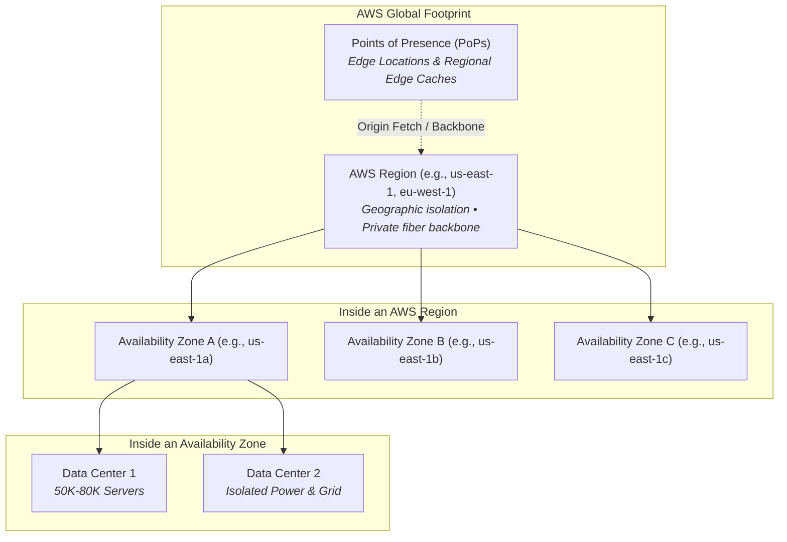
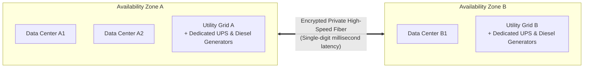
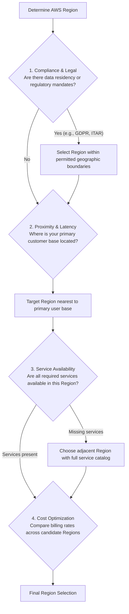
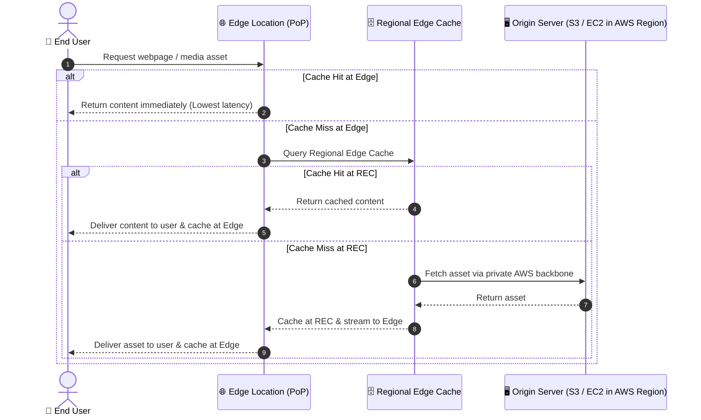

# 🌐 AWS Global Infrastructure Overview

> **Course**: AWS Cloud Foundations  
> **Module**: M01 – Cloud Computing Foundations & Global Infrastructure  
> **Source**: `T05-0008-RSCF_SG_EN-US_M01_AWSINFRASTRUCTURE.pdf`  
> **Target Audience**: AWS re/Start Learners & Cloud Practitioners  

---

## 🎯 Module Overview

The AWS Global Infrastructure is the foundation of the Amazon Web Services cloud platform. It is engineered to provide a flexible, reliable, scalable, fault-tolerant, and highly secure cloud computing environment with low latency and global network throughput. 

Understanding how AWS structures its physical and logical assets—spanning **Data Centers**, **Availability Zones (AZs)**, **Regions**, and **Points of Presence (PoPs)**—is essential for designing resilient applications, meeting compliance mandates, optimizing latency, and managing infrastructure costs.

---

### 📌 Learning Objectives
- [ ] Describe the architectural hierarchy and features of the AWS Global Infrastructure
- [ ] Distinguish clearly between AWS Regions, Availability Zones, Data Centers, and Points of Presence (PoPs)
- [ ] Evaluate the four key factors when selecting an optimal AWS Region (Compliance, Latency, Service Availability, Cost)
- [ ] Explain how Points of Presence (Edge Locations and Regional Edge Caches) reduce latency using Amazon CloudFront and Amazon Route 53
- [ ] Compare core infrastructure traits: Elasticity, Scalability, Fault Tolerance, and High Availability
- [ ] Understand disaster recovery and resiliency patterns across Availability Zones and Regions

---

## 📚 Key Terminology

| Term | Definition |
| :--- | :--- |
| **AWS Region** | A distinct physical geographical area containing two or more isolated Availability Zones interconnected by low-latency private networking. |
| **Availability Zone (AZ)** | One or more discrete data centers with redundant power, networking, and connectivity, designed for fault isolation within an AWS Region. |
| **Data Center** | A secure physical facility housing tens of thousands of online physical servers and custom networking hardware where data resides and computes. |
| **Point of Presence (PoP)** | Globally distributed infrastructure consisting of Edge Locations and Regional Edge Caches that deliver cached content to end users with low latency. |
| **Elasticity** | The ability of infrastructure to dynamically acquire resources as needed and release them when no longer required. |
| **Scalability** | The ability of a system to accommodate growth in workload and capacity demand without degrading performance. |
| **Fault Tolerance** | The capacity of a system to continue operating without interruption even when individual components or entire facilities fail. |
| **High Availability (HA)** | Delivering a consistently high level of operational uptime with minimal to no human intervention during incidents. |

---

## 🏛️ AWS Global Infrastructure Hierarchy

The AWS Global Infrastructure follows a multi-tiered hierarchy designed to prevent localized failures from affecting broader services:



---

## 🏢 1. AWS Data Centers: The Physical Foundation

The bedrock of all AWS cloud services is the physical data center. AWS builds and manages data centers in clusters across global regions.

```
┌────────────────────────────────────────────────────────────────────────┐
│                        AWS Data Center Characteristics                 │
├────────────────────────────────────────────────────────────────────────┤
│ • Scale: Houses typically 50,000 to 80,000 physical servers            │
│ • Always Online: 100% active and serving traffic (no "cold" facilities)│
│ • Hardware: Custom multi-ODM sourced servers and network switches      │
│ • Networking: Proprietary Amazon custom network protocol stack         │
│ • Security: Nondisclosed physical addresses; strict biometric controls │
└────────────────────────────────────────────────────────────────────────┘
```

### Security & Operational Engineering
- **Environmental Risk Mitigation**: Sites are selected after extensive geological and environmental analysis (avoiding high-risk flood plains and seismic fault lines).
- **Redundancy by Design**: Every critical system component (power distribution, HVAC cooling, optical connectivity) includes automated failovers.
- **Automated Evacuation**: If a physical failure occurs, automated routing shifts customer traffic away from the affected data center immediately.
- **Zero Cold Facilities**: AWS does not maintain idle or "cold" data centers; every data center is actively powered and serving workloads.

> [!NOTE]
> **Original Design Manufacturer (ODM)**: AWS works with multiple ODMs to build custom-designed computing and networking hardware tailored precisely to AWS performance, cooling, and security requirements.

---

## 🛡️ 2. AWS Availability Zones (AZs)

An **Availability Zone (AZ)** consists of one or more discrete data centers (some AZs contain up to six data centers). Availability Zones are engineered specifically for **fault isolation**.



### Key Architectural Characteristics of AZs
1. **Physical Isolation**: AZs within the same Region are separated by meaningful physical distance (typically tens of kilometers) to protect against local disasters (power outages, fires, localized floods), yet close enough to maintain single-digit millisecond latency.
2. **Independent Utility Grids**: Each AZ is fed by distinct power grids from independent utilities, supplemented by on-site uninterruptible power supplies (UPS) and industrial diesel generators.
3. **Dedicated Network Transit**: Every AZ connects redundantly to multiple tier-1 telecommunication and transit providers.
4. **No Cross-Contamination**: A data center belongs to exactly **one** Availability Zone; no physical data center is ever shared across multiple AZs.
5. **Customer Placement Control**: Customers explicitly choose which Availability Zones their resources (such as Amazon EC2 instances or Amazon VPC subnets) reside in.

> [!TIP]
> **Multi-AZ Architecture for Resiliency**: AWS strongly recommends deploying mission-critical workloads across at least two Availability Zones. If an entire AZ experiences an unforeseen outage, the standby instances in the second AZ continue serving traffic with zero data loss.

---

## 🌍 3. AWS Regions

An **AWS Region** is a physical geographical location around the world. Each Region contains **two or more Availability Zones** (often three or more).

```
┌────────────────────────────────────────────────────────────────────────┐
│                          Global AWS Presence                           │
├────────────────────────────────────────────────────────────────────────┤
│ • Geographic Reach: North America, South America, Europe, Middle East,  │
│                     Africa, and Asia Pacific                           │
│ • Composition: Every Region contains at least 2 Availability Zones     │
│ • Interconnection: Connected via AWS's private high-bandwidth global   │
│                    fiber-optic backbone network                        │
│ • Isolation: Regions are completely isolated from one another          │
└────────────────────────────────────────────────────────────────────────┘
```

### Region Isolation & Data Governance
- **Strict Isolation**: Regions operate independently. A failure in one Region cannot cascade into another Region.
- **Data Sovereignty & Control**: When you store data in a specific AWS Region (e.g., `eu-west-1` in Ireland), AWS **never replicates or moves** your data outside of that Region without your explicit configuration.
- **Backbone Connectivity**: Inter-region traffic travels over encrypted private AWS backbone fiber cables, completely bypassing the public internet for superior security and throughput.

### Specialized Regions: AWS GovCloud (US)
For organizations with stringent regulatory mandates, AWS provides isolated regions such as **AWS GovCloud (US-East and US-West)**:
- Specifically designed for US government agencies, defense contractors, and educational institutions.
- Allows customers to process sensitive and classified workloads, adhering to compliance frameworks such as FedRAMP High, ITAR (International Traffic in Arms Regulations), DoD SRG Impact Levels 2, 4, and 5, and CJIS.
- Access is restricted exclusively to vetted US citizens and green-card holders.

---

## 🧭 4. Four Factors for Selecting an AWS Region

Selecting the optimal AWS Region requires balancing business, regulatory, and technical requirements.



### Detail of the 4 Evaluation Factors

| Factor | Key Considerations | Practical Example |
| :--- | :--- | :--- |
| **1. Data Governance & Legal Requirements** | Local data protection laws, privacy regulations, and national sovereignty mandates require data to remain within country borders. | The European Union **GDPR / EU Data Protection Directive** mandates personal data of EU citizens stay within the EEA (e.g., Frankfurt or Dublin). |
| **2. Proximity to Customers (Latency)** | Placing compute and storage closer to end users minimizes round-trip network transmission times and boosts user experience. | A business headquartered in San Diego with 85% of customers in Virginia should deploy web tiers in `us-east-1` (N. Virginia) rather than `us-west-1`. Test via [CloudPing](https://www.cloudping.info/). |
| **3. Service Availability** | AWS introduces newer services and hardware types to flagship regions first. Not every AWS service is available in every Region. | Emerging machine learning hardware or specialized analytics tools may launch in N. Virginia or Oregon before rolling out globally. |
| **4. Cost Variations** | Infrastructure operating costs (real estate, power, regional taxes, telecom tariffs) differ across countries and cities. | An On-Demand `t3.medium` EC2 Linux instance has a different hourly price in `us-east-2` (Ohio) compared to `ap-northeast-1` (Tokyo). |

> [!IMPORTANT]
> **Compliance Always Overrides Cost & Latency**: If your legal counsel states that customer health data cannot leave Canadian soil, you must deploy in `ca-central-1` (Montreal/Central), even if a nearby US region offers lower pricing.

---

## ⚡ 5. Points of Presence (PoPs): Edge Locations & Regional Edge Caches

In addition to Regions and Availability Zones, AWS maintains a massive worldwide network of **Points of Presence (PoPs)** located in major metropolitan areas across the globe.

PoPs comprise two complementary tiers:
1. **Edge Locations**: Smaller data centers strategically placed in high-density population centers to terminate user connections, handle DNS requests, and serve cached static and dynamic web content.
2. **Regional Edge Caches**: Mid-tier caching facilities located between Edge Locations and your origin servers. They possess larger cache repositories to hold content with infrequent access, preventing edge caches from having to repeatedly query the origin server.



### Services Utilizing Points of Presence
- **Amazon CloudFront**: A high-performance Content Delivery Network (CDN) that delivers web videos, images, APIs, and software downloads securely to end users with low latency and high transfer speeds.
- **Amazon Route 53**: A highly available and scalable cloud Domain Name System (DNS) web service that routes end-user requests to nearest PoPs for fast resolution.
- **AWS Shield & AWS WAF**: Distributed Denial of Service (DDoS) protection and Web Application Firewalls operating at the edge to inspect and block malicious requests before they hit backend infrastructure.

---

## ⚙️ 6. Core AWS Infrastructure Characteristics

The architectural design of the AWS Global Infrastructure delivers four foundational engineering characteristics:

```
┌─────────────────────────┬─────────────────────────────────────────────────┐
│ Feature                 │ Architectural Definition & Value                │
├─────────────────────────┼─────────────────────────────────────────────────┤
│ 🚀 Elasticity           │ Dynamically allocates or deprovisions capacity  │
│                         │ on demand in response to live traffic spikes.   │
├─────────────────────────┼─────────────────────────────────────────────────┤
│ 📈 Scalability          │ Accommodates sustained workload growth over     │
│                         │ long periods without architectural redesign.    │
├─────────────────────────┼─────────────────────────────────────────────────┤
│ 🛡️ Fault Tolerance     │ Built-in redundancy allows continuous operation │
│                         │ even during catastrophic hardware failures.     │
├─────────────────────────┼─────────────────────────────────────────────────┤
│ ⏱️ High Availability   │ Maximizes operational uptime and minimizes      │
│                         │ downtime with little to no manual intervention. │
└─────────────────────────┴─────────────────────────────────────────────────┘
```

### Elasticity vs. Scalability: The Crucial Distinction
- **Elasticity (Dynamic Adjustment)**: Refers to short-term agility—scaling *out* when a flash sale occurs, and automatically scaling *in* at night to save costs. Example: An Auto Scaling group adding 10 EC2 instances at 2:00 PM and terminating them by 6:00 PM.
- **Scalability (Growth Capacity)**: Refers to long-term systemic capability—handling a 500% increase in total registered users over 18 months by leveraging elastic services and managed databases without hitting hard architectural limits.

---

## 🏗️ 7. Disaster Recovery & Resiliency Strategies

AWS Global Infrastructure allows organizations to design workloads along three progressive levels of resiliency:

```mermaid
graph TD
    subgraph SingleAZ["Level 1: Single-AZ Deployment (Basic)"]
        AZ1_App["App on EC2"]
        AZ1_DB["Single DB"]
        AZ1_App --> AZ1_DB
        Warn1["⚠️ Vulnerable to AZ-wide disruption"]
    end

    subgraph MultiAZ["Level 2: Multi-AZ Deployment (High Availability)"]
        AZ_A_App["EC2 in AZ-A"]
        AZ_B_App["EC2 in AZ-B"]
        PrimaryDB["Primary RDS (AZ-A)"]
        StandbyDB["Synchronous Standby RDS (AZ-B)"]
        ELB["Elastic Load Balancer"]
        ELB --> AZ_A_App
        ELB --> AZ_B_App
        AZ_A_App --> PrimaryDB
        AZ_B_App --> PrimaryDB
        PrimaryDB -.->|"Synchronous Replication"| StandbyDB
    end

    subgraph MultiRegion["Level 3: Multi-Region Deployment (Disaster Recovery & Global Reach)"]
        Reg1["Primary Region (e.g., us-east-1)"]
        Reg2["DR / Secondary Region (e.g., us-west-2)"]
        Reg1 ==>|"Cross-Region Asynchronous Replication"| Reg2
        R53["Amazon Route 53 (Latency / Geolocation / Failover DNS Routing)"]
        R53 --> Reg1
        R53 --> Reg2
    end
```



### Architectural Comparison
1. **Single-AZ**: Lowest cost, but vulnerable to facility-level power or environmental issues. Suitable only for non-critical development or testing sandboxes.
2. **Multi-AZ**: Standard production pattern. Protects against hardware failures, data center disruptions, and AZ connectivity failures. Automatic failover occurs in seconds.
3. **Multi-Region**: Highest level of business continuity. Protects against rare regional outages and satisfies international latency or disaster recovery mandates (e.g., active-passive pilot light or active-active global replication).

---

## 📝 8. Knowledge Check & Practice Exam Questions

Test your comprehension of the AWS Global Infrastructure concepts covered in this module:

### Question 1
**Which statement best describes an AWS Availability Zone?**
- A) A geographical location containing two or more data centers separated across continents.
- B) One or more physical data centers with redundant power, networking, and connectivity, designed for fault isolation within a Region.
- C) A content delivery edge location used exclusively by Amazon CloudFront for caching static content.
- D) A private network connection connecting an on-premises data center to an AWS Region.

<details>
<summary>👉 Click to view Answer & Explanation</summary>

**Correct Answer**: **B**  
**Explanation**: An Availability Zone (AZ) consists of one or more discrete data centers with independent power grids, cooling, and network links. A Region consists of multiple AZs, whereas Edge Locations are part of Points of Presence (PoPs).
</details>

---

### Question 2
**A healthcare company must ensure patient records remain within the borders of Germany to comply with local privacy regulations. Which factor is most critical when choosing their AWS deployment location?**
- A) Proximity to company headquarters in New York
- B) Service cost differences between Frankfurt and Ireland
- C) Data governance and legal compliance requirements
- D) The number of Edge Locations in Europe

<details>
<summary>👉 Click to view Answer & Explanation</summary>

**Correct Answer**: **C**  
**Explanation**: Legal, regulatory, and compliance requirements (such as data residency laws) must always dictate Region selection before cost or proximity considerations. Deploying in the Frankfurt Region (`eu-central-1`) keeps patient records inside Germany.
</details>

---

### Question 3
**How do Regional Edge Caches improve performance when used in conjunction with Edge Locations in Amazon CloudFront?**
- A) They eliminate the need for an origin server entirely.
- B) They store frequently changing relational database queries.
- C) They absorb less frequently accessed content closer to edge locations, preventing repeated requests back to the origin server.
- D) They automatically provision additional EC2 instances during traffic spikes.

<details>
<summary>👉 Click to view Answer & Explanation</summary>

**Correct Answer**: **C**  
**Explanation**: Regional Edge Caches have larger cache capacities than standard Edge Locations. They sit between the Edge Locations and the origin server to retain objects that are accessed less frequently, reducing direct load on the origin server.
</details>

---

### Question 4
**Which AWS service or mechanism ensures that an application continues operating properly even if a single component fails, without requiring manual human intervention?**
- A) Fault tolerance and High Availability architectures
- B) CloudPing latency testing
- C) Billing Cost Allocation Tags
- D) Cold standby data centers

<details>
<summary>👉 Click to view Answer & Explanation</summary>

**Correct Answer**: **A**  
**Explanation**: Fault tolerance provides built-in component redundancy so a system survives failures without interruption. High Availability ensures minimal downtime with automated failovers and health checking. AWS never uses cold data centers.
</details>

---

### Question 5
**An e-commerce company operates in Tokyo and notices high latency for visitors browsing from London. What AWS solution can reduce latency for those UK visitors with minimal architectural complexity and cost?**
- A) Build a private data center in the United Kingdom.
- B) Deploy Amazon CloudFront to cache content across AWS Points of Presence near London.
- C) Migrate all backend databases exclusively to the London Region.
- D) Convert all server hardware to multi-ODM specifications.

<details>
<summary>👉 Click to view Answer & Explanation</summary>

**Correct Answer**: **B**  
**Explanation**: Amazon CloudFront leverages the global network of Points of Presence (Edge Locations) to cache web content close to end users worldwide, reducing latency and offloading traffic from origin servers without requiring a complete database migration.
</details>

---

## 📌 9. Key Takeaways

- **Regions & AZs**: The AWS Global Infrastructure is constructed around geographically isolated **Regions**, each containing at least **two or more Availability Zones**.
- **Data Centers**: Each AZ is composed of **one or more data centers** (typically housing 50,000–80,000 servers), all 100% active and online, powered by independent utilities and redundant generators.
- **Selection Criteria**: Choose your Region based on:
  1. *Compliance and legal governance* (data sovereignty)
  2. *Proximity to customers* (reducing network latency)
  3. *Service availability* (verifying service presence)
  4. *Cost differences* (pricing varies across regions)
- **Points of Presence**: PoPs comprise **Edge Locations** and **Regional Edge Caches**, working alongside **Amazon CloudFront** and **Amazon Route 53** to cache content and optimize DNS routing nearest to global end users.
- **Architectural Strength**: AWS systems are inherently **elastic**, **scalable**, **fault-tolerant**, and **highly available**, enabling multi-AZ and multi-region business continuity.
