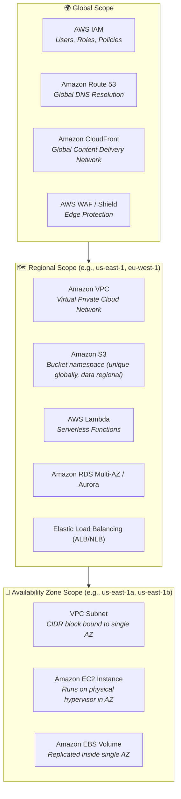
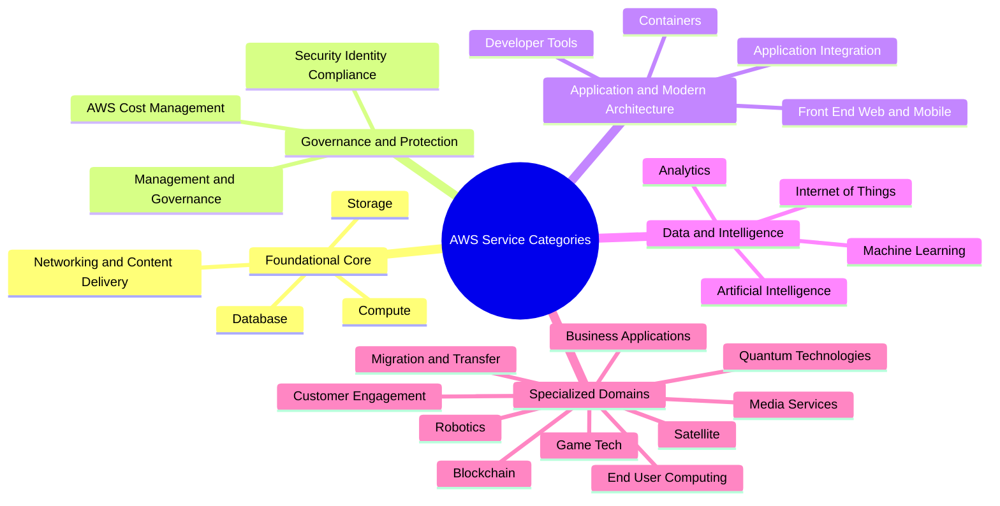
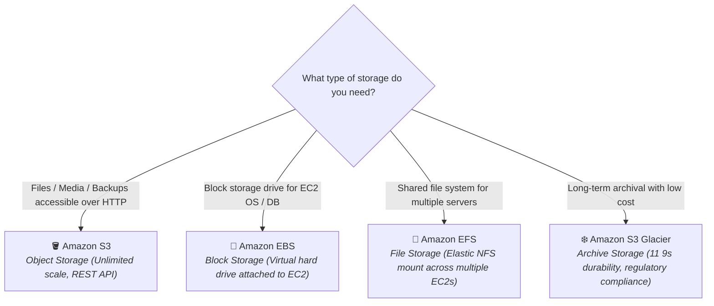
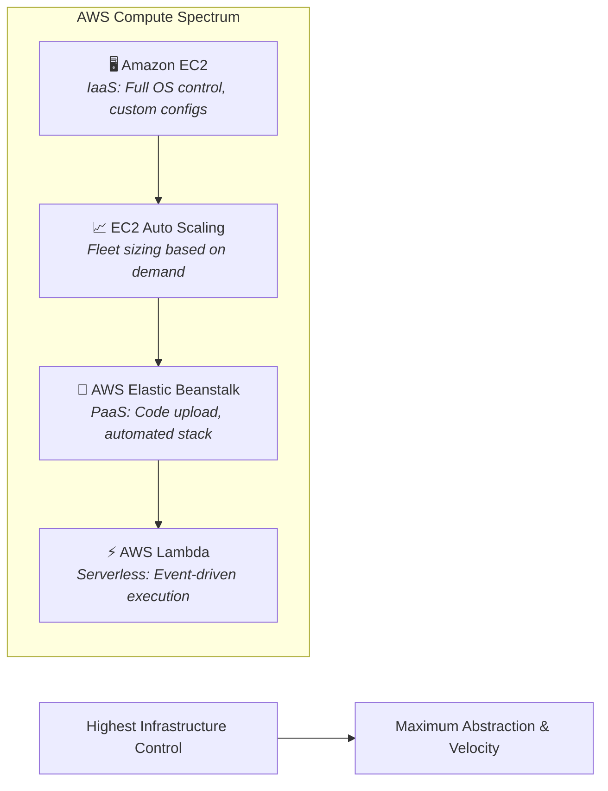
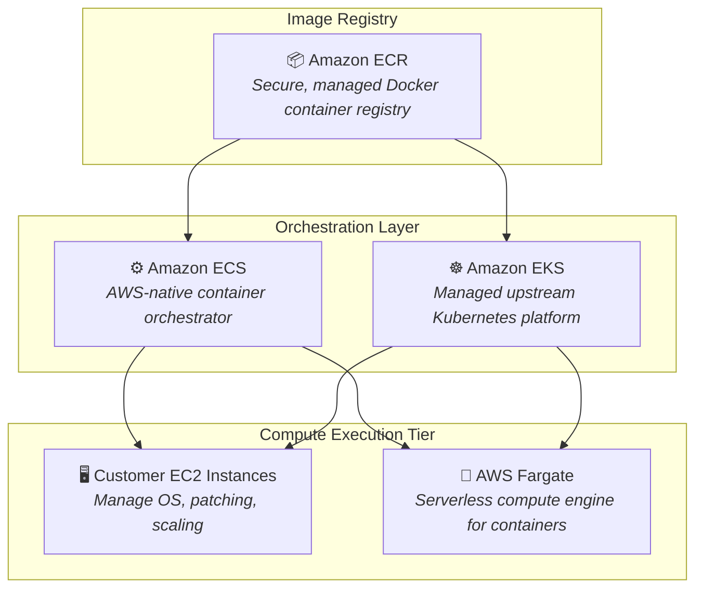
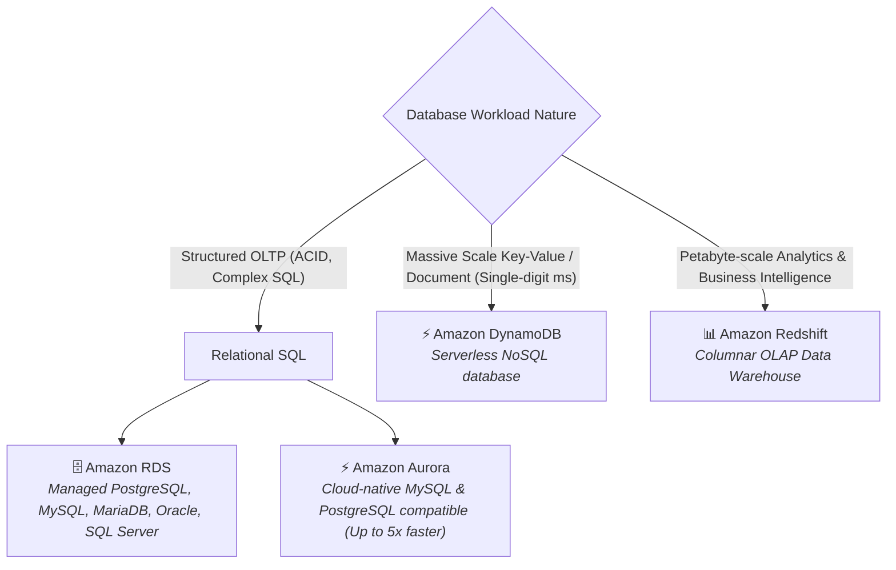
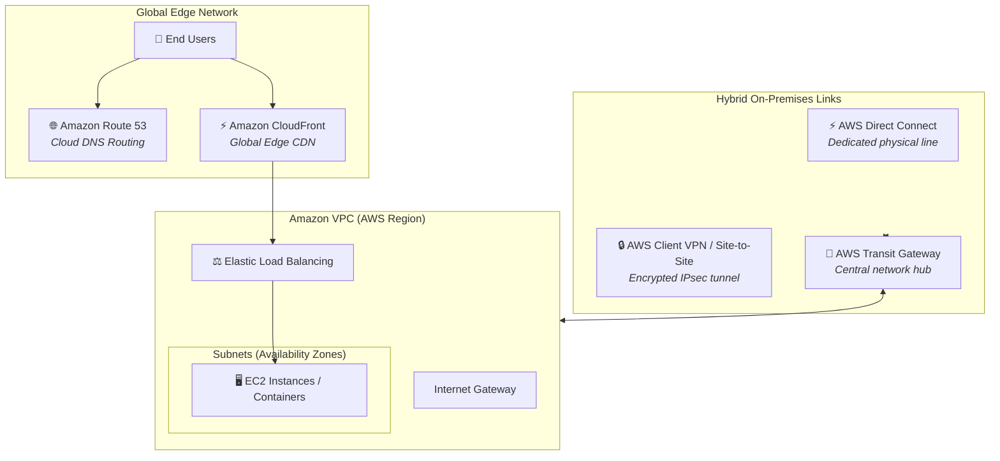
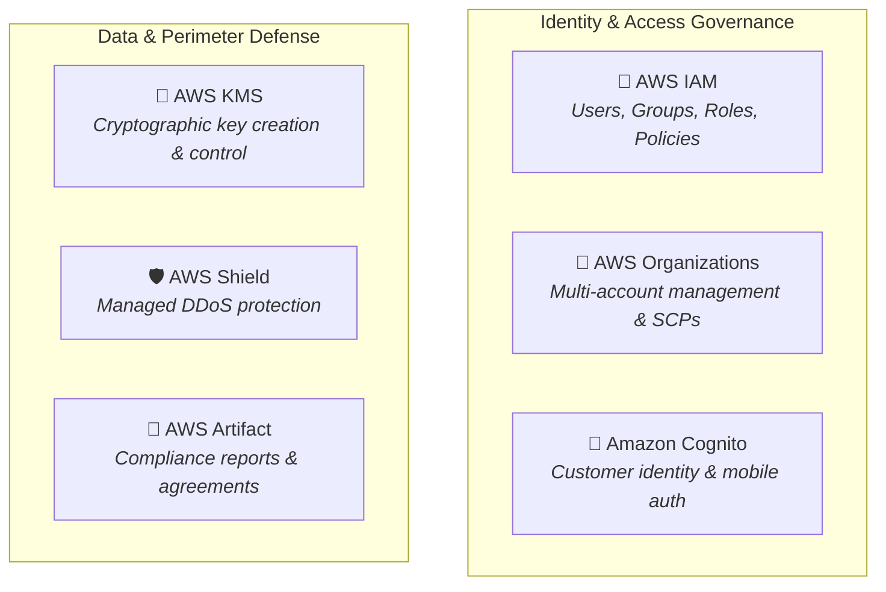
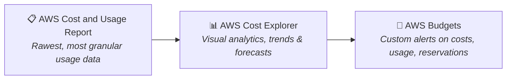
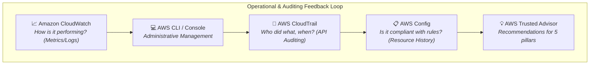

# 🧭 AWS Services and Service Categories

> **Course**: AWS Cloud Foundations  
> **Module**: M01 – Cloud Computing Foundations: Services & Service Categories  
> **Source**: `T05-0009-RSCF_SG_EN-US_M01_SERVICESANDCATEGORY.pdf`  
> **Target Audience**: AWS re/Start Learners & Cloud Practitioners  

---

## 🎯 Module Overview

Amazon Web Services (AWS) provides more than 200 fully featured services delivered across global data centers. To help architects, administrators, and developers navigate this extensive ecosystem, AWS organizes its offerings into logical **service categories**. Each category addresses specific cloud architectural needs—ranging from foundational building blocks like compute, storage, and networking, to specialized capabilities in databases, artificial intelligence, containers, and cost management.

This module introduces the taxonomy of AWS service categories, conducts in-depth explorations of the eight core foundational categories highlighted in the AWS Cloud Foundations curriculum, explains the architectural scoping (Global vs. Regional vs. Availability Zone level), and provides guided hands-on navigation of the AWS Management Console.

---

### 📌 Learning Objectives

- [ ] Identify and define the broad catalog of AWS service categories
- [ ] Understand the primary use cases and distinguishing features of core **Storage** services (Amazon S3, Amazon EBS, Amazon EFS, Amazon S3 Glacier)
- [ ] Distinguish between primary **Compute** models (Amazon EC2, Amazon EC2 Auto Scaling, AWS Elastic Beanstalk, AWS Lambda)
- [ ] Explain modern **Container** services and management options (Amazon ECS, Amazon ECR, Amazon EKS, AWS Fargate)
- [ ] Evaluate **Database** offerings across relational, NoSQL, and analytical engines (Amazon RDS, Amazon Aurora, Amazon DynamoDB, Amazon Redshift)
- [ ] Diagram and describe **Networking and Content Delivery** constructs (Amazon VPC, ELB, Amazon CloudFront, Amazon Route 53, AWS Transit Gateway, AWS Direct Connect, AWS Client VPN)
- [ ] Identify foundational **Security, Identity, and Compliance** services (AWS IAM, AWS Organizations, Amazon Cognito, AWS Artifact, AWS KMS, AWS Shield)
- [ ] Explain **AWS Cost Management** tooling (AWS Cost and Usage Report, AWS Budgets, AWS Cost Explorer)
- [ ] Contrast operational and monitoring tools in **Management and Governance** (AWS Management Console, AWS CLI, AWS Config, Amazon CloudWatch, AWS Auto Scaling, AWS Trusted Advisor, AWS Well-Architected Tool, AWS CloudTrail)
- [ ] Differentiate resource scope between **Global**, **Regional**, and **Availability Zone (AZ)** constructs
- [ ] Complete the guided AWS Management Console clickthrough activity and master the foundational knowledge check

---

## 🌐 Architectural Scope: Global vs. Regional vs. AZ-Level

When designing and navigating cloud environments, understanding the **scope of failure isolation and operational reach** of each AWS service is essential. AWS constructs operate across three primary structural tiers:



### Scope Comparison Matrix

| Architectural Scope | Characteristics | Key AWS Services & Resources | High Availability / Failure Boundary |
| :--- | :--- | :--- | :--- |
| **Global Scope** | Resources and configurations apply universally across all AWS Regions without requiring region selection. | • AWS Identity and Access Management (IAM)<br>• Amazon Route 53<br>• Amazon CloudFront<br>• AWS Organizations<br>• AWS WAF (Global endpoints) | Resilient across the entire worldwide AWS infrastructure backbone. |
| **Regional Scope** | Resources operate within and are confined to a single AWS Region. Traffic and data do not leave the Region unless explicitly replicated. | • Amazon Virtual Private Cloud (VPC)<br>• Amazon S3 (Buckets)<br>• AWS Lambda<br>• Amazon DynamoDB (Single-region tables)<br>• Elastic Load Balancing (ELB)<br>• AWS CloudTrail / CloudWatch | Survives the outage of an individual Availability Zone; isolated from other Regions. |
| **Availability Zone (AZ) Scope** | Resources physically reside inside one specific AZ. If that AZ experiences an outage, the resource becomes unavailable unless architected for Multi-AZ redundancy. | • Amazon EC2 Instances<br>• Amazon EBS Volumes<br>• VPC Subnets | Failure is isolated to that physical data center cluster; requires Multi-AZ configuration for high availability. |

> [!IMPORTANT]
> **Key Exam Distinction**: A **VPC** is a **Regional** resource that spans all Availability Zones within that Region. A **Subnet** is strictly an **Availability Zone-level** resource; each subnet resides entirely within a single AZ and cannot span multiple AZs.

---

## 🗺️ Complete Landscape of AWS Service Categories

AWS groups its expanding portfolio of cloud services into well-defined categories within the AWS Management Console:



### Summary of AWS Service Categories

| Category | Primary Focus | Representative Services |
| :--- | :--- | :--- |
| **Compute** | On-demand virtual servers, serverless compute, and scaling engines. | Amazon EC2, AWS Lambda, AWS Elastic Beanstalk, EC2 Auto Scaling |
| **Storage** | Highly scalable object, block, file, and archival storage systems. | Amazon S3, Amazon EBS, Amazon EFS, Amazon S3 Glacier |
| **Containers** | Packaging, deploying, and orchestrating containerized microservices. | Amazon ECS, Amazon EKS, Amazon ECR, AWS Fargate |
| **Database** | Purpose-built relational, key-value, document, in-memory, and graph databases. | Amazon RDS, Amazon Aurora, Amazon DynamoDB, Amazon Redshift |
| **Networking & Content Delivery** | Isolated cloud networks, DNS routing, load balancing, and edge caching. | Amazon VPC, Amazon Route 53, Amazon CloudFront, Elastic Load Balancing |
| **Security, Identity, & Compliance** | Identity governance, cryptographic key protection, and perimeter defense. | AWS IAM, AWS Organizations, AWS KMS, AWS Shield, Amazon Cognito, AWS Artifact |
| **Management & Governance** | System telemetry, auditing, configuration tracking, and architecture guidance. | Amazon CloudWatch, AWS CloudTrail, AWS Config, AWS Trusted Advisor, AWS CLI |
| **AWS Cost Management** | Financial monitoring, billing analysis, forecasting, and budget alerts. | AWS Cost Explorer, AWS Budgets, AWS Cost and Usage Report |
| **Analytics** | Big data processing, real-time streaming, interactive SQL queries, and warehousing. | Amazon Athena, Amazon EMR, Amazon Kinesis, Amazon OpenSearch |
| **Application Integration** | Decoupled messaging queues, pub/sub notifications, and workflow orchestrators. | Amazon SQS, Amazon SNS, Amazon EventBridge, AWS Step Functions |
| **Developer Tools** | Continuous integration and deployment (CI/CD) pipelines and source control. | AWS CodePipeline, AWS CodeBuild, AWS CodeDeploy, AWS CodeCommit |
| **Machine Learning** | Model building, training, deployment, computer vision, and NLP services. | Amazon SageMaker, Amazon Rekognition, Amazon Comprehend, Amazon Polly |
| **Migration & Transfer** | Moving on-premises data, servers, and databases into the AWS Cloud. | AWS Database Migration Service (DMS), AWS DataSync, AWS Transfer Family |

---

## 💾 1. Storage Service Category

AWS provides diverse storage types engineered to match specific performance, access frequency, protocol, and cost requirements.



### In-Depth Service Breakdown

#### 1. Amazon Simple Storage Service (Amazon S3)
- **Architecture**: Scalable **Object Storage** service storing data as objects within buckets.
- **Key Characteristics**:
  - Objects consist of file data, a key (name), metadata, and a unique URL.
  - Virtually unlimited total capacity; individual object size up to **5 TB**.
  - Designed for **99.999999999% (11 9s)** of data durability across multiple Availability Zones.
  - Accessible from anywhere over standard HTTP/HTTPS REST APIs.
- **Common Use Cases**: Static website hosting, mobile and web application assets, backup and recovery, data lakes for big data analytics, IoT sensor data storage.

#### 2. Amazon Elastic Block Store (Amazon EBS)
- **Architecture**: High-performance **Block Storage** designed specifically for Amazon EC2 instances.
- **Key Characteristics**:
  - Functions like a raw, unformatted physical hard disk or SSD drive.
  - Replicated within an Availability Zone to protect from single hardware failures.
  - Persists independently from the running lifecycle of an attached EC2 instance.
  - Supports point-in-time backups via **EBS Snapshots** saved to Amazon S3.
- **Common Use Cases**: Operating system boot volumes, transaction-intensive relational databases (Oracle, SQL Server, MySQL), big data analytics engines.

#### 3. Amazon Elastic File System (Amazon EFS)
- **Architecture**: Fully managed, elastic **File Storage** using the Network File System (NFSv4) protocol.
- **Key Characteristics**:
  - Multi-attach capability: Thousands of Amazon EC2 instances across multiple AZs can read and write concurrently.
  - Automatically grows and shrinks on demand—scales to petabytes without provisioning or pre-allocating disk space.
  - Compatible with Linux-based workloads and on-premises servers via AWS Direct Connect or VPN.
- **Common Use Cases**: Enterprise content management systems (WordPress, Drupal), shared home directories, big data analytics workloads requiring POSIX compliance.

#### 4. Amazon S3 Glacier
- **Architecture**: Secure, durable, extremely low-cost cloud storage class for **archiving** and **long-term compliance backup**.
- **Key Characteristics**:
  - 11 9s durability at a fraction of the cost of active S3 standard storage.
  - Retrieval tiers range from minutes (Expedited) to hours (Standard / Bulk).
  - Provides comprehensive compliance features such as S3 Object Lock (WORM – Write Once, Read Many).
- **Common Use Cases**: Healthcare records retention, financial transaction audit logs, tape backup replacement, disaster recovery cold archives.

### Storage Service Comparison Table

| Service | Storage Paradigm | Attachment / Access Method | Primary Use Case | Performance / Scaling |
| :--- | :--- | :--- | :--- | :--- |
| **Amazon S3** | Object Storage | HTTP / HTTPS API, S3 Console, SDKs | Static web assets, data lakes, backups | Scales automatically to petabytes/exabytes |
| **Amazon EBS** | Block Storage | Attached directly to a single EC2 instance in same AZ | Boot volumes, database storage | High IOPS, ultra-low latency (single-digit ms) |
| **Amazon EFS** | File Storage (POSIX / NFS) | Mounted simultaneously across hundreds of EC2 instances | Shared application directories, CMS, parallel compute | Elastic scaling, throughput scales with capacity |
| **Amazon S3 Glacier**| Archival Object Storage | S3 Lifecycle policies, API retrieval jobs | Regulatory long-term data archiving | Low cost, non-immediate retrieval (minutes to hours) |

---

## ⚡ 2. Compute Service Category

Compute forms the operational heart of applications, offering flexibility ranging from full virtual machine control to automated serverless execution.



### In-Depth Service Breakdown

#### 1. Amazon Elastic Compute Cloud (Amazon EC2)
- **Architecture**: Infrastructure as a Service (**IaaS**) providing resizable virtual machines (instances) in the cloud.
- **Key Characteristics**:
  - Full administrative and root access to the guest operating system (Linux or Windows).
  - Wide variety of instance families optimized for Compute, Memory, Storage, Accelerated Computing (GPU), and General Purpose.
  - Complete control over networking, security groups, software stacks, and storage volumes.
- **Common Use Cases**: Legacy application migrations, enterprise ERP systems, custom web servers, high-performance batch processing.

#### 2. Amazon EC2 Auto Scaling
- **Architecture**: Automated fleet management service that dynamically adds or removes EC2 instances.
- **Key Characteristics**:
  - **Predictive & Dynamic Scaling**: Scales based on metrics (e.g., CPU utilization, network traffic) or historical schedules.
  - **Fleet Health Monitoring**: Automatically detects unhealthy instances and replaces them to maintain desired capacity.
  - **Cost Optimization**: Utilizes On-Demand, Spot, and Reserved Instances in flexible combinations.
- **Common Use Cases**: Variable traffic websites, seasonal e-commerce workloads, stateless application tiers.

#### 3. AWS Elastic Beanstalk
- **Architecture**: Platform as a Service (**PaaS**) for deploying and scaling web applications and services without managing underlying infrastructure details.
- **Key Characteristics**:
  - Developers upload source code (Java, .NET, Node.js, Python, Ruby, Go, Docker, PHP).
  - Automatically handles provisioning, load balancing, auto-scaling, and application health monitoring.
  - Preserves full customer control over underlying AWS resources if customization is needed.
- **Common Use Cases**: Rapid web application development, prototyping, modern web APIs deployed by application development teams.

#### 4. AWS Lambda
- **Architecture**: Event-driven **Serverless** compute engine running code without provisioning or managing servers.
- **Key Characteristics**:
  - Executes code in response to events (e.g., S3 object uploads, DynamoDB table modifications, HTTP API calls via API Gateway).
  - True pay-per-use billing: Customers pay only for the compute time consumed in millisecond increments; zero cost when code is idle.
  - Scales automatically from zero to tens of thousands of concurrent executions.
- **Common Use Cases**: Real-time image thumbnailing, event-driven microservices, data processing pipelines, scheduled cron tasks.

---

## 📦 3. Containers Service Category

Containers bundle code, runtime, system libraries, and configuration into a lightweight, portable package that runs consistently across any environment.



### In-Depth Service Breakdown

#### 1. Amazon Elastic Container Service (Amazon ECS)
- **Architecture**: AWS-native, highly scalable, high-performance container orchestration service.
- **Key Characteristics**:
  - Native deep integration with IAM, VPC, Route 53, and Elastic Load Balancing.
  - Manages container lifecycles using simple task definitions and services.
  - Simplifies container deployment without requiring deep Kubernetes expertise.

#### 2. Amazon Elastic Container Registry (Amazon ECR)
- **Architecture**: Fully managed Docker container registry facilitating secure storage, sharing, and deployment of container software.
- **Key Characteristics**:
  - Integrated with IAM for fine-grained resource-based repository permissions.
  - Encrypts images at rest and in transit; supports automated image vulnerability scanning.
  - High availability architecture hosting images reliably across AWS data centers.

#### 3. Amazon Elastic Kubernetes Service (Amazon EKS)
- **Architecture**: Managed Kubernetes service running upstream, certified Kubernetes software on AWS.
- **Key Characteristics**:
  - Automatically manages the availability and scalability of the Kubernetes control plane nodes across multiple AZs.
  - Compatible with standard Kubernetes tools (kubectl, Helm, Kubernetes Dashboard).
  - Ideal for hybrid cloud deployments and organizations standardizing on open-source Kubernetes APIs.

#### 4. AWS Fargate
- **Architecture**: **Serverless compute engine** for containers compatible with both Amazon ECS and Amazon EKS.
- **Key Characteristics**:
  - Eliminates the need to provision, configure, patch, or scale virtual machine clusters.
  - You pay only for the vCPU and memory resources requested by your container tasks while running.
  - Seamlessly secures containers with task-level IAM roles and dedicated network interfaces.

---

## 🗄️ 4. Database Service Category

Rather than forcing every workload into a monolithic database, AWS provides purpose-built databases optimized for relational transactions, key-value lookups, document models, in-memory caching, and analytical data warehousing.



### In-Depth Service Breakdown

#### 1. Amazon Relational Database Service (Amazon RDS)
- **Architecture**: Managed service that automates setup, operation, and scaling of relational database management systems (RDBMS).
- **Supported Engines**: MySQL, PostgreSQL, MariaDB, Oracle Database, Microsoft SQL Server.
- **Key Features**: Automated backups, database software patching, point-in-time recovery, Multi-AZ automated failover for high availability, and Read Replicas for read-heavy scaling.

#### 2. Amazon Aurora
- **Architecture**: Cloud-native relational database engine engineered from the ground up to take advantage of AWS distributed storage.
- **Key Characteristics**:
  - Fully compatible with MySQL and PostgreSQL.
  - Up to **5 times faster** than standard MySQL and **3 times faster** than standard PostgreSQL.
  - Replicates 6 copies of data across 3 Availability Zones with self-healing, distributed storage that scales automatically up to 128 TB.
  - Offers serverless on-demand scaling via **Amazon Aurora Serverless**.

#### 3. Amazon DynamoDB
- **Architecture**: Fully managed, serverless **NoSQL** database delivering consistent, single-digit millisecond latency at any scale.
- **Key Characteristics**:
  - Supports both key-value and document data structures.
  - Fully managed with automatic multi-AZ data replication, encryption at rest, and point-in-time recovery.
  - On-Demand and Provisioned capacity modes, with built-in in-memory caching via DynamoDB Accelerator (DAX).
- **Common Use Cases**: Gaming leaderboards, mobile app user state, e-commerce shopping carts, real-time bidding platforms.

#### 4. Amazon Redshift
- **Architecture**: Fast, petabyte-scale **cloud data warehouse** designed for Online Analytical Processing (OLAP).
- **Key Characteristics**:
  - Uses columnar storage and massively parallel processing (MPP) to execute complex queries across millions of rows.
  - Redshift Spectrum enables running SQL queries directly against exabytes of unstructured/semi-structured data stored in Amazon S3 data lakes without loading.
  - Integrates seamlessly with business intelligence (BI) tools such as Amazon QuickSight, Tableau, and Power BI.

---

## 🌐 5. Networking & Content Delivery Service Category

AWS networking constructs allow organizations to build isolated cloud data centers, establish secure hybrid links, distribute traffic, and accelerate global content delivery.



### In-Depth Service Breakdown

#### 1. Amazon Virtual Private Cloud (Amazon VPC)
- **Definition**: Logically isolated virtual network dedicated to your AWS account within a specific Region.
- **Key Components**: Subnets (public and private), Route Tables, Internet Gateways (IGWs), NAT Gateways, Security Groups (stateful virtual firewalls), and Network Access Control Lists (NACLs - stateless subnet filters).

#### 2. Elastic Load Balancing (ELB)
- **Definition**: Automatically distributes incoming application network traffic across multiple targets (EC2 instances, containers, IP addresses, Lambda functions).
- **Types**:
  - **Application Load Balancer (ALB)**: Layer 7 (HTTP/HTTPS) advanced routing.
  - **Network Load Balancer (NLB)**: Layer 4 (TCP/UDP) ultra-low latency, extreme performance.
  - **Gateway Load Balancer (GWLB)**: Deploys third-party virtual appliances.

#### 3. Amazon CloudFront
- **Definition**: Fast, secure **Content Delivery Network (CDN)** that caches and delivers static and dynamic web content, video streams, and APIs through hundreds of globally distributed Points of Presence (PoPs).
- **Benefits**: Drastically reduces network latency for worldwide users while safeguarding origins via integrated DDoS protection.

#### 4. Amazon Route 53
- **Definition**: Highly available, scalable cloud **Domain Name System (DNS)** web service.
- **Functions**: Domain registration, DNS record routing (latency-based, geolocation, failover, weighted), and automated endpoint health checking.
- **Port Number Origin**: Named after the standard DNS network port (**TCP/UDP port 53**).

#### 5. AWS Direct Connect
- **Definition**: Dedicated, private physical network connection linking an organization's on-premises data center or office directly to AWS.
- **Benefits**: Bypasses the public internet entirely, delivering consistent network performance, increased throughput, and reduced bandwidth costs.

#### 6. AWS Client VPN & Site-to-Site VPN
- **Definition**: Managed VPN services creating secure, encrypted TLS/IPsec tunnels connecting remote workers or on-premises branch offices into AWS VPC networks.

#### 7. AWS Transit Gateway
- **Definition**: A central network transit hub connecting thousands of Amazon VPCs and on-premises networks through a single, simplified hub-and-spoke architecture.

---

## 🛡️ 6. Security, Identity, & Compliance Service Category

AWS provides identity governance, cryptographic security, compliance auditing, and threat defense to protect customer data according to the AWS Shared Responsibility Model.



### In-Depth Service Breakdown

#### 1. AWS Identity and Access Management (IAM)
- **Role**: Foundational service that grants secure administrative access to AWS resources and APIs.
- **Core Constructs**:
  - **IAM Users**: Individual identities representing people or applications.
  - **IAM Groups**: Collections of IAM users sharing the same policy permissions.
  - **IAM Roles**: Identities assumed by entities (e.g., an EC2 instance or Lambda function) that acquire temporary security credentials.
  - **IAM Policies**: JSON documents defining explicit `Allow` or `Deny` permissions.
- **Architectural Scope**: **Global**.

#### 2. AWS Organizations
- **Role**: Account management service that consolidates multiple AWS accounts into an organizational hierarchy.
- **Key Capability**: **Service Control Policies (SCPs)** enforce permission guardrails across all accounts in an organization or organizational unit (OU).

#### 3. Amazon Cognito
- **Role**: Customer identity and access management for web and mobile applications.
- **Features**: User Pools (user registration, sign-in, MFA) and Identity Pools (federation with Google, Apple, Facebook to obtain temporary AWS credentials).

#### 4. AWS Artifact
- **Role**: Centralized on-demand portal for downloading AWS compliance documentation and entering into legal agreements.
- **Documents Included**: SOC 1/2/3 reports, ISO certifications, PCI DSS audit packages, and Business Associate Addendums (BAA for HIPAA).

#### 5. AWS Key Management Service (AWS KMS)
- **Role**: Managed cryptographic service to create, store, and control encryption keys across AWS services and custom applications.
- **Security Standard**: Backed by FIPS 140-2 validated Hardware Security Modules (HSMs).

#### 6. AWS Shield
- **Role**: Managed distributed denial of service (DDoS) protection service safeguards applications running on AWS.
- **Tiers**:
  - **AWS Shield Standard**: Automatic, free perimeter protection applied to all AWS customers against common Layer 3 and 4 attacks.
  - **AWS Shield Advanced**: Paid tier providing specialized protection against sophisticated attacks, 24/7 access to the AWS DDoS Response Team (DRT), and cost spike protection.

---

## 💰 7. AWS Cost Management Service Category

Effective cloud adoption requires real-time transparency, budgeting, and cost optimization tools.



### In-Depth Service Breakdown

| Service | Primary Function | Ideal Use Case |
| :--- | :--- | :--- |
| **AWS Cost and Usage Report (CUR)** | Delivers the most comprehensive, granular dataset of AWS usage, pricing, and reservation metadata stored directly in S3. | Enterprise accounting, custom data pipeline ingestion, deep financial audits. |
| **AWS Budgets** | Allows setting custom financial and usage budgets that trigger automated notifications (email, SNS, Slack) when thresholds are exceeded or forecasted to exceed. | Proactive expense alerting for engineering managers and department leads. |
| **AWS Cost Explorer** | Web interface that visualizes, analyzes, and graphs historical spending patterns, projects future costs up to 12 months, and recommends Reserved Instances/Savings Plans. | Interactive visual analysis of monthly spend trends by service, tag, or region. |

---

## ⚙️ 8. Management & Governance Service Category

The Management and Governance category provides visibility, automation, and operational guardrails across cloud environments.



### In-Depth Service Breakdown

#### 1. AWS Management Console
- Secure, web-based graphical user interface (GUI) accessible via browser to create, manage, and inspect AWS resources.

#### 2. AWS Command Line Interface (AWS CLI)
- Unified, downloadable command-line tool allowing administrators to control all AWS services using scripts and terminal commands (`aws ec2 run-instances`, `aws s3 cp`).

#### 3. Amazon CloudWatch
- Telemetry monitoring and observability service that collects metrics, monitors log files, sets metric alarms (e.g., alert when CPU > 80%), and triggers automated actions.

#### 4. AWS CloudTrail
- Governance and auditing service that records and logs every API call and user action across your AWS account. Answers: *Who made the request? From what IP? At what time?*

#### 5. AWS Config
- Service that evaluates, audits, and continuously records configurations of AWS resources to track changes against compliance baselines over time.

#### 6. AWS Auto Scaling
- Centralized service that enables unified scaling plans across multiple services (EC2 instances, ECS tasks, DynamoDB tables, Aurora replicas) simultaneously.

#### 7. AWS Trusted Advisor
- Automated cloud inspection tool comparing account configuration against AWS best practices across **5 Pillars**:
  1. Cost Optimization
  2. Performance
  3. Security
  4. Fault Tolerance
  5. Service Limits (Quotas)

#### 8. AWS Well-Architected Tool
- Formal framework tool providing architectural review questionnaires and improvement plans aligned with the **AWS Well-Architected Framework Pillars** (Operational Excellence, Security, Reliability, Performance Efficiency, Cost Optimization, Sustainability).

---

## 🧪 Guided Hands-On Activity: AWS Management Console Clickthrough

### Activity Purpose
This exercise provides direct familiarity navigating the AWS Management Console, locating services across categories, changing regions, and distinguishing between **Global**, **Regional**, and **Availability Zone-scoped** infrastructure.

```
┌────────────────────────────────────────────────────────────────────────┐
│              AWS Management Console Navigation Architecture             │
├────────────────────────────────────────────────────────────────────────┤
│ [AWS Logo] [Services ▾] [Search Bar: "EC2"        ]   [Region: London ▾]│
│  ├─ Compute          → EC2, Lambda, Elastic Beanstalk                  │
│  ├─ Storage          → S3, EBS, EFS, Glacier                           │
│  ├─ Database         → RDS, DynamoDB, Redshift                         │
│  ├─ Networking       → VPC, Route 53, CloudFront                       │
│  └─ Security         → IAM, Organizations, KMS, Shield                 │
└────────────────────────────────────────────────────────────────────────┘
```

### Step-by-Step Walkthrough

1. **Accessing the Console**:
   - Sign in to the AWS Management Console in your hands-on sandbox environment.
2. **Navigating the Services Menu**:
   - Click the **Services** grid icon in the top navigation bar.
   - Observe the categorized breakdown of services (Compute, Storage, Database, Networking, etc.).
   - Locate **Amazon EC2** under Compute, and verify where other services are grouped.
3. **Region Switching & Scope Inspection**:
   - In the top-right header, identify the current AWS Region (e.g., `N. Virginia (us-east-1)`).
   - Click the dropdown and select a different region, such as `Europe (London) eu-west-2`.
   - Open the **Amazon VPC** console from the Services menu.
   - In the left navigation pane, select **Subnets**. Inspect an existing subnet's details pane.
   - In the left navigation pane, select **Your VPCs**. Observe the VPC configuration.

---

### Activity Questions & Detailed Explanations

#### Question #1: Which service category is the IAM service in?
> **Answer**: **Security, Identity, and Compliance**  
> **Explanation**: AWS Identity and Access Management (IAM) controls authentication (who you are) and authorization (what permissions you have). Because its core purpose is access control and credential management, it is classified under Security, Identity, and Compliance.

---

#### Question #2: Which service category is the Amazon VPC service in?
> **Answer**: **Networking and Content Delivery**  
> **Explanation**: Amazon Virtual Private Cloud (Amazon VPC) establishes isolated virtual private networks, IP subnets, route tables, and gateways. These represent core networking constructs.

---

#### Question #3: Does the subnet that you selected exist at the level of the Region or at the level of the Availability Zone?
> **Answer**: **Availability Zone level**  
> **Explanation**: Every subnet created in a VPC is explicitly tied to exactly **one Availability Zone** (e.g., `us-east-1a` or `eu-west-2b`). A subnet cannot span across multiple AZs. When you view a subnet in the console, the Availability Zone is an immutable property of that subnet.

---

#### Question #4: Does the VPC exist at the level of the Region or at the level of the Availability Zone?
> **Answer**: **Region level**  
> **Explanation**: An Amazon VPC spans across **all Availability Zones** within an AWS Region. You can create subnets in any Availability Zone inside that Region, all interconnected under the same VPC CIDR routing space.

---

#### Question #5: Which services are global instead of Regional? (Check: Amazon EC2, IAM, Lambda, Route 53)
> **Answer**: **IAM** and **Amazon Route 53** are **Global**; **Amazon EC2** and **AWS Lambda** are **Regional**.  
> **Explanation**:
> - When you open the **IAM** or **Route 53** consoles, the Region selector in the top-right header automatically switches to **Global** because policies, users, and DNS hosted zones apply worldwide.
> - **Amazon EC2** and **AWS Lambda** require you to select an AWS Region. Instances, AMIs, and serverless functions exist and execute inside that specific geographical Region.

---

## 📊 Comprehensive AWS Core Services Cheat Sheet

| Service | Category | Scope | Core Function | Memory Hook |
| :--- | :--- | :--- | :--- | :--- |
| **Amazon EC2** | Compute | AZ (Instances) | Virtual servers in the cloud | "Elastic Cloud Computing" |
| **AWS Lambda** | Compute | Regional | Serverless code execution | "Run code, pay per millisecond" |
| **AWS Elastic Beanstalk**| Compute | Regional | PaaS code deployment platform | "Upload code, AWS handles the rest" |
| **Amazon S3** | Storage | Regional (Global URI) | Scalable object storage | "Buckets & objects over HTTP" |
| **Amazon EBS** | Storage | AZ | High-performance block volumes for EC2 | "Virtual hard drive for EC2" |
| **Amazon EFS** | Storage | Regional (Multi-AZ) | Elastic shared network file system | "Shared drive across multiple servers" |
| **Amazon S3 Glacier** | Storage | Regional | Ultra-low cost long-term archival | "Cold archive storage" |
| **Amazon ECS** | Containers | Regional | AWS-native container orchestration | "Simple Docker container manager" |
| **Amazon EKS** | Containers | Regional | Managed Kubernetes clusters | "Upstream Kubernetes on AWS" |
| **AWS Fargate** | Containers | Regional | Serverless container compute engine | "Containers without server management" |
| **Amazon RDS** | Database | Regional / Multi-AZ | Managed relational databases | "Automated SQL databases" |
| **Amazon Aurora** | Database | Regional (Multi-AZ) | High-speed cloud-native MySQL/PostgreSQL | "5x faster MySQL, 3x faster Postgres" |
| **Amazon DynamoDB** | Database | Regional | Serverless NoSQL key-value store | "Single-digit millisecond latency" |
| **Amazon Redshift** | Database | Regional | Petabyte-scale OLAP data warehouse | "Big data SQL analytics" |
| **Amazon VPC** | Networking | Regional | Isolated virtual cloud network | "Your private data center in AWS" |
| **Amazon Route 53** | Networking | Global | Cloud DNS & domain registration | "Port 53 DNS routing" |
| **Amazon CloudFront** | Networking | Global | Fast Content Delivery Network (CDN) | "Global edge caching" |
| **AWS IAM** | Security | Global | Users, roles, groups, and policies | "Access control & permissions" |
| **AWS Organizations** | Security | Global | Multi-account governance with SCPs | "Consolidated billing & account trees" |
| **AWS KMS** | Security | Regional | Encryption key creation and management | "Hardware-backed key encryption" |
| **AWS CloudWatch** | Management | Regional | Operational telemetry & metrics alarm | "How your systems are performing" |
| **AWS CloudTrail** | Management | Regional / Multi-region | API activity audit log | "Who did what, and when" |
| **AWS Cost Explorer** | Cost Mgmt | Regional / Global | Spending visualization & forecasts | "Visualizing bill trends over time" |

---

## 📝 Practice Knowledge Check

### Question 1
A startup company needs to store millions of customer-uploaded profile images. The images must be accessible over the web via a unique URL and need 11 9s of durability. Which AWS storage service is best suited?
- [ ] A) Amazon EBS
- [ ] B) Amazon EFS
- [ ] C) Amazon S3
- [ ] D) Amazon S3 Glacier

> **Answer**: **C**  
> **Explanation**: Amazon Simple Storage Service (Amazon S3) is an object storage service designed for storing any amount of unstructured data (such as images, videos, and documents) accessible over HTTP/HTTPS URLs with 99.999999999% (11 9s) durability. Amazon EBS provides block storage for EC2; Amazon EFS is an NFS file share; Glacier is for long-term cold archiving.

---

### Question 2
An enterprise is designing a multi-tier web application. They need to deploy relational database workloads with automated failover across data centers and managed software patching. Which service should they choose?
- [ ] A) Amazon DynamoDB
- [ ] B) Amazon Redshift
- [ ] C) Amazon RDS with Multi-AZ
- [ ] D) Amazon Elastic Block Store

> **Answer**: **C**  
> **Explanation**: Amazon RDS provides fully managed relational database engines (PostgreSQL, MySQL, MariaDB, Oracle, SQL Server) with automated patching, backup, and synchronous Multi-AZ failover. DynamoDB is NoSQL, Redshift is for analytical data warehousing, and EBS is block storage.

---

### Question 3
Which of the following AWS services operates at a **Global** scope rather than a Regional scope?
- [ ] A) AWS Lambda
- [ ] B) Amazon Virtual Private Cloud (Amazon VPC)
- [ ] C) Amazon EC2
- [ ] D) AWS Identity and Access Management (IAM)

> **Answer**: **D**  
> **Explanation**: AWS IAM is a global service. Users, groups, roles, and policies defined in IAM apply across all AWS Regions worldwide. Lambda, VPC, and EC2 operate within specific AWS Regions.

---

### Question 4
A financial services firm wants to ensure that all API calls made within their AWS environment—including who invoked them, when, and from what IP address—are captured for compliance auditing. Which service should they enable?
- [ ] A) Amazon CloudWatch
- [ ] B) AWS CloudTrail
- [ ] C) AWS Config
- [ ] D) AWS Trusted Advisor

> **Answer**: **B**  
> **Explanation**: AWS CloudTrail records and retains account activity and API calls across the AWS infrastructure. CloudWatch tracks system metrics and performance logs; AWS Config records resource configuration states; Trusted Advisor provides optimization checks.

---

### Question 5
A development team wants to deploy a containerized microservice without provisioning, configuring, or managing the underlying EC2 server instances. Which compute engine provides this serverless container capability?
- [ ] A) Amazon EC2 Auto Scaling
- [ ] B) AWS Elastic Beanstalk
- [ ] C) AWS Fargate
- [ ] D) Amazon ECR

> **Answer**: **C**  
> **Explanation**: AWS Fargate is the serverless compute engine for containers that works with Amazon ECS and Amazon EKS, eliminating the need to manage EC2 clusters. Amazon ECR is an image registry, not a compute engine.

---

## 📌 Key Takeaways & Summary

- **Service Categories Structure the Cloud**: AWS organizes hundreds of cloud services into intuitive functional categories (Compute, Storage, Database, Networking, Management & Governance, Security, Cost Management).
- **Core Storage Triad**:
  - **Amazon S3**: Scalable object storage accessible via web APIs.
  - **Amazon EBS**: High-performance persistent block storage attached to individual EC2 instances.
  - **Amazon EFS**: Scalable, shared NFS file system mounted concurrently across multiple compute instances.
- **Compute Options Span Control vs. Abstraction**: From low-level virtual machines (EC2) to platform deployment (Elastic Beanstalk) and event-driven serverless computing (Lambda).
- **Scope Dictates Resilience**:
  - **Global**: IAM, Route 53, CloudFront.
  - **Regional**: VPC, S3 buckets, DynamoDB, Lambda.
  - **Availability Zone**: EC2 instances, EBS volumes, VPC subnets.
- **Governance & Observability Pairings**:
  - **CloudWatch** monitors *performance metrics and operational health*.
  - **CloudTrail** audits *API calls and user activity*.
  - **AWS Config** tracks *configuration changes and compliance*.
