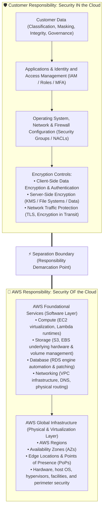
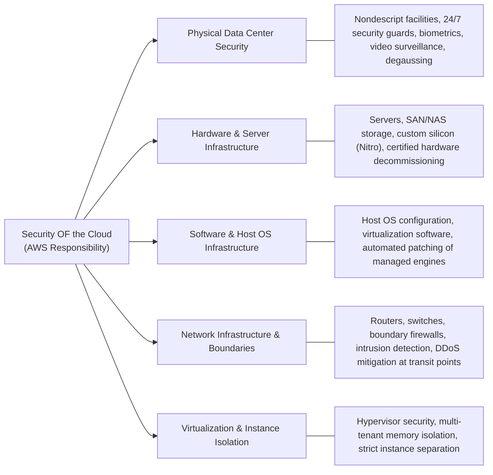
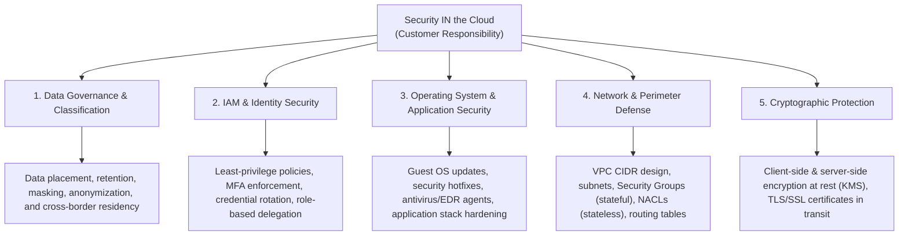
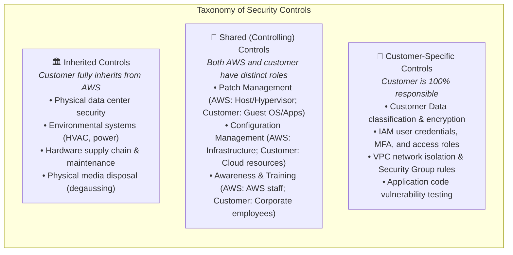
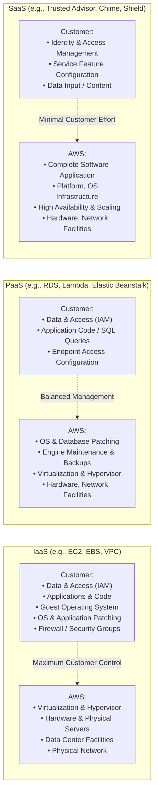
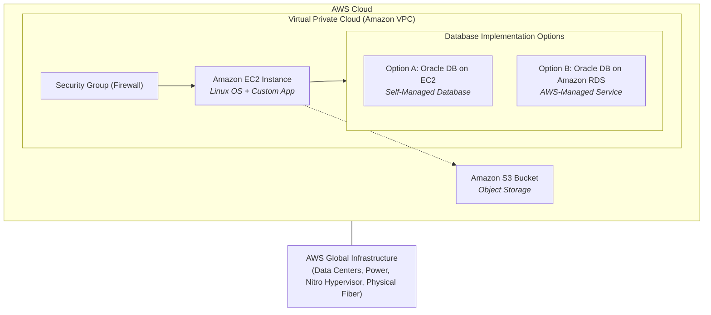

# 🛡️ AWS Shared Responsibility Model: Cloud Security Architecture & Governance

> **Course**: AWS Cloud Foundations  
> **Module**: M01 – Cloud Computing Foundations & Security Governance  
> **Source**: `T05-0010-RSCF_SG_EN-US_M01_SHAREDRESPONSIBILITYMODEL.pdf`  
> **Target Audience**: AWS re/Start Learners & AWS Certified Cloud Practitioner (CLF-C02) Candidates  

---

## 🎯 Module Overview

Security is job zero and the highest operational priority at Amazon Web Services (AWS). AWS delivers a highly scalable, durable, and reliable cloud computing environment while simultaneously equipping customers with the security tools and isolation required to safeguard sensitive workloads.

Unlike traditional on-premises IT environments—where an organization owns and maintains every single layer of the stack from concrete data center perimeters up to end-user applications—cloud computing introduces a collaborative governance framework known as the **AWS Shared Responsibility Model**.

Under this model, the operational and security burdens are clearly divided:
- **AWS is responsible for Security OF the Cloud**: Protecting the physical and logical infrastructure running all cloud services.
- **The Customer is responsible for Security IN the Cloud**: Securing everything they deploy, configure, and store within the cloud environment.

Understanding this division of responsibility, as well as how controls are categorized (Inherited, Shared, and Customer-Specific) across Infrastructure as a Service (IaaS), Platform as a Service (PaaS), and Software as a Service (SaaS), is vital for building compliant, resilient, and secure architectures.

---

### 📌 Learning Objectives

- [ ] Describe AWS Cloud security principles and define the core concepts of the **AWS Shared Responsibility Model**.
- [ ] Differentiate between **Security OF the Cloud** (AWS responsibility) and **Security IN the Cloud** (Customer responsibility).
- [ ] Detail the physical, hardware, software, network, and virtualization controls managed by AWS.
- [ ] Identify customer-managed controls, including data classification, IAM permissions, OS configuration, patching, and firewalls.
- [ ] Classify security controls into **Inherited Controls**, **Shared (Controlling) Controls**, and **Customer-Specific Controls**.
- [ ] Analyze how security obligations shift dynamically across cloud delivery models: **IaaS**, **PaaS**, and **SaaS**.
- [ ] Solve real-world deployment scenarios (e.g., EC2 vs. Amazon RDS database patching and Amazon S3 bucket access policies).
- [ ] Evaluate compliance mechanisms and third-party audit attestations available through AWS Artifact.

---

## 🏗️ 1. The AWS Shared Responsibility Architecture

The AWS Shared Responsibility Model establishes an explicit boundary separating customer security configurations from AWS infrastructure protection.

> [!IMPORTANT]
> The division of responsibility is not static across all AWS services. While the foundational rule (*AWS secures the infrastructure; the customer secures what they put on it*) always applies, the exact boundary shifts based on whether the customer uses **IaaS**, **PaaS**, or **SaaS** service tiers.

---

## 🏢 2. Security OF the Cloud (AWS Responsibility)

AWS manages, operates, and controls all components from the virtualization layer and host operating systems down to the physical facilities where services operate. Customers cannot visit AWS data centers or audit hardware racks in person, but AWS maintains continuous auditing and third-party compliance verification.

### Key Areas of AWS Responsibility

1. **Physical Security of Data Centers**:
   - **Nondescript Facilities**: Data centers are located in undisclosed, unmarked facilities with strict access controls.
   - **Multi-Factor Access**: Access is granted strictly on a need-based, least-privilege principle with biometric and two-factor authentication.
   - **24/7 Physical Monitoring**: Facilities employ professional security personnel, intrusion sensors, continuous closed-circuit television (CCTV) surveillance, and access logging.
   - **Media Sanitization & Decommissioning**: Defective or decommissioned storage drives are purged using multi-pass wiping, degaussing, and physical shredding according to DoD 5220.22-M and NIST 800-88 standards.

2. **Hardware and Storage Infrastructure**:
   - Provisioning, health monitoring, and maintenance of all bare-metal server chassis, power distribution units (PDUs), backup generators, HVAC systems, and storage arrays.
   - Secure supply chain verification for proprietary AWS silicon (such as the AWS Nitro System and custom hardware chips).

3. **Software & Host Infrastructure**:
   - Maintenance, hardening, and patching of the physical host operating systems.
   - Operating and maintaining the software platforms powering AWS managed services (e.g., the hypervisor code, storage node daemons, and internal service APIs).

4. **Network Infrastructure**:
   - Redundant optical network architecture connecting Availability Zones and Regions across private AWS-owned fiber backbones.
   - Boundary monitoring, intrusion detection systems (IDS), deep packet inspection at network perimeters, and automated inline distributed denial-of-service (DDoS) mitigation.

5. **Virtualization Infrastructure & Instance Isolation**:
   - Rigorous hypervisor separation ensuring tenant workloads cannot access memory, CPU registers, or storage assigned to another tenant.
   - The **AWS Nitro System** offloads network, storage, management, and security tasks to dedicated hardware cards, virtually eliminating hypervisor overhead and preventing host administrators from accessing guest memory.

> [!NOTE]
> **Audit Attestations & AWS Artifact**: Customers verify AWS security controls via formal third-party audit reports (such as SOC 1/2/3, ISO/IEC 27001, 27017, 27018, PCI-DSS Level 1, HIPAA, and FedRAMP). These reports and compliance agreements are available on demand inside the AWS Management Console via **AWS Artifact**.

---

## 🛡️ 3. Security IN the Cloud (Customer Responsibility)

While AWS secures the underlying platform, the customer retains complete operational authority and responsibility for everything deployed in their AWS environment. Customers retain sole ownership and control over their data, architecture, access configurations, and cryptographic assets.

### The 5 Pillars of Customer Responsibility

| Pillar | Operational Responsibility | Best Practice Implementations |
| :--- | :--- | :--- |
| **1. Customer Data Protection** | Determining where data resides, how it is categorized, who accesses it, and when it is retired. | Data classification policies, lifecycle rules, data loss prevention (DLP), and regional residency compliance (e.g., GDPR, CCPA). |
| **2. Identity & Access (IAM)** | Configuring access credentials, password policies, user directories, and authorization rules. | Enforcing Multi-Factor Authentication (MFA), least privilege IAM policies, temporary credentials via AWS STS / IAM Roles, and removing access keys. |
| **3. Operating Systems & Applications** | Choosing, configuring, updating, and patching the guest OS on compute instances (e.g., Amazon EC2). | Running AWS Systems Manager Patch Manager, hardening AMI templates, and updating third-party libraries and web application code. |
| **4. Network Configuration & Firewalls** | Defining network topology, isolation boundaries, routing, and packet filtering rules. | Restricting inbound ports via EC2 Security Groups, subnet segmentation via Network Access Control Lists (NACLs), AWS WAF, and AWS Network Firewall. |
| **5. Cryptography & Encryption** | Encrypting data at rest and data in transit; managing cryptographic key access. | Enabling server-side encryption on Amazon S3 and Amazon EBS using AWS KMS; mandating TLS 1.2+ for in-transit communication. |

### Customer Authority over Data Residency
Customers maintain absolute sovereignty over their data:
- **Storage Location**: The customer explicitly chooses the geographic AWS Region where their content is housed. AWS never replicates data across Regions without explicit customer instruction.
- **Service Utilization**: The customer decides which AWS services process or interact with their data.
- **Data Transformation**: The customer determines whether data is plain text, masked, anonymized, tokenized, or cryptographically encrypted.
- **Access Lifecycle**: The customer dictates how credentials and access privileges are created, assigned, audited, and revoked.

---

## ⚖️ 4. Taxonomy of Cloud Security Controls

AWS categorizes security controls under the shared responsibility model into three distinct classifications: **Inherited Controls**, **Shared (Controlling) Controls**, and **Customer-Specific Controls**.

### Detailed Controls Comparison

| Control Type | Description | AWS Responsibility | Customer Responsibility |
| :--- | :--- | :--- | :--- |
| **Inherited Controls** | Security controls that the customer seamlessly inherits in full from the AWS infrastructure. | Physical access controls, biometric security, camera surveillance, environmental controls (cooling, fire suppression), uninterruptible power supplies (UPS), and hardware decommissioning. | None. The customer reviews AWS compliance reports (SOC, ISO) to verify that AWS maintains these controls. |
| **Shared Controls** | Controls that apply to both the infrastructure layer and the customer workload layer, requiring distinct actions from both parties. | **Patch Management**: Patches physical hosts, network firmware, and managed service runtimes. **Configuration Management**: Configures underlying hypervisors and foundational cloud APIs. **Awareness & Training**: Trains AWS employees on security policies and physical safety. | **Patch Management**: Patches guest OS, applications, and database engines on EC2. **Configuration Management**: Configures security groups, VPC routing, IAM policies, and OS firewalls. **Awareness & Training**: Trains internal employees on corporate security, phishing, and access governance. |
| **Customer-Specific Controls** | Controls that are solely the responsibility of the customer based on the workloads and applications they deploy. | None. AWS provides the building blocks (KMS, IAM, VPC), but does not operate the controls. | Implementing end-to-end data encryption, managing customer IAM credentials and permissions, architecting network firewalls, and securing proprietary software code. |

---

## 🔄 5. Shared Responsibility Across Cloud Delivery Models

The degree of customer management effort directly depends on the cloud service delivery model deployed: **Infrastructure as a Service (IaaS)**, **Platform as a Service (PaaS)**, and **Software as a Service (SaaS)**.

### Comprehensive Comparison Matrix

| Feature / Dimension | Infrastructure as a Service (IaaS) | Platform as a Service (PaaS) | Software as a Service (SaaS) |
| :--- | :--- | :--- | :--- |
| **Typical AWS Services** | **Amazon EC2**, **Amazon EBS**, **Amazon VPC** | **AWS Lambda**, **Amazon RDS**, **AWS Elastic Beanstalk** | **AWS Trusted Advisor**, **Amazon Chime**, **AWS Shield** |
| **Customer Flexibility** | Highest: complete control over OS, storage drivers, network stacks, and software packages. | Moderate: customer focuses on application code, schema design, and data endpoints. | Low to Moderate: customer consumes centrally hosted software through web console, apps, or APIs. |
| **Guest OS Patching** | **Customer Responsibility** (must update, patch kernel, and reboot). | **AWS Responsibility** (AWS automatically patches host and database OS). | **AWS Responsibility** (fully abstracted from end customer). |
| **Database Engine Patching** | **Customer Responsibility** (if database runs on EC2). | **AWS Responsibility** (Amazon RDS schedules minor/major engine patches). | **AWS Responsibility** (fully managed by AWS internal teams). |
| **Disaster Recovery & Redundancy** | **Customer Responsibility** (configuring Multi-AZ deployments, snapshots, Auto Scaling). | **Shared / AWS-Managed** (RDS provides automated Multi-AZ replication; Lambda scales natively). | **AWS Responsibility** (AWS manages underlying service resiliency and global failover). |
| **Security Configuration** | Customer configures guest OS firewalls, EC2 security groups, routing, IAM, and patches. | Customer configures database access grants, IAM roles, and application-level network endpoints. | Customer configures user seats, subscription tiers, and role-based permissions. |

---

## 🔬 6. Case Study & Activity: AWS Deployment Scenario

Consider a standard enterprise three-tier web deployment inside an AWS Virtual Private Cloud (VPC):
- **Web/App Tier**: Amazon EC2 instances running Linux and Apache.
- **Storage Tier**: Amazon Simple Storage Service (Amazon S3) buckets for static media and backups.
- **Database Tier**: Relational Oracle Database workload (analyzed under two separate operational configurations: EC2 self-hosted vs. Amazon RDS managed).

### Responsibility Breakdown & Scenario Analysis

The table below breaks down the 8 foundational questions presented in the curriculum scenario:

| # | Architecture Component / Scenario Question | Responsible Party | Detailed Rationale & Operational Context |
| :-: | :--- | :---: | :--- |
| **1** | **Upgrades and patches to the operating system on the EC2 instance** | **The Customer** | Amazon EC2 is an IaaS service. The customer chooses the guest OS (e.g., Amazon Linux, Ubuntu, Windows) and must schedule updates, install security patches, and reboot instances. |
| **2** | **Physical security of the data center** | **AWS** | AWS maintains 24/7 security perimeter controls, biometric access, and physical surveillance of all facilities housing AWS infrastructure. |
| **3** | **Virtualization infrastructure and hypervisor isolation** | **AWS** | AWS engineers and maintains the hypervisor layer (such as the AWS Nitro System) ensuring complete memory, CPU, and network tenant isolation. |
| **4** | **Amazon EC2 security group settings** | **The Customer** | Security groups act as virtual stateful firewalls controlling inbound and outbound traffic to instances. The customer is solely responsible for defining allow rules and port access. |
| **5** | **Configuration of the applications that run on the EC2 instance** | **The Customer** | Any web server (Apache, Nginx), background daemon, custom code, or runtime framework installed on EC2 is completely within the customer's management boundary. |
| **6** | **Oracle upgrades or patches if the Oracle instance runs as an Amazon RDS instance** | **AWS** | Amazon RDS is a managed PaaS database offering. AWS handles provisioning, underlying OS management, routine minor engine patching, and storage maintenance automatically. |
| **7** | **Oracle upgrades or patches if Oracle runs on an EC2 instance** | **The Customer** | When running software on top of self-managed IaaS EC2 instances, the customer acts as database administrator (DBA), managing software licenses, database patches, and backups. |
| **8** | **Configuration of S3 bucket access policies and permissions** | **The Customer** | Amazon S3 infrastructure, durability, and physical disks are secured by AWS, but the customer controls access via S3 Bucket Policies, IAM policies, and S3 Block Public Access settings. |

> [!TIP]
> **Key Exam Heuristic**: Whenever evaluating whether AWS or the customer is responsible for an administrative task, ask: **"Do I have administrative (root / RDP / SSH) access to the underlying server?"**  
> - If **YES** (e.g., EC2) $\rightarrow$ **Customer** is responsible for patching and maintenance.  
> - If **NO** (e.g., RDS, Lambda, S3, DynamoDB) $\rightarrow$ **AWS** is responsible for patching and infrastructure maintenance.

---

## 🛠️ 7. Guided Knowledge Check

Test your understanding of the AWS Shared Responsibility Model with the following questions.

### Question 1
**Which of the following security tasks is the customer responsible for when deploying an Amazon EC2 instance?**
- [ ] A) Decommissioning defective hard disk drives
- [ ] B) Patching the host virtualization hypervisor
- [ ] C) Applying security patches to the guest operating system
- [ ] D) Securing the physical perimeter of the AWS data center

👉 View Answer & Explanation

**Correct Answer**: **C) Applying security patches to the guest operating system**  
**Explanation**: In an IaaS model (Amazon EC2), the customer is responsible for managing everything from the guest operating system upward, including kernel updates, security patches, and anti-malware software. Decommissioning physical disks (A), patching the hypervisor (B), and physical data center perimeter security (D) are all AWS responsibilities (Security OF the Cloud).

---

### Question 2
**Under the AWS Shared Responsibility Model, which control is considered a *Shared (Controlling) Control*?**
- [ ] A) Physical data center perimeter fencing
- [ ] B) Configuration Management
- [ ] C) Amazon S3 bucket policy definitions
- [ ] D) Edge location biometric access enforcement

👉 View Answer & Explanation

**Correct Answer**: **B) Configuration Management**  
**Explanation**: Configuration Management and Patch Management are shared controls because both AWS and the customer have distinct roles. AWS configures and maintains the underlying infrastructure and hypervisors, while the customer configures their provisioned cloud resources, security groups, and guest systems. Physical fencing (A) and biometric access (D) are inherited controls managed entirely by AWS. S3 bucket policies (C) are customer-specific controls.

---

### Question 3
**How does a customer's security responsibility change when migrating a database from an EC2 instance to Amazon RDS?**
- [ ] A) The customer assumes responsibility for the underlying server hardware.
- [ ] B) AWS takes over OS patching, database engine maintenance, and automated backups.
- [ ] C) The customer no longer needs to manage IAM access permissions or database credentials.
- [ ] D) AWS becomes responsible for encrypting the customer's database queries and classifying customer tables.

👉 View Answer & Explanation

**Correct Answer**: **B) AWS takes over OS patching, database engine maintenance, and automated backups.**  
**Explanation**: Migrating from self-managed IaaS (EC2) to managed PaaS (Amazon RDS) offloads the operational burden of OS updates, minor engine patching, hardware scaling, and baseline backups to AWS. The customer remains responsible for IAM permissions, database user access, table structures, and data encryption configuration.

---

### Question 4
**Which document repository in the AWS Management Console allows customers to download AWS third-party compliance reports (such as SOC 2 and ISO 27001) to verify security of the cloud?**
- [ ] A) AWS Trusted Advisor
- [ ] B) AWS Shield
- [ ] C) AWS Artifact
- [ ] D) AWS IAM Credential Report

👉 View Answer & Explanation

**Correct Answer**: **C) AWS Artifact**  
**Explanation**: AWS Artifact is the central portal for on-demand access to AWS compliance reports, certifications, and security agreements (such as Business Associate Addendums for HIPAA). AWS Trusted Advisor provides architecture recommendations; AWS Shield mitigates DDoS attacks; and IAM Credential Reports audit account user credentials.

---

## 📝 8. Key Takeaways & Review Summary

- **Shared Responsibility Definition**: Security in AWS is a shared partnership. AWS manages **Security OF the Cloud**, and the customer manages **Security IN the Cloud**.
- **AWS Scope (OF the Cloud)**: AWS operates, controls, and defends the global infrastructure—including data centers, availability zones, physical hardware, host operating systems, hypervisors, and core service software.
- **Customer Scope (IN the Cloud)**: Customers own and secure their data, identity and access policies (IAM), guest operating systems, application code, firewall configurations (Security Groups / NACLs), and cryptographic keys.
- **Service Models Shift Responsibility**:
  - **IaaS (EC2)**: Customer has maximum flexibility and handles guest OS patching, networking, and firewalls.
  - **PaaS (RDS, Lambda)**: AWS handles host OS and engine patching; customer manages application code and data access.
  - **SaaS (Trusted Advisor, Chime)**: AWS manages the complete application stack; customer manages access configurations and user accounts.
- **Control Taxonomy**:
  - **Inherited**: Physical facilities, hardware, and environmental safeguards inherited directly from AWS.
  - **Shared**: Patch management, configuration management, and awareness training executed across both tiers.
  - **Customer-Specific**: Application security, data classification, and IAM privilege administration managed strictly by the customer.
