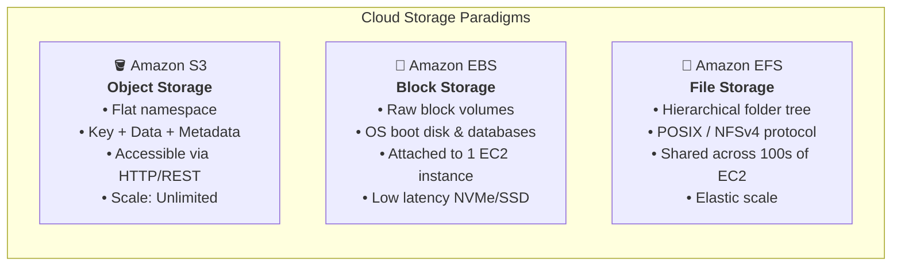
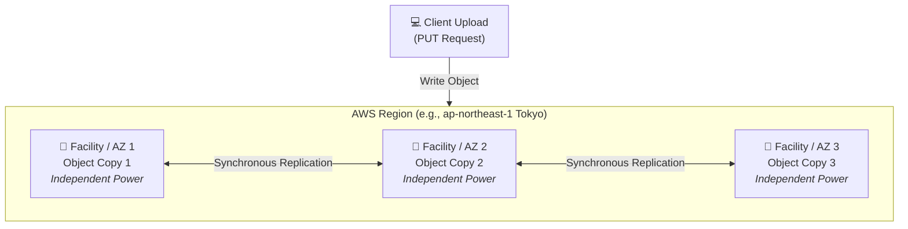
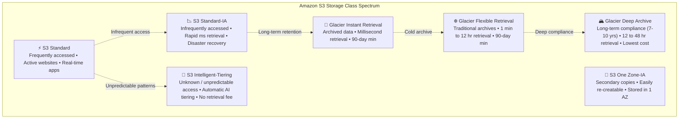
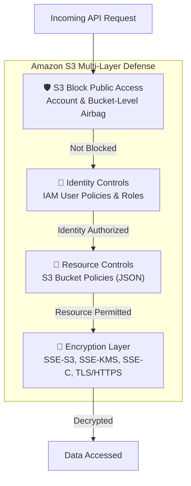
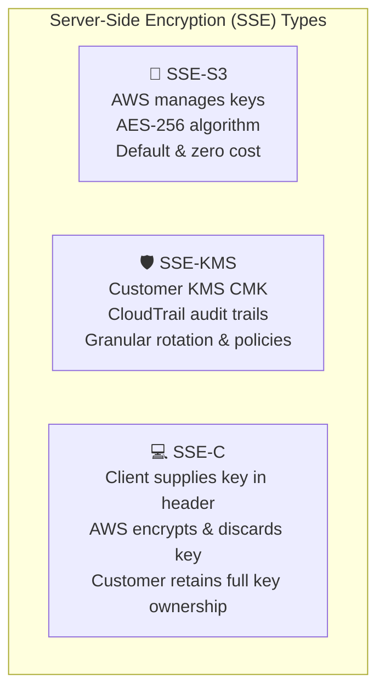
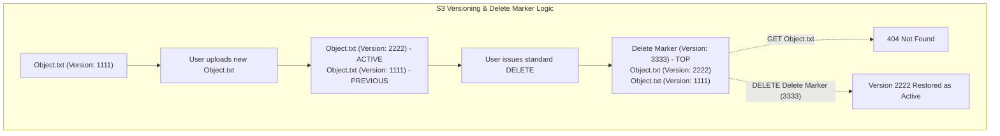
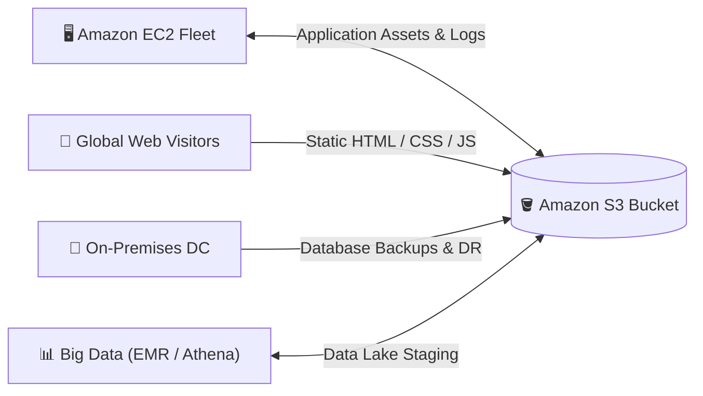

# 🪣 Module 01: Amazon Simple Storage Service (Amazon S3) – Study Guide

> **Course**: AWS re/Start Cloud Foundations  
> **Module**: M01 – Cloud Computing Foundations & Storage  
> **Source Document**: `T05-0011-RSCF_SG_EN-US_M01_AMAZONS3.pdf`  
> **Target Audience**: AWS re/Start Learners & Cloud Practitioners  

---

## 🎯 Module Overview

Welcome to **Amazon Simple Storage Service (Amazon S3)**. Data is the core asset of modern computing systems, powering web applications, big data analytics, machine learning pipelines, and enterprise disaster recovery strategies. Traditional on-premises storage architectures often face bottlenecks involving hardware provisioning lead times, capacity limits, high capital expenditures, and complex multi-site replication.

**Amazon S3** is an object storage service engineered to offer industry-leading scalability, data availability, security, and performance. S3 allows individuals and organizations to store and protect virtually unlimited quantities of data for virtually any use case—including data lakes, cloud-native applications, backups, archives, and static website hosting.

This study guide details the architectural foundations of Amazon S3, examines how object storage differs from block and file storage, surveys the diverse S3 storage classes, explains security controls and encryption models, and reviews core features including lifecycle rules, versioning, replication, and cost optimization.

---

### 📌 Learning Objectives

- [ ] **Define Amazon S3 Fundamentals**: Explain the core architecture of object storage, logical buckets, object keys, metadata, and web-addressable REST endpoints.
- [ ] **Compare Storage Architectures**: Differentiate object storage (Amazon S3) from block storage (Amazon EBS) and file storage (Amazon EFS).
- [ ] **Analyze Durability & Redundancy**: Articulate how Amazon S3 achieves 99.999999999% (11 9s) of durability through automatic multi-facility and multi-AZ replication.
- [ ] **Evaluate S3 Storage Classes**: Compare access tiers (Standard, Intelligent-Tiering, Standard-IA, One Zone-IA, Glacier Instant Retrieval, Glacier Flexible Retrieval, and Glacier Deep Archive) across durability, availability, latency, minimum retention, and retrieval cost.
- [ ] **Implement S3 Security & Access Control**: Formulate layered defense strategies utilizing IAM policies, S3 Bucket Policies, Access Control Lists (ACLs), S3 Block Public Access, and pre-signed URLs.
- [ ] **Apply Server-Side Encryption (SSE)**: Contrast SSE-S3, SSE-KMS, and SSE-C encryption mechanisms for data at rest, alongside TLS/HTTPS in-transit protection.
- [ ] **Configure Advanced S3 Features**: Understand Versioning, Lifecycle transitions and expirations, Cross-Region Replication (CRR), Same-Region Replication (SRR), and Static Website Hosting.
- [ ] **Calculate & Optimize S3 Costs**: Identify billing dimensions (storage volume, API request types, data transfer egress, and tier transitions) to construct cost-effective storage solutions.

---

## 📚 Key Terminology

| Term | Definition |
| :--- | :--- |
| **Object Storage** | A storage architecture that manages data as discrete objects containing data, a unique identifier (key), and customizable metadata, rather than blocks or a hierarchical file tree. |
| **S3 Bucket** | A logical container for objects stored in Amazon S3. Every bucket is tied to a specific AWS Region and possesses a globally unique name. |
| **Object Key** | The unique identifier (name and path prefix) assigned to an object within an S3 bucket (e.g., `media/videos/intro.mp4`). |
| **Object Metadata** | A set of name-value pairs that describe the object. Includes system metadata (file size, modification date, MD5 checksum) and user-defined custom metadata. |
| **11 9s Durability** | A design standard representing 99.999999999% durability over a given year, meaning an average loss probability of one file out of 10 billion stored objects. |
| **Storage Class** | A storage tier engineered for specific access patterns, retention timelines, and cost profiles (e.g., Standard vs. Glacier Deep Archive). |
| **Bucket Policy** | A resource-based JSON policy attached directly to an S3 bucket that grants or restricts access permissions to the bucket and its objects. |
| **S3 Block Public Access** | A centralized account- and bucket-level security control that overrides permissive access policies to prevent public exposure. |
| **Server-Side Encryption (SSE)** | Automatic encryption of data at the storage layer before it is written to disk, and decryption upon authorized retrieval. |
| **Lifecycle Rule** | Automated policy rules that transition objects between storage classes or trigger permanent deletion after a configured schedule. |
| **Cross-Region Replication (CRR)** | Automated, asynchronous copying of objects across S3 buckets in different geographic AWS Regions. |

---

## 🏗️ 1. Amazon S3 Fundamentals

### What is Amazon S3?
Amazon Simple Storage Service (Amazon S3) is an object-level cloud storage solution managed entirely by AWS. Instead of maintaining physical hard disk drives, SAN arrays, or file servers, developers and system administrators interact with Amazon S3 via secure web protocols (HTTP/HTTPS) and programmatic APIs.

```
┌────────────────────────────────────────────────────────────────────────┐
│                        Amazon S3 Core Pillars                          │
├────────────────────────────────────────────────────────────────────────┤
│ • Scalability: Unlimited capacity; individual objects from 0 B to 5 TB │
│ • Durability: Designed for 99.999999999% (11 9s) of data durability    │
│ • Web Native: Every object is addressable via standard REST URLs       │
│ • Secure: Default private access, Block Public Access, built-in SSE    │
│ • Granular Control: Bucket policies, IAM roles, tags, and lifecycle rules│
└────────────────────────────────────────────────────────────────────────┘
```

---

### Storage Models Compared: Object vs. Block vs. File

Cloud storage falls into three primary paradigms, each suited for distinct architectural workloads:

| Storage Dimension | Object Storage (Amazon S3) | Block Storage (Amazon EBS) | File Storage (Amazon EFS) |
| :--- | :--- | :--- | :--- |
| **Data Organization** | Objects stored flatly in buckets with key + metadata | Raw fixed-sized blocks on virtual storage volumes | Hierarchical directory tree (folders/files) |
| **Modification Model** | **Atomic replacement**: Modifying 1 byte requires re-uploading the entire object | **Block-level updates**: Directly modify specific altered blocks | **File-level delta**: Incremental byte updates within files |
| **Access Protocol** | HTTP / HTTPS (REST API, AWS SDKs, CLI, Console) | Fibre Channel, iSCSI, NVMe attached to compute instance | Network File System (NFSv4), POSIX compliant |
| **Mountable to OS** | **No** (accessed over HTTP web endpoints) | **Yes** (attached directly to a single EC2 instance) | **Yes** (concurrently mounted across hundreds of EC2 instances) |
| **Max Individual Size**| Up to 5 TB per single object | Up to 16 TiB (or 64 TiB for io2) per volume | Petabytes of elastic, growing file system |
| **Primary Use Cases** | Media assets, backups, static websites, data lakes, application logs | OS boot volumes, databases (MySQL, Oracle), low-latency transactional apps | Shared file repositories, content management systems (CMS), enterprise home directories |



> [!IMPORTANT]
> **No Partial File Updates in S3**: Because S3 is an object store, it does not support file editing in place. If an application updates a 4 GB database file stored in S3, it cannot overwrite a few bytes within that file; the entire 4 GB object must be re-uploaded. For workloads requiring frequent, granular block-level read/write transactions, choose **Amazon EBS** or **Amazon EFS**.

---

### Anatomy of an S3 Object

In Amazon S3, an **object** consists of the following elements:

1. **Object Key (Name)**: The unique string identifier assigned to an object within a bucket. While S3 presents a flat structure, slashes (`/`) in keys (e.g., `development/2026/report.pdf`) allow user interfaces and tools to simulate folders and hierarchical prefixes.
2. **Data / Payload**: The actual sequence of bytes being stored. An object can range from 0 bytes up to **5 TB** in size.
3. **Metadata**: Name-value pairs providing context:
   - **System Metadata**: Automatically maintained by AWS (e.g., `Content-Length`, `Last-Modified`, `ETag`, `Storage-Class`).
   - **User-Defined Metadata**: Custom headers prefixed with `x-amz-meta-` defined during object upload (e.g., `x-amz-meta-author: cloud-admin`).
4. **Version ID**: A unique string assigned by S3 to distinguish multiple versions of the same key when Versioning is enabled.
5. **Access Control Information**: Permissions granting or denying read/write privileges to specific AWS principals.

---

### Buckets and the Universal DNS Namespace

A **bucket** is the root container for objects in Amazon S3. 

#### Bucket Naming Rules
1. **Globally Unique Across AWS**: No two AWS accounts in the world can have an S3 bucket with the same name.
2. **DNS-Compliant**: Bucket names are resolved via global DNS and must adhere to the following rules:
   - Length between 3 and 63 characters.
   - Must contain only lowercase letters (`a-z`), numbers (`0-9`), and hyphens (`-`).
   - Must start and end with a letter or number.
   - Must **not** contain uppercase letters, underscores (`_`), or adjacent periods.
   - Must not be formatted as an IP address (e.g., `192.168.1.1`).

#### Region Association
When creating a bucket, you must specify the **AWS Region** where its physical data will reside (e.g., `us-east-1` in North Virginia, `ap-northeast-1` in Tokyo, `eu-central-1` in Frankfurt). Choosing an optimal Region depends on:
- **Compliance & Data Sovereignty**: Legal mandates requiring data to remain within a specific jurisdiction.
- **Latency**: Proximity to end users or application servers accessing the objects.
- **Cost**: Regional variance in pricing for storage and data transfer.

---

### URL & REST Endpoint Structures

Because Amazon S3 natively operates over HTTP/HTTPS, every object is reachable through a standardized URL structure.

```
Virtual-Hosted–Style URL (Recommended Standard):
https://[bucket-name].s3.[region].amazonaws.com/[key]

Example:
https://my-cloud-reports.s3.ap-northeast-1.amazonaws.com/media/preview2.mp4
│       │               │  │               │              │ └─────────────────── Object Key
│       │               │  │               │              └───────────────────── S3 Domain
│       │               │  └───────────────┴──────────────────────────────────── AWS Region Code
│       └───────────────┴─────────────────────────────────────────────────────── Bucket Name
└─────────────────────────────────────────────────────────────────────────────── Protocol (HTTPS)
```

> [!NOTE]
> **Path-Style URLs (Deprecated)**: Older implementations utilized path-style URLs in the format `https://s3.[region].amazonaws.com/[bucket-name]/[key]`. AWS has formally transitioned to virtual-hosted-style URLs to ensure superior routing scalability and DNS performance.

---

### Redundancy & 11 9s Durability

Amazon S3 standard storage classes are engineered for **99.999999999% (11 9s) durability**. 

How does AWS achieve this level of durability?
- **Automatic Multi-Facility Replication**: When an object is uploaded to an S3 bucket, it is automatically and synchronously replicated across at least **three physically isolated Availability Zones (AZs)** within that Region.
- **Independent Infrastructure**: Each AZ is separated by meaningful geographic distance (kilometers) and features independent utility feeds, backup generators, and fiber connectivity.
- **Concurrent Facility Failure Resilience**: Amazon S3 is architected to withstand the concurrent loss of data in **two full facilities (or AZs)** without any customer data loss.



> [!TIP]
> **Durability vs. Availability**:
> - **Durability (11 9s = 99.999999999%)**: Measures data preservation. If you store 10,000,000 objects in S3, you can expect on average to lose a single object once every 10,000 years.
> - **Availability (e.g., 99.99%)**: Measures system uptime and immediate accessibility over the network. If S3 experiences a brief transient network interruption, your data remains durable and intact even if temporary retrieval availability dips momentarily.

---

### Seamless Elastic Scaling

Traditional on-premises storage arrays require administrators to forecast storage capacity months in advance, submit purchase orders for physical drives, and re-partition RAID arrays.

Amazon S3 eliminates capacity planning through **seamless elastic scaling**:
- **Zero Capacity Provisioning**: You do not pre-allocate or reserve disk space. A bucket can store 10 files or 10 billion files without configuration changes.
- **Dynamic Throughput Scaling**: S3 automatically scales to support high request rates. It natively supports up to **3,500 PUT/COPY/POST/DELETE** requests per second and **5,500 GET/HEAD** requests per second per partitioned prefix.
- **Pay-as-you-Go**: Costs are determined entirely by the exact volume of data stored and requests processed.

---

## 📦 2. Amazon S3 Storage Classes

To optimize costs across varying data lifecycles, Amazon S3 provides specialized **storage classes** designed for different access patterns, retention durations, and availability requirements.



---

### Detailed Breakdown of Storage Classes

#### 1. Amazon S3 Standard
- **Designation**: High-throughput, low-latency storage for active, frequently accessed data.
- **Availability & Durability**: 99.99% availability, 11 9s durability across $\ge 3$ AZs.
- **Ideal Workloads**: Production web and mobile applications, media streaming distributions, dynamic big data analytics workloads, gaming asset hosting.

#### 2. Amazon S3 Intelligent-Tiering
- **Designation**: Automated cost optimization for data with unknown, changing, or unpredictable access patterns.
- **Mechanism**: Automatically analyzes object access patterns. If an object remains unaccessed for **30 consecutive days**, it moves to the *Infrequent Access Tier*. If accessed later, it immediately returns to the *Frequent Access Tier*. Optional automated tiers include *Archive Instant Access* (90 days), *Archive Access* (90–730 days), and *Deep Archive Access* (180–730 days).
- **Pricing Model**: Small monthly monitoring and automation fee per object. **Zero retrieval fees** and **zero tier-transition fees**.

#### 3. Amazon S3 Standard-Infrequent Access (Standard-IA)
- **Designation**: Designed for objects accessed less frequently, but requiring immediate, real-time millisecond access when needed.
- **Availability & Durability**: 99.9% availability, 11 9s durability across $\ge 3$ AZs.
- **Pricing Model**: Lower storage rate per GB than S3 Standard, but incurs a **per-GB retrieval fee** when objects are read. Minimum billable object size is 128 KB, and minimum storage duration is 30 days.
- **Ideal Workloads**: Backup archives, disaster recovery (DR) staging data, older application logs.

#### 4. Amazon S3 One Zone-Infrequent Access (One Zone-IA)
- **Designation**: Lower-cost infrequent access tier that stores data in a **single Availability Zone** rather than multiple AZs.
- **Availability & Durability**: 99.5% availability, 11 9s durability within a single AZ.
- **Cost Advantage**: Approximately **20% less expensive** per GB than Standard-IA.
- **Risk Consideration**: If the physical facility hosting that single AZ is compromised or destroyed, data can be permanently lost.
- **Ideal Workloads**: Secondary backup copies of on-premises infrastructure, easily re-creatable processed data (e.g., transcoded video thumbnails), cross-region disaster recovery replication targets where primary data exists elsewhere.

#### 5. Amazon S3 Glacier Instant Retrieval
- **Designation**: Archive storage class that delivers the lowest-cost storage for rarely accessed data that still demands immediate, real-time **millisecond retrieval**.
- **Ideal Workloads**: Medical imaging archives, news media footage, regulatory records that might need instantaneous audit review. Minimum storage duration: 90 days.

#### 6. Amazon S3 Glacier Flexible Retrieval (Formerly S3 Glacier)
- **Designation**: Low-cost, secure archiving solution for cold data that does not require instantaneous retrieval.
- **Retrieval Tiers**:
  - **Expedited**: 1 to 5 minutes (for urgent emergency recoveries).
  - **Standard**: 3 to 5 hours (standard batch recovery).
  - **Bulk**: 5 to 12 hours (free or lowest-cost large-scale retrieval).
- **Ideal Workloads**: Quarterly enterprise backups, retired project files. Minimum storage duration: 90 days.

#### 7. Amazon S3 Glacier Deep Archive
- **Designation**: The absolute **lowest-cost cloud storage tier** across the entire industry (fractions of a cent per GB per month). Engineered to replace legacy on-premises magnetic tape libraries.
- **Retrieval Tiers**:
  - **Standard**: 12 hours.
  - **Bulk**: 48 hours.
- **Ideal Workloads**: Highly regulated compliance datasets (financial transaction ledgers, healthcare clinical trial records, tax documentation) retained for 7 to 10+ years and accessed once or twice a year. Minimum storage duration: 180 days.

---

### Storage Class Comprehensive Comparison Table

| Storage Class | Durability | Availability (SLA) | AZ Redundancy | Retrieval Latency | Min Storage Duration | Per-GB Retrieval Fee? |
| :--- | :--- | :--- | :--- | :--- | :--- | :--- |
| **S3 Standard** | 99.999999999% (11 9s) | 99.99% | $\ge 3$ AZs | Milliseconds | None | No |
| **S3 Intelligent-Tiering** | 99.999999999% (11 9s) | 99.9% | $\ge 3$ AZs | Milliseconds | None | **No** (Monitoring fee applies) |
| **S3 Standard-IA** | 99.999999999% (11 9s) | 99.9% | $\ge 3$ AZs | Milliseconds | 30 days | Yes |
| **S3 One Zone-IA** | 99.999999999% (11 9s) | 99.5% | **1 AZ only** | Milliseconds | 30 days | Yes |
| **S3 Glacier Instant Retrieval** | 99.999999999% (11 9s) | 99.9% | $\ge 3$ AZs | Milliseconds | 90 days | Yes |
| **S3 Glacier Flexible Retrieval** | 99.999999999% (11 9s) | 99.9% | $\ge 3$ AZs | Minutes to hours (1m – 12h) | 90 days | Yes |
| **S3 Glacier Deep Archive** | 99.999999999% (11 9s) | 99.9% | $\ge 3$ AZs | Hours (12h – 48h) | 180 days | Yes |

---

## 🔒 3. Amazon S3 Security & Permissions

Security in Amazon S3 follows a defense-in-depth model, giving administrators granular control over identity, network access, data encryption, and public visibility.



---

### S3 Block Public Access
**S3 Block Public Access** acts as a centralized safeguard against accidental public exposure of data. It can be applied at the **AWS Account level** or directly to individual **S3 buckets**.

It enforces four distinct guardrail settings:
1. `BlockPublicAcls`: Blocks public access granted through new ACLs.
2. `IgnorePublicAcls`: Ignores all existing public ACLs on buckets and objects.
3. `BlockPublicPolicy`: Rejects new bucket policies that grant public access.
4. `RestrictPublicBuckets`: Restricts public access to buckets that have existing public policies to only AWS service principals and authorized users.

> [!NOTE]
> Since April 2023, Amazon S3 automatically enables **S3 Block Public Access** and turns on **Object Ownership (Bucket owner enforced)** by default for all newly created S3 buckets, effectively disabling legacy ACLs out of the box.

---

### Access Management: Policies vs. ACLs

| Authorization Mechanism | Scope | Format | Recommended Use |
| :--- | :--- | :--- | :--- |
| **IAM User Policies** | Identity-based (attached to IAM users, groups, or roles) | JSON | Regulating what specific employees, admin roles, or internal EC2 instances can do across AWS resources. |
| **S3 Bucket Policies** | Resource-based (attached directly to the S3 bucket) | JSON | Enforcing cross-account access, requiring TLS encryption in transit, or managing permissions for entire bucket prefixes. |
| **Access Control Lists (ACLs)** | Legacy resource-based (attached to buckets or individual objects) | XML / Console list | **Legacy only**. AWS officially recommends disabling ACLs in favor of Bucket Policies. |

#### Example: Bucket Policy Enforcing Encrypted HTTPS (In-Transit)
The following JSON bucket policy denies any `s3:GetObject` request that does not travel over an encrypted connection using HTTPS (`aws:SecureTransport: "false"`):

```json
{
  "Version": "2012-10-17",
  "Statement": [
    {
      "Sid": "EnforceTLSRequestsOnly",
      "Effect": "Deny",
      "Principal": "*",
      "Action": "s3:*",
      "Resource": [
        "arn:aws:s3:::my-secure-bucket",
        "arn:aws:s3:::my-secure-bucket/*"
      ],
      "Condition": {
        "Bool": {
          "aws:SecureTransport": "false"
        }
      }
    }
  ]
}
```

---

### Pre-Signed URLs
By default, private objects can only be fetched by authenticated principals with IAM credentials. What if an application needs to allow a customer to download a video or upload a profile picture without granting them an IAM account?
- **Pre-Signed URLs**: The bucket owner generates a URL embedded with temporary cryptographic security credentials.
- **Configurable Expiration**: The URL is valid only for a designated lifespan (e.g., 15 minutes, 1 hour).
- **Scoped Action**: Can grant either temporary `GET` (download) or `PUT` (upload) capabilities.

---

### Data Encryption Models

Amazon S3 supports robust encryption mechanisms for data both in transit and at rest.

#### 1. Encryption in Transit
- All communication between client applications, AWS services, and Amazon S3 can be encrypted using **TLS 1.2 or TLS 1.3 (HTTPS)**.
- Unencrypted HTTP requests can be explicitly rejected via bucket policy conditions (`aws:SecureTransport`).

#### 2. Server-Side Encryption (Encryption at Rest)
Server-side encryption protects data after it arrives in AWS, encrypting the bytes before writing them to physical disk arrays and automatically decrypting them upon retrieval.

| Encryption Mechanism | Key Management Responsibility | Audit Trail & Features |
| :--- | :--- | :--- |
| **SSE-S3** (Server-Side Encryption with Amazon S3-Managed Keys) | Fully managed by Amazon S3 | Uses 256-bit Advanced Encryption Standard (AES-256). Enabled by default on all new objects at no extra charge. |
| **SSE-KMS** (Server-Side Encryption with AWS KMS Keys) | Managed via **AWS Key Management Service (AWS KMS)** | Provides detailed **AWS CloudTrail** audit logging for every key access event, key rotation policies, and separate permission boundaries between KMS key administrators and S3 storage admins. |
| **SSE-C** (Server-Side Encryption with Customer-Provided Keys) | Managed entirely by the customer | The client transmits the encryption key in the HTTP request header; AWS executes the encryption/decryption in memory and immediately purges the key. AWS never stores customer keys. |



---

## ⚙️ 4. Core S3 Features & Lifecycle Management

### S3 Versioning
**Versioning** is a bucket-level feature that preserves every version of every object stored within a bucket.

- **Protection Against Accidental Deletes and Overwrites**: If an object is overwritten with a new file sharing the same key name, S3 retains both versions with distinct Version IDs.
- **Delete Markers**: When an authorized user issues a standard `DELETE` command against a versioned object, S3 does not permanently destroy the file; instead, it places a lightweight **Delete Marker** on top of the object. Retrieving the object returns a `404 Not Found`. However, deleting the Delete Marker restores the previous active version.
- **Permanent Deletion**: Permanently purging an object requires an explicit delete command referencing both the key and the exact `versionId`.
- **MFA Delete**: Extra security guardrail requiring multi-factor authentication (MFA) tokens to permanently remove an object version or alter bucket versioning states.



---

### S3 Lifecycle Configuration Rules

As objects age, their business utility and access frequency decline. Keeping cold logs or archives in S3 Standard results in unnecessary operational expense. **S3 Lifecycle Rules** automate data tiering and retirement.

A Lifecycle Rule contains two types of actions:
1. **Transition Actions**: Automatically shift objects to progressively cheaper storage classes based on creation age or non-current version age:
   - *Example*: Move objects to **S3 Standard-IA** after 30 days $\rightarrow$ move to **S3 Glacier Flexible Retrieval** after 90 days $\rightarrow$ move to **S3 Glacier Deep Archive** after 180 days.
2. **Expiration Actions**: Automatically delete objects permanently or purge non-current versions after a configured period (e.g., delete log files after 365 days).

---

### S3 Replication: Cross-Region (CRR) & Same-Region (SRR)

S3 Replication enables automatic, asynchronous copying of objects across S3 buckets.

#### Prerequisites for S3 Replication:
1. **Versioning must be enabled** on both the source and destination buckets.
2. An **IAM Service Role** must be configured granting Amazon S3 permission to read from the source bucket and write to the destination bucket.

#### Cross-Region Replication (CRR) vs. Same-Region Replication (SRR):
- **Cross-Region Replication (CRR)**: Replicates objects across buckets situated in different AWS Regions (e.g., `us-east-1` $\rightarrow$ `eu-central-1`).
  - *Use Cases*: Minimizing latency for international users, meeting strict multi-region disaster recovery mandates, compliance regulations demanding geographic dispersion.
- **Same-Region Replication (SRR)**: Replicates objects across buckets within the same AWS Region (e.g., between two different AWS accounts in `us-east-1`).
  - *Use Cases*: Aggregating production logs into a centralized security account, maintaining segregated production and test development environments.

---

### Static Website Hosting

Amazon S3 can serve client-side static web applications directly to the internet without requiring server operating systems, web server software (such as Apache or Nginx), or compute instances (Amazon EC2).

```
┌────────────────────────────────────────────────────────────────────────┐
│                   Static Website Hosting Architecture                  │
├────────────────────────────────────────────────────────────────────────┤
│ • Supports: HTML, CSS, JavaScript, images, client-side SPA frameworks  │
│ • Does NOT Support: Server-side dynamic code (PHP, Python/Django, ASP) │
│ • Features: Custom Index Document (index.html) and Error Document      │
│ • Web Endpoint: http://[bucket-name].s3-website-[region].amazonaws.com │
│ • Edge Distribution: Pair with Amazon CloudFront for SSL/TLS & caching │
└────────────────────────────────────────────────────────────────────────┘
```

> [!CAUTION]
> S3 static website hosting endpoints **only support HTTP** natively. To deliver a static website securely over **HTTPS** with a custom domain (e.g., `https://example.com`), configure an **Amazon CloudFront** distribution pointing to the S3 bucket as its origin and attach an **AWS Certificate Manager (ACM)** SSL/TLS certificate.

---

## 💼 5. Common Use Cases & Architectural Patterns



1. **Application Asset Storage & Media Hosting**:
   - Central repository for user-generated content (images, profile avatars, uploaded documents, videos).
   - Offloads file storage from application servers; clients can download files directly via web URLs or CloudFront.
2. **Static Web Application Hosting**:
   - High-performance, zero-maintenance web serving for landing pages, marketing websites, and single-page apps (React, Vue, Angular).
3. **Backup and Disaster Recovery (DR)**:
   - High durability (11 9s) ensures reliable secondary backups of on-premises databases and servers.
   - Combined with CRR for cross-continental disaster recovery failover.
4. **Data Lakes and Big Data Analytics**:
   - S3 functions as the primary storage layer for AWS big data ecosystems (Amazon Athena, Amazon EMR, AWS Glue, Amazon Redshift Spectrum).
   - Allows separation of compute and storage: compute clusters can be turned off when not analyzing data, while raw data remains cost-effectively stored in S3.

---

## 💰 6. Amazon S3 Pricing & Cost Optimization

Amazon S3 operates on a 100% consumption-based, pay-as-you-go model. There are no minimum setup fees or upfront contractual commitments.

### The Core S3 Billing Dimensions

1. **Storage Volume**:
   - Billed in gigabyte-months (GB/month) based on the total size of objects stored.
   - Pricing tiers decrease as storage volume grows (e.g., first 50 TB/month, next 450 TB/month, over 500 TB/month).
   - Rates depend heavily on the selected storage class (Standard vs. Standard-IA vs. Glacier Deep Archive).
2. **API Request Types**:
   - AWS bills for API requests executed against buckets.
   - **Write & Management Operations**: `PUT`, `COPY`, `POST`, and `LIST` requests incur higher per-1,000 request charges.
   - **Read Operations**: `GET` and `SELECT` requests are billed at a lower rate per 10,000 requests.
   - `DELETE` requests are free.
3. **Data Retrieval Charges**:
   - Standard storage does not charge data retrieval fees.
   - Infrequent access and archive classes (Standard-IA, One Zone-IA, Glacier Instant/Flexible/Deep Archive) incur a **per-GB retrieval fee** when objects are read or restored.
4. **Data Transfer (Bandwidth)**:
   - **Data Transfer IN**: 100% **FREE** for all data uploaded into Amazon S3 from the internet or other AWS services.
   - **Data Transfer OUT**: Billed per GB when data leaves the AWS Region:
     - Transfer out to the internet is billed on a tiered per-GB scale.
     - Transfer out to another AWS Region (e.g., via CRR) incurs inter-region transfer charges.
     - Transfer out from Amazon S3 to **Amazon CloudFront** edge locations is **FREE**.
     - Transfer out to **Amazon EC2** within the **same AWS Region** is **FREE**.

```
┌────────────────────────────────────────────────────────────────────────┐
│                        S3 Data Transfer Cost Rules                     │
├────────────────────────────────────────────────────────────────────────┤
│  🟢 Data In from Internet/AWS Services  ───────►  FREE ($0.00 / GB)    │
│  🟢 Data Out to CloudFront (Anywhere)   ───────►  FREE ($0.00 / GB)    │
│  🟢 Data Out to EC2 (Same Region)       ───────►  FREE ($0.00 / GB)    │
│  🔴 Data Out to Internet                ───────►  Billed Tiered/GB     │
│  🔴 Data Out to Different AWS Region    ───────►  Billed Inter-Region  │
└────────────────────────────────────────────────────────────────────────┘
```

---

## 📝 Knowledge Check & Exam Readiness

Test your comprehension of Amazon S3 with these scenario-based questions:

### Question 1
**A company must retain financial transaction records for 10 years to satisfy national banking compliance rules. The records are rarely accessed (perhaps once or twice across a decade), but in the rare event an audit occurs, the company can comfortably wait 12 to 24 hours to retrieve the data. Which storage class provides the most cost-effective solution?**
- A) Amazon S3 Standard
- B) Amazon S3 Standard-Infrequent Access (Standard-IA)
- C) Amazon S3 Glacier Flexible Retrieval
- D) Amazon S3 Glacier Deep Archive

<details>
<summary>👉 Click to view Answer & Explanation</summary>

**Correct Answer**: **D**  
**Explanation**: Amazon S3 Glacier Deep Archive is AWS's lowest-cost storage tier, specifically designed for long-term digital preservation and regulatory compliance datasets retained for 7 to 10+ years with retrieval times of 12 to 48 hours. S3 Standard and Standard-IA are much more expensive for long-term idle storage.
</details>

---

### Question 2
**A startup wants to host a client-side web application built with HTML5, CSS3, and JavaScript on Amazon S3. What must the cloud administrator configure to ensure visitors can access the website securely via HTTPS using their custom domain name (`www.startup.com`)?**
- A) Enable S3 Static Website Hosting directly on the bucket and point Route 53 straight to the S3 website endpoint.
- B) Deploy an Amazon CloudFront distribution with an SSL/TLS certificate from AWS Certificate Manager (ACM) pointing to the S3 bucket as its origin.
- C) Create an S3 Bucket Policy granting public read access with `aws:SecureTransport: "true"` and enable S3 Transfer Acceleration.
- D) Deploy an Amazon EC2 instance inside a public subnet to proxy requests to Amazon S3.

<details>
<summary>👉 Click to view Answer & Explanation</summary>

**Correct Answer**: **B**  
**Explanation**: The native S3 Static Website Hosting endpoint only supports plain HTTP and does not support custom SSL/TLS certificates. To serve an S3-hosted static website over HTTPS with a custom domain, you must configure Amazon CloudFront in front of the bucket and bind an SSL certificate issued by AWS Certificate Manager (ACM).
</details>

---

### Question 3
**An administrator accidentally deleted a critical business document from an S3 bucket where Versioning is enabled. How can the administrator immediately recover the file?**
- A) Contact AWS Support to retrieve the file from physical tape backup.
- B) Delete the Delete Marker that S3 placed over the object key.
- C) Download the file from the AWS Glacier automatic trash folder.
- D) Re-upload the file from an on-premises workstation.

<details>
<summary>👉 Click to view Answer & Explanation</summary>

**Correct Answer**: **B**  
**Explanation**: When an object in a version-enabled bucket is deleted via standard commands, Amazon S3 places a Delete Marker on top of the object stack. The original object versions remain fully intact. Simply deleting the Delete Marker restores the previous active version of the file.
</details>

---

### Question 4
**A media agency processes raw user videos into compressed preview thumbnails. These thumbnails can be easily re-created from the original source files in minutes if lost, but they are accessed infrequently. The agency wants to minimize storage costs while retaining millisecond retrieval times. Which storage class is best suited?**
- A) Amazon S3 Standard
- B) Amazon S3 One Zone-Infrequent Access (One Zone-IA)
- C) Amazon S3 Glacier Flexible Retrieval
- D) Amazon S3 Intelligent-Tiering

<details>
<summary>👉 Click to view Answer & Explanation</summary>

**Correct Answer**: **B**  
**Explanation**: Amazon S3 One Zone-IA stores data in a single Availability Zone at approximately 20% lower cost than Standard-IA while delivering millisecond retrieval. Because the thumbnails are easily re-creatable and infrequently accessed, accepting single-AZ risk in exchange for lower cost is the optimal architectural decision.
</details>

---

### Question 5
**Which of the following operations incur NO data transfer charges in Amazon S3? (Select TWO)**
- A) Uploading a 50 GB database backup file from an on-premises data center to an S3 bucket.
- B) Downloading a 10 GB video file from an S3 bucket to a home computer over the public internet.
- C) Replicating 100 GB of objects from an S3 bucket in North Virginia (`us-east-1`) to an S3 bucket in Ireland (`eu-west-1`).
- D) Transferring objects from an S3 bucket to an Amazon CloudFront distribution edge location.
- E) Transferring objects from an S3 bucket in Tokyo to an EC2 instance in Sydney.

<details>
<summary>👉 Click to view Answer & Explanation</summary>

**Correct Answer**: **A and D**  
**Explanation**: In Amazon S3: (1) All inbound data transfers (Transfer IN) from the internet or other services are completely free; (2) Data transfers out from S3 to Amazon CloudFront edge locations are completely free. Transfers out to the internet, cross-region replication (CRR), or cross-region EC2 instances incur bandwidth egress charges.
</details>

---

### Question 6
**A security officer discovers that a junior engineer accidentally uploaded customer tax forms to a public S3 bucket. The company wants to enforce a company-wide policy that prevents any bucket in the AWS account from ever exposing objects publicly, regardless of existing or future bucket policies. What feature should be enabled?**
- A) S3 Object Versioning
- B) S3 Block Public Access at the Account level
- C) AWS Shield Advanced
- D) Multi-Factor Authentication (MFA) Delete

<details>
<summary>👉 Click to view Answer & Explanation</summary>

**Correct Answer**: **B**  
**Explanation**: Enabling S3 Block Public Access at the AWS Account level establishes an overriding perimeter defense that ignores public ACLs, blocks public bucket policies, and prevents public access across all present and future buckets in that account.
</details>

---

## 📌 7. Key Takeaways & Summary Checklist

- [x] **Object Storage Model**: Amazon S3 stores data as **objects** within logical **buckets**. Objects contain data (0 B to 5 TB), a key name, and metadata. It operates on a flat namespace accessible via REST/HTTPS web URLs.
- [x] **Durability & Resilience**: Designed for **99.999999999% (11 9s)** durability by automatically replicating data across $\ge 3$ physical Availability Zones within an AWS Region. Built to survive the concurrent destruction of two physical facilities.
- [x] **Storage Tiers for Every Lifecycle**:
  - **Standard**: Active, frequent access.
  - **Intelligent-Tiering**: Unknown or unpredictable access patterns with zero retrieval fees.
  - **Standard-IA**: Infrequent access with instant ms retrieval; per-GB retrieval fees apply.
  - **One Zone-IA**: 20% cheaper than Standard-IA; stored in 1 AZ for reproducible/secondary data.
  - **Glacier Instant / Flexible / Deep Archive**: Deep archive options ranging from millisecond retrieval down to lowest-cost 12–48 hour retrieval for long-term compliance.
- [x] **Layered Security**:
  - Defense-in-depth via **S3 Block Public Access** (enabled by default).
  - Fine-grained access control using **IAM policies** (identity) and **S3 Bucket Policies** (resource).
  - Automatic encryption at rest using **SSE-S3** (default), **SSE-KMS** (audit logging & key control), or **SSE-C** (customer keys).
  - Secure in-transit communication via **TLS/HTTPS**.
- [x] **Enterprise Capabilities**:
  - **Versioning**: Preserves overwrite history and guards against accidental deletion via Delete Markers.
  - **Lifecycle Rules**: Automatically transition or expire objects based on predefined retention schedules.
  - **Replication**: Asynchronous copying across regions (CRR) or within the same region (SRR).
  - **Static Web Hosting**: Cost-effective hosting for client-side static web apps, easily paired with CloudFront for HTTPS.
- [x] **Cost Optimization**: Pay only for what you use. Inbound transfers and CloudFront egress are free; charges apply to storage volume (GB-months), API request volume (`PUT`/`GET`), and outbound internet/inter-region egress.
