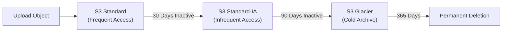

# 🎥 AWS Technical Demonstration: Amazon S3 Hands-On Guide

> **Course**: AWS Academy Cloud Foundations / AWS re/Start  
> **Module**: M01 – Cloud Foundations (Storage)  
> **Source Media**: `T05-0012-RSSCHAB_EN-US_Video_M01_S3_Demo.mp4` (21 min 28 sec)  
> **Format**: Video Audio Transcription & Comprehensive Lab Walkthrough  
> **Target Audience**: AWS re/Start Learners  

---

## 🎯 Demonstration Overview

In this comprehensive guided demonstration, the instructor walks step-by-step through the Amazon Simple Storage Service (Amazon S3) management console. The demonstration covers bucket creation mechanics, global DNS namespace compliance, region selection criteria, S3 object metadata architecture, storage tiers (Standard, Intelligent-Tiering, Standard-IA, One Zone-IA, Glacier, Deep Archive), security by default (Block Public Access), bucket policies, and static website hosting.

### 📌 Learning Objectives
- [ ] Understand Amazon S3 as an infinitely scalable, highly durable object storage system
- [ ] Create a globally unique, DNS-compliant S3 bucket
- [ ] Evaluate region selection criteria (latency, compliance, cost, redundancy)
- [ ] Analyze the difference between logical files and S3 objects (key, data, metadata, URL)
- [ ] Compare all Amazon S3 storage classes and automatic lifecycle transitions
- [ ] Understand security by default and safely manage S3 Block Public Access
- [ ] Configure S3 properties (versioning, server access logging, static website hosting)

---

## 🏗️ 1. What is Amazon S3?

Amazon S3 is an **object storage** service built to store and retrieve any amount of data from anywhere on the internet.

```
┌────────────────────────────────────────────────────────────────────────┐
│                        Amazon S3 Core Pillars                          │
│                                                                        │
│  🛡️ 99.999999999% (11 9s) Durability : Data automatically stored     │
│     across at least 3 Availability Zones (AZs) in a Region.            │
│  ⚡ Scalability: Store unlimited objects from 0 bytes up to 5 TB each. │
│  🌐 Web Accessible: Every object is addressable via a unique REST URL. │
│  🔒 Secure by Default: All public access is blocked out of the box.    │
└────────────────────────────────────────────────────────────────────────┘
```

---

## 🛠️ 2. Step-by-Step Console Walkthrough

### Step 1: Navigating the Global S3 Console
- The Amazon S3 Console displays a **global view** of all buckets owned by your AWS account across all Regions.
- Although the console view is global, each physical bucket resides in a specific **AWS Region**.

### Step 2: Bucket Creation & Global DNS Naming Rules
1. Click **Create bucket**.
2. **Bucket Naming Constraints**:
   - Must be globally unique across all AWS accounts in the entire world.
   - Must be **DNS-compliant**: only lowercase letters (`a-z`), numbers (`0-9`), and hyphens (`-`).
   - No uppercase letters, no underscores, and cannot start or end with a hyphen.
   - *Why?* Because the bucket name becomes part of the public web endpoint URL:
     `https://[bucket-name].s3.[region].amazonaws.com/[object-key]`

> [!NOTE]
> **Demo Example**: The instructor attempted to use `test` (rejected as duplicate), then uppercase `ACF_S3_Demo` (rejected by DNS rules), and finally created **`acf-s3-demo`** in the **São Paulo (`sa-east-1`)** Region.

### Step 3: Regional Placement Decision Criteria
When deciding which Region to host your bucket in, consider:
1. **Latency**: Proximity to your primary user base.
2. **Regulatory & Compliance**: Data residency laws (e.g., GDPR, HIPAA).
3. **Cost Optimization**: Storage pricing varies across AWS Regions.
4. **Disaster Recovery**: Cross-region replication for geo-redundancy.

---

## 📦 3. S3 Storage Classes Deep Dive

During the object upload review, the instructor breaks down the characteristics of each storage tier:

| Storage Class | Designed For | Min Duration | Availability | Az Redundancy | Key Advantage |
| :--- | :--- | :---: | :---: | :---: | :--- |
| **S3 Standard** | Frequently accessed active data | None | 99.99% | $\ge 3$ AZs | Low latency, high throughput |
| **S3 Intelligent-Tiering** | Unknown or unpredictable access patterns | 30 days | 99.9% | $\ge 3$ AZs | Automatic cost savings; zero retrieval fees |
| **S3 Standard-IA** | Long-lived, infrequently accessed; rapid retrieval | 30 days | 99.9% | $\ge 3$ AZs | Lower storage fee; small retrieval fee |
| **S3 One Zone-IA** | Recreatable secondary data | 30 days | 99.5% | **1 AZ only** | 20% lower cost than Standard-IA |
| **S3 Glacier Flexible** | Archival backup; minutes to hours retrieval | 90 days | 99.99% | $\ge 3$ AZs | Lowest cost cold storage |
| **S3 Glacier Deep Archive** | Compliance archive; 12-48 hour retrieval | 180 days | 99.99% | $\ge 3$ AZs | Lowest cost storage in the cloud |



---

## 🔒 4. Security Mechanics: S3 Block Public Access

1. **Principle of Least Privilege**:
   - Out of the box, public access to S3 resources is completely sealed shut.
   - AWS enforces a 4-tier **Block Public Access (BPA)** setting at both the account and bucket levels.
2. **Enabling Controlled Public Access (Demo Exercise)**:
   - Navigate to bucket > **Permissions** tab.
   - Click **Edit** under Block Public Access settings.
   - Uncheck *Block all public access*.
   - AWS requires you to type **`confirm`** in a security warning modal to acknowledge the action.
   - Select the target object > **Actions** > **Make public using ACL**.

> [!CAUTION]
> Making buckets or objects public is discouraged in enterprise production. Best practice is to keep buckets private and use **IAM Policies**, **Pre-Signed URLs**, or **CloudFront Origin Access Control (OAC)** for authorized access.

---

## ⚙️ 5. Advanced Bucket Capabilities

- **Versioning**: Preserves every version of an object with unique version IDs. Protects against accidental overwrites or malicious deletions.
- **Server Access Logging**: Generates detailed access audit records for every HTTP request made against the bucket.
- **Default Encryption**: Encrypts all uploaded objects at rest using AES-256 (`SSE-S3`) or AWS Key Management Service (`SSE-KMS`).
- **Static Website Hosting**: Serves HTML, CSS, JavaScript, and images directly from the bucket without managing web servers.
- **S3 Event Notifications**: Automatically triggers AWS Lambda functions or sends SNS/SQS messages when new files are created.

---

## 📝 Complete Verbatim Audio Transcript

<details>
<summary><b>Click to expand full audio transcription (21 min 28 sec)</b></summary>

```text
Hello and welcome to this Academy Cloud Foundations demonstration. In this particular segment, we will be speaking about Amazon Simple Storage Service, or Amazon S3 for short. Amazon S3 is an object storage, built to store and retrieve any amount of data from anywhere on the internet. It's a simple storage service that offers an extremely durable, highly available, and infinitely scalable data storage infrastructure at very low cost. S3 provides a simple web interface that you can use to store and retrieve any amount of data at any time from anywhere on the web. Using this web service, you can easily build applications that make use of the internet storage, and since S3 is highly scalable, you only pay for what you use, you can start small and grow your application as you wish. You get no compromise on performance or reliability. S3 is also designed to be highly flexible. You can store any type and amount of data that you want. You can read the same piece of data a million times or only for emergencies like the S3 recovery. You can build a simple FTP application or a sophisticated web application like Amazon.com the retail website. So S3 frees you as a developer to focus on innovation instead of figuring out how to store your data.

So how do we get started? You need to have an Amazon Web Services account to access S3. I have here my Amazon account. I'm going to be navigating to the S3 console. We get to see that it's a relatively simple console with just a few items actually worth highlighting. The very first one is that the S3 console gives you a global view of all of your buckets. Despite the fact that a bucket actually needs to live in a particular region, the console provides you a global overview of all of the buckets existing, including the region in which they live. This one on U.S. Oregon, most of them on North Virginia. As you may have noticed, a bucket happens to be the logical storage resource for Amazon S3. In order for us to create a bucket, we click on the create bucket button.

A bucket needs to have a name that is DNS compliant. What this means is that in general, you want to focus on using lowercase letters, numbers and dashes. You cannot make the name too big. The reason for this DNS compliance requirement is that the name of the bucket will actually be used on the URL that you use to access your files and your objects. And therefore, it needs to be unique globally. If you forget the uniqueness of the name or if you're not sure of the name is being used, the system itself gives you a heads up when a particular bucket name is already in use. Just take the example for the bucket name test. That is a relatively common actual bucket name. If we click on create, you get to see the system tells you the bucket name already exists. Therefore we need to apply some form of change to this particular name in order to be able to use it. Notice also the little eye to the right, which kind of reminds you that the bucket name needs to be unique across all buckets in the system globally. And this has to do with the fact that the bucket name is being used in the URLs that then will access the bucket as well as the objects within it.

Now, let's take this other example. In this particular case, the bucket name may not be used. However, we're using uppercase letters and the system makes an attempt to remind you of what is allowable versus what cannot be used. I'm going to name this particular bucket, acf-s3-demo. This appears to be a unique enough bucket. I've chosen to store it in the São Paulo region as a way of putting it as far away from my home as possible. Which region do you actually choose in order to put a bucket can follow a number of requirements. You can also choose a region that is remote from your other operations for geographic redundancy and disaster recovery purposes. You can choose a region that enables you to address specific legal or regular regulation requirements. And finally, you can choose a region that allows you to reduce storage cost. You can choose a lower price region to save money. In this case, I'm just using São Paulo for demonstration purposes.

Now, I can choose to create bucket immediately, but let's explore what kind of questions the user interface gives us as we manufacture a bucket. I'm going to click on next. And we get to see a number of other properties that can be attributed to this particular bucket. We get to see on the top versioning, which basically keeps all the versions of a particular object on the same bucket. When you enable versioning, multiple uploads of the same file are actually retained by a timestamp. And that actually helps you be able to recover from accident or overrides or deletion. Enabling versioning also increases the total data size that is stored in your bucket, so you need to be mindful of that, especially when it comes to billing and pricing. We see also the item for server access logging. And this is a way of maintaining a trace of the type of access that a particular bucket is actually sustaining. Tags represent key value pairs that you can use as a way of providing kind of stickers to be able to align the use of the bucket in terms of perhaps who is the owner, who the contact person is, for what purpose is this bucket being used. Object level logging as the name suggests is actually a trace file that keeps a record of who is accessing objects in this particular bucket. CloudTrail will be able to maintain such items. One important item about S3 is that you can enable encryption. The encryption in S3 uses AES 256 encryption and you have a variety of ways of managing the keys that will cipher this particular item. You can have the S3 service manage the keys itself. You can manage the keys yourself as a customer or perhaps you may want to leverage the AWS service for key management. In that particular case, you get the freedom to choose how the keys are handled. Last but not least, you can actually have CloudWatch requests metrics for the usage of this particular bucket. In this example, we're leaving everything as default.

The next item has to do with permissions, and following the principle of least privilege, and as it is common with most of AWS resources, basically public access to the resources that you create is sealed shut, unless you specifically enable access to a resource, only the owner will be able to access and manipulate these items. Notice how the block all public access is enabled. We're going to leave it as is and continue to move forward. In this panel, we are reviewing the configuration, the name of the bucket, the region, the options, as well as the permissions that have been enabled by default. We're taking it as it shows up out of the box. We're going to be creating the bucket.

And now we get to see acf-s3-demo bucket. If we navigate into it, you are able to examine number one, the region in which it lives, and the properties for the bucket can actually be modified through the properties tab. The permissions for the bucket has its own tab, allowing you to be able to block or enable public access, you can assign a bucket policy. This will be created using the Identity and Access Management Service. You can also define an access control list. This is a legacy mechanism that actually existed prior to policies being able to be used. The Management tab allows you to be able to define life cycle for the objects in this bucket, allows you to define perhaps analytics in terms of usage for this particular bucket.

Going back to the overview, we are within the bucket and we're going to upload a particular file. Notice also the button for create folder. A folder is actually an abstract concept in the idea of a bucket. It's not really a folder the way that we got to know it using an operating system. Despite the fact that the S3 interface actually presents it like that, it's basically a logical separator for you to be able to organize files within a bucket and still follow a particular hierarchy. We're not going to create a folder, however we are going to upload a file. When we select the upload file, we click on Add files. I navigate to my desktop and I'm going to select my machine profile application. This is Packaged in Mac format. Notice how it already registered the name. I'm going to click on Next. As a way of demonstrating how for a particular object, I am the owner. I can read write and modify. You can add another AWS account to have access to this. We're going to leave that as is. Notice how in terms of public permissions, as we mentioned earlier, public access is blocked. As most things AWS, public access out of the box is sealed shut. Unless you specifically enable access, access will be disallowed for anyone but the owner.

Click on Next, select the Storage class for this particular object. And as you get to see, there is a significant amount of storage classes. Each of them actually has its own use and applicability for use cases. The standard storage class is usually the default store for any uploads that you have. This is the more common item and is intended for frequently accessed data. Notice in the availability zone it indicates that at least three availability zones are actually at play when you upload the object. And this is how S3 is able to implement high availability, high durability. Each object that you upload actually gets copied into three separate availability zones and three copies of this particular item exist at all times. In the event of a failure on a particular facility, you always have redundant copies that actually become available to you.

Now interestingly enough, the second is the intelligent tier. As the name suggests, this is for long lived data with changing or unknown access patterns. So Amazon S3 intelligent tiering is an S3 storage class for data with unknown access patterns or changing access patterns that are difficult to learn. It is the first cloud storage class that delivers automatic cost savings by moving objects between two access tiers when access patterns change. One tier is optimized for frequent access and the other lower cost tiers are designed for infrequent access. Objects uploaded or transitioned to S3 intelligent tiering are automatically stored in the frequent access tier. S3 intelligent tiering works by monitoring access patterns and then moving the objects that have not been accessed in 30 consecutive days to the infrequent access tier. If the objects are accessed later, S3 intelligent tiering moves the object back to the frequent access tiers. This means that all objects stored in S3 intelligent tiering are always available when needed. There are no retrieval fees so you won't see unexpected increases in storage bills when access patterns change. So S3 intelligent tiering is for data where you don't really know the access patterns or whether they're changing and you cannot really discern them. So it is ideal for data sets where you may not be able to anticipate what the access pattern is going to be. It's all about saving you money and maintaining the object in the proper tier.

S3 standard infrequent access is Amazon's S3 storage class for data that is accessed less frequently but requires rapid access when needed. S3 standard IA as it is called offers the high durability throughput and low latency of Amazon S3 standard storage class. It also provides you a low per gigabyte storage price and per gigabyte retrieval fee. So this combination of low cost and high performance makes S3 standard IA ideal for long-term storage backups and a store for disaster recovery. The S3 standard IA storage class is set at the object level and can exist in the same bucket as the S3 standard or S3 one zone IA storage classes. This will allow you to use the S3 lifecycle policies to automatically transition objects between storage classes without any application changes. This particular storage category is also used by the intelligent tier.

S3 one zone IA storage class is an Amazon S3 storage class that customers can choose to store objects in a single availability zone. S3 one zone IA storage redundantly stores data within that single availability zone to deliver storage at 20% less cost than geographically redundant S3 standard IA or S3 standard, which stores data redundantly across multiple geographically separated availability zones. S3 one zone IA offers 99% availability, but unlike the S3 standard and S3 standard IA storage classes, data stored in S3 one zone IA will be lost in the event of an availability zone destruction. So you need to be able to reproduce the data that is stored in S3 one zone IA. This is usually thumbnail pictures from a high resolution picture catalog or data that normally lives in its natural form and you use the S3 one zone IA storage tier as a way of maintaining some variation copy usually a smaller version or perhaps a lower resolution.

Glacier and Glacier Deep Archive are actually used for cold permanent storage. Glacier as the name suggests is frozen storage. It gives you a significant price reduction in terms of storage however it comes at the expense of having high latency high wait times before you actually retrieve the object. Reduced redundancy is not recommended to be used, it's more expensive than any of the other tiers and it is a storage class that is being deprecated.

Moving forward on this particular panel we get to review the permissions and we finally get to upload our object. The panel indicates a progress report of the upload until we finally get it accessible. At this point we see the file being uploaded we are within the bucket acf-s3-demo and we get to see the different tabs for the bucket configuration. If we select the actual file we then get to be able to inspect the idea of the latest version. We left versioning unavailable for this particular bucket as well as this particular object within the bucket. However you get to see the metadata that is associated with the file. We call S3 an object store and despite the fact that you are actually uploading logical files they become objects simply because these files get wrapped around with additional metadata like owner last modified storage class whether server side encryption is enabled or not and that turns the file into an object. More importantly also notice the object URL in order for you to be able to access it using an API or using a web browser from anywhere.

By virtue of the permissions that we actually use which are the default permissions, public access to this particular object is actually disabled. The first thing that needs to happen is that we need to enable public access on the bucket. We are going to do that as an exercise although the best practice is for you to be able to determine who will have access to this and manufacture a bucket policy that will allow access only and exactly as you need to. Public access to S3 resources is frowned upon and usually causes more harm than good. However for the sake of an exercise and to demonstrate the built-in protections that the system has, let's go through the mechanics of rotating public access.

I'm going to navigate to the bucket that contains the object and in the particular bucket I'm going to select the permissions tab and notice how there's a full set of block public access settings. I'm going to click on the edit menu and then uncheck block public access. Please note when I click on save the system actually asks me to confirm that this is in fact what I want to do. This is a reminder that updating public access settings will have an impact on the bucket and all of its contents. I type the word confirm and verify that that's in fact what I want to see happen. Now I have enabled public access at the bucket level. So now the blocking of all public access has been disabled. I can navigate back to the overview tab. I can select the file and then on the actions I can select make public. The system reminds me that everyone will have access to this particular file and I confirm.

At this point I will expect to be able to navigate back into examining the file metadata and when clicking the item I will expect a download dialog to permit me now to be able to download the file. There's a significant amount of other features that are worth exploring with S3, especially when it comes to properties. The idea of versioning, the idea of server access logging, you can use an S3 bucket to be able to host a static website. A static website is a website where no dynamic information is generated. This could be just static HTML pages, JPEGs, even perhaps videos or pictures. And it does not require for you to manage a web server or anything of the sort. It scales up and down as needed and can be easily configured.

In terms of management there are a number of other properties that you can set up. There is default encryption as well as things like events where the S3 bucket will generate an event perhaps to activate a Lambda function when an object is actually uploaded. And the idea of who pays when a particular object is accessed. This is more an introductory demo for simple storage service. I hope you found it useful and thanks for watching.
```

</details>
