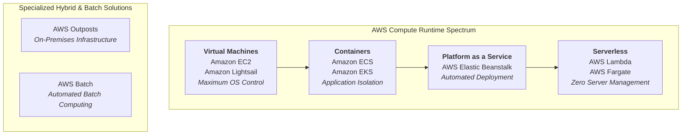
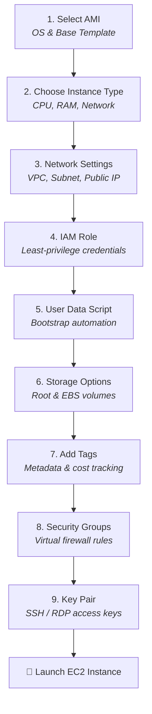
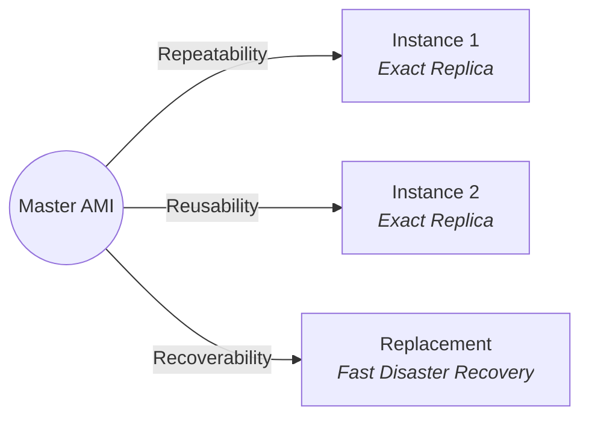
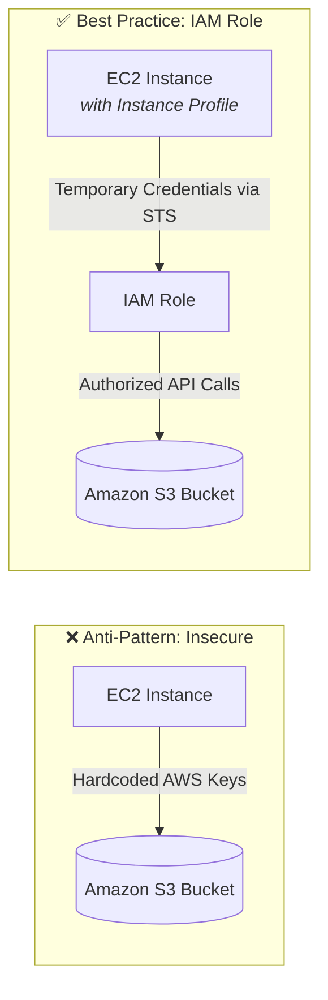
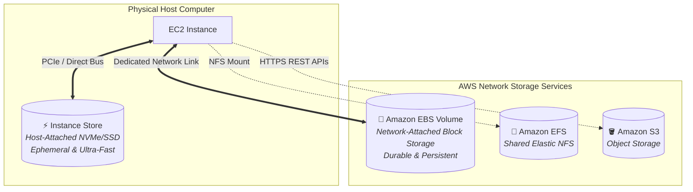
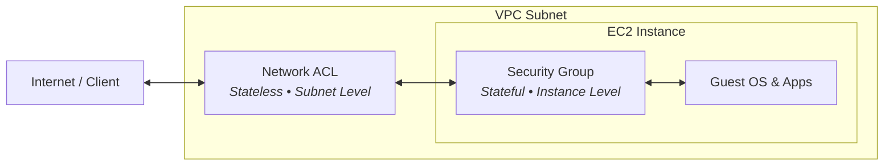
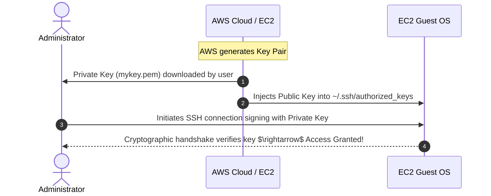
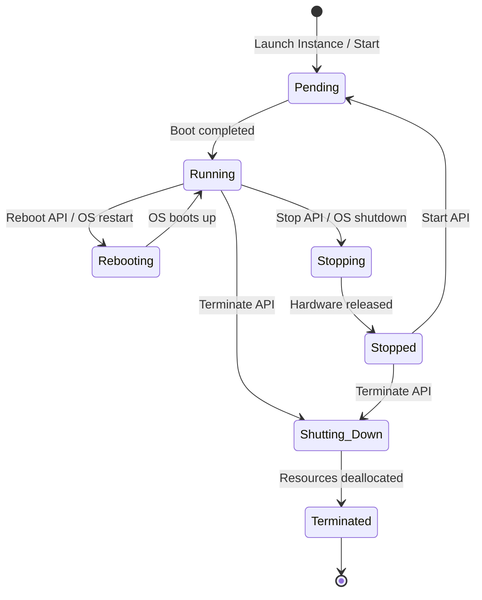
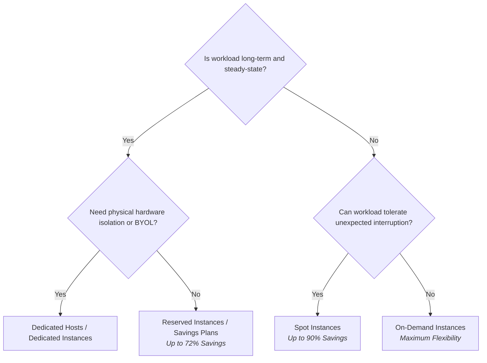

# 💻 Amazon Elastic Compute Cloud (Amazon EC2)

> **Course**: AWS Cloud Foundations  
> **Module**: M01 – Cloud Computing Foundations & Compute Services  
> **Source**: `T05-0013-RSCF_SG_EN-US_M01_COMPUTEAMAZONEC2.pdf`  
> **Target Audience**: AWS re/Start Learners & Cloud Practitioners  

---

## 🎯 Module Overview

Compute is the computational engine of any modern cloud architecture. Whether developing dynamic mobile backends, running enterprise ERP systems, or deploying distributed clusters to process scientific simulations, business applications require scalable computing capacity.

**Amazon Elastic Compute Cloud (Amazon EC2)** provides secure, resizable compute capacity in the cloud. It eliminates the capital expenditures, hardware procurement cycles, and operational overhead of traditional on-premises data centers by delivering on-demand virtual servers—known as **EC2 instances**—that can be launched, scaled, and terminated within minutes.

This guide provides a comprehensive breakdown of Amazon EC2 architecture: compute runtime models, Amazon Machine Images (AMIs), instance family categories, storage architectures (Amazon EBS vs. Instance Store), network and firewall configurations (Security Groups vs. Network ACLs), cryptographic key pairs, the complete EC2 instance lifecycle, and cost-optimization purchasing options.

---

### 📌 Learning Objectives

- [ ] Explain the core features, advantages, and use cases of Amazon Elastic Compute Cloud (Amazon EC2)
- [ ] Compare AWS compute runtime choices across Virtual Machines, Containers, PaaS, Serverless, and Specialized platforms
- [ ] Navigate the **9-step Launch Instance Wizard** workflow and configure essential instance parameters
- [ ] Differentiate between Amazon Machine Image (AMI) categories and understand the three operational benefits: Repeatability, Reusability, and Recoverability
- [ ] Decode EC2 instance naming syntax and select appropriate instance families (General Purpose, Compute Optimized, Memory Optimized, Accelerated Computing, Storage Optimized)
- [ ] Distinguish between persistent network-attached storage (**Amazon EBS**) and temporary host-attached block storage (**EC2 Instance Store**)
- [ ] Contrast the security properties of stateful **Security Groups** and stateless **Network Access Control Lists (NACLs)**
- [ ] Secure remote administrative access using asymmetric cryptographic **Key Pairs** for SSH (Linux) and RDP (Windows)
- [ ] Map the complete **EC2 Instance Lifecycle** and analyze the state transitions (`pending`, `running`, `stopping`, `stopped`, `shutting-down`, `terminated`, `rebooting`)
- [ ] Evaluate EC2 purchasing options (**On-Demand**, **Reserved Instances**, **Savings Plans**, **Spot Instances**, **Dedicated Hosts**, and **Dedicated Instances**) to optimize architectural cost

---

## 📚 Key Terminology

| Term | Definition |
| :--- | :--- |
| **Amazon EC2** | Amazon Elastic Compute Cloud; a web service providing secure, resizable virtual computing capacity in the AWS Cloud. |
| **EC2 Instance** | A virtual compute server running in the AWS Cloud, launched from a specific machine image and configuration profile. |
| **Amazon Machine Image (AMI)** | A preconfigured template containing the guest operating system, initial software stack, launch permissions, and block device mapping required to launch an instance. |
| **Instance Type** | A predefined hardware configuration profile specifying virtual CPUs (vCPUs), memory (RAM), storage options, and network performance. |
| **Instance Profile** | A logical container for an AWS Identity and Access Management (IAM) role attached to an EC2 instance to delegate API permissions securely. |
| **User Data** | A bootstrap script (Bash or PowerShell) executed automatically by `cloud-init` or `EC2Launch` during the initial boot phase of an instance. |
| **Amazon EBS** | Amazon Elastic Block Store; persistent, high-performance, network-attached block-level storage designed for EC2 instances. |
| **Instance Store** | Ephemeral, temporary block-level storage located on physical disks directly attached to the underlying host hardware server. |
| **Security Group** | A virtual, stateful firewall that controls inbound and outbound network traffic at the instance level. |
| **Key Pair** | A pair of cryptographic keys (public key held by AWS, private key held by the customer) used to authenticate access to an EC2 instance. |

---

## 🏗️ AWS Runtime Compute Landscape

AWS provides a spectrum of compute runtime paradigms tailored to varying levels of operational control, architectural velocity, and management overhead.



### Compute Models Comparison

| Compute Model | Primary AWS Services | Level of Control | Deployment Speed | Best Fit Workloads |
| :--- | :--- | :--- | :--- | :--- |
| **Virtual Machines (VMs)** | Amazon EC2, Amazon Lightsail | **Full OS Control** (root/admin access, kernel tuning, custom networking) | Minutes | Monolithic apps, legacy migrations, custom kernel/OS requirements, persistent server applications |
| **Containers** | Amazon ECS, Amazon EKS | **Medium-High** (control container runtime and container orchestration) | Seconds to Minutes | Microservices architectures, packaged multi-tier web stacks, portable application modules |
| **Platform as a Service (PaaS)** | AWS Elastic Beanstalk | **Medium** (focus on application code; platform manages provisioning and scaling) | Minutes | Rapid web applications (Node.js, Python, Java, PHP, .NET, Ruby, Go, Docker) with standard architectures |
| **Serverless** | AWS Lambda, AWS Fargate | **Low Infrastructure Management** (event-driven execution, zero server maintenance) | Milliseconds | Event-triggered microservices, backend API endpoints, stream processing, containerized micro-tasks |
| **Specialized Solutions** | AWS Outposts, AWS Batch | **Varies** (fully managed specialized orchestration or hybrid hardware extension) | Minutes to Hours | Hybrid on-premises low-latency requirements (Outposts); massive-scale batch computing jobs (Batch) |

---

## 🖥️ 1. Amazon EC2 Core Architecture & Fundamentals

### What Does "EC2" Stand For?

- **Elastic**: Infrastructure capacity can dynamically expand or contract automatically to match workload fluctuations. You can adjust the quantity of instances or resize individual instances.
- **Compute**: Delivers raw processing power (**vCPU**) and memory (**RAM**) required to execute application code, host databases, and run computations.
- **Cloud**: Instances are provisioned across global AWS Regions and Availability Zones without requiring physical hardware maintenance.

```
┌────────────────────────────────────────────────────────────────────────┐
│                   Traditional On-Premises vs. Amazon EC2               │
├────────────────────────────────────────────────────────────────────────┤
│ Traditional On-Premises:                                               │
│ • Fixed capacity provisioned for peak demand $\rightarrow$ Idle waste │
│ • High capital expenditures (CapEx) for data center floor and servers │
│ • Multi-month hardware procurement and setup cycles                   │
│ • Ongoing operational costs: cooling, electricity, cabling, staffing  │
├────────────────────────────────────────────────────────────────────────┤
│ Amazon EC2 Cloud Computing:                                            │
│ • Variable operational expense (OpEx) with pay-as-you-go pricing       │
│ • Capacity provisions dynamically in minutes                           │
│ • Resize or terminate instances on demand                              │
│ • Broad OS support: Amazon Linux, Ubuntu, RHEL, SUSE, Windows Server   │
└────────────────────────────────────────────────────────────────────────┘
```

### Guest OS vs. Host OS Architecture

In Amazon EC2's virtualized environment, a clear hypervisor abstraction separates physical infrastructure from tenant workloads:

- **Host Hardware & Host OS / Hypervisor**: Owned, patched, secured, and maintained entirely by AWS. Customers never interact directly with the physical hypervisor layer.
- **Guest Operating System**: Chosen and configured by the customer (Microsoft Windows Server or Linux distributions such as Amazon Linux, Ubuntu, Red Hat Enterprise Linux, SUSE). The customer maintains complete administrative (`root` / `Administrator`) control over the guest OS.

### Typical Server Roles Supported by Amazon EC2

Amazon EC2 instances accommodate virtually any server workload:
- **Web & Application Servers**: Apache, Nginx, Tomcat, Node.js, Django, ASP.NET
- **Relational & NoSQL Database Servers**: PostgreSQL, MySQL, MongoDB, Redis, Cassandra
- **Enterprise & Productivity Platforms**: Active Directory domain controllers, mail relays, catalog engines
- **Media & High-Throughput Compute**: Video transcoding, game matchmaking, rendering, proxy services

---

## 🛠️ 2. The 9-Step EC2 Launch Framework

Launching an EC2 instance via the AWS Management Console Launch Instance Wizard involves nine structured architectural decisions:



---

### Step 1: Select an Amazon Machine Image (AMI)

An **AMI** is a master template containing the software configuration (operating system, application server, and software packages) required to initialize an EC2 instance.

An AMI includes three vital elements:
1. **Root Volume Template**: A snapshot or pre-built image containing the operating system, file system, libraries, and pre-installed tools.
2. **Launch Permissions**: Access policies determining which AWS accounts are authorized to deploy instances from the AMI (Public, Explicit AWS Account IDs, or Private).
3. **Block Device Mapping**: Directives specifying which storage volumes (root and auxiliary EBS or instance store volumes) attach to the instance upon launch.

#### AMI Source Categories

```
┌────────────────────────────────────────────────────────────────────────┐
│                          AMI Source Categories                         │
├────────────────────────────────────────────────────────────────────────┤
│ 1. Quick Start       • Curated by AWS; officially supported Linux &    │
│                        Windows Server operating systems.               │
│ 2. My AMIs           • Custom images built and captured from existing  │
│                        configured instances in your AWS account.       │
│ 3. AWS Marketplace   • Commercial & open-source software solutions     │
│                        packaged by verified ISVs and third parties.    │
│ 4. Community AMIs    • Publicly shared by global AWS users.            │
│                        ⚠️ Use at your own risk; avoid in production.  │
└────────────────────────────────────────────────────────────────────────┘
```

#### The 3 Rs of AMI Operations



- **Repeatability**: Standardize identical software environments across dozens or hundreds of virtual servers with automated precision.
- **Reusability**: Eliminate manual configuration when launching autoscaling fleets or multi-instance web tiers.
- **Recoverability**: Capture periodic AMI backups of customized production servers to restore failed workloads rapidly into replacement instances.

---

### Step 2: Choose an Instance Type

EC2 instance types represent optimized combinations of CPU cores, memory capacity, local storage, and network throughput.

#### Instance Naming Syntax

Consider the instance identifier `t3.large`:

$$\underbrace{\mathbf{t}}_{\text{Instance Family}} \quad \underbrace{\mathbf{3}}_{\text{Generation Number}} \quad \mathbf{.} \quad \underbrace{\text{large}}_{\text{Instance Size}}$$

- **Family (`t`)**: Represents the workload optimization specialty (e.g., `t` for burstable general purpose, `c` for compute optimized, `r` for memory optimized).
- **Generation (`3`)**: Hardware release generation. Higher numbers reflect newer, more powerful hardware architectures offering superior price-to-performance.
- **Size (`large`)**: Indicates the resource capacity scale. Moving up sizes typically doubles the vCPU, RAM, and network allocation proportionally.

#### Instance Size Scaling Example: The `t3` Family

| Instance Name | vCPU | Memory (GiB) | Storage | Network Performance |
| :--- | :---: | :---: | :---: | :--- |
| `t3.nano` | 2 | 0.5 | EBS-Only | Up to 5 Gbps |
| `t3.micro` | 2 | 1.0 | EBS-Only | Up to 5 Gbps *(AWS Free Tier eligible)* |
| `t3.small` | 2 | 2.0 | EBS-Only | Up to 5 Gbps |
| `t3.medium` | 2 | 4.0 | EBS-Only | Up to 5 Gbps |
| `t3.large` | 2 | 8.0 | EBS-Only | Up to 5 Gbps |
| `t3.xlarge` | 4 | 16.0 | EBS-Only | Up to 5 Gbps |
| `t3.2xlarge` | 8 | 32.0 | EBS-Only | Up to 5 Gbps |

> [!NOTE]
> Moving from `t3.large` (2 vCPU, 8 GiB RAM) to `t3.xlarge` (4 vCPU, 16 GiB RAM) doubles both vCPU and memory. Scaling to `t3.2xlarge` doubles them again (8 vCPU, 32 GiB RAM).

#### Core Instance Type Categories & Workload Matrix

| Category | Families / Generations | Architectural Profile | Primary Use Cases |
| :--- | :--- | :--- | :--- |
| **General Purpose** | `a1`, `m4`, `m5`, `m6i`, `t2`, `t3`, `t4g` | Balanced ratio of compute, memory, and networking | Web and app servers, development/staging environments, microservices, small-to-medium databases |
| **Compute Optimized** | `c4`, `c5`, `c6i`, `c7g` | High ratio of compute performance (vCPU) relative to memory | High-performance web servers, scientific modeling, distributed batch analytics, media encoding, dedicated gaming servers |
| **Memory Optimized** | `r4`, `r5`, `r6i`, `x1`, `z1d` | Massive memory-to-CPU ratio; ultra-fast memory processing | In-memory caches (Redis, Memcached), high-performance relational databases, Apache Spark/Hadoop processing |
| **Accelerated Computing** | `f1`, `g3`, `g4`, `g5`, `p2`, `p3`, `p4` | Hardware accelerators (GPUs, FPGAs, AWS Trainium/Inferentia) | Machine learning training and inference, 3D graphics rendering, video processing, computational fluid dynamics |
| **Storage Optimized** | `d2`, `d3`, `h1`, `i3`, `i3en`, `i4i` | High sequential read/write throughput and massive local NVMe SSD storage | High-frequency NoSQL databases (Cassandra, MongoDB), distributed file systems, data warehousing, transactional systems |

#### Advanced Networking Features

- **Cluster Placement Groups**: Deploy tightly coupled instances inside a single Availability Zone to achieve ultra-low inter-node network latency and maximum bisection bandwidth.
- **Enhanced Networking**: Bypasses the traditional hypervisor networking layer via Single Root I/O Virtualization (SR-IOV) to deliver higher packet-per-second (PPS) rates, lower network jitter, and reduced latency.
  - **Elastic Network Adapter (ENA)**: Supports throughput speeds up to 100 Gbps (and 400 Gbps on modern specialized instance types).
  - **Intel 82599 Virtual Function (VF)**: Legacy interface supporting speeds up to 10 Gbps.

---

### Step 3: Specify Network Settings

The network location governs the logical environment and internet reachability of the instance:

1. **AWS Region**: Must be chosen prior to entering the launch wizard. Instances reside inside a specific Availability Zone within that Region.
2. **Virtual Private Cloud (VPC)**: The isolated software-defined virtual network where the instance will run.
3. **Subnet**: Determines the Availability Zone placement and routing tier:
   - **Public Subnet**: Route table includes a route to an Internet Gateway (`0.0.0.0/0` $\rightarrow$ `igw-xxxx`).
   - **Private Subnet**: Isolated from direct inbound internet traffic; routes outbound internet traffic through a NAT Gateway.
4. **Auto-Assign Public IP**:
   - In a **Default VPC**, instances automatically receive a public IPv4 address.
   - In a **Custom (Non-Default) VPC**, public IP assignment defaults to disabled unless explicitly enabled in subnet attributes or overridden during instance launch.

---

### Step 4: Attach an IAM Role (Instance Profile)

Applications running on an EC2 instance frequently need to interact with other AWS services (e.g., uploading assets to Amazon S3, reading parameters from AWS Systems Manager, or writing records to Amazon DynamoDB).



> [!CAUTION]
> **Never store static AWS credentials (`AWS_ACCESS_KEY_ID` / `AWS_SECRET_ACCESS_KEY`) directly on an EC2 instance.** If the instance or file system is compromised, those long-term keys are exposed.

- **Instance Profile**: A logical container that passes an IAM role to an EC2 instance. When you select an IAM role in the EC2 console, AWS automatically manages the associated instance profile.
- **Temporary Rotating Credentials**: The AWS Security Token Service (AWS STS) provides rotating temporary credentials to the instance metadata service (`http://169.254.169.254/latest/meta-data/`).
- **Dynamic Attachment**: IAM roles can be attached, detached, or replaced on running or stopped EC2 instances at any time without restarting the server. Permissions updates made to the IAM role propagate immediately to attached instances.

---

### Step 5: Configure User Data (Bootstrap Automation)

**User Data** allows administrators to supply configuration scripts that execute automatically during the final boot phase of an instance.

```bash
#!/bin/bash
# Update installed packages
yum update -y

# Install Apache web server and utilities
yum install -y httpd wget

# Start and enable Apache service
systemctl start httpd
systemctl enable httpd

# Create basic landing page
echo "<h1>Welcome to AWS Cloud Foundations on Amazon EC2!</h1>" > /var/www/html/index.html
```

#### Execution Characteristics & Best Practices
- **Execution Privileges**: Runs with root privileges (`root` on Linux, `SYSTEM` on Windows).
- **Execution Engine**: Handled by `cloud-init` on Linux and `EC2Launch` / `EC2Config` on Windows Server.
- **Default Behavior**: Executes **only once** during the initial instance launch. Subsequent reboots or stop/start cycles will not re-run user data by default (unless configured as a MIME multipart script).
- **Strategic Value**: Automates environment tailoring at launch, drastically reducing the number of distinct custom AMIs an organization needs to maintain.

---

### Step 6: Configure Storage Architecture

Storage options define how data is held, persisted, and accessed by the EC2 instance.



#### Detailed Comparison: Amazon EBS vs. EC2 Instance Store

| Feature | Amazon EBS (Elastic Block Store) | Amazon EC2 Instance Store |
| :--- | :--- | :--- |
| **Physical Architecture** | Network-attached block storage device | Physically attached disks directly inside host hardware |
| **Data Persistence** | **Durable & Persistent**; survives instance stop, restart, and failure | **Ephemeral (Temporary)**; data lost when instance is stopped or terminated |
| **Stop/Start Capability** | Supports stopping and starting instances freely | **Cannot be stopped** via AWS EC2 API (only terminated or rebooted) |
| **Reboot Behavior** | Data persists across reboot | Data persists across reboot |
| **Termination Behavior** | Configurable via `DeleteOnTermination` flag (default: true for root, false for attached volumes) | Always deleted upon instance termination |
| **Snapshots & Backups** | Point-in-time snapshots stored in Amazon S3 | No native snapshot mechanism; must back up data manually |
| **Primary Use Cases** | Root operating system volumes, databases, ERPs, long-term stateful application storage | Buffers, high-speed caches, scratch processing directories, replicated stateless web pools |

> [!IMPORTANT]
> **Reboot vs. Stop Behavior on Instance Store**: If an instance with an Instance Store volume reboots (operating system restart or AWS console reboot), the data remains intact. However, if the instance stops (due to a host hardware failure or OS shutdown), **all Instance Store data is permanently erased**.

#### Additional Storage Alternatives
- **Amazon EFS (Elastic File System)**: Managed serverless network file system supporting concurrent read-write access from hundreds of EC2 instances via standard NFSv4.
- **Amazon S3 (Simple Storage Service)**: Scalable object storage accessed via REST APIs over HTTPS, offering eleven 9s (99.999999999%) of durability.

---

### Step 7: Assign Resource Tags

A **Tag** is a metadata label assigned to an AWS resource consisting of a case-sensitive **Key** and an optional **Value**.

```
┌────────────────────────────────────────────────────────┐
│                      Tag Examples                      │
├──────────────────────────┬─────────────────────────────┤
│ Key (Case-Sensitive)     │ Value                       │
├──────────────────────────┼─────────────────────────────┤
│ Name                     │ Production-Web-Server-01    │
│ Environment              │ Production                  │
│ Project                  │ CloudFoundations-M01        │
│ CostCenter               │ Finance-1042                │
│ Owner                    │ DevOps-Team                 │
└──────────────────────────┴─────────────────────────────┘
```

#### Core Operational Benefits of Tagging
1. **Cost Allocation**: Generate itemized AWS billing reports grouped by department, application, or project tag.
2. **Operations Automation**: Execute scripts targeting resources with specific tags (e.g., stopping all instances tagged `Environment=Development` at 7:00 PM).
3. **Access Control (ABAC)**: Implement Attribute-Based Access Control policies in IAM to govern who can manage specific tagged resources.
4. **Search and Filtering**: Efficiently organize and filter hundreds of resources in the EC2 console and AWS CLI.

---

### Step 8: Configure Security Groups (Virtual Firewall)

A **Security Group** operates as a virtual firewall that filters network traffic directly at the hypervisor level, outside the guest operating system.



#### Security Group Characteristics
- **Instance-Level Control**: Security groups attach to individual Elastic Network Interfaces (ENIs) of instances.
- **Default Rules**:
  - **Inbound**: Denies all traffic by default (*Default Deny*).
  - **Outbound**: Allows all outbound traffic by default (*Allow All Outbound*).
- **Allow Rules Only**: You cannot create explicit "Deny" rules in security groups; any traffic not explicitly permitted is dropped.
- **Stateful Nature**: Security groups automatically track connection state. If an inbound packet is permitted, the outbound response traffic is automatically allowed, regardless of outbound rules.

#### Security Groups vs. Network Access Control Lists (NACLs)

| Feature | Security Group | Network Access Control List (Network ACL) |
| :--- | :--- | :--- |
| **Operating Layer** | **Instance level** (virtual interface) | **Subnet level** (boundary of the subnet) |
| **Rule Types** | **Allow rules only** (cannot specify Deny) | **Allow and Deny rules** |
| **Rule Processing** | Evaluates **all rules** before authorizing traffic | Evaluates rules in **strict numerical order** (lowest number first) |
| **State Handling** | **Stateful**: Return traffic automatically permitted | **Stateless**: Inbound and outbound traffic must be explicitly permitted |
| **Default VPC Setup** | Inbound: Deny all; Outbound: Allow all | Inbound: Allow all; Outbound: Allow all |

---

### Step 9: Configure Cryptographic Key Pairs

Amazon EC2 utilizes **asymmetric public key cryptography** to authenticate remote administrative connections securely without transmitting passwords over the network.



- **Public Key**: Stored by AWS. For Linux instances, the public key is automatically injected into `/home/<user>/.ssh/authorized_keys` during boot.
- **Private Key (`.pem` / `.ppk`)**: Downloaded once by the administrator during creation. AWS does not retain a copy of the private key.
- **Linux Connection (SSH)**: Connect via SSH using the private key:
  ```bash
  ssh -i mykey.pem ec2-user@<public-ip-address>
  ```
- **Windows Connection (RDP)**: The private key file is used in the AWS Management Console to decrypt the random local `Administrator` password, which is then used to connect via Remote Desktop Protocol (port 3389).

---

## 💻 3. Programmatic Launching: AWS CLI

In addition to the visual AWS Management Console, EC2 instances can be provisioned programmatically using the **AWS Command Line Interface (AWS CLI)** or AWS SDKs.

```bash
aws ec2 run-instances \
    --image-id ami-0c55b159cbfafe1f0 \
    --count 1 \
    --instance-type t3.micro \
    --key-name ProductionKeyPair \
    --security-group-ids sg-0123456789abcdef0 \
    --subnet-id subnet-0a1b2c3d4e5f6g7h8 \
    --tag-specifications 'ResourceType=instance,Tags=[{Key=Name,Value=WebServer-Cli}]' \
    --region us-east-1
```

### Command Parameter Breakdown

| Parameter | Purpose |
| :--- | :--- |
| `aws ec2 run-instances` | Invokes the Amazon EC2 service and calls the `RunInstances` API action. |
| `--image-id` | Specifies the unique ID of the source Amazon Machine Image (AMI) to deploy. |
| `--count` | Number of instances to launch concurrently from this single invocation. |
| `--instance-type` | Designates the hardware compute sizing (vCPU, RAM, storage, network profile). |
| `--key-name` | Identifies the registered cryptographic key pair for administrative login. |
| `--security-group-ids` | Associates one or more existing security group firewalls with the instance ENI. |
| `--subnet-id` | Places the instance within a designated VPC subnet and Availability Zone. |
| `--tag-specifications` | Applies resource tags immediately upon launch. |
| `--region` | Identifies the target AWS Region hosting the AMI and target VPC. |

---

## 🔄 4. Amazon EC2 Instance Lifecycle

An EC2 instance progresses through distinct operational states from initial provisioning to final decommissioning:



### Instance State Reference

| Instance State | Description | Physical Host Behavior | Billing Impact | Root Volume Support |
| :--- | :--- | :--- | :--- | :--- |
| **Pending** | Instance is being prepared, hardware host is allocated, and the AMI is copied to the root volume. | Provisioning on host hardware | No compute charges | Both EBS & Instance Store |
| **Running** | Instance is fully booted and operational; network interfaces and IP addresses are active. | Bound to physical host | Normal compute per-second/hourly charges apply | Both EBS & Instance Store |
| **Rebooting** | Operating system restart initiated via AWS CLI/console or guest OS command. | **Remains on same physical host**; preserves public/private IPs and Instance Store | Compute charges continue without interruption | Both EBS & Instance Store |
| **Stopping** | Intermediate transitional state as OS terminates services and flushes disks. | Preparing to release host resources | Compute charges stop once transition finishes | **EBS-Backed only** |
| **Stopped** | Instance is completely shut down and decoupled from host server hardware. | **Host hardware released**; starts on a new host when started | **Zero compute charges**; storage (EBS) and Elastic IP charges still apply | **EBS-Backed only** |
| **Shutting-down** | Intermediate state while AWS cleans up resources and prepares for termination. | Releasing all network and hardware allocations | Compute charges stop | Both EBS & Instance Store |
| **Terminated** | Instance virtual machine is permanently destroyed; visible briefly in console before removal. | Decommissioned; volumes marked for deletion are erased | No further charges | Both EBS & Instance Store |

> [!TIP]
> **Host Relocation on Stop/Start**: When you `Stop` an EBS-backed instance and then `Start` it, AWS allocates a brand-new physical host server in the Availability Zone. This operation changes the instance's public IPv4 address (unless an Elastic IP is attached). In contrast, a `Reboot` retains the exact same physical host, maintaining private and public IP addresses.

---

## 💰 5. EC2 Purchasing Options & Pricing Models

Amazon EC2 offers flexible purchasing options to balance cost efficiency, predictability, and hardware isolation:



### Comprehensive Pricing Models Comparison

| Pricing Option | Pricing Mechanics | Commitment | Discount Level | Best Fit Workloads | Interruption Risk |
| :--- | :--- | :--- | :--- | :--- | :--- |
| **On-Demand** | Pay by the second or hour for active running compute capacity | None | Baseline (0%) | Short-term, unpredictable, spiky workloads; initial development, testing, and proof-of-concept | None |
| **Reserved Instances (RI)** | Commit to specific instance configuration and Region | 1-year or 3-year term | Up to **72%** vs. On-Demand | Steady-state, predictable production applications running 24/7 | None |
| **Savings Plans** | Flexible pricing model committing to a consistent compute spend ($/hour) | 1-year or 3-year term | Up to **72%** vs. On-Demand | Predictable usage across EC2, AWS Fargate, and AWS Lambda | None |
| **Spot Instances** | Bid on spare EC2 compute capacity in the AWS Cloud | None | Up to **90%** vs. On-Demand | Fault-tolerant, stateless, background processing, batch jobs, big data | **Yes** (2-minute warning notification) |
| **Dedicated Hosts** | Physical server with EC2 capacity fully dedicated to customer use | On-Demand or Reservation | Baseline + Host fee (saves on licensing) | Bring Your Own License (BYOL) software (Windows, SQL Server), regulatory hardware compliance | None |
| **Dedicated Instances** | Virtual instances running in a VPC on single-tenant hardware | On-Demand or Reservation | Baseline + dedicated tenancy fee | Strict corporate compliance or regulatory security isolation | None |

#### Spot Interruption Handling
When AWS requires spare Spot capacity back, it issues a **2-minute Spot Instance interruption notice** via Amazon EventBridge and instance metadata. Spot instances can be configured to:
- **Terminate**: The virtual machine and ephemeral storage are deleted.
- **Stop**: The instance stops, preserving EBS root volume data for rapid resumption when capacity returns.
- **Hibernate**: The operating system memory (RAM) is flushed to the EBS root volume, allowing the workload to resume exactly where it left off.

#### Dedicated Hosts vs. Dedicated Instances

| Dimension | Dedicated Host | Dedicated Instance |
| :--- | :--- | :--- |
| **Hardware Tenancy** | Dedicated to a single customer | Dedicated to a single customer |
| **Host Visibility & Sockets** | Full visibility into physical sockets and cores | No visibility into physical host sockets/cores |
| **Licensing Support** | Supports per-socket, per-core, per-VM BYOL licenses | Standard cloud licensing |
| **Instance Placement** | Complete control over instance placement on physical host | Managed automatically by AWS |
| **Billing Model** | Billed per physical host | Billed per instance with dedicated tenancy fee |

---

## 🧠 6. Knowledge Check

Test your understanding of Amazon EC2 concepts, configurations, and architectural best practices.

---

### Question 1
**An engineering team wants to run a high-performance in-memory cache using Redis and an in-memory database cluster. Which EC2 instance family category provides the most suitable resource ratio for this workload?**
- A) Compute Optimized (`c5`, `c6i`)
- B) Memory Optimized (`r5`, `x1`)
- C) Storage Optimized (`i3`, `d2`)
- D) Accelerated Computing (`p3`, `g4`)

<details>
<summary>👉 Click to view Answer & Explanation</summary>

**Correct Answer**: **B**  
**Explanation**: Memory Optimized instance families (such as `r5`, `r6i`, `x1`, and `z1d`) are specifically engineered for memory-intensive workloads that process large datasets in memory, such as Redis/Memcached distributed caches and in-memory analytics. Compute Optimized focuses on CPU, Storage Optimized on disk throughput, and Accelerated Computing on GPUs/FPGAs.
</details>

---

### Question 2
**A developer terminates an EC2 instance that was configured with a root EBS volume and an attached Instance Store volume. What will happen to the data stored on each volume?**
- A) All data on both the EBS volume and Instance Store volume is retained indefinitely.
- B) The EBS root volume is deleted (if `DeleteOnTermination` is true), and all data on the Instance Store volume is permanently erased.
- C) The Instance Store data is saved to Amazon S3 automatically, while the EBS volume is detached.
- D) The Instance Store volume persists, but the EBS volume is wiped.

<details>
<summary>👉 Click to view Answer & Explanation</summary>

**Correct Answer**: **B**  
**Explanation**: Instance Store volumes are physically attached to the host server and are ephemeral; terminating an instance permanently deletes all data on the Instance Store. EBS root volumes are deleted by default upon termination unless `DeleteOnTermination` was set to false.
</details>

---

### Question 3
**You are configuring access control for an EC2 web server. You create an inbound Security Group rule allowing TCP port 443 (HTTPS) from any IP address (`0.0.0.0/0`). Do you need to create a corresponding outbound rule to allow HTTPS responses back to clients?**
- A) Yes, because Security Groups are stateless and require explicit outbound rules.
- B) No, because Security Groups are stateful; return traffic for allowed inbound requests is automatically permitted.
- C) Yes, but only if the subnet's Network ACL also has an outbound allow rule.
- D) No, because port 443 does not generate outbound responses.

<details>
<summary>👉 Click to view Answer & Explanation</summary>

**Correct Answer**: **B**  
**Explanation**: Security Groups are stateful. Any inbound traffic permitted by an inbound rule automatically allows the corresponding response traffic out of the instance, regardless of outbound security group rules. Network ACLs, by comparison, are stateless and would require explicit outbound rules.
</details>

---

### Question 4
**A big data processing pipeline processes non-urgent nightly batch jobs that can be interrupted and resumed without data loss. Which EC2 purchasing option provides the most significant cost savings for this workload?**
- A) On-Demand Instances
- B) Dedicated Hosts
- C) Spot Instances
- D) Scheduled Reserved Instances

<details>
<summary>👉 Click to view Answer & Explanation</summary>

**Correct Answer**: **C**  
**Explanation**: Spot Instances allow customers to take advantage of unused EC2 capacity at discounts of up to 90% compared to On-Demand prices. Because the big data workload is fault-tolerant and time-insensitive, it is the ideal candidate for Spot Instances despite the 2-minute interruption notification.
</details>

---

### Question 5
**An application running on an EC2 instance needs to securely read and write objects to an Amazon S3 bucket. What is the AWS-recommended security best practice to grant this access?**
- A) Store long-term AWS IAM access keys in the application's configuration file on the EC2 root volume.
- B) Pass IAM access keys into the EC2 User Data script so they are exported as system environment variables.
- C) Attach an IAM Role with appropriate S3 permissions to the EC2 instance via an instance profile.
- D) Configure the Security Group to allow outbound traffic to Amazon S3 over port 443.

<details>
<summary>👉 Click to view Answer & Explanation</summary>

**Correct Answer**: **C**  
**Explanation**: AWS strongly recommends attaching an IAM Role to an EC2 instance via an instance profile. The AWS Security Token Service (STS) delivers short-lived, automatically rotating credentials to the instance, eliminating the risk of exposed hardcoded credentials. Security Groups control network packet flow, not AWS API identity permissions.
</details>

---

## 📌 7. Module Summary & Key Takeaways

- **Compute Flexibility**: Amazon EC2 provides on-demand, resizable virtual machines in the cloud, granting full root/admin control over Windows and Linux guest operating systems.
- **The 9 Launch Decisions**: Deploying an instance requires configuring an **AMI**, **Instance Type**, **Network Settings**, optional **IAM Role**, **User Data bootstrap script**, **Storage configuration**, **Metadata Tags**, **Security Groups**, and cryptographic **Key Pairs**.
- **AMI Value**: AMIs package root volume templates, permissions, and device mappings to deliver **Repeatability**, **Reusability**, and **Recoverability**.
- **Instance Sizing**: Instance types balance CPU, memory, storage, and networking. Select among **General Purpose**, **Compute Optimized**, **Memory Optimized**, **Accelerated Computing**, and **Storage Optimized** families.
- **Storage Trade-offs**: **Amazon EBS** provides persistent, network-attached block storage that survives instance stops. **EC2 Instance Store** delivers ultra-low-latency host-attached ephemeral storage for temporary, disposable data.
- **Network Defense**: **Security Groups** provide stateful, instance-level virtual firewall filtering with allow rules. **Network ACLs** provide stateless, subnet-level protection with numbered allow/deny rules.
- **Lifecycle & Hosts**: Stopping an EBS-backed instance releases host hardware and halts compute billing; starting it redeploys it onto a new physical host. Rebooting preserves the same physical host and IP addresses.
- **Cost Optimization**: Align purchasing models with workload behavior—leverage **On-Demand** for spiky/short-term tasks, **Reserved Instances / Savings Plans** for steady-state workloads, **Spot Instances** for fault-tolerant batch computing, and **Dedicated Hosts** for BYOL software licenses and compliance.
