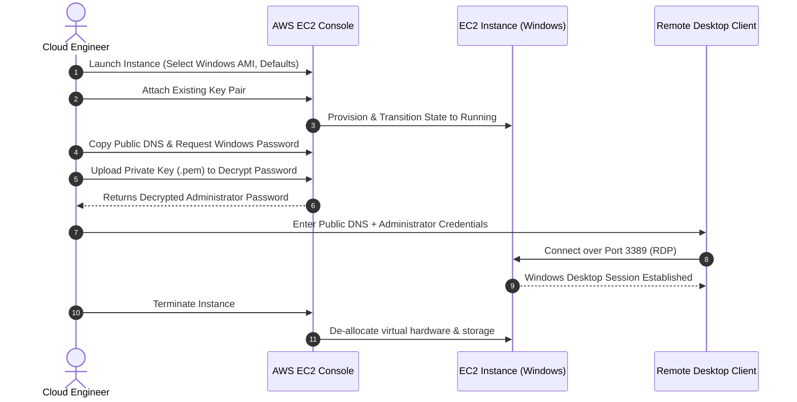

# 🎥 AWS Technical Demonstration: Amazon EC2 Windows Instance Hands-On Guide

> **Course**: AWS Academy Cloud Foundations / AWS re/Start  
> **Module**: M01 – Cloud Foundations (Compute)  
> **Source Media**: `T05-0014-RSSCHAB_EN-US_Video_M01_EC2_Demo.mp4` (3 min 32 sec)  
> **Format**: Video Audio Transcription & Step-by-Step Lab Walkthrough  
> **Target Audience**: AWS re/Start Learners  

---

## 🎯 Demonstration Overview

In this hands-on video demonstration, the instructor shows the end-to-end lifecycle of an **Amazon Elastic Compute Cloud (Amazon EC2)** Windows instance. The walkthrough covers navigating the AWS Management Console to the EC2 service, selecting an Amazon Machine Image (AMI), configuring instance settings, using cryptographic key pairs to retrieve and decrypt the administrator password, connecting remotely via Remote Desktop Protocol (RDP), and cleanly terminating the instance.

### 📌 Learning Objectives
- [ ] Launch an Amazon EC2 virtual server from the AWS Management Console
- [ ] Select an appropriate Windows Amazon Machine Image (AMI)
- [ ] Understand the role of Amazon EC2 Key Pairs in secure authentication
- [ ] Retrieve and decrypt the Windows Administrator password using private keys
- [ ] Establish a Remote Desktop Protocol (RDP) session over public IP/DNS
- [ ] Safely terminate EC2 instances to prevent unnecessary cloud spend

---

## 🛠️ Step-by-Step Execution Guide



---

### Step 1: Navigating to the EC2 Dashboard
1. Log into the **AWS Management Console**.
2. Under **Services > Compute**, select **EC2**.
3. In the EC2 Dashboard, click the blue **Launch Instance** button.

### Step 2: Choosing an Amazon Machine Image (AMI)
1. In the Step 1 AMI selection catalog, scroll down to the Windows operating system options.
2. Select a base **Microsoft Windows Server** AMI.
3. For the demonstration, default values are accepted (e.g., instance type `t2.micro`).
4. Click **Review and Launch**, then click **Launch**.

### Step 3: Key Pair Authentication
1. When prompted by the Key Pair dialog:
   - Connecting to instances after launch requires asymmetric cryptographic keys.
   - You can either create a new key pair or choose an existing key pair.
2. The instructor selects an existing key pair, checks the acknowledgment checkbox, and clicks **Launch Instances**.

### Step 4: Monitoring Lifecycle Status
1. Click **View Instances**.
2. Review instance states:
   - Previous instances: `terminated`
   - New instance: `pending` $\rightarrow$ `running`
3. Wait for the status checks to initialize.

### Step 5: Connecting via Remote Desktop (RDP)
1. Select the running instance. In the details pane, copy the **Public IPv4 DNS** name (or public IP address).
2. Retrieve the Windows Administrator Password:
   - Click **Actions > Security > Get Windows Password** (or Actions > Get Windows Password).
   - Click **Choose File** and select your local private key file (`.pem`).
   - Click **Decrypt Password**.
   - Copy the decrypted alphanumeric password.
3. Open your local **Remote Desktop Connection (RDP)** client:
   - **Computer / Host**: Paste the instance's Public DNS name.
   - **Username**: `Administrator`
   - **Password**: Paste the decrypted administrator password.
4. Accept the SSL/TLS certificate prompt and connect. The Windows Desktop session initializes.

### Step 6: Cleaning Up & Terminating
1. Disconnect the RDP session by closing the window.
2. Return to the EC2 Console.
3. Select the instance, go to **Instance State > Terminate instance**, and confirm **Terminate**.
4. The virtual machine transitions to `shutting-down` and then `terminated`.

> [!CAUTION]
> Cloud Cost Hygiene: Always terminate demonstration or test EC2 instances when finished to avoid accumulating compute and EBS storage charges.

---

## 📝 Complete Verbatim Audio Transcript

```text
In this demo I'm going to set up an elastic compute cloud or EC2 instance. I've already logged into the console so I'll start by going to compute services and clicking EC2. And I'll click on launch instance.

Here I can choose which operating system I'll be running on my instance. I'll scroll down to one of the Windows versions and click select. For this demo I'll use all the defaults and simply click Review and Launch. I can review the default settings here but I know the defaults are fine for this demonstration so I'll just click Launch.

Connecting to the instance after it's launched requires cryptographic keys. So this pop-up is asking me to select the key pair that I'd like to use or gives me the option to create a new key pair. I already have an existing key pair so I'll check the acknowledge box here and click Launch instances.

The instance is now launching and it only takes a few seconds so I'll click View instances and see if it's ready. This is showing all the instances I have in this region. You can see there are two terminated ones and a pending one which is my new one. And there you can see the instance status just changed to running and it's still initializing the status checks.

I'll select my new running instance and at the bottom of my screen it shows me more information about it. You can see this new instance has a public IPv4 address and a DNS name so let's try connecting to it with remote desktop. The first thing I need will be the DNS name or IP address so I'll go to the console and copy the DNS name.

The username for all the windows instances will be administrator and I'll click Connect. Now it needs the password for the administrator account and I can get that from the console so I go back to the console and go to actions and get windows password. It needs my keys to decrypt the password so I'll click Choose File. Select the keys I'm using for this region and click Decrypt password. And here's my administrator password. I'll copy that, then back in the remote desktop session I'll paste it in here and click OK. I'll click Yes to continue connecting. And here it is logging in for the first time as administrator and setting up my windows desktop.

I'll disconnect by closing the window. Close this box. And if I no longer need this instance I can go to actions, instance state and terminate and click Yes.

So in this demo we've created an EC2 instance with Windows running on it, connected to that instance using remote desktop, and then terminated the instance.
```
