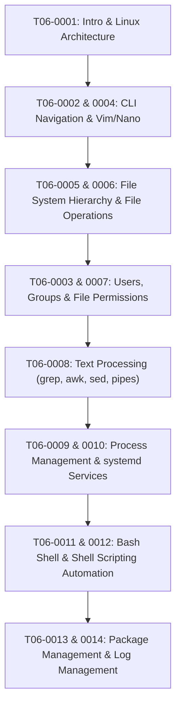

# T06 — Linux Fundamentals (Module 02)

> **Course**: AWS re/Start Linux Fundamentals  
> **Module**: T06 – Linux Operating System & Administration  
> **Standard**: Compliant with [`PROJECT_STANDARDS.md`](../PROJECT_STANDARDS.md)

---

## 📖 Module Overview

Linux is the foundational operating system powering cloud computing, containerized microservices, and enterprise server infrastructure on AWS. This module provides complete, in-depth coverage of command-line administration, user/group security, permissions, filesystem navigation, process and service management (`systemd`), Bash shell scripting, software packaging, and system log analysis.

---

## 🗺️ Curriculum Structure & Navigation

| Index | Title / Document | Type | Primary Topics Covered | Guide Link |
|---|---|:---:|---|:---:|
| **T06-0001** | Introduction to Linux | Study Guide | Unix history, Linus Torvalds, GPLv2, Kernel architecture, Distro families (RHEL/Debian/SUSE), AL2/AL2023 | [View Guide](./T06-0001-RSLX_EN-US_SG_M02_INTROLINUX.md) |
| **T06-0002** | The Linux Command Line | Study Guide | Shell anatomy, Command syntax, Navigating paths (`pwd`, `cd`, `ls`), Getting help (`man`, `info`, `--help`), History & shortcuts | [View Guide](./T06-0002-RSLX_EN-US_SG_M02_LINUXCMNDLINE.md) |
| **T06-0003** | Users and Groups Management | Study Guide | Root UID 0, System accounts, `/etc/passwd`, `/etc/shadow`, `/etc/group`, `useradd`, `usermod`, `sudo`, `visudo` | [View Guide](./T06-0003-RSLX_EN-US_SG_M02_USERSGROUPS.md) |
| **T06-0004** | Editing Files | Study Guide | Text editors overview: GNU nano, Vim modal editing (Normal/Insert/Ex/Visual), `.vimrc`, terminal editing workflows | [View Guide](./T06-0004-RSLX_EN-US_SG_M02_EDITINGFILES.md) |
| **T06-0005** | Working with the File System | Study Guide | Filesystem Hierarchy Standard (FHS), Directory roles, Disks, Partitions, Filesystem types, `df`, `du`, `mount` | [View Guide](./T06-0005-RSLX_EN-US_SG_M02_WORKWITHFILESYSTEM.md) |
| **T06-0006** | Working with Files | Study Guide | File creation (`touch`), copying (`cp`), moving (`mv`), deletion (`rm`), viewers (`head`, `tail -f`), `tar`, `gzip`, Inodes & hard/symlinks | [View Guide](./T06-0006-RSLX_EN-US_SG_M02_WORKWITHFILES.md) |
| **T06-0007** | Managing File Permissions | Study Guide | 10-char file mode, `chmod` (symbolic & octal 755/644/400), `chown`, `chgrp`, SUID/SGID/Sticky Bit, `umask` | [View Guide](./T06-0007-RSLX_EN-US_SG_M02_MNGFILEPERMS.md) |
| **T06-0008** | Working Commands & Text Processing | Study Guide | Wildcards, I/O redirection (`<`, `>`, `2>`, `&>`), Pipes (`|`), `tee`, `find`, `grep`, `cut`, `awk`, `sed`, `sort`, `uniq`, `wc` | [View Guide](./T06-0008-RSLX_EN-US_SG_M02_WORKINGCMNDS.md) |
| **T06-0009** | Managing Processes | Study Guide | Process lifecycle (PID/PPID, `fork`/`exec`), States (R/S/D/T/Z), `ps`, `top`, signals (SIGTERM/SIGKILL), `kill`, `nice`/`renice`, `cron` | [View Guide](./T06-0009-RSLX_EN-US_SG_M02_MNGPROCESSES.md) |
| **T06-0010** | Managing Services | Study Guide | Initialization (SysVinit vs Upstart vs systemd), `systemctl` (start/stop/enable/status), Unit files, `journalctl`, CloudWatch integration | [View Guide](./T06-0010-RSLX_EN-US_SG_M02_MNGSERVICES.md) |
| **T06-0011** | The Bash Shell | Study Guide | Shell types, Profile scripts (`~/.bashrc`, `/etc/profile`), Environment variables (`$PATH`, `$PS1`), Aliases, Shell expansions | [View Guide](./T06-0011-RSLX_EN-US_SG_M02_BASHSHELL.md) |
| **T06-0012** | Bash Scripts | Study Guide | Shebang `#!/bin/bash`, Variables, Positional parameters (`$1`, `$@`), `if`/`case`, Loops (`for`, `while`), Functions, Error handling (`set -euo pipefail`) | [View Guide](./T06-0012-RSLX_EN-US_SG_M02_BASHSCRIPTS.md) |
| **T06-0013** | Software Management | Study Guide | Package managers: `rpm`, `yum`/`dnf` (RHEL/Amazon Linux) vs `dpkg`, `apt` (Debian/Ubuntu), Repositories, AL2 Extras | [View Guide](./T06-0013-RSLX_EN-US_SG_M02_SOFTWAREMGMT.md) |
| **T06-0014** | Managing Log Files | Study Guide | `/var/log` structure (`messages`, `secure`, `syslog`), rsyslog daemon, `logrotate` configuration & automation, CloudWatch agent integration | [View Guide](./T06-0014-RSLX_EN-US_SG_M02_MNGLOGFILES.md) |

---

## 🎯 Learning Roadmap

---

## 🛠️ Verification & Quality Standards

- All 14 modules follow strict GitHub Flavored Markdown (GFM) formatting.
- Fully free of external Joplin metadata (`#joplin` and `> **Tags**:`).
- Includes architecture diagrams, command tables, hands-on production recipes, and comprehensive self-test knowledge checks with answers.
