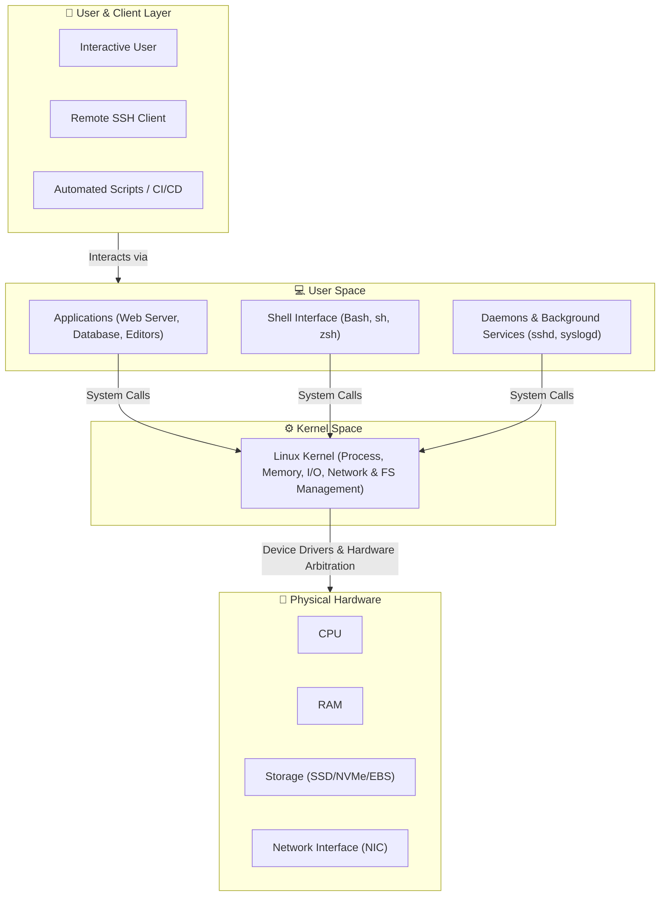
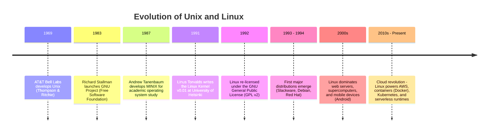
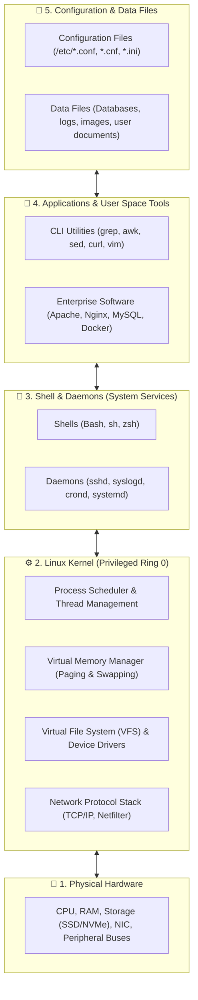
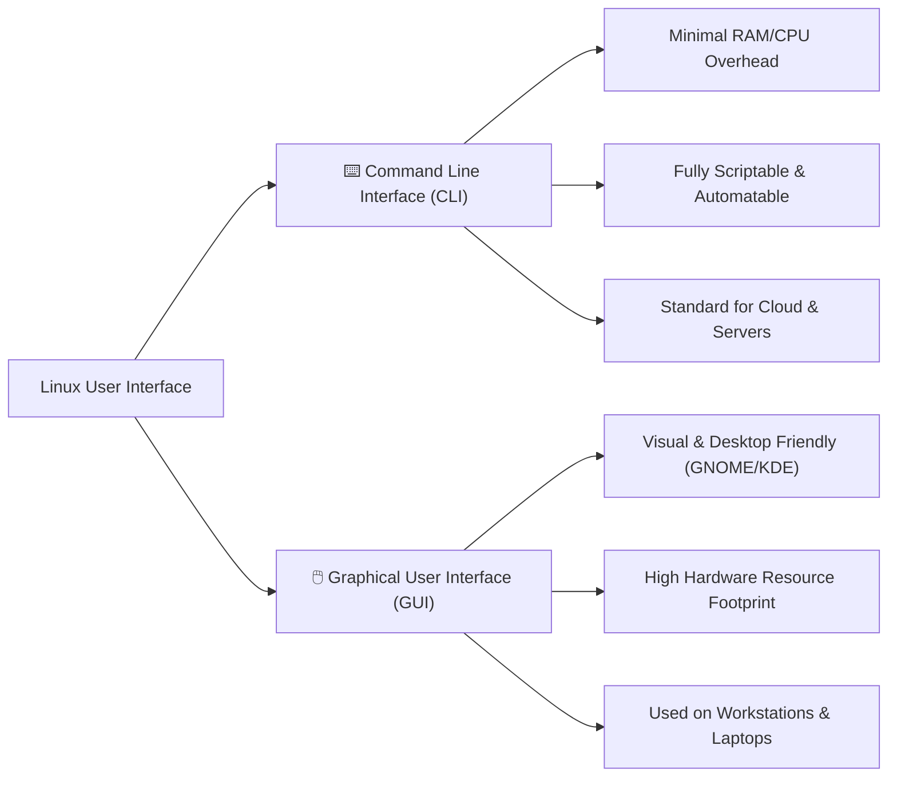
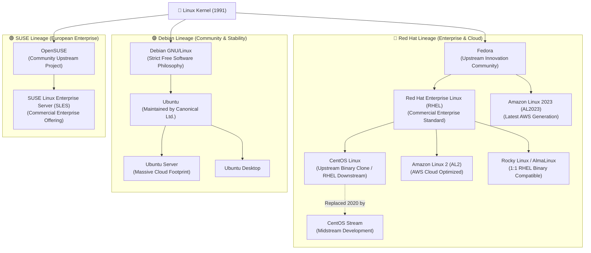
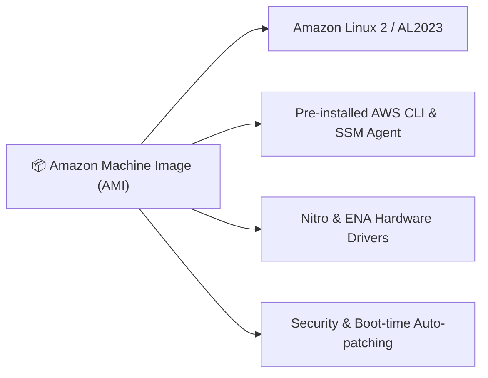
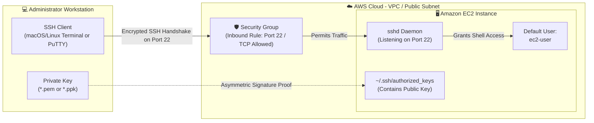

# 🐧 Module 02: Introduction to Linux – Study Guide

> **Course**: AWS re/Start Linux Fundamentals  
> **Module**: M02 – Introduction to Linux  
> **Source Document**: `T06-0001-RSLX_EN-US_SG_M02_INTROLINUX.pdf`  
> **Target Audience**: AWS re/Start Learners / Cloud Practitioners / Systems Administrators  

---

## 🎯 Module Overview

Welcome to **Introduction to Linux**. Linux is the undisputed backbone of modern cloud computing, powering over 90% of public cloud workloads, high-performance computing clusters, container ecosystems, and mission-critical enterprise backends. Whether you are launching an Amazon EC2 virtual machine, orchestrating microservices with Amazon Elastic Kubernetes Service (Amazon EKS), or automating infrastructure deployment, a solid mastery of Linux fundamentals is indispensable.

This study guide breaks down what Linux is, its Unix heritage, Linus Torvalds' seminal creation in 1991, the open-source GNU philosophy, the internal architecture of the operating system, shell interaction, manual documentation navigation, major distribution lineages, and practical connectivity to remote AWS Linux instances via SSH.

### 📌 Learning Objectives
- [ ] **Define Linux & Core Operating System Principles**: Articulate how an operating system arbitrates hardware and software, and recognize Linux as a modular, open-source, multi-user, and multitasking OS.
- [ ] **Trace Linux History & Open-Source Licensing**: Explain the lineage from Unix and the GNU Project to Linus Torvalds' 1991 kernel release, and describe the GNU General Public License (GPL).
- [ ] **Deconstruct Linux Architectural Components**: Identify and map the relationships among the Hardware layer, Kernel, Daemons, Shell, Applications, Data files, and Configuration files.
- [ ] **Compare User Interface Paradigms**: Contrast the Command Line Interface (CLI) and Graphical User Interface (GUI), understanding why servers preferentially operate headlessly via CLI.
- [ ] **Master Linux Built-in Documentation**: Navigate and search manual pages using the `man` command and related navigation keybindings.
- [ ] **Categorize Major Linux Distributions**: Distinguish the primary upstream sources and commercial families (Debian/Ubuntu, Red Hat/Fedora/CentOS/Amazon Linux, SUSE/OpenSUSE).
- [ ] **Understand Linux in the Cloud & AWS Ecosystem**: Analyze why Linux dominates cloud computing and examine AWS-tailored distributions like Amazon Linux 2 (AL2) and Amazon Linux 2023 (AL2023).
- [ ] **Establish Secure Remote Connectivity**: Connect to Amazon EC2 Linux instances using SSH, manage `.pem` and `.ppk` key formats, and troubleshoot network security group rules.

---

## 🖥️ 1. Hardware, Operating Systems & What is Linux?

### Hardware vs. Software Fundamentals
A computer system consists of two complementary dimensions:
1. **Hardware**: The physical electronic and mechanical components that execute computations and persist electrical signals:
   - **Central Processing Unit (CPU)**: Executes instructions and performs arithmetic and logic.
   - **Random Access Memory (RAM)**: Provides high-speed, volatile temporary workspace for active code and data.
   - **Storage Drives (SSD / HDD)**: Non-volatile persistent media retaining files and OS binaries across reboots.
   - **Networking (NIC)**: Facilitates data transmission across local and wide-area networks.
2. **Software**: The programmed instruction sets and applications installed on the system.

### The Role of the Operating System (OS)
An **Operating System** is the foundational software layer acting as the broker and arbitrator between user applications and raw physical hardware:
- Manages and schedules processor time and memory allocations.
- Controls read/write access to storage filesystems and attached peripherals.
- Enforces user isolation, process boundaries, and permission controls.
- Provides interactive interfaces (CLI and GUI) for human operators and automation scripts.



### Core Characteristics of the Linux Operating System
Linux provides foundational capabilities that make it ideal for high-scale enterprise workloads:
- **Open Source**: The complete source code is publicly accessible, allowing anyone to inspect, modify, optimize, and redistribute it.
- **Multi-User**: Multiple independent users can access system resources concurrently, each maintaining isolated home directories, environments, and privileges.
- **Multitasking**: The operating system executes hundreds or thousands of processes concurrently through preemptive CPU scheduling.
- **Networking Native**: Networking protocols (TCP/IP, routing, packet filtering) were engineered directly into the core kernel design from its earliest days.
- **Modularity**: Components (kernel modules, shells, utilities, daemons) can be installed, upgraded, or removed independently without disrupting the entire system.
- **Rock-Solid Stability**: Linux systems can run continuously for months or years without experiencing resource leaks, performance degradation, or mandatory restarts.

---

## 📜 2. History of Linux & Open-Source Licensing

### From Unix to Minix
In the late 1960s (1969), computer scientists Ken Thompson, Dennis Ritchie, and others at AT&T Bell Laboratories created **Unix**. Unix introduced pioneering architectural concepts:
- Everything is represented as a file or a stream of bytes.
- Small, single-purpose modular tools combined via pipes (`|`).
- Portability across diverse hardware architectures via the C programming language.

However, Unix was proprietary, heavily copyrighted, and prohibitively expensive for academic and personal experimentation. In 1987, Professor Andrew Tanenbaum created **MINIX**, a minimalist Unix-like teaching OS, but its source code was constrained by academic licensing.

### The GNU Project (1983)
In 1983, Richard Stallman founded the **GNU Project** (a recursive acronym for *GNU's Not Unix*) under the Free Software Foundation (FSF). Stallman's objective was to develop a 100% free Unix-compatible operating system. Over the 1980s, GNU developers successfully authored almost all essential user-space components:
- The GNU C Compiler (`gcc`)
- The GNU C Library (`glibc`)
- Core system utilities (`coreutils`: `ls`, `cp`, `cat`, etc.)
- Text editors (`Emacs`) and shells (`Bash`)

However, the GNU project lacked a finished, production-ready kernel (their microkernel project, GNU Hurd, progressed slowly).

### Linus Torvalds and the Birth of the Linux Kernel (1991)
In August 1991, **Linus Torvalds**, a 21-year-old computer science student at the University of Helsinki in Finland, announced a personal project:

> *"I'm doing a (free) operating system (just a hobby, won't be big and professional like gnu) for 386(486) AT clones..."*

Linus created a monolithic kernel designed specifically for Intel 80386 hardware. Combining Linus's kernel with the existing GNU userland tools yielded a complete, fully functioning, open-source operating system. Technically, what is widely called "Linux" is more formally known as **GNU/Linux**.



### Open-Source Licensing & The GNU GPL
Linux is distributed under the terms of the **GNU General Public License (GPL)** (specifically GPLv2). The GPL is a **copyleft** license that guarantees end users the four essential software freedoms:
1. **Freedom 0**: The freedom to run the program for any purpose.
2. **Freedom 1**: The freedom to study how the program works and modify it to suit your needs (access to source code is a prerequisite).
3. **Freedom 2**: The freedom to redistribute copies to assist neighbors and the community.
4. **Freedom 3**: The freedom to improve the program and release your improvements to the public.

> [!IMPORTANT]
> **The Copyleft Reciprocity Clause**:  
> Under GPLv2, if an individual or company modifies the Linux kernel and distributes the resulting binary to others, they **must** also make the modified source code available under the same GPL terms. This reciprocity prevents proprietary vendors from privatizing the Linux codebase, ensuring that community enhancements remain freely available to all.

---

## 🏛️ 3. Linux Architecture & Major Components

A complete Linux operating system consists of five distinct, interconnected layers:



### Component Analysis

| Component | Nature | Primary Role & Description | Notable Examples |
| :--- | :--- | :--- | :--- |
| **Kernel** | Core program | Operates in privileged mode (Ring 0). Arbitrates physical resources, manages memory, schedules CPU time, and controls hardware device communication. | Linux Kernel v5.x / v6.x |
| **Daemons** | Background services | Unattended background processes not attached to an interactive terminal session. Typically initialized during boot to deliver persistent system services. Name traditionally ends with `d`. | `sshd` (SSH daemon)<br/>`syslogd` (system logging)<br/>`crond` (scheduled jobs)<br/>`systemd` (init manager) |
| **Shell** | Command interpreter | The interactive interface between the human operator and the kernel. Accepts text commands, parses syntax, executes binaries, and displays standard output. | `bash`, `sh`, `zsh`, `ksh` |
| **Applications** | User software | Programs that fulfill end-user or business requirements. Runs in user space (Ring 3) with restricted hardware access. | Web browsers, text editors (`vim`, `nano`), Python runtime, web servers (`nginx`). |
| **Data Files** | Information stores | User-generated or application-generated data, stored in standardized directories. | `/var/log/messages`, database tables, user documents. |
| **Configuration Files** | System parameters | Human-readable text files that dictate application and service behavior upon startup or runtime reload. | `/etc/group`, `/etc/passwd`, `/etc/ssh/sshd_config`, `/etc/resolv.conf`. |

### Deep Dive: Functions of the Linux Kernel
The Linux kernel operates as the master controller of the entire operating system:
1. **Processor Time Scheduling**: Implements scheduling algorithms (such as the Completely Fair Scheduler - CFS) to apportion CPU clock cycles across active processes and threads.
2. **Memory Allocation**: Divides physical RAM into virtual memory addresses, assigns isolated memory blocks to running programs, and swaps idle memory to disk storage when RAM is exhausted.
3. **Peripheral Device Access & Drivers**: Contains monolithic device drivers facilitating seamless communication with storage controllers, network adapters, sound cards, and USB interfaces.
4. **File System Management**: Implements the Virtual File System (VFS) abstraction, allowing uniform access across diverse filesystem formats (`ext4`, `XFS`, `btrfs`, `NFS`).

### Daemons: The Unseen Workhorses
A **daemon** is a process that runs silently in the background without direct terminal interaction:
- **`syslogd` / `journald`**: Captures messages emitted by the kernel, authentication systems, and applications, appending them to structured log files (`/var/log/`).
- **`sshd`**: Listens on TCP port 22 for incoming Secure Shell connections, authenticates credentials, and spawns encrypted sessions for remote administrators.
- **`crond`**: Evaluates cron table schedules every minute, executing recurring maintenance scripts, backups, and tasks automatically.

### File Naming and Extensions in Linux
Unlike Windows, where file extensions strictly dictate execution behavior, Linux recognizes file types primarily through file headers and metadata:
- **Naming Pattern**: `[directoryName/]fileName[.extension]`
  - Example: `/etc/ssh/sshd_config` (`/etc/ssh` is the directory; `sshd_config` is the file).
  - Example: `/var/log/audit/audit.log` (`.log` is an informational extension).
- **Common Configuration File Extensions**: `.conf`, `.cnf`, `.cfg`, `.cf`, `.ini`

> [!NOTE]
> In Linux, configuration files are plain human-readable text. Modifying system behavior rarely requires binary editing or registry modification—simply edit the configuration text file using an editor like `nano` or `vim` and instruct the service to reload.

---

## 💻 4. Interfacing with Linux: CLI vs. GUI & The Shell

### Command Line Interface (CLI) vs. Graphical User Interface (GUI)

Linux provides flexibility in how operators interact with the operating system:



| Dimension | Command Line Interface (CLI) | Graphical User Interface (GUI) |
| :--- | :--- | :--- |
| **Primary Interaction** | Keyboard input via shell text prompts (`$`, `#`). | Mouse clicks, windows, icons, menus (e.g., GNOME, KDE Plasma). |
| **Resource Consumption** | **Extremely light**: Runs on as little as 128 MB RAM and minimal CPU overhead. | **Heavy**: Demands 1 GB - 4 GB RAM, 3D graphics drivers, and display servers (Wayland/X11). |
| **Scripting & Automation**| **Native**: Every command can be chained, piped, and scripted in Bash or Python. | **Difficult**: Automating mouse movements and window events requires complex RPA tools. |
| **Remote Access Efficiency** | High speed over low-bandwidth networks (SSH transfers raw text only). | High bandwidth consumption (VNC/RDP must transfer graphical frame buffers). |
| **Server & Cloud Use** | **Universal Standard**: 99%+ of production Linux cloud instances run headlessly (no GUI). | Rare on servers; limited to developer workstations and personal desktops. |

### What is a Shell?
A **shell** is a command-line interpreter that reads user inputs from standard input (the keyboard or a script file), interprets syntax, resolves path variables, invokes the appropriate executable binaries via kernel system calls, and routes output back to standard output.

```
┌────────────────────────────────────────────────────────────────────────┐
│                        Command Execution Flow                          │
│                                                                        │
│  [User Types: 'ls -l'] ──> [Bash Shell parses tokens & flags]          │
│                                    │                                   │
│                                    ▼                                   │
│                      [Kernel: execve() system call]                    │
│                                    │                                   │
│                                    ▼                                   │
│                  [Binary /usr/bin/ls accesses filesystem]              │
│                                    │                                   │
│                                    ▼                                   │
│                 [Directory listing returned to terminal]               │
└────────────────────────────────────────────────────────────────────────┘
```

### Major Shell Types

| Shell | Name / Origin | Characteristics & Modern Relevance |
| :--- | :--- | :--- |
| **`sh`** | **Bourne Shell** | Developed by Stephen Bourne at AT&T Bell Labs (1977). The historical Unix standard. Lightweight, basic syntax, lacks modern auto-completion. |
| **`bash`** | **Bourne-Again Shell** | Created by Brian Fox for the GNU Project (1989). **The universal default shell** across virtually all Linux distributions. Features command history, tab completion, rich arithmetic, and scripting syntax. |
| **`ksh`** | **KornShell** | Developed by David Korn at Bell Labs (1983). Combines Bourne syntax with C shell interactive usability. Common in legacy enterprise Unix (AIX, Solaris). |
| **`zsh`** | **Z Shell** | Highly extensible modern shell featuring advanced tab auto-completion, plugin themes (Oh My Zsh), and spell checking. Default shell on modern macOS. |

> [!TIP]
> **Bash is the Core Industry Expectation**:  
> In AWS re/Start, cloud operations, and systems administration, **Bash** is the mandatory foundational shell. Almost all automation scripts, EC2 user-data initialization routines, and container launch commands execute in Bash.

---

## 📖 5. Linux Built-in Documentation: The `man` Command

### The Philosophy of Manual Pages
Unlike operating systems that rely on external internet documentation, Linux distributions package exhaustive reference documentation directly into the local filesystem: **Manual Pages (man pages)**. 

When encountering unfamiliar syntax or flags, the industry-standard developer adage is:  
> *"RTFM: Read The Friendly Manual — Did you check the man pages?"*

### Syntax of the `man` Command
```bash
man <commandName>
```
To read the manual page for the manual system itself:
```bash
man man
```

### Anatomy of a Standard Man Page
Man pages follow a structured format standardized across all Unix-like platforms:

```
NAME
       ls - list directory contents

SYNOPSIS
       ls [OPTION]... [FILE]...

DESCRIPTION
       List  information  about  the FILEs (the current directory by default).
       Sort entries alphabetically if none of -cftuvSUX nor --sort is specified.

OPTIONS
       -a, --all
              do not ignore entries starting with .

       -l     use a long listing format

       -h, --human-readable
              with -l and -s, print sizes like 1K 234M 2G etc.
```

- **NAME**: The command name followed by a single-sentence definition of its purpose.
- **SYNOPSIS**: Formal grammatical syntax demonstrating mandatory arguments, optional flags (enclosed in square brackets `[...]`), and ellipses indicating repeating parameters.
- **DESCRIPTION**: In-depth explanation of how the program operates and responds to inputs.
- **OPTIONS**: Complete dictionary of single-letter flags (e.g., `-l`) and long flags (e.g., `--all`) modifying program execution.
- **FILES / SEE ALSO**: Related files, configuration paths, and complementary commands.

### Navigating Man Pages (The `less` Pager Keybindings)
Man pages render using a terminal pager program (typically `less`). Learn these essential keyboard shortcuts:

| Keybinding | Action |
| :--- | :--- |
| **`Down Arrow` / `j`** | Scroll down by **one line**. |
| **`Up Arrow` / `k`** | Scroll up by **one line**. |
| **`Space Bar` / `Page Down` / `Ctrl + f`** | Advance forward by **one full screen**. |
| **`Page Up` / `Ctrl + b`** | Move backward by **one full screen**. |
| **`/<pattern>`** | **Search forward** for the string pattern (e.g., `/-h` or `/recursive`). |
| **`?<pattern>`** | **Search backward** for the string pattern. |
| **`n`** | Jump to the **next occurrence** of the searched pattern. |
| **`N`** | Jump to the **previous occurrence** of the searched pattern. |
| **`g`** | Jump directly to the **beginning** of the manual page. |
| **`G`** | Jump directly to the **end** of the manual page. |
| **`q`** | **Quit** the manual page and return to the shell command prompt. |

---

## 🌳 6. Linux Distributions (Distros) & The Family Tree

### What is a Distribution?
Because the Linux kernel is modular and open-source, anyone can package it into a complete operating system. A **Linux Distribution (Distro)** is an integrated release package combining:
1. The **Linux Kernel** (often customized with hardware patches).
2. The **GNU Core Utilities** (compilers, basic commands, shells).
3. A **Package Management System** (to install, update, and remove software).
4. System initialization managers (e.g., `systemd`).
5. Pre-configured software packages, libraries, security policies, and default configurations.

### Major Linux Distribution Lineages



### Deep-Dive: Distribution Comparison

| Distribution Family | Key Members | Package Manager | Primary Audience & Use Cases | Distinctive Traits |
| :--- | :--- | :--- | :--- | :--- |
| **Red Hat Family** | RHEL, Fedora, CentOS, Amazon Linux 2, AlmaLinux, Rocky Linux | `rpm`, `yum`, `dnf` | Enterprise backends, government, financial institutions, AWS Cloud workloads. | Extremely stable release cycles, SELinux security integration, comprehensive commercial vendor support. |
| **Debian Family** | Debian, Ubuntu, Linux Mint | `dpkg`, `apt`, `apt-get` | Web hosting, machine learning workloads, cloud containers, desktop developer environments. | Adheres strictly to free software guidelines; Ubuntu provides polished 6-month release cadence and 5-year Long Term Support (LTS) releases. |
| **SUSE Family** | OpenSUSE, SUSE Linux Enterprise Server (SLES) | `rpm`, `zypper` | European enterprise IT, SAP HANA enterprise database workloads. | Deep YaST administration utility integration; highly optimized for mission-critical SAP installations. |

### The CentOS Evolution Note
- **CentOS** (*Community Enterprise Operating System*) historically provided a free, 100% binary-compatible downstream rebuild of RHEL.
- In December 2020, Red Hat announced the discontinuation of traditional downstream CentOS Linux in favor of **CentOS Stream** (a rolling preview upstream of upcoming RHEL point releases).
- Community projects like **Rocky Linux** and **AlmaLinux** emerged to fill the downstream role, while AWS continued engineering its own in-house distributions.

---

## ☁️ 7. Why Linux in Cloud Computing & AWS?

### Why Linux Dominates the Cloud
Modern cloud architectures, from hyperscalers to microservices, run overwhelmingly on Linux due to five primary factors:
1. **Zero Licensing Costs & Horizontal Elasticity**: Spinning up 10,000 Linux instances carries zero operating system licensing fees, unlike proprietary operating systems that charge per-core licensing.
2. **Minimal Footprint & Fast Boot Times**: Minimalist headless Linux kernels boot in under two seconds, making auto-scaling responsive to traffic spikes.
3. **Container Native**: Containers (Docker, Podman, containerd) rely natively on Linux kernel primitives: **cgroups** (resource allocation limits) and **namespaces** (process isolation).
4. **Unmatched Automation & Scriptability**: Everything in Linux can be orchestrated via text configuration, APIs, shell scripts, and infrastructure-as-code tools (Terraform, AWS CloudFormation).
5. **Security Hardening**: Strict file permissions, kernel namespaces, seccomp filters, and SELinux/AppArmor provide robust multi-tenant defense.

### Amazon Linux 2 (AL2)
**Amazon Linux 2** is an enterprise-grade Linux distribution engineered by AWS specifically for use on **Amazon Elastic Compute Cloud (Amazon EC2)**:
- **RHEL Upstream Foundation**: Derived from Red Hat Enterprise Linux sources, utilizing the `yum` package manager and `systemd`.
- **AWS Kernel Optimization**: Includes customized kernel drivers for AWS Nitro System virtual hardware, Elastic Network Adapters (ENA), and NVMe storage.
- **Security by Default**: Automatically checks and applies critical security patches upon instance initialization.
- **Pre-installed AWS Tooling**: Includes AWS CLI, CloudWatch agent integration, and AWS System Manager (SSM) agent out of the box.
- **Long-Term Support**: AWS provides 5 years of long-term support for Amazon Linux 2.

### Amazon Linux 2023 (AL2023)
The next generation of Amazon Linux, **Amazon Linux 2023 (AL2023)**:
- Directly utilizes Fedora upstream components.
- Transitions package management to modern `dnf` (*Dandified YUM*).
- Enforces predictable two-year major release cadences with quarterly minor updates.
- Enables SELinux in permissive/enforcing mode and incorporates cryptographic policy hardening.



---

## 🔑 8. Connecting to a Remote Linux Server via SSH

### Lab Architecture: Secure Shell (SSH) Over the Network
When deploying Linux workloads in AWS, systems administrators do not plug monitors and keyboards into physical servers. Instead, administration is conducted over the network via **Secure Shell (SSH)** running on **TCP Port 22**.



### Key Pair Asymmetric Cryptography
AWS uses public-key cryptography to authenticate administrative sessions without transmitting cleartext passwords across the internet:
- **Public Key**: Retained by AWS and injected automatically into `/home/ec2-user/.ssh/authorized_keys` inside the EC2 instance when it launches.
- **Private Key**: Downloaded exclusively by the administrator during key creation. **AWS never retains the private key**. You must safeguard this file.

### Key Formats: `.pem` vs. `.ppk`

| Feature | `.pem` (Privacy Enhanced Mail) | `.ppk` (PuTTY Private Key) |
| :--- | :--- | :--- |
| **Standard** | Industry standard OpenSSH / PEM Base64 encoded format. | Proprietary format created specifically for the Windows PuTTY client. |
| **Primary Platforms**| macOS Terminal, Linux Bash, Windows PowerShell / WSL, native OpenSSH. | Windows PuTTY GUI application. |
| **Conversion Utility** | Upstream source file provided by AWS. | Converted from `.pem` using the **PuTTYgen** utility. |

```
┌────────────────────────────────────────────────────────────────────────┐
│                        Key Format Conversion                           │
│                                                                        │
│   [AWS Generated Key.pem] ──> [PuTTYgen Tool] ──> [Converted Key.ppk]  │
│   (For OpenSSH / Linux/Mac)                        (For Windows PuTTY) │
└────────────────────────────────────────────────────────────────────────┘
```

### Standard Default Usernames across AWS Linux AMIs
When connecting to an EC2 instance, you must supply the correct initial username matching the operating system distribution:

| Distribution AMI | Default Administrative Username |
| :--- | :--- |
| **Amazon Linux 2 / AL2023** | `ec2-user` |
| **Red Hat Enterprise Linux (RHEL)** | `ec2-user` |
| **CentOS** | `centos` or `ec2-user` |
| **Ubuntu** | `ubuntu` |
| **SUSE Linux Enterprise** | `ec2-user` or `root` |
| **Debian** | `admin` |

### Connection Method 1: macOS, Linux & Windows OpenSSH (Terminal)
Modern operating systems provide native OpenSSH in the terminal.

1. **Set strict private key file permissions** (OpenSSH will reject keys that are readable by other users):
   ```bash
   chmod 400 my-lab-key.pem
   ```
2. **Execute the SSH command**:
   ```bash
   ssh -i my-lab-key.pem ec2-user@<Instance-Public-IP>
   ```
3. **Accept the SSH host key fingerprint**:
   ```
   The authenticity of host '54.210.12.34' can't be established.
   ECDSA key fingerprint is SHA256:abc123xyz...
   Are you sure you want to continue connecting (yes/no/[fingerprint])? yes
   ```

### Connection Method 2: Windows via PuTTY
For legacy Windows environments utilizing the graphical PuTTY client:
1. Open **PuTTY**.
2. In the **Host Name (or IP address)** field, enter the public IPv4 address of the EC2 instance (or `ec2-user@<Public-IP>`).
3. Ensure the **Port** is set to `22` and **Connection type** is `SSH`.
4. In the left navigation tree, expand **Connection** $\rightarrow$ **SSH** $\rightarrow$ **Auth** (or **Credentials** in newer versions).
5. Click **Browse** next to *Private key file for authentication* and select your converted `.ppk` file.
6. Click **Open**. When the terminal window opens, log in as `ec2-user`.

> [!CAUTION]
> **Common Connection Troubleshooting**:
> - **Connection timed out**: The EC2 Security Group is blocking inbound traffic. Check that an inbound rule allows TCP port 22 from your current IP address.
> - **Permission denied (publickey)**: You are using the wrong username (e.g., using `root` instead of `ec2-user`) or you selected the wrong private key file.
> - **Permissions 0644 for 'key.pem' are too open**: You forgot to run `chmod 400 key.pem` on your client machine before initiating OpenSSH.

---

## ❓ 9. Knowledge Check & Comprehension Review

Test your understanding of the concepts covered in this module.

### Question 1
**What is the defining characteristic of the Linux operating system kernel?**
- A) It is a proprietary closed-source application designed exclusively for supercomputers.
- B) It is the core computer program that controls all hardware resources, CPU scheduling, memory allocation, and peripheral access.
- C) It is the graphical window manager responsible for rendering desktop icons.
- D) It is an office productivity suite developed by the Free Software Foundation.

<details>
<summary>👉 View Answer and Explanation</summary>

**Correct Answer: B) It is the core computer program that controls all hardware resources, CPU scheduling, memory allocation, and peripheral access.**

**Explanation**:  
The kernel is the foundational heart of the operating system. It operates in privileged CPU execution mode (Ring 0) and arbitrates all interactions between user applications and the physical hardware (CPU, RAM, storage drives, and network cards).
</details>

---

### Question 2
**What is the primary difference between Linux and a Linux Distribution?**
- A) Linux is a complete graphical suite, while a distribution is only the kernel source code.
- B) Linux refers strictly to the kernel created by Linus Torvalds, whereas a distribution combines the kernel with complementary GNU tools, package managers, daemons, and utilities.
- C) Linux is designed exclusively for servers, while distributions are designed exclusively for smartphones.
- D) Linux requires paid enterprise licensing, while distributions are always illegal pirated copies.

<details>
<summary>👉 View Answer and Explanation</summary>

**Correct Answer: B) Linux refers strictly to the kernel created by Linus Torvalds, whereas a distribution combines the kernel with complementary GNU tools, package managers, daemons, and utilities.**

**Explanation**:  
Technically, "Linux" is only the kernel. A distribution (such as Amazon Linux 2, Ubuntu, or RHEL) packages the kernel together with the GNU core utilities, a package management system, system configuration files, shells, and system services into a complete, bootable operating system.
</details>

---

### Question 3
**Which shell serves as the standard default command interpreter across modern Linux distributions?**
- A) Bourne Shell (`sh`)
- B) C Shell (`csh`)
- C) KornShell (`ksh`)
- D) Bourne-Again Shell (`bash`)

<details>
<summary>👉 View Answer and Explanation</summary>

**Correct Answer: D) Bourne-Again Shell (`bash`)**

**Explanation**:  
The `bash` shell (Bourne-Again Shell), developed by the GNU Project, is the standard default shell on virtually all Linux distributions due to its rich command history, tab completion, job control, and scripting capabilities.
</details>

---

### Question 4
**A systems administrator needs to view the syntax and available command-line flags for the `tar` command. Which command should they execute?**
- A) `help tar`
- B) `man tar`
- C) `info --manual tar`
- D) `doc tar`

<details>
<summary>👉 View Answer and Explanation</summary>

**Correct Answer: B) `man tar`**

**Explanation**:  
The `man` command displays the built-in manual pages for Linux utilities, detailing the command's name, syntax synopsis, description, and every supported option flag.
</details>

---

### Question 5
**What is a background program called in Linux that runs without interactive user control and typically ends in the letter 'd'?**
- A) Module
- B) Shell
- C) Daemon
- D) Microservice

<details>
<summary>👉 View Answer and Explanation</summary>

**Correct Answer: C) Daemon**

**Explanation**:  
A **daemon** is a computer program running in the background to provide continuous system or network services. Common examples include `sshd` (SSH daemon), `syslogd` (system log daemon), and `crond` (scheduled task daemon).
</details>

---

### Question 6
**When connecting to a newly launched Amazon Linux 2 instance on Amazon EC2 via SSH, what is the default administrative username?**
- A) `root`
- B) `admin`
- C) `ubuntu`
- D) `ec2-user`

<details>
<summary>👉 View Answer and Explanation</summary>

**Correct Answer: D) `ec2-user`**

**Explanation**:  
Amazon Linux 2 and RHEL AMIs pre-configure `ec2-user` as the default user account with `sudo` administrative privileges. Ubuntu instances use `ubuntu`, while Debian instances use `admin`.
</details>

---

### Question 7
**Why do production cloud servers almost exclusively run headlessly using a Command Line Interface (CLI) rather than a Graphical User Interface (GUI)?**
- A) Linux kernels are technically incapable of rendering graphical graphics.
- B) The CLI consumes negligible CPU and RAM resources, enables remote automation via scripts, and maximizes server efficiency.
- C) AWS does not support graphical displays on any cloud hardware.
- D) GUIs are prohibited by the GNU General Public License.

<details>
<summary>👉 View Answer and Explanation</summary>

**Correct Answer: B) The CLI consumes negligible CPU and RAM resources, enables remote automation via scripts, and maximizes server efficiency.**

**Explanation**:  
GUIs consume significant system memory (hundreds of megabytes to gigabytes) and CPU cycles simply to render window managers and desktop backgrounds. Headless servers operating via the CLI allocate 100% of their compute and memory capacity to production application workloads and can be automated effortlessly via scripts and SSH.
</details>

---

### Question 8
**Under the GNU General Public License (GPLv2), what obligation exists if you modify the Linux kernel and redistribute the binary to external parties?**
- A) You must pay a 10% royalty to the University of Helsinki.
- B) You must make your modified source code publicly available under the same GPL terms.
- C) You must convert the kernel into proprietary closed-source software.
- D) You are forbidden from redistributing any modified software.

<details>
<summary>👉 View Answer and Explanation</summary>

**Correct Answer: B) You must make your modified source code publicly available under the same GPL terms.**

**Explanation**:  
The GPL is a copyleft license. If you distribute modified binaries derived from GPL code, the reciprocity clause requires you to provide the corresponding modified source code to the recipients under the exact same open-source terms.
</details>

---

## 📝 10. Key Takeaways & Review Checklist

- [x] **Linux Kernel**: Created by Linus Torvalds in 1991 at the University of Helsinki; manages processor scheduling, memory, file system access, and hardware devices.
- [x] **GNU Project & GPL**: Richard Stallman founded GNU in 1983; the combination of GNU tools and the Linux kernel forms the complete GNU/Linux OS protected under the copyleft GNU General Public License (GPL).
- [x] **System Architecture**: Five key tiers: Physical Hardware $\rightarrow$ Kernel $\rightarrow$ Shell / Daemons $\rightarrow$ Applications $\rightarrow$ Configuration & Data Files.
- [x] **Daemons**: System services running silently in the background without terminal attachment; traditionally end with `d` (e.g., `sshd`, `syslogd`, `crond`).
- [x] **CLI vs. GUI**: Production servers operate headlessly via CLI to minimize resource overhead and maximize scriptability; user workstations frequently employ GUIs.
- [x] **Bash Shell**: The default command interpreter in Linux; bridges human command entry with kernel execution.
- [x] **Documentation (`man`)**: The built-in documentation system; use `man <command>` to inspect syntax, `/pattern` to search, and `q` to quit.
- [x] **Distribution Families**: Major branches include Red Hat (Fedora, RHEL, CentOS, Amazon Linux), Debian (Debian, Ubuntu), and SUSE (OpenSUSE, SLES).
- [x] **Cloud Dominance**: Linux powers modern cloud architectures and containers due to zero licensing cost, horizontal scalability, rapid boot times, and deep automation.
- [x] **Amazon Linux 2 (AL2)**: AWS-optimized distribution based on RHEL, featuring automatic security patching, pre-installed AWS CLI, and Nitro hardware drivers.
- [x] **Secure Shell (SSH)**: Connects to remote EC2 instances over TCP port 22 using asymmetric key pairs (`.pem` for OpenSSH, `.ppk` for PuTTY) and default user `ec2-user`.
