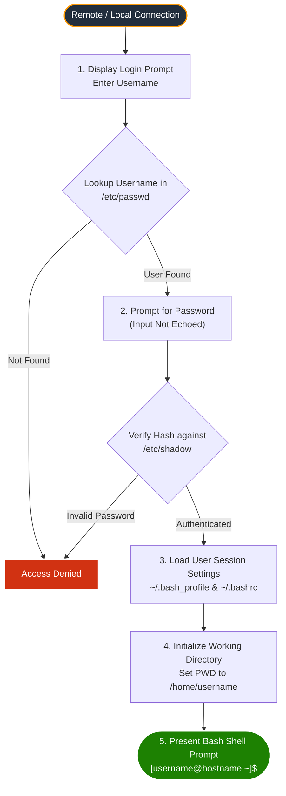
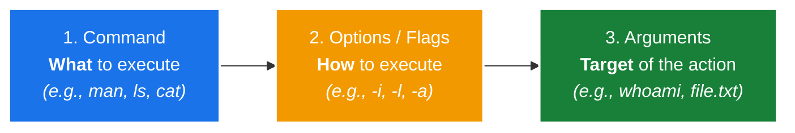
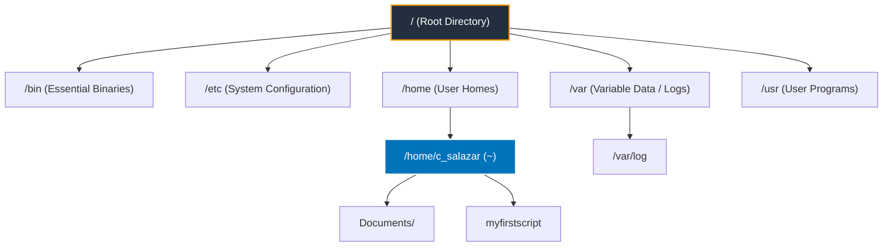
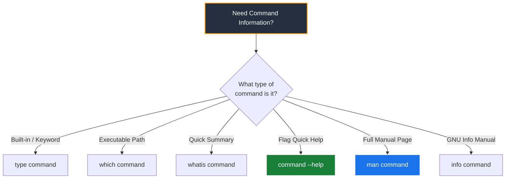
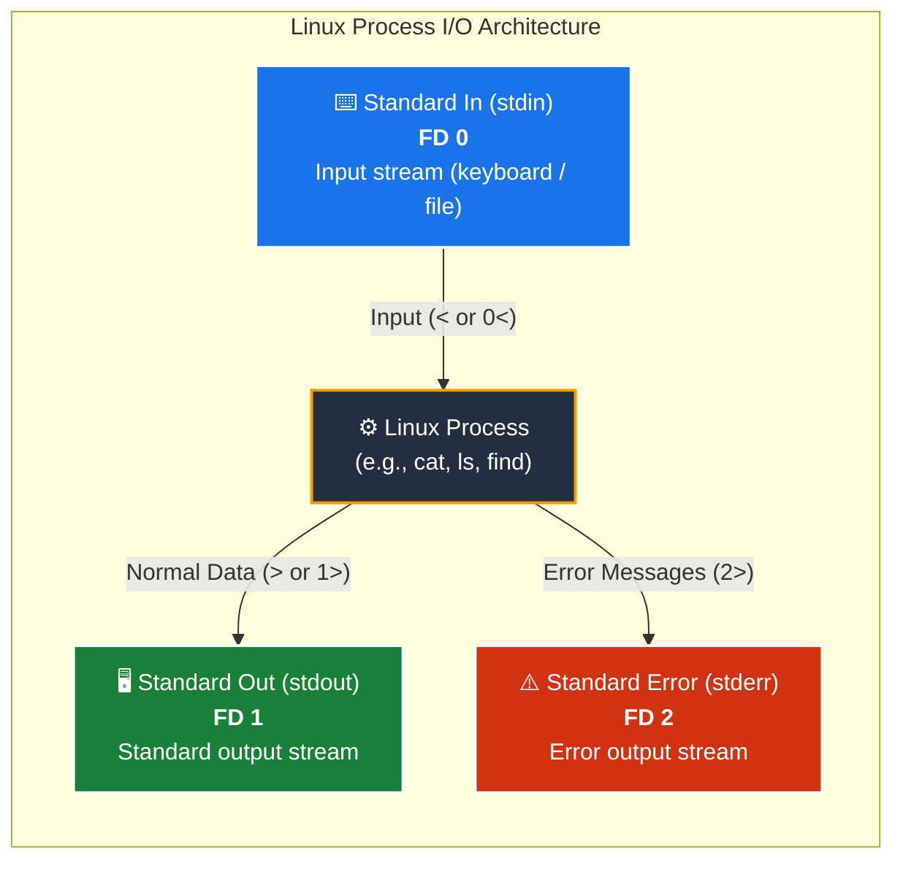

# 🐧 Module 02: Linux Command Line – Study Guide

> **Course**: AWS re/Start Linux Fundamentals  
> **Module**: M02 – Linux Command Line  
> **Source Document**: `T06-0002-RSLX_EN-US_SG_M02_LINUXCMNDLINE.pdf`  
> **Target Audience**: AWS re/Start Learners / Linux System Administrators / Cloud Practitioners  

---

## 🎯 Module Overview

The Linux Command Line Interface (CLI) is the primary environment through which cloud practitioners, systems engineers, and DevOps administrators configure, operate, and troubleshoot Linux systems and cloud instances (such as Amazon EC2). Unlike graphical user interfaces (GUIs), the command line provides direct, reproducible, scriptable, and resource-efficient control over operating system operations.

This study guide examines the core fundamentals of the Linux CLI. It details the complete user login workflow, the anatomy and components of the shell prompt and command syntax, core system inspection utilities, file system navigation, command-line assistance tools, standard input/output streams and redirection, and efficiency techniques including command history and keyboard shortcuts.

### 📌 Learning Objectives
- [ ] **Describe the Linux Login Workflow**: Detail the authentication process, the roles of `/etc/passwd` and `/etc/shadow`, profile configuration scripts, and initial directory landing.
- [ ] **Analyze Shell Prompt and Command Anatomy**: Deconstruct prompt components and master the `command [options] [arguments]` syntax structure.
- [ ] **Navigate the Linux File System**: Master path mechanics (absolute vs. relative paths, special symbols `~`, `.`, `..`) and navigate directories using `pwd`, `cd`, and `ls` with essential flags (`-l`, `-a`, `-h`, `-t`, `-R`).
- [ ] **Obtain System Information and Execute Basic Commands**: Utilize core diagnostic commands including `whoami`, `id`, `hostname`, `uptime`, `date`, `cal`, `clear`, `echo`, `touch`, and `cat`.
- [ ] **Access Help and Documentation**: Query built-in documentation using `man`, `--help`, `info`, `which`, `type`, and `whatis`.
- [ ] **Manage Standard I/O Streams and Redirection**: Explain File Descriptors 0 (`stdin`), 1 (`stdout`), and 2 (`stderr`), and redirect streams to files or `/dev/null`.
- [ ] **Leverage History and Keyboard Shortcuts**: Accelerate CLI workflows with tab completion, history expansion (`!number`), reverse incremental search (`Ctrl+R`), and terminal process controls (`Ctrl+C`, `Ctrl+D`, `Ctrl+L`).

---

## 🔐 1. Linux Login Workflow & Authentication

All Linux administrative sessions begin with an authentication and session initialization workflow. Whether accessing a local virtual machine or connecting remotely over SSH (using tools like PuTTY, OpenSSH, or macOS/Linux Terminal) to an Amazon EC2 instance, the operating system enforces strict identity validation.



### The Three Stages of the Login Workflow

1. **Authentication**:
   - The user is prompted for their username at `login:`.
   - The system verifies the existence of the account.
   - The user is prompted for their password (`Password:`). 
   - **Password Masking**: The password characters do not echo on the terminal screen (no asterisks or dots appear). This security measure prevents shoulder-surfing.
   - Access is either granted or denied based on cryptographic verification.

2. **Session Environment Initialization**:
   - Upon successful verification, Linux spawns the user's login shell (typically `/bin/bash`).
   - The shell executes startup scripts to set environment variables (such as `PATH`, `USER`, and `HISTSIZE`):
     - `/home/username/.bash_profile` (or `~/.profile`): Executed for login shells.
     - `/home/username/.bashrc`: Executed for interactive non-login shells and sourced by `.bash_profile`.
     - `/home/username/.bash_history`: Reads and records the history of executed commands.

3. **Presentation of Command Prompt**:
   - The shell sets the initial present working directory to the user's home directory (`/home/username`).
   - The interactive prompt is displayed, ready to accept user input.

---

### Core Authentication Configuration Files

Linux separates account metadata from cryptographic password hashes across two primary configuration files in the `/etc` directory.

#### 1. The Account Metadata File: `/etc/passwd`
Each line in `/etc/passwd` defines an individual user account using seven colon-delimited fields:

```text
c_salazar:x:1001:1001:Carlos Salazar:/home/c_salazar:/bin/bash
    │     │   │    │          │              │            └─ 7. Default Login Shell
    │     │   │    │          │              └────────────── 6. Home Directory Path
    │     │   │    │          └───────────────────────────── 5. User Description (GECOS)
    │     │   │    └──────────────────────────────────────── 4. Primary Group ID (GID)
    │     │   └───────────────────────────────────────────── 3. User ID (UID)
    │     └───────────────────────────────────────────────── 2. Password Placeholder ('x')
    └─────────────────────────────────────────────────────── 1. Username (Login Name)
```

| Field Index | Field Name | Description | Example |
| :---: | :--- | :--- | :--- |
| **1** | **Username** | Account login identifier (max 32 characters; case-sensitive, lowercase standard). | `c_salazar` |
| **2** | **Password Placeholder** | Historically stored encrypted passwords; now holds an `x`, signifying the hash is secured in `/etc/shadow`. | `x` |
| **3** | **User ID (UID)** | Unique integer identifying the user (`0` is reserved for `root`; system accounts `< 1000`; regular users `≥ 1000`). | `1001` |
| **4** | **Group ID (GID)** | Numeric identifier of the user's primary group. | `1001` |
| **5** | **User Description** | Full name, contact, or role information (also known as the GECOS field). | `Carlos Salazar` |
| **6** | **Home Directory** | The absolute path to the directory where the user lands upon login. | `/home/c_salazar` |
| **7** | **Login Shell** | The absolute path of the shell interpreter executed upon login. | `/bin/bash` |

> [!NOTE]
> Username conventions: Usernames are case-sensitive and have a maximum length of 32 characters. By standard Unix convention, usernames use lowercase characters (`salazar` is distinct from `Salazar`).

#### 2. The Cryptographic Shadow File: `/etc/shadow`
Because `/etc/passwd` must be world-readable so that utilities and processes can map numeric UIDs to usernames, storing password hashes in `/etc/passwd` posed a significant security vulnerability (offline dictionary and brute-force cracking). Modern Linux systems place password hashes into `/etc/shadow`, which is readable only by the superuser (`root`):
- Contains encrypted password hashes (using robust hashing algorithms like SHA-512, identified by `$6$`).
- Stores password aging parameters, expiration dates, account lock status, and minimum/maximum password duration policies.

---

## 💻 2. Linux Command Prompt Anatomy

Once logged in, the user interacts with the system through the **Bash** shell prompt.

```text
[c_salazar@hostname ~]$ pwd
/home/c_salazar
[c_salazar@hostname ~]$
```

### Breakdown of the Prompt Elements

```text
 [ c_salazar @ hostname    ~    ] $ 
   │           │           │      │
   │           │           │      └─ Privilege Indicator ($ = standard user, # = root)
   │           │           └──────── Current Working Directory (~ = user's home)
   │           └──────────────────── System Hostname / Server Name
   └──────────────────────────────── Current Logged-in Username
```

1. **Username (`c_salazar`)**: Indicates the user account executing commands in the current session.
2. **Separator (`@`)**: Divides the username from the system identifier.
3. **Hostname (`hostname`)**: Identifies the machine or node name. In cloud architectures, this frequently reflects an internal DNS record (e.g., `ip-10-0-1-45`).
4. **Current Directory (`~`)**: Shows the active directory. The tilde symbol (`~`) is a shorthand alias for the current user's home directory (`/home/c_salazar`).
5. **Privilege Symbol (`$` vs `#`)**:
   - `$` : Represents a standard, unprivileged user account.
   - `#` : Represents the administrative superuser (`root`).

> [!IMPORTANT]
> The shell prompt format is governed by the `PS1` environment variable. While the `[user@host dir]$` format is standard in Red Hat Enterprise Linux, CentOS, Fedora, and Amazon Linux, it can be customized across distributions.

---

## ⚙️ 3. Linux Command Anatomy & Syntax Rules

Linux commands adhere to a standardized syntactic structure:

$$\text{\texttt{command}} \quad \text{\texttt{[options]}} \quad \text{\texttt{[arguments]}}$$



### Component Definitions

1. **Command (`What`)**:
   - The executable binary, shell builtin, alias, or script that you instruct the operating system to run.
   - Example: `man`, `ls`, `cat`, `touch`.
2. **Options / Flags (`How`)**:
   - Modifiers that alter or customize the command's standard behavior.
   - Short flags typically begin with a single hyphen `-` (e.g., `-l`, `-a`, `-i`). Multiple single-letter flags can often be combined (e.g., `-la` or `-ltr`).
   - Long flags typically begin with two hyphens `--` (e.g., `--all`, `--human-readable`, `--help`).
3. **Arguments (`Target`)**:
   - The operand that the command acts upon, such as a file name, directory path, string, or search expression.
   - Some commands require arguments (e.g., `cat filename`), while others have optional arguments or default values (e.g., `ls` defaults to listing the current directory).

### Real-World Analogy: The Vehicle Drive Model

| Component | Analogy Element | Analogy Role | Real Linux Command Example: `man -i whoami` |
| :--- | :--- | :--- | :--- |
| **Command** | `drive` | The primary action to undertake. | `man` (Display manual documentation) |
| **Option** | `--headlights` / `-h` | Modifies the condition of the drive. | `-i` (Perform a case-insensitive search) |
| **Argument** | `car` | The specific object acted upon. | `whoami` (The target manual topic being inspected) |

> [!WARNING]
> **Linux is Strictly Case-Sensitive**: Command names, options, directory paths, and file names distinguish between lowercase and uppercase characters. `whoami` is valid, whereas `Whoami` or `WHOAMI` will result in a `command not found` error. Similarly, `-r` and `-R` denote completely different flags in most utilities.

---

## 🧭 4. Navigating the Linux File System

Linux organizes all data, devices, and files into a single hierarchical tree structure originating at the root directory (`/`). Navigating this tree efficiently is a mandatory skill for cloud administration.



### Path Notation: Absolute vs. Relative Paths

- **Absolute Path**: Specifies the full, unambiguous path starting from the system root (`/`). It is valid regardless of the user's current directory.
  - Examples: `/home/c_salazar/documents`, `/etc/passwd`, `/var/log/messages`
- **Relative Path**: Specifies a location relative to the user's current working directory. Does **not** begin with a leading slash `/`.
  - Examples: `documents/report.txt`, `../folder.txt`, `./myfirstscript`

### Special Directory Symbols

| Symbol | Representation | Use Case Example |
| :---: | :--- | :--- |
| `.` | The current working directory. | `./script.sh` (Run executable located in current directory) |
| `..` | The parent directory (one level up). | `cd ..` (Move up one folder level) |
| `~` | The current user's home directory. | `cd ~` or `ls ~/projects` (Access user's home folder) |
| `-` | The previous working directory. | `cd -` (Toggle back to the folder you just came from) |

---

### Core Navigation Commands

#### 1. `pwd` – Print Working Directory
Displays the absolute path of the directory you are currently working in.
```bash
[c_salazar@hostname ~]$ pwd
/home/c_salazar
```

#### 2. `cd` – Change Directory
Navigates between directories in the filesystem hierarchy.
```bash
# Return to home directory
[c_salazar@hostname /var/log]$ cd

# Change directory using an absolute path
[c_salazar@hostname ~]$ cd /etc

# Change directory using a relative path
[c_salazar@hostname /etc]$ cd sysconfig

# Move up one directory level
[c_salazar@hostname /etc/sysconfig]$ cd ..

# Return to previous working directory
[c_salazar@hostname /etc]$ cd -
/etc/sysconfig
```

#### 3. `ls` – List Directory Contents
Lists the files, directories, and links residing within a target directory (defaults to current directory if no path is given).

```bash
[c_salazar@hostname ~]$ ls -la
total 32
drwx------  4 c_salazar c_salazar 4096 Oct 12 10:15 .
drwxr-xr-x 10 root      root      4096 Oct 10 08:00 ..
-rw-------  1 c_salazar c_salazar  842 Oct 12 11:30 .bash_history
-rw-r--r--  1 c_salazar c_salazar   18 Jan 15  2021 .bash_logout
-rw-r--r--  1 c_salazar c_salazar  141 Jan 15  2021 .bash_profile
-rw-r--r--  1 c_salazar c_salazar  376 Jan 15  2021 .bashrc
-rw-r--r--  1 c_salazar c_salazar    0 Oct 12 10:14 file_example_1
-rw-r--r--  1 c_salazar c_salazar  124 Oct 12 10:15 folder.txt
```

### Essential `ls` Command Flags

| Flag | Name / Function | Operational Description |
| :---: | :--- | :--- |
| `-l` | **Long Format** | Displays detailed metadata: permissions, link count, owner, group, file size, timestamp, and name. |
| `-a` | **All Files** | Lists all entries, including hidden files and directories (those beginning with a dot `.`). |
| `-h` | **Human-Readable** | Pairs with `-l` to format file sizes into easily readable units (`K`, `M`, `G`) instead of raw byte counts. |
| `-t` | **Time Sort** | Sorts output by modification timestamp, showing the most recently modified files first. |
| `-R` | **Recursive** | Recursively traverses and lists the contents of all subdirectories beneath the target directory. |

```bash
# Common high-efficiency combinations:
ls -lah    # Long format, all hidden files, human-readable file sizes
ls -lt     # Long format sorted by most recent modification
ls -lR     # Long format recursively listing all subdirectory trees
```

---

## 🛠️ 5. Essential System Inspection & Management Commands

The following foundational utilities are used constantly for environment inspection, troubleshooting, file creation, and text display.

### 1. Identity & Host Diagnostic Utilities

- **`whoami`**: Prints the effective username of the currently active shell session.
  ```bash
  [c_salazar@hostname ~]$ whoami
  c_salazar
  ```
  *Primary Use Case*: Verifying privilege elevation after executing `su` or `sudo`, confirming context before issuing dangerous commands.

- **`id`**: Displays the real and effective numeric User ID (UID), Group ID (GID), and all supplementary group memberships.
  ```bash
  [c_salazar@hostname ~]$ id
  uid=1001(c_salazar) gid=1001(c_salazar) groups=1001(c_salazar),10(wheel)
  ```

- **`hostname`**: Displays or sets the system's network node name / FQDN.
  ```bash
  [c_salazar@hostname ~]$ hostname
  ip-10-0-1-50.ec2.internal
  ```

- **`uptime`**: Shows how long the server has been running since its last reboot, the number of active users, and system load averages over 1, 5, and 15 minutes.
  ```bash
  [c_salazar@hostname ~]$ uptime
   14:22:01 up 45 days,  3:18,  2 users,  load average: 0.04, 0.08, 0.05
  ```

- **`date`**: Prints or sets the current system clock date and time in the configured timezone (e.g., UTC).
  ```bash
  [c_salazar@hostname ~]$ date
  Mon Oct 12 14:25:30 UTC 2026
  ```

- **`cal`**: Generates a formatted text calendar for the current month or a specified month and year.
  ```bash
  [c_salazar@hostname ~]$ cal
      October 2026    
  Su Mo Tu We Th Fr Sa
               1  2  3
   4  5  6  7  8  9 10
  11 12 13 14 15 16 17
  18 19 20 21 22 23 24
  25 26 27 28 29 30 31
  ```

- **`clear`**: Clears all displayed text from the terminal screen window, repositioning the command prompt at the top.

---

### 2. File Creation, Manipulation & Output

- **`echo`**: Writes text strings or variable expansions directly to standard output.
  ```bash
  [c_salazar@hostname ~]$ echo 'Hi!'
  Hi!
  [c_salazar@hostname ~]$ echo "Current User is: $USER"
  Current User is: c_salazar
  ```
  *Primary Use Case*: Shell scripting feedback, writing configuration strings to files via redirection, debugging variables.

- **`touch`**: Updates the access and modification timestamps of an existing file to the current system time. If the file does not exist, `touch` creates a new, empty file (0 bytes).
  ```bash
  # Create a single empty file:
  [c_salazar@hostname ~]$ touch file_example_1

  # Create multiple empty files simultaneously:
  [c_salazar@hostname ~]$ touch file_example_1 file_example_2 file_example_3
  ```

- **`cat`** (*concatenate*): Reads files sequentially and streams their contents directly to standard output (the terminal window).
  ```bash
  [c_salazar@hostname ~]$ cat /etc/hosts.allow
  # hosts.allow file configuration
  sshd: ALL
  ```
  *Primary Use Case*: Inspecting text-based system configurations and concatenating multiple files together into a single output stream.

---

## 📖 6. Getting Help & System Documentation

Linux provides comprehensive internal documentation. Administrators can diagnose syntax and parameters without leaving the terminal.



### Help Utilities Comparison

| Command | Primary Function | Example Usage | Best Suited For |
| :--- | :--- | :--- | :--- |
| **`man`** | Formatted reference manual pages. | `man -i whoami` | Comprehensive deep-dive on utilities, system calls, and config files. |
| **`--help`** | Built-in flag outputting command options. | `ls --help` | Quick reminder of available flags and syntax directly in terminal. |
| **`info`** | Hypertext, menu-driven documentation. | `info coreutils` | Detailed GNU manuals structured in navigable chapters and nodes. |
| **`which`** | Returns the absolute path of an executable. | `which cat` | Verifying which executable file in `$PATH` is invoked. |
| **`type`** | Reveals how a command name is interpreted. | `type cd` | Distinguishing shell builtins from aliases, keywords, and binaries. |
| **`whatis`** | One-line summary from manual page headers. | `whatis touch` | Rapidly identifying unfamiliar commands. |

### Navigating `man` Pages
Manual pages use the system pager (typically `less`):
- `Spacebar` / `Page Down`: Scroll down one screen.
- `b` / `Page Up`: Scroll up one screen.
- `/pattern`: Search forward for `pattern`.
- `n` / `N`: Repeat search forward / backward.
- `q`: Exit/quit the manual page and return to the prompt.

> [!TIP]
> The `-i` flag on `man` (e.g., `man -i whoami`) enables **case-insensitive** searching within manual page keywords.

---

## 🔀 7. Standard I/O Streams & Redirection

In Linux, standard streams are interconnected communication channels through which processes receive input and send output. Under the Unix philosophy, "everything is a file," and standard streams are represented by integer **File Descriptors (FD)**.



### The Three Standard Streams

| Stream Name | File Descriptor | Default Device | Operator | Function & Purpose |
| :--- | :---: | :--- | :---: | :--- |
| **`stdin`** | **`0`** | Keyboard | `<` or `0<` | Data channel flowing **into** a command or application. |
| **`stdout`** | **`1`** | Terminal Display | `>` or `1>` | Standard data stream flowing **out** of successful command execution. |
| **`stderr`** | **`2`** | Terminal Display | `2>` | Diagnostic channel where a process writes error messages. |

---

### Redirection Mechanics & Practical Examples

#### 1. Standard Input Redirection (`stdin` / `0<`)
Directs the contents of a file into a command as its input stream instead of reading from keyboard input.
```bash
# cat reads its input stream from 'myfirstscript' rather than the keyboard:
[c_salazar@hostname ~]$ cat 0< myfirstscript
#!/bin/bash
echo "Hello AWS re/Start"
```

#### 2. Standard Output Redirection (`stdout` / `1>`)
Redirects the command's normal screen output into a specified file.
- `>` or `1>`: **Overwrites** target file contents.
- `>>` or `1>>`: **Appends** output to the end of the file.

```bash
# Writes directory listing into folder.txt (overwrites existing file):
[c_salazar@hostname ~]$ ls -l 1> folder.txt

# Appends timestamp to an audit log:
[c_salazar@hostname ~]$ date >> audit.log
```

#### 3. Standard Error Redirection (`stderr` / `2>`)
Isolates error messages and writes them to a designated file or discards them entirely.

```bash
# Redirect all error messages (such as Permission Denied) to /dev/null:
[c_salazar@hostname ~]$ find / -name "*" -print 2> /dev/null
```

> [!TIP]
> **Discarding Errors with `/dev/null`**:  
> `/dev/null` is the Linux "null device" or data sink. Any data written to `/dev/null` is immediately discarded. Redirecting `2> /dev/null` keeps terminal output clean when executing broad searches or scans across system directories where permission restrictions generate numerous error lines.

#### 4. Combining Output and Error Streams
- Redirect both `stdout` and `stderr` to the same log file:
  ```bash
  # Traditional syntax:
  command > output.log 2>&1

  # Modern Bash shorthand:
  command &> output.log
  ```

---

## ⚡ 8. Command History, Bash Tab Completion & Shortcuts

Efficiency in the command line relies on minimizing redundant typing, rapid command retrieval, and interactive terminal navigation.

### Bash Command History

Bash tracks every command entered during interactive sessions. This history is stored in memory during the active session and written to the persistent file `/home/username/.bash_history` upon session exit.

```bash
[c_salazar@hostname ~]$ history
  140  pwd
  141  ls -la
  142  touch file_example_1
  143  cat /etc/hosts.allow
  144  uptime
```

#### History Recall & Execution Shortcuts

| Shortcut / Syntax | Operational Effect |
| :--- | :--- |
| `↑` / `↓` **Arrow Keys** | Cycle backwards and forwards through previous commands in the history buffer. |
| `!143` | Re-executes the exact command recorded at event number 143 (e.g., `cat /etc/hosts.allow`). |
| `!!` | Re-executes the immediately preceding command (`sudo !!` re-runs previous command with root privileges). |
| `!cat` | Re-executes the most recent command that began with the letters `cat`. |
| `history -c` | Clears the active shell's in-memory command history list. |

> [!NOTE]
> **Mistake Correction Best Practice**:  
> If you make a typo in a lengthy command, do not retype the entire command from scratch. Press the Up Arrow (`↑`) or invoke the history event, edit the incorrect parameter at the prompt, and press `Enter`.

> [!CAUTION]
> **Credential Sanitization**:  
> Avoid passing sensitive passwords, API tokens, or secrets as command-line arguments, as they are saved in plaintext to `~/.bash_history`. If entered accidentally, purge the specific entry or clean your history file.

---

### Bash Tab Completion

Tab completion is one of the most powerful productivity features in the shell:
- **Single `Tab`**: If you type the beginning of a command, file name, or directory path and press `Tab`, Bash automatically completes the name once sufficient characters have been provided to make it unique.
- **Double `Tab` (`Tab` `Tab`)**: If multiple matches exist, pressing `Tab` twice displays all possible matching candidates. You can then type one or two additional distinguishing letters and press `Tab` again to complete.

```text
[c_salazar@hostname ~]$ tou<TAB>           --> Auto-completes to 'touch '
[c_salazar@hostname ~]$ touch file_<TAB><TAB>
file_example_1  file_example_2  file_example_3
[c_salazar@hostname ~]$ touch file_e1<TAB>  --> Auto-completes to 'touch file_example_1'
```

---

### Essential Terminal Keyboard Shortcuts

Mastering terminal shortcuts dramatically increases navigation speed and allows immediate control over runaway processes.

| Shortcut | Category | Operational Function |
| :---: | :--- | :--- |
| **`Tab`** | Completion | Auto-completes command names, file paths, and environment variables. |
| **`Ctrl + C`** | Process Control | Sends the `SIGINT` signal to terminate and halt the currently running foreground process immediately. |
| **`Ctrl + D`** | Session Control | Sends an End-Of-File (`EOF`) signal; closes the active shell session or exits `cat` interactive input. |
| **`Ctrl + L`** | Screen Control | Clears the terminal screen buffer (equivalent to running the `clear` command). |
| **`Ctrl + R`** | Search | Activates interactive reverse-i-search across history (type letters to search previous commands). |
| **`Ctrl + A`** | Cursor Navigation | Moves cursor instantly to the beginning of the current command line. |
| **`Ctrl + E`** | Cursor Navigation | Moves cursor instantly to the end of the current command line. |
| **`Ctrl + U`** | Line Editing | Cuts/erases everything from the cursor position backwards to the start of the line. |
| **`Ctrl + K`** | Line Editing | Cuts/erases everything from the cursor position forward to the end of the line. |

---

## 📊 9. Command Reference & Summary Tables

### Core Commands Reference

| Utility | Category | Syntax Pattern | Summary Description |
| :--- | :--- | :--- | :--- |
| **`pwd`** | Navigation | `pwd` | Prints the absolute path of the current working directory. |
| **`cd`** | Navigation | `cd [directory]` | Changes current directory (`~` for home, `..` for parent, `-` for previous). |
| **`ls`** | Navigation | `ls [options] [path]` | Lists directory contents (`-l` long, `-a` all/hidden, `-h` human-readable, `-t` time). |
| **`whoami`** | System Identity | `whoami` | Displays the current effective user login name. |
| **`id`** | System Identity | `id [user]` | Prints numeric UID, GID, and supplementary group memberships. |
| **`hostname`**| Networking | `hostname` | Displays or sets the system's DNS/TCP-IP host or node name. |
| **`uptime`** | System Health | `uptime` | Shows duration system has been running, user count, and load averages. |
| **`date`** | System Health | `date [options]` | Prints or sets current system calendar date and time. |
| **`cal`** | System Utility | `cal [month] [year]` | Displays formatted calendar grid for the month or year. |
| **`clear`** | Terminal Display| `clear` | Clears terminal screen text buffer. |
| **`echo`** | Text & Output | `echo [string]` | Outputs text strings or variable values to standard output. |
| **`touch`** | File Management| `touch file...` | Creates empty files or updates access/modification timestamps. |
| **`cat`** | File Management| `cat [file...]` | Concatenates and prints file contents to stdout. |
| **`history`** | Shell Builtin | `history [options]` | Displays or manages command history list stored in `~/.bash_history`. |
| **`man`** | Help & Docs | `man [-i] topic` | Displays formatted manual page documentation for commands and files. |

---

## ❓ 10. Checkpoint Review & Self-Assessment

Test your mastery of the concepts covered in this module with the following review questions:

### Question 1
**What are the three main components of standard Linux command syntax?**
> **Answer**:  
> 1. **Command**: The program or binary specifying what you want Linux to execute (e.g., `man`, `ls`).  
> 2. **Option(s)**: Modifiers starting with `-` or `--` that adjust how the command behaves (e.g., `-i`, `-la`).  
> 3. **Argument(s)**: The operand specifying what the command acts on (e.g., a file name, directory path, or search string).

---

### Question 2
**How do you run a specific command directly from your Bash history?**
> **Answer**:  
> You can execute a command by referencing its event number from the `history` listing using the exclamation mark (`!`) syntax. For example, entering `!143` re-runs the command listed at event number 143. Alternatively, use `!!` to repeat the immediately preceding command, or `Ctrl + R` to interactively search and execute past commands.

---

### Question 3
**What happens if you attempt tab completion on a command or file name when you haven't typed enough characters to make it unique?**
> **Answer**:  
> The shell will complete the common prefix and stop. Pressing the `Tab` key a second time (double `Tab`) prompts Bash to display a list of all possible matching commands, files, or directories that share that prefix.

---

### Question 4
**Why are password hashes stored in `/etc/shadow` rather than in `/etc/passwd`?**
> **Answer**:  
> `/etc/passwd` must be world-readable (`chmod 644`) so normal user programs and system processes can resolve numeric user IDs (UIDs) to usernames. If password hashes remained in `/etc/passwd`, unprivileged users could read them and run offline dictionary or brute-force attacks. Moving password hashes to `/etc/shadow` restricts read permissions exclusively to the `root` administrative account (`chmod 000` or `0600`).

---

### Question 5
**What is the significance of the file descriptor `2>` and why would an administrator redirect it to `/dev/null`?**
> **Answer**:  
> File descriptor `2` represents **Standard Error (`stderr`)**. Redirecting `2> /dev/null` silences error messages by dumping them into the Linux bit-bucket. This is frequently used during large file searches (e.g., `find / -name "*.conf" 2> /dev/null`) to discard "Permission Denied" errors and keep the output clean.

---

## 📝 11. Key Takeaways & Best Practices

1. **The Three-Step Login Workflow**:
   - The user authenticates with their username (validated in `/etc/passwd`) and password (verified against `/etc/shadow`).
   - The shell session environment is configured via `~/.bash_profile` and `~/.bashrc`.
   - The user is placed into their home directory (`/home/username`, represented by `~`) with a command prompt.

2. **Standard I/O Streams (`0`, `1`, `2`)**:
   - `0<` redirects Standard Input (`stdin`).
   - `1>` or `>` redirects Standard Output (`stdout`).
   - `2>` redirects Standard Error (`stderr`).
   - Standardizing streams allows commands to be chained, filtered, and redirected across devices and files seamlessly.

3. **Productivity Habits**:
   - **Double-Tab Regularly**: Always use Tab completion to avoid typos in complex file names and command paths.
   - **Navigate History**: Use `↑`, `↓`, `!number`, and `Ctrl + R` instead of re-typing long commands.
   - **Master Shortcuts**: Use `Ctrl + C` to cancel stuck processes, `Ctrl + L` to clean the screen, and `Ctrl + A` / `Ctrl + E` to navigate long command lines.
