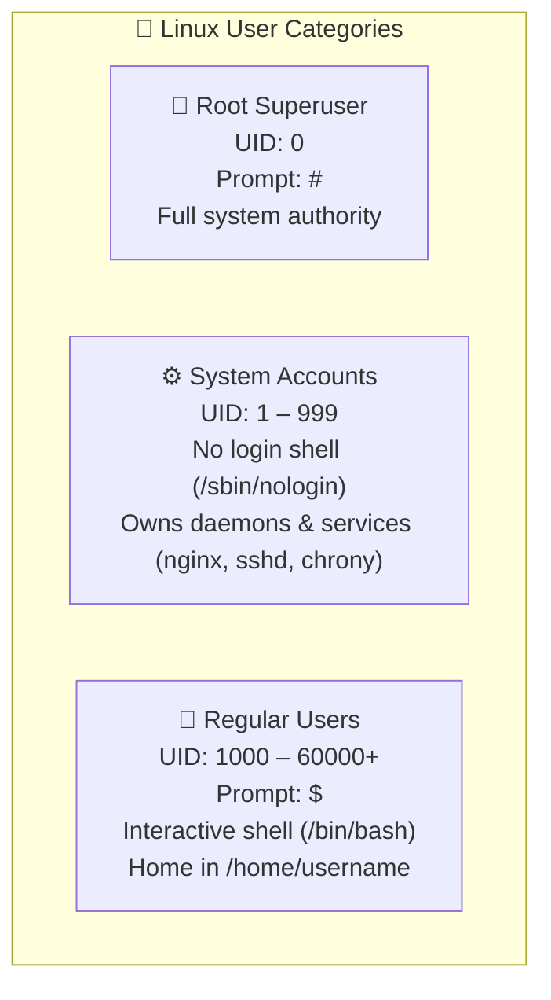
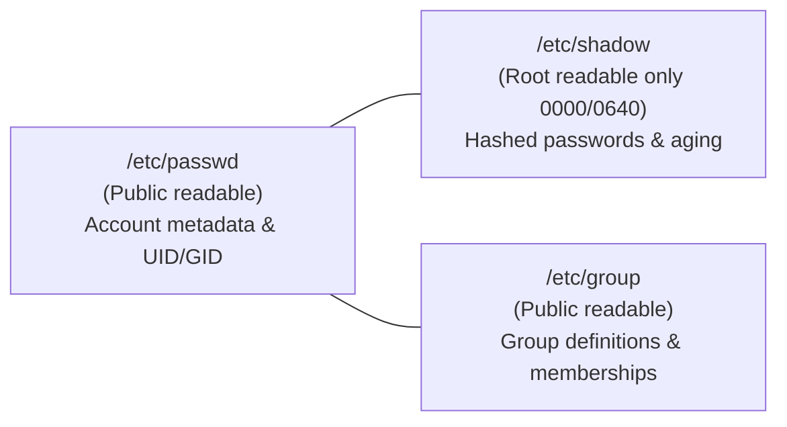
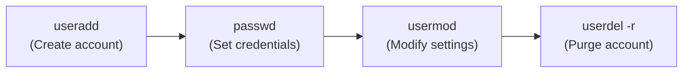
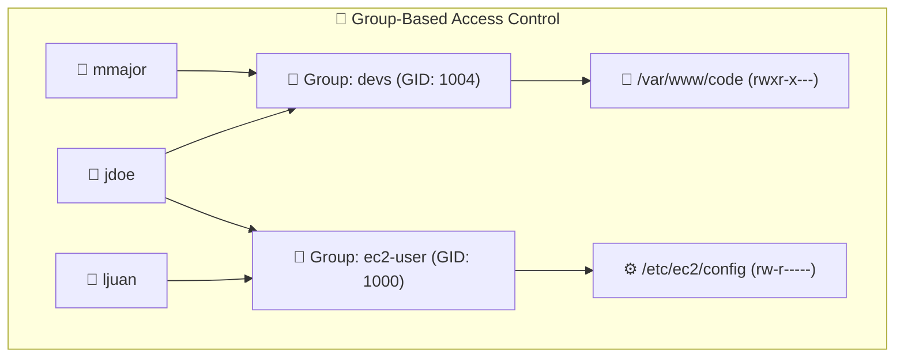
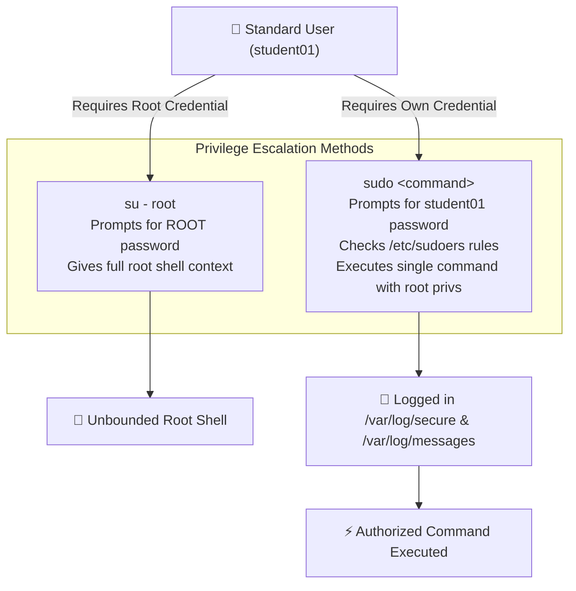
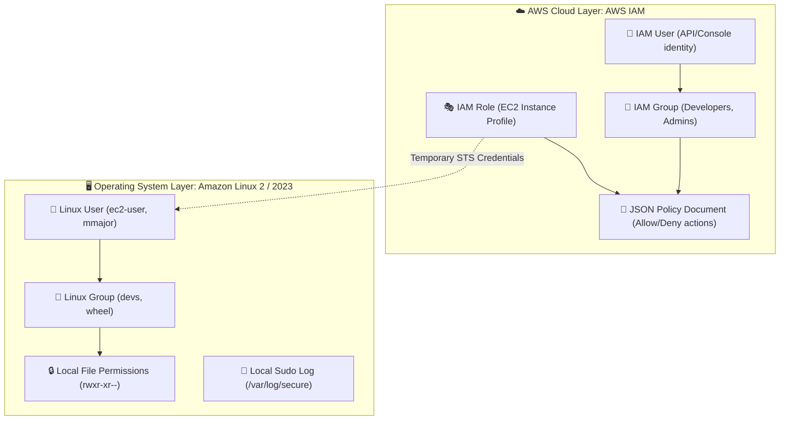

# 👥 Module 02: Linux User and Group Management – Study Guide

> **Course**: AWS re/Start Linux Fundamentals  
> **Module**: M02 – Linux Fundamentals: Users and Groups  
> **Source Document**: `T06-0003-RSLX_EN-US_SG_M02_USERSGROUPS.pdf`  
> **Target Audience**: AWS re/Start Learners / Linux System Administrators / Cloud Practitioners  

---

## 🎯 Module Overview

Welcome to **Linux User and Group Management**. Linux is a true multi-user, multitasking operating system designed from the ground up with strong security, process isolation, and discretionary access control. Every process, file, directory, and system resource in Linux belongs to a specific user and group.

Proper management of user and group accounts is essential for maintaining system stability, enforcing least privilege, and preventing unauthorized access or accidental configuration destruction. This guide covers how Linux organizes user identities, key local configuration databases (`/etc/passwd`, `/etc/shadow`, `/etc/group`), account and group management commands, privilege elevation workflows (`su`, `sudo`, and `/etc/sudoers`), auditing practices, and the architectural bridge to AWS Identity and Access Management (IAM).

### 📌 Learning Objectives
- [ ] **Distinguish Linux User Types & Identifiers**: Understand the roles of the root superuser, system service accounts, and regular interactive users, along with their UID/GID conventions.
- [ ] **Analyze System Account Databases**: Deconstruct the colon-delimited schemas of `/etc/passwd`, `/etc/shadow`, and `/etc/group`.
- [ ] **Perform User Account Administration**: Create, modify, delete, and secure user accounts using `useradd`, `usermod`, `userdel`, and `passwd`.
- [ ] **Manage Group Memberships**: Create and configure primary and supplementary groups using `groupadd`, `groupmod`, `groupdel`, `gpasswd`, and `usermod -aG`.
- [ ] **Implement Safe Privilege Escalation**: Compare `su` vs. `su -` vs. `sudo`, understand sudoer syntax (`WHO WHERE=(AS WHOM) WHAT`), edit safely using `visudo`, and audit privileged actions via `/var/log/secure` and `/var/log/messages`.
- [ ] **Bridge to Cloud Security**: Relate Linux discretionary access control to AWS Identity and Access Management (IAM) users, groups, roles, and policies.

---

## 👤 1. Linux User Architecture & Account Types

Linux enforces security by associating every running program and every filesystem object with a numeric identifier representing a user account.



### User Categories and UID/GID Conventions

| User Category | Typical UID / GID Range | Default Shell | Home Directory | Purpose & Privileges |
| :--- | :--- | :--- | :--- | :--- |
| **Root Superuser** | `0` | `/bin/bash` | `/root` | Ultimate administrator account with unrestricted access across the entire kernel, files, processes, and hardware devices. |
| **System / Service Accounts** | `1` – `999` (RHEL/CentOS/Amazon Linux) <br> `1` – `499` (Older systems) | `/sbin/nologin` or `/bin/false` | Non-standard (e.g., `/var/empty`, `/var/lib/nfs`) | Created automatically during OS or daemon installation (e.g., `daemon`, `bin`, `sshd`, `chrony`, `tcpdump`) to run services with restricted permissions. |
| **Regular Users** | `1000+` (RHEL/Amazon Linux) <br> `500+` (Legacy systems) | `/bin/bash`, `/bin/sh`, `/bin/zsh` | `/home/<username>` | Human users (e.g., `ec2-user`, `mmajor`, `jdoe`) created for day-to-day interactive tasks. Restricted to their own home directories and delegated permissions. |

### Prompt Indicators
Linux shells provide an immediate visual cue indicating the user's privilege level:
- **`$` (Dollar sign)**: Indicates a standard, unprivileged user account.
  ```bash
  [student01@server00 ~]$
  ```
- **`#` (Hash / Pound sign)**: Indicates the **root** superuser account. Extreme caution is required.
  ```bash
  [root@server00 ~]#
  ```

> [!CAUTION]
> **Use Caution with Root**:
> The root account can override all security checks and filesystem permissions. A simple typographical error—such as executing `rm -rf /` or `rm -rf *` inside the wrong working directory—can destroy the entire operating system beyond recovery. System administrators should log in as standard users and elevate permissions only when executing specific administrative commands.

---

## 🗄️ 2. Core User & Group Authentication Files

When Linux operates in local authentication mode (without LDAP, Active Directory, or Kerberos), user and group configurations are maintained in three plain-text configuration files in `/etc`.



---

### The `/etc/passwd` File

The `/etc/passwd` file stores basic user identity and profile metadata. It is world-readable (`chmod 644`) so that system utilities (such as `ls -l` and `ps`) can translate numeric UIDs into human-readable user names.

#### Example Record
```text
mmajor:x:524538:584731:Mary Major:/home/mmajor:/bin/bash
```

#### Field-by-Field Breakdown

| Field # | Field Name | Example Value | Description |
| :---: | :--- | :--- | :--- |
| **1** | **Username** | `mmajor` | The unique login name for the user account (case-sensitive). |
| **2** | **Password Placeholder** | `x` | An `x` indicates that the encrypted password hash is stored securely in `/etc/shadow`. (In legacy Unix, DES hashes were stored directly here). |
| **3** | **User ID (UID)** | `524538` | The unique numerical identifier assigned to the user. UID `0` is always root. |
| **4** | **Group ID (GID)** | `584731` | The numerical identifier of the user's primary group (defined in `/etc/group`). |
| **5** | **GECOS / Comment** | `Mary Major` | Informational comment field, typically used for the user's full name, office room, or telephone contact. |
| **6** | **Home Directory** | `/home/mmajor` | The absolute path to the directory that becomes the user's current working directory upon login. |
| **7** | **Default Login Shell** | `/bin/bash` | The absolute path to the command-line shell program launched when the user authenticates. `/sbin/nologin` prevents interactive shell login. |

---

### The `/etc/shadow` File

Because `/etc/passwd` is world-readable, storing password hashes in `/etc/passwd` exposed systems to offline dictionary and brute-force cracking attacks. Modern Linux separates credentials into `/etc/shadow`, which is strictly restricted to root access (`permissions 0000` or `0640` owned by root/shadow).

#### Example Record
```text
mmajor:$6$qZ7y...$8vU9...:19245:0:90:7:14:19500:
```

#### Field-by-Field Breakdown

| Field # | Field Name | Example | Description |
| :---: | :--- | :--- | :--- |
| **1** | **Username** | `mmajor` | Login name corresponding to the `/etc/passwd` record. |
| **2** | **Encrypted Password** | `$6$...` | Cryptographic hash of the password (starts with algorithm ID: `$1$` MD5, `$5$` SHA-256, `$6$` SHA-512, `$y$` yescrypt). `!` or `*` locks the account. |
| **3** | **Last Password Change** | `19245` | Days between January 1, 1970 (Unix Epoch) and the date the password was last modified. |
| **4** | **Minimum Password Age** | `0` | Minimum number of days required before the user can change their password again. |
| **5** | **Maximum Password Age** | `90` | Maximum number of days the password remains valid before mandatory renewal. |
| **6** | **Warning Period** | `7` | Number of days prior to expiration that the user receives password expiry warnings. |
| **7** | **Inactivity Period** | `14` | Number of days after password expiration during which the account remains accessible before being automatically locked. |
| **8** | **Expiration Date** | `19500` | Absolute date in days since Epoch when the entire account expires and becomes disabled. |
| **9** | **Reserved** | *(empty)* | Reserved flag for future operating system enhancements. |

---

### The `/etc/group` File

The `/etc/group` file defines local group identities and lists secondary (supplementary) members belonging to each group.

#### Example Record
```text
devs:x:1004:jdoe,mmajor
```

#### Field-by-Field Breakdown

| Field # | Field Name | Example Value | Description |
| :---: | :--- | :--- | :--- |
| **1** | **Group Name** | `devs` | Unique identifier name for the group. |
| **2** | **Group Password** | `x` | Placeholder for group password hash (rarely used; stored in `/etc/gshadow` if set). |
| **3** | **Group ID (GID)** | `1004` | Unique numerical identifier for the group. |
| **4** | **Member List** | `jdoe,mmajor` | Comma-separated list of usernames who belong to this group as a **secondary/supplementary** group. *(Note: Users whose primary group is this GID are omitted here)*. |

---

### Essential Inspection Utilities

Administrators frequently inspect user and group database files using standard text utilities:

```bash
# View the first 5 lines of /etc/passwd
head -n 5 /etc/passwd

# View the last 5 lines of /etc/passwd
tail -n 5 /etc/passwd

# Search for a specific user record in /etc/passwd
grep mmajor /etc/passwd

# Check user entry in /etc/group
grep devs /etc/group

# Combine commands with pipes
head -n 20 /etc/passwd | grep -E "bash|sh"
```

---

## 🛠️ 3. User Management Commands

Linux provides administrative commands to manage user accounts without manually editing `/etc/passwd` or `/etc/shadow`.



### The `useradd` Command

The `useradd` command creates a new user account, allocates UID and primary GID, populates home directory skeletons from `/etc/skel/`, and establishes default shell configurations.

```bash
useradd [options] username
```

| Option | Flag Description | Practical Example | Description |
| :--- | :--- | :--- | :--- |
| `-c` | Comment / GECOS | `useradd -c "Mary Major" mmajor` | Sets the full name or description in field 5 of `/etc/passwd`. |
| `-d` | Custom Home Directory | `useradd -d /custom/home/jdoe jdoe` | Specifies a non-standard home directory path. |
| `-m` | Create Home Directory | `useradd -m -s /bin/bash jdoe` | Forces home directory creation (default on most Linux distros). |
| `-M` | Do Not Create Home | `useradd -M service_acc` | Creates user account without allocating a `/home` directory. |
| `-e` | Account Expiration | `useradd -e 2026-12-31 jdoe` | Sets account disable date (`YYYY-MM-DD`). |
| `-s` | Login Shell | `useradd -s /sbin/nologin servicebot` | Designates user shell (use `/sbin/nologin` to block console login). |
| `-u` | Specific UID | `useradd -u 2500 jdoe` | Explicitly assigns a custom UID rather than taking next available. |
| `-g` | Primary Group | `useradd -g staff jdoe` | Assigns an existing group as primary instead of User Private Group (UPG). |
| `-G` | Secondary Groups | `useradd -G devs,docker jdoe` | Assigns supplementary group memberships upon creation. |

---

### The `usermod` Command

The `usermod` command modifies existing user attributes in `/etc/passwd` and `/etc/shadow`.

```bash
usermod [options] username
```

| Option | Function | Syntax Example | Notes / Best Practice |
| :--- | :--- | :--- | :--- |
| `-c` | Update Comment | `usermod -c "Senior Architect" mmajor` | Changes full name / title metadata. |
| `-e` | Update Expiration | `usermod -e 2027-01-01 mmajor` | Extends or updates expiry date. |
| `-d -m` | Move Home Directory | `usermod -d /home/mary -m mmajor` | Moves home folder and copies contents to the new path. |
| `-s` | Change Shell | `usermod -s /bin/zsh mmajor` | Updates login shell. |
| `-aG` | **Append Secondary Group** | `usermod -aG hr,marketing mmajor` | **CRITICAL**: Always use `-a` with `-G`. Omitting `-a` removes the user from all other secondary groups! |
| `-L` | Lock Account | `usermod -L mmajor` | Prepends `!` to password hash in `/etc/shadow`. |
| `-U` | Unlock Account | `usermod -U mmajor` | Removes `!` from password hash in `/etc/shadow`. |

> [!WARNING]
> **The Danger of `usermod -G` without `-a`**:  
> Running `usermod -G devs jdoe` without the `-a` (append) flag replaces all existing secondary groups with only `devs`. If `jdoe` was in `wheel`, `docker`, and `admin`, those memberships will be immediately stripped. Always use `usermod -aG <group> <user>`.

---

### The `userdel` Command

The `userdel` command removes user accounts from system files.

```bash
# Deletes user entry from /etc/passwd and /etc/shadow, but LEAVES /home/mmajor on disk
userdel mmajor

# Deletes user AND purges their home directory and mail spool (-r = remove)
userdel -r mmajor
```

> [!TIP]
> Before deleting an employee's account with `-r`, archive their home directory files or verify ownership to prevent loss of shared project data.

---

### The `passwd` Command

The `passwd` command configures and modifies authentication credentials.

```bash
passwd [options] [username]
```

#### Rules & Behaviors:
1. **Interactive Prompt**: Prompts the user to enter their new password twice to avoid typos.
2. **Zero Screen Echo**: Characters are not echoed to the terminal screen (not even asterisks `*`) for shoulder-surfing protection.
3. **Standard Users**: Can only update their **own** password and must provide their current password first to authenticate.
4. **Root Superuser**: Can set or reset passwords for **any** user without knowing the existing password.

```bash
# Regular user changing their own password
passwd

# Root changing a user's password directly
passwd jdoe

# Root checking password status for an account (-S)
passwd -S jdoe

# Root locking an account (-l) or unlocking (-u)
passwd -l jdoe
passwd -u jdoe
```

---

## 👥 4. Group Management Commands

A Linux **group** is a collection of user accounts organized under a shared GID. Groups streamline security administration: instead of applying file permissions to twenty individual users, an administrator grants permissions to one group and places those users inside it.



### Primary vs. Supplementary Groups
- **Primary Group**: Defined in field 4 of `/etc/passwd`. Every file created by the user is automatically owned by this primary group.
- **Supplementary (Secondary) Group**: Defined in `/etc/group`. Grants the user permissions to shared directories and project files owned by other groups.

---

### Group Commands Overview

| Command | Syntax | Description |
| :--- | :--- | :--- |
| `groupadd` | `groupadd [options] group_name` | Creates a new group record in `/etc/group`. |
| `groupmod` | `groupmod -n new_name old_name` | Renames an existing group (`-n`) or alters GID (`-g`). |
| `groupdel` | `groupdel group_name` | Removes a group from `/etc/group`. *(Cannot delete a user's primary group while user exists)*. |
| `groups` | `groups [username]` | Displays all groups the current or specified user belongs to. |
| `id` | `id [username]` | Prints detailed numerical and text UID, GID, and secondary group memberships. |

#### Command Demonstration
```bash
# Create a new group named 'developers'
groupadd developers

# Rename group 'developers' to 'devs'
groupmod -n devs developers

# Delete group 'testgroup'
groupdel testgroup

# Inspect current user identity and memberships
id
# Output: uid=1000(ec2-user) gid=1000(ec2-user) groups=1000(ec2-user),4(adm),10(wheel),1004(devs)

# Check group names for user jdoe
groups jdoe
```

---

### Managing Group Memberships: `usermod` vs. `gpasswd`

Adding users to groups can be executed through `usermod` or `gpasswd`.

```bash
# Method 1: Using usermod (append secondary groups)
usermod -aG hr,marketing mmajor

# Method 2: Using gpasswd (add single user to group)
gpasswd -a jdoe marketing

# Method 3: Removing a user from a group with gpasswd
gpasswd -d jdoe marketing
```

#### Detailed `gpasswd` Flags

The `gpasswd` utility administers `/etc/group` and `/etc/gshadow`:

| Option | Flag Format | Description | Example |
| :--- | :--- | :--- | :--- |
| `-a` | `--add USER GROUP` | Adds a user to the specified group | `gpasswd -a jdoe ec2-user` |
| `-d` | `--delete USER GROUP` | Removes a user from the group | `gpasswd -d jdoe devs` |
| `-M` | `--members LIST GROUP` | Overwrites the full member list with a comma-separated list | `gpasswd -M smartinez,rroe ec2-user` |
| `-A` | `--administrators ADMINS` | Designates group administrators allowed to add/remove users | `gpasswd -A mmajor devs` |

---

## 🛡️ 5. Privilege Escalation: `su`, `sudo`, & `/etc/sudoers`

System administrators must perform maintenance tasks requiring superuser permissions. Two primary mechanisms provide privilege escalation: **`su` (substitute user)** and **`sudo` (superuser do)**.



---

### The `su` Command (Substitute User)

The `su` command switches the current shell session to another user account (defaulting to `root` if no username is supplied).

```bash
# Switch to root preserving existing environment variables
su root

# Switch to root with a CLEAN login environment (Root's PATH, HOME, variables)
su - root
# Note: 'su -' is shorthand for 'su - root'

# Switch to another regular user
su student02
```

> [!IMPORTANT]
> **Difference Between `su` and `su -`**:
> - `su root`: Retains the original standard user's environment variables (such as `$PATH`, `$USER`, and current working directory). This can introduce security hazards or path errors.
> - `su - root`: Loads a fresh login shell, initializing root's native environment variables (`/root`, root `$PATH`, `/root/.bashrc`). Always prefer `su -` when switching to root.

---

### The `/etc/sudoers` File

Rather than distributing the root password to multiple administrators, Linux delegates granular administrative permissions using `/etc/sudoers`.

#### Sudoers Syntax Breakdown

The generic entry structure follows:
```text
# WHO     WHERE  = (AS WHOM)    WHAT
username  hosts  = (user:group) commands
```

```text
mmajor    ALL    = (ALL:ALL)    ALL
%devs     ALL    = (ALL)        NOPASSWD: ALL
%users    localhost = (root)    /usr/sbin/shutdown -r now
```

1. **`WHO`**: The user account (`mmajor`) or group (`%devs`, prefixed by `%`).
2. **`WHERE`**: The hosts/hostnames where the rule applies (`ALL` indicates any host; `localhost` indicates the local machine).
3. **`(AS WHOM)`**: The target account and group the command runs as (`(ALL)` allows running as root or any other user).
4. **`WHAT`**: The specific absolute paths to authorized commands (`ALL`, `/usr/sbin/shutdown -r now`, `/usr/sbin/useradd`).
5. **`NOPASSWD:`**: Bypasses the user password authentication prompt when invoking `sudo`.

---

### The `visudo` Safe Editor

> [!CAUTION]
> **Never Edit `/etc/sudoers` Directly**:  
> Always modify the sudoers file using the command:
> ```bash
> sudo visudo
> ```
> `visudo` locks the file against concurrent edits and **parses syntax before saving**. If a syntax error is introduced into `/etc/sudoers` with a normal editor (`nano` or `vi`), all `sudo` functionality breaks across the entire machine, potentially locking administrators out permanently.

---

### Using `sudo` in Practice

```bash
# Delegated user creating a new account with sudo
[student01@server00 ~]$ sudo useradd user20
[sudo] password for student01: 

# View delegated sudo permissions for the current user
sudo -l

# View delegated sudo permissions for a specific user (-lU)
sudo -lU student01
```

#### Sudo Privilege Elevation Comparison
- **`sudo <command>`**: Runs a single command with root privileges and returns immediately to the standard shell.
- **`sudo -i`**: Spawns an interactive root login shell using the caller's password (if authorized for `ALL`).
- **`sudo -s`**: Spawns a shell specified by the user's `$SHELL` environment variable.

---

### Sudo Auditing and System Logs

A major security advantage of `sudo` over `su` is comprehensive logging:
- **/var/log/secure** (RHEL, CentOS, Amazon Linux) or **/var/log/auth.log** (Debian, Ubuntu): Records every sudo command invocation, timestamps, the calling user, target command, and terminal source.
- **/var/log/messages** or **/var/log/syslog**: Records general system events and elevation authorizations.

```text
# Sample /var/log/secure log entry
Oct 12 14:22:05 server00 sudo: student01 : TTY=pts/0 ; PWD=/home/student01 ; USER=root ; COMMAND=/usr/sbin/useradd user20
```

---

### Comparison: `su` vs. `sudo`

| Feature / Criteria | `su` (Substitute User) | `sudo` (Superuser Do) |
| :--- | :--- | :--- |
| **Password Required** | Requires target account's password (e.g., **root password**) | Requires calling user's **own password** (or `NOPASSWD`) |
| **Granularity of Control** | All-or-nothing (full session access) | Highly granular (individual commands and arguments) |
| **Accountability & Audit** | Low (once in root shell, command origins become obscured) | High (every command logged with caller's username in `/var/log/secure`) |
| **Credential Sharing** | Requires sharing root password across staff | Zero shared credentials; each admin uses their personal account |
| **Session Model** | Persistent root interactive shell | Single command execution (default) |
| **Best Practice** | Discouraged for everyday admin tasks | **Industry Standard** for system administration |

---

## ☁️ 6. Cloud Identity Bridge: Linux Access Control vs. AWS IAM

In enterprise cloud environments, Linux user administration intersects directly with **AWS Identity and Access Management (IAM)**. While Linux manages access to the local operating system kernel and filesystem, AWS IAM manages access to AWS services, API endpoints, and cloud infrastructure.



### Conceptual Mapping: Linux Local Auth vs. AWS IAM

| Concept | Linux Local Architecture | AWS IAM Architecture |
| :--- | :--- | :--- |
| **Identity Primitive** | Linux User (`/etc/passwd`, UID) | IAM User / IAM Role (ARN, Unique ID) |
| **Grouping Mechanism** | Linux Group (`/etc/group`, GID) | IAM User Group |
| **Credential Storage** | `/etc/shadow` (hashed password) | AWS Managed Credential Store (Passwords, Access Keys) |
| **Permission Model** | POSIX permissions (`rwx`, `ugo`) & `/etc/sudoers` | JSON IAM Policy Documents (`Effect`, `Action`, `Resource`) |
| **Elevation Method** | `sudo`, `visudo`, `su` | `sts:AssumeRole`, Switch Role in Console |
| **Management Interfaces** | Shell CLI (`useradd`, `usermod`, `passwd`) | AWS Console, AWS CLI (`aws iam ...`), AWS SDKs (Boto3) |
| **Audit Log** | `/var/log/secure`, `/var/log/messages` | AWS CloudTrail (global API logging) |

### Accessing AWS IAM
AWS IAM can be managed through three primary interfaces:
1. **AWS Management Console**: Browser-based graphical interface for visual identity management and policy editing.
2. **AWS Command Line Interface (AWS CLI)**: Command-line tool invoked from local shells to automate infrastructure scripting.
3. **AWS Software Development Kits (SDKs)**: Language-specific libraries (Python Boto3, Java, Node.js) for programmatic API access from inside cloud applications.

---

## 🔒 7. Security Best Practices

1. **Enforce Least Privilege**: Grant users only the exact permissions needed to perform their job duties.
2. **Eliminate Shared Accounts**: Assign exactly one personal account per human administrator. Never share login credentials.
3. **Disable Direct Root Login**: Configure SSH (`/etc/ssh/sshd_config`) with `PermitRootLogin no`. Require administrators to log in as named standard users and elevate via `sudo`.
4. **Mandate `visudo`**: Always configure sudoer definitions through `visudo` to prevent locking out administrators due to syntax corruption.
5. **Protect File Databases**: Ensure `/etc/shadow` has permissions `0000` or `0640` and belongs exclusively to `root:root` or `root:shadow`.
6. **Audit Privileged Actions**: Regularly inspect `/var/log/secure` and ingest system authentication logs into centralized monitoring systems (such as Amazon CloudWatch Logs).
7. **Clean Account Deletion**: When an employee leaves, immediately lock the account with `usermod -L` or remove with `userdel -r` after archiving user files.

---

## 🧠 8. Checkpoint & Knowledge Check

Test your understanding of Linux user and group management concepts.

### Question 1
**Which command is used to add a new user account to a Linux system?**
> **Answer**: `useradd` (or `adduser` on Debian-derived systems).  
> **Explanation**: The `useradd` command creates the user record in `/etc/passwd` and `/etc/shadow`, generates a primary group, and can establish the user's home directory.

---

### Question 2
**Which command is used to set or reset a user account password?**
> **Answer**: `passwd`.  
> **Explanation**: Standard users run `passwd` to change their own password; the root superuser can run `passwd <username>` to reset passwords for any account without requiring the old password.

---

### Question 3
**How is organizing users into groups useful to system administrators?**
> **Answer**: Organizing users into groups allows administrators to manage access permissions and security policies for multiple users as a single collective unit, rather than assigning rights to each individual account.

---

### Question 4
**Which command is used to grant full administrative permissions to a user within the user's current environment?**
> **Answer**: `su root`.  
> **Explanation**: `su root` elevates the session to root privileges while preserving the calling user's current environment. To load root's full clean environment instead, `su - root` (or `su -`) is used.

---

### Question 5
**What is the function of the `-a` flag when running `usermod -aG developers jdoe`?**
> **Answer**: It **appends** the user to the specified secondary group(s) without removing them from their existing secondary groups. Omitting `-a` causes `usermod -G` to overwrite and remove all other group memberships.

---

### Question 6
**Why is `sudo` preferred over `su` in enterprise environments?**
> **Answer**: `sudo` does not require sharing the root password, enforces granular per-command authorizations via `/etc/sudoers`, prompts for the administrator's own password, and logs every privileged execution to `/var/log/secure` for accountability.

---

## 📝 9. Key Takeaways

- A **Linux user account** represents a unique identity on the system with an assigned UID.
- Multiple user accounts can be organized into **Linux groups** (with a GID) to simplify permission management.
- The **root user** (UID 0, prompt `#`) possesses complete authority over all kernel resources, hardware, files, and running processes.
- The **`/etc/passwd`** file stores public account metadata; **`/etc/shadow`** stores encrypted password hashes and aging metrics; **`/etc/group`** stores group definitions and secondary members.
- Use **`useradd`**, **`usermod`**, and **`userdel`** to manage users, and **`groupadd`**, **`groupmod`**, **`groupdel`**, and **`gpasswd`** to manage groups.
- The **`su`** command switches sessions to another account (requiring the target user's password), while **`sudo`** delegates specific commands to authorized users (requiring their own password) as controlled by **`/etc/sudoers`**.
- Always edit `/etc/sudoers` with **`visudo`** to prevent syntax errors that could lock out administrative access.
- In cloud architectures, local Linux account management is complemented by **AWS IAM**, which centrally governs cloud API and service access through Users, Groups, Roles, and Policies.
