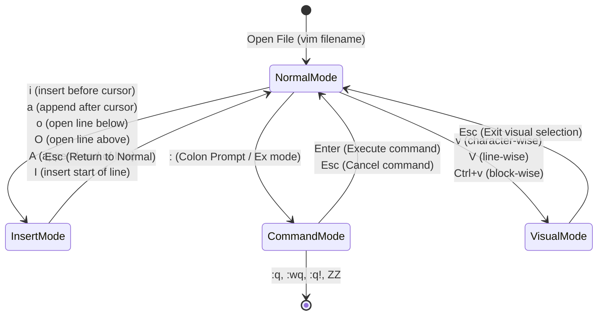
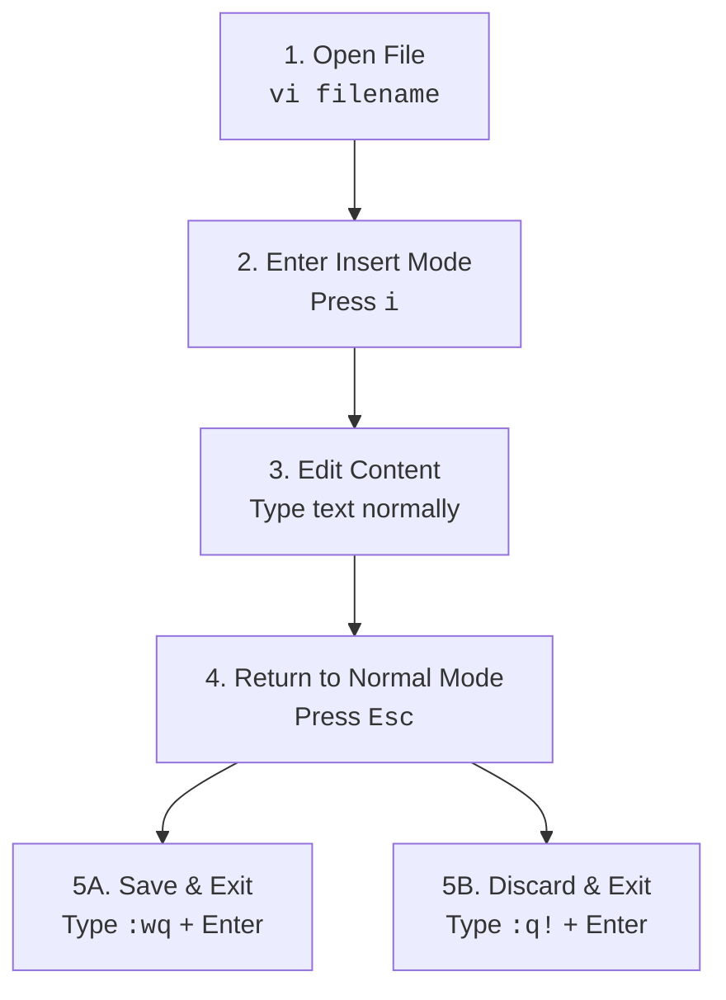

# 📝 Module 02: Editing Files – Study Guide

> **Course**: AWS re/Start Linux Fundamentals  
> **Module**: M02 – Editing Files  
> **Source Document**: `T06-0004-RSLX_EN-US_SG_M02_EDITINGFILES.pdf`  
> **Target Audience**: AWS re/Start Learners / Linux System Administrators / Cloud Practitioners  

---

## 🎯 Module Overview

In Unix and Linux operating systems, the foundational design principle is that **"everything is a file."** Hardware devices, process interfaces, system configuration settings, system services, and application parameters are all stored and managed as plaintext files within the hierarchical file system. 

Consequently, proficiency in creating, modifying, and managing plaintext files directly from the command-line interface (CLI) is an indispensable core competency for any systems administrator, DevOps engineer, or cloud architect. Because cloud instances (such as Amazon Elastic Compute Cloud / EC2) and enterprise servers commonly run headless—without a Graphical User Interface (GUI) or desktop environment—engineers must be adept with terminal-based text editors.

This study guide examines the most widely used Linux text editors: **Vim**, **GNU nano**, and the GUI-based **gedit**. It details their operational paradigms, keystroke shortcuts, navigation strategies, and practical workflows.

---

### 📌 Learning Objectives

- [ ] **Explain the Importance of Text Editors in Linux**: Understand why plaintext file editing is critical for administering Linux systems and configuring cloud workloads.
- [ ] **Compare Linux Text Editors**: Differentiate the operational models and use cases of terminal editors (Vim, GNU nano, Emacs) versus GUI editors (gedit).
- [ ] **Master GNU nano Navigation & Commands**: Use modeless terminal editing, basic keystroke shortcuts (`^O`, `^X`, `^W`, `^K`, `^U`), and advanced buffer management.
- [ ] **Understand Vim's Modal Architecture**: Contrast Normal/Command mode, Insert mode, Command-line/Ex mode, and Visual mode.
- [ ] **Execute Core Vim Operations**: Perform mode transitions, file saving/quitting (`:w`, `:q`, `:wq`, `:q!`), motion navigation (`h, j, k, l`, `w`, `b`, `gg`, `G`), text manipulation (`x`, `dd`, `yy`, `p`), and search/replace (`/pattern`, `:s/old/new/g`).
- [ ] **Access Help Systems Across Editors**: Retrieve built-in help and manual pages in Vim (`vimtutor`, `:help`, `K`), nano (`^G`), and gedit.
- [ ] **Evaluate GUI Editor Capabilities**: Understand gedit requirements, desktop environments (GNOME, Xfce, KDE), and EC2 GUI provisioning considerations.

---

## 🖥️ 1. Editing Files in Linux: Overview

### The "Everything is a File" Philosophy
In Linux, almost all operating system configuration is maintained in plain, human-readable text files located in standard directories such as `/etc`, `/var`, and `/home`. For instance:
- Network settings: `/etc/resolv.conf`, `/etc/netplan/`
- User credentials & groups: `/etc/passwd`, `/etc/group`
- Package repositories: `/etc/apt/sources.list` or `/etc/yum.repos.d/`
- Service configurations: `/etc/ssh/sshd_config`, `/etc/nginx/nginx.conf`

Unlike operating systems that store core configurations in binary registries or proprietary databases, Linux requires administrators to read and edit plaintext configuration files to install software, modify access permissions, manage system daemons, and tune kernel parameters.

### Why Terminal Text Editors Are Critical
In production environments and cloud infrastructure (e.g., AWS EC2 instances, containerized workloads, bare-metal servers):
1. **Headless Servers**: Production servers rarely run a display server (X11 or Wayland) or desktop environment to save RAM, CPU, and disk overhead while minimizing the attack surface.
2. **Remote SSH Access**: Administrative management is performed remotely over Secure Shell (SSH), where graphical transmission is inefficient or disabled.
3. **Emergency Recovery**: Single-user rescue modes and minimal bootstrap environments provide only a basic terminal shell with primitive text editors available.

```
┌────────────────────────────────────────────────────────────────────────┐
│                        Linux Text Editor Spectrum                      │
│                                                                        │
│   [GNU nano]        ───►  [Vim / Vi]        ───►  [gedit / Desktop]    │
│   • Modeless              • Modal Architecture     • Graphical GUI     │
│   • On-screen shortcuts   • Ubiquitous             • Requires Desktop  │
│   • Beginner friendly     • Highly scriptable        (GNOME/Xfce/KDE)  │
│   • Lightweight           • Lightning fast         • Heavy overhead    │
└────────────────────────────────────────────────────────────────────────┘
```

### Editor Comparison: Nano vs. Vim vs. Emacs vs. gedit

| Feature / Attribute | GNU nano | Vim / Vi | GNU Emacs | gedit |
| :--- | :--- | :--- | :--- | :--- |
| **Interface Type** | Terminal (CLI) | Terminal (CLI) / GUI (gVim) | Terminal & GUI | GUI (Desktop) |
| **Editing Paradigm** | Modeless (What you type is entered) | Modal (Normal, Insert, Ex, Visual) | Modeless with key chords | Modeless (Standard GUI) |
| **Learning Curve** | Gentle / Immediate | Moderate to Steep | Steep | None (Intuitive) |
| **Default Availability** | Installed on many distributions | Ubiquitous on nearly all Unix/Linux | Usually requires separate install | Requires full GUI desktop |
| **Key Bindings** | Ctrl (`^`) & Meta/Alt (`M-`) | Keystroke commands & colon prompts | Extensive Ctrl (`C-`) & Alt (`M-`) | Standard Ctrl+C, Ctrl+V, etc. |
| **System Overhead** | Minimal | Minimal (< 10 MB) | Moderate to High | High (GUI stack required) |
| **Primary Cloud Use** | Quick single-file configuration | Ubiquitous DevOps / Production editing | Advanced programming environments | Local development workstations |

---

## 📝 2. Working with GNU nano

### What is GNU nano?
**GNU nano** is an easy-to-use, lightweight, modeless text editor designed as an enhanced, free clone of the classic Pico editor (part of the Pine email suite). 

> [!NOTE]
> Nano works directly in the terminal shell. While nano is standard on Ubuntu, Debian, and many modern distributions, it might not be pre-installed on minimal or enterprise images.
> - **Debian / Ubuntu**: `sudo apt-get install nano`
> - **RHEL / Amazon Linux / CentOS**: `sudo yum install nano` or `sudo dnf install nano`

### The nano Interface
When launching nano (`nano filename.txt`), the terminal displays:
1. **Title Bar** (Top): Shows the nano version, current file name, and modification status (`[ Modified ]`).
2. **Editing Area** (Middle): Text entry workspace.
3. **Status Line** (Third row from bottom): Displays notifications, error messages, and search alerts.
4. **Shortcut Menu Bar** (Bottom two rows): Displays the most common commands.

In nano shortcut notations:
- The caret symbol `^` represents the **Ctrl** key (e.g., `^O` means `Ctrl + O`).
- The prefix `M-` represents the **Meta** key (typically **Alt**, or **Esc** on terminals without an Alt key).

```
  GNU nano 6.2                     welcome.txt                               
┌────────────────────────────────────────────────────────────────────────────┐
│ Welcome to Linux text editing.                                             │
│ This is a plaintext file edited with GNU nano.                            │
│                                                                            │
│                                                                            │
└────────────────────────────────────────────────────────────────────────────┘
^G Help         ^O WriteOut     ^W Where Is     ^K Cut          ^T Execute
^X Exit         ^R Read File    ^\ Replace      ^U Paste        ^J Justify
```

### Essential nano Keystrokes & Shortcuts

#### Primary File & Session Commands
| Shortcut | Action | Description |
| :--- | :--- | :--- |
| `^G` (`Ctrl+G`) | **Display Help** | Opens the extensive built-in nano documentation screen. |
| `^O` (`Ctrl+O`) | **Write Out (Save)** | Writes the current file buffer to disk (prompts for filename, press Enter to confirm). |
| `^X` (`Ctrl+X`) | **Exit** | Closes the current buffer and exits nano (prompts to save if modifications are unsaved). |
| `^C` (`Ctrl+C`) | **CurPos** | Displays the current cursor position (line and column numbers) and character count. |

#### Editing & Text Manipulation
| Shortcut | Action | Description |
| :--- | :--- | :--- |
| `^K` (`Ctrl+K`) | **Cut Line** | Cuts the current line (or selected text) and stores it in the cutbuffer. Repeated `^K` cuts consecutive lines into a single buffer. |
| `^U` (`Ctrl+U`) | **Paste / Uncut** | Pastes ("uncuts") the contents of the cutbuffer at the current cursor position. |
| `M-^` or `M-6` (`Alt+^` / `Alt+6`) | **Copy Line** | Copies the current line into the cutbuffer without deleting it. |
| `^J` (`Ctrl+J`) | **Justify** | Justifies the current paragraph according to margin settings. |

#### Navigation & Screen Movement
| Shortcut | Action | Description |
| :--- | :--- | :--- |
| `^Y` (`Ctrl+Y`) | **Previous Screen** | Moves the viewport up one screen (Page Up). |
| `^V` (`Ctrl+V`) | **Next Screen** | Moves the viewport down one screen (Page Down). |
| `^A` (`Ctrl+A`) | **Line Start** | Moves cursor to the start of the current line. |
| `^E` (`Ctrl+E`) | **Line End** | Moves cursor to the end of the current line. |
| `^_` (`Ctrl+_`) | **Go to Line/Col** | Prompts for a line and column number to jump directly to. |
| `M-]` (`Alt+]`) | **Matching Bracket** | Jumps the cursor to the matching bracket, brace, or parenthesis. |

#### Search, Replace & Multi-Buffer Operations
| Shortcut | Action | Description |
| :--- | :--- | :--- |
| `^W` (`Ctrl+W`) | **Where Is (Search)** | Searches for a specific string or regular expression. |
| `M-W` (`Alt+W`) | **Repeat Search** | Repeats the last search operation forward. |
| `^\` (`Ctrl+\`) | **Replace** | Performs find-and-replace for a string or regular expression across the file. |
| `M-<` or `M-,` (`Alt+,`) | **Previous Buffer** | Switches to the previous open file buffer when multiple files are opened. |
| `M->` or `M-.` (`Alt+.`) | **Next Buffer** | Switches to the next open file buffer. |

> [!TIP]
> To open a file at a specific line number in nano, use the `+line` flag from the terminal:
> ```bash
> nano +42 /etc/ssh/sshd_config
> ```
> This immediately positions the cursor at line 42 upon opening.

---

## ⚡ 3. Working with Vim (Vi IMproved)

### Overview and Heritage of Vim
**Vim** (Vi IMproved) is an advanced, highly configurable clone of Bill Joy's original Unix `vi` editor written by Bram Moolenaar. 

Key attributes of Vim include:
- **Default Ubiquity**: Installed by default or symlinked (`vi -> vim`) on virtually every Linux distribution and Unix system worldwide.
- **Customizability**: Supports user configuration files (`~/.vimrc`), syntax highlighting for hundreds of languages, custom key mappings, macros, and automation scripts.
- **Speed & Efficiency**: Designed so that hands never leave the home row on the keyboard, minimizing repetitive strain and maximizing editing throughput.
- **No GUI Menus**: Operates entirely via keystroke commands in the terminal.

---

### The Modal Editing Architecture
Unlike typical modeless editors (such as Notepad or Word, where every typed letter immediately appears as text), Vim is a **modal editor**. Keystrokes have completely different functions depending on which mode Vim is currently in.



Vim primarily utilizes three traditional operational modes (plus Visual mode):

1. **Normal / Command Mode** (Default):
   - When you open a file, Vim starts in Normal mode.
   - Keystrokes are interpreted as **commands** (navigation, text deletion, copy, paste, undo).
   - Typing `j` moves the cursor down; typing `x` deletes a character; typing `dd` cuts the whole line.
2. **Insert Mode**:
   - Entered from Normal mode by pressing keys such as `i`, `a`, or `o`.
   - In this mode, typed keystrokes enter raw text content into the file buffer.
   - Pressing **`Esc`** exits Insert mode and returns to Normal mode.
3. **Command-line / Ex Mode**:
   - Accessed from Normal mode by pressing the colon (`:`) key.
   - The cursor moves to a command prompt at the bottom line of the terminal.
   - Used for file I/O operations (writing files, quitting, reading files), global substitutions, setting environment options, and running shell commands.
4. **Visual Mode**:
   - Accessed by typing `v` (character select), `V` (line select), or `Ctrl+v` (block select).
   - Allows highlighting text ranges before applying commands such as yank (`y`), delete (`d`), or indentation (`>`).

---

## 🛠️ 4. Essential Vim Operations & Cheat Sheet

### Entering and Exiting Modes

```
        ┌─────────────────────────────────────────────────────────────┐
        │                        INSERT MODE                          │
        │             (Keystrokes enter text directly)               │
        └─────────────────────────────────────────────────────────────┘
                     ▲                               │
                     │  i, a, o, I, A, O             │  <ESC>
                     │                               ▼
        ┌─────────────────────────────────────────────────────────────┐
        │                   NORMAL / COMMAND MODE                     │
        │             (Default: Navigation & Editing)                │
        └─────────────────────────────────────────────────────────────┘
                     │                               ▲
                     │  : (colon)                    │  <ESC> or <Enter>
                     ▼                               │
        ┌─────────────────────────────────────────────────────────────┐
        │                     EX / COMMAND-LINE MODE                  │
        │             (Bottom line prompt: :w, :q, :s)                │
        └─────────────────────────────────────────────────────────────┘
```

| Key | Mode Transition | Function |
| :--- | :--- | :--- |
| `i` | Normal $\rightarrow$ Insert | Insert text immediately **before** the cursor. |
| `a` | Normal $\rightarrow$ Insert | Append text immediately **after** the cursor. |
| `I` | Normal $\rightarrow$ Insert | Insert text at the **start of the current line** (first non-blank character). |
| `A` | Normal $\rightarrow$ Insert | Append text at the **end of the current line**. |
| `o` | Normal $\rightarrow$ Insert | Open a **new line below** the cursor and enter Insert mode. |
| `O` | Normal $\rightarrow$ Insert | Open a **new line above** the cursor and enter Insert mode. |
| `Esc` | Any $\rightarrow$ Normal | Return to Normal mode (cancels partial commands, exits Insert/Visual mode). |
| `:` | Normal $\rightarrow$ Ex | Opens the Ex command-line prompt at the bottom of the screen. |

---

### Quitting and Saving Files (Ex Mode & Normal Mode)

From Normal mode, type `:` followed by the command, then press **Enter**:

| Command | Action | Explanation |
| :--- | :--- | :--- |
| `:w` | **Write** | Writes the buffer to disk (saves changes) without exiting Vim. |
| `:w filename` | **Write As** | Saves the current buffer to the specified new file name. |
| `:q` | **Quit** | Quits Vim. Fails with an error message if there are unsaved modifications. |
| `:wq` | **Write & Quit** | Saves changes and cleanly exits Vim. |
| `:wq!` | **Force Write & Quit** | Overwrites read-only files (if write permissions can be overridden) and exits. |
| `:q!` | **Quit Discarding Changes** | Quits Vim unconditionally, abandoning all modifications made during the session. |
| `ZZ` | **Save & Exit (Normal Mode)** | Fast keystroke in Normal mode to write changes and exit (equivalent to `:x` or `:wq`). |
| `ZQ` | **Exit Without Saving** | Fast keystroke in Normal mode to quit discarding changes (equivalent to `:q!`). |

> [!CAUTION]
> If you make accidental changes to a sensitive production configuration file (such as `/etc/sudoers` or `/etc/fstab`), do **NOT** use `:wq`. Immediately press `Esc` and type `:q!` to abandon all changes safely!

---

### Navigation & Cursor Movements (Normal Mode)

Vim's cursor navigation operates without requiring arrow keys, keeping hands on the primary keyboard home row:

```
                  k (Up)
                    ▲
                    │
   h (Left) ◄───────┼───────► l (Right)
                    │
                    ▼
                  j (Down)
```

| Keystroke | Movement / Scope |
| :--- | :--- |
| `h` | Move cursor one character **left** |
| `j` | Move cursor one line **down** |
| `k` | Move cursor one line **up** |
| `l` | Move cursor one character **right** |
| `w` | Jump forward to the **beginning of the next word** |
| `b` | Jump backward to the **beginning of the previous word** |
| `e` | Jump forward to the **end of the current/next word** |
| `0` (Zero) | Jump to the **start of the current line** (column 0) |
| `^` | Jump to the **first non-blank character** of the current line |
| `$` | Jump to the **end of the current line** |
| `gg` | Jump to the **first line** of the file (top of file) |
| `G` | Jump to the **last line** of the file (bottom of file) |
| `42G` or `:42` | Jump directly to **line 42** of the file |
| `Ctrl+f` | Scroll down one full page (Page Down) |
| `Ctrl+b` | Scroll up one full page (Page Up) |

---

### Text Editing, Deleting, Yanking, Putting & Undoing

In Vim's grammar, commands frequently follow the syntax: `[count] [operator] [motion]`.

| Keystroke | Command Type | Effect |
| :--- | :--- | :--- |
| `x` | Delete Char | Deletes the single character directly under the cursor. |
| `X` | Delete Before Char | Deletes the character directly before the cursor (backspace). |
| `dd` | Delete Line | Deletes (cuts) the entire current line and places it into the unnamed register. |
| `3dd` | Delete Lines | Deletes 3 lines starting from the cursor downward. |
| `dw` | Delete Word | Deletes from the cursor to the beginning of the next word. |
| `D` | Delete to End | Deletes from the cursor to the end of the current line (`d$`). |
| `yy` or `Y` | Yank Line (Copy) | Copies the entire current line into the paste buffer (register). |
| `yw` | Yank Word | Copies the current word into the paste buffer. |
| `p` | Put (Paste After) | Pastes the contents of the register **below** the current line (if line) or **after** the cursor. |
| `P` | Put (Paste Before) | Pastes the contents of the register **above** the current line or **before** the cursor. |
| `u` | Undo | Undoes the last edit or command. |
| `Ctrl+r` | Redo | Redoes the last undone change. |

---

### Searching and Search & Replace

#### Interactive Search
- `/pattern`: Searches forward from the current cursor position for `pattern`. Press **Enter** to jump to the first occurrence.
- `?pattern`: Searches backward from the current cursor position for `pattern`.
- `n`: Jumps to the **next** match in the same direction.
- `N`: Jumps to the **previous** match in the reverse direction.

#### Find and Replace (Substitution in Ex Mode)
The substitution command syntax is: `:[range]s/target/replacement/[flags]`

| Syntax / Example | Scope & Effect |
| :--- | :--- |
| `:s/old/new/` | Replaces the **first occurrence** of `old` with `new` on the current line only. |
| `:s/old/new/g` | Replaces **all occurrences** (`g` = global flag) of `old` with `new` on the current line. |
| `:%s/old/new/g` | Replaces **all occurrences** of `old` with `new` throughout the **entire file** (`%` represents all lines). |
| `:%s/old/new/gc` | Globally replaces throughout the entire file with **user confirmation** (`c` flag: prompt y/n/a/q for each match). |
| `:1,50s/old/new/g` | Replaces all occurrences between lines 1 and 50 inclusive. |

---

### Accessing Help in Vim

Vim includes an extensive internal documentation system:

```
┌────────────────────────────────────────────────────────────────────────┐
│                        Vim Help Ecosystem                              │
│                                                                        │
│   [Shell]               [Inside Vim]             [Cursor Context]      │
│   $ vimtutor            :help                    K                     │
│   (Interactive Lab)     :help <keyword>          (Lookup Linux man)    │
└────────────────────────────────────────────────────────────────────────┘
```

1. **`vimtutor`**:
   - Executed directly from the Linux shell: `vimtutor`.
   - Launches an interactive 30-minute tutorial that makes a copy of a practice file so learners can practice Vim keystrokes directly without fear of damaging actual files.
2. **`:help`**:
   - Entered from Normal mode: press `Esc` then type `:help` and press **Enter**.
   - Opens a split window containing the comprehensive user manual. Close the help buffer with `:q`.
3. **`:help <keyword>`**:
   - Searches documentation for a specific feature, setting, or command.
   - Example: `:help 'textwidth'` jumps directly to the documentation defining the `textwidth` option.
   - Example: `:help dd` explains the delete line command.
4. **`K` (Keyword Manual Page Lookup)**:
   - In Normal mode, positioning the cursor over a command or keyword and pressing capital **`K`** automatically opens the system man page (`man`) for that keyword.
   - *Example*: Place the cursor over `useradd`, press `K` $\rightarrow$ opens the `useradd(8)` Linux manual page. Press `q` to exit the man page and resume editing.

---

### 🛡️ The Minimum Vi/Vim Survival Kit

If you are unexpectedly placed into Vim on a remote server, these five core actions ensure complete operational capability:



| Action | Keystrokes |
| :--- | :--- |
| **1. Enter Insert Mode** | Press `i` |
| **2. Return to Command Mode** | Press `Esc` |
| **3. Enter Ex Mode** | Press `:` |
| **4. Save Changes and Quit** | Type `:wq` and press `Enter` |
| **5. Abort and Quit Discarding Changes** | Type `:q!` and press `Enter` |

---

## 🖥️ 5. GUI-Based Text Editor: gedit

### Overview of gedit
**gedit** is the official default text editor of the **GNOME** desktop environment. It provides a standard, graphical interface similar to standard graphical desktop text editors (e.g., Notepad, TextEdit).

```
┌────────────────────────────────────────────────────────────┐
│ [ Open ] [ Save ] [   ▼   ]               Untitled Document │
├────────────────────────────────────────────────────────────┤
│ File  Edit  View  Search  Tools  Documents  Help           │
├────────────────────────────────────────────────────────────┤
│                                                            │
│  gedit provides standard menu buttons, tabs,              │
│  syntax highlighting, line numbering, and mouse selection. │
│                                                            │
└────────────────────────────────────────────────────────────┘
```

### Characteristics & Requirements
- **Graphical Menus & Mouse Support**: Users can click menus, highlight with the mouse, use standard desktop keyboard shortcuts (`Ctrl+C`, `Ctrl+V`, `Ctrl+S`, `Ctrl+Z`), and manage multiple files in tabs.
- **Desktop Environment Prerequisite**: Requires a running graphical environment such as **GNOME**, **Xfce**, or **K Desktop Environment (KDE)**. It cannot run directly in a purely text-based TTY or standard headless SSH shell without X11 forwarding.
- **Optional Nature in Linux**: Because Linux does not require a GUI, `gedit` is strictly optional and absent on most server distributions.

### Running a GUI on Amazon EC2
While cloud servers standardly operate headless, AWS provides documentation for administrators who need a GUI environment on cloud compute instances (e.g., for specialized graphical management tools or desktop workstations).
- To install a GUI (such as MATE or GNOME) and access it via Virtual Network Computing (VNC) on Amazon Linux 2, refer to AWS Knowledge Center guidance:
  - Reference: [AWS Knowledge Center: How to install a GUI on an Amazon EC2 instance running Amazon Linux 2](https://aws.amazon.com/premiumsupport/knowledge-center/ec2-linux2-install-gui/)
- Standard installation steps include:
  ```bash
  # Example: Installing MATE desktop environment on Amazon Linux 2
  sudo amazon-linux-extras install mate-desktop1.x -y
  bash -c 'echo PREFERRED=/usr/bin/mate-session > /etc/sysconfig/desktop'
  sudo yum install tigervnc-server -y
  ```

---

## 📊 6. Comprehensive Editor Reference Matrix

| Criterion | GNU nano | Vim | gedit |
| :--- | :--- | :--- | :--- |
| **Primary Environment** | CLI Terminal | CLI Terminal | GUI Desktop |
| **Operational Model** | Modeless | Modal (Normal/Insert/Ex/Visual) | Modeless GUI |
| **Prerequisites** | Terminal shell | Terminal shell | X11/Wayland + Desktop Engine |
| **Start Command** | `nano <file>` | `vim <file>` (or `vi <file>`) | `gedit <file> &` |
| **Save File** | `Ctrl+O` (`^O`) | `:w` (Ex mode) | `Ctrl+S` or click **Save** |
| **Exit Editor** | `Ctrl+X` (`^X`) | `:q` or `:q!` (Ex mode) | `Ctrl+Q` or click close button |
| **Save & Exit** | `Ctrl+O` then `Ctrl+X` | `:wq` or `ZZ` | Save dialog upon exit |
| **Cut Operation** | `Ctrl+K` (`^K`) | `dd` (line) or `d{motion}` | `Ctrl+X` |
| **Paste Operation** | `Ctrl+U` (`^U`) | `p` or `P` | `Ctrl+V` |
| **Search Forward** | `Ctrl+W` (`^W`) | `/pattern` | `Ctrl+F` |
| **Repeat Search** | `Alt+W` (`M-W`) | `n` (forward), `N` (reverse) | `Ctrl+G` / Enter |
| **Global Replace** | `Ctrl+\` (`^\`) | `:%s/old/new/g` | `Ctrl+H` |
| **Getting Help** | `Ctrl+G` (`^G`) | `:help`, `vimtutor`, `K` | Help menu button / [GNOME Help](https://help.gnome.org/users/gedit/stable/) |
| **Cloud Administration Suitability** | High (for quick edits) | Maximum (standard production tool) | Low (impractical on headless servers) |

---

## 💡 7. Checkpoint Questions & Practice Exercises

### Checkpoint Question 1
**Question**: Why are text editors essential to Linux users and systems administrators?  
**Answer & Technical Context**:
> Because the entire Linux file system is built upon the "everything is a file" architecture. System configuration settings, network parameters, user profiles, security policies, and service daemons are stored as plaintext files. Modifying system behavior requires editing these files. Because production servers are typically headless without a graphical desktop, proficiency in terminal text editors is an indispensable prerequisite for Linux systems management.

---

### Checkpoint Question 2
**Question**: What are the five fundamental skills required to manage a Linux system using Vim?  
**Answer & Step-by-Step Execution**:
1. **Opening a File**: Run `vi <filename>` or `vim <filename>` from the terminal prompt.
2. **Entering Insert Mode**: Press `Esc` to verify Normal mode, then press `i` (or `a` / `o`) to enter Insert mode and begin typing text.
3. **Returning to Command/Normal Mode**: Press `Esc` to leave Insert mode and issue commands.
4. **Saving the File**: From Normal mode, enter Ex mode by typing `:`, then type `w` and press `Enter` (`:w`).
5. **Exiting Vim**: From Normal mode, type `:q` and press `Enter` to quit (or `:wq` to save and quit, `:q!` to quit discarding changes).

---

### Checkpoint Question 3
**Question**: An administrator modifies a system file using Vim, realizes an error was made, and needs to discard all edits made during the current session without saving. What command must be executed?  
**Answer & Technical Context**:
> Press `Esc` to return to Normal mode, then enter Ex mode by typing `:q!` and press `Enter`. The exclamation mark (`!`) forces Vim to quit immediately, overriding the warning about unsaved buffer changes and preserving the original file intact on disk.

---

### Checkpoint Question 4
**Question**: In GNU nano, what do the symbols `^` and `M-` indicate, and how do you save a file without exiting?  
**Answer & Technical Context**:
> - The caret `^` represents the **Ctrl** key (e.g., `^O` = `Ctrl+O`).
> - The prefix `M-` represents the **Meta** key (typically the **Alt** key, or **Esc** on select terminal emulators).
> - To save a file without exiting, press `Ctrl+O` ("WriteOut"), confirm the filename at the bottom prompt by pressing `Enter`.

---

## 📌 8. Key Takeaways

1. **Three Core Linux Editors**:
   - **Vim**: The ubiquitous, highly efficient, modal terminal text editor present on virtually every Unix/Linux distribution.
   - **GNU nano**: A lightweight, beginner-friendly, modeless terminal editor displaying active shortcuts on screen.
   - **gedit**: A graphical desktop editor suited for workstations running GNOME, Xfce, or KDE, but impractical for headless cloud servers.
2. **Accessing Help Across Editors**:
   - **Vim**: Type `:help` in Ex mode, practice using the shell command `vimtutor`, or press `K` in Normal mode to consult Linux man pages.
   - **GNU nano**: Press `^G` (`Ctrl+G`) to view the complete internal help document.
   - **gedit**: Consult the application Help menu or the online [GNOME gedit Documentation](https://help.gnome.org/users/gedit/stable/).
3. **Headless Cloud Workflow**:
   - In cloud architectures such as AWS EC2, servers operate without GUIs to conserve resources and optimize security. Mastery of terminal editors (specifically Vim and nano) is vital for configuration management, troubleshooting, and infrastructure automation.
