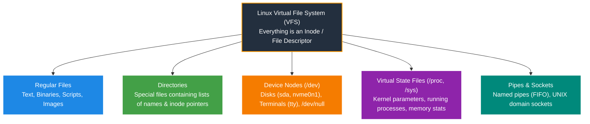
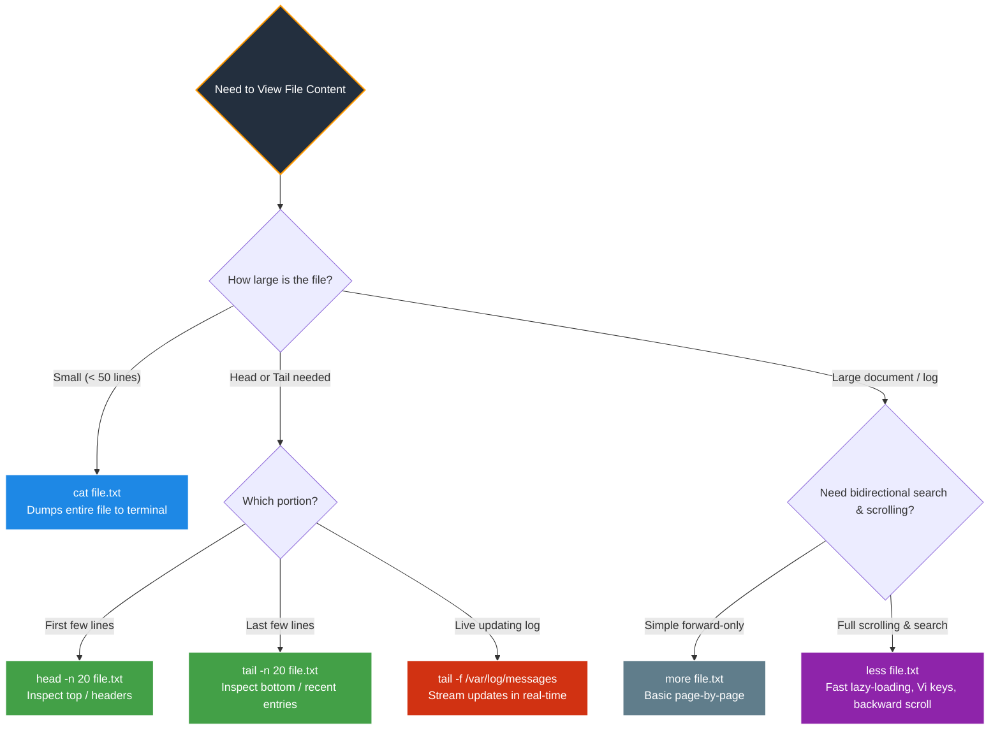
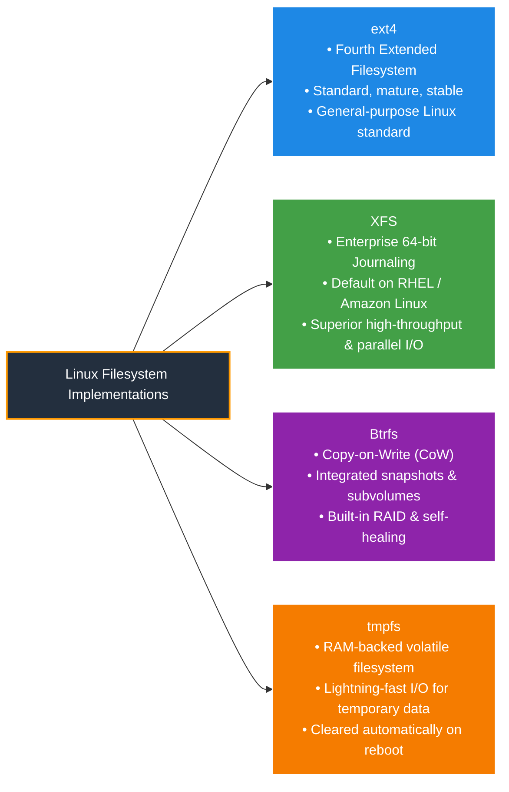
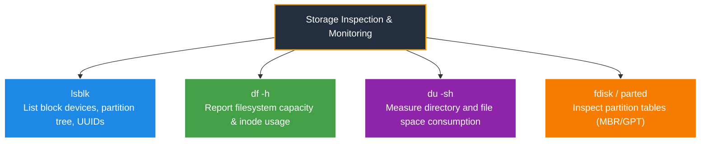

# 📁 Module 02: Working with the Linux File System – Study Guide

> **Course**: AWS re/Start Linux Fundamentals  
> **Module**: M02 – Working with the File System  
> **Source Document**: `T06-0005-RSLX_EN-US_SG_M02_WORKWITHFILESYSTEM.pdf`  
> **Target Audience**: AWS re/Start Learners / Linux System Administrators / Cloud Practitioners  

---

## 🎯 Module Overview

In Unix and Linux operating systems, storage, input/output, hardware devices, and system configurations are structured under a single unified hierarchy guided by the core design tenet: **"Everything is a file."** Whether administering a local workstation, configuring a containerized microservice, or deploying an enterprise workload onto an Amazon Elastic Compute Cloud (Amazon EC2) instance with Amazon Elastic Block Store (Amazon EBS) volumes, understanding how Linux organizes, addresses, manages, and mounts file systems is a vital operational prerequisite.

This study guide provides an exhaustive, practical, and architectural deep-dive into the Linux file system. It begins with the fundamental Unix philosophy of file abstraction, file naming rules, and directory structures. It deconstructs the **Filesystem Hierarchy Standard (FHS)**, delineating the exact functional responsibilities of key system directories such as `/etc`, `/var`, `/home`, `/dev`, `/proc`, and `/sys`. It thoroughly analyzes navigation mechanics, contrasting **absolute** and **relative** paths and detailing directory traversal with `pwd`, `cd`, and `ls`.

Furthermore, this guide covers essential command-line file manipulation utilities (`cat`, `more`, `less`, `head`, `tail`, `cp`, `mv`, `mkdir`, `rmdir`, `rm`), before transitioning into enterprise storage concepts. You will explore physical and virtual disk concepts, partition schemes (MBR vs. GPT), filesystem types (`ext4`, `xfs`, `btrfs`), storage mounting procedures (`mount`, `umount`, and persistent configuration via `/etc/fstab`), and critical storage monitoring utilities (`df`, `du`, `lsblk`, `fdisk`, and `parted`).

---

### 📌 Learning Objectives

- [ ] **Explain the "Everything is a File" Philosophy**: Articulate how Linux models hardware, network sockets, runtime processes, and directories as files to achieve administrative transparency and tool interoperability.
- [ ] **Apply Linux File Naming Rules**: Understand case sensitivity, illegal characters, filename uniqueness within directories, and the role of optional file extensions.
- [ ] **Master the Filesystem Hierarchy Standard (FHS)**: Identify the location, purpose, and contents of standard system directories (`/`, `/root`, `/home`, `/etc`, `/var`, `/bin`, `/usr`, `/dev`, `/proc`, `/sys`, `/tmp`, `/mnt`, `/media`, `/boot`, `/opt`).
- [ ] **Differentiate Absolute vs. Relative Paths**: Trace directory traversal from the root directory (`/`) versus the current working directory (`.`, `..`, `~`), and navigate file systems using `pwd` and `cd`.
- [ ] **Explore Directory Contents with `ls`**: Leverage options including `-l`, `-h`, `-a`, `-R`, and various sorting criteria (`-t`, `-S`, `-X`, `-v`, `-r`).
- [ ] **Inspect and Paginate File Contents**: Compare and deploy `cat`, `more`, `less`, `head`, and `tail` (including continuous log streaming with `-f`).
- [ ] **Execute Core File and Directory Management Operations**: Perform atomic and recursive file creation, copying, moving, renaming, and removal using `mkdir`, `rmdir`, `cp`, `mv`, and `rm`.
- [ ] **Understand Storage, Partitions, and Filesystem Types**: Contrast partition tables (MBR vs. GPT) and compare enterprise Linux filesystem implementations (`ext4`, `xfs`, `btrfs`, `tmpfs`).
- [ ] **Mount and Persist Storage Systems**: Mount and unmount block devices with `mount` and `umount`, troubleshoot busy mounts, and configure reliable persistent mounting via `/etc/fstab` using UUIDs and the `nofail` flag.
- [ ] **Monitor Storage Utilization & Diagnose Issues**: Analyze capacity and inode consumption using `df -h`, identify space-consuming directory trees with `du -sh`, and inspect block device topology with `lsblk`, `fdisk`, and `parted`.

---

## 📂 1. The Linux File System Paradigm: "Everything is a File"

### The Unix Design Philosophy
One of the architectural cornerstones of Unix and Linux is that almost every system resource—from ordinary text files and directories to physical disk partitions, serial ports, active processes, and inter-process communication sockets—is represented and accessed as an entry within the file system tree.



### Transparency and Interoperability
Representing system entities as files provides two massive operational benefits:

1. **Administrative Transparency**:
   - Because hardware devices, active memory statistics, and running processes appear in the file tree, administrators do not need specialized proprietary debugging APIs to inspect them.
   - For example, reading CPU capabilities or memory utilization is as straightforward as reading a text file:
     ```bash
     cat /proc/cpuinfo
     cat /proc/meminfo
     ```
   - Process listings and thread attributes can be inspected directly under `/proc/[PID]/`.

2. **Tool Interoperability**:
   - Standard command-line utilities designed for manipulating plaintext files (`cat`, `grep`, `awk`, `sed`, `less`, `head`, `wc`) can be seamlessly applied to system internals, configuration files, and data streams.
   - For example, filtering files or process streams using Linux pipelines:
     ```bash
     ls -l /var/log | grep ".log"
     cat /proc/partitions | awk '{print $4}'
     ```

### Linux File Types
In a standard Linux file system, entries belong to one of seven recognized file types. In a long directory listing (`ls -l`), the very first character of the permission string indicates the file type:

| Symbol | File Type | Description | Common Location / Example |
| :---: | :--- | :--- | :--- |
| `-` | **Regular file** | Plaintext, compiled binary, compressed archive, script, or image. | `/etc/passwd`, `/bin/bash` |
| `d` | **Directory** | A special file listing filename-to-inode mappings and subdirectories. | `/home`, `/var/log` |
| `l` | **Symbolic link** | A soft pointer referencing another path in the file system. | `/bin -> usr/bin` |
| `c` | **Character device** | Device transmitting data sequentially character-by-character (unbuffered stream). | `/dev/tty`, `/dev/null`, `/dev/random` |
| `b` | **Block device** | Device transferring data in fixed-size blocks (buffered, random access storage). | `/dev/sda`, `/dev/xvda`, `/dev/nvme0n1p1` |
| `s` | **Socket** | Local Unix domain socket for inter-process communication (IPC). | `/run/systemd/private`, `/var/run/docker.sock` |
| `p` | **Named pipe (FIFO)**| First-In-First-Out pipe allowing two processes to communicate. | `/run/systemd/initctl/fifo` |

> [!NOTE]
> In terminal output, directories often display in **blue**, regular executables in **green**, symbolic links in **cyan**, archives in **red**, and block/character devices in **yellow**. However, terminal color highlighting is determined by shell configuration (such as the `$LS_COLORS` environment variable) and is not an operating system standard.

---

### File Naming Conventions and Extensions

Linux handles filenames and extensions quite differently from operating systems like Microsoft Windows:

1. **Case Sensitivity**:
   - Linux file systems are strictly case-sensitive.
   - `myFile`, `MyFilesList.txt`, and `myFile.txt` are three completely distinct files that can coexist simultaneously in the exact same directory:
     ```bash
     $ touch myFile MyFilesList.txt myFile.txt
     $ ls -l m* M*
     -rw-r--r-- 1 ec2-user ec2-user 0 Oct 12 10:00 MyFilesList.txt
     -rw-r--r-- 1 ec2-user ec2-user 0 Oct 12 10:00 myFile
     -rw-r--r-- 1 ec2-user ec2-user 0 Oct 12 10:00 myFile.txt
     ```

2. **Uniqueness**:
   - Every file within the same directory must have a unique name when accounting for case sensitivity.

3. **Permitted and Forbidden Characters**:
   - Filenames can contain letters, numbers, hyphens (`-`), underscores (`_`), and periods (`.`).
   - The forward slash (`/`) is strictly forbidden within a filename because it acts as the directory path separator.
   - The null character (`\0`) is forbidden because it serves as the string terminator in C.
   - While spaces and special shell characters (`*`, `?`, `[`, `]`, `!`, `$`, `&`, `;`, `|`, `\`, `'`, `"`, `< `, `>`) can technically be escaped or quoted, **using spaces or special characters in filenames is strongly discouraged** in Linux administration because it introduces script fragility and command-line parsing errors.

4. **File Extensions**:
   - In Linux, file extensions (e.g., `.txt`, `.conf`, `.sh`, `.jpg`) are **optional** and are **not** strictly bound to specific applications by the operating system kernel.
   - A file named `report` without an extension containing plaintext can be opened by any text editor or script.
   - Linux identifies file formats using **magic numbers** (header byte signatures) inspected by tools like the `file` command:
     ```bash
     $ file backup_data
     backup_data: gzip compressed data, was "backup.tar", last modified: Mon Oct 12 08:30:00 2026
     ```
   - **Best Practice**: While extensions are optional to the kernel, administrators and developers should consistently use standard extensions (e.g., `.conf` for configurations, `.sh` for shell scripts, `.jpg` for JPEG images). Misleading extensions (e.g., naming an image `notes.txt`) cause human confusion and disrupt external software expectations.

---

## 🌳 2. The Filesystem Hierarchy Standard (FHS)

### Architecture of the Linux Inverted Tree
In Windows, storage is divided into distinct drive letters representing individual physical or logical disks (`C:\`, `D:\`, `E:\`). 

In contrast, Linux uses a **single unified hierarchical tree** starting from a solitary root node denoted by a forward slash: `/`. All secondary partitions, removable media, network-attached storage (NFS/EFS), and virtual filesystems are grafted (mounted) as directories into this unified inverted tree.

```mermaid
graph TD
    Root["/ (Root of File System)"]
    
    Root --> bin["/bin -> /usr/bin<br/>Essential user binaries"]
    Root --> sbin["/sbin -> /usr/sbin<br/>Essential system binaries"]
    Root --> boot["/boot<br/>Kernel & bootloader"]
    Root --> dev["/dev<br/>Device nodes"]
    Root --> etc["/etc<br/>Host configuration"]
    Root --> home["/home<br/>User home directories"]
    Root --> root["/root<br/>Root superuser home"]
    Root --> lib["/lib -> /usr/lib<br/>Shared libraries"]
    Root --> media["/media<br/>Removable devices"]
    Root --> mnt["/mnt<br/>Temporary mounts"]
    Root --> opt["/opt<br/>Third-party software"]
    Root --> proc["/proc<br/>Process virtual data"]
    Root --> sys["/sys<br/>Hardware virtual tree"]
    Root --> tmp["/tmp<br/>Temporary storage"]
    Root --> usr["/usr<br/>User utilities & apps"]
    Root --> var["/var<br/>Variable dynamic data"]

    home --> userA["/home/ec2-user"]
    home --> userB["/home/student"]
    etc --> pass["/etc/passwd"]
    etc --> fstab["/etc/fstab"]
    var --> log["/var/log"]
    var --> spool["/var/spool"]
    usr --> usrbin["/usr/bin"]
    usr --> usrlocal["/usr/local"]

    style Root fill:#d13212,stroke:#fff,stroke-width:2px,color:#fff
    style etc fill:#232f3e,stroke:#ff9900,stroke-width:1px,color:#fff
    style var fill:#232f3e,stroke:#ff9900,stroke-width:1px,color:#fff
    style dev fill:#232f3e,stroke:#ff9900,stroke-width:1px,color:#fff
    style proc fill:#8e24aa,stroke:#fff,stroke-width:1px,color:#fff
    style sys fill:#8e24aa,stroke:#fff,stroke-width:1px,color:#fff
```



### The Role and Purpose of the FHS
The **Filesystem Hierarchy Standard (FHS)** is an open standard maintained by the Linux Foundation that specifies the directory structure and directory contents in Linux distributions. The primary purposes of the FHS are:
1. **Software Portability**: Enables software packages and applications to install reliably across various Linux distributions (RHEL, Debian, Ubuntu, Amazon Linux, SUSE) without redesigning path structures.
2. **Predictable Administration**: Ensures systems administrators and automated orchestration tools can immediately locate configuration files, log archives, user profiles, and operational binaries.

---

### Detailed Breakdown of FHS Directories

The following table provides an exhaustive breakdown of the primary directories defined by the FHS:

| Directory | Full Name / Category | Architectural Function & Contents | Real-World Cloud & Admin Examples |
| :--- | :--- | :--- | :--- |
| **`/`** | **Root** | The absolute primary foundation of the file system hierarchy. Every file, directory, and mounted storage device branches from `/`. | No file system exists above `/`. |
| **`/root`** | **Root User Home** | The dedicated home directory for the `root` administrative superuser account. | `/root/.ssh/authorized_keys`, `/root/.bashrc`. Located directly on the root partition so root can log in even if `/home` is on an unmounted network partition. |
| **`/home`** | **User Homes** | Houses personal directories and individual user environment files for non-root standard system users. | `/home/ec2-user`, `/home/ubuntu`, `/home/student`. Frequently hosted on separate storage volumes to isolate user quotas. |
| **`/etc`** | **Editable Text Configuration** | Contains host-specific, system-wide configuration files and startup scripts. Contains only configuration data, no binaries. | `/etc/passwd` (accounts), `/etc/shadow` (password hashes), `/etc/fstab` (mounts), `/etc/resolv.conf` (DNS), `/etc/ssh/sshd_config`. |
| **`/var`** | **Variable Data** | Stores persistent runtime information that frequently changes size during normal operation: system logs, spoolers, databases, web roots. | `/var/log/messages`, `/var/log/secure`, `/var/log/nginx/access.log`, `/var/spool/cron`, `/var/www/html`. |
| **`/bin`** | **User Binaries** | Contains essential user command binaries required for single-user recovery mode and basic system operation. | `/bin/ls`, `/bin/cp`, `/bin/bash`, `/bin/cat`. (On modern systemd distros, `/bin` is a symbolic link to `/usr/bin`). |
| **`/sbin`** | **System Binaries** | Contains essential administrative system management binaries intended for the superuser. | `/sbin/fdisk`, `/sbin/reboot`, `/sbin/iptables`, `/sbin/ip`. (Symlinked to `/usr/sbin` on modern distros). |
| **`/usr`** | **User System Resources** | Secondary hierarchy containing shareable, read-only user software, system utilities, libraries, and documentation. | `/usr/bin` (installed programs), `/usr/sbin`, `/usr/lib` (shared objects), `/usr/local` (locally compiled software), `/usr/share/man` (manual pages). |
| **`/dev`** | **Devices** | Contains special block and character device nodes representing hardware components, partitions, terminals, and pseudo-devices. | `/dev/sda` (SATA disk), `/dev/nvme0n1` (NVMe SSD), `/dev/xvda` (AWS Xen disk), `/dev/null` (bit bucket), `/dev/zero`, `/dev/urandom`. |
| **`/proc`** | **Process Virtual File System** | Virtual pseudo-filesystem generated dynamically by the Linux kernel in RAM. Exposes real-time kernel metrics and process tables. Consumes 0 bytes of disk. | `/proc/cpuinfo`, `/proc/meminfo`, `/proc/version`, `/proc/sys/net/ipv4/ip_forward`, `/proc/[PID]/cmdline`. |
| **`/sys`** | **System Virtual File System (sysfs)** | Kernel pseudo-filesystem exposing structured hardware, driver, and kernel subsystem configuration parameters. Consumes 0 bytes of disk. | `/sys/class/net/` (network interfaces), `/sys/block/` (block devices), `/sys/devices/`. |
| **`/tmp`** | **Temporary Storage** | Shared scratch space where users and running services create temporary data files. | Often mounted as `tmpfs` (RAM-backed) and automatically purged on system reboot or via `systemd-tmpfiles`. |
| **`/mnt`** | **Mount Point** | Standard directory for system administrators to manually mount temporary file systems, recovery disks, or external storage volumes. | `sudo mount /dev/xvdf1 /mnt/data` |
| **`/media`** | **Removable Media** | Mount point for automatically detected removable media devices (USB drives, CD-ROMs, SD cards). | `/media/usb-drive` |
| **`/boot`** | **Bootloader Files** | Contains critical static bootloader files, Linux kernel images (`vmlinuz`), and initial RAM disk archives (`initramfs`). | `/boot/grub2/grub.cfg`, `/boot/vmlinuz-5.10.0`, `/boot/initramfs.img`. |
| **`/opt`** | **Optional Add-on Packages** | Reserved for self-contained, proprietary, or third-party enterprise application suites (e.g., Google Chrome, AWS CLI v2). | `/opt/aws/amazon-cloudwatch-agent/`, `/opt/gitlab/`. |
| **`/srv`** | **Service Data** | Contains site-specific operational data served by this system (e.g., FTP files, CVS repositories, web data). | `/srv/www`, `/srv/ftp`. |

> [!IMPORTANT]
> **Cloud Administrator Insight**: In production cloud environments like AWS, understanding FHS directory isolation is essential for architecture and security:
> - `/var/log` is often allocated to a separate disk or EBS volume. If an application suddenly floods log files, filling `/var/log` to 100% capacity will **not** crash the root partition (`/`) or halt core operating system services.
> - `/tmp` is commonly configured with the `noexec` mount option to prevent attackers from downloading and executing malicious binaries in world-writable directories.

---

## 🧭 3. File System Navigation: Absolute vs. Relative Paths

### Understanding Paths
In a Graphical User Interface (GUI), users navigate files by visually double-clicking folder icons within file managers. In a Command Line Interface (CLI), navigation requires traversing the file tree programmatically by specifying **paths**.

A **path** is an ordered string of directory names separated by forward slashes (`/`) that defines the traversal sequence required to locate a targeted resource.

```
                  Root Directory: /
                         │
                    ┌────┴────┐
                   etc       home
                              │
                           userA
                              │
                          Documents
                              │
                           projects
                              │
                          report.txt
```

### Absolute Paths
An **absolute path** is the complete, unambiguous path to a file or directory referenced directly from the **root of the file system (`/`)**.

- **Anatomy**: An absolute path **always** begins with a leading forward slash (`/`).
- **Context Independence**: An absolute path remains 100% valid regardless of what directory the user or script is currently working in.
- **Examples**:
  - `/home/userA/Documents/projects/report.txt`
  - `/etc/nginx/nginx.conf`
  - `/var/log/messages`

### Relative Paths
A **relative path** specifies the location of a file or directory **relative to the current working directory (`$PWD`)**.

- **Anatomy**: A relative path **never** begins with a leading forward slash (`/`).
- **Context Dependence**: A relative path relies entirely on where the shell session is currently situated. If your current directory changes, the relative path may become invalid or point to an entirely different file.
- **Navigational Tokens**:
  - `.` (Single Dot): References the **current working directory**.
  - `..` (Double Dot): References the **parent directory** (one level up).
  - `~` (Tilde): Expands to the current user's **home directory** (e.g., `/home/ec2-user`).
  - `~username`: Expands to the specified user's home directory (e.g., `/home/student`).
- **Examples**:
  - If current working directory is `/home/userA`:
    - Relative path to projects: `Documents/projects`
    - Full path resolved by shell: `/home/userA/Documents/projects`
  - If current working directory is `/home/userA/Documents/projects`:
    - Relative path to navigate to `/home`: `../../`
    - Relative path to inspect system logs: `../../../../var/log/messages`

---

### Navigation Commands: `pwd` and `cd`

#### 1. `pwd` (Print Working Directory)
The `pwd` command prints the absolute path of the directory you are currently located in.

```bash
[ec2-user@ip-10-0-0-1 ~]$ pwd
/home/ec2-user
```

- **Options**:
  - `pwd -L`: Displays the logical path, including symbolic links (default).
  - `pwd -P`: Displays the physical, canonical path, resolving all symbolic links to their real filesystem target:
    ```bash
    [ec2-user@ip-10-0-0-1 /bin]$ pwd -L
    /bin
    [ec2-user@ip-10-0-0-1 /bin]$ pwd -P
    /usr/bin
    ```

#### 2. `cd` (Change Directory)
The `cd` command changes the shell's current working directory.

```bash
# Navigate using an absolute path
$ cd /var/log

# Navigate using a relative path
$ cd ../etc/systemd

# Navigate using special shortcuts:
$ cd ~          # Navigates to the current user's home directory (/home/ec2-user)
$ cd            # Running cd with NO arguments also returns directly to home
$ cd ..         # Moves up one level into the parent directory
$ cd ../..      # Moves up two levels
$ cd -          # Returns to the PREVIOUS working directory (toggles back and forth)
```

### Absolute vs. Relative Comparison Table

| Attribute | Absolute Path | Relative Path |
| :--- | :--- | :--- |
| **Leading Character** | Always begins with `/` | Never begins with `/` |
| **Starting Reference** | Root directory (`/`) | Current working directory (`$PWD`) |
| **Context Sensitivity** | Fixed and unchanging; independent of location | Dependent on current directory location |
| **Shell Scripts** | Recommended for cron jobs and automation scripts to prevent ambiguity | Recommended for local project directory portability |
| **Example** | `cd /home/userA/Documents/projects` | `cd Documents/projects` (assuming PWD is `/home/userA`) |

---

## 🔍 4. Exploring and Inspecting Directory Contents: `ls`

### Command Syntax & Mechanics
The `ls` (list) command displays information about files and directory contents.

```bash
ls [OPTIONS] [FILE / DIRECTORY...]
```

When run without arguments, `ls` displays the files and folders within the current directory in alphabetical order. You can pass one or multiple target paths:

```bash
ls /var /etc /home
```

---

### Essential `ls` Command Options

| Option | Flag | Description & Operational Use Case |
| :--- | :--- | :--- |
| **Long format** | `-l` | Displays detailed metadata: file permissions, hard links, owner, group, size in bytes, last modification timestamp, and filename. |
| **Human-readable** | `-h` | Converts file sizes from raw bytes into human-friendly units (K, M, G, T). Must be combined with `-l` (e.g., `ls -lh`). |
| **All files** | `-a` | Displays all entries, including hidden files and hidden directories (files starting with a leading dot `.`, such as `.bashrc`). |
| **Almost all** | `-A` | Displays all files including hidden files, but omits the current directory (`.`) and parent directory (`..`) entries. |
| **Recursive** | `-R` | Recursively lists all subdirectories and their contents throughout the entire directory branch. |
| **Sort by time** | `-t` | Sorts output by modification time, newest files first. |
| **Sort by size** | `-S` | Sorts output by file size, largest files first. |
| **Sort by extension**| `-X` or `--sort=extension` | Sorts files alphabetically based on their file extension. |
| **Sort by version** | `-v` or `--sort=version` | Sorts version numbers naturally (e.g., `file-1`, `file-2`, `file-10` instead of `file-1`, `file-10`, `file-2`). |
| **Reverse sort** | `-r` | Reverses whatever sort criteria is applied (e.g., `ls -ltr` shows oldest first, leaving newest at the bottom). |
| **Directory itself**| `-d` | Lists the directory entry itself rather than its contents (vital when inspecting directory permissions: `ls -ld /var/log`). |
| **Inode numbers** | `-i` | Prints the unique filesystem inode index number for each file. |

---

### Anatomy of `ls -l` Long Format Output

Understanding each field in a long listing is essential for Linux administration:

```
drwxr-xr-x  2  ec2-user  ec2-user  4096  Oct 12 14:32  Documents
-rw-r--r--  1  ec2-user  ec2-user  1248  Oct 12 14:35  notes.txt
▲└──┬───┘  ▲  └───┬──┘  └───┬──┘  ▲     └──────┬─────┘  └───┬───┘
│   │      │      │         │      │            │           └─ File Name
│   │      │      │         │      │            └─ Modification Timestamp
│   │      │      │         │      └─ Size in Bytes (or Human-readable with -h)
│   │      │      │         └─ Owning Group
│   │      │      └─ Owning User
│   │      └─ Number of Hard Links
│   └─ Permissions: User (rwx), Group (r-x), Others (r-x)
└─ File Type Indicator (d = Directory, - = Regular file, l = Symlink)
```

> [!TIP]
> **DevOps Administration Favorite (`ls -lhrt`)**:
> Combining `-l` (long listing), `-h` (human sizes), `-r` (reverse sort), and `-t` (sort by time) is one of the most useful command combinations in Linux. Because reverse time sorting puts the **most recently modified files at the very bottom** of the terminal, you can immediately spot newly generated log files or dropped artifacts without scrolling up.

---

## 📖 5. Viewing and Paginating File Contents

Linux provides several command-line utilities for inspecting the contents of text files without opening a full-screen editor like Vim or nano.



### 1. `cat` (Concatenate and Display)
The `cat` utility reads files sequentially and writes them to standard output.
- **Use Case**: Quick inspection of short configuration files.
- **Key Options**:
  - `cat -n`: Number all output lines.
  - `cat -b`: Number non-empty output lines.
  - `cat -s`: Squeeze multiple consecutive blank lines into a single blank line.
- **Limitation**: `cat` dumps the entire file to the terminal at once. For multi-thousand-line files, it overwhelms the terminal buffer.

### 2. `more` (First-Generation Pager)
The `more` command displays text one screenful at a time.
- **Syntax**: `more [options] [+/pattern] [+linenum] filename`
- **Behavior**:
  - Loads the **entire file** into memory before displaying.
  - Can only scroll **forward** (downward) through the document using the Spacebar (down a page) or Enter (down a line).
- **Options**:
  - `-d`: Displays navigation help prompts at the bottom.
  - `-f`: Prevents logical line wrapping.
  - `-p`: Clears the screen before displaying the page.
  - `-s`: Squeezes consecutive blank lines.
  - `+100`: Starts viewing directly at line 100.
  - `+/error`: Jumps directly to the first occurrence of "error".

### 3. `less` (Modern Advanced Pager)
The `less` utility is the standard Unix pager designed as an advanced successor to `more` (*"less is more"*).
- **Syntax**: `less [options] filename`
- **Key Advantages over `more`**:
  - **Lazy Loading**: `less` does **not** read the entire file before displaying results. It loads only the current screen buffer, making it nearly instantaneous even on 50 GB log files.
  - **Bidirectional Navigation**: Allows scrolling both **downward** and **upward**.
  - **Vi Keybindings**:
    - `j` or Down Arrow: Scroll down one line.
    - `k` or Up Arrow: Scroll up one line.
    - `Spacebar` or `Ctrl + F`: Scroll forward one window.
    - `b` or `Ctrl + B`: Scroll backward one window.
    - `/pattern`: Search forward for a pattern.
    - `?pattern`: Search backward for a pattern.
    - `n`: Jump to next search match; `N`: Jump to previous search match.
    - `g`: Jump to beginning of file; `G`: Jump to end of file.
    - `q`: Quit and exit the pager.
- **Options**:
  - `-N`: Displays line numbers alongside content.
  - `-X`: Leaves file contents on the terminal screen upon exit rather than clearing it.
  - `+F`: Activates "follow mode" (identical to `tail -f`).

### 4. `head` (View Beginning of File)
Displays the first part of files.
- **Default Behavior**: Outputs the first 10 lines of the specified file.
- **Options**:
  - `-n <number>`: Outputs the first *n* lines (e.g., `head -n 5 /etc/passwd`).
  - `-c <number>`: Outputs the first *c* bytes.
- Multiple files can be viewed simultaneously: `head file1.txt file2.txt`.

### 5. `tail` (View End of File)
Displays the last part of files.
- **Default Behavior**: Outputs the last 10 lines of the specified file.
- **Options**:
  - `-n <number>`: Outputs the last *n* lines (e.g., `tail -n 25 /var/log/messages`).
  - `-c <number>`: Outputs the last *c* bytes.
  - `-f`: **Follow mode**. Keeps the file open and dynamically outputs newly appended lines in real time. Essential for monitoring application logs and system events:
    ```bash
    sudo tail -f /var/log/nginx/access.log
    ```

---

### File Inspection Utilities Comparison Table

| Command | Primary Function | Scrolling Direction | Memory Footprint | Real-Time Monitoring | Primary Cloud Use Case |
| :--- | :--- | :--- | :--- | :---: | :--- |
| **`cat`** | Stream entire file | Terminal scrollback only | Full file dump | ❌ No | Inspecting short scripts, `/etc/resolv.conf`, concatenating files |
| **`more`** | Basic pagination | Forward only | Loads full file | ❌ No | Legacy Unix scripting, simple screen-by-screen reads |
| **`less`** | Advanced pagination | **Bidirectional (Up & Down)** | **Minimal (Lazy buffer)** | ✅ Yes (`+F`) | Inspecting large production log archives, manual pages |
| **`head`** | Inspect top lines | None | Minimal | ❌ No | Inspecting CSV headers, script shebangs, configuration banners |
| **`tail`** | Inspect bottom lines | None | Minimal | ✅ Yes (`-f`) | Watching live server activity, debugging failed deployments |

---

## 🛠️ 6. File & Directory Management Operations

### 1. Creating Directories: `mkdir`
The `mkdir` (make directory) command creates one or more new directories.

```bash
mkdir [OPTIONS] <directory_name>...
```

- **Creating Multiple Directories**:
  ```bash
  mkdir dir1 dir2 dir3
  ```
- **Key Options**:
  - `-p` (**Parents**): Creates parent directories as needed without throwing an error if they already exist. This ensures script idempotency:
    ```bash
    # Without -p, this fails if /home/ec2-user/project does not already exist:
    mkdir /home/ec2-user/project/build/logs
    
    # With -p, all missing intermediate folders are automatically created:
    mkdir -p /home/ec2-user/project/build/logs
    ```
  - `-m <mask / mode>`: Explicitly sets octal permissions at the moment of creation:
    ```bash
    mkdir -m 700 /home/ec2-user/.ssh
    ```

---

### 2. Removing Empty Directories: `rmdir`
The `rmdir` command deletes empty directories.

```bash
rmdir <directory_name>
```

- **Strict Limitation**: If the target directory contains even a single file or hidden folder, `rmdir` aborts with `Directory not empty`.
- **Relationship to `rm`**: Running `rmdir dir` is operationally identical to `rm -d dir`.
- For directories containing files, recursive deletion (`rm -r`) must be used instead.

---

### 3. Copying Files and Directories: `cp`
The `cp` command copies files and directory trees from a source location to a destination.

```bash
cp [OPTIONS] source destination
cp [OPTIONS] source1 source2 source3 destination_directory/
```

- **Default Overwrite Behavior**: By default, `cp` will silently overwrite an existing destination file of the same name unless protected by file permissions or aliases.

#### Comprehensive `cp` Options Reference

| Option | Flag | Description |
| :--- | :--- | :--- |
| **Archive** | `-a` | **Archive mode**. Equivalent to `-dR --preserve=all`. Preserves file modes, ownership, timestamps, security contexts, and copies symlinks as symlinks rather than following them. |
| **Recursive** | `-r` or `-R` | Recursively copies directories and all nested contents. Required when copying folders. |
| **Interactive** | `-i` | Prompts for confirmation before overwriting an existing destination file. |
| **Force** | `-f` | Forces the copy. If a destination file cannot be opened, removes it and tries again. |
| **No Clobber** | `-n` | Do not overwrite an existing file. Silently skips existing files. |
| **Update** | `-u` | Copies only if the source file is newer than the destination file, or if the destination file is missing. |
| **Verbose** | `-v` | Prints the name of each file as it is copied. |
| **Link** | `-l` | Creates hard links to files instead of duplicating data blocks on disk. |
| **Follow Symlinks** | `-L` | Always follows symbolic links in source and copies the actual target files. |

```bash
# Copy single file into existing directory
cp /etc/nginx/nginx.conf /etc/nginx/nginx.conf.bak

# Copy multiple files into a destination directory
cp file1.txt file2.txt /home/ec2-user/backup/

# Recursively copy an entire directory tree while preserving all attributes
cp -av /var/www/html /backup/html_20261012/
```

---

### 4. Moving and Renaming Files: `mv`
The `mv` command moves or renames files and directories.

```bash
mv [OPTIONS] source destination
mv [OPTIONS] source1 source2 source3 target_directory/
```

- **Renaming vs. Moving**:
  - If source and destination are in the **same directory**, `mv` renames the file:
    ```bash
    mv old_name.txt new_name.txt
    ```
  - If destination is a **different directory**, `mv` relocates the file:
    ```bash
    mv report.txt /home/ec2-user/Documents/
    ```
  - You can move and rename in a single atomic step:
    ```bash
    mv report.txt /home/ec2-user/Documents/final_report.txt
    ```
- **Key Options**:
  - `-i`: Prompts before overwriting an existing file.
  - `-f`: Overwrites existing files without prompting.
  - `-n`: Never overwrites an existing file.
  - `-v`: Verbose output showing moved items.
- **Pattern Matching**:
  ```bash
  mv *.png /var/www/images/
  ```

---

### 5. Deleting Files and Directories: `rm`
The `rm` (remove) command permanently deletes files, symbolic links, and directories from the file system.

```bash
rm [OPTIONS] filename(s)...
```

> [!CAUTION]
> **No Trash Can / Recycle Bin**: Linux CLI deletions are permanent. When a file is unlinked and no process holds an open file descriptor, its data blocks are marked as free space and cannot be recovered via a simple "undo" command.

- **Key Options**:
  - `-r` or `-R` (**Recursive**): Recursively removes directories and all nested contents.
  - `-f` (**Force**): Ignores non-existent files, never prompts for confirmation, and overrides read-only warnings.
  - `-i` (**Interactive**): Prompts for confirmation before removing every single file.
  - `-d` (**Directory**): Removes an empty directory (identical to `rmdir`).
  - `-v` (**Verbose**): Prints the name of each deleted file.
- **Common Usage Patterns**:
  ```bash
  # Delete specific files
  rm file1.txt file2.txt

  # Safely delete with confirmation
  rm -i *.bak

  # Recursively and forcefully delete a directory tree
  rm -rf /tmp/old_build_artifacts/
  ```

> [!WARNING]
> **The Danger of `rm -rf`**:
> Running `rm -rf` with unintended path arguments or unexpanded variables (e.g., `rm -rf $DIR/` where `$DIR` is undefined) can devastate an operating system. Modern GNU `rm` includes safety checks that refuse to run `rm -rf /` unless explicitly overridden with `--no-preserve-root`. Always verify your path before hitting Enter.

---

## 💾 7. Storage Concepts, Partitioning & Linux Filesystem Types

### Physical Disks, Partitions, and Block Devices
Before an operating system can store files, storage hardware must be organized into logical structures:

```
┌────────────────────────────────────────────────────────────────────────┐
│             Physical Storage Disk or Cloud EBS Volume                  │
│                     (e.g., /dev/nvme0n1 or /dev/sda)                   │
├──────────────────────────────────┬─────────────────────────────────────┤
│   Partition 1: /dev/nvme0n1p1    │     Partition 2: /dev/nvme0n1p2     │
│   Formatted with XFS             │     Formatted with ext4             │
│   Mounted at: / (Root)           │     Mounted at: /data               │
└──────────────────────────────────┴─────────────────────────────────────┘
```

1. **Storage Device Nodes**:
   - SATA / SCSI / USB drives: `/dev/sda`, `/dev/sdb`, `/dev/sdc`...
   - AWS Xen virtual disks: `/dev/xvda`, `/dev/xvdf`...
   - NVMe High-Performance SSDs (AWS Nitro instances): `/dev/nvme0n1`, `/dev/nvme1n1`...
2. **Partition Tables**:
   - **MBR (Master Boot Record)**: Legacy standard. Supports a maximum of 4 primary partitions and disk sizes up to **2 TB**.
   - **GPT (GUID Partition Table)**: Modern UEFI standard. Supports up to 128 partitions by default and disk capacities up to **9.4 Zettabytes (ZB)**. GPT stores duplicate backup partition tables at the end of the disk for resiliency.

---

### Major Linux Filesystem Types

A **file system** provides the data structures, indexing mechanisms, and allocation tables that translate raw disk blocks into human-readable files and directories.



#### 1. `ext4` (Fourth Extended Filesystem)
- **Status**: The long-standing standard default across Debian, Ubuntu, and many Linux distributions.
- **Features**: Robust journaling, extents-based block allocation, backward compatibility with ext2/ext3, and online filesystem resizing (expanding).
- **Limits**: Maximum file size 16 TB; maximum volume size 1 Exabyte (EB).

#### 2. `XFS` (Enterprise High-Performance Filesystem)
- **Status**: The default filesystem for enterprise distributions including **Red Hat Enterprise Linux (RHEL)**, CentOS, and **Amazon Linux 2 / Amazon Linux 2023**.
- **Features**: Highly scalable 64-bit journaling architecture designed for parallel I/O operations, dynamic inode allocation, delayed block allocation, and stellar performance with multi-gigabyte files.
- **Limits**: Maximum volume size 8 Exabytes.
- **Operational Note**: An XFS filesystem can be grown online (`xfs_growfs`), but **cannot be shrunk**.

#### 3. `Btrfs` (B-tree Filesystem)
- **Status**: Default on Fedora and openSUSE; widely used for advanced storage appliances.
- **Features**: Copy-on-Write (CoW) design, native subvolumes, writable instant snapshots, data and metadata checksumming for silent corruption detection, built-in multi-device pooling (RAID 0, 1, 10).

#### 4. `tmpfs` (Virtual Memory Filesystem)
- **Status**: Standard memory-backed filesystem mounted at `/run` and frequently `/tmp`.
- **Features**: Stores files in dynamic RAM and swap space. Zero disk latency; contents are completely wiped upon reboot.

---

### Filesystem Comparison Matrix

| Feature | `ext4` | `xfs` | `btrfs` | `tmpfs` |
| :--- | :--- | :--- | :--- | :--- |
| **Architecture** | Inode / Extents Table | B+ Trees / Allocation Groups | Copy-on-Write (CoW) B-Trees | RAM / Swap virtual paging |
| **Default In** | Ubuntu, Debian | RHEL, Amazon Linux 2 / 2023 | Fedora, openSUSE | All modern Linux distros (`/run`) |
| **Max File Size** | 16 TB | 8 EB | 16 EB | Limited by RAM/Swap allocation |
| **Online Growth** | ✅ Yes (`resize2fs`) | ✅ Yes (`xfs_growfs`) | ✅ Yes (`btrfs filesystem resize`) | ✅ Yes (`mount -o remount,size=...`) |
| **Filesystem Shrink**| ✅ Yes (requires unmount) | ❌ No (Cannot shrink) | ✅ Yes (Online) | ✅ Yes |
| **Native Snapshots** | ❌ No | ❌ No (Requires LVM) | ✅ Yes (Subvolumes) | ❌ No |
| **Primary Cloud Role** | Standard root volumes, general compute | High-throughput databases, big data, EBS | Development environments, snapshot testing | Fast scratch space, session tokens, locks |

---

## 🔌 8. Storage Mounting, Unmounting & Persistent Mounts (`/etc/fstab`)

### The Mounting Process
Unlike Windows, where plugging in a new drive assigns an isolated letter like `E:`, Linux requires attaching the formatted filesystem into an existing directory within the unified directory tree. This attachment operation is called **mounting**, and the targeted directory is called the **mount point**.

```
    Existing Hierarchy: /mnt/data (empty folder)
               +
    Block Device: /dev/xvdf1 (formatted with XFS)
               │
               ▼  sudo mount /dev/xvdf1 /mnt/data
    
    Result: Accessing /mnt/data reads/writes directly to /dev/xvdf1
```

---

### 1. The `mount` Command
Used to attach filesystems to the hierarchy.

```bash
mount [OPTIONS] <device> <mount_point>
```

- **Viewing Active Mounts**: Running `mount` with no arguments lists all currently mounted filesystems.
- **Mounting an EBS Volume**:
  ```bash
  # 1. Create a mount point directory
  sudo mkdir -p /data
  
  # 2. Mount the device
  sudo mount -t xfs /dev/xvdf1 /data
  ```
- **Common Mount Options (`-o`)**:
  - `ro`: Mount as read-only.
  - `rw`: Mount as read-write (default).
  - `noexec`: Disallow execution of any binaries located on this filesystem (security hardening).
  - `nosuid`: Disable SUID/SGID bit evaluation.
  - `nodev`: Prevent interpretation of block/character devices on this filesystem.

---

### 2. The `umount` Command
Used to safely detach a mounted filesystem.

```bash
umount <mount_point_or_device>
```

```bash
sudo umount /data
# Or specify device:
sudo umount /dev/xvdf1
```

#### Troubleshooting "Target is Busy" Errors
If an administrator or active background process has an open file handle inside the mounted directory, unmounting fails with:
`umount: /data: target is busy.`

**Resolution Steps**:
1. Identify offending processes using `lsof` (list open files) or `fuser`:
   ```bash
   lsof +D /data
   fuser -vm /data
   ```
2. Terminate the blocking process or change working directory out of `/data`:
   ```bash
   cd ~
   ```
3. If necessary, execute a lazy unmount (detaches immediately from tree, cleans up when references close):
   ```bash
   sudo umount -l /data
   ```

---

### 3. Persistent Mounts via `/etc/fstab`
Commands executed via `mount` are temporary; when the server reboots, temporary mounts disappear. To make storage attachments permanent across reboots, entries must be registered in the system configuration file: **`/etc/fstab`** (File Systems Table).

#### The Six Fields of `/etc/fstab`

```
# <file system>                           <mount point>  <type>  <options>       <dump>  <pass>
UUID=3f1b4a62-89cd-4e2b-a1e4-8f0d9c4a5b12  /data          xfs     defaults,nofail   0       2
```

1. **Device Identifier (`<file system>`)**:
   - Can be a device path (`/dev/xvdf1`) or a Universally Unique Identifier (`UUID=...`).
   - **Cloud Best Practice**: **Always use UUIDs** (retrieved via `blkid` or `lsblk -f`). In cloud environments like AWS EC2, device node names can change dynamically across reboots or hypervisor migrations (e.g., `/dev/xvdf` becoming `/dev/nvme1n1`), whereas the UUID stored in the filesystem superblock remains constant.
2. **Mount Point (`<mount point>`)**:
   - The absolute path to the directory where the filesystem will be attached (`/data`).
3. **Filesystem Type (`<type>`)**:
   - `xfs`, `ext4`, `btrfs`, `tmpfs`, or `nfs`.
4. **Mount Options (`<options>`)**:
   - `defaults`: Grants standard options (`rw`, `suid`, `dev`, `exec`, `auto`, `nouser`, `async`).
   - `nofail`: **Crucial in Cloud / AWS**: Instructs the system to continue booting even if this storage volume is detached, missing, or fails to mount. Without `nofail`, a missing non-root EBS volume will cause EC2 system boot to hang in emergency mode!
   - `_netdev`: Waits for network initialization before attempting mount (mandatory for NFS / AWS EFS).
5. **Dump Frequency (`<dump>`)**:
   - Used by the legacy `dump` backup tool. Almost universally set to `0` (disabled) on modern systems.
6. **Fsck Pass Order (`<pass>`)**:
   - Dictates the order in which `fsck` checks filesystems at boot:
     - `1`: Reserved exclusively for the root filesystem (`/`).
     - `2`: All other local storage partitions.
     - `0`: Disable boot-time filesystem check (always use `0` for XFS, as XFS does not use `fsck`).

> [!IMPORTANT]
> **Safety Rule for Editing `/etc/fstab`**:
> After editing `/etc/fstab`, **NEVER reboot immediately**. If you made a syntax error, your server may fail to boot. Always test your configuration immediately by executing:
> ```bash
> sudo mount -a
> ```
> `mount -a` attempts to mount all filesystems listed in `/etc/fstab` that are not currently mounted. If this command runs silently without errors, your fstab syntax is valid.

---

## 📊 9. Storage Inspection & Disk Space Monitoring Utilities

Systems administrators regularly monitor storage to avoid downtime, service crashes, and database write failures caused by full partitions.



---

### 1. `lsblk` (List Block Devices)
Displays a structured tree hierarchy of all recognized block devices (disks, partitions, LVM volumes).

```bash
$ lsblk
NAME         MAJ:MIN RM  SIZE RO TYPE MOUNTPOINTS
nvme0n1      259:0    0   30G  0 disk 
├─nvme0n1p1  259:1    0 29.9G  0 part /
├─nvme0n1p127 259:2   0    1M  0 part 
└─nvme0n1p128 259:3   0   10M  0 part /boot/efi
nvme1n1      259:4    0  100G  0 disk 
└─nvme1n1p1  259:5    0  100G  0 part /data
```

- **Valuable Flags**:
  - `lsblk -f`: Outputs filesystem types, labels, and filesystem **UUIDs**:
    ```bash
    $ lsblk -f
    NAME        FSTYPE FSVER LABEL UUID                                 MOUNTPOINT
    nvme1n1p1   xfs                3f1b4a62-89cd-4e2b-a1e4-8f0d9c4a5b12 /data
    ```
  - `lsblk -m`: Displays device ownership, modes, and permission settings.

---

### 2. `df` (Disk Free)
Reports file system disk space usage across all mounted volumes.

```bash
df [OPTIONS] [FILE / PATH]
```

- **Essential Options**:
  - `df -h` (**Human-readable**): Formats sizes in Powers of 1024 (K, M, G, T) instead of raw 1K blocks:
    ```bash
    $ df -h
    Filesystem      Size  Used Avail Use% Mounted on
    devtmpfs        4.0M     0  4.0M   0% /dev
    /dev/nvme0n1p1   30G  4.2G   26G  14% /
    /dev/nvme1n1p1  100G   12G   89G  12% /data
    ```
  - `df -T`: Displays the filesystem type (`xfs`, `ext4`) in an extra column.
  - `df -i` (**Inodes**): Displays free and consumed **inodes** rather than disk block bytes.

> [!CAUTION]
> **The Hidden "No Space Left on Device" Culprit (Inode Exhaustion)**:
> In Linux, a disk can run out of space even when `df -h` shows 50% available capacity! This occurs when an application creates millions of tiny, empty files (such as session files or cache tokens), consuming all allocated **inodes**. Always check `df -i` if a system reports full disk errors despite available gigabytes.

---

### 3. `du` (Disk Usage)
Estimates file and directory space consumption hierarchically.

```bash
du [OPTIONS] [PATH]
```

- **Essential Options**:
  - `du -s` (**Summary**): Displays only a total summary for the specified directory rather than printing every subfolder.
  - `du -h` (**Human-readable**): Displays sizes in KB, MB, and GB.
  - `du -sh *`: Summarizes the size of every item in the current directory:
    ```bash
    $ du -sh *
    1.2M    Documents
    450M    backups
    12K     notes.txt
    ```
  - `du -h --max-depth=1 /var`: Analyzes top-level folder consumption within `/var`.

#### Troubleshooting Disk Space Exhaustion: Find Top 10 Largest Items
When a partition reaches 95%+ capacity, run this pipeline to identify the largest disk consumers:
```bash
sudo du -ah /var | sort -hr | head -n 10
```

---

### 4. Partition Inspection: `fdisk` and `parted`
- **`fdisk`**: Standard partition table manipulator.
  - View all disks and partition tables:
    ```bash
    sudo fdisk -l
    ```
- **`parted`**: Modern partition manipulator supporting GPT, large volumes (>2 TB), and machine-readable output:
  - View partition layouts across all drives:
    ```bash
    sudo parted -l
    ```

---

## 🧩 10. Practical Hands-On Cloud Scenarios

### Scenario 1: Provisioning and Mounting a New Amazon EBS Volume
You have attached a new 50 GB Amazon EBS volume to an EC2 instance. The volume appears as `/dev/nvme1n1`. Configure it for production use at `/srv/appdata`.

```bash
# Step 1: Verify the block device is detected
lsblk

# Step 2: Create a GPT partition table and partition (or format directly)
sudo fdisk /dev/nvme1n1
# (Create partition /dev/nvme1n1p1)

# Step 3: Format the partition with the enterprise XFS filesystem
sudo mkfs -t xfs /dev/nvme1n1p1

# Step 4: Create the targeted mount point directory
sudo mkdir -p /srv/appdata

# Step 5: Locate the permanent UUID of the formatted partition
sudo blkid /dev/nvme1n1p1
# Output: /dev/nvme1n1p1: UUID="9a7b2c14-5d3e-4f1a-b8c2-3e4a5d6f7a8b" TYPE="xfs"

# Step 6: Add persistent entry to /etc/fstab with nofail
echo 'UUID=9a7b2c14-5d3e-4f1a-b8c2-3e4a5d6f7a8b /srv/appdata xfs defaults,nofail 0 2' | sudo tee -a /etc/fstab

# Step 7: Test the fstab entry immediately without rebooting
sudo mount -a

# Step 8: Confirm mount status and capacity
df -h /srv/appdata
```

---

### Scenario 2: Troubleshooting a Rapidly Filling Partition
An alarm alerts you that the root partition `/` has reached 98% capacity on a web server.

```bash
# Step 1: Verify overall capacity and inode consumption
df -h
df -i

# Step 2: Determine which primary directory is consuming the storage
sudo du -h --max-depth=1 / | sort -hr

# Step 3: Drill down into the offending directory (e.g., /var/log)
sudo du -h --max-depth=1 /var/log | sort -hr

# Step 4: Identify individual unrotated massive log files
ls -lhS /var/log/*.log | head -n 5

# Step 5: Safely truncate an active log file without deleting open file descriptors
# (Note: Using rm on an open log file does NOT free disk space until the daemon restarts!)
sudo truncate -s 0 /var/log/application_debug.log
```

---

## ❓ 11. Knowledge Check & Review Questions

### Question 1 (Slide Checkpoint)
**What is the fundamental difference between an absolute path and a relative path in Linux?**

**Detailed Answer**:
- An **absolute path** specifies the full, unambiguous location of a file or directory starting from the root of the file system (`/`). It always begins with a leading forward slash (e.g., `/home/userA/Documents/projects/my_file.txt`). Absolute paths are context-independent and resolve identically regardless of the user's current working directory.
- A **relative path** specifies the location of a resource relative to the current working directory (`$PWD`). It never starts with a leading forward slash (e.g., `Documents/projects/my_file.txt` or `../../var/log`). Relative paths depend entirely on your current working directory and become invalid if you switch to a different directory.

---

### Question 2 (Slide Checkpoint)
**When would you use the `less` command instead of the `more` command, and why?**

**Detailed Answer**:
You would choose `less` over `more` whenever:
1. **Bidirectional Scrolling is Required**: `more` only permits scrolling forward (downward) through a file. `less` allows scrolling both forward and backward using arrow keys, `j`/`k`, and page controls.
2. **Viewing Very Large Files**: `more` loads the entire file into memory before rendering output, causing significant latency on multi-gigabyte files. `less` employs lazy-loading, reading only the data required to fill the active screen buffer, resulting in near-instantaneous startup.
3. **Advanced Pattern Searching**: `less` supports bidirectional regex searching (`/` for forward, `?` for backward) and highlights matches.

---

### Question 3
**An administrator types `rm -r /home/student/projects` and is prompted for every single file. What option should be added to suppress confirmation prompts when deleting large directories?**
- A) `rm -rf`
- B) `rm -ri`
- C) `rm -d`
- D) `rmdir`

**Answer**: **A (`rm -rf`)**  
*Explanation*: The `-f` (force) option ignores non-existent files and overrides confirmation prompts, allowing recursive (`-r`) removal of directory trees without interactive pauses.

---

### Question 4
**In which FHS directory are host-specific system configuration files such as `/etc/passwd` and network configurations located?**
- A) `/var`
- B) `/usr`
- C) `/etc`
- D) `/proc`

**Answer**: **C (`/etc`)**  
*Explanation*: The `/etc` directory is designated by the Filesystem Hierarchy Standard exclusively for host-specific, editable text configuration files and system startup settings.

---

### Question 5
**Why is it critical to include the `nofail` option when adding an Amazon EBS data volume to `/etc/fstab`?**
- A) It formats the volume if it is unformatted.
- B) It allows the EC2 instance to complete its boot cycle even if the volume fails to attach or is missing.
- C) It grants read and write permissions to standard users.
- D) It prevents file system corruption during power loss.

**Answer**: **B**  
*Explanation*: By default, if an entry in `/etc/fstab` fails to mount during system boot, the systemd init system halts the boot process and enters emergency rescue mode. On headless cloud instances, this causes connection timeouts. The `nofail` option allows boot to proceed smoothly even if the storage volume is unavailable.

---

## 📋 12. Summary & Key Takeaways

```
┌────────────────────────────────────────────────────────────────────────┐
│                   Module 02 Core Architectural Takeaways               │
├────────────────────────────────────────────────────────────────────────┤
│ 1. Everything is a File: Linux models devices (/dev), kernel runtime   │
│    metrics (/proc, /sys), and directories as files, granting           │
│    transparent management via standard text and pipeline tools.        │
│                                                                        │
│ 2. Unified Tree & FHS: No drive letters exist. All storage is grafted  │
│    into the inverted tree starting at /. The FHS standardizes directory│
│    roles (/etc for config, /var for logs, /home for user spaces).      │
│                                                                        │
│ 3. Path Traversals: Absolute paths start at /; relative paths start at │
│    $PWD. Master navigation using pwd, cd, and shortcuts (~, .., .).    │
│                                                                        │
│ 4. Inspection & Pagers: Use cat for short files, head/tail for edge    │
│    lines, tail -f for live log streams, and less for fast, two-way     │
│    search and pagination.                                              │
│                                                                        │
│ 5. File Operations: mkdir -p ensures parent directory creation; cp -av │
│    preserves metadata; mv renames or relocates; rm -rf permanently     │
│    removes trees.                                                      │
│                                                                        │
│ 6. Storage & Mounting: Enterprise Linux defaults to XFS or ext4. New   │
│    block devices are attached via mount and unmounted via umount.      │
│    Always persist cloud mounts in /etc/fstab using UUIDs and nofail,   │
│    and validate with mount -a before rebooting.                        │
│                                                                        │
│ 7. Disk Diagnostics: Use df -h for disk capacity, df -i for inode      │
│    exhaustion, du -sh * to identify space consumers, and lsblk -f to   │
│    inspect device trees and UUIDs.                                     │
└────────────────────────────────────────────────────────────────────────┘
```
